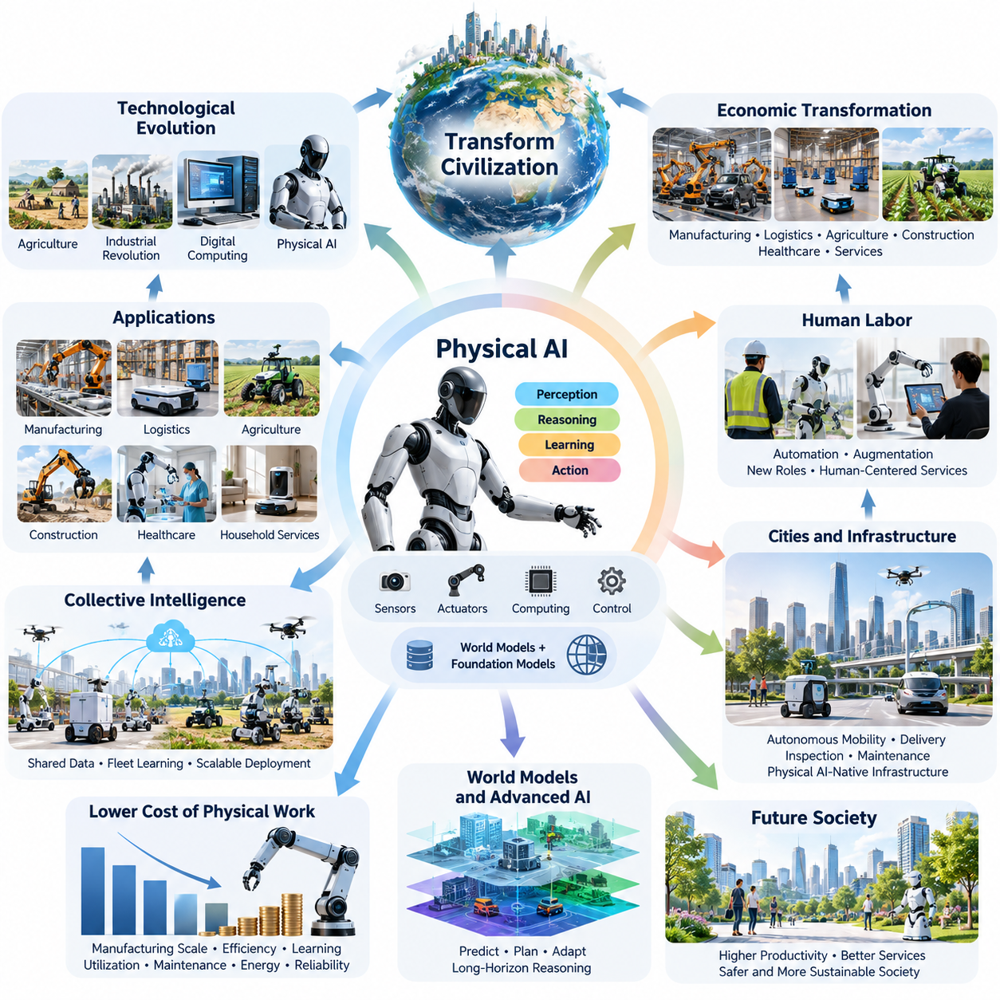
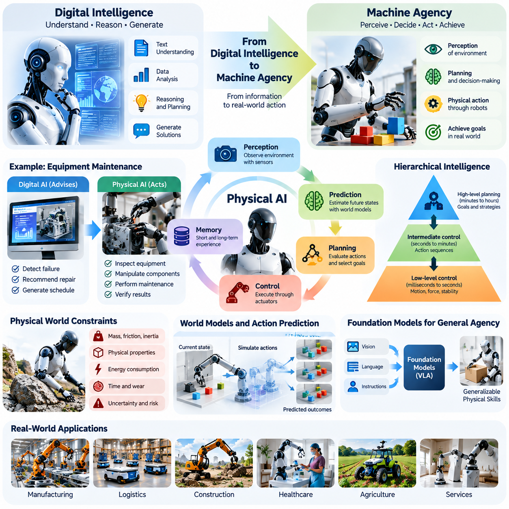
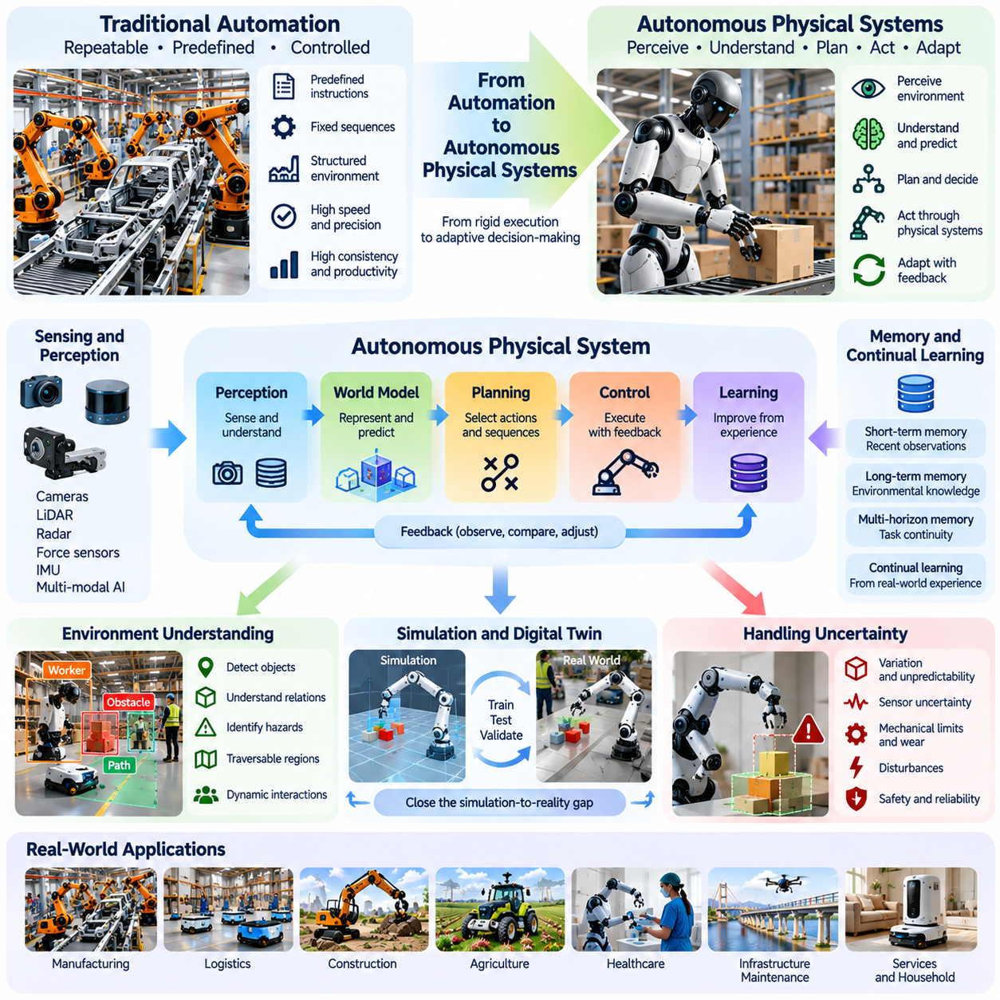
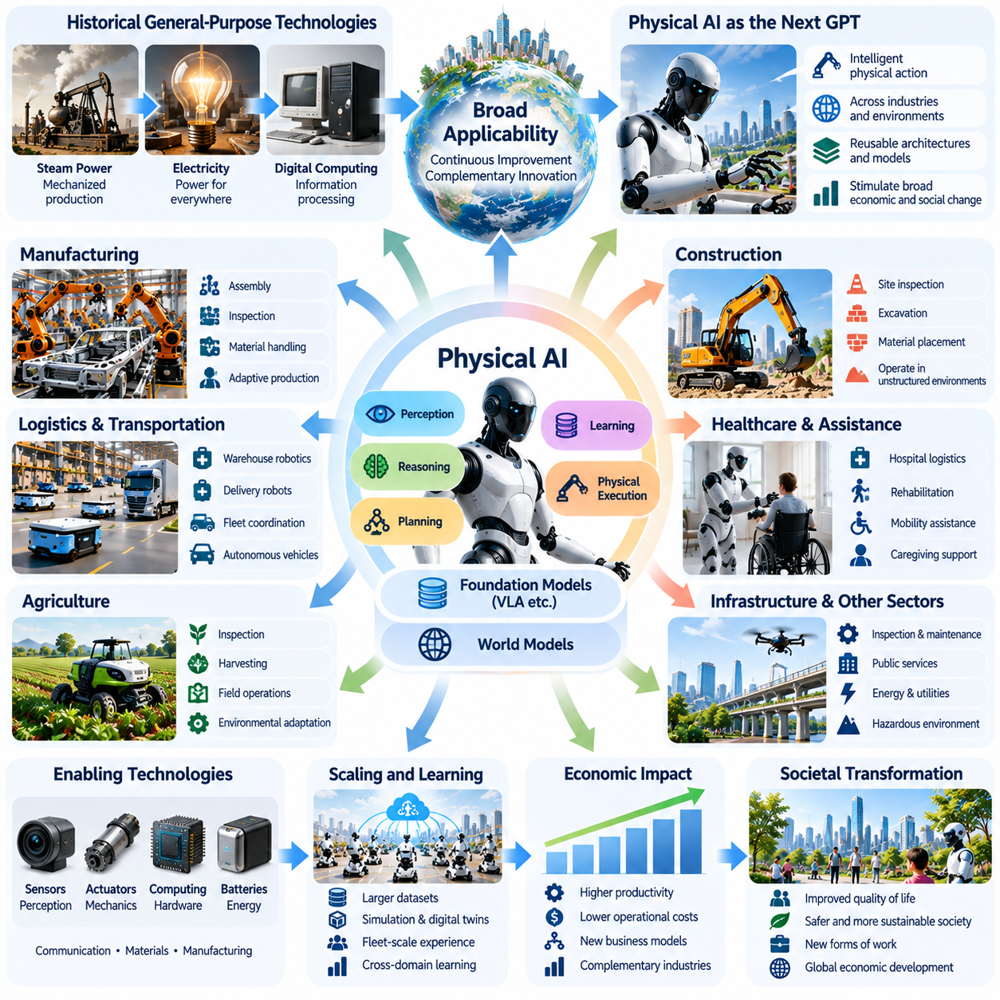
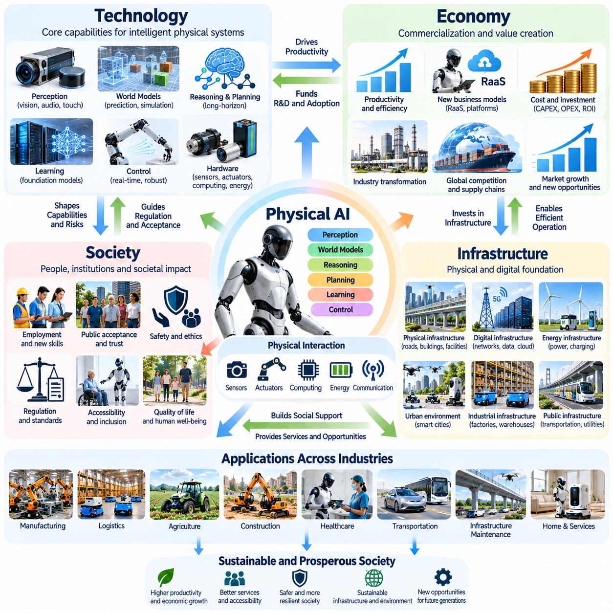
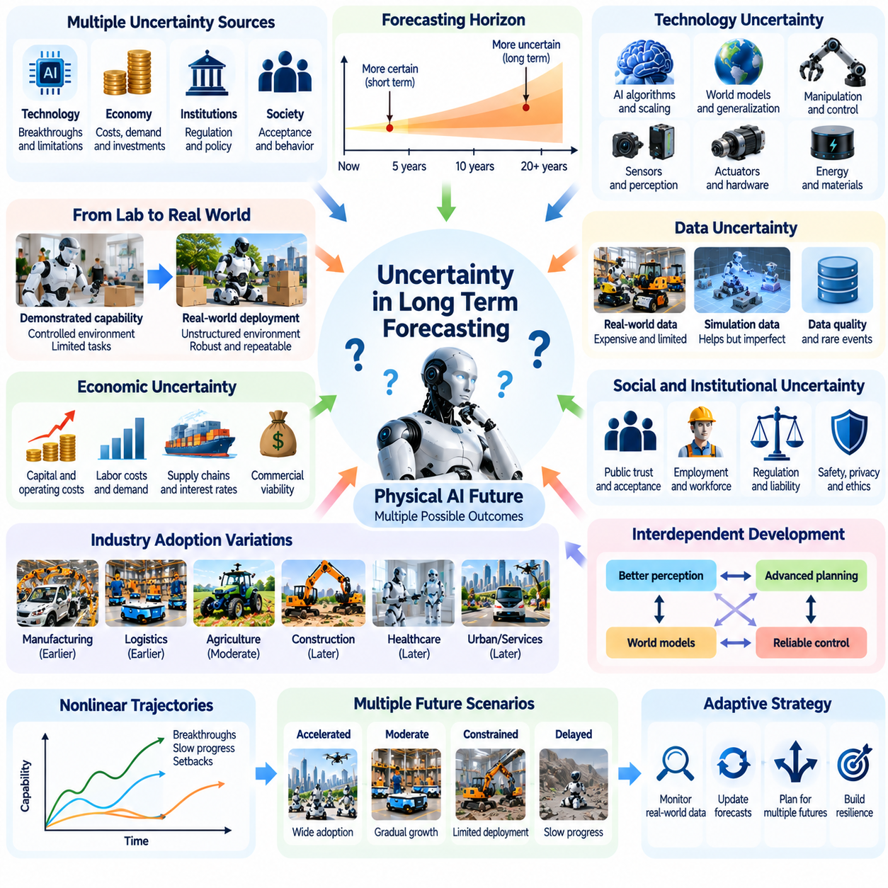
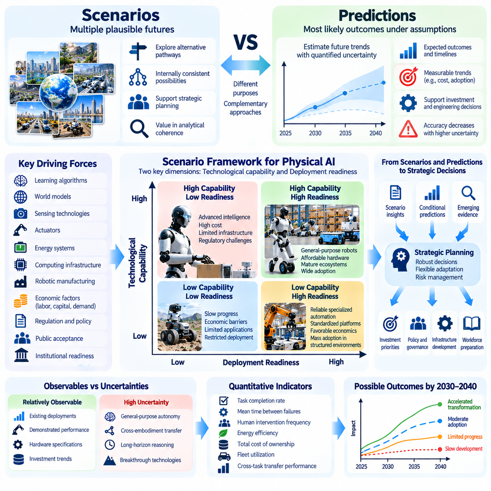
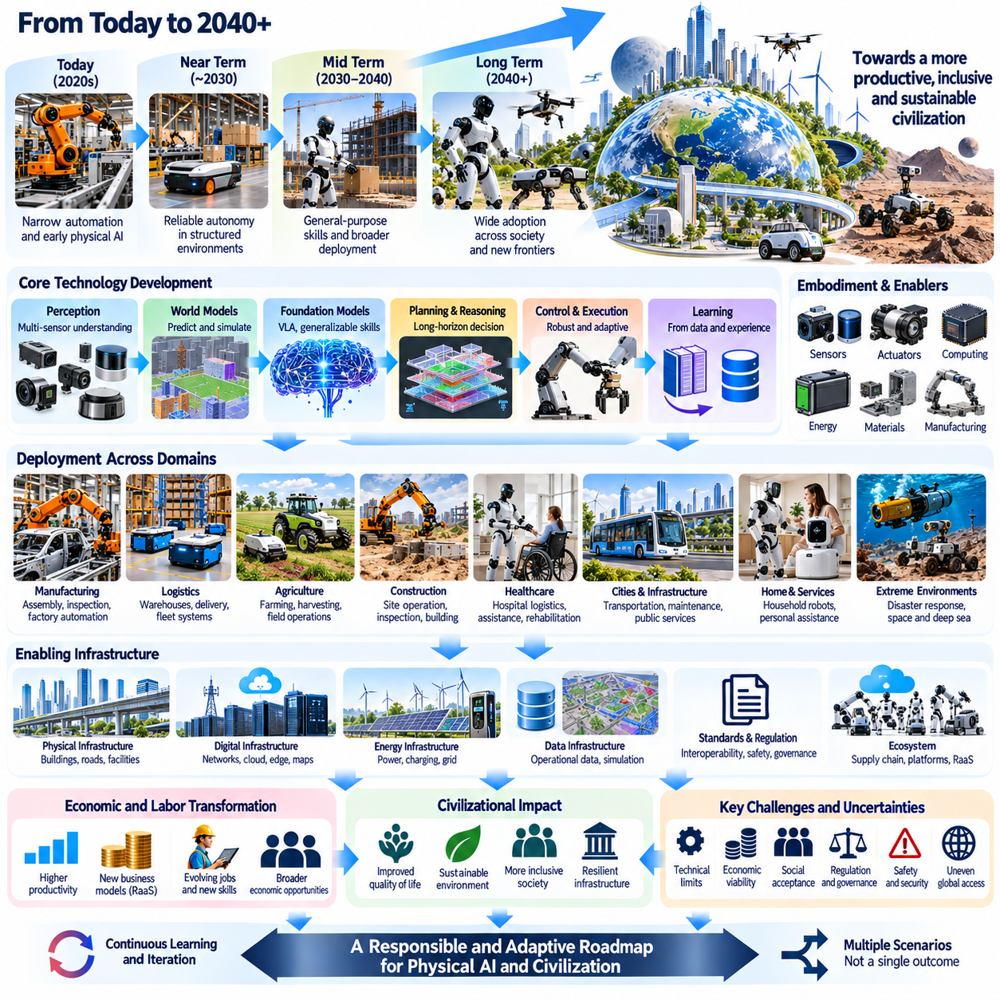

**Volume 13. Future of Physical AI and Civilization**

# Chapter 00. Introduction

## 00.01. Why Physical AI May Transform Civilization

{width="7.268055555555556in" height="7.268055555555556in"}

피지컬 인공지능(Physical AI)은 인공지능(Artificial Intelligence)의 기능을 디지털 정보 처리(Digital Information Processing) 영역에서 물리적 세계(Physical World)와의 직접적인 상호작용으로 확장한다는 점에서 기술 진화(Technological Evolution)의 잠재적인 전환점을 의미한다. 주로 정보를 생성하거나 데이터를 분석하고 의사결정을 지원하는 기존 인공지능과 달리, 피지컬 인공지능은 인식(Perception), 추론(Reasoning), 학습(Learning), 행동(Action)을 통합하여 자율 기계(Autonomous Machines)를 통해 실제 물리적 환경에 영향을 미친다.

역사적으로 주요 기술 혁명(Technological Revolutions)은 인간이 상품을 생산하고 노동을 조직하며 자원을 분배하고 기반시설(Infrastructure)을 구축하는 방식을 변화시켜 문명을 발전시켰다. 농업은 정착 생활을 가능하게 했고, 산업 기계는 생산 능력을 확대했으며, 디지털 컴퓨팅(Digital Computing)은 정보 처리 속도를 높였다. 피지컬 인공지능은 점점 복잡해지는 물리적 활동을 프로그래밍 가능하고 적응적이며 부분적으로 자율적인 형태로 전환함으로써 또 다른 변화를 가져올 수 있다.

피지컬 인공지능의 차별적인 특징은 지능(Intelligence)과 물리적 행위 능력(Physical Agency)을 연결하는 데 있다. 시스템은 센서 정보(Sensory Information)를 해석하고 환경 조건을 이해하며 행동의 결과를 예측하고 실제 세계의 제약조건 아래에서 움직임을 실행해야 한다. 이를 위해 인공지능 알고리즘과 센서(Sensors), 액추에이터(Actuators), 기계 구조(Mechanical Structures), 컴퓨팅 플랫폼(Computing Platforms), 신뢰성 높은 제어 시스템(Control Systems)의 통합이 필요하다.

전통적인 자동화(Traditional Automation)는 일반적으로 사전에 정의된 운영 조건과 정교하게 설계된 동작 순서에 의존해 왔다. 산업용 로봇(Industrial Robots)은 환경이 예측 가능한 상태로 유지될 때 반복 작업을 매우 일관되게 수행한다. 피지컬 인공지능은 변화하는 상황에 적응하고 익숙하지 않은 조건을 인식하며 가능한 모든 상황을 명시적으로 프로그래밍하지 않아도 적절한 행동을 선택하도록 함으로써 이러한 능력을 확장하고자 한다.

이러한 전환은 경제적으로 유용한 기계 활동의 범위를 크게 확대할 수 있다. 제조(Manufacturing), 물류(Logistics), 농업(Agriculture), 건설(Construction), 의료(Healthcare), 기반시설 유지보수(Infrastructure Maintenance), 가정 서비스(Household Services)에는 예측하기 어려운 환경과의 물리적 상호작용이 필요한 작업이 많다. 자율 시스템의 능력이 향상되면서 지속적인 인간 개입에 의존했던 일부 활동도 지능형 기계 지원(Intelligent Machine Assistance)에 점차 적합해질 수 있다.

경제적 영향(Economic Implications)은 개별 작업을 자동화 장비로 대체하는 수준을 넘어선다. 피지컬 인공지능은 다양한 운영 환경에서 여러 활동을 수행할 수 있는 새로운 형태의 생산 자본(Productive Capital)이 될 수 있다. 광범위한 기계적 재설계(Mechanical Redesign) 대신 소프트웨어와 학습을 통해 기계를 재구성할 수 있다면 자본 투자(Capital Investment), 생산 유연성(Production Flexibility), 운영 생산성(Operational Productivity) 사이의 관계가 상당히 변화할 수 있다.

중요한 가능성 중 하나는 특정 형태의 물리적 노동(Physical Work)에 대한 실질 비용이 점진적으로 감소하는 것이다. 로봇 제조(Robot Manufacturing), 액추에이터 효율(Actuator Efficiency), 컴퓨팅 하드웨어(Computational Hardware), 자율 학습(Autonomous Learning)의 발전은 기계 노동(Machine Labor)의 경제적 매력을 높일 수 있다. 그러나 실제 비용 절감은 가동률(Utilization Rate), 유지보수 요구사항, 에너지 소비, 안전 의무, 배치 복잡성, 자율 운영의 신뢰성에 따라 달라진다.

피지컬 인공지능과 인간 노동(Human Labor)의 관계는 문명 발전에서 특히 중요한 요소가 될 것이다. 반복적이고 위험하며 육체적으로 힘든 일부 작업은 점차 자동화될 수 있으며, 다른 직업은 감독(Supervision), 조정(Coordination), 창의적 문제 해결(Creative Problem Solving), 인간 중심 서비스(Human-Centered Services)로 발전할 수 있다. 이러한 변화의 방향은 조직이 지능형 기계를 주로 인간 노동자의 능력을 증강(Augmentation)하는 데 사용하는지, 특정 노동을 대체(Substitution)하는 데 사용하는지에 따라 달라진다.

피지컬 인공지능은 도시와 기반시설의 설계 방식에도 영향을 미칠 수 있다. 자율 이동 플랫폼(Autonomous Mobility Platforms), 배송 로봇(Delivery Robots), 지능형 검사 시스템(Intelligent Inspection Systems), 자동화된 유지보수 장비가 도시 운영에 통합될 수 있다. 건물, 교통망, 통신 시스템, 공공시설은 기계의 자율 주행, 공유 환경 이해(Shared Environmental Understanding), 협력 운영(Coordinated Operations), 안전한 인간-로봇 상호작용(Human-Robot Interaction)을 지원하는 기능을 점진적으로 도입할 수 있다.

이러한 발전은 인간만을 위해 설계된 환경에 로봇을 단순히 추가하는 방식에서 벗어나 피지컬 인공지능 중심 기반시설(Physical AI-Native Infrastructure)의 출현을 촉진할 수 있다. 표준화된 인터페이스(Standardized Interfaces), 기계 판독 가능 지도(Machine-Readable Maps), 연결된 시설(Connected Facilities), 통합 로봇 군집 관리(Coordinated Fleet Management)는 운영 복잡성을 줄일 수 있다. 그러나 기반시설의 전환에는 장기적인 투자, 상호운용성 표준(Interoperability Standards), 사이버보안(Cybersecurity), 사회적 수용성(Public Acceptance)이 필요하다.

피지컬 인공지능의 발전은 환경 상태를 표현하고 시간이 흐르면서 해당 상태가 어떻게 변화할지 예측하는 월드 모델(World Models)의 발전과 밀접하게 연결되어 있다. 객체, 행동, 물리적 제약조건, 미래 결과 사이의 관계를 학습함으로써 자율 기계는 즉각적인 반응을 넘어서는 계획을 수행할 수 있다. 신뢰성 높은 월드 모델은 장기 시간 범위 추론(Long-Horizon Reasoning), 불확실성 추정(Uncertainty Estimation), 적응형 의사결정(Adaptive Decision-Making)을 지원할 수 있다.

월드 모델과 로봇 파운데이션 모델(Robot Foundation Models), 시각-언어-행동 모델(Vision-Language-Action Models, VLA)의 통합은 기계의 능력을 더욱 확장할 수 있다. 파운데이션 모델(Foundation Models)은 전이 가능한 표현(Transferable Representations)과 일반 지식을 제공하며, 행동 중심 모델(Action-Oriented Models)은 인식과 명령을 물리적 행동으로 연결한다. 이러한 접근법을 예측 동역학(Predictive Dynamics), 메모리(Memory), 피드백 제어(Feedback Control)와 결합하면 더욱 유연하고 범용적인 자율 시스템을 구현할 수 있다.

또 다른 잠재적 변화는 집단 기계 지능(Collective Machine Intelligence)의 발전이다. 대규모 로봇 군집(Robot Fleets)은 공장, 창고, 도시 및 다양한 환경에서 운영 경험(Operational Experience)을 생성할 수 있다. 적절한 거버넌스(Governance) 아래에서 선택된 경험은 공유 학습 시스템(Shared Learning Systems)에 기여할 수 있으며, 한 기계가 발견한 개선 사항을 다른 기계에도 적용할 수 있다. 이러한 데이터 기반 학습 순환(Data-Driven Learning Cycles)은 개별 로봇이 독립적으로 학습하는 경우보다 능력 발전을 가속할 수 있다.

피지컬 인공지능은 인구 고령화(Population Aging)와 노동력 부족(Labor Shortages)을 겪는 사회에서 특히 중요한 가치를 제공할 수 있다. 자율 지원 시스템(Autonomous Assistance Systems)은 자재 취급, 운송, 시설 유지보수, 일부 돌봄 활동을 지원할 수 있다. 이러한 기술은 인적 자원이 부족한 환경에서 필수 서비스를 유지하는 데 기여할 수 있다. 그러나 성공적인 도입을 위해서는 경제성(Affordability), 신뢰성(Reliability), 접근성(Accessibility), 인간의 존엄성(Human Dignity)과 의미 있는 대인관계의 보존이 중요하다.

잠재적인 영향은 환경 지속가능성(Environmental Sustainability)과 자원 관리(Resource Management)까지 확장된다. 지능형 기계는 정밀 농업(Precision Agriculture)을 개선하고 기반시설의 노후화를 감시하며 재생에너지 시설(Renewable Energy Facilities)을 검사하고 자재 활용 효율을 높일 수 있다. 동시에 로봇의 광범위한 배치는 컴퓨팅 하드웨어, 배터리, 전력, 산업용 소재에 대한 수요를 증가시키므로 생애주기 효율(Lifecycle Efficiency)과 책임 있는 자원 관리가 필수적인 고려사항이 된다.

피지컬 인공지능은 위험하거나 접근하기 어렵고 인간이 지속적으로 머물기에 적합하지 않은 환경에서 활동할 수 있는 인류의 능력도 확장할 수 있다. 재난 지역(Disaster Zones), 심해(Deep Oceans), 원격 산업시설(Remote Industrial Facilities), 지구 외 환경(Extraterrestrial Environments)은 상당한 운영상의 어려움을 수반한다. 현지에서 추론하고 적응할 수 있는 자율 기계는 이러한 환경에서 탐사, 과학 연구, 기반시설 건설, 자원 활용을 지원할 수 있다.

우주 탐사(Space Exploration)는 물리적 자율성(Physical Autonomy)의 중요성을 특히 명확하게 보여준다. 통신 지연(Communication Delays)과 불확실한 환경 조건은 행성 탐사 기계(Planetary Machines)의 지속적인 원격 제어를 제한한다. 더욱 발전된 피지컬 인공지능은 로봇 탐사선이 낯선 지형을 주행하고 과학 장비를 조작하며 예상하지 못한 상황에 대응하고 지구에서 즉각적인 명령을 받지 않더라도 협력 작업을 수행하도록 지원할 수 있다.

피지컬 인공지능과 범용 인공지능(Artificial General Intelligence, AGI)의 융합(Convergence)은 기계 지능의 본질에 관한 더욱 근본적인 질문을 제기한다. 물리적 구현체(Physical Embodiments)를 통해 작동하는 범용 지능(General Intelligence)은 언어 이해나 추상적 추론 이상의 능력을 요구한다. 환경에 기반한 인식(Grounded Perception), 인과관계 이해(Causal Understanding), 시간적 메모리(Temporal Memory), 물리적 계획(Physical Planning), 불확실성 관리가 필요하며, 특히 실수가 되돌릴 수 없는 결과를 초래할 수 있는 환경에서 이러한 능력이 중요하다.

그러나 로봇의 능력이 향상된다고 해서 범용 인공지능의 출현이 자동으로 보장되는 것은 아니다. 물리적 능력(Physical Competence)은 작업, 환경, 기계적 구현체(Mechanical Embodiments)에 따라 여전히 전문화될 수 있다. 광범위한 일반화(Broad Generalization)를 달성하려면 전이 학습(Transfer Learning), 지속적 적응(Continual Adaptation), 상식적 물리 추론(Commonsense Physical Reasoning), 효율적인 탐색(Efficient Exploration), 낯선 조건에서의 강건한 성능(Robust Performance)이 발전해야 한다. 이러한 요소는 여전히 중요한 과학적·공학적 과제로 남아 있다.

따라서 피지컬 인공지능이 문명에 미치는 중요성은 기술적 성능 이상의 요소에 의해 결정된다. 물리적 세계에 영향을 미칠 수 있는 자율 시스템은 책임(Responsibility), 법적 책임(Liability), 개인정보 보호(Privacy), 보안(Security), 인간 통제(Human Control)에 관한 문제를 제기한다. 순수한 정보 시스템에서 발생하는 오류와 달리 물리적 기계의 실패는 기반시설을 손상시키고 필수 서비스를 중단시키며 인간의 안전을 직접적으로 위협할 수 있다.

경제적 분배(Economic Distribution) 역시 중요한 과제가 될 것이다. 첨단 로봇 플랫폼, 컴퓨팅 기반시설, 고품질 운영 데이터셋(Operational Datasets), 제조 역량을 확보한 기업과 국가는 불균형적으로 큰 이점을 얻을 수 있다. 적절한 제도와 정책이 마련되지 않는다면 생산성 향상과 동시에 경제력 집중(Concentration of Economic Power), 기술 접근성 불평등(Technology Access Inequality), 노동시장의 상당한 혼란(Labor Market Disruption)이 발생할 수 있다.

피지컬 인공지능의 장기적인 발전 경로(Long-Term Trajectory)는 기술 발전이 경제적 유인(Economic Incentives), 사회 제도(Social Institutions), 규제 체계(Regulatory Frameworks), 물리적 한계(Physical Limitations)와 상호작용하기 때문에 여전히 불확실하다. 알고리즘의 발전만으로 성공적인 배치가 보장되지는 않는다. 기계적 신뢰성(Mechanical Reliability), 에너지 효율(Energy Efficiency), 안전 인증(Safety Certification), 유지보수 기반시설(Maintenance Infrastructure), 비정형 환경(Unstructured Environments)에서의 운영 비용이 유망한 기술 시연을 확장 가능한 상용 시스템으로 전환할 수 있는지를 결정할 수 있다.

따라서 문명적 변화(Civilizational Transformation)는 필연적인 기술적 결과가 아니라 여러 가능한 발전 경로를 포함하는 점진적인 과정으로 이해해야 한다. 일부 산업은 작업이 구조화되어 있고 경제적 효과를 측정하기 쉽기 때문에 자율 물리 시스템(Autonomous Physical Systems)을 빠르게 도입할 수 있다. 반면 취약한 사람들을 대상으로 하거나 예측하기 어려운 조건 또는 복잡한 사회적 상호작용이 포함된 환경에서는 훨씬 긴 개발 및 검증 기간이 필요할 수 있다.

2030\\\~2040년을 전망하면 전문화된 자율 기계(Specialized Autonomous Machines)의 광범위한 배치부터 점차 범용성을 갖춘 로봇 플랫폼(General-Purpose Robotic Platforms)의 출현까지 다양한 시나리오가 가능하다. 더욱 발전된 시나리오에서는 협력 로봇 군집(Coordinated Robot Fleets), 자기 개선형 물리 지능(Self-Improving Physical Intelligence), 자율 운영 중심 기반시설(Autonomy-Oriented Infrastructure)을 예상할 수 있다. 이러한 가능성은 명시적인 가정, 측정 가능한 이정표(Measurable Milestones), 기술적 의존관계(Technical Dependencies), 대안적인 발전 속도를 바탕으로 평가해야 한다.

궁극적으로 피지컬 인공지능은 지능, 물리적 노동, 생산 자본, 인간의 행위 주체성(Human Agency) 사이의 관계를 변화시킴으로써 문명을 전환할 수 있다. 가장 중요한 의미는 개별 지능형 로봇을 만드는 데 있는 것이 아니라 유용한 물리적 작업을 대규모로 수행할 수 있는 상호 연결된 시스템(Interconnected Systems)의 출현에 있을 수 있다. 이러한 변화가 사회 전체에 폭넓게 공유되는 번영(Shared Prosperity)으로 이어질지는 기술 혁신을 인간의 요구, 제도적 책임(Institutional Responsibility), 장기적인 사회적 복지(Long-Term Societal Well-Being)와 얼마나 효과적으로 조화시키는지에 달려 있다.

## 00.02. From Digital Intelligence to Machine Agency

{width="7.268055555555556in" height="7.268055555555556in"}

디지털 지능(Digital Intelligence)은 인간이 지식을 창출하고 정보를 처리하며 의사결정을 수행하는 방식을 변화시켜 왔다. 기계학습(Machine Learning), 대규모 언어 모델(Large Language Models), 고급 추론 시스템(Advanced Reasoning Systems)은 복잡한 데이터를 해석하고 해결책을 생성하며 지적 활동을 지원할 수 있다. 그러나 이러한 능력은 주로 디지털 환경(Digital Environments)에서 작동해 왔으며, 지능은 인간의 의사결정과 행동을 통해 간접적으로 물리적 세계(Physical World)에 영향을 미쳐 왔다.

기계 행위 주체성(Machine Agency)은 디지털 지능을 자율적인 물리적 행동(Autonomous Physical Action)으로 확장하는 근본적인 변화를 의미한다. 지능형 기계(Intelligent Machine)는 단순히 무엇을 해야 하는지 권고하는 수준을 넘어 주변 환경을 인식하고 운영 목표를 설정하며 행동을 선택하고 물리적 메커니즘(Physical Mechanisms)을 통해 이를 실행할 수 있다. 이러한 전환은 컴퓨팅(Computation), 의사결정(Decision-Making), 물질적 환경(Material Environment) 사이에 새로운 관계를 형성한다.

지능(Intelligence)과 행위 주체성(Agency)의 차이를 이해하는 것은 이러한 변화를 파악하는 데 필수적이다. 지능은 정보를 표현하고 패턴을 인식하며 관계를 추론하고 문제를 해결하는 능력을 의미한다. 행위 주체성은 정의된 목표를 달성하기 위해 환경에 영향을 미치는 행동을 시작하고 수행하는 능력을 의미한다. 피지컬 인공지능(Physical AI)은 이러한 능력을 실제 세계의 제약조건(Real-World Constraints) 아래에서 작동하는 시스템에 통합한다.

디지털 인공지능 시스템(Digital AI System)은 장비 고장을 식별하고 수리 절차를 권고하거나 최적화된 생산 일정을 생성할 수 있다. 물리적 능력을 갖춘 자율 시스템(Autonomous System)은 여기에서 더 나아가 장비를 검사하고 부품을 조작하며 승인된 유지보수 작업을 수행하고 그 결과를 검증할 수 있다. 이러한 차이는 단순히 지능의 수준에 있는 것이 아니라 의사결정을 실제 결과를 수반하는 물리적 행동(Physical Actions)으로 전환하는 능력에 있다.

기계 행위 주체성은 인식(Perception), 예측(Prediction), 계획(Planning), 제어(Control) 사이의 지속적인 상호작용을 요구한다. 센서(Sensors)는 주변 환경에 대한 관측 정보(Observations)를 제공하고, 내부 표현(Internal Representations)은 관련된 물리적 상태를 추정한다. 계획 메커니즘은 가능한 행동을 평가하며, 제어 시스템은 선택된 결정을 액추에이터 명령(Actuator Commands)으로 변환한다. 환경으로부터 얻은 피드백(Feedback)은 기계가 편차를 감지하고 행동을 조정하도록 한다.

디지털 환경과 달리 물리적 세계에는 무시하거나 쉽게 되돌릴 수 없는 제약조건이 존재한다. 물체는 질량(Mass), 마찰(Friction), 관성(Inertia), 기하학적 특성(Geometric Properties)을 가지며, 행동에는 에너지와 시간이 필요하다. 센서 측정에는 불확실성(Uncertainty)이 존재하고 기계 부품에는 마모(Wear)가 발생하며 예상하지 못한 상호작용은 손상을 초래할 수 있다. 따라서 물리적 행위 주체성(Physical Agency)은 동역학(Dynamics), 안전성(Safety), 운영 신뢰성(Operational Reliability)에 기반한 지능을 요구한다.

월드 모델(World Models)은 디지털 추론(Digital Reasoning)과 물리적 행동(Physical Action)을 연결하는 중요한 기반을 제공한다. 월드 모델은 환경 상태(Environmental States)를 표현하고 다양한 행동에 따라 해당 상태가 어떻게 변화할 수 있는지 추정한다. 자율 기계는 센서 관측과 학습된 물리적 관계를 결합하여 행동의 결과를 예측하고 대안을 평가하며 즉각적인 반응을 넘어서는 계획을 수립할 수 있다.

행동 조건부 예측(Action-Conditioned Prediction)은 자율 기계가 자연적으로 발생하는 변화와 자신의 개입으로 발생하는 변화를 구분해야 한다는 점에서 특히 중요하다. 물체를 이동시키는 로봇은 물체의 변위(Displacement), 잠재적인 충돌(Potential Collisions), 주변 구조물에 미치는 영향을 예측해야 한다. 이러한 예측은 인과 추론(Causal Reasoning)을 지원하며 계획 시스템이 물리적 행동을 실행하기 전에 가능한 대안들을 비교하도록 한다.

기계 행위 주체성으로의 전환은 인공지능 아키텍처(Artificial Intelligence Architectures)의 역할도 변화시킨다. 전통적인 디지털 모델은 주로 입력 정보(Input Information)를 출력 정보(Output Information)로 변환한다. 반면 피지컬 인공지능 아키텍처는 운영 상태(Operational State)를 유지하고 여러 시간적 프로세스를 조정하며 고수준 추론(High-Level Reasoning)을 저수준 제어(Low-Level Control)와 연결해야 한다. 이러한 요구사항은 인식, 메모리, 계획, 실시간 실행(Real-Time Execution)을 결합하는 계층형 시스템(Hierarchical Systems)의 발전을 촉진한다.

계층형 지능(Hierarchical Intelligence)은 기계가 서로 다른 시간 범위(Time Horizons)에서 작동하도록 한다. 고수준 계획(High-Level Planning)은 수분 또는 수시간에 걸친 목표를 설정할 수 있으며, 중간 수준 제어기(Intermediate Controllers)는 일련의 행동을 조정한다. 저수준 제어 메커니즘(Low-Level Control Mechanisms)은 훨씬 짧은 시간 간격에서 움직임, 힘, 안정성을 조절한다. 성공적인 물리적 행위 주체성은 예상하지 못한 환경 변화에 대응하면서 이러한 시간적 계층 사이의 일관성을 유지하는 데 달려 있다.

메모리(Memory)는 기계가 변화하는 환경에서 장시간 작업을 수행할 때 더욱 중요해진다. 단기 메모리(Short-Term Memory)는 즉각적인 맥락과 최근 관측 정보를 지원하며, 장기 메모리(Long-Term Memory)는 환경 지식, 운영 경험, 학습된 절차를 보존한다. 다중 시간 범위 메모리 시스템(Multi-Horizon Memory Systems)은 자율 에이전트(Autonomous Agents)가 작업의 연속성을 유지하고 반복적으로 발생하는 조건을 인식하며 축적된 경험을 통해 의사결정을 개선하도록 지원할 수 있다.

파운데이션 모델(Foundation Models)과 멀티모달 학습(Multimodal Learning)은 보다 범용적인 기계 행위 주체성을 실현하기 위한 또 다른 경로를 제공한다. 시각-언어 모델(Vision-Language Models, VLM)은 시각적 관측을 의미적 개념(Semantic Concepts) 및 명령과 연결하며, 시각-언어-행동 모델(Vision-Language-Action Models, VLA)은 이러한 관계를 실행 가능한 행동으로 확장한다. 이러한 아키텍처를 월드 모델 및 신뢰성 높은 제어기(Reliable Controllers)와 결합하면 인간의 목표를 해석하고 상황에 적합한 물리적 작업으로 변환하는 기계를 구현할 수 있다.

그러나 행동 예측(Action Prediction)을 생성한다고 해서 성공적인 물리적 실행(Physical Execution)이 보장되는 것은 아니다. 로봇은 신체적 구현 특성(Embodiment), 액추에이터 한계(Actuator Limits), 접촉 동역학(Contact Dynamics), 위치 추정 불확실성(Localization Uncertainty), 변화하는 환경 조건을 고려해야 한다. 시뮬레이션(Simulation)에서 효과적으로 작동하는 정책(Policy)도 익숙하지 않은 하드웨어나 실제 환경으로 전이될 때 실패할 수 있다. 따라서 물리적 행위 주체성에는 피드백, 시험, 강건한 제어(Robust Control)를 통한 지속적인 검증이 필요하다.

신체적 구현(Embodiment)은 지능이 물리적 세계에 영향을 미칠 수 있는 방식을 결정한다. 이동 로봇(Mobile Robot), 산업용 매니퓰레이터(Industrial Manipulator), 휴머노이드(Humanoid), 사족보행 로봇(Quadruped), 비행체(Aerial Vehicle)는 서로 다른 이동 능력, 센서 구성(Sensing Configurations), 기계적 제약조건을 가진다. 일부 지식은 플랫폼 사이에서 전이될 수 있지만 실질적인 자율성(Practical Autonomy)을 확보하려면 각 기계의 물리적 구조와 사용 가능한 행동에 맞게 의사결정을 조정해야 한다.

기계 행위 주체성의 출현은 분산 자율성(Distributed Autonomy)과 집단 자율성(Collective Autonomy)의 가능성도 제시한다. 여러 로봇은 활동을 조정하고 환경 표현(Environmental Representations)을 공유하며 운영 경험을 교환할 수 있다. 로봇 군집 수준 시스템(Fleet-Level Systems)은 작업을 할당하고 자원을 관리하며 집단 행동(Collective Behavior)을 최적화할 수 있다. 이러한 협력은 자율 기계를 독립적인 장치에서 더 큰 물리적 기반시설에 참여하는 상호 연결된 구성요소로 변화시킨다.

자율성(Autonomy)의 증가는 인간과 기계 사이의 관계도 변화시킨다. 전통적인 도구는 인간의 직접적인 조작에 의존하며, 자동화 시스템(Automated Systems)은 사전에 정의된 명령을 따른다. 자율 에이전트는 승인된 목표와 운영 경계(Operational Boundaries) 내에서 중간 단계의 행동을 독립적으로 선택할 수 있다. 이에 따라 인간의 역할은 목표 정의, 제약조건 설정, 성능 감독, 필요할 때의 개입으로 이동한다.

이러한 변화가 기계에 독립적인 도덕적 권한(Moral Authority)이나 제한 없는 의사결정 권한을 부여한다는 의미는 아니다. 기계 행위 주체성은 의식(Consciousness), 인격성(Personhood), 법적 책임(Legal Responsibility)이 아니라 운영 자율성(Operational Autonomy)을 설명하는 공학적 개념(Engineering Concept)이다. 인간의 제도와 조직은 허용 가능한 행동을 정의하고 책임 소재를 정하며 자율 시스템이 확립된 안전 및 윤리적 경계 내에서 작동하도록 보장할 책임을 계속 가진다.

기계 행위 주체성이 증가할수록 자율적인 의사결정이 사람, 재산, 기반시설에 직접적인 영향을 미칠 수 있기 때문에 안전 요구사항(Safety Requirements)은 더욱 엄격해진다. 시스템은 위험한 조건을 인식하고 불확실성을 추정하며 운영 한계를 준수하고 필요한 경우 안전 상태(Safe States)로 전환해야 한다. 실행 중 모니터링(Runtime Monitoring), 독립적인 안전 제어기(Independent Safety Controllers), 비상 개입 메커니즘(Emergency Intervention Mechanisms), 검증 가능한 운영 제약조건(Verifiable Operating Constraints)은 신뢰할 수 있는 물리적 자율성의 필수 요소가 된다.

기계 행위 주체성의 경제적 중요성(Economic Significance)은 복잡한 물리적 프로세스에서 지속적인 인간 개입의 필요성을 줄일 수 있다는 가능성에서 비롯된다. 일상적인 변동 상황을 독립적으로 처리할 수 있는 기계는 더 오랜 시간 동안 더욱 다양한 환경에서 작동할 수 있다. 그러나 경제적 타당성(Economic Viability)은 신뢰성, 유지보수 비용(Maintenance Costs), 배치 복잡성(Deployment Complexity), 에너지 효율(Energy Efficiency), 인간의 지원이 필요한 상황의 발생 빈도에 따라 결정된다.

기계 행위 주체성은 제조, 물류, 건설, 농업, 의료, 도시 서비스(Urban Services)를 점진적으로 변화시킬 수 있다. 자율 시스템은 자재 이동을 조정하고 기반시설을 검사하며 장비를 조작하고 까다로운 환경에서 인간 작업자를 지원할 수 있다. 물리적 복잡성(Physical Complexity), 안전 요구사항, 규제(Regulation), 경제적 유인(Economic Incentives)이 산업마다 크게 다르기 때문에 도입 속도 역시 서로 다르게 나타날 것이다.

아직 해결되지 않은 주요 과제 중 하나는 좁게 정의된 작업을 넘어 일반화(Generalization)할 수 있는 기계를 개발하는 것이다. 디지털 지능은 정보 영역 사이에서 지식을 전이할 수 있는 경우가 많지만 물리적 일반화(Physical Generalization)를 위해서는 기하학(Geometry), 동역학(Dynamics), 인과관계(Causality), 신체적 구현에 대한 이해가 필요하다. 익숙하지 않은 물체, 환경, 운영 조건에 안정적으로 적응하는 능력은 광범위한 역량을 갖춘 자율 시스템을 구현하는 데 여전히 핵심적인 장애 요소이다.

디지털 지능과 기계 행위 주체성의 융합은 궁극적으로 컴퓨팅이 물리적 생산(Physical Production)과 기반시설의 능동적인 구성요소가 되는 새로운 기술 패러다임(Technological Paradigm)을 확립할 수 있다. 지능은 더 이상 세계를 분석하거나 인간 운영자에게 조언하는 역할에만 제한되지 않을 것이다. 대신 적절한 거버넌스 아래에서 운영되는 자율 시스템은 물질적 현실(Material Reality)과의 지속적인 상호작용을 통해 인식하고, 예측하고, 결정하고, 행동하고, 학습할 수 있다.

이러한 전환의 장기적인 중요성은 특정 로봇 플랫폼의 개발이 아니라 확장 가능한 물리적 지능(Scalable Physical Intelligence)의 출현에 있다. 인식, 월드 모델링(World Modeling), 추론, 메모리, 제어가 더욱 긴밀하게 통합되면서 기계는 점점 더 유연한 운영 능력(Operational Capabilities)을 확보할 수 있다. 이러한 진화가 문명을 변화시킬 수 있을지는 기술 발전, 경제적 접근성(Economic Accessibility), 제도적 거버넌스(Institutional Governance), 의미 있는 인간 통제(Meaningful Human Control)의 유지에 달려 있다.

## 00.03. From Automation to Autonomous Physical Systems

{width="7.268055555555556in" height="7.268055555555556in"}

자동화(Automation)는 기계가 반복적인 물리적 작업(Physical Tasks)을 빠르고 정밀하며 일관되게 수행하도록 함으로써 산업 발전(Industrial Development)에서 핵심적인 역할을 해왔다. 전통적인 자동화 시스템(Traditional Automated Systems)은 일반적으로 사전에 정의된 명령, 고정된 작업 순서, 통제된 환경을 기반으로 작동한다. 이러한 시스템은 생산성(Productivity)을 획기적으로 향상시켰지만, 그 효과는 안정적인 운영 조건과 광범위한 인간의 공학적 설계에 의존하는 경우가 많다.

자율 물리 시스템(Autonomous Physical Systems)은 기존 자동화를 넘어서는 근본적인 발전을 의미한다. 자율 기계(Autonomous Machines)는 사전에 결정된 절차만 실행하는 것이 아니라 환경 조건을 인식하고 변화하는 상황을 해석하며 적절한 행동을 선택하고 피드백(Feedback)을 통해 자신의 행동을 조정할 수 있다. 이러한 전환은 기계의 작동 방식을 경직된 명령 실행에서 정의된 목표와 제약조건 내에서의 적응형 의사결정(Adaptive Decision-Making)으로 변화시킨다.

자동화와 자율성(Autonomy)의 차이는 주로 시스템이 불확실성(Uncertainty)에 대응하는 방식에 있다. 기존 자동화는 관련된 운영 조건을 시스템 설계 단계에서 미리 예측할 수 있다고 가정한다. 반면 자율 시스템(Autonomous Systems)은 사전에 완전히 정의할 수 없는 다양한 변화를 처리해야 한다. 이를 위해 환경 이해(Environmental Understanding), 예측 추론(Predictive Reasoning), 불확실성 추정(Uncertainty Estimation), 적응형 제어(Adaptive Control)를 위한 메커니즘이 필요하다.

산업 생산(Industrial Production)은 이러한 차이를 명확하게 보여준다. 전통적인 로봇 조립 라인(Robotic Assembly Line)은 정교하게 구조화된 작업 공간에서 프로그래밍된 움직임을 수행한다. 반면 자율 제조 시스템(Autonomous Manufacturing System)은 부품 위치의 변화를 인식하고 예상하지 못한 장애물을 감지하며 조작 전략(Manipulation Strategies)을 수정하고 특정 운영 장애로부터 복구할 수 있다. 이러한 능력은 광범위한 수동 재프로그래밍(Manual Reprogramming)과 환경 준비에 대한 의존도를 줄일 수 있다.

자율성으로의 전환은 자동화를 이분법적으로 대체하는 것이 아니라 기계 능력의 점진적인 확장을 의미한다. 많은 실제 시스템은 결정론적 제어(Deterministic Control), 규칙 기반 논리(Rule-Based Logic), 최적화 알고리즘(Optimization Algorithms), 학습된 정책(Learned Policies)을 결합한다. 적절한 자율성 수준(Level of Autonomy)은 작업 복잡성, 환경 변동성(Environmental Variability), 안전 요구사항(Safety Requirements), 경제적 고려사항에 따라 결정된다. 신뢰성 높은 자동화는 자율 아키텍처(Autonomous Architectures)에서도 여전히 필수적이다.

인식(Perception)은 자율적인 물리적 운영에 필요한 첫 번째 주요 능력이다. 카메라(Cameras), 라이다(LiDAR), 레이더(Radar), 힘 센서(Force Sensors), 관성 측정 장치(Inertial Measurement Units, IMU) 및 기타 센싱 장치(Sensing Devices)는 환경에 대한 관측 정보(Observations)를 생성한다. 인공지능 모델(Artificial Intelligence Models)은 이러한 측정값을 객체, 기하학적 구조(Geometry), 움직임(Motion), 운영 조건(Operational Conditions)에 대한 표현으로 변환한다. 정확한 인식은 기계가 중요한 변화를 식별하고 상황 인식(Situational Awareness)을 유지하도록 한다.

환경 이해(Environmental Understanding)는 단순히 객체를 감지하거나 위치를 추정하는 수준을 넘어선다. 자율 시스템은 물리적 개체(Physical Entities) 사이의 관계를 해석하고 주행 가능한 영역(Traversable Regions)을 인식하며 위험 요소를 식별하고 작업과 관련된 제약조건을 이해해야 한다. 예를 들어 창고를 주행하는 이동 로봇(Mobile Robot)은 동적 장애물(Dynamic Obstacles), 제한 구역(Restricted Areas), 이용 가능한 경로, 작업자 및 다른 기계와의 상호작용을 고려해야 한다.

월드 모델(World Models)은 인식과 예측 기반 의사결정(Predictive Decision-Making)을 연결하는 프레임워크(Framework)를 제공한다. 환경 상태(Environmental States)를 표현하고 행동이 미래 조건에 어떤 영향을 미치는지 학습함으로써 자율 시스템은 실행 전에 잠재적인 결과를 평가할 수 있다. 예측 월드 모델(Predictive World Models)은 기하학적 구조, 물리 동역학(Physical Dynamics), 객체 상호작용(Object Interactions), 불확실성을 포함할 수 있으며, 기계가 단순한 반응형 대응(Reactive Responses)을 넘어 숙고적인 물리적 계획(Deliberate Physical Planning)을 수행하도록 한다.

계획(Planning)은 환경 이해를 운영 목표(Operational Objectives)를 달성하기 위한 일련의 행동으로 변환한다. 고수준 계획기(High-Level Planners)는 목표와 작업 순서를 결정하며, 모션 계획기(Motion Planners)는 기하학적 및 동역학적 제약조건 아래에서 실행 가능한 궤적(Feasible Trajectories)을 생성한다. 저수준 제어기(Low-Level Controllers)는 계획된 움직임을 액추에이터 명령(Actuator Commands)으로 변환한다. 효과적인 자율성은 서로 다른 공간적·시간적 규모(Spatial and Temporal Scales)에서 이러한 구성요소를 조정해야 한다.

피드백 제어(Feedback Control)는 고급 인공지능이 고수준 추론(High-Level Reasoning)을 수행하더라도 여전히 필수적이다. 물리적 기계는 외란(Disturbances), 기계적 불확실성(Mechanical Uncertainty), 센서 잡음(Sensor Noise), 변화하는 부하(Changing Loads)의 영향을 받는다. 폐루프 제어(Closed-Loop Control)는 목표 동작과 측정된 결과를 지속적으로 비교하고 편차를 보정한다. 따라서 자율 지능(Autonomous Intelligence)은 기존 로봇공학(Robotics), 동역학(Dynamics), 제어공학(Control Engineering)의 원리를 대체하는 것이 아니라 보완해야 한다.

학습(Learning)은 전통적인 자동화와 고급 자율성(Advanced Autonomy)을 구분하는 또 다른 중요한 요소이다. 자율 시스템은 사람이 직접 설계한 규칙에만 의존하지 않고 시연(Demonstrations), 시뮬레이션(Simulation), 강화학습(Reinforcement Learning), 운영 경험(Operational Experience)으로부터 유용한 행동을 습득할 수 있다. 학습된 정책(Learned Policies)은 적응성을 향상시킬 수 있지만, 학습 성능이 익숙하지 않은 조건에서의 신뢰성을 보장하지 않으므로 배치 전에 신중한 평가가 필요하다.

시뮬레이션과 디지털 트윈(Digital Twins)은 학습, 시험, 검증을 위한 환경을 제공함으로써 자율 물리 시스템의 개발을 가속할 수 있다. 엔지니어는 실제 장비를 즉시 위험에 노출시키지 않고도 다양한 운영 조건, 외란, 드물게 발생하는 사건(Rare Events)을 기계가 경험하도록 할 수 있다. 그러나 시뮬레이션 환경과 실제 환경의 차이는 시뮬레이션-현실 격차(Simulation-to-Reality Gap)를 발생시키며, 이를 해결하기 위해 보정(Calibration), 적응(Adaptation), 실제 환경 시험(Real-World Testing)이 필요하다.

메모리(Memory)와 지속 학습(Continual Learning)은 자율 시스템이 장기간 작동할수록 더욱 중요해진다. 단기 메모리(Short-Term Memory)는 최근 관측 정보와 즉각적인 작업 맥락(Task Context)을 유지하며, 장기 메모리(Long-Term Memory)는 환경 지식과 축적된 경험을 보존한다. 다중 시간 범위 메모리 아키텍처(Multi-Horizon Memory Architectures)는 기계가 즉각적인 제어 결정과 장기 목표, 운영 이력, 변화하는 환경 조건을 조정하도록 지원할 수 있다.

자율 운영(Autonomous Operation)에는 예상하지 못한 상황을 처리하기 위한 메커니즘도 필요하다. 인식 결과가 불확실해지거나 장비가 비정상적으로 작동하거나 계획된 행동을 실행할 수 없게 되면 기계는 문제를 식별하고 적절한 복구 전략(Recovery Strategies)을 선택해야 한다. 이러한 대응에는 재계획(Replanning), 운영 속도 감소, 인간 지원 요청, 사전에 정의된 안전 상태(Safe State)로의 전환이 포함될 수 있다.

자동화에서 자율성으로 전환하는 전 과정에서 인간 감독(Human Supervision)은 여전히 필수적이다. 감독자는 목표를 정의하고 민감한 작업을 승인하며 성능을 모니터링하고 필요한 경우 개입할 수 있다. 원격 조작(Teleoperation)과 공유 제어 시스템(Shared-Control Systems)은 기계가 일상적인 활동을 자율적으로 수행하는 동안 인간이 어려운 예외 상황(Exception Handling)을 관리하는 중간 단계의 접근법을 제공한다. 이러한 구성은 제한 없는 자율성을 요구하지 않으면서 운영 유연성(Operational Flexibility)을 향상시킬 수 있다.

자율 시스템의 의사결정 권한(Decision-Making Authority)이 확대될수록 안전공학(Safety Engineering)은 더욱 복잡해진다. 전통적인 자동화 기계는 상대적으로 예측 가능한 작업 순서를 기준으로 평가할 수 있는 경우가 많다. 반면 자율 시스템은 불확실한 인식, 예상하지 못한 의사결정, 변화하는 환경, 사람과의 상호작용까지 추가로 평가해야 한다. 따라서 독립적인 안전 메커니즘(Independent Safety Mechanisms), 실행 중 안전 보장(Runtime Assurance), 운영 경계(Operational Boundaries), 체계적인 검증(Systematic Validation)이 필수적이다.

자율성의 경제적 가치(Economic Value)는 허용 가능한 성능과 신뢰성을 유지하면서 운영 과정에서 필요한 인간의 개입을 얼마나 줄일 수 있는지에 달려 있다. 빈번한 재프로그래밍 없이 다양한 조건을 처리할 수 있는 기계는 더 높은 가동률(Utilization)과 낮은 감독 비용(Supervision Costs)을 달성할 수 있다. 그러나 자율성은 센서, 컴퓨팅 하드웨어(Computing Hardware), 소프트웨어 개발(Software Development), 유지보수(Maintenance), 사이버보안(Cybersecurity), 안전 인증(Safety Certification)과 관련된 비용도 발생시킨다.

제조(Manufacturing)와 물류(Logistics)는 물리적 자율성(Physical Autonomy)이 점진적으로 확장되는 중요한 환경이다. 자율 이동 로봇(Autonomous Mobile Robots, AMR)은 자재를 운송하고 창고 운영을 조정하며 조건이 변화할 때 경로를 수정할 수 있다. 이동형 매니퓰레이터(Mobile Manipulators)는 궁극적으로 공유 작업 공간(Shared Workspaces)에서 주행과 객체 조작(Object Manipulation)을 결합할 수 있다. 실질적인 효과는 기존 기반시설, 운영 프로세스(Operational Processes), 로봇 군집 관리 시스템(Fleet Management Systems)과의 통합에 달려 있다.

건설(Construction), 농업(Agriculture), 의료(Healthcare), 기반시설 유지보수(Infrastructure Maintenance)는 추가적인 기회를 제공하지만 환경적 불확실성(Environmental Uncertainty)도 더욱 크다. 불규칙한 지형(Uneven Terrain), 변화하는 날씨, 변형 가능한 재료(Deformable Materials), 인간과의 근접성(Human Proximity), 예측하기 어려운 장애물은 자율 인식과 제어에 어려움을 초래한다. 따라서 이러한 산업에서는 광범위한 배치가 실용화되기 전에 특화된 신체 구조(Specialized Embodiments), 강건한 월드 모델(Robust World Models), 신중하게 제한된 자율 운영 능력이 필요할 수 있다.

로봇 파운데이션 모델(Robot Foundation Models)과 시각-언어-행동 아키텍처(Vision-Language-Action Architectures, VLA)의 출현은 적응형 자율성(Adaptable Autonomy)으로의 전환을 더욱 가속할 수 있다. 이러한 모델은 작업 간 지식 전이(Knowledge Transfer)를 실현하고 인간의 명령을 물리적 행동과 연결하는 것을 목표로 한다. 그러나 신뢰할 수 있는 실제 환경 성능을 확보하려면 범용 모델(General-Purpose Models)의 출력을 신체 구조 인식 계획(Embodiment-Aware Planning), 신뢰성 높은 제어(Reliable Control), 안전 감독(Safety Supervision), 물리적 피드백(Physical Feedback)과 통합해야 한다.

더 큰 규모에서 자율 물리 시스템은 독립적인 기계에서 협력하는 로봇 군집(Coordinated Fleets)으로 발전할 수 있다. 공유 지도(Shared Maps), 통신 네트워크(Communication Networks), 작업 할당 메커니즘(Task Allocation Mechanisms), 집단 학습(Collective Learning)은 이기종 로봇(Heterogeneous Robots) 사이의 협력을 지원할 수 있다. 로봇 군집 수준 지능(Fleet-Level Intelligence)은 자원 활용(Resource Utilization)과 운영 복원력(Operational Resilience)을 향상시킬 수 있지만, 통신 장애(Communication Failures), 사이버보안 위험(Cybersecurity Risks), 협력 복잡성(Coordination Complexity)은 추가적인 공학적 과제를 발생시킨다.

따라서 자동화에서 자율 물리 시스템으로의 발전은 단순히 알고리즘의 정교함이 증가하는 것이 아니라 아키텍처와 운영 방식의 전환(Architectural and Operational Transformation)으로 이해해야 한다. 신뢰성 높은 자율성(Reliable Autonomy)은 물리적 제약조건이 존재하는 시스템 안에서 인식, 월드 모델링(World Modeling), 계획, 학습, 메모리, 제어, 안전을 통합함으로써 실현된다. 각 구성요소는 실제 환경 조건에서 다른 구성요소들과 일관되게 작동해야 한다.

궁극적으로 자율 물리 시스템은 문명이 생산(Production), 운송(Transportation), 기반시설(Infrastructure), 필수 서비스(Essential Services)를 조직하는 방식을 변화시킬 수 있다. 이러한 시스템의 혁신적인 잠재력(Transformative Potential)은 지속적인 인간의 직접 지시에 대한 의존도를 줄이면서 점점 더 다양한 물리적 활동을 수행할 수 있다는 데 있다. 이러한 가능성을 실현하려면 측정 가능한 신뢰성(Measurable Reliability), 책임 있는 거버넌스(Responsible Governance), 경제적 접근성(Economic Accessibility), 의미 있는 인간 감독(Meaningful Human Oversight)에 대한 지속적인 노력이 필요하다.

## 00.04. Physical AI as a General Purpose Technology

{width="7.268055555555556in" height="7.268055555555556in"}

피지컬 인공지능(Physical AI)은 다양한 산업, 경제 활동, 사회적 환경 전반으로 그 능력이 확장될 수 있다는 점에서 범용 기술(General-Purpose Technology)로 발전할 잠재력을 가지고 있다. 범용 기술은 광범위한 적용 가능성(Broad Applicability), 지속적인 개선(Continuous Improvement), 보완적 혁신(Complementary Innovations)을 촉진하는 능력으로 구별된다. 피지컬 인공지능은 다양한 운영 영역(Operational Domains)에서 지능적인 물리적 행동(Intelligent Physical Action)을 가능하게 함으로써 이러한 특성을 나타낼 수 있다.

역사적으로 전기(Electricity), 증기 동력(Steam Power), 디지털 컴퓨팅(Digital Computing)과 같은 기술은 특정 응용 분야에 국한되지 않았기 때문에 경제를 변화시켰다. 이러한 기술의 도입은 새로운 생산 방식(Production Methods), 조직 구조(Organizational Structures), 산업 생태계(Industrial Ecosystems)의 형성을 가능하게 했다. 피지컬 인공지능도 제조, 운송, 의료, 농업, 건설, 기반시설(Infrastructure)에 통합될 수 있는 적응형 기계 지능(Adaptable Machine Intelligence)을 제공함으로써 유사한 발전 경로를 따를 수 있다.

피지컬 인공지능이 범용 기술로 발전할 수 있는 잠재력은 인식(Perception), 추론(Reasoning), 계획(Planning), 학습(Learning), 물리적 실행(Physical Execution)의 결합에서 비롯된다. 개별 작업을 위해 설계된 특수 자동화(Specialized Automation)에만 의존하는 대신, 미래 시스템은 서로 다른 기계에서 공통 지능 아키텍처(Common Intelligence Architectures)를 재사용할 수 있다. 공유 컴퓨팅 기반(Shared Computational Foundations)은 개발 복잡성을 줄이는 동시에 특정 환경과 기계적 구현 형태(Mechanical Embodiments)에 대한 적응을 가능하게 할 수 있다.

로봇 파운데이션 모델(Robot Foundation Models)은 이러한 기술적 범용성(Technological Generality)을 실현할 수 있는 하나의 메커니즘을 제공한다. 다양한 센서 관측(Sensory Observations), 시연(Demonstrations), 운영 경험(Operational Experiences)으로부터 표현(Representations)을 학습함으로써 이러한 모델은 작업 간 전이 가능한 능력을 획득할 수 있다. 시각-언어-행동 아키텍처(Vision-Language-Action Architectures, VLA)는 의미적 이해(Semantic Understanding)와 물리적 행동을 연결하여 기계가 명령을 해석하고 상황에 적합한 행동(Context-Sensitive Actions)을 생성하도록 지원할 수 있다.

월드 모델(World Models)은 재사용 가능한 물리적 지능(Reusable Physical Intelligence)의 또 다른 필수 구성요소를 제공한다. 이러한 모델은 환경 상태(Environmental States), 물리적 관계(Physical Relationships), 다양한 행동에 따른 미래의 가능한 결과를 표현한다. 월드 모델을 계획 및 제어와 결합하면 기계가 익숙하지 않은 상황에 대해 추론할 수 있다. 월드 모델의 범용성은 학습된 표현이 서로 다른 환경, 객체, 로봇 구현체(Robot Embodiments)에서도 유용하게 유지되는지에 달려 있다.

범용 기술의 핵심적인 특징 중 하나는 보완적 혁신(Complementary Innovation)을 지원하는 능력이다. 피지컬 인공지능은 센서(Sensors), 액추에이터(Actuators), 컴퓨팅 플랫폼(Computing Platforms), 배터리(Batteries), 통신 네트워크(Communication Networks), 로봇 소재(Robotic Materials)의 발전을 촉진할 수 있다. 이러한 지원 기술(Supporting Technologies)의 개선은 자율 시스템의 능력을 확장하며, 지능형 기계에 대한 수요 증가는 하드웨어와 소프트웨어의 추가적인 개발을 촉진하는 유인으로 작용할 수 있다.

피지컬 인공지능과 디지털 컴퓨팅의 관계는 특히 중요하다. 디지털 컴퓨팅은 산업 전반에서 정보 처리(Information Processing)를 범용화했으며, 피지컬 인공지능은 프로그래밍 가능한 지능(Programmable Intelligence)을 물질적 생산(Material Production)과 물리적 서비스(Physical Services) 영역으로 확장할 수 있다. 이는 기계 구조와 환경적 제약조건이 여전히 중요하기 때문에 물리적 활동이 완전히 소프트웨어로 정의된다는 의미는 아니다. 대신 소프트웨어 지능(Software Intelligence)이 물리적 자원의 활용 방식을 점점 더 크게 결정할 수 있다.

제조업(Manufacturing)은 이러한 잠재력을 보여주는 초기 사례이다. 지능형 로봇(Intelligent Robots)은 조립(Assembly), 검사(Inspection), 자재 취급(Material Handling), 적응형 생산 공정(Adaptive Production Processes)을 지원할 수 있다. 공유 인식 및 계획 아키텍처(Shared Perception and Planning Architectures)를 서로 다른 생산 라인에 적용하면 완전히 독립적인 자동화 솔루션을 개발해야 하는 필요성을 줄일 수 있다. 그러나 성공적인 배치를 위해서는 여전히 작업별 전용 도구(Task-Specific Tooling), 안전 검증(Safety Validation), 기존 산업 시스템과의 통합이 필요하다.

물류(Logistics)와 운송(Transportation)은 기술의 광범위한 확산(Technological Diffusion)을 위한 추가적인 기회를 제공한다. 자율 이동 로봇(Autonomous Mobile Robots, AMR), 배송 플랫폼(Delivery Platforms), 지능형 로봇 군집 시스템(Intelligent Fleet Systems)은 창고, 공장, 교통 네트워크에서 이동과 자원 할당(Resource Allocation)을 조정할 수 있다. 주행(Navigation), 위치 추정(Localization), 환경 이해(Environmental Understanding)가 향상됨에 따라 공통 소프트웨어 구성요소(Common Software Components)는 더욱 다양한 이동 응용 분야에서 재사용될 수 있다.

농업(Agriculture)과 건설(Construction)은 범용 물리 지능(General-Purpose Physical Intelligence)의 가능성과 어려움을 동시에 보여준다. 자율 기계는 검사, 운송, 수확(Harvesting), 굴착(Excavation), 자재 배치(Material Placement)를 수행할 수 있다. 그러나 이러한 환경에는 변화하는 지형, 기상 조건, 변형 가능한 재료(Deformable Materials), 예측하기 어려운 장애물이 존재한다. 신뢰성 높은 성능을 확보하려면 전이 가능한 지능(Transferable Intelligence)을 특수한 기계 설계(Specialized Mechanical Designs) 및 강건한 환경 적응(Robust Environmental Adaptation)과 결합해야 한다.

의료(Healthcare)와 개인 지원(Personal Assistance)은 기계가 취약한 사람들과 가까운 거리에서 작동하고 사회적으로 민감한 환경에 배치된다는 점에서 추가적인 요구사항을 발생시킨다. 피지컬 인공지능은 병원 물류(Hospital Logistics), 재활(Rehabilitation), 이동 지원(Mobility Assistance), 일부 돌봄 활동(Caregiving Activities)을 지원할 수 있다. 그러나 임상적 안전성(Clinical Safety), 개인정보 보호(Privacy), 인간의 존엄성(Human Dignity), 전문적 책임(Professional Accountability)은 기계 지능의 개선만으로 해결할 수 없는 제약조건을 부과한다.

피지컬 인공지능의 경제적 영향(Economic Influence)은 상호 연결된 산업 전반에서 발생하는 생산성 파급효과(Productivity Spillovers)를 통해 확장될 수 있다. 한 산업에서 개발된 로봇 인식(Robotic Perception), 조작(Manipulation), 계획 기술의 개선이 다른 산업에도 이익을 제공할 수 있다. 이러한 지식 전이(Knowledge Transfer)는 중복 연구를 줄이고 혁신을 가속할 수 있다. 그러나 파급효과의 규모는 상호운용성(Interoperability), 기술 접근성(Technology Access), 배치 비용(Deployment Costs), 전이 가능한 운영 데이터(Transferable Operational Data)의 가용성에 따라 달라진다.

확장 효과(Scaling Effects)는 피지컬 인공지능의 범용 기술적 특성을 더욱 강화할 수 있다. 더 큰 데이터셋(Datasets), 개선된 시뮬레이션 환경(Simulation Environments), 로봇 군집 규모의 운영 경험(Fleet-Scale Operational Experience)은 점점 더 능력 있는 모델의 개발을 지원할 수 있다. 공유 학습 시스템(Shared Learning Systems)은 검증된 개선 사항을 여러 기계에 배포할 수 있다. 그러나 물리적 학습(Physical Learning)은 데이터 수집 비용, 안전성, 구현체 간 차이(Embodiment Differences), 일부 경험의 제한적인 전이 가능성과 관련된 제약을 받는다.

표준화(Standardization)는 개별 로봇 혁신을 광범위하게 접근할 수 있는 기술 기반시설(Technological Infrastructure)로 전환하는 데 중요하다. 공통 인터페이스(Common Interfaces), 통신 프로토콜(Communication Protocols), 안전 요구사항(Safety Requirements), 데이터 표현(Data Representations)은 기계와 소프트웨어 플랫폼 사이의 상호운용성을 향상시킬 수 있다. 개방형 아키텍처(Open Architectures)는 소규모 개발자의 참여를 촉진할 수 있으며, 독점적 생태계(Proprietary Ecosystems)는 통합 개발을 가속하는 동시에 기술적 의존성(Technological Dependence)을 증가시킬 수 있다.

피지컬 인공지능은 로봇의 기능에 대한 접근과 장비의 직접 소유를 분리함으로써 비즈니스 모델(Business Models)도 변화시킬 수 있다. 서비스형 로봇(Robot-as-a-Service, RaaS), 공유 로봇 군집 플랫폼(Shared Fleet Platforms), 사용량 기반 자동화 서비스(Usage-Based Automation Services)는 조직이 전체 로봇 시스템을 구매하지 않고도 지능형 기계를 도입하도록 지원할 수 있다. 이러한 모델은 시장 접근성(Market Access)을 확대할 수 있지만, 성공 여부는 가동률(Utilization), 유지보수 경제성(Maintenance Economics), 서비스 신뢰성(Service Reliability), 계약상 책임(Contractual Responsibility)에 달려 있다.

피지컬 인공지능의 확산은 산업별 기술 준비도(Technical Readiness)와 경제적 유인(Economic Incentives)이 서로 다르기 때문에 불균등하게 진행될 가능성이 높다. 반복 작업이 존재하는 구조화된 환경(Structured Environments)은 변동성이 큰 공공 공간보다 신뢰성 높은 자율성을 더 일찍 확보할 수 있다. 자본 집약적 산업(Capital-Intensive Industries)은 소규모 조직이 비용을 정당화할 수 있기 전에 정교한 시스템을 먼저 도입할 수 있다. 따라서 기술적 범용성(Technological Generality)이 즉각적이고 보편적인 배치(Universal Deployment)를 보장하는 것은 아니다.

노동의 변화(Labor Transformation)는 범용 물리 지능의 또 다른 중요한 결과이다. 기계가 더 광범위한 물리적 작업을 수행할 수 있게 되면 조직은 생산 공정(Production Processes)을 재구성하고 인간의 책임과 역할을 재정의할 수 있다. 일부 활동은 자동화될 수 있으며, 다른 활동은 인간-로봇 협업(Human-Robot Collaboration)을 통해 능력이 증강될 수 있다. 그에 따른 고용 효과(Employment Effects)는 생산성 향상, 수요 확대(Demand Expansion), 노동력 적응(Workforce Adaptation), 제도적 대응(Institutional Responses)에 따라 달라진다.

따라서 피지컬 인공지능과 경제 성장(Economic Growth)의 관계는 단순히 인간 노동자를 기계로 대체하는 것보다 훨씬 복잡하다. 자율 시스템은 생산 능력(Productive Capacity)을 확대하고 서비스 가용성(Service Availability)을 개선하며 이전에는 실현하기 어려웠던 활동을 가능하게 할 수 있다. 동시에 배치를 위해서는 장비, 기반시설, 교육훈련(Training), 거버넌스(Governance)에 상당한 투자가 필요하다. 생산성 향상은 이를 뒷받침하는 조직적·기술적 변화(Organizational and Technological Changes)에 달려 있다.

에너지 및 환경적 고려사항(Energy and Environmental Considerations)은 피지컬 인공지능의 장기적인 확산에 영향을 미칠 수 있다. 지능형 기계는 자원 효율(Resource Efficiency), 기반시설 모니터링(Infrastructure Monitoring), 정밀 작업(Precision Operations)을 개선할 수 있다. 그러나 대규모 배치는 전력, 컴퓨팅 하드웨어, 배터리, 산업용 소재에 대한 수요를 증가시킨다. 순환경 영향(Net Environmental Impact)은 생애주기 효율(Lifecycle Efficiency), 에너지원(Energy Sources), 제조 관행(Manufacturing Practices), 자동화가 폐기물을 줄이는 정도에 따라 달라진다.

범용 기술은 지정학적 경쟁(Geopolitical Competition)과 산업 조직(Industrial Organization)에도 영향을 미친다. 로봇 제조(Robotics Manufacturing), 반도체 생산(Semiconductor Production), 인공지능 연구(AI Research), 산업 통합(Industrial Integration)에서 강력한 역량을 보유한 국가는 전략적 우위(Strategic Advantages)를 확보할 수 있다. 컴퓨팅 자원(Computational Resources), 독점 데이터셋(Proprietary Datasets), 로봇 플랫폼(Robotic Platforms)의 집중은 시장 진입 장벽(Barriers to Entry)을 형성할 수 있다. 경쟁, 상호운용성, 교육, 기술 접근성을 지원하는 정책은 이러한 이익이 분배되는 방식을 결정할 수 있다.

피지컬 인공지능은 궁극적으로 점점 더 자율화되는 기반시설(Autonomous Infrastructure)을 지원하는 핵심 기술 계층(Enabling Layer)이 될 수 있다. 공장, 창고, 교통 시스템, 에너지 시설, 도시는 기계 인식(Machine Perception), 계획, 협력 행동(Coordinated Action)을 일상적인 운영에 통합할 수 있다. 이러한 시스템에는 공유 환경 표현(Shared Environmental Representations), 보안 통신(Secure Communication), 로봇 군집 관리(Fleet Management), 인간 감독(Human Oversight)을 위한 메커니즘이 필요하다. 이러한 발전은 점진적으로 진행되며 신뢰성 높은 상호운용성에 의존할 것이다.

피지컬 인공지능이 범용 기술로 등장하는 것을 필연적인 결과로 간주해서는 안 된다. 광범위한 적용 가능성은 신뢰성 높은 성능(Reliable Performance), 경제적 타당성(Economic Viability), 서로 다른 작업과 환경 사이의 성공적인 전이(Successful Transfer)를 통해 입증되어야 한다. 물리적 추론(Physical Reasoning), 조작(Manipulation), 에너지 효율(Energy Efficiency), 안전 보장(Safety Assurance), 지속 학습(Continual Learning)의 한계는 기술 확산을 제한할 수 있다. 따라서 발전 수준은 모델의 능력만이 아니라 실제 배치 결과(Practical Deployment Outcomes)를 통해 평가해야 한다.

궁극적으로 피지컬 인공지능의 문명적 중요성(Civilizational Importance)은 적응 가능한 물리적 지능(Adaptable Physical Intelligence)을 재사용 가능한 기술 자원(Reusable Technological Resource)으로 만들 수 있는 능력에서 비롯될 수 있다. 공통 학습(Common Learning), 추론(Reasoning), 제어 기반(Control Foundations)이 다양한 기계와 산업을 지원할 수 있다면 피지컬 인공지능은 광범위한 혁신을 촉진하고 생산 활동(Productive Activity)을 재구성할 수 있다. 장기적인 영향은 기술적 성숙도(Technical Maturity), 제도적 거버넌스(Institutional Governance), 경제적 접근성(Economic Accessibility), 자율 시스템을 인간 사회에 책임 있게 통합하는 정도에 따라 결정될 것이다.

## 00.05. Technology Economy Society and Infrastructure

{width="7.268055555555556in" height="7.268055555555556in"}

피지컬 인공지능(Physical AI)의 미래는 기술 발전만으로 이해할 수 없다. 자율 물리 시스템(Autonomous Physical Systems)은 경제, 사회, 기반시설(Infrastructure)이 상호 연결된 환경에서 작동하기 때문이다. 기계 지능(Machine Intelligence)의 발전은 생산성과 제도적 조직(Institutional Organization)에 영향을 미치며, 경제적 유인(Economic Incentives)과 사회적 기대(Social Expectations)는 어떤 기술이 도입되는지를 결정한다. 이러한 관계는 상호 영향을 주고받는 복잡한 시스템을 형성한다.

기술(Technology)은 피지컬 인공지능을 가능하게 하는 기반 역량(Foundational Capabilities)을 제공한다. 인식(Perception), 월드 모델링(World Modeling), 추론(Reasoning), 계획(Planning), 학습(Learning), 제어(Control)의 발전은 기계가 물리적 환경과 상호작용하도록 한다. 센서(Sensors), 액추에이터(Actuators), 컴퓨팅 하드웨어(Computing Hardware), 통신 네트워크(Communication Networks), 에너지 시스템(Energy Systems)은 이러한 계산 능력을 실제 작동으로 전환한다. 이들 기술의 통합 수준이 자율 기계(Autonomous Machines)의 신뢰성과 유용성을 결정한다.

경제적 조건(Economic Conditions)은 기술적 능력이 상업적으로 실현 가능한 시스템(Commercially Viable Systems)으로 발전할 수 있는지를 결정한다. 조직은 자율 장비(Autonomous Equipment)를 도입하기 전에 자본 지출(Capital Expenditure), 운영 비용(Operating Costs), 생산성 향상(Productivity Improvements), 유지보수 요구사항(Maintenance Requirements), 예상 투자수익(Expected Returns)을 평가한다. 높은 능력을 갖춘 로봇이라도 비용이 측정 가능한 편익을 초과하거나 통합 과정에서 광범위한 조직 변화가 필요하다면 배치가 제한될 수 있다.

사회(Society)는 노동에 대한 기대(Labor Expectations), 대중의 수용성(Public Acceptance), 교육(Education), 규제(Regulation), 윤리적 우선순위(Ethical Priorities)를 통해 피지컬 인공지능의 발전에 영향을 미친다. 자율 기계는 사람들과 함께 작동하며 고용(Employment), 개인정보 보호(Privacy), 접근성(Accessibility), 안전(Safety)에 영향을 준다. 따라서 기술적 성공은 기계 성능뿐만 아니라 개인과 제도가 이러한 시스템을 신뢰할 수 있고 유익하며 인간의 가치(Human Values)에 부합한다고 판단하는지에도 달려 있다.

기반시설(Infrastructure)은 자율 시스템이 작동하는 물리적·디지털 기반(Physical and Digital Foundation)을 제공한다. 교통 네트워크(Transportation Networks), 산업 시설(Industrial Facilities), 에너지 분배 시스템(Energy Distribution Systems), 통신 플랫폼(Communication Platforms), 공공 공간(Public Spaces)은 지능형 기계가 활용할 수 있는 환경을 형성한다. 인간의 운영만을 고려하여 설계된 기반시설은 자율 주행(Autonomous Navigation), 협력(Coordination), 신뢰성 높은 작업 수행(Reliable Task Execution)에 상당한 제약을 줄 수 있다.

이 네 가지 차원은 지속적인 피드백 메커니즘(Feedback Mechanisms)을 통해 상호작용한다. 기술적 개선은 운영 비용을 낮추어 경제적 투자와 광범위한 도입을 촉진할 수 있다. 배치가 확대되면 추가적인 학습과 혁신을 지원하는 운영 경험(Operational Experience)이 축적된다. 동시에 사회적 우려는 규제에 영향을 미칠 수 있으며, 기반시설의 한계는 인공지능 능력이 향상되더라도 상용화(Commercialization)를 지연시킬 수 있다.

제조업(Manufacturing)은 기술, 경제, 사회, 기반시설 사이의 상호의존성(Interdependence)을 보여준다. 지능형 로봇(Intelligent Robots)에는 신뢰성 높은 인식과 제어가 필요하지만, 성공적인 배치는 생산 경제성(Production Economics), 인력 조직(Workforce Organization), 공장 배치(Factory Layouts), 안전 절차(Safety Procedures)에도 달려 있다. 따라서 자율 장비의 도입은 자재 흐름(Material Flows), 직원의 책임, 정보 시스템(Information Systems), 유지보수 관행(Maintenance Practices)의 변화를 요구할 수 있다.

물류(Logistics)는 이러한 상호 연결된 변화의 또 다른 사례를 제공한다. 자율 이동 로봇(Autonomous Mobile Robots, AMR)은 자재 운송(Material Transportation)과 창고 협력(Warehouse Coordination)을 개선할 수 있지만, 성능은 시설의 기하학적 구조(Facility Geometry), 통신 신뢰성(Communication Reliability), 교통 관리(Traffic Management), 재고 시스템(Inventory Systems)과의 통합에 달려 있다. 기술적 능력이 운영 프로세스(Operational Processes)와 일치하고 인간 작업자가 자동화된 로봇 군집(Automated Fleets)과 안전하게 협력할 수 있을 때 경제적 편익이 발생한다.

도시 환경(Urban Environments)은 피지컬 인공지능이 공공 기반시설(Public Infrastructure) 및 다양한 사회 집단(Social Groups)과 상호작용하기 때문에 추가적인 복잡성을 발생시킨다. 자율주행 차량(Autonomous Vehicles), 배송 로봇(Delivery Robots), 검사 로봇(Inspection Machines), 유지보수 시스템(Maintenance Systems)은 도로, 건물, 공공시설을 공동으로 이용할 수 있다. 성공적인 통합을 위해서는 접근 가능한 기반시설(Accessible Infrastructure), 명확한 운영 규칙(Operating Rules), 신뢰성 높은 통신, 자율 행동의 안전성에 대한 대중의 신뢰가 필요하다.

피지컬 인공지능과 노동시장(Labor Markets)의 관계는 특히 중요하다. 자동화(Automation)는 특정 작업에 대한 수요를 변화시키고 직업 구조(Occupational Structures)를 재편하며 새로운 기술 역량(Technical Skills)에 대한 요구를 발생시킬 수 있다. 일부 노동자는 생산성을 높이는 지원 기술(Productivity-Enhancing Assistance)의 혜택을 받을 수 있지만, 다른 노동자는 일자리 대체(Displacement)나 책임의 변화를 경험할 수 있다. 교육, 재훈련(Retraining), 제도적 적응(Institutional Adaptation)은 이러한 영향이 분배되는 방식을 결정할 것이다.

경제적 생산성 향상(Economic Productivity Improvements)은 산업 경쟁(Industrial Competition)의 구조도 변화시킬 수 있다. 지능형 기계를 대규모로 배치할 수 있는 조직은 운영 효율(Operating Efficiency), 서비스 가용성(Service Availability), 생산 유연성(Production Flexibility)에서 경쟁 우위를 확보할 수 있다. 그러나 높은 초기 투자 요구사항(Initial Investment Requirements)과 전문 기술 공급업체(Specialized Technology Providers)에 대한 의존성은 시장 집중(Market Concentration)을 심화시키고 중소기업의 진입 장벽(Barriers to Entry)을 형성할 수 있다.

국가 간 피지컬 인공지능 역량의 분포는 세계 경제 발전(Global Economic Development)에 영향을 미칠 수 있다. 첨단 반도체 산업(Advanced Semiconductor Industries), 로봇 제조(Robotics Manufacturing), 컴퓨팅 기반시설(Computational Infrastructure), 전문 기술 역량(Technical Expertise)을 보유한 지역은 자율 시스템을 더 빠르게 도입할 수 있다. 이러한 자원이 부족한 국가는 기술적 의존성(Technological Dependence)에 직면할 수 있지만, 접근 가능한 플랫폼(Accessible Platforms)과 국제 협력(International Cooperation)은 참여를 위한 대안적 경로를 제공할 수 있다.

에너지 기반시설(Energy Infrastructure)은 피지컬 인공지능의 대규모 배치를 위한 핵심 의존 요소(Critical Dependency)이다. 자율 기계는 계산(Computation), 센싱(Sensing), 구동(Actuation), 통신(Communication)을 위해 전력을 필요로 한다. 배터리 용량(Battery Capacity), 충전 인프라(Charging Availability), 열 관리(Thermal Management), 전력 신뢰성(Power Reliability)은 작동 시간(Operating Duration)과 경제적 성능(Economic Performance)에 직접적인 영향을 미친다. 따라서 광범위한 도입을 위해서는 에너지 생산(Energy Generation), 저장(Storage), 분배(Distribution)에 대한 조정된 투자가 필요할 수 있다.

디지털 기반시설(Digital Infrastructure) 역시 중요하다. 자율 시스템은 소프트웨어 업데이트(Software Updates), 데이터 관리(Data Management), 원격 모니터링(Remote Monitoring), 로봇 군집 협력(Fleet Coordination)에 점점 더 의존하기 때문이다. 엣지 컴퓨팅(Edge Computing)은 시간에 민감한 제어(Time-Sensitive Control)와 로컬 의사결정(Local Decision-Making)을 지원하며, 클라우드 플랫폼(Cloud Platforms)은 대규모 학습(Large-Scale Training)과 공유 학습 서비스(Shared Learning Services)를 제공할 수 있다. 효과적인 아키텍처는 지연시간(Latency), 대역폭(Bandwidth), 개인정보 보호, 신뢰성, 운영 독립성(Operational Independence) 사이의 균형을 유지해야 한다.

월드 모델(World Models)과 디지털 트윈(Digital Twins)은 기술적 지능(Technological Intelligence)과 물리적 기반시설을 연결하는 중요한 요소가 될 수 있다. 건물, 공장, 교통 네트워크, 도시 환경에 대한 공유 표현(Shared Representations)은 계획과 협력 운영(Coordinated Operations)을 지원할 수 있다. 그러나 정확한 모델을 유지하려면 지속적인 데이터 수집(Data Collection), 동기화(Synchronization), 거버넌스(Governance), 환경 변화에 대응하기 위한 메커니즘이 필요하다.

로봇 친화적 기반시설(Robot-Friendly Infrastructure)의 개발은 자율 운영(Autonomous Operation)의 복잡성을 점진적으로 줄일 수 있다. 표준화된 도킹 스테이션(Standardized Docking Stations), 기계 판독형 주행 정보(Machine-Readable Navigation Information), 접근 가능한 이동 경로(Accessible Pathways), 상호운용 가능한 통신 인터페이스(Interoperable Communication Interfaces)는 배치를 단순화할 수 있다. 그러나 기반시설의 개조에는 상당한 비용이 발생하며, 특수 시설에 대한 과도한 의존은 범용 피지컬 인공지능(General-Purpose Physical AI)에 기대되는 유연성을 제한할 수 있다.

사회적 수용성(Social Acceptance)은 사람들이 인식하는 편익과 위험 사이의 균형에 크게 좌우된다. 사람들은 위험한 작업을 줄이고 접근성을 개선하거나 필수 서비스를 지원하는 기계를 환영할 수 있지만, 감시(Surveillance), 고용 불안정(Employment Disruption), 인간 통제력 상실(Loss of Human Control)에 대해서는 우려를 나타낼 수 있다. 투명한 운영 관행(Transparent Operating Practices), 명확한 책임성(Accountability), 실질적인 인간 개입 기회(Human Intervention Opportunities)는 대중의 신뢰(Public Trust)에 영향을 미칠 수 있다.

거버넌스(Governance)는 기술 혁신(Technological Innovation)을 경제적·사회적 목표(Economic and Social Objectives)와 조정하는 데 필요한 제도적 메커니즘(Institutional Mechanisms)을 제공한다. 안전 표준(Safety Standards), 인증 절차(Certification Processes), 책임 체계(Liability Frameworks), 개인정보 보호 조치(Privacy Protections), 사이버보안 요구사항(Cybersecurity Requirements)은 자율 운영의 경계(Boundaries)를 설정한다. 효과적인 거버넌스는 유익한 실험(Beneficial Experimentation)과 책임 있는 혁신(Responsible Innovation)을 불필요하게 방해하지 않으면서 개인과 공공 기반시설을 보호해야 한다.

피지컬 인공지능의 환경적 영향(Environmental Consequences)은 기술의 전체 생애주기(Technology Lifecycles)에 걸쳐 평가해야 한다. 지능형 기계는 폐기물을 줄이고 정밀 작업(Precision Operations)을 개선하며 기반시설 유지보수(Infrastructure Maintenance)를 지원할 수 있다. 그러나 로봇과 컴퓨팅 하드웨어의 제조에는 소재와 에너지가 소비된다. 지속 가능한 발전(Sustainable Development)은 운영 효율 향상(Operational Efficiency Gains)이 생산, 배치, 폐기(Disposal) 과정에서 발생하는 환경적 비용(Environmental Costs)을 얼마나 상쇄하는지에 달려 있다.

피지컬 인공지능은 공공 기반시설(Public Infrastructure)과 민간 기반시설(Private Infrastructure) 사이에 새로운 관계를 형성할 수도 있다. 상업용 로봇 군집(Commercial Robotic Fleets)은 공공 도로, 통신 네트워크, 공유 공간 정보(Shared Spatial Information)에 의존할 수 있으며, 공공기관(Public Institutions)은 민간이 개발한 자율 플랫폼(Autonomous Platforms)을 활용할 수 있다. 이러한 관계는 상호운용성(Interoperability), 데이터 소유권(Data Ownership), 서비스 연속성(Service Continuity), 경쟁(Competition), 기반시설 투자 책임(Infrastructure Investment Responsibility)에 관한 문제를 제기한다.

변화의 속도(Pace of Transformation)는 기술 준비도(Technological Readiness), 경제적 유인, 사회적 기대, 기반시설 조건이 산업별로 다르기 때문에 차이를 보일 것이다. 구조화된 산업 시설(Structured Industrial Facilities)은 예측하기 어려운 공공 환경보다 자율성을 더 일찍 지원할 수 있다. 의료 및 돌봄 응용 분야(Healthcare and Caregiving Applications)는 인간의 취약성(Human Vulnerability)과 윤리적 고려사항(Ethical Considerations)이 추가적인 운영 제약조건(Operational Constraints)을 형성하기 때문에 더욱 광범위한 검증(Validation)이 필요할 수 있다.

따라서 장기 계획(Long-Term Planning)은 개별적인 기술 예측(Isolated Technological Forecasts)이 아니라 상호 연결된 발전 경로(Interconnected Development Pathways)를 고려해야 한다. 로봇 추론(Robotic Reasoning)에서 획기적인 발전이 이루어지더라도 저렴한 하드웨어(Affordable Hardware), 신뢰성 높은 에너지, 적절한 규제, 배치 가능한 기반시설(Deployable Infrastructure)이 없다면 영향은 제한적일 수 있다. 반대로 표준(Standards), 제조 규모(Manufacturing Scale), 조직 운영 관행(Organizational Practices)의 개선은 핵심 알고리즘(Fundamental Algorithms)이 점진적으로 발전하는 상황에서도 기술 도입을 가속할 수 있다.

피지컬 인공지능 기반 문명(Physical AI-Enabled Civilization)으로의 전환에는 기계, 조직, 제도, 건조 환경(Built Environments) 사이의 지속적인 적응(Continuous Adaptation)이 수반될 것이다. 기술적 능력은 경제적 기회(Economic Opportunities)를 재편하며, 사회적 우선순위(Social Priorities)와 기반시설 투자는 이후의 혁신 방향에 영향을 미칠 것이다. 이러한 상호작용을 이해하는 것은 현실적인 발전 시나리오(Realistic Development Scenarios)를 평가하고 핵심 의존관계(Critical Dependencies)를 식별하는 데 필수적이다.

궁극적으로 피지컬 인공지능은 더 광범위한 기술적·경제적·사회적·기반시설적 전환(Technological, Economic, Social, and Infrastructural Transformation)의 일부로 이해해야 한다. 문명적 중요성(Civilizational Significance)은 지능형 기계가 생산 시스템(Productive Systems)과 일상 환경(Everyday Environments)에 얼마나 효과적으로 통합되는지에 달려 있다. 지속 가능한 발전(Sustainable Progress)을 위해서는 인간의 주체성(Human Agency)과 사회적 복지(Societal Well-Being)를 유지하면서 공학(Engineering), 투자(Investment), 거버넌스, 교육, 기반시설의 조화로운 발전이 필요하다.

## 00.06. Uncertainty in Long Term Forecasting

{width="7.268055555555556in" height="7.268055555555556in"}

피지컬 인공지능(Physical AI)의 장기 예측(Long-Term Forecasting)에는 상당한 불확실성(Uncertainty)이 존재한다. 기술 발전이 경제적 조건(Economic Conditions), 제도적 의사결정(Institutional Decisions), 예측하기 어려운 사회적 변화(Social Developments)와 상호작용하기 때문이다. 현재의 연구는 로봇공학(Robotics)과 인공지능(Artificial Intelligence)의 중요한 발전 추세를 보여주지만, 이러한 추세만으로 미래의 결과를 정확하게 확정할 수는 없다. 따라서 미래 예측에서는 관측 가능한 증거(Observable Evidence), 합리적인 가정(Reasonable Assumptions), 추측적 가능성(Speculative Possibilities)을 구분해야 한다.

예측 기간(Forecasting Horizon)이 수년에서 수십 년으로 확장될수록 불확실성은 증가한다. 단기 전망(Short-Term Projections)은 기존 시제품(Prototypes), 투자 약정(Investment Commitments), 공학적 로드맵(Engineering Roadmaps)을 근거로 수립할 수 있다. 반면 장기 전망(Long-Term Projections)은 아직 가시화되지 않은 발전에 의존한다. 새로운 과학적 발견(Scientific Discoveries), 경제적 충격(Economic Disruptions), 규제 변화(Regulatory Changes), 예상하지 못한 기술적 한계(Technological Limitations)는 예상된 발전 경로를 크게 변화시킬 수 있다.

피지컬 인공지능은 지능이 물리적 시스템(Physical Systems)을 통해 작동해야 한다는 점에서 예측이 특히 어렵다. 알고리즘(Algorithms)의 개선이 로봇 성능(Robotic Performance)의 동등한 향상으로 자동 연결되는 것은 아니다. 센서(Sensors), 액추에이터(Actuators), 배터리(Batteries), 기계 구조(Mechanical Structures), 환경 조건(Environmental Conditions)은 계산 능력만으로 제거할 수 없는 제약조건을 부과한다. 발전은 여러 기술 영역에 걸친 조화로운 개선에 달려 있다.

입증된 능력(Demonstrated Capabilities)과 예상되는 능력(Projected Capabilities)을 구분하는 것은 기본적으로 중요하다. 로봇이 통제된 조건(Controlled Conditions)에서 작업을 성공적으로 수행했다고 해서 익숙하지 않은 환경에서도 신뢰성 높은 성능이 입증되는 것은 아니다. 실험실 시연(Laboratory Demonstrations)에는 광범위한 사전 준비, 인간의 개입(Human Intervention), 제한된 운영 가정(Operating Assumptions)이 숨겨져 있을 수 있다. 따라서 장기 예측은 강건성(Robustness), 반복 재현성(Repeatability), 일반화(Generalization), 실제 배치 요구사항(Practical Deployment Requirements)을 고려해야 한다.

스케일링 법칙(Scaling Laws)은 피지컬 인공지능의 미래 능력에 관한 유용하지만 불완전한 정보를 제공한다. 더 큰 모델(Models), 데이터셋(Datasets), 컴퓨팅 자원(Computational Resources)은 학습과 일반화를 개선할 수 있지만, 물리적 지능(Physical Intelligence)은 상호작용 데이터(Interaction Data), 신체 구현체 다양성(Embodiment Diversity), 실제 환경 평가(Real-World Evaluation)와 관련된 추가적인 병목현상(Bottlenecks)에 직면한다. 따라서 디지털 인공지능(Digital AI)의 스케일링 추세를 로봇공학에 직접 외삽(Extrapolation)하면 잘못된 기대를 형성할 수 있다.

월드 모델(World Models)은 유망한 기회와 상당한 예측 불확실성을 동시에 제공한다. 물리적 환경의 예측 표현(Predictive Representations)을 학습하면 계획(Planning), 조작(Manipulation), 장기 시간 범위 자율성(Long-Horizon Autonomy)을 개선할 수 있다. 그러나 이러한 모델이 익숙하지 않은 객체, 복잡한 접촉(Complex Contacts), 변화하는 물리적 조건에 얼마나 효과적으로 일반화될 수 있는지는 여전히 불확실하다. 시뮬레이션(Simulation)에서의 예측 정확도(Predictive Accuracy)가 실제 환경의 신뢰성 높은 제어(Real-World Control)를 반드시 보장하는 것은 아니다.

데이터 가용성(Data Availability)은 또 다른 주요 불확실성이다. 대규모 로봇 군집(Large Robotic Fleets)은 광범위한 운영 경험(Operational Experience)을 생성할 수 있으며, 시뮬레이션과 합성 데이터(Synthetic Data)는 학습 범위(Training Coverage)를 확장할 수 있다. 그러나 물리적으로 의미 있는 데이터(Physically Meaningful Data)를 수집하는 데는 여전히 높은 비용이 발생하며, 드물게 발생하는 안전 필수 사건(Safety-Critical Events)을 충분히 표현하기도 어렵다. 데이터셋 규모(Dataset Scale), 데이터 품질(Data Quality), 전이 가능한 로봇 능력(Transferable Robotic Competence) 사이의 관계는 여전히 해결되지 않은 연구 문제(Open Research Question)이다.

하드웨어 개발(Hardware Development)은 소프트웨어 시스템(Software Systems)과는 다른 불확실성을 발생시킨다. 액추에이터 효율(Actuator Efficiency), 에너지 저장(Energy Storage), 촉각 센싱(Tactile Sensing), 제조 공정(Manufacturing Processes)의 발전은 새로운 로봇 능력을 가능하게 할 수 있다. 반대로 비용(Cost), 내구성(Durability), 출력 밀도(Power Density), 유지보수(Maintenance)의 한계는 배치를 지연시킬 수 있다. 미래 예측에서는 물리적 장비의 상대적으로 느린 개발 주기(Development Cycles)와 교체 주기(Replacement Cycles)를 고려해야 한다.

경제적 불확실성(Economic Uncertainty)은 자율 기계(Autonomous Machines)의 실제 도입에 강한 영향을 미친다. 기술적으로 성공한 시스템이라도 자본 비용(Capital Costs), 유지보수 비용(Maintenance Expenses), 통합 요구사항(Integration Requirements)이 과도하게 유지된다면 광범위하게 배치되지 못할 수 있다. 노동 비용(Labor Costs), 금리(Interest Rates), 공급망(Supply Chains), 고객 수요(Customer Demand) 역시 투자 결정에 영향을 미친다. 따라서 기술적 실현 가능성(Technological Feasibility)과 상업적 타당성(Commercial Viability)은 별도로 평가해야 한다.

도입 속도(Pace of Adoption)는 산업별로 상당한 차이를 보일 수 있다. 구조화된 제조 및 창고 환경(Structured Manufacturing and Warehouse Environments)은 건설 현장(Construction Sites), 병원(Hospitals), 공공 도로(Public Streets)보다 자율 시스템을 더 일찍 지원할 수 있다. 환경적 복잡성(Environmental Complexity), 안전 요구사항(Safety Requirements), 운영 경제성(Operational Economics)의 차이는 서로 다른 도입 경로(Adoption Pathways)를 형성한다. 따라서 피지컬 인공지능 산업 전체에 대한 단일 예측은 이러한 중요한 차이를 가릴 수 있다.

사회적·제도적 대응(Social and Institutional Responses)은 추가적인 불확실성을 발생시킨다. 대중의 신뢰(Public Trust), 고용에 대한 우려(Employment Concerns), 개인정보 보호에 대한 기대(Privacy Expectations), 기계 자율성(Machine Autonomy)에 대한 태도는 기술 배치에 영향을 미칠 수 있다. 정부는 서로 다른 인증 요구사항(Certification Requirements), 책임 체계(Liability Frameworks), 자율 운영 제한(Restrictions on Autonomous Operation)을 수립할 수 있다. 이러한 결정은 기술적 성능의 개선과 별개로 도입을 가속하거나 제한할 수 있다.

노동 대체(Labor Displacement)에 관한 예측은 특히 가정에 민감하다. 특정 작업을 자동화할 수 있는 기술적 능력이 존재한다고 해서 해당 직업이 사라진다는 의미는 아니다. 직업은 여러 활동, 대인 관계적 책임(Interpersonal Responsibilities), 조직적 기능(Organizational Functions)의 결합으로 이루어진다. 자동화는 경제적 유인(Economic Incentives)과 제도적 적응(Institutional Adaptation)에 따라 일부 작업을 대체하거나 인간의 능력을 증강(Augmentation)하거나 새로운 고용 형태(New Forms of Employment)를 창출할 수 있다.

불확실성은 기술 구성요소(Technological Components) 사이의 상호작용에서도 발생한다. 인식(Perception)의 개선은 조작과 제어에서 상응하는 발전이 없다면 실제 가치가 제한될 수 있다. 더 나은 계획 알고리즘(Planning Algorithms)은 더욱 정확한 월드 모델을 필요로 할 수 있으며, 고급 모델(Advanced Models)은 저렴한 컴퓨팅 기반시설(Affordable Computing Infrastructure)에 의존할 수 있다. 이러한 의존관계(Dependencies)는 개별 연구 분야에서 획기적인 발전이 이루어지더라도 전체적인 발전을 지연시키는 병목현상을 형성할 수 있다.

기술 발전(Technological Development)은 완만하고 연속적인 개선보다는 비선형적 발전 경로(Nonlinear Trajectories)를 따를 수 있다. 학습 아키텍처(Learning Architectures), 시뮬레이션, 로봇 하드웨어(Robotic Hardware)에서의 획기적인 발전(Breakthroughs)은 예상보다 빠르게 능력을 향상시킬 수 있다. 반대로 수익 체감(Diminishing Returns), 해결되지 않은 신뢰성 문제(Reliability Problems), 안전 사고(Safety Incidents)는 발전을 늦출 수 있다. 따라서 일정한 개선 속도(Constant Improvement Rates)를 가정하는 예측 방법은 가속과 정체(Stagnation)의 가능성을 모두 과소평가할 수 있다.

역사적 유추(Historical Analogies)는 유용한 관점을 제공하지만 결정론적 증거(Deterministic Evidence)로 취급해서는 안 된다. 전기(Electricity), 자동차(Automobiles), 산업용 로봇(Industrial Robots), 디지털 컴퓨팅(Digital Computing)은 각각 기반시설과 제도의 영향을 받으며 서로 다른 도입 패턴(Adoption Patterns)을 보였다. 피지컬 인공지능은 이러한 기술과 공통된 특성을 가지지만 물리적 상호작용(Physical Interaction)과 자율적 의사결정(Autonomous Decision-Making)에 관련된 고유한 과제에도 직면한다. 역사적 비교는 미래의 가능성을 이해하는 데 활용해야 하며 발전 일정을 결정하는 근거로 사용해서는 안 된다.

시나리오 분석(Scenario Analysis)은 정확한 예측을 주장하지 않으면서 불확실성에 대응하는 실용적인 방법을 제공한다. 기술 발전, 경제적 타당성, 규제, 사회적 수용성(Social Acceptance)에 관한 서로 다른 가정을 바탕으로 대안적 미래(Alternative Futures)를 구성할 수 있다. 이러한 시나리오는 핵심 의존관계(Critical Dependencies)와 잠재적 결과(Potential Consequences)를 식별하는 데 도움을 준다. 그 가치는 특정 결과에 확실성을 부여하는 것이 아니라 준비와 의사결정(Decision-Making)을 지원하는 데 있다.

보수적 시나리오(Conservative Scenario)는 작업 간 전이(Transfer Across Tasks)가 제한된 특수 로봇 시스템(Specialized Robotic Systems)의 점진적인 개선을 가정할 수 있다. 보다 가속화된 시나리오(Accelerated Scenario)는 점점 더 강력해지는 파운데이션 모델(Foundation Models), 공유 월드 모델(Shared World Models), 확장 가능한 로봇 군집 학습(Scalable Fleet Learning)을 포함할 수 있다. 중간 시나리오(Intermediate Scenario)는 광범위한 소프트웨어 발전과 지속적인 하드웨어 및 배치 제약조건을 결합할 수 있다. 각각의 경로는 생산성과 기반시설 투자(Infrastructure Investment)에 서로 다른 영향을 미친다.

정량적 예측(Quantitative Forecasting)은 가정과 불확실성 범위(Uncertainty Ranges)를 명시적으로 문서화할 때 시나리오 분석을 보완할 수 있다. 작업 성공률(Task Success Rates), 개입 빈도(Intervention Frequency), 운영 비용(Operating Costs), 에너지 소비(Energy Consumption), 배치 규모(Deployment Scale)와 같은 지표는 관측 가능한 판단 기준(Observable Indicators)을 제공한다. 그러나 이러한 지표에 기반한 예측은 실험적 성능(Experimental Performance)과 지속적인 상업 운영(Sustained Commercial Operation)을 구분해야 하며, 불확실한 추정치를 확립된 사실로 제시해서는 안 된다.

예측 프레임워크(Forecasting Frameworks)는 상관된 위험(Correlated Risks)과 연쇄적 영향(Cascading Effects)도 고려해야 한다. 반도체 부족(Semiconductor Shortages), 에너지 제약(Energy Constraints), 사이버보안 사고(Cybersecurity Incidents), 주요 규제 변화는 여러 로봇 산업에 동시에 영향을 미칠 수 있다. 클라우드 서비스(Cloud Services), 통신 네트워크(Communication Networks), 물리적 기반시설(Physical Infrastructure) 사이의 상호의존성(Interdependence)은 장애의 영향을 증폭시킬 수 있다. 개별 기술 변수만 평가하면 이러한 시스템적 취약성(Systemic Vulnerabilities)을 과소평가할 수 있다.

전문가 판단(Expert Judgment)은 여전히 가치가 있지만 인지적 편향(Cognitive Biases)의 영향을 받을 수 있다. 연구자는 자신의 전문 분야에서 발전 속도를 과대평가할 수 있으며, 투자자는 낙관적인 상용화 일정(Commercialization Timelines)을 선호할 수 있다. 대중적 담론(Public Narratives)은 과장된 기대(Exaggerated Expectations)와 지나친 비관론(Excessive Pessimism) 사이를 오갈 수 있다. 따라서 예측 과정에는 다양한 전문성(Diverse Expertise), 투명한 가정(Transparent Assumptions), 독립적인 평가(Independent Evaluation), 관측 결과와의 체계적인 비교(Systematic Comparison)가 포함되어야 한다.

새로운 증거가 경쟁하는 시나리오(Competing Scenarios)의 실현 가능성에 대한 판단을 변화시키기 때문에 지속적인 예측 수정(Continuous Forecast Revision)이 필수적이다. 연구 벤치마크(Research Benchmarks), 실제 환경 배치 결과(Real-World Deployment Results), 하드웨어 비용(Hardware Costs), 규제 동향(Regulatory Developments)을 시간에 따라 모니터링할 수 있다. 가정이 관측된 조건과 일치하지 않게 되면 예측을 갱신해야 한다. 이러한 적응형 접근법(Adaptive Approach)은 장기 로드맵(Long-Term Roadmap)을 변경할 수 없는 예언처럼 취급하는 것보다 유용하다.

불확실성(Uncertainty)과 무지(Ignorance)를 구분하는 것도 중요하다. 일부 불확실성은 실험(Experiments), 역사적 관측(Historical Observations), 통계 분석(Statistical Analysis)을 통해 정량화할 수 있다. 다른 불확실성은 아직 알려지지 않은 미래의 발견(Unknown Future Discoveries)이나 전례 없는 사회적 반응(Unprecedented Social Responses)에서 비롯된다. 이러한 서로 다른 불확실성의 형태를 인식하면 거짓 정밀성(False Precision)을 방지하고 여러 가능한 미래에서도 유효하게 작동하는 유연한 계획 전략(Flexible Planning Strategies)을 수립할 수 있다.

2030년부터 2040년까지의 기간에 대한 피지컬 인공지능 예측은 고정된 이정표(Fixed Milestones)보다 조건부 발전 경로(Conditional Development Pathways)를 강조해야 한다. 범용 조작(General-Purpose Manipulation), 장기 시간 범위 자율성(Long-Horizon Autonomy), 체화 학습(Embodied Learning), 협력 로봇 군집(Coordinated Robotic Fleets)의 발전은 기술 도입에 상당한 영향을 미칠 수 있다. 그러나 이러한 발전의 시점과 규모는 기술적 성능(Technical Performance)이 경제성(Affordability), 안전성(Safety), 기반시설 준비도(Infrastructure Readiness)와 함께 충족되어야 하므로 여전히 불확실하다.

궁극적으로 피지컬 인공지능에 대한 책임 있는 미래 예측(Responsible Forecasting)은 지적 겸손(Intellectual Humility), 경험적 엄밀성(Empirical Discipline), 불확실성에 대한 명시적 인식(Explicit Recognition of Uncertainty)을 요구한다. 장기 전망은 현재 무엇이 입증되었고, 무엇이 기술적으로 실현 가능하며(Technically Plausible), 무엇이 여전히 추측적(Speculative)인지 명확하게 구분해야 한다. 측정 가능한 증거(Measurable Evidence), 대안적 시나리오(Alternative Scenarios), 지속적인 재평가(Continuous Reassessment)를 결합함으로써 사회는 특정 기술적 미래가 필연적이라고 가정하지 않으면서도 혁신적인 변화의 가능성(Transformative Possibilities)에 대비할 수 있다.

## 00.07. Scenarios vs Predictions

{width="7.268055555555556in" height="7.268055555555556in"}

피지컬 인공지능(Physical AI)의 미래를 이해하려면 시나리오(Scenarios)와 예측(Predictions)을 명확하게 구분해야 한다. 예측은 명시된 가정(Specified Assumptions) 아래에서 발생할 가능성이 가장 높은 결과를 추정하려는 반면, 시나리오는 서로 다른 기술적·경제적·사회적 조건에서 나타날 수 있는 여러 실현 가능한 미래(Plausible Futures)를 탐색한다. 두 접근법 모두 가치가 있지만 장기 전략 계획(Long-Term Strategic Planning)에서 서로 다른 목적을 수행한다.

예측은 일반적으로 예상 결과(Expected Outcomes), 일정(Timelines), 측정 가능한 추세(Measurable Trends)를 식별하는 것을 목표로 한다. 로봇 배치율(Robotic Deployment Rates), 하드웨어 비용(Hardware Costs), 생산성 향상(Productivity Improvements), 특정 기술적 능력(Technical Capabilities)의 출현 시점을 추정할 수 있다. 이러한 추정은 신뢰할 수 있는 증거가 존재할 때 투자와 공학적 의사결정(Engineering Decisions)을 지원할 수 있다. 그러나 미래의 발전이 불확실한 기술적 돌파구(Breakthroughs)와 복잡한 상호작용에 의존할수록 정확도는 감소한다.

시나리오는 반드시 가장 가능성이 높은 미래를 식별하는 것은 아니다. 대신 연구자, 정책 입안자(Policymakers), 조직이 대안적인 발전 경로(Alternative Development Pathways)를 검토하도록 돕는 내적 일관성을 갖춘 가능성(Internally Consistent Possibilities)을 설명한다. 시나리오는 로봇 파운데이션 모델(Robot Foundation Models)의 빠른 발전, 지속적인 하드웨어 한계(Hardware Limitations), 엄격한 규제 요구사항(Regulatory Requirements)을 탐색할 수 있다. 그 유용성은 예측의 확실성보다 분석적 일관성(Analytical Coherence)에 달려 있다.

이러한 구분은 피지컬 인공지능에서 특히 중요하다. 기술적 능력(Technological Capability)이 광범위한 도입(Widespread Adoption)으로 자동 연결되는 것은 아니기 때문이다. 자율 조작(Autonomous Manipulation)의 획기적인 발전은 배치 비용(Deployment Costs)을 충분히 낮추지 못하면서도 실험실 성능(Laboratory Performance)을 향상시킬 수 있다. 반대로 점진적인 기술 개선(Incremental Technical Improvements)이 유리한 경제적 조건(Favorable Economics) 및 표준화된 기반시설(Standardized Infrastructure)과 결합하면 상당한 산업적 변화(Industrial Transformation)를 가져올 수 있다.

시나리오 구성(Scenario Construction)은 미래 결과에 영향을 미치는 주요 동인(Major Forces)을 식별하는 것에서 시작한다. 피지컬 인공지능에서는 학습 알고리즘(Learning Algorithms), 월드 모델(World Models), 센싱 기술(Sensing Technologies), 액추에이터(Actuators), 에너지 시스템(Energy Systems), 컴퓨팅 기반시설(Computing Infrastructure), 로봇 제조(Robotic Manufacturing)가 여기에 포함된다. 노동 비용(Labor Costs), 자본 가용성(Capital Availability), 시장 수요(Market Demand)와 같은 경제적 변수도 규제(Regulation), 대중의 수용성(Public Acceptance), 제도적 준비도(Institutional Readiness)와 함께 고려해야 한다.

불확실성(Uncertainty)은 합리적인 신뢰 수준으로 관측할 수 있는 변수와 구분해야 한다. 기존 로봇 배치(Existing Robotic Deployments), 입증된 작업 성능(Demonstrated Task Performance), 하드웨어 사양(Hardware Specifications), 문서화된 투자 추세(Documented Investment Trends)는 유용한 출발점을 제공한다. 반면 범용 자율성(General-Purpose Autonomy), 신체 구현체 간 전이(Cross-Embodiment Transfer), 장기 시간 범위 추론(Long-Horizon Reasoning)의 미래 돌파구는 여전히 불확실성이 크다. 시나리오는 이러한 범주를 명시적으로 구분해야 한다.

유용한 시나리오 프레임워크(Scenario Framework)는 기술적 능력(Technological Capability)과 배치 준비도(Deployment Readiness)라는 두 가지 핵심 차원을 중심으로 대안적 미래를 구성할 수 있다. 기술적 능력은 로봇이 인식(Perception), 추론(Reasoning), 계획(Planning), 조작(Manipulation), 학습(Learning)을 얼마나 효과적으로 수행하는지를 설명한다. 배치 준비도는 경제성(Affordability), 안전 인증(Safety Certification), 기반시설 호환성(Infrastructure Compatibility), 운영 신뢰성(Operational Reliability), 조직적 통합(Organizational Integration)을 의미한다. 이 두 차원은 서로 다른 속도로 발전할 수 있다.

고능력·고준비도 시나리오(High-Capability, High-Readiness Scenario)는 범용 로봇 지능(General-Purpose Robotic Intelligence)의 상당한 발전과 저렴한 하드웨어(Affordable Hardware), 성숙한 배치 생태계(Mature Deployment Ecosystems)가 함께 나타나는 상황을 가정한다. 자율 시스템(Autonomous Systems)은 제조, 물류, 건설, 일부 서비스 산업으로 확장될 수 있다. 그러나 유리한 조건에서도 기술 도입은 작업별 경제성(Task-Specific Economics), 안전 요구사항(Safety Requirements), 지역 기반시설(Regional Infrastructure)에 계속 의존할 것이다.

고능력·저준비도 시나리오(High-Capability, Low-Readiness Scenario)는 고급 지능(Advanced Intelligence)만으로 충분하지 않을 수 있는 이유를 보여준다. 로봇은 정교한 조작(Sophisticated Manipulation), 예측 월드 모델링(Predictive World Modeling), 유연한 작업 수행(Flexible Task Execution)을 시연하면서도 여전히 비용이 높거나 유지보수가 어려울 수 있다. 부족한 기반시설, 해결되지 않은 법적 책임 문제(Liability Questions), 제한적인 안전 보장(Safety Assurance)은 인상적인 연구 성과에도 불구하고 상업적 배치(Commercial Deployment)를 제한할 수 있다.

저능력·고준비도 시나리오(Low-Capability, High-Readiness Scenario)는 광범위하게 일반화 가능한 지능(Broadly Generalizable Intelligence)보다 신뢰성 높은 특수 자동화(Reliable Specialized Automation)를 강조할 수 있다. 표준화된 플랫폼(Standardized Platforms), 성숙한 산업용 인터페이스(Mature Industrial Interfaces), 유리한 운영 경제성(Favorable Operating Economics)은 구조화된 환경(Structured Environments)에서 광범위한 도입을 지원할 수 있다. 이러한 미래는 로봇이 인간 수준의 다목적 능력(Human-Level Versatility)을 확보하지 않더라도 상당한 생산성 향상을 제공할 수 있다.

저능력·저준비도 시나리오(Low-Capability, Low-Readiness Scenario)는 지속적인 경제적·제도적 장벽(Economic and Institutional Barriers)과 함께 기술 발전이 느리게 진행되는 상황을 의미한다. 피지컬 인공지능의 배치는 좁게 정의된 산업 응용 분야(Narrowly Defined Industrial Applications)에 집중될 수 있다. 높은 유지보수 비용(Maintenance Costs), 제한적인 전이 가능성(Transferability), 부족한 신뢰성(Reliability), 약한 투자 유인(Investment Incentives)은 확장을 제한할 수 있다. 이 시나리오는 낙관적인 전망이 간과할 수 있는 취약성(Vulnerabilities)을 식별하는 데 도움을 준다.

이러한 대안적 경로(Alternative Pathways)는 미래가 반드시 사전에 정의된 네 가지 범주 중 하나를 따라야 한다는 주장이 아니라 분석 도구(Analytical Tools)이다. 실제 발전은 여러 시나리오의 요소를 결합하거나 시간에 따라 방향을 바꾸거나 예상하지 못한 결과를 만들어낼 수 있다. 따라서 시나리오 프레임워크는 새로운 증거(Emerging Evidence), 기술적 불연속성(Technological Discontinuities), 산업 및 지역 간 차이를 수용할 수 있을 만큼 유연해야 한다.

예측은 조건부 결과(Conditional Outcomes)를 추정함으로써 시나리오 내부에서 활용될 수 있다. 예를 들어 모델은 가정된 로봇 비용(Robot Costs), 인간 개입률(Intervention Rates), 가동률(Utilization Levels)을 바탕으로 자율 창고 운영(Autonomous Warehouse Operations)의 경제적 타당성(Economic Feasibility)을 추정할 수 있다. 이러한 예측은 명시된 조건 내에서만 의미가 있다. 유지보수(Maintenance), 에너지 소비(Energy Consumption), 노동력 가용성(Labor Availability)에 관한 가정이 바뀌면 결과도 크게 달라질 수 있다.

정량적 지표(Quantitative Indicators)는 시나리오를 관측 가능한 증거(Observable Evidence)와 연결하는 데 도움을 준다. 작업 완료율(Task Completion Rates), 평균 고장 간격(Mean Time Between Failures), 인간 개입 빈도(Human Intervention Frequency), 에너지 효율(Energy Efficiency), 총소유비용(Total Cost of Ownership), 로봇 군집 가동률(Fleet Utilization)은 운영 성숙도(Operational Maturity)를 측정하는 기준을 제공한다. 작업 간 전이 성능(Cross-Task Transfer Performance)과 익숙하지 않은 조건에서의 복구 능력(Recovery from Unfamiliar Conditions)은 범용 자율성으로의 발전을 나타낼 수 있다. 그러나 단일 지표만으로 전체 준비도를 충분히 설명할 수는 없다.

월드 모델 개발(World Model Development)은 시나리오에 따라 달라지는 기술적 불확실성(Technological Uncertainty)의 사례를 제공한다. 예측 표현(Predictive Representations)이 다양한 물리적 환경에서 신뢰성 높게 일반화된다면 장기 시간 범위 계획(Long-Horizon Planning)과 적응형 조작(Adaptive Manipulation)을 개선할 수 있다. 반대로 학습된 동역학(Learned Dynamics)이 익숙하지 않은 접촉(Contacts), 재료(Materials), 신체 구현체(Embodiments)에 민감하게 반응한다면 실제 활용상의 이점은 더 느리게 나타날 수 있다. 장기 분석에서는 이 두 가지 가능성을 모두 고려해야 한다.

로봇 파운데이션 모델(Robot Foundation Models)과 시각-언어-행동 시스템(Vision-Language-Action Systems, VLA)도 유사한 불확실성을 발생시킨다. 멀티모달 학습(Multimodal Learning)의 발전은 더욱 폭넓은 명령 수행(Instruction Following)과 재사용 가능한 로봇 기술(Reusable Robotic Skills)을 가능하게 할 수 있다. 그러나 신뢰성 높은 물리적 실행(Reliable Physical Execution)을 위해서는 여전히 신체 구현체 인식 제어(Embodiment-Aware Control), 불확실성 처리(Uncertainty Handling), 안전 메커니즘(Safety Mechanisms)이 필요하다. 시나리오는 모델 수준의 개선(Model-Level Improvements)이 현실적인 운영 조건에서 지속적인 자율 성능(Sustained Autonomous Performance)으로 이어지는지를 평가해야 한다.

경제적 시나리오(Economic Scenarios)는 인간 노동의 직접적인 대체(Direct Substitution of Human Labor) 이상의 요소를 고려해야 한다. 피지컬 인공지능은 생산 능력(Productive Capacity)을 확대하고 위험한 작업(Hazardous Work)을 줄이며 서비스 가용성(Service Availability)을 개선하고 이전에는 실현하기 어려웠던 작업을 가능하게 할 수 있다. 동시에 도입에는 시설(Facilities), 인력 교육(Workforce Training), 유지보수 네트워크(Maintenance Networks), 디지털 기반시설(Digital Infrastructure)에 대한 상당한 투자가 필요할 수 있다. 이러한 보완적 비용(Complementary Costs)에 대한 가정이 달라지면 서로 다른 결과가 나타난다.

사회적·규제적 발전(Social and Regulatory Developments)은 기술 발전 경로를 상당히 변화시킬 수 있다. 자율 시스템이 측정 가능한 안전성(Measurable Safety)과 명확한 편익(Clear Benefits)을 입증하면 대중의 신뢰(Public Confidence)가 높아질 수 있다. 반대로 심각한 사고(Serious Incidents), 개인정보 보호에 대한 우려(Privacy Concerns), 고용 불안정(Employment Disruptions)은 제한적인 정책(Restrictive Policies)으로 이어질 수 있다. 시나리오 분석은 무제한적인 배치(Unrestricted Deployment)나 영구적인 금지(Permanent Prohibition)가 필연적이라고 가정하지 않으면서 거버넌스 체계(Governance Arrangements)가 기술 도입에 미치는 영향을 검토해야 한다.

기반시설 준비도(Infrastructure Readiness)는 시나리오 간 차이를 발생시키는 또 다른 요인이다. 신뢰성 높은 에너지 공급(Reliable Energy Supplies), 충전 네트워크(Charging Networks), 통신 시스템(Communication Systems), 기계 판독형 환경(Machine-Readable Environments), 상호운용 가능한 소프트웨어 인터페이스(Interoperable Software Interfaces)는 로봇 운영을 지원할 수 있다. 이러한 자원을 이용할 수 없는 지역에서는 지능형 기계가 기술적으로 충분한 능력을 확보하더라도 배치가 제한될 수 있다. 따라서 기반시설 투자(Infrastructure Investment)는 기술 도입을 촉진하는 독립적인 동인(Independent Driver)으로 작용할 수 있다.

시나리오 분석(Scenario Analysis)은 2030년부터 2040년까지의 발전을 검토할 때 특히 유용하다. 범용 로봇(General-Purpose Robots)이나 자율 기반시설(Autonomous Infrastructure)의 등장 시점을 고정된 날짜로 지정하기보다 연구자는 조건부 이정표(Conditional Milestones)를 설명할 수 있다. 여기에는 검증된 장기 시간 범위 자율성(Validated Long-Horizon Autonomy), 경제적으로 실현 가능한 이동형 조작(Economically Viable Mobile Manipulation), 확장 가능한 로봇 군집 학습(Scalable Fleet Learning), 점점 더 복잡한 환경에서의 인증된 운영(Certified Operation)이 포함될 수 있다.

엄격한 예측 프로세스(Disciplined Forecasting Process)는 시나리오의 가정을 새로운 증거와 정기적으로 비교해야 한다. 연구 시연(Research Demonstrations), 상업적 배치 결과(Commercial Deployment Results), 제조 비용(Manufacturing Costs), 규제 결정(Regulatory Decisions), 운영 안전 기록(Operational Safety Records)은 어떤 경로의 실현 가능성이 높아지고 있는지를 보여줄 수 있다. 관측 결과가 기대와 다르게 나타나면 예측을 재보정(Recalibration)해야 하며, 중요한 불확실성이 변화하면 시나리오도 수정해야 한다.

시나리오 계획(Scenario Planning)은 여러 미래에서도 가치가 유지되는 의사결정을 지원한다. 모듈형 로봇 아키텍처(Modular Robotic Architectures), 상호운용 가능한 인터페이스(Interoperable Interfaces), 강건한 안전 시스템(Robust Safety Systems), 인력 개발(Workforce Development), 유연한 기반시설(Flexible Infrastructure)은 특정 기술 발전 경로에 대한 의존도를 줄일 수 있다. 이러한 투자는 범용 자율성이 빠르게 발전하든 특수 시스템(Specialized Systems)이 계속 우세하든 전략적 선택권(Strategic Options)을 유지하는 데 도움이 될 수 있다.

핵심 목표는 예측을 시나리오로 대체하는 것이 아니라 각 접근법을 적절하게 활용하는 것이다. 예측은 측정 가능한 의사결정(Measurable Decisions)을 지원하는 조건부 추정치(Conditional Estimates)를 제공하며, 시나리오는 가정(Assumptions), 의존관계(Dependencies), 대안적 가능성(Alternative Possibilities)을 드러낸다. 두 방법을 결합하면 근본적으로 불확실한 발전에 대해 잘못된 확신(False Confidence)을 형성하지 않으면서 전략적 추론(Strategic Reasoning)을 개선할 수 있다.

궁극적으로 피지컬 인공지능의 미래는 사전에 결정된 목적지(Predetermined Destination)가 아니라 실현 가능한 기술적·문명적 변화(Plausible Technological and Civilizational Transformations)의 다양한 범위로 검토해야 한다. 시나리오는 사회가 서로 다른 가능성에 대비하도록 돕고, 예측은 명확하게 정의된 조건 내에서 검증 가능한 기대(Testable Expectations)를 제공한다. 두 접근법은 물리적 지능(Physical Intelligence)이 발전하는 과정에서 적응형 계획(Adaptive Planning), 책임 있는 투자(Responsible Investment), 정보에 근거한 거버넌스(Informed Governance)를 함께 지원한다.

## 00.08. Roadmap of Physical AI and Civilization

{width="7.268055555555556in" height="7.268055555555556in"}

피지컬 인공지능(Physical AI)과 문명의 로드맵(Roadmap)은 향후 수십 년 동안 자율 물리 지능(Autonomous Physical Intelligence)의 발전이 기술 시스템(Technological Systems), 경제 구조(Economic Structures), 사회 제도(Social Institutions), 인간 환경(Human Environments)에 어떤 영향을 미칠 수 있는지를 검토한다. 이 로드맵은 사전에 결정된 미래(Predetermined Future)를 제시하기보다 상호 연결된 발전 경로(Development Pathways)와 핵심 의존관계(Critical Dependencies)를 식별한다. 그 목적은 공학적 발전(Engineering Progress)을 보다 광범위한 문명적 결과(Civilizational Consequences)와 연결하는 데 있다.

피지컬 인공지능은 사전에 정의된 명령(Predefined Instructions)을 실행하는 기계에서 동적 환경(Dynamic Environments)을 인식하고 예측하며 계획하고 행동할 수 있는 시스템으로의 전환을 의미한다. 이러한 전환에는 인공지능(Artificial Intelligence), 로봇공학(Robotics), 제어공학(Control Engineering), 물리적 기반시설(Physical Infrastructure)의 통합이 필요하다. 이를 통해 확보되는 능력은 구조화된 산업 환경(Structured Industrial Settings)을 넘어 점점 더 복잡한 영역으로 자율 운영(Autonomous Operation)을 점진적으로 확장할 수 있다.

이러한 변화의 기술적 기반(Technological Foundation)에는 인식 시스템(Perception Systems), 월드 모델(World Models), 로봇 파운데이션 모델(Robot Foundation Models), 적응형 제어 아키텍처(Adaptive Control Architectures)가 포함된다. 이러한 구성요소는 기계가 물리적 조건을 해석하고 미래 상태(Future States)를 추정하며 적절한 행동을 선택하도록 한다. 멀티모달 학습(Multimodal Learning), 행동 조건부 예측(Action-Conditioned Prediction), 장기 시간 범위 추론(Long-Horizon Reasoning)의 발전은 자율 기계가 신뢰성 있게 수행할 수 있는 작업의 범위를 확장할 수 있다.

물리적 지능(Physical Intelligence)은 계산 모델(Computational Models)과 기계적 구현체(Mechanical Embodiments) 사이의 관계에도 의존한다. 센서(Sensors), 액추에이터(Actuators), 에너지 시스템(Energy Systems), 물리적 구조(Physical Structures)는 지능이 실제 세계와 상호작용하는 방식을 결정한다. 소프트웨어의 발전만으로 하드웨어 성능(Hardware Performance)의 부족을 완전히 보완할 수는 없다. 따라서 로드맵은 알고리즘(Algorithms), 로봇 플랫폼(Robotic Platforms), 소재(Materials), 제조(Manufacturing), 에너지 기술(Energy Technologies) 전반에 걸친 조화로운 발전을 고려해야 한다.

2030년에 이르는 기간 동안 실현 가능한 발전 경로(Plausible Development Pathway) 중 하나는 상대적으로 구조화된 환경에서 신뢰성 높은 자율성(Reliable Autonomy)을 확대하는 것이다. 제조 시설(Manufacturing Facilities), 창고(Warehouses), 산업 검사 시스템(Industrial Inspection Systems), 일부 운송 응용 분야(Transportation Applications)는 개선된 인식과 적응형 계획(Adaptive Planning)의 혜택을 받을 수 있다. 발전 여부는 측정 가능한 작업 성능(Measurable Task Performance), 운영 신뢰성(Operational Reliability), 경제적 타당성(Economic Feasibility), 적용 가능한 안전 요구사항(Safety Requirements)의 준수에 달려 있다.

자율 시스템(Autonomous Systems)을 구조화 수준이 낮은 환경(Less Structured Environments)으로 확장하는 과정에서는 추가적인 과제가 발생한다. 건설 현장(Construction Sites), 농경지(Agricultural Fields), 병원(Hospitals), 공공 공간(Public Spaces)에는 변화하는 장애물, 불확실한 상호작용(Uncertain Interactions), 다양한 인간 활동(Human Activities)이 존재한다. 이러한 환경에서는 강건한 인식(Robust Perception), 예측 월드 모델(Predictive World Models), 유연한 조작(Flexible Manipulation), 효과적인 복구 전략(Recovery Strategies)이 필요하다. 성공적인 배치는 신중하게 제한된 운영 영역(Operational Domains)을 통해 진행될 수 있다.

2030년부터 2040년까지의 기간에는 범용 학습 아키텍처(General-Purpose Learning Architectures)와 특수 로봇 플랫폼(Specialized Robotic Platforms)의 통합이 더욱 확대될 수 있다. 로봇 파운데이션 모델과 시각-언어-행동 시스템(Vision-Language-Action Systems, VLA)은 재사용 가능한 기술(Reusable Skills)과 더욱 유연한 명령 수행(Instruction Following)을 지원할 수 있다. 그러나 작업과 신체 구현체(Embodiments) 전반에 걸친 일반화(Generalization)의 수준은 여전히 불확실하다. 신뢰성 높은 물리적 실행(Reliable Physical Execution)을 위해서는 작업별 검증(Task-Specific Validation)과 안전 감독(Safety Supervision)이 계속 필요할 것이다.

장기 시간 범위 자율성(Long-Horizon Autonomy)은 특히 중요한 연구 방향(Research Direction)을 나타낸다. 장시간에 걸친 활동을 수행하는 기계는 즉각적인 제어(Immediate Control)를 중간 수준의 계획(Intermediate Planning) 및 장기 목표(Long-Term Objectives)와 조정해야 한다. 계층적 추론(Hierarchical Reasoning), 다중 시간 범위 메모리(Multi-Horizon Memory), 예측 월드 모델은 이러한 조정을 지원할 수 있다. 실질적인 가치는 정확한 환경 표현(Environmental Representations)을 유지하고 장시간 운영 중 누적되는 오류(Accumulated Errors)로부터 복구할 수 있는지에 달려 있다.

독립적인 자율 기계에서 협력하는 로봇 군집(Coordinated Robotic Fleets)으로의 전환은 또 다른 주요 발전 경로를 형성할 수 있다. 공유 지도(Shared Maps), 분산 작업 할당(Distributed Task Allocation), 운영 데이터 수집(Operational Data Collection), 집단 학습(Collective Learning)은 로봇 군집의 성능을 향상시킬 수 있다. 다수의 로봇에서 수집된 경험은 데이터 품질(Data Quality), 개인정보 보호(Privacy), 사이버보안(Cybersecurity), 로봇 구현체 간 차이(Differences Between Robotic Embodiments)가 적절하게 관리된다는 조건에서 지속적인 개선(Continuous Improvement)을 지원할 수 있다.

노동(Labor)과 고용(Employment)은 로드맵의 첫 번째 주요 문명적 차원(Civilizational Dimension)을 형성한다. 피지컬 인공지능은 일부 물리적 작업(Physical Tasks)을 자동화하고 인간의 능력(Human Capabilities)을 증강하며 직업적 책임(Occupational Responsibilities)을 변화시킬 수 있다. 이러한 영향은 기술적 실현 가능성(Technical Feasibility)과 경제적 유인(Economic Incentives)에 따라 산업과 지역별로 달라질 것이다. 교육(Education), 재훈련(Retraining), 작업장 재설계(Workplace Redesign), 제도적 적응(Institutional Adaptation)은 생산성 향상이 광범위하게 공유되는 기회(Broadly Shared Opportunities)로 이어지는지를 결정할 것이다.

경제적 변화(Economic Transformation)는 노동 대체(Labor Substitution)를 넘어 확장된다. 자율 물리 시스템은 생산 유연성(Production Flexibility)을 개선하고 기반시설 활용률(Infrastructure Utilization)을 높이며 서비스 접근성(Access to Services)을 확대할 수 있다. 공유 로봇 플랫폼(Shared Robotic Platforms)과 서비스형 로봇(Robot-as-a-Service, RaaS)을 활용하는 새로운 비즈니스 모델(Business Models)은 일부 도입 장벽(Adoption Barriers)을 낮출 수 있다. 그러나 자본 요구사항(Capital Requirements), 유지보수 비용(Maintenance Costs), 시장 집중(Market Concentration), 불균등한 기술 접근성(Unequal Technological Access)은 경제적 편익의 분배에 영향을 미칠 수 있다.

도시(Cities)와 기반시설(Infrastructure)은 잠재적 변화의 또 다른 주요 영역이다. 자율 운송(Autonomous Transportation), 배송(Delivery), 검사(Inspection), 유지보수 시스템(Maintenance Systems)은 건물(Buildings), 도로(Roads), 공공 설비(Utilities), 통신 네트워크(Communication Networks)와 점점 더 긴밀하게 통합될 수 있다. 공유 환경 표현(Shared Environmental Representations)과 협력 제어(Coordinated Control)는 운영 효율(Operational Efficiency)을 향상시킬 수 있다. 이러한 통합에는 기반시설의 적응(Infrastructure Adaptation), 상호운용성(Interoperability), 공공 안전 조치(Public Safety Measures), 책임성 있는 거버넌스(Accountable Governance)가 필요하다.

에너지 기반시설(Energy Infrastructure)은 피지컬 인공지능 배치의 실질적인 규모를 결정하는 데 중요한 역할을 할 것이다. 로봇은 계산(Computation), 센싱(Sensing), 구동(Actuation), 통신(Communication)을 위해 전력을 필요로 하며, 이를 지원하는 데이터센터(Data Centers)도 추가적인 전력을 소비한다. 배터리 기술(Battery Technology), 충전 네트워크(Charging Networks), 전력 관리(Power Management), 에너지 가용성(Energy Availability)은 운영 경제성(Operational Economics)에 영향을 미칠 것이다. 환경적 결과(Environmental Outcomes)는 제조, 운영, 폐기(Disposal)의 전 과정에 걸쳐 평가해야 한다.

로드맵은 피지컬 인공지능이 원격 및 위험 환경(Remote and Hazardous Environments)으로 확장되는 가능성도 고려한다. 자율 시스템은 심해 검사(Deep-Sea Inspection), 재난 대응(Disaster Response), 산업 유지보수(Industrial Maintenance), 우주 탐사(Space Exploration)를 지원할 수 있다. 이러한 응용 분야에서는 통신 지연(Communication Delays), 제한된 에너지 자원(Limited Energy Resources), 불확실한 물리적 조건(Uncertain Physical Conditions)에서도 강건하게 작동해야 한다. 직접적인 감독(Direct Supervision)이 어려운 환경에서는 더 높은 자율성이 지속적인 인간 개입(Continuous Human Intervention)에 대한 의존도를 줄일 수 있다.

우주 탐사는 장기 시간 범위 물리적 지능(Long-Horizon Physical Intelligence)이 요구되는 특히 까다로운 사례이다. 행성 표면(Planetary Surfaces)에서 작동하는 로봇 시스템은 익숙하지 않은 지형을 주행하고 지질 구조(Geological Structures)를 검사하며 장비를 조작하고 제한된 자원을 관리해야 할 수 있다. 예측 계획(Predictive Planning)과 자율 복구(Autonomous Recovery)는 임무 유연성(Mission Flexibility)을 높일 수 있다. 그러나 신뢰성(Reliability), 방사선 내성(Radiation Tolerance), 통신 제약(Communication Constraints), 하드웨어 내구성(Hardware Durability)은 여전히 상당한 과제로 남아 있다.

피지컬 인공지능과 범용 인공지능(Artificial General Intelligence, AGI)의 융합(Convergence)은 또 다른 장기 연구 문제(Long-Term Research Question)를 제기한다. 범용 추론(General Reasoning)의 발전은 작업 계획(Task Planning)과 적응(Adaptation)을 개선할 수 있으며, 체화된 상호작용(Embodied Interaction)은 지능형 시스템(Intelligent Systems)에 추가적인 물리적 기반(Grounding)을 제공할 수 있다. 그러나 디지털 지능(Digital Intelligence)의 발전이 범용 물리적 능력(General Physical Competence)을 자동으로 보장하는 것은 아니다. 범용 인지 능력(General Cognitive Capabilities)과 신뢰성 높은 체화된 행위 주체성(Reliable Embodied Agency) 사이의 관계는 여전히 해결되지 않은 문제이다.

사회적 결과(Societal Consequences)는 자율 능력(Autonomous Capabilities)이 어떻게 관리되고 분배되는지에 달려 있다. 피지컬 인공지능은 접근성(Accessibility)을 개선하고 위험한 노동(Hazardous Labor)을 줄이며 고령화 인구(Aging Populations)를 지원할 수 있지만, 감시(Surveillance)에 대한 우려, 경제적 불평등(Economic Inequality), 기술적 의존성(Technological Dependence)을 심화시킬 수도 있다. 대중의 신뢰(Public Trust)를 확보하려면 투명한 운영 경계(Transparent Operating Boundaries), 실질적인 인간 감독(Meaningful Human Oversight), 명확한 책임(Clear Responsibility), 의도하지 않은 결과(Unintended Consequences)에 대응하는 메커니즘이 필요하다.

안전(Safety)과 거버넌스(Governance)는 광범위한 배치 이후가 아니라 기술적 능력의 발전과 함께 개발되어야 한다. 자율 기계는 물리적 피해(Physical Harm), 불확실한 의사결정(Uncertain Decisions), 소프트웨어 취약성(Software Vulnerabilities), 인간과의 상호작용(Interactions with People)에 관련된 위험을 발생시킨다. 검증(Verification), 타당성 확인(Validation), 실행 중 모니터링(Runtime Monitoring), 사이버보안, 독립적인 안전 메커니즘(Independent Safety Mechanisms)은 계속 필수적일 것이다. 규제 접근법(Regulatory Approaches)은 운영 위험(Operational Risk)과 사회적 민감성(Societal Sensitivity)에 따라 산업별로 달라질 수 있다.

표준화(Standardization)와 상호운용성(Interoperability)은 로드맵을 실현하기 위한 중요한 기반 조건(Enabling Conditions)이다. 공통 통신 프로토콜(Common Communication Protocols), 데이터 표현(Data Representations), 안전 인터페이스(Safety Interfaces), 로봇 소프트웨어 아키텍처(Robotic Software Architectures)는 통합 비용(Integration Costs)을 줄이고 혁신을 촉진할 수 있다. 개방형 플랫폼(Open Platforms)은 더욱 광범위한 참여를 지원할 수 있으며, 긴밀하게 통합된 독점 시스템(Proprietary Systems)은 구현상의 이점(Implementation Advantages)을 제공할 수 있다. 결과적으로 형성되는 기술 생태계(Technological Ecosystem)는 경쟁(Competition)과 접근성(Accessibility)에 영향을 미칠 것이다.

미해결 연구 문제(Open Research Questions)에는 전이 가능한 월드 모델(Transferable World Models), 신뢰성 높은 조작(Reliable Manipulation), 지속 학습(Continual Learning), 신체 구현체 간 일반화(Cross-Embodiment Generalization), 장기간에 걸친 자율 운영(Autonomous Operation over Extended Time Horizons)이 포함된다. 연구자들은 불확실성 추정(Uncertainty Estimation), 효율적인 물리적 데이터 수집(Efficient Physical Data Collection), 익숙하지 않은 조건에서의 체계적인 평가(Systematic Evaluation)도 해결해야 한다. 발전 수준은 단편적인 시연(Isolated Demonstrations)이나 벤치마크 개선(Benchmark Improvements)이 아니라 지속적인 실제 환경 성능(Sustained Real-World Performance)을 통해 측정해야 한다.

로드맵은 서로 다른 기술 구성요소(Technological Components)가 각기 다른 속도로 발전할 가능성을 고려해야 한다. 강력한 학습 모델(Powerful Learning Models)은 저렴한 하드웨어(Affordable Hardware)나 신뢰성 높은 안전 인증(Safety Certification)이 확보되기 전에 등장할 수 있다. 반대로 제조 규모(Manufacturing Scale)와 표준화된 기반시설(Standardized Infrastructure)의 개선은 특수 시스템(Specialized Systems)의 배치를 가속할 수 있다. 이러한 발전 속도의 불일치(Mismatches)는 산업과 지역별로 서로 다른 발전 경로(Development Trajectories)를 형성할 수 있다.

시나리오 기반 계획(Scenario-Based Planning)은 이러한 불확실성을 해석하기 위한 프레임워크(Framework)를 제공한다. 가속화 시나리오(Accelerated Scenarios)는 광범위하게 전이 가능한 로봇 지능(Broadly Transferable Robotic Intelligence)과 성숙한 배치 생태계(Mature Deployment Ecosystems)를 포함할 수 있으며, 보수적 시나리오(Conservative Scenarios)는 특수 자율성(Specialized Autonomy)과 점진적인 산업 도입(Gradual Industrial Adoption)을 강조할 수 있다. 중간 결과(Intermediate Outcomes)는 강력한 소프트웨어 발전(Software Progress)과 지속적인 물리적 제약(Physical Constraints)을 결합할 수 있다. 각 시나리오는 투자(Investment), 거버넌스, 인력 준비(Workforce Preparation)에 대해 서로 다른 요구사항을 제시한다.

실용적인 로드맵(Practical Roadmap)은 기술적 이정표(Technological Milestones)를 측정 가능한 운영 및 사회적 지표(Operational and Societal Indicators)와 연결해야 한다. 작업 성공률(Task Success Rates), 개입 빈도(Intervention Frequency), 총소유비용(Total Cost of Ownership), 에너지 효율(Energy Efficiency), 배치 규모(Deployment Scale), 안전 성능(Safety Performance)은 실제 발전 수준을 보여줄 수 있다. 고용 전환(Employment Transitions), 기반시설 준비도(Infrastructure Readiness), 접근성(Accessibility), 대중의 수용성(Public Acceptance)은 문명적 영향(Civilizational Impact)을 평가하는 보완적 지표를 제공한다. 이러한 지표는 새로운 증거가 축적됨에 따라 재평가되어야 한다.

궁극적으로 피지컬 인공지능과 문명의 미래는 지능형 기계(Intelligent Machines), 경제적 유인(Economic Incentives), 인간 제도(Human Institutions), 물리적 기반시설(Physical Infrastructure) 사이의 상호작용을 통해 형성될 것이다. 2030년부터 2040년까지의 기간은 기술적 통합(Technological Integration)의 중요한 단계가 될 수 있지만, 그 결과를 확실하게 규정할 수는 없다. 책임 있는 발전(Responsible Progress)을 위해서는 조화로운 공학적 개발(Coordinated Engineering), 경험적 평가(Empirical Evaluation), 적응형 거버넌스(Adaptive Governance), 인간의 주체성(Human Agency)과 사회적 복지(Societal Well-Being)에 대한 지속적인 관심이 필요하다.
