**Volume 13. Future of Physical AI and Civilization**


# Chapter 01. Physical AI and Labor

##  

## 01.01. From Mechanical Automation to Intelligent Labor

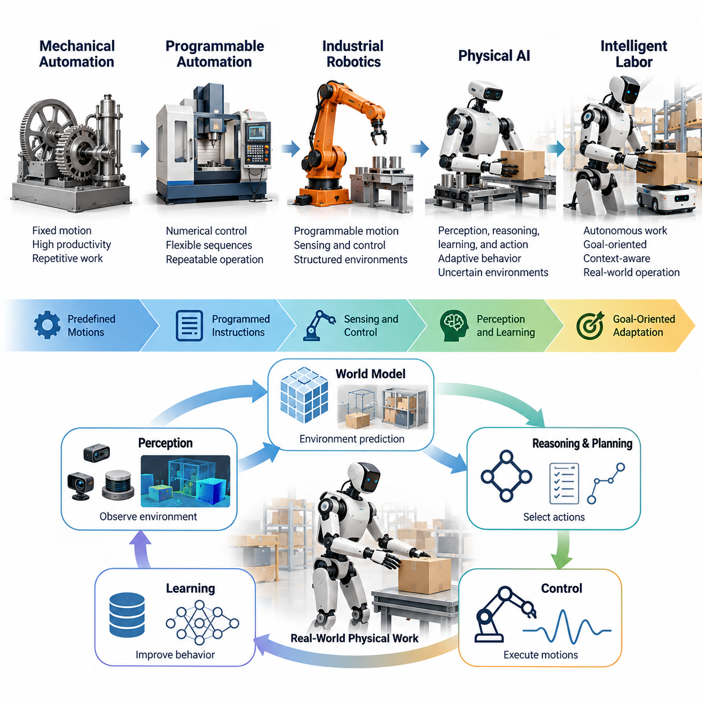{width="7.268055555555556in" height="7.268055555555556in"}

The evolution from mechanical automation to intelligent labor represents a fundamental transformation in how human societies organize physical work. Traditional machines were designed to execute predefined motions under controlled conditions, whereas Physical AI systems increasingly combine perception, reasoning, learning, and action to perform tasks in environments characterized by uncertainty, variability, and continuous change.

Mechanical automation emerged from the need to increase productivity, improve precision, and reduce dependence on repetitive human effort. Early industrial machines converted energy into controlled motion, enabling production at scales beyond manual capabilities. However, these systems generally required carefully structured environments, fixed operating procedures, and human intervention whenever unexpected conditions disrupted normal operation.

The development of programmable automation introduced greater flexibility through numerical control, industrial controllers, and robotic manipulators. Manufacturing systems could execute complex sequences with high repeatability, while sensors provided limited feedback about machine states and production conditions. Nevertheless, most automated equipment remained dependent on explicitly programmed rules and engineering assumptions established before deployment.

Industrial robotics extended mechanical automation by combining programmable motion with increasingly sophisticated sensing and control. Robotic arms became capable of welding, assembly, material handling, and precision manufacturing. Their effectiveness was particularly high in structured environments where objects, workstations, and task sequences remained predictable, but adaptation to unfamiliar situations often required substantial reprogramming.

The emergence of Physical AI changes this relationship between machines and their operating environments. Instead of relying exclusively on predetermined trajectories, intelligent physical systems can interpret sensory observations, estimate environmental states, select actions, and adjust behavior according to changing conditions. This transition introduces adaptive decision-making into activities previously constrained by rigid automation architectures.

Intelligent labor can be understood as physical work performed by autonomous or semi-autonomous systems capable of integrating perception, planning, control, and feedback. Such systems do not merely repeat movements but attempt to achieve operational objectives despite environmental variation. Their intelligence is expressed through reliable task execution, context-sensitive adaptation, and the ability to respond appropriately to unexpected events.

A central distinction between conventional automation and intelligent labor concerns the representation of tasks. Traditional automation frequently defines work as a sequence of machine instructions, while Physical AI can represent work through objectives, constraints, environmental conditions, and desired outcomes. This allows a system to consider alternative action sequences when the original execution plan becomes unsuitable.

Modern perception technologies provide an essential foundation for this transition. Cameras, depth sensors, LiDAR, force sensors, and proprioceptive measurements allow robots to estimate their surroundings and internal physical states. Machine learning models transform these observations into representations of objects, obstacles, surfaces, movements, and interactions that support increasingly sophisticated autonomous behavior.

World models extend perception by representing how physical environments may evolve over time. By combining spatial understanding, object relationships, physical dynamics, and action-dependent predictions, these models can support decisions about future consequences. Their development is particularly important for intelligent labor because successful physical work requires anticipating interactions rather than reacting only to immediate observations.

Learning-based control introduces another important departure from conventional automation. Instead of requiring engineers to specify every possible response, robotic systems can acquire behaviors through demonstrations, reinforcement learning, simulation, and operational experience. These methods may improve adaptation to complex tasks, although reliable deployment still depends on sufficient data coverage, safety constraints, and robust evaluation.

The integration of vision-language-action models offers a possible pathway toward more flexible task specification. Human instructions can be associated with visual observations and physical actions, allowing robots to interpret goals expressed in natural language. However, translating general instructions into dependable real-world execution remains difficult because physical tasks involve geometric precision, contact dynamics, uncertainty, and safety requirements.

Intelligent labor also requires the coordination of multiple temporal horizons. Low-level controllers regulate forces and movements over short intervals, while task planners coordinate actions across longer periods. Higher-level reasoning systems may manage objectives extending across complete workflows. Effective integration of these horizons is necessary for robots to execute meaningful tasks without continuous human direction.

The transition becomes especially visible in manufacturing and logistics. Conventional machines perform repetitive operations at dedicated workstations, whereas intelligent mobile robots can potentially transport materials, recognize changing layouts, manipulate varied objects, and coordinate with other equipment. These capabilities may allow automation to expand beyond isolated production cells into interconnected operational environments.

In construction, agriculture, and infrastructure maintenance, the limitations of mechanical automation become particularly apparent. Worksites change continuously, surfaces are irregular, materials vary, and environmental conditions cannot always be controlled. Physical AI offers the possibility of adapting robotic operations to these circumstances, although perception reliability, mobility, manipulation, and environmental robustness remain major technical challenges.

The transformation of labor should not be interpreted simply as replacing human workers with autonomous machines. Most occupations combine physical execution, judgment, communication, responsibility, and situational awareness. Consequently, intelligent automation is more likely to affect individual tasks at different rates, producing new arrangements of human supervision, robotic execution, and collaborative decision-making across many industries.

Human workers may increasingly concentrate on defining objectives, managing exceptions, supervising autonomous systems, and handling situations requiring social understanding or complex judgment. Robots may assume repetitive, physically demanding, hazardous, or highly standardized activities. The resulting division of responsibilities will depend on technical reliability, deployment economics, organizational design, regulatory requirements, and worker acceptance.

The economic significance of intelligent labor extends beyond improvements in machine productivity. Adaptive robots may increase equipment utilization, reduce operational interruptions, and make automation feasible for smaller production batches or more variable workflows. However, the actual benefits must account for acquisition costs, energy consumption, maintenance, integration, supervision, downtime, and the continuing need for human expertise.

An important consequence is the gradual separation of productive physical capacity from direct human working hours. Conventional automation already supports continuous industrial operation, but intelligent systems could extend this capability to environments requiring frequent adaptation. If reliability and affordability improve sufficiently, organizations may expand productive capacity without proportionally increasing the number of workers assigned to routine physical execution.

Nevertheless, autonomous physical labor remains constrained by fundamental engineering challenges. Robots must operate under uncertain sensory conditions, imperfect models, actuator limitations, and unpredictable human behavior. Errors that might be tolerable in digital applications can produce physical damage or injury. Consequently, intelligent labor requires rigorous safety engineering, uncertainty management, monitoring, and reliable fallback mechanisms.

The transition also changes the meaning of operational knowledge. In conventional automation, expertise is frequently embedded in machine programs, mechanical designs, and human procedures. Physical AI introduces learned policies, shared representations, and experience-based adaptation as additional forms of productive knowledge. Managing these resources becomes increasingly important for maintaining performance across changing tasks and environments.

Large-scale robotic fleets could accelerate this process through collective experience. Operational observations from multiple robots may reveal recurring failures, environmental variations, and opportunities for improved behavior. When supported by appropriate data governance, validation, and controlled deployment, these experiences can contribute to continuous system improvement and the gradual accumulation of reusable physical intelligence.

The development of intelligent labor is therefore not a single technological event but a progressive transformation involving robotics, artificial intelligence, infrastructure, economics, and institutions. Different industries will adopt these capabilities at different speeds because task complexity, safety requirements, labor costs, and environmental variability differ substantially. General-purpose physical labor remains an ambitious objective rather than an established universal capability.

Over the longer term, the distinction between machines as fixed production tools and machines as adaptive participants in productive activity may become increasingly important. Physical AI could enable new organizational models in which humans establish goals, exercise oversight, and contribute specialized expertise while autonomous systems perform growing portions of physical execution. The resulting transformation will depend as much on governance and human choices as on technological progress.

Ultimately, the movement from mechanical automation to intelligent labor represents a shift from programmed motion toward goal-directed physical agency. Its historical importance lies not only in the possibility of producing more goods with fewer repetitive operations, but also in changing how physical capabilities are created, distributed, and coordinated. Understanding this transition provides the foundation for examining the future relationship between Physical AI, human employment, and civilization.

기계적 자동화(Mechanical Automation)에서 지능형 노동(Intelligent Labor)으로의 진화는 인류 사회가 물리적 노동(Physical Labor)을 조직하고 수행하는 방식에 근본적인 변화를 의미한다. 전통적인 기계는 통제된 환경에서 사전에 정의된 동작을 실행하도록 설계되었지만, 피지컬 인공지능(Physical AI) 시스템은 인식(Perception), 추론(Reasoning), 학습(Learning), 행동(Action)을 통합하여 불확실성과 다양성, 지속적인 변화가 존재하는 환경에서도 작업을 수행할 수 있도록 발전하고 있다.

기계적 자동화(Mechanical Automation)는 생산성(Productivity)을 향상시키고 정밀도(Precision)를 높이며 반복적인 인간 노동에 대한 의존도를 줄이기 위한 필요성에서 등장하였다. 초기 산업용 기계는 에너지를 제어된 운동으로 변환하여 수작업으로는 달성하기 어려운 규모의 생산을 가능하게 하였다. 그러나 이러한 시스템은 일반적으로 정형화된 환경(Structured Environment), 고정된 작업 절차, 그리고 예상하지 못한 상황이 발생했을 때 인간의 개입에 의존하였다.

프로그래밍 가능한 자동화(Programmable Automation)의 발전은 수치 제어(Numerical Control), 산업용 제어기(Industrial Controller), 로봇 매니퓰레이터(Robotic Manipulator)를 통해 더 높은 유연성을 제공하였다. 제조 시스템은 높은 반복 정밀도로 복잡한 작업 순서를 실행할 수 있었으며, 센서는 기계 상태와 생산 조건에 대한 제한적인 피드백(Feedback)을 제공하였다. 그러나 대부분의 자동화 장비는 배치 이전에 정의된 명시적인 규칙과 엔지니어링 가정에 의존하였다.

산업용 로봇(Industrial Robotics)은 프로그래밍 가능한 동작에 점점 정교해지는 센싱(Sensing)과 제어(Control) 기술을 결합함으로써 기계적 자동화를 확장하였다. 로봇 팔(Robotic Arm)은 용접, 조립, 자재 취급, 정밀 제조 작업을 수행할 수 있게 되었다. 이러한 시스템은 물체, 작업 공간, 작업 순서가 예측 가능한 정형화된 환경에서 특히 효과적이었지만, 익숙하지 않은 상황에 적응하기 위해서는 상당한 수준의 재프로그래밍(Reprogramming)이 필요한 경우가 많았다.

피지컬 인공지능(Physical AI)의 등장은 기계와 작업 환경 사이의 관계를 변화시키고 있다. 지능형 물리 시스템(Intelligent Physical System)은 사전에 결정된 궤적(Trajectory)에만 의존하는 대신 센서 관측을 해석하고, 환경 상태를 추정하며, 행동을 선택하고, 변화하는 조건에 따라 동작을 조정할 수 있다. 이러한 전환은 기존의 경직된 자동화 아키텍처(Automation Architecture)에 적응형 의사결정(Adaptive Decision-Making)을 도입한다는 의미를 가진다.

지능형 노동(Intelligent Labor)은 인식(Perception), 계획(Planning), 제어(Control), 피드백(Feedback)을 통합할 수 있는 자율 또는 반자율 시스템(Autonomous or Semi-Autonomous System)이 수행하는 물리적 작업으로 이해할 수 있다. 이러한 시스템은 단순히 동작을 반복하는 것이 아니라 환경 변화에도 불구하고 작업 목표를 달성하려고 한다. 지능은 신뢰할 수 있는 작업 실행, 상황에 따른 적응, 예상하지 못한 사건에 적절하게 대응하는 능력을 통해 표현된다.

전통적인 자동화와 지능형 노동 사이의 핵심적인 차이는 작업 표현(Task Representation)에 있다. 전통적인 자동화는 작업을 기계 명령의 순서로 정의하는 경우가 많지만, 피지컬 인공지능은 목표(Objective), 제약조건(Constraint), 환경 조건(Environmental Condition), 원하는 결과(Desired Outcome)를 중심으로 작업을 표현할 수 있다. 이를 통해 기존 실행 계획이 적합하지 않게 되었을 때 대체 행동 순서를 검토할 수 있다.

현대적인 인식 기술(Perception Technology)은 이러한 전환을 위한 필수적인 기반을 제공한다. 카메라(Camera), 깊이 센서(Depth Sensor), 라이다(LiDAR), 힘 센서(Force Sensor), 고유수용감각 측정(Proprioceptive Measurement)을 통해 로봇은 주변 환경과 내부 물리 상태를 추정할 수 있다. 머신러닝 모델(Machine Learning Model)은 이러한 관측을 물체, 장애물, 표면, 움직임, 상호작용에 대한 표현으로 변환하여 더욱 정교한 자율 행동을 지원한다.

월드 모델(World Model)은 물리적 환경이 시간에 따라 어떻게 변화할 수 있는지를 표현함으로써 인식 기능을 확장한다. 공간적 이해(Spatial Understanding), 객체 관계(Object Relationship), 물리 동역학(Physical Dynamics), 행동 조건부 예측(Action-Conditioned Prediction)을 결합하여 미래 결과에 대한 의사결정을 지원할 수 있다. 성공적인 물리적 작업은 즉각적인 관측에 반응하는 것뿐 아니라 상호작용의 결과를 예측해야 하므로 월드 모델의 발전은 지능형 노동에서 특히 중요하다.

학습 기반 제어(Learning-Based Control)는 기존 자동화와 구별되는 또 다른 중요한 변화를 도입한다. 엔지니어가 가능한 모든 대응 방식을 명시적으로 지정하는 대신 로봇 시스템은 시연(Demonstration), 강화학습(Reinforcement Learning), 시뮬레이션(Simulation), 운영 경험(Operational Experience)을 통해 행동을 습득할 수 있다. 이러한 방법은 복잡한 작업에 대한 적응성을 높일 수 있지만, 신뢰할 수 있는 배치를 위해서는 충분한 데이터 범위, 안전 제약조건, 견고한 평가가 필요하다.

비전-언어-행동 모델(Vision-Language-Action Model)의 통합은 더욱 유연한 작업 명세(Task Specification)를 구현하기 위한 잠재적인 경로를 제공한다. 인간의 지시를 시각적 관측 및 물리적 행동과 연결함으로써 로봇은 자연어(Natural Language)로 표현된 목표를 해석할 수 있다. 그러나 일반적인 지시를 신뢰할 수 있는 현실 세계의 실행으로 변환하는 것은 기하학적 정밀도, 접촉 동역학(Contact Dynamics), 불확실성, 안전 요구사항 때문에 여전히 어려운 과제로 남아 있다.

지능형 노동은 여러 시간 범위(Temporal Horizon)에 걸친 조정도 필요로 한다. 저수준 제어기(Low-Level Controller)는 짧은 시간 간격에서 힘과 움직임을 조절하고, 작업 계획기(Task Planner)는 더 긴 시간에 걸쳐 행동을 조정한다. 상위 수준 추론 시스템(High-Level Reasoning System)은 전체 작업 흐름에 걸친 목표를 관리할 수 있다. 이러한 시간 범위를 효과적으로 통합하는 것은 로봇이 지속적인 인간의 지시 없이 의미 있는 작업을 수행하는 데 필수적이다.

이러한 전환은 제조업(Manufacturing)과 물류(Logistics)에서 특히 뚜렷하게 나타난다. 기존 기계는 전용 작업장에서 반복적인 작업을 수행하는 반면, 지능형 모바일 로봇(Intelligent Mobile Robot)은 자재 운송, 변화하는 배치 구조 인식, 다양한 물체 조작, 다른 장비와의 협력을 수행할 수 있는 잠재력을 가진다. 이러한 능력은 자동화를 개별 생산 셀(Production Cell)에서 상호 연결된 운영 환경으로 확장할 수 있다.

건설(Construction), 농업(Agriculture), 인프라 유지보수(Infrastructure Maintenance)에서는 기계적 자동화의 한계가 더욱 분명하게 나타난다. 작업 현장은 지속적으로 변화하고, 지면은 불규칙하며, 자재의 특성이 다양하고, 환경 조건을 항상 통제할 수는 없다. 피지컬 인공지능은 이러한 조건에 로봇 작업을 적응시킬 가능성을 제공하지만, 인식 신뢰성, 이동성(Mobility), 조작 능력(Manipulation), 환경 강건성(Environmental Robustness)은 여전히 중요한 기술적 과제로 남아 있다.

노동의 변화는 단순히 인간 근로자를 자율 기계로 대체하는 것으로 해석해서는 안 된다. 대부분의 직업(Occupation)은 물리적 실행, 판단(Judgment), 의사소통(Communication), 책임(Responsibility), 상황 인식(Situational Awareness)을 결합한다. 따라서 지능형 자동화는 개별 작업(Task)에 서로 다른 속도로 영향을 미치며, 다양한 산업에서 인간의 감독, 로봇의 실행, 협력적 의사결정이 결합된 새로운 업무 구조를 형성할 가능성이 높다.

인간 근로자는 점차 목표 정의(Objective Definition), 예외 상황 처리(Exception Handling), 자율 시스템 감독(Supervision), 사회적 이해 또는 복잡한 판단이 필요한 상황에 집중할 수 있다. 로봇은 반복적이고 육체적으로 부담이 크며 위험하거나 고도로 표준화된 작업을 담당할 수 있다. 이러한 역할 분담은 기술적 신뢰성, 배치 경제성(Deployment Economics), 조직 설계, 규제 요구사항, 근로자의 수용성에 따라 달라질 것이다.

지능형 노동의 경제적 중요성은 단순한 기계 생산성 향상을 넘어선다. 적응형 로봇(Adaptive Robot)은 장비 활용률(Equipment Utilization)을 높이고 운영 중단을 줄이며 소량 생산이나 변동성이 높은 작업 흐름에서도 자동화를 가능하게 할 수 있다. 그러나 실제 경제적 효과를 평가할 때는 도입 비용, 에너지 소비, 유지보수, 시스템 통합, 감독, 가동 중단 시간, 지속적으로 필요한 인간 전문성을 모두 고려해야 한다.

중요한 결과 중 하나는 생산적인 물리적 작업 능력(Productive Physical Capacity)이 인간의 직접적인 노동시간(Human Working Hours)으로부터 점진적으로 분리된다는 점이다. 기존 자동화도 연속적인 산업 운영을 지원하지만, 지능형 시스템은 빈번한 적응이 필요한 환경까지 이러한 능력을 확장할 수 있다. 신뢰성과 경제성이 충분히 개선된다면 조직은 일상적인 물리적 작업에 투입되는 근로자 수를 비례적으로 늘리지 않고도 생산 능력을 확대할 수 있다.

그럼에도 불구하고 자율 물리 노동(Autonomous Physical Labor)은 근본적인 엔지니어링 과제에 의해 제약받는다. 로봇은 불확실한 센서 조건, 불완전한 모델, 액추에이터(Actuator)의 한계, 예측하기 어려운 인간 행동 속에서 작동해야 한다. 디지털 응용에서는 허용될 수 있는 오류도 물리적 손상이나 인명 피해를 초래할 수 있다. 따라서 지능형 노동에는 엄격한 안전 엔지니어링(Safety Engineering), 불확실성 관리(Uncertainty Management), 모니터링(Monitoring), 신뢰할 수 있는 대체 작동 체계(Fallback Mechanism)가 필요하다.

이러한 전환은 운영 지식(Operational Knowledge)의 의미도 변화시킨다. 기존 자동화에서는 전문 지식이 기계 프로그램, 기계 설계, 인간의 작업 절차에 내재되어 있는 경우가 많다. 피지컬 인공지능은 학습된 정책(Learned Policy), 공유 표현(Shared Representation), 경험 기반 적응(Experience-Based Adaptation)을 추가적인 생산 지식의 형태로 도입한다. 이러한 자원을 관리하는 것은 변화하는 작업과 환경에서 성능을 유지하는 데 점점 더 중요해진다.

대규모 로봇 군집(Robotic Fleet)은 집단 경험(Collective Experience)을 통해 이러한 과정을 가속할 수 있다. 여러 로봇에서 수집된 운영 관측은 반복적인 실패, 환경 변화, 행동 개선의 기회를 발견하는 데 활용될 수 있다. 적절한 데이터 거버넌스(Data Governance), 검증(Validation), 통제된 배치(Controlled Deployment)가 뒷받침된다면 이러한 경험은 지속적인 시스템 개선과 재사용 가능한 물리 지능(Reusable Physical Intelligence)의 점진적인 축적에 기여할 수 있다.

따라서 지능형 노동의 발전은 단일한 기술적 사건이 아니라 로봇공학(Robotics), 인공지능(Artificial Intelligence), 인프라(Infrastructure), 경제(Economics), 제도(Institution)가 함께 변화하는 점진적인 전환 과정이다. 작업의 복잡성, 안전 요구사항, 노동 비용, 환경 변동성이 산업마다 크게 다르기 때문에 기술 도입 속도도 서로 다를 것이다. 범용 물리 노동(General-Purpose Physical Labor)은 이미 확립된 보편적 능력이 아니라 여전히 도전적인 목표로 남아 있다.

장기적으로 기계를 고정된 생산 도구(Fixed Production Tool)로 보는 관점과 적응형 생산 활동의 참여자(Adaptive Participant)로 보는 관점 사이의 차이는 더욱 중요해질 수 있다. 피지컬 인공지능은 인간이 목표를 설정하고 감독하며 전문성을 제공하는 동안 자율 시스템이 점점 더 많은 물리적 작업을 수행하는 새로운 조직 모델을 가능하게 할 수 있다. 이러한 변화의 결과는 기술 발전뿐 아니라 거버넌스(Governance)와 인간의 선택에도 크게 좌우될 것이다.

궁극적으로 기계적 자동화(Mechanical Automation)에서 지능형 노동(Intelligent Labor)으로의 전환은 프로그래밍된 동작(Programmed Motion)에서 목표 지향적 물리적 행위 능력(Goal-Directed Physical Agency)으로 이동하는 것을 의미한다. 그 역사적 중요성은 반복 작업을 줄이면서 더 많은 재화를 생산할 가능성뿐 아니라 물리적 역량이 생성되고 분배되며 조정되는 방식을 변화시키는 데 있다. 이러한 전환을 이해하는 것은 피지컬 인공지능, 인간 고용(Human Employment), 문명(Civilization)의 미래 관계를 분석하기 위한 기초가 된다.

##  

## 01.02. Task Automation vs Occupation Automation

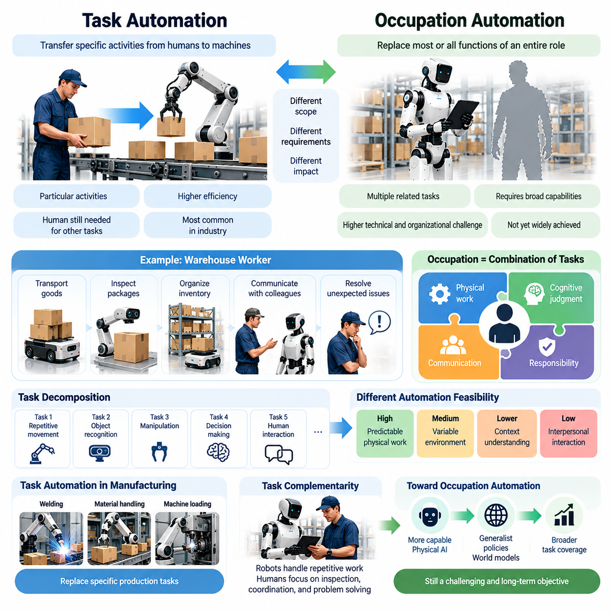{width="7.268055555555556in" height="7.268055555555556in"}

Task automation and occupation automation represent two fundamentally different dimensions of technological change in the labor market. Task automation refers to the transfer of specific activities from humans to machines, while occupation automation implies replacing most or all functions associated with an entire professional role. Understanding this distinction is essential for evaluating how Physical AI may transform employment, productivity, and organizational structures.

An occupation consists of multiple tasks requiring different combinations of physical capabilities, cognitive judgment, communication, and responsibility. A warehouse worker may transport goods, identify damaged packages, organize inventory, communicate with colleagues, and resolve unexpected operational problems. Automating material transportation does not automatically eliminate the broader occupation because many complementary responsibilities remain.

Traditional industrial automation has primarily operated at the task level. Assembly robots perform welding, fastening, and repetitive manipulation, while automated conveyors transport materials along predefined routes. These technologies replace particular activities rather than entire occupational categories. Human workers continue performing setup, maintenance, inspection, exception handling, and coordination across the production process.

Physical AI expands the range of tasks that machines can potentially perform by combining perception, planning, learning, and adaptive control. Autonomous mobile robots can navigate changing environments, while intelligent manipulators can interact with objects exhibiting variations in shape, position, and orientation. Nevertheless, improvements in individual capabilities do not necessarily translate into complete occupational autonomy.

The distinction becomes clearer when considering task decomposition. Complex occupations can be represented as collections of activities with different technical requirements, execution frequencies, and operational dependencies. Some activities involve predictable physical movements, whereas others require contextual understanding or interpersonal interaction. Their automation feasibility must therefore be evaluated separately rather than inferred from an occupational title.

Task automation depends on several interacting factors, including technical feasibility, economic viability, operational reliability, and institutional acceptance. A robotic system may successfully demonstrate a particular activity in laboratory conditions without becoming commercially suitable for continuous deployment. Real-world automation requires acceptable performance under uncertainty, manageable maintenance costs, and compliance with relevant safety requirements.

Occupation automation introduces additional challenges because tasks are rarely independent. Completing one activity may require information generated by another, and unexpected events can change the entire workflow. A robot capable of transporting materials may still require human assistance when inventory records conflict, equipment fails, or priorities change. Such dependencies limit the effectiveness of evaluating occupational replacement through isolated demonstrations.

The concept of task coverage provides a useful framework for understanding automation progress. Task coverage describes the proportion of activities within an occupation that a technological system can perform at an acceptable standard. However, coverage should consider task frequency, duration, economic value, and operational criticality. Automating many minor activities may have less practical impact than automating one time-consuming responsibility.

A related concept is task complementarity, which describes how automated and human activities interact within a workflow. When robots perform repetitive transportation or heavy lifting, human workers may devote more attention to inspection, coordination, and problem-solving. In such cases, automation increases the productivity of remaining human tasks rather than eliminating the occupation itself.

Task substitution occurs when machines directly replace human effort in specific activities. The economic consequences depend on whether displaced working hours can be reassigned to other productive functions. If automation reduces the need for routine handling while increasing demand for supervision and quality assurance, the occupational structure may change without a proportional decline in employment.

Complete occupation automation requires much broader capabilities than individual task substitution. An autonomous system must execute interconnected activities, manage transitions between them, recognize exceptions, and maintain performance across varying circumstances. It must also operate within organizational procedures and accountability structures. These requirements make occupational automation a substantially more demanding objective than automating isolated physical operations.

Physical AI may reduce this gap through generalist robotic policies and increasingly capable world models. Systems that learn reusable representations of objects, actions, and environmental dynamics could transfer knowledge across related tasks. Vision-language-action architectures may also enable flexible instruction following. However, generalization across tasks, environments, and robot embodiments remains an unresolved technical challenge.

Manufacturing provides a practical illustration of these distinctions. Industrial robots may automate material placement, welding, and machine loading while human technicians manage calibration, quality verification, and production changes. Even when several production tasks become autonomous, the manufacturing occupation may evolve toward system supervision and process optimization rather than disappear entirely.

Warehouse operations demonstrate similar dynamics. Autonomous mobile robots can transport inventory between locations, while automated picking systems may handle selected products under suitable conditions. Human workers remain important for irregular objects, damaged goods, inventory discrepancies, and unusual customer requirements. The resulting labor transformation depends on how effectively automated components integrate into the complete workflow.

Construction presents greater obstacles to occupation automation because work environments are highly variable. Robots may perform surveying, layout marking, material transport, or selected installation activities, but construction professionals also interpret drawings, coordinate trades, respond to site conditions, and make safety-critical judgments. Automating these responsibilities requires capabilities extending beyond accurate physical manipulation.

Healthcare illustrates the importance of nonphysical occupational requirements. Robots can support logistics, patient transportation, cleaning, and selected clinical procedures, yet healthcare occupations involve communication, empathy, ethical judgment, and professional accountability. Even sophisticated physical automation does not automatically reproduce these human responsibilities, making task augmentation a more realistic pathway in many healthcare settings.

The economic impact of automation depends on how organizations redesign workflows after introducing intelligent machines. Simply replacing individual tasks may produce limited benefits if remaining processes create bottlenecks. Greater productivity often requires reorganizing work allocation, information flows, equipment utilization, and human responsibilities. Consequently, organizational adaptation becomes as important as technological capability.

Automation exposure should not be confused with actual employment displacement. An occupation may contain numerous technically automatable tasks without experiencing immediate workforce reductions. Adoption depends on capital availability, implementation costs, regulatory constraints, customer expectations, and labor market conditions. Furthermore, productivity improvements may increase output demand and create additional activities that partially offset displaced work.

Task automation can also generate new occupational responsibilities. Robot deployment requires integration engineers, fleet supervisors, maintenance specialists, safety auditors, data engineers, and operational trainers. As autonomous systems become more widespread, these functions may develop into specialized professions. However, the number, accessibility, and compensation of newly created positions may differ substantially from those associated with displaced activities.

Measuring automation therefore requires more than counting robot installations or estimating the percentage of tasks that machines can perform. A comprehensive assessment should examine actual operating hours, human intervention frequency, task completion reliability, labor hours saved, and changes in employment composition. These measurements help distinguish technological demonstrations from economically meaningful transformations of work.

A useful analytical approach is to evaluate occupations as dynamic task networks rather than fixed collections of duties. When one activity becomes automated, the importance, frequency, and organization of remaining activities may change. New tasks can emerge while obsolete procedures disappear. This dynamic perspective explains why occupational transformation cannot be reliably predicted by simply summing the automation probabilities of individual tasks.

The relationship between task automation and occupation automation will also vary across industries and regions. Environments with standardized processes, high labor costs, and substantial production volumes may adopt automation more rapidly. Smaller organizations or highly variable workplaces may experience slower transitions. Differences in infrastructure, workforce skills, regulation, and investment capacity will further influence adoption patterns.

Over time, advances in Physical AI could increase the number of occupations in which machines perform most routine physical activities. Nevertheless, the transition from high task coverage to complete occupational replacement remains dependent on reliability, adaptability, accountability, and economic integration. Human roles may increasingly emphasize oversight, exception management, creative problem-solving, and coordination across autonomous systems.

Ultimately, distinguishing task automation from occupation automation provides a more accurate foundation for understanding the future of labor. Physical AI will not necessarily transform employment through the immediate disappearance of entire professions. Instead, its effects are likely to emerge through successive changes in task allocation, occupational responsibilities, and organizational design, with outcomes determined by both technological capabilities and human economic decisions.

작업 자동화(Task Automation)와 직업 자동화(Occupation Automation)는 노동시장(Labor Market)에서 발생하는 기술적 변화의 근본적으로 다른 두 가지 차원을 나타낸다. 작업 자동화는 특정 활동을 인간에서 기계로 이전하는 것을 의미하는 반면, 직업 자동화는 하나의 직업적 역할(Professional Role)에 포함된 대부분 또는 모든 기능을 대체하는 것을 의미한다. 이러한 차이를 이해하는 것은 피지컬 인공지능(Physical AI)이 고용, 생산성, 조직 구조를 어떻게 변화시킬 수 있는지 평가하는 데 필수적이다.

하나의 직업(Occupation)은 물리적 능력(Physical Capability), 인지적 판단(Cognitive Judgment), 의사소통(Communication), 책임(Responsibility)이 서로 다른 방식으로 결합된 여러 작업으로 구성된다. 창고 근로자는 물품 운송, 손상된 포장 식별, 재고 정리, 동료와의 의사소통, 예상하지 못한 운영 문제 해결 등을 수행할 수 있다. 자재 운송을 자동화하더라도 다른 보완적인 책임이 남아 있기 때문에 해당 직업 전체가 자동으로 사라지는 것은 아니다.

전통적인 산업 자동화(Industrial Automation)는 주로 개별 작업 수준(Task Level)에서 이루어져 왔다. 조립 로봇(Assembly Robot)은 용접, 체결, 반복적인 조작 작업을 수행하며, 자동화 컨베이어(Automated Conveyor)는 사전에 정의된 경로를 따라 자재를 운송한다. 이러한 기술은 직업 전체가 아니라 특정 활동을 대체한다. 인간 근로자는 생산 공정 전반에서 설비 설정, 유지보수, 검사, 예외 상황 처리, 작업 조정 등을 계속 수행한다.

피지컬 인공지능(Physical AI)은 인식(Perception), 계획(Planning), 학습(Learning), 적응형 제어(Adaptive Control)를 결합함으로써 기계가 수행할 수 있는 작업의 범위를 확장한다. 자율이동로봇(Autonomous Mobile Robot)은 변화하는 환경에서 주행할 수 있으며, 지능형 매니퓰레이터(Intelligent Manipulator)는 형태, 위치, 방향이 다양한 물체와 상호작용할 수 있다. 그러나 개별 능력의 향상이 반드시 직업 전체의 자율화(Occupational Autonomy)로 이어지는 것은 아니다.

이러한 차이는 작업 분해(Task Decomposition)를 고려할 때 더욱 명확해진다. 복잡한 직업은 서로 다른 기술적 요구사항, 실행 빈도, 운영상 의존성을 가진 활동들의 집합으로 표현할 수 있다. 일부 활동은 예측 가능한 물리적 움직임을 포함하지만, 다른 활동은 상황적 이해(Contextual Understanding)나 대인 상호작용(Interpersonal Interaction)을 필요로 한다. 따라서 자동화 가능성(Automation Feasibility)은 직업의 명칭만으로 판단하기보다 개별적으로 평가해야 한다.

작업 자동화(Task Automation)는 기술적 실현 가능성(Technical Feasibility), 경제적 타당성(Economic Viability), 운영 신뢰성(Operational Reliability), 제도적 수용성(Institutional Acceptance) 등 여러 요인의 상호작용에 의해 결정된다. 로봇 시스템이 실험실 환경에서 특정 작업을 성공적으로 시연하더라도 지속적인 상용 운영에 적합하다는 의미는 아니다. 현실 세계의 자동화에는 불확실한 조건에서도 허용 가능한 성능, 관리 가능한 유지보수 비용, 관련 안전 요구사항의 준수가 필요하다.

직업 자동화(Occupation Automation)는 작업들이 서로 독립적이지 않은 경우가 많기 때문에 추가적인 과제를 수반한다. 하나의 활동을 완료하기 위해 다른 활동에서 생성된 정보가 필요할 수 있으며, 예상하지 못한 사건은 전체 작업 흐름(Workflow)을 변화시킬 수 있다. 자재를 운송할 수 있는 로봇도 재고 기록의 불일치, 장비 고장, 우선순위 변경이 발생하면 인간의 도움이 필요할 수 있다. 이러한 의존성은 개별 시연만으로 직업 대체 가능성을 평가하는 방식의 한계를 보여준다.

작업 범위(Task Coverage)는 자동화의 진전을 이해하기 위한 유용한 분석 체계를 제공한다. 작업 범위는 하나의 직업에 포함된 활동 중 기술 시스템이 허용 가능한 수준으로 수행할 수 있는 비율을 의미한다. 그러나 작업 범위를 평가할 때는 작업 빈도(Task Frequency), 소요 시간(Duration), 경제적 가치(Economic Value), 운영상 중요도(Operational Criticality)를 고려해야 한다. 중요도가 낮은 여러 활동을 자동화하는 것보다 시간이 많이 소요되는 하나의 핵심 작업을 자동화하는 것이 더 큰 실질적 영향을 미칠 수 있다.

이와 관련된 개념으로 작업 보완성(Task Complementarity)이 있으며, 이는 자동화된 활동과 인간의 활동이 작업 흐름 안에서 어떻게 상호작용하는지를 설명한다. 로봇이 반복적인 운송이나 중량물 취급을 수행하면 인간 근로자는 검사, 조정, 문제 해결에 더 많은 시간을 투입할 수 있다. 이러한 경우 자동화는 직업 자체를 제거하기보다 인간에게 남아 있는 작업의 생산성을 향상시킨다.

작업 대체(Task Substitution)는 기계가 특정 활동에서 인간의 노동을 직접 대체할 때 발생한다. 그 경제적 결과는 대체된 노동시간을 다른 생산적인 기능에 재배치할 수 있는지에 따라 달라진다. 자동화가 반복적인 자재 취급의 필요성을 줄이는 동시에 감독(Supervision)과 품질보증(Quality Assurance)에 대한 수요를 증가시킨다면, 고용이 비례적으로 감소하지 않더라도 직업 구조는 변화할 수 있다.

완전한 직업 자동화(Complete Occupation Automation)는 개별 작업을 대체하는 것보다 훨씬 광범위한 능력을 필요로 한다. 자율 시스템(Autonomous System)은 상호 연결된 활동을 실행하고, 작업 간 전환을 관리하며, 예외 상황을 인식하고, 다양한 환경에서도 성능을 유지해야 한다. 또한 조직의 운영 절차와 책임 체계(Accountability Structure) 안에서 작동해야 한다. 이러한 요구사항은 직업 자동화가 개별 물리 작업의 자동화보다 훨씬 어려운 목표임을 보여준다.

피지컬 인공지능(Physical AI)은 범용 로봇 정책(Generalist Robotic Policy)과 점점 정교해지는 월드 모델(World Model)을 통해 이러한 격차를 줄일 수 있다. 물체, 행동, 환경 동역학(Environmental Dynamics)에 대한 재사용 가능한 표현을 학습하는 시스템은 관련 작업 사이에서 지식을 전이할 수 있다. 비전-언어-행동 아키텍처(Vision-Language-Action Architecture)도 유연한 명령 수행을 가능하게 할 수 있다. 그러나 작업, 환경, 로봇 신체 구조(Robot Embodiment)를 넘어서는 일반화(Generalization)는 여전히 해결되지 않은 기술적 과제이다.

제조업(Manufacturing)은 이러한 차이를 보여주는 실질적인 사례이다. 산업용 로봇(Industrial Robot)은 자재 배치, 용접, 기계 투입 작업을 자동화할 수 있지만, 인간 기술자는 교정(Calibration), 품질 검증(Quality Verification), 생산 변경 관리 등을 수행한다. 여러 생산 작업이 자율화되더라도 제조업 관련 직업은 완전히 사라지기보다 시스템 감독(System Supervision)과 공정 최적화(Process Optimization)를 중심으로 변화할 수 있다.

창고 운영(Warehouse Operations)에서도 유사한 변화가 나타난다. 자율이동로봇(Autonomous Mobile Robot)은 장소 사이에서 재고를 운송할 수 있으며, 자동 피킹 시스템(Automated Picking System)은 적절한 조건에서 특정 제품을 취급할 수 있다. 그러나 불규칙한 형태의 물체, 손상된 상품, 재고 불일치, 특수한 고객 요구사항을 처리하는 데는 여전히 인간 근로자가 중요하다. 노동 구조의 변화는 자동화된 구성요소들이 전체 작업 흐름에 얼마나 효과적으로 통합되는지에 따라 달라진다.

건설(Construction)은 작업 환경의 변동성이 매우 높기 때문에 직업 자동화에 더 큰 장애물이 존재한다. 로봇은 측량(Surveying), 위치 표시(Layout Marking), 자재 운송, 일부 설치 작업을 수행할 수 있지만, 건설 전문가는 도면 해석, 공종 간 조정, 현장 조건 대응, 안전에 중요한 판단도 수행한다. 이러한 책임을 자동화하려면 정확한 물리적 조작 능력을 넘어서는 광범위한 역량이 필요하다.

의료(Healthcare)는 비물리적 직업 요구사항(Nonphysical Occupational Requirement)의 중요성을 보여준다. 로봇은 물류, 환자 이송, 청소, 일부 임상 절차(Clinical Procedure)를 지원할 수 있지만, 의료 직업에는 의사소통, 공감(Empathy), 윤리적 판단(Ethical Judgment), 전문적 책임(Professional Accountability)이 포함된다. 정교한 물리적 자동화도 이러한 인간의 책임을 자동으로 재현하지는 못하므로, 많은 의료 환경에서는 작업 증강(Task Augmentation)이 더욱 현실적인 발전 경로가 된다.

자동화의 경제적 영향(Economic Impact)은 조직이 지능형 기계를 도입한 이후 작업 흐름을 어떻게 재설계하는지에 따라 달라진다. 개별 작업만 대체하는 방식은 남아 있는 공정이 병목현상(Bottleneck)을 발생시킬 경우 제한적인 효과만 가져올 수 있다. 더 높은 생산성을 달성하려면 작업 배분(Work Allocation), 정보 흐름(Information Flow), 장비 활용률(Equipment Utilization), 인간의 책임 구조를 재구성해야 하는 경우가 많다. 따라서 조직적 적응(Organizational Adaptation)은 기술적 능력만큼 중요해진다.

자동화 노출도(Automation Exposure)를 실제 고용 대체(Employment Displacement)와 혼동해서는 안 된다. 하나의 직업에 기술적으로 자동화할 수 있는 작업이 많이 포함되어 있더라도 즉각적인 인력 감축이 발생하는 것은 아니다. 기술 도입은 자본 가용성(Capital Availability), 구현 비용(Implementation Cost), 규제 제약(Regulatory Constraint), 고객 기대(Customer Expectation), 노동시장 조건(Labor Market Condition)에 따라 달라진다. 또한 생산성 향상은 생산물 수요를 증가시키고 새로운 활동을 창출하여 대체된 노동의 일부를 상쇄할 수 있다.

작업 자동화(Task Automation)는 새로운 직업적 책임도 만들어낼 수 있다. 로봇 배치(Robot Deployment)에는 시스템 통합 엔지니어(Integration Engineer), 로봇 군집 감독자(Fleet Supervisor), 유지보수 전문가(Maintenance Specialist), 안전 감사 담당자(Safety Auditor), 데이터 엔지니어(Data Engineer), 운영 교육 담당자(Operational Trainer)가 필요하다. 자율 시스템이 확산되면서 이러한 기능은 전문 직업으로 발전할 수 있다. 그러나 새롭게 창출되는 일자리의 수, 접근 가능성, 보상 수준은 대체되는 활동과 상당히 다를 수 있다.

따라서 자동화 수준을 측정하려면 로봇 설치 대수를 계산하거나 기계가 수행할 수 있는 작업의 비율을 추정하는 것만으로는 충분하지 않다. 포괄적인 평가(Comprehensive Assessment)에는 실제 운영시간(Operating Hours), 인간 개입 빈도(Human Intervention Frequency), 작업 완료 신뢰성(Task Completion Reliability), 절감된 노동시간(Labor Hours Saved), 고용 구성(Employment Composition)의 변화가 포함되어야 한다. 이러한 측정은 기술적 시연과 경제적으로 의미 있는 노동 구조의 변화를 구분하는 데 도움이 된다.

유용한 분석 방법은 직업을 고정된 업무의 집합이 아니라 동적인 작업 네트워크(Dynamic Task Network)로 평가하는 것이다. 하나의 활동이 자동화되면 남아 있는 활동의 중요도, 빈도, 조직 방식이 달라질 수 있다. 새로운 작업이 등장하는 동시에 기존 절차가 사라질 수도 있다. 이러한 동적 관점(Dynamic Perspective)은 개별 작업의 자동화 확률(Automation Probability)을 단순히 합산하는 방식으로는 직업의 변화를 신뢰성 있게 예측하기 어려운 이유를 설명한다.

작업 자동화와 직업 자동화의 관계는 산업과 지역에 따라서도 달라질 것이다. 표준화된 공정(Standardized Process), 높은 노동 비용(Labor Cost), 대규모 생산량(Production Volume)을 가진 환경에서는 자동화가 더 빠르게 도입될 수 있다. 소규모 조직이나 변동성이 높은 작업 환경에서는 전환이 더 느리게 진행될 수 있다. 인프라, 근로자 역량(Workforce Skill), 규제, 투자 능력(Investment Capacity)의 차이도 기술 도입 양상에 추가적인 영향을 미칠 것이다.

시간이 지남에 따라 피지컬 인공지능(Physical AI)의 발전은 기계가 대부분의 일상적인 물리 작업을 수행할 수 있는 직업의 수를 증가시킬 수 있다. 그러나 높은 작업 범위(High Task Coverage)에서 완전한 직업 대체(Complete Occupational Replacement)로 전환하는 과정은 여전히 신뢰성(Reliability), 적응성(Adaptability), 책임성(Accountability), 경제적 통합(Economic Integration)에 달려 있다. 인간의 역할은 자율 시스템 전반의 감독, 예외 상황 관리, 창의적 문제 해결, 조정 기능을 더욱 강조하는 방향으로 변화할 수 있다.

궁극적으로 작업 자동화(Task Automation)와 직업 자동화(Occupation Automation)를 구분하는 것은 노동의 미래를 이해하기 위한 더욱 정확한 기반을 제공한다. 피지컬 인공지능(Physical AI)은 반드시 직업 전체가 즉각적으로 사라지는 방식으로 고용을 변화시키는 것은 아니다. 오히려 그 영향은 작업 배분(Task Allocation), 직업적 책임(Occupational Responsibility), 조직 설계(Organizational Design)의 연속적인 변화를 통해 나타날 가능성이 높으며, 그 결과는 기술적 역량과 인간의 경제적 의사결정에 의해 함께 결정될 것이다.

##  

## 01.03. Physical vs Cognitive Task Automation

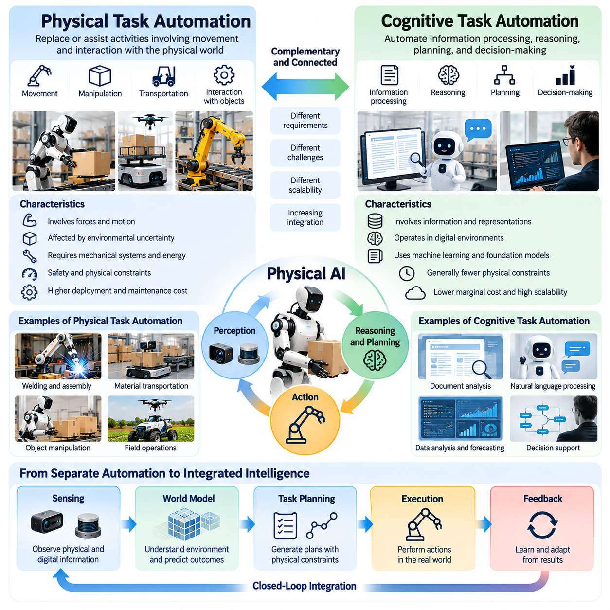{width="7.268055555555556in" height="7.268055555555556in"}

Physical task automation and cognitive task automation represent two complementary dimensions of technological transformation in human labor. Physical automation replaces or assists activities involving movement, manipulation, transportation, and interaction with material environments. Cognitive automation addresses information processing, reasoning, planning, and decision-making. Physical AI increasingly connects these dimensions through integrated perception and action.

Historically, physical automation developed through mechanization, industrial machinery, and programmable robotics. Machines increased human productive capacity by performing repetitive movements with greater speed, strength, and consistency. Cognitive automation evolved through computing, expert systems, and artificial intelligence, allowing software to process information and execute predefined decision procedures without directly interacting with physical objects.

The distinction between physical and cognitive tasks reflects differences in their operational requirements. Physical tasks involve forces, motion, contact dynamics, spatial constraints, and environmental uncertainty. Cognitive tasks primarily involve representations, information relationships, logical operations, and abstract objectives. However, many real-world occupations combine these requirements, making a strict separation increasingly difficult.

Traditional physical automation depends heavily on structured environments and predictable interactions. Industrial robots can execute precise trajectories when object positions, tooling, and workspace conditions remain stable. Cognitive automation often operates in digital environments where information can be copied, transformed, and evaluated without mechanical constraints. These differences influence the cost, reliability, and scalability of automation technologies.

Physical AI introduces intelligence into physical task execution by integrating sensors, computational models, and adaptive control. A robot must perceive its environment, estimate relevant physical states, select appropriate actions, and continuously adjust movement. Unlike purely digital systems, its decisions produce physical consequences that may be difficult to reverse and can introduce safety risks.

Cognitive automation has advanced through machine learning, natural language processing, computer vision, and foundation models. These technologies support document analysis, software generation, information retrieval, forecasting, and decision assistance. Although their outputs can influence physical operations, cognitive systems generally require additional interfaces, actuators, and control mechanisms to execute actions in the material world.

A fundamental difference concerns the relationship between intelligence and embodiment. Cognitive AI can manipulate symbolic or learned representations without possessing a physical body. Physical AI requires embodiment through sensors, actuators, mechanical structures, and environmental interaction. The capabilities of an embodied system depend not only on computational intelligence but also on morphology, energy availability, mechanical precision, and control bandwidth.

The automation of physical tasks also introduces complex temporal requirements. Motor control may require rapid feedback to maintain stability, regulate contact forces, and avoid collisions. Cognitive reasoning can sometimes operate over longer intervals, although time-critical digital applications also exist. Integrated Physical AI architectures must coordinate fast control processes with slower planning and deliberative reasoning.

Environmental uncertainty creates another important distinction. Digital information systems frequently operate with explicit data structures and standardized interfaces, while physical environments contain irregular surfaces, deformable objects, uncertain friction, and unpredictable disturbances. Robots must estimate hidden states and compensate for imperfect measurements. These challenges make reliable physical execution more difficult than producing a plausible digital response.

Physical tasks are also constrained by energy, materials, and mechanical wear. Moving heavy objects requires sufficient actuator torque, structural strength, and power capacity. Repeated operations introduce maintenance requirements and component degradation. Cognitive automation consumes computational resources but generally does not face equivalent mechanical constraints during purely digital execution.

The economic scalability of the two automation categories therefore differs substantially. Cognitive software can often be distributed across many users with relatively low additional deployment costs, although computing expenses remain important. Physical automation requires hardware production, installation, maintenance, safety validation, and site-specific integration. These requirements can slow deployment even when intelligent control algorithms improve rapidly.

Nevertheless, physical and cognitive automation increasingly reinforce each other. Cognitive models can interpret instructions, generate plans, and reason about operational objectives, while physical systems execute actions and collect environmental feedback. This relationship enables closed-loop intelligence in which perception, reasoning, action, and evaluation operate as interconnected components rather than isolated technological functions.

World models provide an important bridge between cognitive reasoning and physical execution. By representing environmental states, object interactions, and predicted consequences of actions, these models support planning grounded in physical dynamics. A robot can potentially evaluate alternative actions before execution, although prediction accuracy remains limited by model uncertainty and unfamiliar operating conditions.

Vision-language-action models extend this integration by connecting visual observations, language instructions, and robotic control outputs. Such architectures can translate high-level task descriptions into action representations, reducing dependence on manually programmed procedures. However, reliable deployment still requires precise control, safety constraints, and mechanisms for detecting failures during execution.

Manufacturing illustrates how cognitive and physical automation can operate together. Cognitive systems may optimize production schedules, analyze quality measurements, and predict equipment failures. Physical robots perform assembly, material handling, and inspection movements. Integrating these capabilities can improve operational coordination, but successful deployment depends on reliable communication between planning systems and physical equipment.

In logistics, cognitive automation supports demand forecasting, inventory planning, and route optimization, while physical automation handles transportation, sorting, and selected picking operations. Their integration enables warehouse systems to coordinate information flows with material movement. Human workers remain essential where uncertain conditions, unusual products, or operational exceptions exceed automated capabilities.

Construction and infrastructure maintenance demonstrate the importance of combining both dimensions. Cognitive systems can analyze engineering drawings, compare digital models with observed conditions, and identify potential discrepancies. Physical robots can perform surveying, scanning, inspection, or selected construction activities. Connecting digital reasoning with accurate physical measurement creates opportunities for more adaptive project execution.

Healthcare provides another example of complementary automation. Cognitive AI can assist with medical information analysis, scheduling, and clinical documentation, while physical robots support logistics, rehabilitation, and selected procedures. However, clinical responsibility, patient communication, and safety requirements limit the extent to which these capabilities can independently replace professional human judgment.

The labor implications of physical and cognitive automation are not identical. Cognitive automation may transform information-intensive occupations by reducing time spent on documentation, analysis, and routine decision support. Physical automation may reduce demand for repetitive movement, transportation, and material handling. Occupations combining both types of work may experience broader restructuring as integrated systems become more capable.

Human workers may increasingly perform functions that connect automated reasoning with physical operations. These responsibilities include defining objectives, validating machine decisions, supervising robotic execution, resolving exceptions, and ensuring compliance with safety requirements. Consequently, the future workforce may require combinations of digital literacy, physical systems knowledge, operational judgment, and interdisciplinary coordination.

The convergence of physical and cognitive automation also introduces new safety and accountability challenges. Errors in cognitive planning can propagate into robotic actions, while inaccurate physical observations can corrupt higher-level decisions. Effective systems therefore require uncertainty estimation, runtime monitoring, verification, and human intervention mechanisms that operate across both computational and physical layers.

Progress toward general-purpose Physical AI depends on overcoming limitations in both domains simultaneously. Advanced reasoning alone cannot compensate for inadequate manipulation, sensing, or mechanical reliability. Similarly, highly capable robotic hardware cannot achieve broad autonomy without contextual understanding and adaptable planning. General physical intelligence requires coordinated development across computation, embodiment, learning, and control.

Ultimately, physical and cognitive task automation should be understood as increasingly interconnected components of intelligent production systems. Their convergence may transform labor by combining the automation of information processing with the automation of material interaction. The resulting changes will depend on technological maturity, economic feasibility, organizational adaptation, and the continuing role of human judgment in complex physical environments.

물리적 작업 자동화(Physical Task Automation)와 인지적 작업 자동화(Cognitive Task Automation)는 인간 노동의 기술적 변화를 나타내는 상호 보완적인 두 가지 차원이다. 물리적 자동화(Physical Automation)는 이동, 조작, 운송, 물질적 환경과의 상호작용을 포함하는 활동을 대체하거나 지원한다. 인지적 자동화(Cognitive Automation)는 정보 처리, 추론, 계획, 의사결정을 담당한다. 피지컬 인공지능(Physical AI)은 통합된 인식(Perception)과 행동(Action)을 통해 이 두 영역을 점점 더 긴밀하게 연결하고 있다.

역사적으로 물리적 자동화(Physical Automation)는 기계화(Mechanization), 산업용 기계(Industrial Machinery), 프로그래밍 가능한 로봇(Programmable Robotics)을 통해 발전하였다. 기계는 반복적인 움직임을 더 빠르고 강력하며 일관되게 수행함으로써 인간의 생산 능력을 향상시켰다. 인지적 자동화(Cognitive Automation)는 컴퓨팅(Computing), 전문가 시스템(Expert System), 인공지능(Artificial Intelligence)을 통해 발전하였으며, 소프트웨어가 물리적 객체와 직접 상호작용하지 않고도 정보를 처리하고 사전에 정의된 의사결정 절차를 실행할 수 있도록 하였다.

물리적 작업(Physical Task)과 인지적 작업(Cognitive Task)의 구분은 운영 요구사항(Operational Requirement)의 차이를 반영한다. 물리적 작업에는 힘(Force), 운동(Motion), 접촉 동역학(Contact Dynamics), 공간적 제약조건(Spatial Constraint), 환경적 불확실성(Environmental Uncertainty)이 포함된다. 인지적 작업은 주로 표현(Representation), 정보 관계(Information Relationship), 논리 연산(Logical Operation), 추상적 목표(Abstract Objective)를 다룬다. 그러나 현실 세계의 많은 직업은 이러한 요구사항을 결합하므로 두 영역을 엄격하게 구분하기가 점점 어려워지고 있다.

전통적인 물리적 자동화(Physical Automation)는 정형화된 환경(Structured Environment)과 예측 가능한 상호작용(Predictable Interaction)에 크게 의존한다. 산업용 로봇(Industrial Robot)은 물체의 위치, 공구, 작업 공간 조건이 일정하게 유지될 때 정밀한 궤적(Trajectory)을 실행할 수 있다. 인지적 자동화(Cognitive Automation)는 정보가 기계적 제약 없이 복사, 변환, 평가될 수 있는 디지털 환경(Digital Environment)에서 작동하는 경우가 많다. 이러한 차이는 자동화 기술의 비용, 신뢰성, 확장성에 영향을 미친다.

피지컬 인공지능(Physical AI)은 센서(Sensor), 계산 모델(Computational Model), 적응형 제어(Adaptive Control)를 통합하여 물리적 작업 수행에 지능을 도입한다. 로봇은 주변 환경을 인식하고 관련 물리적 상태를 추정하며 적절한 행동을 선택하고 움직임을 지속적으로 조정해야 한다. 순수한 디지털 시스템과 달리 로봇의 결정은 되돌리기 어려운 물리적 결과를 초래할 수 있으며, 안전 위험(Safety Risk)을 발생시킬 수도 있다.

인지적 자동화(Cognitive Automation)는 머신러닝(Machine Learning), 자연어 처리(Natural Language Processing), 컴퓨터 비전(Computer Vision), 파운데이션 모델(Foundation Model)을 통해 발전해 왔다. 이러한 기술은 문서 분석, 소프트웨어 생성, 정보 검색, 예측, 의사결정 지원을 가능하게 한다. 인지 시스템의 출력이 물리적 운영에 영향을 미칠 수는 있지만, 실제 물질 세계에서 행동을 실행하려면 일반적으로 추가적인 인터페이스(Interface), 액추에이터(Actuator), 제어 메커니즘(Control Mechanism)이 필요하다.

근본적인 차이 중 하나는 지능(Intelligence)과 체화(Embodiment)의 관계에 있다. 인지 인공지능(Cognitive AI)은 물리적 신체 없이도 기호적 표현(Symbolic Representation)이나 학습된 표현(Learned Representation)을 처리할 수 있다. 피지컬 인공지능(Physical AI)은 센서, 액추에이터, 기계 구조(Mechanical Structure), 환경과의 상호작용을 통한 체화가 필요하다. 체화된 시스템(Embodied System)의 능력은 계산 지능뿐 아니라 형태 구조(Morphology), 에너지 가용성(Energy Availability), 기계적 정밀도(Mechanical Precision), 제어 대역폭(Control Bandwidth)에 의해서도 결정된다.

물리적 작업의 자동화는 복잡한 시간적 요구사항(Temporal Requirement)도 수반한다. 운동 제어(Motor Control)는 안정성을 유지하고 접촉력을 조절하며 충돌을 방지하기 위해 빠른 피드백(Fast Feedback)을 필요로 할 수 있다. 인지적 추론(Cognitive Reasoning)은 경우에 따라 더 긴 시간 간격에서 작동할 수 있지만, 시간에 민감한 디지털 응용 분야도 존재한다. 통합된 피지컬 인공지능 아키텍처(Physical AI Architecture)는 빠른 제어 과정과 상대적으로 느린 계획 및 숙고적 추론(Deliberative Reasoning)을 조정해야 한다.

환경적 불확실성(Environmental Uncertainty)은 또 다른 중요한 차이를 만든다. 디지털 정보 시스템(Digital Information System)은 명시적인 데이터 구조(Data Structure)와 표준화된 인터페이스(Standardized Interface)를 사용하는 경우가 많지만, 물리적 환경에는 불규칙한 표면, 변형 가능한 물체(Deformable Object), 불확실한 마찰(Uncertain Friction), 예측할 수 없는 외란(Disturbance)이 존재한다. 로봇은 숨겨진 상태(Hidden State)를 추정하고 불완전한 측정값을 보정해야 한다. 이러한 과제는 그럴듯한 디지털 응답을 생성하는 것보다 신뢰할 수 있는 물리적 실행을 더욱 어렵게 만든다.

물리적 작업은 에너지(Energy), 재료(Material), 기계적 마모(Mechanical Wear)에 의해서도 제약받는다. 무거운 물체를 이동시키려면 충분한 액추에이터 토크(Actuator Torque), 구조적 강도(Structural Strength), 전력 용량(Power Capacity)이 필요하다. 반복적인 작업은 유지보수 요구사항(Maintenance Requirement)과 부품 열화(Component Degradation)를 발생시킨다. 인지적 자동화는 계산 자원(Computational Resource)을 소비하지만, 순수한 디지털 실행 과정에서는 일반적으로 이와 동등한 기계적 제약을 받지 않는다.

따라서 두 자동화 영역의 경제적 확장성(Economic Scalability)은 상당히 다르다. 인지 소프트웨어(Cognitive Software)는 컴퓨팅 비용이 여전히 중요하지만, 상대적으로 낮은 추가 배포 비용으로 많은 사용자에게 제공될 수 있다. 반면 물리적 자동화는 하드웨어 생산(Hardware Production), 설치(Installation), 유지보수(Maintenance), 안전 검증(Safety Validation), 현장별 시스템 통합(Site-Specific Integration)을 필요로 한다. 이러한 요구사항은 지능형 제어 알고리즘이 빠르게 발전하더라도 실제 배치 속도를 늦출 수 있다.

그럼에도 불구하고 물리적 자동화와 인지적 자동화는 점점 더 서로를 강화하고 있다. 인지 모델(Cognitive Model)은 명령을 해석하고 계획을 생성하며 운영 목표를 추론할 수 있고, 물리 시스템(Physical System)은 행동을 실행하고 환경 피드백(Environmental Feedback)을 수집한다. 이러한 관계는 인식, 추론, 행동, 평가가 분리된 기술적 기능이 아니라 상호 연결된 구성요소로 작동하는 폐루프 지능(Closed-Loop Intelligence)을 가능하게 한다.

월드 모델(World Model)은 인지적 추론(Cognitive Reasoning)과 물리적 실행(Physical Execution)을 연결하는 중요한 가교 역할을 한다. 환경 상태(Environmental State), 객체 간 상호작용(Object Interaction), 행동의 예측 결과(Predicted Action Consequence)를 표현함으로써 월드 모델은 물리 동역학(Physical Dynamics)에 기반한 계획을 지원한다. 로봇은 실행 전에 대체 행동을 평가할 수 있지만, 예측 정확도(Prediction Accuracy)는 모델 불확실성(Model Uncertainty)과 익숙하지 않은 운영 조건에 의해 제한될 수 있다.

비전-언어-행동 모델(Vision-Language-Action Model)은 시각적 관측(Visual Observation), 언어 명령(Language Instruction), 로봇 제어 출력(Robotic Control Output)을 연결함으로써 이러한 통합을 확장한다. 이러한 아키텍처는 상위 수준의 작업 설명(High-Level Task Description)을 행동 표현(Action Representation)으로 변환하여 수작업으로 프로그래밍된 절차에 대한 의존도를 줄일 수 있다. 그러나 신뢰할 수 있는 배치를 위해서는 여전히 정밀 제어(Precise Control), 안전 제약조건(Safety Constraint), 실행 중 실패를 감지하는 메커니즘(Failure Detection Mechanism)이 필요하다.

제조업(Manufacturing)은 인지적 자동화와 물리적 자동화가 함께 작동하는 방식을 보여준다. 인지 시스템(Cognitive System)은 생산 일정(Production Schedule)을 최적화하고 품질 측정값(Quality Measurement)을 분석하며 장비 고장을 예측할 수 있다. 물리적 로봇(Physical Robot)은 조립, 자재 취급, 검사 동작을 수행한다. 이러한 능력을 통합하면 운영 조정(Operational Coordination)을 개선할 수 있지만, 성공적인 배치는 계획 시스템(Planning System)과 물리 장비 사이의 신뢰할 수 있는 통신에 달려 있다.

물류(Logistics)에서 인지적 자동화(Cognitive Automation)는 수요 예측(Demand Forecasting), 재고 계획(Inventory Planning), 경로 최적화(Route Optimization)를 지원하며, 물리적 자동화(Physical Automation)는 운송, 분류, 일부 피킹 작업(Picking Operation)을 수행한다. 두 기술의 통합은 창고 시스템이 정보 흐름(Information Flow)과 자재 이동(Material Movement)을 조정할 수 있도록 한다. 불확실한 조건, 특수한 제품, 운영상 예외 상황이 자동화 능력을 초과하는 경우에는 인간 근로자가 여전히 필수적이다.

건설(Construction)과 인프라 유지보수(Infrastructure Maintenance)는 두 영역을 결합하는 것의 중요성을 보여준다. 인지 시스템은 엔지니어링 도면(Engineering Drawing)을 분석하고 디지털 모델(Digital Model)을 관측된 조건과 비교하며 잠재적인 불일치(Discrepancy)를 식별할 수 있다. 물리적 로봇은 측량(Surveying), 스캐닝(Scanning), 검사(Inspection), 일부 건설 작업을 수행할 수 있다. 디지털 추론(Digital Reasoning)을 정확한 물리적 측정(Physical Measurement)과 연결하면 더욱 적응적인 프로젝트 실행이 가능해진다.

의료(Healthcare)는 상호 보완적인 자동화의 또 다른 사례를 제공한다. 인지 인공지능(Cognitive AI)은 의료 정보 분석(Medical Information Analysis), 일정 관리(Scheduling), 임상 문서화(Clinical Documentation)를 지원할 수 있으며, 물리적 로봇은 물류, 재활(Rehabilitation), 일부 의료 절차를 지원한다. 그러나 임상적 책임(Clinical Responsibility), 환자와의 의사소통(Patient Communication), 안전 요구사항(Safety Requirement)은 이러한 기술이 전문적인 인간의 판단을 독립적으로 대체할 수 있는 범위를 제한한다.

물리적 자동화와 인지적 자동화가 노동에 미치는 영향(Labor Implication)은 동일하지 않다. 인지적 자동화는 문서 작성, 분석, 일상적인 의사결정 지원에 소요되는 시간을 줄임으로써 정보 집약적 직업(Information-Intensive Occupation)을 변화시킬 수 있다. 물리적 자동화는 반복적인 움직임, 운송, 자재 취급에 대한 노동 수요를 줄일 수 있다. 두 유형의 작업을 결합한 직업은 통합 시스템의 능력이 향상됨에 따라 더욱 광범위한 구조적 재편을 경험할 수 있다.

인간 근로자는 자동화된 추론(Automated Reasoning)과 물리적 운영(Physical Operation)을 연결하는 기능을 점점 더 많이 수행할 수 있다. 이러한 책임에는 목표 정의(Objective Definition), 기계 의사결정 검증(Machine Decision Validation), 로봇 실행 감독(Robotic Execution Supervision), 예외 상황 해결(Exception Resolution), 안전 요구사항 준수(Safety Compliance)가 포함된다. 따라서 미래의 노동력(Workforce)은 디지털 활용 능력(Digital Literacy), 물리 시스템 지식(Physical Systems Knowledge), 운영 판단(Operational Judgment), 학제 간 조정(Interdisciplinary Coordination)을 결합한 역량을 필요로 할 수 있다.

물리적 자동화와 인지적 자동화의 융합(Convergence)은 새로운 안전 및 책임 문제(Safety and Accountability Challenge)도 발생시킨다. 인지적 계획(Cognitive Planning)의 오류는 로봇 행동으로 전파될 수 있으며, 부정확한 물리적 관측은 상위 수준의 의사결정을 왜곡할 수 있다. 따라서 효과적인 시스템은 계산 계층(Computational Layer)과 물리 계층(Physical Layer) 전반에서 작동하는 불확실성 추정(Uncertainty Estimation), 실행시간 모니터링(Runtime Monitoring), 검증(Verification), 인간 개입 메커니즘(Human Intervention Mechanism)을 필요로 한다.

범용 피지컬 인공지능(General-Purpose Physical AI)을 향한 발전은 두 영역의 한계를 동시에 극복하는 데 달려 있다. 고급 추론(Advanced Reasoning)만으로는 불충분한 조작 능력(Manipulation), 센싱(Sensing), 기계적 신뢰성(Mechanical Reliability)을 보완할 수 없다. 마찬가지로 매우 뛰어난 로봇 하드웨어(Robotic Hardware)도 상황적 이해(Contextual Understanding)와 적응형 계획(Adaptive Planning) 없이는 광범위한 자율성을 달성할 수 없다. 범용 물리 지능(General Physical Intelligence)은 계산, 체화, 학습, 제어 전반에 걸친 조화로운 발전을 필요로 한다.

궁극적으로 물리적 작업 자동화(Physical Task Automation)와 인지적 작업 자동화(Cognitive Task Automation)는 지능형 생산 시스템(Intelligent Production System)을 구성하는 점점 더 긴밀하게 연결된 요소로 이해해야 한다. 두 기술의 융합은 정보 처리의 자동화와 물질적 상호작용의 자동화를 결합함으로써 노동을 변화시킬 수 있다. 이러한 변화의 결과는 기술적 성숙도(Technological Maturity), 경제적 실현 가능성(Economic Feasibility), 조직적 적응(Organizational Adaptation), 복잡한 물리적 환경에서 지속되는 인간 판단(Human Judgment)의 역할에 따라 달라질 것이다.

##  

## 01.04. Human Robot Task Reallocation

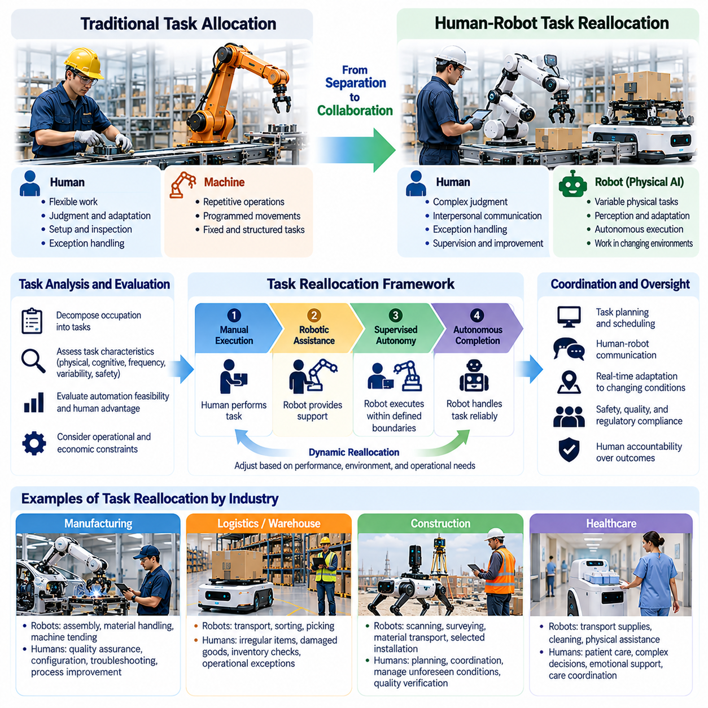{width="7.268055555555556in" height="7.268055555555556in"}

Human-robot task reallocation describes the redistribution of work between human workers and intelligent machines as Physical AI becomes integrated into productive environments. Rather than replacing entire occupations, robotic systems increasingly assume selected activities while humans retain or acquire complementary responsibilities. This transformation changes how work is organized, coordinated, supervised, and evaluated across industries.

Traditional labor allocation has generally assigned machines to repetitive operations and humans to activities requiring flexibility, judgment, and adaptation. Industrial robots execute programmed movements, while workers handle setup, inspection, maintenance, and unexpected situations. Physical AI challenges this division by enabling machines to perform increasingly variable tasks that previously required continuous human involvement.

Effective task reallocation begins with understanding the structure of work. An occupation can be decomposed into activities characterized by physical demands, cognitive complexity, frequency, variability, and safety requirements. Each activity can then be evaluated according to robotic capability, human comparative advantage, operational constraints, and economic feasibility rather than assuming that entire jobs must remain exclusively human or robotic.

Tasks involving repetitive transportation, heavy lifting, predictable manipulation, and hazardous exposure are often attractive candidates for robotic execution. Machines can potentially provide consistent performance while reducing physical strain and occupational risk. However, their suitability depends on environmental conditions, task variability, reliability, and integration costs rather than physical repetition alone.

Human workers may retain responsibilities involving ambiguous situations, ethical judgment, interpersonal communication, and complex exception handling. These activities frequently require contextual knowledge extending beyond immediate sensor observations. Human involvement also remains important when robotic decisions have significant safety, legal, or organizational consequences that require accountable oversight.

Task reallocation should be understood as a dynamic process rather than a permanent division of responsibilities. As robotic capabilities improve, activities initially requiring direct human control may transition toward supervised autonomy. Conversely, unexpected environmental conditions or equipment failures may temporarily return control to human operators, creating flexible arrangements between autonomous execution and human intervention.

A useful framework distinguishes manual execution, robotic assistance, supervised autonomy, and autonomous task completion. Manual execution places primary responsibility for physical actions on humans, while robotic assistance provides mechanical or computational support. Supervised autonomy allows robots to execute tasks independently within defined boundaries, whereas autonomous completion requires reliable handling of expected operating conditions.

The allocation of responsibility must also account for the difference between performing an action and being accountable for its consequences. A robot may independently transport materials or manipulate equipment, but organizations remain responsible for safety, quality, and regulatory compliance. Consequently, increasing machine autonomy does not automatically eliminate human supervisory and institutional responsibilities.

Human-robot collaboration introduces coordination requirements that are absent from isolated automation. Workers and robots must exchange information about task objectives, operating states, spatial constraints, and unexpected events. Effective collaboration requires interfaces that communicate machine intentions and limitations clearly, allowing humans to understand when intervention is necessary and how robotic behavior may affect surrounding activities.

Physical AI can support more adaptive allocation through real-time task planning and environmental awareness. Robots may select activities according to workload, location, available resources, and operational priorities. Human supervisors can redirect assignments when circumstances change, while fleet management systems coordinate multiple machines to reduce congestion, waiting time, and unnecessary movement.

Manufacturing provides an important example of task reallocation. Robots may perform repetitive assembly, material handling, and machine tending, while human workers concentrate on quality assurance, process improvement, equipment configuration, and troubleshooting. As intelligent manipulation improves, the boundary between automated execution and human intervention may shift toward increasingly complex production activities.

Warehouse operations demonstrate how reallocation can transform complete workflows. Autonomous mobile robots can transport inventory, while automated handling systems perform selected sorting and picking operations. Human workers may focus on irregular products, damaged goods, inventory discrepancies, and operational exceptions. Productivity improvements depend on coordinating these responsibilities rather than simply introducing additional robots.

Construction environments require particularly flexible arrangements because tasks and site conditions change continuously. Robots may perform scanning, surveying, layout marking, material transportation, and selected installation activities. Human professionals remain responsible for interpreting engineering requirements, coordinating trades, managing unforeseen conditions, and verifying that completed work satisfies safety and quality standards.

In healthcare, robotic systems may assume physically demanding transportation, supply delivery, cleaning, and selected assistance activities. Medical professionals can then allocate more attention to patient assessment, communication, and clinical decisions. Nevertheless, successful reallocation requires careful consideration of patient safety, privacy, professional responsibility, and the importance of direct human interaction.

Agriculture offers additional opportunities for redistributing physical work. Autonomous machines can support planting, monitoring, spraying, harvesting, and material transport under suitable conditions. Human operators may concentrate on crop management, equipment supervision, environmental assessment, and exceptional situations. The appropriate division depends on terrain, weather, biological variability, and seasonal operational requirements.

Task reallocation also changes the skills required from workers. Employees who previously performed repetitive physical operations may increasingly need capabilities in robot supervision, interface operation, safety monitoring, and basic troubleshooting. Technical specialists may require expertise in perception systems, control architectures, data management, and robotic maintenance, creating demand for continuous education and reskilling.

The transition can produce both augmentation and substitution effects. Augmentation occurs when robotic assistance increases human productivity or reduces physical burden, while substitution occurs when machines directly replace human effort in particular activities. Both effects may coexist within the same organization, making employment outcomes dependent on production demand, organizational strategy, and opportunities for worker reassignment.

Economic evaluation should therefore consider the complete human-robot workflow rather than isolated robotic performance. Relevant factors include task completion time, intervention frequency, system utilization, labor hours, maintenance costs, and operational reliability. A robot that performs individual actions rapidly may provide limited benefits if frequent human assistance creates bottlenecks elsewhere in the process.

Poorly designed reallocation can introduce new operational risks. Excessive reliance on automation may reduce human situational awareness, while unclear responsibility boundaries can delay intervention during failures. Workers may also experience increased cognitive workload when supervising multiple systems simultaneously. Effective deployment requires explicit operating procedures, appropriate staffing, and interfaces designed around human capabilities.

Adaptive autonomy offers a potential mechanism for balancing these concerns. Robotic systems can operate independently when confidence and environmental conditions satisfy defined requirements, while requesting assistance when uncertainty or risk increases. Such arrangements require reliable uncertainty estimation, transparent intervention requests, and safe transitions between autonomous and human-controlled operation.

World models and predictive planning may further improve task allocation by estimating future environmental states and operational consequences. A robot could anticipate congestion, identify potential task conflicts, or recognize when a planned manipulation is unlikely to succeed. Human supervisors could use these predictions to coordinate resources and intervene before local problems disrupt broader workflows.

At organizational scale, human-robot task reallocation becomes a problem of system design rather than individual machine deployment. Workstations, schedules, information systems, training programs, and management practices must evolve together. Organizations that redesign workflows around complementary human and robotic capabilities may achieve greater benefits than those attempting to reproduce existing human procedures through automation alone.

Ultimately, human-robot task reallocation represents a continuous negotiation between technological capability, economic value, safety, and human responsibility. Physical AI may progressively expand the activities machines can perform, but effective labor transformation requires thoughtful coordination rather than indiscriminate replacement. The long-term objective is to develop productive systems in which human judgment and robotic execution contribute complementary strengths.

인간-로봇 작업 재배분(Human-Robot Task Reallocation)은 피지컬 인공지능(Physical AI)이 생산 환경에 통합됨에 따라 인간 근로자와 지능형 기계(Intelligent Machine) 사이에서 작업이 재분배되는 과정을 의미한다. 로봇 시스템은 직업 전체를 대체하기보다 특정 활동을 점차 담당하게 되며, 인간은 상호 보완적인 책임을 유지하거나 새로운 역할을 맡게 된다. 이러한 변화는 산업 전반에서 작업이 조직되고, 조정되고, 감독되고, 평가되는 방식을 변화시킨다.

전통적인 노동 배분(Labor Allocation)은 일반적으로 반복적인 작업을 기계에 할당하고, 유연성(Flexibility), 판단(Judgment), 적응(Adaptation)이 필요한 활동을 인간에게 맡겨 왔다. 산업용 로봇(Industrial Robot)은 프로그래밍된 움직임을 실행하는 반면, 근로자는 설비 설정, 검사, 유지보수, 예상하지 못한 상황을 처리한다. 피지컬 인공지능은 기계가 이전에는 지속적인 인간 개입이 필요했던 가변적인 작업까지 수행할 수 있도록 함으로써 이러한 역할 구분에 변화를 가져오고 있다.

효과적인 작업 재배분(Task Reallocation)은 작업의 구조를 이해하는 것에서 시작된다. 하나의 직업(Occupation)은 물리적 요구사항(Physical Demand), 인지적 복잡성(Cognitive Complexity), 작업 빈도(Frequency), 변동성(Variability), 안전 요구사항(Safety Requirement)에 따라 여러 활동으로 분해할 수 있다. 이후 각 활동은 직업 전체를 인간이나 로봇 중 한쪽에만 배정해야 한다고 가정하는 대신 로봇의 능력, 인간의 비교우위(Comparative Advantage), 운영 제약조건(Operational Constraint), 경제적 실현 가능성(Economic Feasibility)에 따라 평가할 수 있다.

반복적인 운송(Repetitive Transportation), 중량물 취급(Heavy Lifting), 예측 가능한 조작(Predictable Manipulation), 위험 환경 노출(Hazardous Exposure)을 포함하는 작업은 로봇 실행(Robotic Execution)에 적합한 후보가 되는 경우가 많다. 기계는 일관된 성능을 제공하면서 신체적 부담과 산업재해 위험(Occupational Risk)을 줄일 수 있다. 그러나 적합성은 단순한 반복성뿐 아니라 환경 조건, 작업 변동성, 신뢰성, 시스템 통합 비용에 따라 결정된다.

인간 근로자는 모호한 상황(Ambiguous Situation), 윤리적 판단(Ethical Judgment), 대인 의사소통(Interpersonal Communication), 복잡한 예외 상황 처리(Complex Exception Handling)를 포함하는 책임을 계속 담당할 수 있다. 이러한 활동에는 즉각적인 센서 관측(Sensor Observation)을 넘어서는 맥락적 지식(Contextual Knowledge)이 필요한 경우가 많다. 또한 로봇의 결정이 안전, 법률, 조직 운영에 중대한 영향을 미치고 책임 있는 감독(Accountable Oversight)이 요구될 때 인간의 참여는 여전히 중요하다.

작업 재배분(Task Reallocation)은 영구적으로 고정된 역할 분담이 아니라 동적인 과정(Dynamic Process)으로 이해해야 한다. 로봇의 능력이 향상됨에 따라 초기에는 인간의 직접적인 제어가 필요했던 활동이 감독형 자율성(Supervised Autonomy)으로 전환될 수 있다. 반대로 예상하지 못한 환경 조건이나 장비 고장이 발생하면 제어권이 일시적으로 인간 운영자(Human Operator)에게 돌아갈 수 있으며, 이를 통해 자율 실행과 인간 개입 사이의 유연한 운영 구조가 형성된다.

유용한 분석 체계는 수동 실행(Manual Execution), 로봇 보조(Robotic Assistance), 감독형 자율성(Supervised Autonomy), 자율 작업 완료(Autonomous Task Completion)를 구분하는 것이다. 수동 실행에서는 물리적 행동의 주요 책임을 인간이 담당하며, 로봇 보조는 기계적 또는 계산적 지원을 제공한다. 감독형 자율성에서는 로봇이 정의된 범위 안에서 독립적으로 작업을 실행하며, 자율 작업 완료는 예상되는 운영 조건을 신뢰성 있게 처리할 수 있어야 한다.

책임의 배분(Responsibility Allocation)은 행동을 수행하는 것과 그 결과에 책임을 지는 것 사이의 차이도 고려해야 한다. 로봇이 자율적으로 자재를 운송하거나 장비를 조작할 수 있더라도 조직은 안전(Safety), 품질(Quality), 규제 준수(Regulatory Compliance)에 대한 책임을 유지한다. 따라서 기계의 자율성(Machine Autonomy)이 증가한다고 해서 인간의 감독 책임(Human Supervisory Responsibility)과 제도적 책임(Institutional Responsibility)이 자동으로 사라지는 것은 아니다.

인간-로봇 협업(Human-Robot Collaboration)은 독립적인 자동화(Isolated Automation)에는 존재하지 않는 추가적인 조정 요구사항(Coordination Requirement)을 발생시킨다. 근로자와 로봇은 작업 목표, 운영 상태, 공간적 제약조건(Spatial Constraint), 예상하지 못한 사건에 관한 정보를 교환해야 한다. 효과적인 협업을 위해서는 기계의 의도와 한계를 명확하게 전달하는 인터페이스(Interface)가 필요하며, 이를 통해 인간은 언제 개입해야 하는지와 로봇의 행동이 주변 활동에 어떤 영향을 미치는지 이해할 수 있어야 한다.

피지컬 인공지능(Physical AI)은 실시간 작업 계획(Real-Time Task Planning)과 환경 인식(Environmental Awareness)을 통해 더욱 적응적인 작업 배분(Adaptive Task Allocation)을 지원할 수 있다. 로봇은 작업량(Workload), 위치(Location), 사용 가능한 자원(Available Resource), 운영 우선순위(Operational Priority)에 따라 활동을 선택할 수 있다. 상황이 변화하면 인간 감독자가 작업 할당을 조정할 수 있으며, 로봇 군집 관리 시스템(Fleet Management System)은 여러 기계를 조정하여 혼잡, 대기시간, 불필요한 이동을 줄일 수 있다.

제조업(Manufacturing)은 작업 재배분의 중요한 사례를 제공한다. 로봇은 반복적인 조립(Assembly), 자재 취급(Material Handling), 기계 작업 보조(Machine Tending)를 수행할 수 있으며, 인간 근로자는 품질보증(Quality Assurance), 공정 개선(Process Improvement), 장비 설정(Equipment Configuration), 문제 해결(Troubleshooting)에 집중할 수 있다. 지능형 조작(Intelligent Manipulation) 능력이 향상됨에 따라 자동화된 실행과 인간 개입 사이의 경계는 더욱 복잡한 생산 활동으로 이동할 수 있다.

창고 운영(Warehouse Operations)은 작업 재배분이 전체 작업 흐름(Workflow)을 어떻게 변화시킬 수 있는지 보여준다. 자율이동로봇(Autonomous Mobile Robot)은 재고를 운송할 수 있으며, 자동화된 취급 시스템(Automated Handling System)은 일부 분류(Sorting) 및 피킹(Picking) 작업을 수행할 수 있다. 인간 근로자는 불규칙한 제품, 손상된 상품, 재고 불일치, 운영상 예외 상황에 집중할 수 있다. 생산성 향상은 단순히 로봇을 추가하는 것이 아니라 이러한 책임을 효과적으로 조정하는 데 달려 있다.

건설 환경(Construction Environment)은 작업과 현장 조건이 지속적으로 변화하기 때문에 특히 유연한 운영 구조를 필요로 한다. 로봇은 스캐닝(Scanning), 측량(Surveying), 위치 표시(Layout Marking), 자재 운송(Material Transportation), 일부 설치 작업(Installation Activity)을 수행할 수 있다. 인간 전문가는 엔지니어링 요구사항(Engineering Requirement)을 해석하고, 공종 간 작업을 조정하며, 예상하지 못한 현장 조건을 관리하고, 완료된 작업이 안전 및 품질 기준을 충족하는지 검증하는 책임을 계속 담당한다.

의료(Healthcare) 분야에서 로봇 시스템은 신체적 부담이 큰 운송, 의료 물품 배송(Supply Delivery), 청소(Cleaning), 일부 보조 활동(Assistance Activity)을 담당할 수 있다. 의료 전문가는 환자 평가(Patient Assessment), 의사소통(Communication), 임상적 의사결정(Clinical Decision-Making)에 더 많은 주의를 기울일 수 있다. 그러나 성공적인 작업 재배분을 위해서는 환자 안전(Patient Safety), 개인정보 보호(Privacy), 전문적 책임(Professional Responsibility), 직접적인 인간 상호작용(Human Interaction)의 중요성을 신중하게 고려해야 한다.

농업(Agriculture)은 물리적 작업을 재분배할 수 있는 추가적인 기회를 제공한다. 자율 기계(Autonomous Machine)는 적절한 조건에서 파종(Planting), 모니터링(Monitoring), 살포(Spraying), 수확(Harvesting), 자재 운송(Material Transport)을 지원할 수 있다. 인간 운영자는 작물 관리(Crop Management), 장비 감독(Equipment Supervision), 환경 평가(Environmental Assessment), 예외 상황 처리에 집중할 수 있다. 적절한 역할 분담은 지형(Terrain), 날씨(Weather), 생물학적 변동성(Biological Variability), 계절별 운영 요구사항(Seasonal Operational Requirement)에 따라 달라진다.

작업 재배분(Task Reallocation)은 근로자에게 요구되는 기술(Skill)도 변화시킨다. 이전에 반복적인 물리 작업을 수행하던 직원은 점차 로봇 감독(Robot Supervision), 인터페이스 운영(Interface Operation), 안전 모니터링(Safety Monitoring), 기본적인 문제 해결(Basic Troubleshooting) 능력을 필요로 할 수 있다. 기술 전문가는 인식 시스템(Perception System), 제어 아키텍처(Control Architecture), 데이터 관리(Data Management), 로봇 유지보수(Robotic Maintenance)에 대한 전문성을 필요로 하며, 이는 지속적인 교육(Continuous Education)과 재교육(Reskilling)에 대한 수요를 창출한다.

이러한 전환은 노동 증강(Augmentation)과 노동 대체(Substitution) 효과를 동시에 발생시킬 수 있다. 노동 증강은 로봇의 지원이 인간의 생산성을 높이거나 신체적 부담을 줄일 때 발생하며, 노동 대체는 기계가 특정 활동에서 인간의 노동을 직접 대신할 때 발생한다. 두 효과는 동일한 조직 안에서도 공존할 수 있으므로 고용 결과(Employment Outcome)는 생산 수요(Production Demand), 조직 전략(Organizational Strategy), 근로자 재배치(Worker Reassignment)의 기회에 따라 달라진다.

따라서 경제적 평가(Economic Evaluation)는 개별 로봇의 성능이 아니라 전체 인간-로봇 작업 흐름(Human-Robot Workflow)을 고려해야 한다. 관련 요소에는 작업 완료 시간(Task Completion Time), 개입 빈도(Intervention Frequency), 시스템 활용률(System Utilization), 노동시간(Labor Hours), 유지보수 비용(Maintenance Cost), 운영 신뢰성(Operational Reliability)이 포함된다. 로봇이 개별 행동을 빠르게 수행하더라도 빈번한 인간의 지원이 다른 공정에서 병목현상(Bottleneck)을 발생시킨다면 전체적인 효과는 제한적일 수 있다.

잘못 설계된 작업 재배분(Poorly Designed Task Reallocation)은 새로운 운영 위험(Operational Risk)을 초래할 수 있다. 자동화에 대한 과도한 의존은 인간의 상황 인식(Situational Awareness)을 감소시킬 수 있으며, 불명확한 책임 경계(Responsibility Boundary)는 고장 발생 시 개입을 지연시킬 수 있다. 또한 근로자가 여러 시스템을 동시에 감독할 경우 인지적 작업 부하(Cognitive Workload)가 증가할 수 있다. 효과적인 배치를 위해서는 명확한 운영 절차(Operating Procedure), 적절한 인력 배치(Staffing), 인간의 능력을 고려한 인터페이스 설계(Interface Design)가 필요하다.

적응형 자율성(Adaptive Autonomy)은 이러한 문제의 균형을 맞추기 위한 잠재적인 메커니즘을 제공한다. 로봇 시스템은 신뢰도(Confidence)와 환경 조건이 정의된 요구사항을 충족할 때 독립적으로 작동하고, 불확실성(Uncertainty)이나 위험(Risk)이 증가하면 지원을 요청할 수 있다. 이러한 운영 구조에는 신뢰할 수 있는 불확실성 추정(Uncertainty Estimation), 명확한 개입 요청(Intervention Request), 자율 제어와 인간 제어 사이의 안전한 전환(Safe Transition)이 필요하다.

월드 모델(World Model)과 예측 기반 계획(Predictive Planning)은 미래 환경 상태(Future Environmental State)와 운영 결과(Operational Consequence)를 추정함으로써 작업 배분을 더욱 개선할 수 있다. 로봇은 혼잡(Congestion)을 예측하고, 잠재적인 작업 충돌(Task Conflict)을 식별하거나, 계획된 조작이 실패할 가능성을 인식할 수 있다. 인간 감독자는 이러한 예측을 활용하여 자원을 조정하고 국지적인 문제가 전체 작업 흐름을 방해하기 전에 개입할 수 있다.

조직 규모(Organizational Scale)에서 인간-로봇 작업 재배분(Human-Robot Task Reallocation)은 개별 기계의 배치 문제가 아니라 시스템 설계(System Design)의 문제가 된다. 작업장(Workstation), 일정(Schedule), 정보 시스템(Information System), 교육 프로그램(Training Program), 관리 방식(Management Practice)이 함께 발전해야 한다. 기존의 인간 작업 절차를 자동화로 단순히 재현하려는 조직보다 인간과 로봇의 상호 보완적인 능력을 중심으로 작업 흐름을 재설계하는 조직이 더 큰 효과를 달성할 수 있다.

궁극적으로 인간-로봇 작업 재배분(Human-Robot Task Reallocation)은 기술적 능력(Technological Capability), 경제적 가치(Economic Value), 안전(Safety), 인간의 책임(Human Responsibility) 사이에서 지속적으로 균형을 조정하는 과정이다. 피지컬 인공지능(Physical AI)은 기계가 수행할 수 있는 활동의 범위를 점진적으로 확장할 수 있지만, 효과적인 노동 구조의 변화에는 무분별한 대체가 아니라 신중한 조정이 필요하다. 장기적인 목표는 인간의 판단(Human Judgment)과 로봇의 실행(Robotic Execution)이 상호 보완적인 강점을 발휘하는 생산 시스템(Productive System)을 구축하는 것이다.

##  

## 01.05. Augmentation vs Substitution

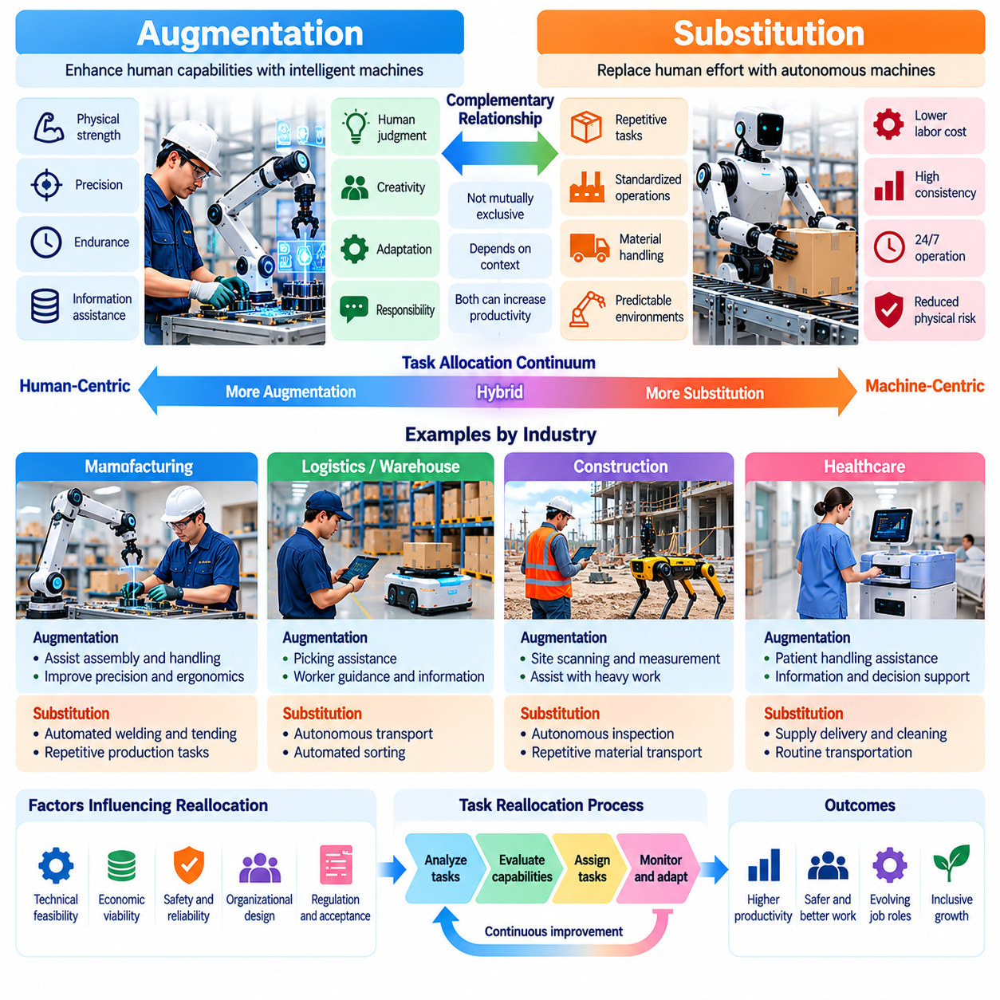{width="7.268055555555556in" height="7.268055555555556in"}

Augmentation and substitution represent two distinct mechanisms through which Physical AI transforms human labor. Augmentation occurs when intelligent machines enhance human capabilities, productivity, or safety, while substitution occurs when robotic systems replace human effort in particular tasks. These mechanisms are not mutually exclusive, and their relative importance depends on technological capabilities, economic incentives, organizational design, and the characteristics of work.

Human augmentation emphasizes cooperation between workers and intelligent machines rather than the elimination of human participation. Robots can provide physical strength, precision, endurance, and computational assistance while humans contribute contextual judgment, creativity, and responsibility. This complementary relationship allows organizations to improve operational performance without necessarily transferring complete control of productive activities to autonomous systems.

Substitution involves transferring activities previously performed by humans to machines capable of executing them independently. Industrial robots replacing manual welding, autonomous vehicles performing selected transportation tasks, and automated handling systems moving warehouse inventory illustrate this mechanism. However, replacing individual activities does not automatically imply eliminating entire occupations, because remaining responsibilities may still require human participation.

The distinction between augmentation and substitution becomes clearer when examining task-level productivity. Augmentation increases the effectiveness of human effort by improving the tools and information available to workers. Substitution reduces the amount of direct human labor required for specific activities. Both mechanisms can increase output per labor hour, but their consequences for employment, wages, skill requirements, and organizational structures may differ substantially.

Physical AI introduces new possibilities for augmentation through intelligent perception, adaptive manipulation, and predictive assistance. A robotic assistant may identify objects, position components, stabilize heavy equipment, or recommend safer movement sequences. Human workers retain authority over important decisions while benefiting from machine capabilities that extend their physical reach, reduce fatigue, and improve execution consistency.

Collaborative robots provide a practical example of augmentation in manufacturing environments. These systems may assist workers with repetitive positioning, component handling, and precision assembly while humans perform complex adjustments and quality verification. Successful collaboration depends on appropriate safety measures, clear responsibility boundaries, and task designs that account for the capabilities and limitations of both participants.

Substitution becomes economically attractive when machines can perform activities at acceptable quality and reliability with lower total operating costs. Repetitive transportation, standardized material handling, and predictable production operations are common candidates. Nevertheless, acquisition expenses, maintenance requirements, energy consumption, supervision, and integration costs must be considered before concluding that robotic substitution provides an economic advantage.

Augmentation can also produce substantial economic benefits by reducing errors, improving ergonomics, and increasing the productive capacity of experienced workers. In some applications, a human supported by intelligent tools may outperform either an unaided worker or a fully autonomous machine. This possibility is particularly important in environments where task variability and exceptional situations make complete automation difficult.

The relationship between augmentation and substitution is dynamic rather than fixed. A robotic system may initially operate as an assistant, gradually assume greater responsibility, and eventually execute selected tasks autonomously. Conversely, activities previously automated may require renewed human participation when operating conditions become uncertain. The resulting division of labor can evolve as technology, infrastructure, and organizational requirements change.

A central determinant of this evolution is the reliability of autonomous execution. Systems that perform well under controlled conditions may still require extensive human supervision in unfamiliar environments. When failure consequences are significant, augmentation may remain preferable even if substitution is technically possible. Safety-critical industries therefore often adopt staged autonomy rather than transferring complete operational authority immediately.

Manufacturing demonstrates how both mechanisms can coexist within the same production system. Autonomous robots may substitute for manual material transfer or repetitive welding, while collaborative manipulators augment workers during complex assembly. Human technicians may also use AI-based inspection and predictive maintenance tools. The combined effect is a redistribution of tasks rather than a uniform movement toward complete workforce replacement.

Warehouse and logistics operations exhibit similar patterns. Autonomous mobile robots can substitute for routine inventory transportation, while intelligent picking assistance can augment workers handling diverse products. Supervisors coordinate automated workflows and resolve exceptions that exceed machine capabilities. The balance between augmentation and substitution depends on product variability, facility design, throughput requirements, and system reliability.

Construction presents strong opportunities for augmentation because worksites contain changing layouts, irregular materials, and complex coordination requirements. Robots can assist with surveying, scanning, material positioning, and physically demanding operations. Substitution may become feasible for selected repetitive tasks, but comprehensive automation remains constrained by environmental uncertainty, safety obligations, and the need for professional judgment.

Healthcare highlights the importance of maintaining human participation even when physical automation becomes technically capable. Robots may augment medical professionals through patient handling, rehabilitation assistance, and supply transportation. Certain logistical activities may be substituted, but clinical decisions, patient relationships, and professional accountability require careful governance. Automation strategies must therefore consider human dignity alongside operational efficiency.

Agriculture provides another setting in which augmentation and substitution can develop simultaneously. Intelligent equipment may assist farmers with crop monitoring, precision spraying, and harvesting decisions, while autonomous machines perform selected field operations. Environmental variability, seasonal demand, and biological uncertainty influence which tasks can be substituted and which benefit more from human-machine cooperation.

The economic consequences of augmentation and substitution depend partly on demand responses. Productivity improvements may lower production costs, increase output, and create additional demand for complementary labor. However, substitution can also reduce employment in particular tasks or occupations when displaced workers cannot transition into new roles. These outcomes vary across industries and cannot be determined from technological capability alone.

Wage effects are similarly complex. Augmentation may increase the productivity and bargaining value of workers whose expertise becomes more effective with intelligent tools. Substitution may reduce demand for certain routine skills while increasing demand for robotics engineering, supervision, and maintenance. The distribution of benefits depends on labor market institutions, worker mobility, training opportunities, and ownership of productive technologies.

Organizational design plays a decisive role in determining whether Physical AI primarily augments or substitutes human labor. Companies can introduce robots to support existing workers, redesign processes around autonomous execution, or combine both approaches. Decisions about staffing, training, workflow integration, and performance evaluation influence whether technological improvements translate into broader productivity gains or concentrated labor displacement.

Human-centered automation emphasizes preserving meaningful human control, particularly when decisions involve safety, ethical responsibility, or complex social interactions. Augmentation strategies can support this objective by keeping workers actively involved in operational decisions. However, poorly designed assistance systems may increase monitoring burdens, reduce autonomy, or create excessive dependence on machine recommendations.

Substitution strategies also require governance mechanisms that clarify responsibility for autonomous behavior. Organizations must establish procedures for monitoring, intervention, maintenance, and incident investigation. Even when robots independently execute physical activities, accountability remains with the relevant human and institutional actors. Effective automation therefore requires operational oversight rather than assuming autonomy eliminates responsibility.

Physical AI architectures can support flexible transitions between augmentation and substitution through adaptive autonomy. Robots may execute routine actions independently while requesting assistance when uncertainty, environmental complexity, or risk exceeds defined thresholds. World models, predictive planning, and confidence estimation can help determine when autonomous execution is appropriate and when human judgment should guide the next action.

Evaluating these strategies requires metrics extending beyond the number of tasks automated. Relevant measures include productivity per worker, total operating cost, task completion reliability, intervention frequency, workplace safety, worker satisfaction, and employment outcomes. Such evaluations should also consider whether automation improves overall system performance or merely transfers hidden costs and responsibilities to remaining employees.

Over the longer term, advances in generalist robotic systems may expand the technical feasibility of substitution across increasingly diverse physical tasks. Nevertheless, augmentation may remain economically and socially valuable where human expertise, adaptability, and accountability provide complementary advantages. The future balance will depend on technological maturity, institutional choices, and how organizations distribute the benefits of intelligent automation.

Ultimately, augmentation and substitution should be understood as alternative but interconnected pathways for integrating Physical AI into human production systems. Their significance extends beyond whether robots replace workers, encompassing how technology changes human capabilities, organizational responsibilities, and economic opportunity. A sustainable transition requires aligning robotic productivity with human well-being, safety, and equitable access to the benefits of technological progress.

노동 증강(Augmentation)과 노동 대체(Substitution)는 피지컬 인공지능(Physical AI)이 인간 노동(Human Labor)을 변화시키는 서로 다른 두 가지 메커니즘(Mechanism)을 나타낸다. 노동 증강은 지능형 기계(Intelligent Machine)가 인간의 능력, 생산성 또는 안전성을 향상시킬 때 발생하며, 노동 대체는 로봇 시스템(Robotic System)이 특정 작업에서 인간의 노동을 대신할 때 발생한다. 이러한 메커니즘은 상호 배타적이지 않으며, 상대적인 중요성은 기술적 능력(Technological Capability), 경제적 유인(Economic Incentive), 조직 설계(Organizational Design), 작업 특성(Task Characteristic)에 따라 달라진다.

인간 능력 증강(Human Augmentation)은 인간의 참여를 제거하기보다 근로자와 지능형 기계 사이의 협력을 강조한다. 로봇은 물리적 힘(Physical Strength), 정밀도(Precision), 지속 작업 능력(Endurance), 계산 지원(Computational Assistance)을 제공할 수 있으며, 인간은 맥락적 판단(Contextual Judgment), 창의성(Creativity), 책임(Responsibility)을 담당한다. 이러한 상호 보완적 관계(Complementary Relationship)를 통해 조직은 생산 활동에 대한 완전한 통제권을 자율 시스템(Autonomous System)에 이전하지 않고도 운영 성과(Operational Performance)를 향상시킬 수 있다.

노동 대체(Substitution)는 이전에 인간이 수행하던 활동을 독립적으로 실행할 수 있는 기계에 이전하는 것을 의미한다. 수작업 용접(Manual Welding)을 대체하는 산업용 로봇(Industrial Robot), 일부 운송 작업을 수행하는 자율주행차(Autonomous Vehicle), 창고 재고를 이동시키는 자동화된 취급 시스템(Automated Handling System)이 이러한 메커니즘의 사례이다. 그러나 개별 활동의 대체가 반드시 직업 전체의 소멸을 의미하지는 않는다. 남아 있는 업무에는 여전히 인간의 참여가 필요할 수 있기 때문이다.

노동 증강과 노동 대체의 차이는 작업 수준 생산성(Task-Level Productivity)을 분석할 때 더욱 명확해진다. 노동 증강은 근로자가 활용할 수 있는 도구와 정보를 개선하여 인간 노동의 효과를 높인다. 노동 대체는 특정 활동에 필요한 직접적인 인간 노동의 양을 감소시킨다. 두 메커니즘 모두 노동시간당 산출량(Output per Labor Hour)을 증가시킬 수 있지만, 고용(Employment), 임금(Wages), 기술 요구사항(Skill Requirement), 조직 구조(Organizational Structure)에 미치는 영향은 상당히 다를 수 있다.

피지컬 인공지능(Physical AI)은 지능형 인식(Intelligent Perception), 적응형 조작(Adaptive Manipulation), 예측 기반 지원(Predictive Assistance)을 통해 인간 능력 증강의 새로운 가능성을 제공한다. 로봇 보조 시스템(Robotic Assistant)은 물체를 식별하고, 부품의 위치를 조정하며, 무거운 장비를 안정화하거나, 더욱 안전한 동작 순서(Movement Sequence)를 제안할 수 있다. 인간 근로자는 중요한 의사결정에 대한 권한을 유지하면서 작업 범위를 확장하고 피로를 줄이며 실행의 일관성을 향상시키는 기계의 능력을 활용할 수 있다.

협동로봇(Collaborative Robot)은 제조 환경에서 인간 능력 증강의 실질적인 사례를 제공한다. 이러한 시스템은 반복적인 위치 결정(Positioning), 부품 취급(Component Handling), 정밀 조립(Precision Assembly)을 지원할 수 있으며, 인간은 복잡한 조정(Complex Adjustment)과 품질 검증(Quality Verification)을 수행한다. 성공적인 협업은 적절한 안전 조치(Safety Measure), 명확한 책임 경계(Responsibility Boundary), 인간과 로봇 모두의 능력과 한계를 고려한 작업 설계(Task Design)에 달려 있다.

노동 대체(Substitution)는 기계가 허용 가능한 품질과 신뢰성을 유지하면서 더 낮은 총운영비용(Total Operating Cost)으로 작업을 수행할 수 있을 때 경제적으로 매력적이다. 반복적인 운송(Repetitive Transportation), 표준화된 자재 취급(Standardized Material Handling), 예측 가능한 생산 작업(Predictable Production Operation)이 대표적인 후보이다. 그러나 로봇을 통한 노동 대체가 경제적 이점(Economic Advantage)을 제공한다고 판단하기 전에 장비 도입 비용(Acquisition Expense), 유지보수 요구사항(Maintenance Requirement), 에너지 소비(Energy Consumption), 감독(Supervision), 시스템 통합 비용(Integration Cost)을 고려해야 한다.

노동 증강(Augmentation)은 오류 감소(Error Reduction), 인간공학적 개선(Ergonomic Improvement), 숙련 근로자의 생산 능력(Productive Capacity) 향상을 통해 상당한 경제적 이익을 창출할 수 있다. 일부 응용 분야에서는 지능형 도구(Intelligent Tool)의 지원을 받는 인간이 지원받지 않는 근로자나 완전 자율 기계(Fully Autonomous Machine)보다 더 높은 성과를 달성할 수 있다. 이러한 가능성은 작업 변동성(Task Variability)과 예외 상황(Exceptional Situation)으로 인해 완전 자동화(Complete Automation)가 어려운 환경에서 특히 중요하다.

노동 증강과 노동 대체 사이의 관계는 고정된 것이 아니라 동적(Dynamic)이다. 로봇 시스템은 처음에는 보조자(Assistant)로 작동하다가 점차 더 많은 책임을 맡고, 궁극적으로 일부 작업을 자율적으로 실행할 수 있다. 반대로 이전에 자동화되었던 활동도 운영 조건이 불확실해지면 인간의 참여가 다시 필요할 수 있다. 따라서 노동 분업(Division of Labor)은 기술, 인프라(Infrastructure), 조직적 요구사항(Organizational Requirement)의 변화에 따라 발전할 수 있다.

이러한 발전을 결정하는 핵심 요인 중 하나는 자율 실행의 신뢰성(Autonomous Execution Reliability)이다. 통제된 조건(Controlled Condition)에서 우수한 성능을 보이는 시스템도 익숙하지 않은 환경에서는 광범위한 인간 감독(Human Supervision)을 필요로 할 수 있다. 실패의 결과(Failure Consequence)가 중대한 경우에는 노동 대체가 기술적으로 가능하더라도 노동 증강이 더 적합할 수 있다. 따라서 안전 필수 산업(Safety-Critical Industry)은 완전한 운영 권한을 즉시 이전하기보다 단계적 자율성(Staged Autonomy)을 채택하는 경우가 많다.

제조업(Manufacturing)은 두 메커니즘이 동일한 생산 시스템(Production System) 안에서 공존할 수 있음을 보여준다. 자율 로봇(Autonomous Robot)은 수작업 자재 운반이나 반복적인 용접을 대체할 수 있으며, 협동형 매니퓰레이터(Collaborative Manipulator)는 복잡한 조립 과정에서 근로자를 지원할 수 있다. 인간 기술자(Human Technician)는 인공지능 기반 검사(AI-Based Inspection)와 예지보전(Predictive Maintenance) 도구도 활용할 수 있다. 이러한 결합의 결과는 전체 노동력을 일률적으로 대체하는 것이 아니라 작업의 재배분(Task Reallocation)으로 나타난다.

창고 및 물류 운영(Warehouse and Logistics Operations)에서도 유사한 양상이 나타난다. 자율이동로봇(Autonomous Mobile Robot)은 일상적인 재고 운송을 대체할 수 있으며, 지능형 피킹 지원(Intelligent Picking Assistance)은 다양한 제품을 취급하는 근로자의 능력을 증강할 수 있다. 감독자(Supervisor)는 자동화된 작업 흐름(Automated Workflow)을 조정하고 기계의 능력을 초과하는 예외 상황을 해결한다. 노동 증강과 노동 대체 사이의 균형은 제품 다양성(Product Variability), 시설 설계(Facility Design), 처리량 요구사항(Throughput Requirement), 시스템 신뢰성(System Reliability)에 따라 달라진다.

건설(Construction)은 작업 현장의 배치가 지속적으로 변화하고 불규칙한 자재와 복잡한 조정 요구사항이 존재하기 때문에 노동 증강의 가능성이 큰 분야이다. 로봇은 측량(Surveying), 스캐닝(Scanning), 자재 위치 결정(Material Positioning), 신체적 부담이 큰 작업을 지원할 수 있다. 일부 반복적인 작업에서는 노동 대체가 가능해질 수 있지만, 포괄적인 자동화(Comprehensive Automation)는 환경적 불확실성(Environmental Uncertainty), 안전 의무(Safety Obligation), 전문적 판단(Professional Judgment)의 필요성으로 인해 여전히 제약을 받는다.

의료(Healthcare)는 물리적 자동화가 기술적으로 가능해지더라도 인간의 참여를 유지하는 것이 중요함을 보여준다. 로봇은 환자 이동 보조(Patient Handling), 재활 지원(Rehabilitation Assistance), 의료 물품 운송(Supply Transportation)을 통해 의료 전문가(Medical Professional)의 능력을 증강할 수 있다. 일부 물류 활동은 대체될 수 있지만, 임상적 의사결정(Clinical Decision), 환자와의 관계(Patient Relationship), 전문적 책임(Professional Accountability)에는 신중한 거버넌스(Governance)가 필요하다. 따라서 자동화 전략(Automation Strategy)은 운영 효율성(Operational Efficiency)과 함께 인간의 존엄성(Human Dignity)을 고려해야 한다.

농업(Agriculture)은 노동 증강과 노동 대체가 동시에 발전할 수 있는 또 다른 환경이다. 지능형 장비(Intelligent Equipment)는 작물 모니터링(Crop Monitoring), 정밀 살포(Precision Spraying), 수확 의사결정(Harvesting Decision)을 지원할 수 있으며, 자율 기계(Autonomous Machine)는 일부 농경지 작업(Field Operation)을 수행할 수 있다. 환경적 변동성(Environmental Variability), 계절적 수요(Seasonal Demand), 생물학적 불확실성(Biological Uncertainty)은 어떤 작업을 대체할 수 있고 어떤 작업이 인간과 기계의 협력(Human-Machine Cooperation)을 통해 더 큰 이익을 얻을 수 있는지를 결정하는 데 영향을 미친다.

노동 증강과 노동 대체의 경제적 결과(Economic Consequence)는 부분적으로 수요 반응(Demand Response)에 따라 달라진다. 생산성 향상(Productivity Improvement)은 생산 비용을 낮추고 산출량을 증가시키며 보완적 노동(Complementary Labor)에 대한 추가 수요를 창출할 수 있다. 그러나 노동 대체는 대체된 근로자가 새로운 역할로 전환할 수 없는 경우 특정 작업이나 직업의 고용을 감소시킬 수도 있다. 이러한 결과는 산업별로 다르며 기술적 능력만으로 결정할 수 없다.

임금 효과(Wage Effect) 역시 복잡하다. 노동 증강은 지능형 도구를 통해 전문성이 더욱 효과적으로 활용되는 근로자의 생산성과 협상 가치(Bargaining Value)를 높일 수 있다. 노동 대체는 일부 반복적인 기술(Routine Skill)에 대한 수요를 감소시키는 동시에 로봇공학(Robotics Engineering), 감독(Supervision), 유지보수(Maintenance)에 대한 수요를 증가시킬 수 있다. 이익의 분배(Distribution of Benefits)는 노동시장 제도(Labor Market Institution), 근로자 이동성(Worker Mobility), 교육 기회(Training Opportunity), 생산 기술의 소유권(Ownership of Productive Technologies)에 따라 달라진다.

조직 설계(Organizational Design)는 피지컬 인공지능(Physical AI)이 주로 인간 노동을 증강할 것인지 대체할 것인지를 결정하는 데 중요한 역할을 한다. 기업은 기존 근로자를 지원하기 위해 로봇을 도입하거나, 자율 실행(Autonomous Execution)을 중심으로 공정을 재설계하거나, 두 접근법을 결합할 수 있다. 인력 배치(Staffing), 교육(Training), 작업 흐름 통합(Workflow Integration), 성과 평가(Performance Evaluation)에 관한 결정은 기술적 개선이 광범위한 생산성 향상으로 이어질지, 아니면 특정 근로자 집단에 집중된 노동 대체(Labor Displacement)로 이어질지에 영향을 미친다.

인간 중심 자동화(Human-Centered Automation)는 특히 안전, 윤리적 책임(Ethical Responsibility), 복잡한 사회적 상호작용(Social Interaction)이 관련된 의사결정에서 의미 있는 인간 통제(Meaningful Human Control)를 유지하는 것을 강조한다. 노동 증강 전략(Augmentation Strategy)은 근로자가 운영상 의사결정에 적극적으로 참여하도록 함으로써 이러한 목표를 지원할 수 있다. 그러나 잘못 설계된 지원 시스템(Assistance System)은 감독 부담(Monitoring Burden)을 증가시키고 자율성(Autonomy)을 감소시키거나 기계의 권고(Machine Recommendation)에 대한 과도한 의존을 초래할 수 있다.

노동 대체 전략(Substitution Strategy)에도 자율적 행동(Autonomous Behavior)에 대한 책임을 명확히 하는 거버넌스 메커니즘(Governance Mechanism)이 필요하다. 조직은 모니터링(Monitoring), 개입(Intervention), 유지보수(Maintenance), 사고 조사(Incident Investigation)를 위한 절차를 수립해야 한다. 로봇이 물리적 활동을 독립적으로 실행하더라도 책임(Accountability)은 관련 인간과 제도적 주체(Institutional Actor)에게 남아 있다. 따라서 효과적인 자동화는 자율성이 책임을 제거한다고 가정하는 것이 아니라 운영 감독(Operational Oversight)을 필요로 한다.

피지컬 인공지능 아키텍처(Physical AI Architecture)는 적응형 자율성(Adaptive Autonomy)을 통해 노동 증강과 노동 대체 사이의 유연한 전환을 지원할 수 있다. 로봇은 일상적인 행동을 독립적으로 실행하면서 불확실성(Uncertainty), 환경적 복잡성(Environmental Complexity), 위험(Risk)이 정의된 임계값(Threshold)을 초과하면 지원을 요청할 수 있다. 월드 모델(World Model), 예측 기반 계획(Predictive Planning), 신뢰도 추정(Confidence Estimation)은 언제 자율 실행이 적절하고 언제 인간의 판단이 다음 행동을 이끌어야 하는지를 결정하는 데 도움을 줄 수 있다.

이러한 전략을 평가하려면 자동화된 작업의 수를 넘어서는 평가 지표(Evaluation Metric)가 필요하다. 관련 지표에는 근로자당 생산성(Productivity per Worker), 총운영비용(Total Operating Cost), 작업 완료 신뢰성(Task Completion Reliability), 개입 빈도(Intervention Frequency), 작업장 안전(Workplace Safety), 근로자 만족도(Worker Satisfaction), 고용 결과(Employment Outcome)가 포함된다. 또한 자동화가 전체 시스템 성능(Overall System Performance)을 개선하는지, 아니면 숨겨진 비용과 책임(Hidden Cost and Responsibility)을 남아 있는 직원에게 이전하는 데 그치는지도 고려해야 한다.

장기적으로 범용 로봇 시스템(Generalist Robotic System)의 발전은 점점 더 다양한 물리적 작업에서 노동 대체의 기술적 실현 가능성(Technical Feasibility)을 확대할 수 있다. 그럼에도 불구하고 인간의 전문성(Human Expertise), 적응성(Adaptability), 책임성(Accountability)이 상호 보완적인 이점을 제공하는 환경에서는 노동 증강이 경제적·사회적으로 계속 가치 있는 접근법으로 남을 수 있다. 미래의 균형은 기술적 성숙도(Technological Maturity), 제도적 선택(Institutional Choice), 조직이 지능형 자동화의 이익을 분배하는 방식에 따라 달라질 것이다.

궁극적으로 노동 증강(Augmentation)과 노동 대체(Substitution)는 피지컬 인공지능(Physical AI)을 인간의 생산 시스템(Human Production System)에 통합하는 서로 다르지만 상호 연결된 경로로 이해해야 한다. 그 중요성은 로봇이 근로자를 대체하는지의 여부를 넘어 기술이 인간의 능력(Human Capability), 조직적 책임(Organizational Responsibility), 경제적 기회(Economic Opportunity)를 어떻게 변화시키는지까지 포함한다. 지속 가능한 전환(Sustainable Transition)을 위해서는 로봇 생산성(Robotic Productivity)을 인간의 복지(Human Well-Being), 안전(Safety), 기술 발전의 이익에 대한 공평한 접근(Equitable Access)과 조화시키는 것이 필요하다.

##  

## 01.06. Manufacturing and Logistics Labor Transformation

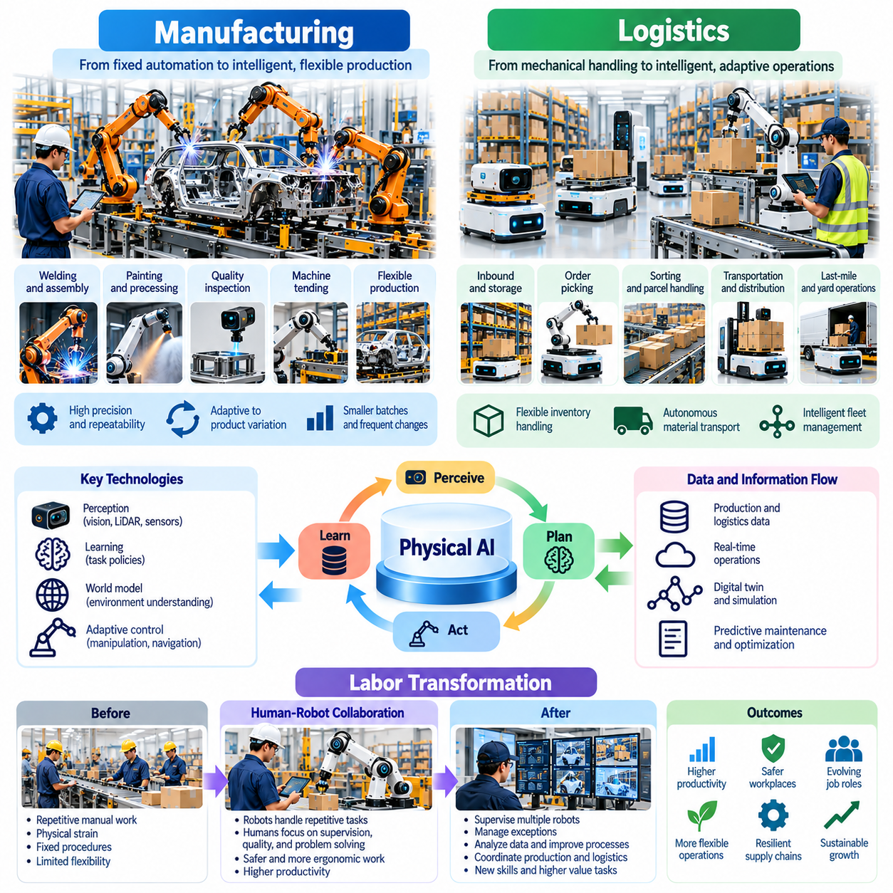{width="7.268055555555556in" height="7.268055555555556in"}

Manufacturing and logistics represent two of the most significant environments for Physical AI-driven labor transformation. Both industries depend on repetitive physical operations, coordinated material flows, and increasingly complex information systems. Intelligent robots can extend automation beyond fixed production sequences, enabling more adaptive execution while changing the responsibilities, skills, and organizational roles of human workers.

Traditional manufacturing automation has concentrated on structured production lines where industrial robots perform welding, assembly, painting, and material handling. These systems deliver high precision and repeatability but often require extensive programming and predictable operating conditions. Physical AI introduces perception, learning, and adaptive control, allowing robotic systems to respond to greater variability in products, materials, and production environments.

The transition toward intelligent manufacturing changes the relationship between workers and machines. Human operators who previously performed repetitive manual operations may increasingly supervise robotic cells, configure equipment, and resolve production exceptions. Robots assume selected execution tasks, while workers become responsible for maintaining operational continuity, interpreting quality information, and coordinating adjustments across production processes.

Flexible manufacturing creates particularly strong demand for adaptive robotic capabilities. Modern factories increasingly handle product variations, smaller production batches, and frequent configuration changes. Traditional automation can become expensive when every variation requires extensive reprogramming. Physical AI can potentially reduce this burden through vision-based manipulation, learned task policies, and more adaptable motion planning.

Human-robot collaboration is another important mechanism of manufacturing transformation. Collaborative robotic systems can assist workers with component positioning, repetitive assembly, and physically demanding handling operations. Humans retain responsibility for complex adjustments, inspection, and exceptional decisions. Effective collaboration requires safety-aware control, intuitive interfaces, and clear procedures for coordinating movement within shared workspaces.

Quality assurance is also evolving through the integration of cognitive and physical automation. Computer vision systems can identify visible defects, while robotic inspection platforms collect measurements from multiple positions. Human specialists interpret uncertain findings, investigate root causes, and determine corrective actions. This combination can shift labor from repetitive inspection toward analytical quality management and continuous process improvement.

Predictive maintenance changes the work of manufacturing technicians by connecting sensor measurements, equipment histories, and machine learning models. Intelligent systems can identify abnormal vibration, temperature, or performance patterns that suggest emerging failures. Maintenance personnel can then prioritize inspections and interventions, although reliable diagnosis still requires engineering judgment and knowledge of physical equipment behavior.

Intralogistics provides a direct connection between manufacturing and broader logistics operations. Autonomous mobile robots transport components, tools, and finished products between production stations and storage areas. Fleet management systems coordinate assignments, routes, and charging schedules. Human logistics personnel increasingly supervise material availability, handle unusual transport requirements, and resolve disruptions affecting production flow.

Warehouse automation is undergoing a similar transformation from fixed mechanical systems toward adaptive robotic operations. Traditional conveyors and automated storage systems efficiently handle standardized flows but may be difficult to modify. Physical AI enables mobile platforms, robotic manipulators, and perception systems to interact with more diverse inventory configurations, supporting flexible warehouse layouts and changing fulfillment requirements.

Order picking remains a challenging area because products vary in shape, weight, packaging, and mechanical properties. Robotic systems must identify objects, estimate grasping conditions, and manipulate items without causing damage. Human workers may continue handling irregular, fragile, or unfamiliar products while robots process suitable inventory categories. The resulting division of labor depends on manipulation reliability and operational economics.

Sorting and parcel handling demonstrate how intelligent automation can reduce repetitive physical workload. Vision-guided systems can classify packages, estimate dimensions, and direct items toward appropriate destinations. Robots may assist with loading, unloading, and transferring parcels between conveyors and transport units. Human personnel remain important for damaged shipments, uncertain classifications, and safety-related exceptions.

Transportation and distribution operations are also affected by advances in autonomous mobility and intelligent coordination. Automated vehicles may support selected movement within factories, warehouses, ports, and controlled logistics facilities. Human operators supervise traffic interactions, respond to unusual conditions, and manage system-level priorities. Deployment depends on environmental complexity, safety validation, infrastructure, and applicable regulations.

The transformation of manufacturing and logistics labor is therefore not limited to replacing manual movement. Intelligent automation changes how operational decisions are made, how information is exchanged, and how workers coordinate production resources. Employees increasingly interact with digital dashboards, robotic control systems, and predictive analytics tools, creating closer integration between physical operations and information management.

These developments create new occupational responsibilities in robotic fleet supervision, automation engineering, sensor calibration, data analysis, and system integration. Workers may need to understand basic robotic behavior, recognize abnormal operating conditions, and perform safe recovery procedures. Technical specialists require deeper knowledge of perception, control, networking, and maintenance, making structured training and reskilling increasingly important.

Labor productivity improvements depend on the performance of the complete production or logistics system rather than isolated robotic tasks. A robot may execute movements quickly but still create bottlenecks if material replenishment, exception handling, or equipment availability is inadequate. Effective deployment requires coordinated scheduling, balanced workloads, reliable maintenance, and careful analysis of interactions between human and robotic activities.

Economic outcomes vary according to facility scale, product diversity, labor costs, and operational requirements. High-volume repetitive processes may justify substantial automation investments, while smaller facilities may benefit more from modular robots and human-assisted systems. Organizations must consider acquisition costs, software integration, energy consumption, maintenance, downtime, and workforce training when evaluating automation strategies.

Safety remains a fundamental requirement during labor transformation. Robots operating near humans must detect obstacles, respect protected zones, and respond appropriately to unexpected movement. Warehouse traffic and shared manufacturing workspaces introduce collision and interaction risks. Safety engineering therefore requires validated control mechanisms, operational procedures, worker education, and continuous monitoring rather than relying exclusively on intelligent perception.

Physical AI also changes the nature of managerial responsibility. Supervisors must coordinate human staffing with robotic capacity, evaluate automated system performance, and respond to operational disruptions. Decisions increasingly involve balancing throughput, equipment utilization, worker workload, and safety. Management practices must evolve to support hybrid workforces in which human and machine capabilities are jointly optimized.

The employment consequences of these changes remain dependent on economic and organizational conditions. Automation may reduce demand for certain repetitive tasks while increasing demand for technical, supervisory, and maintenance roles. Productivity gains may also support production expansion and additional employment in complementary activities. However, workers displaced from existing roles may face transition difficulties without accessible training and reassignment opportunities.

World models and predictive planning may further transform industrial labor by enabling robots to anticipate operational conditions rather than simply react to immediate observations. Systems could estimate future material availability, predict congestion, and evaluate alternative task sequences. Integrating these capabilities with fleet management and manufacturing execution systems may improve coordination across multiple machines and production stages.

Longer-term development may produce manufacturing and logistics environments with increasing levels of autonomous coordination. Robotic systems could dynamically allocate tasks, adapt to changing product requirements, and request human assistance when uncertainty exceeds acceptable limits. Such environments would still require human expertise for strategic planning, engineering changes, safety governance, and exceptional operational decisions.

The successful transformation of manufacturing and logistics depends on aligning technical automation with workforce development and organizational redesign. Introducing robots without adapting workflows, responsibilities, and training can limit productivity gains and create operational instability. A systematic approach should evaluate which tasks are suitable for substitution, which benefit from augmentation, and how human expertise can be preserved and strengthened.

Ultimately, Physical AI is transforming manufacturing and logistics from labor-intensive sequences of isolated operations into increasingly coordinated human-machine production systems. The central change is not merely the number of robots deployed but the redistribution of execution, supervision, reasoning, and responsibility. Sustainable progress requires combining intelligent robotic capabilities with human judgment, safe operations, economic resilience, and opportunities for workforce adaptation.

제조업(Manufacturing)과 물류(Logistics)는 피지컬 인공지능(Physical AI)이 주도하는 노동 변화(Labor Transformation)가 가장 중요하게 나타나는 두 가지 산업 환경이다. 두 산업 모두 반복적인 물리적 작업(Repetitive Physical Operation), 조정된 자재 흐름(Coordinated Material Flow), 점점 더 복잡해지는 정보 시스템(Information System)에 의존한다. 지능형 로봇(Intelligent Robot)은 고정된 생산 순서를 넘어 자동화를 확장하고 더욱 적응적인 작업 실행(Adaptive Execution)을 가능하게 하면서 인간 근로자의 책임, 기술, 조직 내 역할을 변화시킬 수 있다.

전통적인 제조 자동화(Manufacturing Automation)는 산업용 로봇(Industrial Robot)이 용접(Welding), 조립(Assembly), 도장(Painting), 자재 취급(Material Handling)을 수행하는 정형화된 생산라인(Structured Production Line)에 집중해 왔다. 이러한 시스템은 높은 정밀도(Precision)와 반복성(Repeatability)을 제공하지만, 광범위한 프로그래밍(Programming)과 예측 가능한 운영 조건(Operating Condition)을 필요로 하는 경우가 많다. 피지컬 인공지능은 인식(Perception), 학습(Learning), 적응형 제어(Adaptive Control)를 도입하여 로봇 시스템이 제품, 자재, 생산 환경의 더 큰 변동성에 대응할 수 있도록 한다.

지능형 제조(Intelligent Manufacturing)로의 전환은 근로자와 기계 사이의 관계를 변화시킨다. 이전에 반복적인 수작업(Manual Operation)을 수행하던 인간 운영자(Human Operator)는 점차 로봇 작업 셀(Robotic Cell)을 감독하고 장비를 설정하며 생산 과정의 예외 상황(Production Exception)을 해결하는 역할을 맡을 수 있다. 로봇은 특정 실행 작업(Execution Task)을 담당하는 반면, 근로자는 운영 연속성(Operational Continuity)을 유지하고 품질 정보(Quality Information)를 해석하며 생산 공정 전반의 조정을 담당하게 된다.

유연 생산(Flexible Manufacturing)은 적응형 로봇 능력(Adaptive Robotic Capability)에 대한 수요가 특히 높은 분야이다. 현대 공장은 점점 더 다양한 제품(Product Variation), 소량 생산(Small Production Batch), 빈번한 설정 변경(Configuration Change)을 처리하고 있다. 전통적인 자동화는 제품 변형마다 광범위한 재프로그래밍(Reprogramming)이 필요할 경우 비용이 증가할 수 있다. 피지컬 인공지능은 비전 기반 조작(Vision-Based Manipulation), 학습된 작업 정책(Learned Task Policy), 더욱 적응적인 동작 계획(Adaptive Motion Planning)을 통해 이러한 부담을 줄일 수 있다.

인간-로봇 협업(Human-Robot Collaboration)은 제조업 변화의 또 다른 중요한 메커니즘(Mechanism)이다. 협동로봇 시스템(Collaborative Robotic System)은 부품 위치 결정(Component Positioning), 반복적인 조립(Repetitive Assembly), 신체적 부담이 큰 취급 작업(Handling Operation)에서 근로자를 지원할 수 있다. 인간은 복잡한 조정(Complex Adjustment), 검사(Inspection), 예외적인 의사결정(Exceptional Decision)에 대한 책임을 유지한다. 효과적인 협업을 위해서는 안전을 고려한 제어(Safety-Aware Control), 직관적인 인터페이스(Intuitive Interface), 공유 작업 공간(Shared Workspace)에서 움직임을 조정하기 위한 명확한 절차가 필요하다.

품질보증(Quality Assurance) 역시 인지적 자동화(Cognitive Automation)와 물리적 자동화(Physical Automation)의 통합을 통해 발전하고 있다. 컴퓨터 비전 시스템(Computer Vision System)은 눈에 보이는 결함(Visible Defect)을 식별할 수 있으며, 로봇 검사 플랫폼(Robotic Inspection Platform)은 여러 위치에서 측정값을 수집할 수 있다. 인간 전문가(Human Specialist)는 불확실한 검사 결과를 해석하고 근본 원인(Root Cause)을 조사하며 시정 조치(Corrective Action)를 결정한다. 이러한 결합은 노동의 중심을 반복적인 검사에서 분석적 품질 관리(Analytical Quality Management)와 지속적인 공정 개선(Continuous Process Improvement)으로 이동시킬 수 있다.

예지보전(Predictive Maintenance)은 센서 측정값(Sensor Measurement), 장비 이력(Equipment History), 머신러닝 모델(Machine Learning Model)을 연결하여 제조 기술자(Manufacturing Technician)의 업무를 변화시킨다. 지능형 시스템(Intelligent System)은 고장 발생 가능성을 나타내는 비정상적인 진동(Abnormal Vibration), 온도(Temperature), 성능 패턴(Performance Pattern)을 식별할 수 있다. 유지보수 담당자(Maintenance Personnel)는 이를 바탕으로 검사와 개입의 우선순위를 정할 수 있지만, 신뢰할 수 있는 진단(Reliable Diagnosis)을 위해서는 여전히 엔지니어링 판단(Engineering Judgment)과 물리적 장비의 동작에 대한 지식이 필요하다.

공장 내부 물류(Intralogistics)는 제조업과 보다 광범위한 물류 운영(Logistics Operation)을 직접 연결한다. 자율이동로봇(Autonomous Mobile Robot)은 생산 설비(Production Station)와 보관 구역(Storage Area) 사이에서 부품, 공구, 완제품을 운송한다. 로봇 군집 관리 시스템(Fleet Management System)은 작업 할당(Task Assignment), 이동 경로(Route), 충전 일정(Charging Schedule)을 조정한다. 인간 물류 담당자(Human Logistics Personnel)는 점차 자재 가용성(Material Availability)을 감독하고 특수한 운송 요구사항을 처리하며 생산 흐름(Production Flow)에 영향을 미치는 운영 중단(Disruption)을 해결하는 역할을 담당하게 된다.

창고 자동화(Warehouse Automation)도 고정형 기계 시스템(Fixed Mechanical System)에서 적응형 로봇 운영(Adaptive Robotic Operation)으로 유사한 변화를 겪고 있다. 전통적인 컨베이어(Conveyor)와 자동 보관 시스템(Automated Storage System)은 표준화된 물류 흐름(Standardized Flow)을 효율적으로 처리하지만 변경이 어려울 수 있다. 피지컬 인공지능은 이동 플랫폼(Mobile Platform), 로봇 매니퓰레이터(Robotic Manipulator), 인식 시스템(Perception System)이 더욱 다양한 재고 구성(Inventory Configuration)과 상호작용하도록 하여 유연한 창고 배치(Flexible Warehouse Layout)와 변화하는 주문 이행 요구사항(Fulfillment Requirement)을 지원한다.

주문 피킹(Order Picking)은 제품의 형상(Shape), 무게(Weight), 포장(Packaging), 기계적 특성(Mechanical Property)이 다양하기 때문에 여전히 어려운 영역이다. 로봇 시스템은 물체를 식별하고 파지 조건(Grasping Condition)을 추정하며 제품을 손상시키지 않고 조작해야 한다. 인간 근로자는 불규칙하거나 깨지기 쉽고 익숙하지 않은 제품을 계속 취급할 수 있으며, 로봇은 적합한 재고 범주(Inventory Category)를 처리한다. 이에 따른 노동 분업(Division of Labor)은 조작 신뢰성(Manipulation Reliability)과 운영 경제성(Operational Economics)에 따라 결정된다.

분류(Sorting)와 소포 취급(Parcel Handling)은 지능형 자동화(Intelligent Automation)가 반복적인 물리적 작업 부하(Physical Workload)를 줄이는 방식을 보여준다. 비전 유도 시스템(Vision-Guided System)은 포장물을 분류하고 치수(Dimension)를 추정하며 적절한 목적지로 물품을 이동시킬 수 있다. 로봇은 컨베이어와 운송 장치 사이에서 소포의 적재(Loading), 하역(Unloading), 이송(Transfer)을 지원할 수 있다. 인간 담당자는 손상된 화물(Damaged Shipment), 불확실한 분류 결과(Uncertain Classification), 안전 관련 예외 상황(Safety-Related Exception)을 처리하는 데 중요한 역할을 유지한다.

운송 및 유통 운영(Transportation and Distribution Operations)도 자율 이동(Autonomous Mobility)과 지능형 조정(Intelligent Coordination)의 발전에 영향을 받고 있다. 자동화 차량(Automated Vehicle)은 공장, 창고, 항만(Port), 통제된 물류 시설(Controlled Logistics Facility) 내부의 일부 이동 작업을 지원할 수 있다. 인간 운영자는 교통 상호작용(Traffic Interaction)을 감독하고 비정상적인 상황에 대응하며 시스템 수준의 우선순위(System-Level Priority)를 관리한다. 실제 배치는 환경적 복잡성(Environmental Complexity), 안전 검증(Safety Validation), 인프라(Infrastructure), 관련 규제(Applicable Regulation)에 따라 달라진다.

따라서 제조업과 물류 분야의 노동 변화(Labor Transformation)는 단순히 수작업 이동(Manual Movement)을 대체하는 데 국한되지 않는다. 지능형 자동화는 운영 의사결정(Operational Decision)이 이루어지는 방식, 정보가 교환되는 방식, 근로자가 생산 자원(Production Resource)을 조정하는 방식을 변화시킨다. 직원들은 디지털 대시보드(Digital Dashboard), 로봇 제어 시스템(Robotic Control System), 예측 분석 도구(Predictive Analytics Tool)와 점점 더 많이 상호작용하며, 이를 통해 물리적 운영(Physical Operation)과 정보 관리(Information Management) 사이의 통합이 강화된다.

이러한 발전은 로봇 군집 감독(Robotic Fleet Supervision), 자동화 엔지니어링(Automation Engineering), 센서 보정(Sensor Calibration), 데이터 분석(Data Analysis), 시스템 통합(System Integration) 분야에서 새로운 직무 책임(Occupational Responsibility)을 창출한다. 근로자는 기본적인 로봇 동작(Robotic Behavior)을 이해하고 비정상적인 운영 조건(Abnormal Operating Condition)을 인식하며 안전한 복구 절차(Safe Recovery Procedure)를 수행할 수 있어야 한다. 기술 전문가는 인식(Perception), 제어(Control), 네트워킹(Networking), 유지보수(Maintenance)에 대한 더욱 깊은 지식을 필요로 하므로 체계적인 교육(Structured Training)과 재교육(Reskilling)이 점점 중요해지고 있다.

노동 생산성 향상(Labor Productivity Improvement)은 개별 로봇 작업의 성능이 아니라 전체 생산 또는 물류 시스템(Production or Logistics System)의 성능에 달려 있다. 로봇이 빠르게 움직임을 실행하더라도 자재 보충(Material Replenishment), 예외 상황 처리(Exception Handling), 장비 가용성(Equipment Availability)이 충분하지 않으면 병목현상(Bottleneck)이 발생할 수 있다. 효과적인 배치를 위해서는 조정된 일정 관리(Coordinated Scheduling), 균형 잡힌 작업 부하(Balanced Workload), 신뢰할 수 있는 유지보수(Reliable Maintenance), 인간과 로봇의 활동 사이의 상호작용에 대한 면밀한 분석이 필요하다.

경제적 결과(Economic Outcome)는 시설 규모(Facility Scale), 제품 다양성(Product Diversity), 노동비용(Labor Cost), 운영 요구사항(Operational Requirement)에 따라 달라진다. 대량 반복 공정(High-Volume Repetitive Process)은 상당한 자동화 투자(Automation Investment)를 정당화할 수 있지만, 소규모 시설은 모듈형 로봇(Modular Robot)과 인간 보조 시스템(Human-Assisted System)에서 더 큰 이익을 얻을 수 있다. 조직은 자동화 전략(Automation Strategy)을 평가할 때 장비 도입 비용(Acquisition Cost), 소프트웨어 통합(Software Integration), 에너지 소비(Energy Consumption), 유지보수(Maintenance), 가동 중단시간(Downtime), 근로자 교육(Workforce Training)을 고려해야 한다.

안전(Safety)은 노동 변화 과정에서 기본적인 요구사항으로 남아 있다. 인간 근처에서 작동하는 로봇은 장애물(Obstacle)을 감지하고 보호 구역(Protected Zone)을 준수하며 예상하지 못한 움직임에 적절하게 대응해야 한다. 창고 내 이동 교통(Warehouse Traffic)과 공유 제조 작업 공간(Shared Manufacturing Workspace)은 충돌(Collision) 및 상호작용 위험(Interaction Risk)을 발생시킨다. 따라서 안전공학(Safety Engineering)은 지능형 인식에만 의존하는 것이 아니라 검증된 제어 메커니즘(Validated Control Mechanism), 운영 절차(Operational Procedure), 근로자 교육(Worker Education), 지속적인 모니터링(Continuous Monitoring)을 필요로 한다.

피지컬 인공지능(Physical AI)은 관리자의 책임(Managerial Responsibility)의 성격도 변화시킨다. 감독자(Supervisor)는 인간 인력 배치(Human Staffing)와 로봇 처리 능력(Robotic Capacity)을 조정하고, 자동화 시스템의 성능(Automated System Performance)을 평가하며, 운영 중단(Operational Disruption)에 대응해야 한다. 의사결정에는 처리량(Throughput), 장비 활용률(Equipment Utilization), 근로자 작업 부하(Worker Workload), 안전(Safety) 사이의 균형을 맞추는 문제가 점점 더 많이 포함된다. 관리 방식(Management Practice)은 인간과 기계의 능력을 공동으로 최적화하는 혼합형 노동력(Hybrid Workforce)을 지원하도록 발전해야 한다.

이러한 변화가 고용에 미치는 영향(Employment Consequence)은 여전히 경제적·조직적 조건(Economic and Organizational Condition)에 따라 달라진다. 자동화는 일부 반복적인 작업에 대한 수요를 감소시키는 동시에 기술직(Technical Role), 감독직(Supervisory Role), 유지보수 직무(Maintenance Role)에 대한 수요를 증가시킬 수 있다. 생산성 향상(Productivity Gain)은 생산 확대(Production Expansion)와 보완적 활동(Complementary Activity)에서의 추가 고용을 지원할 수도 있다. 그러나 기존 직무에서 대체된 근로자는 접근 가능한 교육과 재배치 기회(Reassignment Opportunity)가 없다면 직무 전환(Transition)에 어려움을 겪을 수 있다.

월드 모델(World Model)과 예측 기반 계획(Predictive Planning)은 로봇이 즉각적인 관측에 단순히 반응하는 대신 운영 조건(Operational Condition)을 미리 예측할 수 있도록 하여 산업 노동을 더욱 변화시킬 수 있다. 시스템은 미래의 자재 가용성(Future Material Availability)을 추정하고 혼잡(Congestion)을 예측하며 대체 작업 순서(Alternative Task Sequence)를 평가할 수 있다. 이러한 능력을 로봇 군집 관리 시스템(Fleet Management System) 및 제조 실행 시스템(Manufacturing Execution System)과 통합하면 여러 기계와 생산 단계 사이의 조정 능력을 향상시킬 수 있다.

장기적인 발전(Longer-Term Development)은 자율적 조정(Autonomous Coordination) 수준이 점점 높아지는 제조 및 물류 환경을 형성할 수 있다. 로봇 시스템은 작업을 동적으로 할당(Dynamic Task Allocation)하고 변화하는 제품 요구사항(Product Requirement)에 적응하며 불확실성(Uncertainty)이 허용 가능한 수준을 초과할 때 인간의 지원을 요청할 수 있다. 이러한 환경에서도 전략적 계획(Strategic Planning), 엔지니어링 변경(Engineering Change), 안전 거버넌스(Safety Governance), 예외적인 운영 의사결정(Exceptional Operational Decision)을 위해서는 여전히 인간의 전문성(Human Expertise)이 필요하다.

제조업과 물류 분야의 성공적인 변화는 기술적 자동화(Technical Automation)를 인력 개발(Workforce Development) 및 조직 재설계(Organizational Redesign)와 조화시키는 데 달려 있다. 작업 흐름(Workflow), 책임(Responsibility), 교육(Training)을 조정하지 않은 채 로봇을 도입하면 생산성 향상이 제한되고 운영 불안정성(Operational Instability)이 발생할 수 있다. 체계적인 접근법(Systematic Approach)은 어떤 작업이 노동 대체(Substitution)에 적합한지, 어떤 작업이 노동 증강(Augmentation)을 통해 이익을 얻는지, 인간의 전문성을 어떻게 보존하고 강화할 수 있는지를 평가해야 한다.

궁극적으로 피지컬 인공지능(Physical AI)은 제조업과 물류를 노동집약적인 개별 작업의 연속(Labor-Intensive Sequence of Isolated Operations)에서 점점 더 긴밀하게 조정되는 인간-기계 생산 시스템(Human-Machine Production System)으로 변화시키고 있다. 핵심적인 변화는 단순히 배치된 로봇의 수가 아니라 실행(Execution), 감독(Supervision), 추론(Reasoning), 책임(Responsibility)의 재분배에 있다. 지속 가능한 발전(Sustainable Progress)을 위해서는 지능형 로봇 능력(Intelligent Robotic Capability)을 인간의 판단(Human Judgment), 안전한 운영(Safe Operation), 경제적 회복탄력성(Economic Resilience), 노동력 적응 기회(Workforce Adaptation Opportunity)와 결합해야 한다.

##  

## 01.07. Construction Agriculture and Field Work

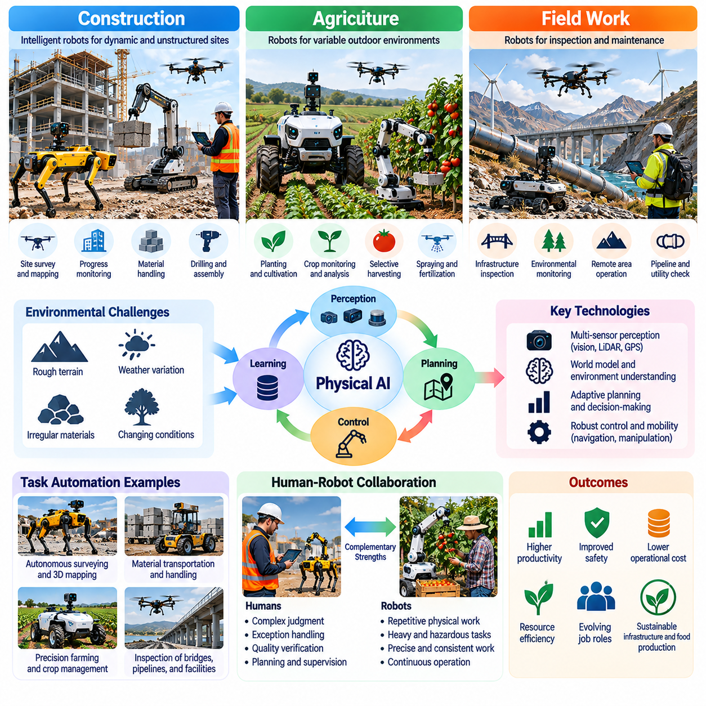{width="7.268055555555556in" height="7.268055555555556in"}

Construction, agriculture, and field work represent some of the most challenging environments for Physical AI-driven labor transformation. Unlike structured factories, these sectors operate across changing terrain, weather conditions, irregular materials, and unpredictable physical interactions. Intelligent robotic systems can reduce dangerous and repetitive labor, but successful deployment requires adaptability, environmental understanding, and close coordination with human expertise.

Construction activities combine heavy material handling, precise measurement, complex coordination, and continuous changes in site conditions. Traditional automation has been limited because construction sites rarely maintain fixed layouts or standardized operating environments. Physical AI introduces mobile perception, autonomous navigation, and adaptive manipulation, potentially extending robotic capabilities into tasks previously dependent on skilled human operators.

Robotic surveying and inspection provide important early opportunities for construction automation. Mobile platforms equipped with LiDAR, cameras, and positioning sensors can capture spatial measurements and compare observed structures with digital engineering models. These capabilities support progress monitoring, dimensional verification, and defect detection, while engineers remain responsible for interpreting discrepancies and approving corrective actions.

The integration of Building Information Modeling with robotic perception creates a foundation for more intelligent construction workflows. Digital design information can guide autonomous scanning, layout marking, and selected installation activities. However, discrepancies between planned geometry and actual site conditions require continuous localization, uncertainty estimation, and measurement validation before robotic systems can execute precision-sensitive operations reliably.

Construction robots can also assist with material transportation, drilling, fastening, and selected assembly activities. Mobile manipulators may position tools or components while human workers supervise complex interactions and verify installation quality. Such systems can reduce physical strain and exposure to hazardous environments, although changing obstacles, unstable surfaces, and shared workspaces create significant safety challenges.

Outdoor construction introduces additional difficulties associated with terrain variability, dust, precipitation, lighting, and temperature. Robotic navigation systems must account for wheel-ground interactions, uneven surfaces, and changing traction conditions. Reliable operation requires robust sensing, mobility control, environmental adaptation, and safe recovery mechanisms rather than assuming that indoor robotic capabilities transfer directly to field environments.

Agriculture presents a different combination of physical uncertainty and biological complexity. Crops vary in size, maturity, geometry, and mechanical sensitivity, while soil conditions and weather change throughout the growing season. Physical AI systems must recognize these variations and adapt their actions accordingly. This makes agricultural automation fundamentally different from repetitive manipulation of standardized industrial components.

Autonomous agricultural machines can support planting, spraying, fertilization, cultivation, and harvesting. Perception systems identify crop rows, obstacles, weeds, and potentially harvestable produce, while control systems coordinate navigation and tool operation. Human farmers increasingly supervise machine performance, interpret environmental conditions, and manage decisions involving crop health, production objectives, and resource allocation.

Precision agriculture combines physical robotics with sensing, prediction, and data-driven decision-making. Field robots and aerial platforms can collect information about vegetation, soil moisture, and spatial variability. Analytical models may recommend targeted interventions, while robotic equipment performs localized operations. This integration can improve resource efficiency, although reliable outcomes depend on sensor quality, biological uncertainty, and agronomic expertise.

Robotic harvesting remains especially challenging because successful manipulation requires perception, contact control, and damage avoidance. Fruits and vegetables may be partially occluded, irregularly positioned, or mechanically delicate. Robots must estimate grasp points, regulate applied forces, and adapt to unexpected movement. Human workers may therefore continue handling difficult cases while automated systems process suitable crops.

Field work extends beyond construction and agriculture into mining, forestry, utilities, environmental monitoring, and infrastructure maintenance. These activities frequently involve remote locations, hazardous conditions, and limited access to communication or support services. Physical AI can support inspection, mapping, transportation, and selected intervention tasks, potentially reducing human exposure to dangerous or physically demanding environments.

Infrastructure inspection illustrates the value of combining mobility with intelligent sensing. Ground robots, climbing platforms, and aerial systems can examine bridges, pipelines, power facilities, and industrial structures. Automated perception may identify visible anomalies or changes over time, but engineering specialists must evaluate structural significance, determine inspection priorities, and authorize maintenance interventions.

Human-robot collaboration in field environments requires flexible responsibility allocation. Robots may execute repetitive measurements, transport equipment, or inspect hazardous areas, while human specialists handle uncertain conditions and complex decisions. Remote supervision and teleoperation provide additional support when autonomous systems encounter unfamiliar situations. Effective coordination depends on communication reliability, operator awareness, and clearly defined intervention procedures.

Connectivity limitations create important differences between field robotics and cloud-dependent automation. Construction sites, farms, and remote infrastructure may experience intermittent networks, limited bandwidth, or communication delays. Edge computing and on-premise intelligence allow robots to maintain essential perception, planning, and control capabilities locally. Cloud systems can support broader analytics and fleet learning without becoming indispensable to immediate safety-critical decisions.

Energy management and mechanical durability are equally important for sustained outdoor deployment. Field robots must operate under constraints involving battery capacity, fuel availability, payload, terrain resistance, and environmental exposure. Dust, moisture, vibration, and repeated mechanical impacts can reduce equipment reliability. Practical automation therefore requires robust hardware design, preventive maintenance, and operational planning alongside advanced artificial intelligence.

The economic feasibility of field automation depends on more than robotic task performance. Construction projects involve temporary worksites and changing requirements, while agricultural operations often face seasonal utilization patterns. Equipment transportation, setup time, maintenance access, and operator training influence total costs. Flexible robotic platforms may provide greater value when they can perform multiple tasks across different sites or operating periods.

Labor transformation in these sectors may initially emphasize augmentation rather than complete substitution. Intelligent machines can extend human strength, improve measurement accuracy, and reduce exposure to dangerous activities without eliminating professional oversight. As reliability improves, selected operations may transition toward supervised autonomy, but broad deployment will depend on the ability to manage environmental variability and exceptional conditions.

The changing division of labor creates demand for new technical and operational skills. Construction workers may need competencies in robotic surveying, digital model interpretation, and automated equipment supervision. Agricultural workers may increasingly use autonomous machinery, sensor analytics, and precision application systems. Field technicians may require knowledge of navigation, calibration, remote diagnostics, and safe recovery procedures.

Safety governance must reflect the distinctive risks of unstructured outdoor environments. Robots may operate near heavy machinery, unstable structures, animals, workers, or public infrastructure. Unexpected environmental changes can invalidate previously safe plans. Effective systems require continuous risk assessment, reliable obstacle detection, emergency stopping mechanisms, and procedures for transferring control to qualified human operators.

World models offer a promising foundation for more capable field robotics by representing terrain, objects, environmental dynamics, and predicted action consequences. Such models could help robots anticipate mobility difficulties, plan manipulation sequences, and evaluate alternative routes. However, their usefulness depends on maintaining accurate state estimates and recognizing when unfamiliar conditions exceed the reliability of learned predictions.

Fleet-scale learning may further improve field automation by collecting experience across construction sites, farms, and infrastructure networks. Robots can record operational failures, unusual terrain conditions, and successful recovery strategies. Curated experience may support model improvement and more robust task policies, although differences between locations require careful validation before transferring learned behaviors into new environments.

Over the longer term, Physical AI may enable increasingly autonomous construction operations, precision agricultural systems, and distributed field maintenance networks. These developments could reduce dangerous labor, improve operational consistency, and address workforce shortages in selected activities. Nevertheless, professional judgment, environmental stewardship, safety responsibility, and complex site coordination will continue to shape the role of human workers.

Ultimately, construction, agriculture, and field work demonstrate that Physical AI must achieve more than accurate movement in controlled environments. Intelligent robots must operate reliably amid uncertainty, physical variability, and changing operational objectives. Sustainable labor transformation will depend on combining embodied intelligence, robust engineering, human supervision, and economically practical deployment strategies that complement the expertise of field professionals.

건설(Construction), 농업(Agriculture), 현장 작업(Field Work)은 피지컬 인공지능(Physical AI)이 주도하는 노동 변화(Labor Transformation)에서 가장 도전적인 환경에 속한다. 정형화된 공장(Structured Factory)과 달리 이러한 산업은 변화하는 지형(Terrain), 기상 조건(Weather Condition), 불규칙한 자재(Irregular Material), 예측하기 어려운 물리적 상호작용(Physical Interaction) 속에서 운영된다. 지능형 로봇 시스템(Intelligent Robotic System)은 위험하고 반복적인 노동을 줄일 수 있지만, 성공적인 배치를 위해서는 적응성(Adaptability), 환경 이해(Environmental Understanding), 인간 전문성과의 긴밀한 협력이 필요하다.

건설 작업(Construction Activity)은 중량물 취급(Heavy Material Handling), 정밀 측정(Precise Measurement), 복잡한 작업 조정(Complex Coordination), 지속적인 현장 조건 변화(Site Condition Change)를 결합한다. 건설 현장은 고정된 배치(Fixed Layout)나 표준화된 운영 환경(Standardized Operating Environment)을 유지하는 경우가 드물기 때문에 전통적인 자동화(Traditional Automation)의 적용이 제한적이었다. 피지컬 인공지능은 이동형 인식(Mobile Perception), 자율주행(Autonomous Navigation), 적응형 조작(Adaptive Manipulation)을 도입하여 이전에는 숙련된 인간 운영자(Skilled Human Operator)에 의존하던 작업까지 로봇의 능력을 확장할 가능성을 제공한다.

로봇 측량(Robotic Surveying)과 검사(Inspection)는 건설 자동화(Construction Automation)의 중요한 초기 적용 기회를 제공한다. 라이다(LiDAR), 카메라(Camera), 위치 측정 센서(Positioning Sensor)를 장착한 이동 플랫폼(Mobile Platform)은 공간 측정값(Spatial Measurement)을 수집하고 관측된 구조물(Observed Structure)을 디지털 엔지니어링 모델(Digital Engineering Model)과 비교할 수 있다. 이러한 능력은 공정 진행 상황 모니터링(Progress Monitoring), 치수 검증(Dimensional Verification), 결함 탐지(Defect Detection)를 지원하며, 엔지니어는 불일치(Discrepancy)를 해석하고 시정 조치(Corrective Action)를 승인하는 책임을 유지한다.

빌딩 정보 모델링(Building Information Modeling, BIM)과 로봇 인식(Robotic Perception)의 통합은 더욱 지능적인 건설 작업 흐름(Intelligent Construction Workflow)의 기반을 형성한다. 디지털 설계 정보(Digital Design Information)는 자율 스캐닝(Autonomous Scanning), 위치 표시(Layout Marking), 일부 설치 작업(Installation Activity)을 안내할 수 있다. 그러나 계획된 형상(Planned Geometry)과 실제 현장 조건(Actual Site Condition) 사이의 불일치를 해결하려면 로봇 시스템이 정밀도에 민감한 작업(Precision-Sensitive Operation)을 신뢰성 있게 실행하기 전에 지속적인 위치 추정(Localization), 불확실성 추정(Uncertainty Estimation), 측정 검증(Measurement Validation)이 필요하다.

건설 로봇(Construction Robot)은 자재 운송(Material Transportation), 드릴링(Drilling), 체결(Fastening), 일부 조립 작업(Assembly Activity)도 지원할 수 있다. 이동형 매니퓰레이터(Mobile Manipulator)는 공구나 부품의 위치를 조정할 수 있으며, 인간 근로자는 복잡한 상호작용을 감독하고 설치 품질(Installation Quality)을 검증한다. 이러한 시스템은 신체적 부담(Physical Strain)과 위험 환경 노출(Hazardous Environment Exposure)을 줄일 수 있지만, 변화하는 장애물(Obstacle), 불안정한 지면(Unstable Surface), 공유 작업 공간(Shared Workspace)은 상당한 안전 문제(Safety Challenge)를 발생시킨다.

실외 건설(Outdoor Construction)은 지형 변동성(Terrain Variability), 먼지(Dust), 강수(Precipitation), 조명(Lighting), 온도(Temperature)와 관련된 추가적인 어려움을 수반한다. 로봇 자율주행 시스템(Robotic Navigation System)은 바퀴-지면 상호작용(Wheel-Ground Interaction), 불균일한 표면(Uneven Surface), 변화하는 접지 조건(Traction Condition)을 고려해야 한다. 신뢰할 수 있는 운영을 위해서는 실내 로봇의 능력이 현장 환경으로 직접 이전될 수 있다고 가정하기보다 강건한 센싱(Robust Sensing), 이동 제어(Mobility Control), 환경 적응(Environmental Adaptation), 안전 복구 메커니즘(Safe Recovery Mechanism)이 필요하다.

농업(Agriculture)은 물리적 불확실성(Physical Uncertainty)과 생물학적 복잡성(Biological Complexity)이 결합된 또 다른 환경이다. 작물(Crop)은 크기(Size), 성숙도(Maturity), 형상(Geometry), 기계적 민감도(Mechanical Sensitivity)가 다양하며, 토양 조건(Soil Condition)과 날씨(Weather)는 생육 기간(Growing Season) 동안 지속적으로 변화한다. 피지컬 인공지능 시스템(Physical AI System)은 이러한 변화를 인식하고 그에 따라 행동을 조정해야 한다. 이 때문에 농업 자동화(Agricultural Automation)는 표준화된 산업용 부품(Standardized Industrial Component)을 반복적으로 조작하는 작업과 근본적으로 다르다.

자율 농업 기계(Autonomous Agricultural Machine)는 파종(Planting), 살포(Spraying), 시비(Fertilization), 경작(Cultivation), 수확(Harvesting)을 지원할 수 있다. 인식 시스템(Perception System)은 작물 열(Crop Row), 장애물(Obstacle), 잡초(Weed), 수확 가능한 농산물(Harvestable Produce)을 식별하며, 제어 시스템(Control System)은 주행(Navigation)과 작업 도구의 작동(Tool Operation)을 조정한다. 인간 농업 종사자(Human Farmer)는 점차 기계 성능(Machine Performance)을 감독하고 환경 조건(Environmental Condition)을 해석하며 작물 건강(Crop Health), 생산 목표(Production Objective), 자원 배분(Resource Allocation)에 관한 의사결정을 관리하게 된다.

정밀 농업(Precision Agriculture)은 물리적 로봇공학(Physical Robotics)을 센싱(Sensing), 예측(Prediction), 데이터 기반 의사결정(Data-Driven Decision-Making)과 결합한다. 현장 로봇(Field Robot)과 항공 플랫폼(Aerial Platform)은 식생(Vegetation), 토양 수분(Soil Moisture), 공간적 변동성(Spatial Variability)에 관한 정보를 수집할 수 있다. 분석 모델(Analytical Model)은 표적화된 개입(Targeted Intervention)을 권고할 수 있으며, 로봇 장비(Robotic Equipment)는 국소적인 작업(Localized Operation)을 수행한다. 이러한 통합은 자원 효율성(Resource Efficiency)을 향상시킬 수 있지만, 신뢰할 수 있는 결과는 센서 품질(Sensor Quality), 생물학적 불확실성(Biological Uncertainty), 농학적 전문성(Agronomic Expertise)에 따라 달라진다.

로봇 수확(Robotic Harvesting)은 성공적인 조작을 위해 인식(Perception), 접촉 제어(Contact Control), 손상 방지(Damage Avoidance)가 필요하기 때문에 특히 어려운 분야로 남아 있다. 과일과 채소는 부분적으로 가려져 있거나(Partially Occluded), 불규칙한 위치에 놓여 있거나, 기계적으로 손상되기 쉬울 수 있다. 로봇은 파지 지점(Grasp Point)을 추정하고 가해지는 힘(Applied Force)을 조절하며 예상하지 못한 움직임에 적응해야 한다. 따라서 인간 근로자는 어려운 사례를 계속 처리하고 자동화 시스템(Automated System)은 적합한 작물을 담당할 수 있다.

현장 작업(Field Work)은 건설과 농업을 넘어 광업(Mining), 임업(Forestry), 공공설비(Utilities), 환경 모니터링(Environmental Monitoring), 인프라 유지보수(Infrastructure Maintenance)까지 확장된다. 이러한 활동은 원격 지역(Remote Location), 위험한 조건(Hazardous Condition), 통신 또는 지원 서비스에 대한 제한적인 접근(Limited Access)을 수반하는 경우가 많다. 피지컬 인공지능은 검사(Inspection), 지도 작성(Mapping), 운송(Transportation), 일부 현장 개입 작업(Intervention Task)을 지원하여 위험하거나 신체적 부담이 큰 환경에 대한 인간의 노출을 줄일 수 있다.

인프라 검사(Infrastructure Inspection)는 이동성(Mobility)과 지능형 센싱(Intelligent Sensing)을 결합하는 것의 가치를 보여준다. 지상 로봇(Ground Robot), 등반형 플랫폼(Climbing Platform), 항공 시스템(Aerial System)은 교량(Bridge), 파이프라인(Pipeline), 전력 시설(Power Facility), 산업 구조물(Industrial Structure)을 검사할 수 있다. 자동화된 인식(Automated Perception)은 눈에 보이는 이상 징후(Visible Anomaly)나 시간에 따른 변화(Change Over Time)를 식별할 수 있지만, 엔지니어링 전문가(Engineering Specialist)는 구조적 중요성(Structural Significance)을 평가하고 검사 우선순위(Inspection Priority)를 결정하며 유지보수 개입(Maintenance Intervention)을 승인해야 한다.

현장 환경(Field Environment)에서 인간-로봇 협업(Human-Robot Collaboration)은 유연한 책임 배분(Flexible Responsibility Allocation)을 필요로 한다. 로봇은 반복적인 측정(Repetitive Measurement)을 실행하고 장비를 운송하거나 위험 구역(Hazardous Area)을 검사할 수 있으며, 인간 전문가는 불확실한 조건과 복잡한 의사결정을 담당한다. 원격 감독(Remote Supervision)과 원격조작(Teleoperation)은 자율 시스템(Autonomous System)이 익숙하지 않은 상황에 직면했을 때 추가적인 지원을 제공한다. 효과적인 조정은 통신 신뢰성(Communication Reliability), 운영자 상황 인식(Operator Awareness), 명확하게 정의된 개입 절차(Intervention Procedure)에 달려 있다.

연결성의 한계(Connectivity Limitation)는 현장 로봇공학(Field Robotics)과 클라우드 의존형 자동화(Cloud-Dependent Automation) 사이에 중요한 차이를 만든다. 건설 현장, 농장, 원격 인프라(Remote Infrastructure)에서는 간헐적인 네트워크(Intermittent Network), 제한된 대역폭(Limited Bandwidth), 통신 지연(Communication Delay)이 발생할 수 있다. 엣지 컴퓨팅(Edge Computing)과 온프레미스 지능(On-Premise Intelligence)은 로봇이 필수적인 인식, 계획, 제어 능력을 로컬 환경(Local Environment)에서 유지하도록 한다. 클라우드 시스템(Cloud System)은 즉각적인 안전 필수 의사결정(Safety-Critical Decision)에 필수적인 의존 요소가 되지 않으면서 광범위한 분석(Analytics)과 로봇 군집 학습(Fleet Learning)을 지원할 수 있다.

에너지 관리(Energy Management)와 기계적 내구성(Mechanical Durability) 역시 지속적인 실외 배치(Outdoor Deployment)에 중요하다. 현장 로봇(Field Robot)은 배터리 용량(Battery Capacity), 연료 가용성(Fuel Availability), 탑재 하중(Payload), 지형 저항(Terrain Resistance), 환경 노출(Environmental Exposure)과 관련된 제약조건 속에서 작동해야 한다. 먼지, 습기(Moisture), 진동(Vibration), 반복적인 기계적 충격(Mechanical Impact)은 장비 신뢰성(Equipment Reliability)을 감소시킬 수 있다. 따라서 실용적인 자동화(Practical Automation)를 위해서는 첨단 인공지능뿐 아니라 강건한 하드웨어 설계(Robust Hardware Design), 예방 정비(Preventive Maintenance), 운영 계획(Operational Planning)이 필요하다.

현장 자동화(Field Automation)의 경제적 실현 가능성(Economic Feasibility)은 로봇의 작업 성능(Task Performance)만으로 결정되지 않는다. 건설 프로젝트(Construction Project)는 임시 작업 현장(Temporary Worksite)과 변화하는 요구사항을 수반하며, 농업 운영(Agricultural Operation)은 계절적 활용 패턴(Seasonal Utilization Pattern)의 영향을 받는 경우가 많다. 장비 운송(Equipment Transportation), 설치 시간(Setup Time), 유지보수 접근성(Maintenance Access), 운영자 교육(Operator Training)은 총비용(Total Cost)에 영향을 미친다. 유연한 로봇 플랫폼(Flexible Robotic Platform)은 서로 다른 현장이나 운영 기간에 걸쳐 여러 작업을 수행할 수 있을 때 더 큰 가치를 제공할 수 있다.

이러한 산업에서 노동 변화(Labor Transformation)는 초기에는 완전한 노동 대체(Complete Substitution)보다 노동 증강(Augmentation)을 강조할 수 있다. 지능형 기계(Intelligent Machine)는 전문적인 인간 감독(Professional Human Oversight)을 제거하지 않으면서 인간의 힘을 확장하고 측정 정확도(Measurement Accuracy)를 향상시키며 위험한 활동에 대한 노출을 줄일 수 있다. 신뢰성(Reliability)이 향상됨에 따라 일부 작업은 감독형 자율성(Supervised Autonomy)으로 전환될 수 있지만, 광범위한 배치는 환경적 변동성(Environmental Variability)과 예외 상황(Exceptional Condition)을 관리하는 능력에 달려 있다.

변화하는 노동 분업(Division of Labor)은 새로운 기술적·운영적 역량(Technical and Operational Skill)에 대한 수요를 창출한다. 건설 근로자는 로봇 측량(Robotic Surveying), 디지털 모델 해석(Digital Model Interpretation), 자동화 장비 감독(Automated Equipment Supervision)에 관한 역량이 필요할 수 있다. 농업 근로자는 자율 기계(Autonomous Machinery), 센서 분석(Sensor Analytics), 정밀 살포 시스템(Precision Application System)을 점점 더 많이 활용할 수 있다. 현장 기술자(Field Technician)는 자율주행(Navigation), 보정(Calibration), 원격 진단(Remote Diagnostics), 안전 복구 절차(Safe Recovery Procedure)에 관한 지식을 필요로 할 수 있다.

안전 거버넌스(Safety Governance)는 비정형 실외 환경(Unstructured Outdoor Environment)의 고유한 위험을 반영해야 한다. 로봇은 중장비(Heavy Machinery), 불안정한 구조물(Unstable Structure), 동물(Animal), 근로자(Worker), 공공 인프라(Public Infrastructure) 근처에서 작동할 수 있다. 예상하지 못한 환경 변화(Environmental Change)는 이전에 안전했던 계획을 무효화할 수 있다. 효과적인 시스템은 지속적인 위험 평가(Continuous Risk Assessment), 신뢰할 수 있는 장애물 탐지(Reliable Obstacle Detection), 비상 정지 메커니즘(Emergency Stopping Mechanism), 자격을 갖춘 인간 운영자(Qualified Human Operator)에게 제어권을 이전하는 절차를 필요로 한다.

월드 모델(World Model)은 지형(Terrain), 객체(Object), 환경 동역학(Environmental Dynamics), 예측된 행동 결과(Predicted Action Consequence)를 표현함으로써 더욱 발전된 현장 로봇공학(Field Robotics)의 유망한 기반을 제공한다. 이러한 모델은 로봇이 이동상의 어려움(Mobility Difficulty)을 예측하고 조작 순서(Manipulation Sequence)를 계획하며 대체 경로(Alternative Route)를 평가하도록 지원할 수 있다. 그러나 그 유용성은 정확한 상태 추정(State Estimation)을 유지하고 익숙하지 않은 조건이 학습된 예측(Learned Prediction)의 신뢰성을 초과하는 시점을 인식하는 능력에 달려 있다.

로봇 군집 규모 학습(Fleet-Scale Learning)은 건설 현장, 농장, 인프라 네트워크(Infrastructure Network) 전반에서 경험을 수집함으로써 현장 자동화(Field Automation)를 더욱 개선할 수 있다. 로봇은 운영 실패(Operational Failure), 특이한 지형 조건(Unusual Terrain Condition), 성공적인 복구 전략(Successful Recovery Strategy)을 기록할 수 있다. 선별·정제된 경험(Curated Experience)은 모델 개선(Model Improvement)과 더욱 강건한 작업 정책(Robust Task Policy)을 지원할 수 있지만, 위치 간 차이(Difference Between Locations)를 고려하여 학습된 행동(Learned Behavior)을 새로운 환경으로 이전하기 전에 신중한 검증(Validation)이 필요하다.

장기적으로 피지컬 인공지능(Physical AI)은 자율성이 점점 높아지는 건설 작업(Autonomous Construction Operation), 정밀 농업 시스템(Precision Agricultural System), 분산형 현장 유지보수 네트워크(Distributed Field Maintenance Network)를 가능하게 할 수 있다. 이러한 발전은 위험한 노동을 줄이고 운영 일관성(Operational Consistency)을 향상시키며 일부 활동에서 인력 부족(Workforce Shortage) 문제를 완화할 수 있다. 그럼에도 불구하고 전문적 판단(Professional Judgment), 환경 관리(Environmental Stewardship), 안전 책임(Safety Responsibility), 복잡한 현장 조정(Complex Site Coordination)은 인간 근로자의 역할을 계속해서 결정하는 중요한 요소로 남을 것이다.

궁극적으로 건설(Construction), 농업(Agriculture), 현장 작업(Field Work)은 피지컬 인공지능(Physical AI)이 통제된 환경에서 정확한 움직임을 수행하는 수준을 넘어야 한다는 사실을 보여준다. 지능형 로봇(Intelligent Robot)은 불확실성(Uncertainty), 물리적 변동성(Physical Variability), 변화하는 운영 목표(Changing Operational Objective) 속에서도 신뢰성 있게 작동해야 한다. 지속 가능한 노동 변화(Sustainable Labor Transformation)는 체화 지능(Embodied Intelligence), 강건한 엔지니어링(Robust Engineering), 인간 감독(Human Supervision), 경제적으로 실현 가능한 배치 전략(Economically Practical Deployment Strategy)을 결합하여 현장 전문가(Field Professional)의 전문성을 보완하는 데 달려 있다.

##  

## 01.08. Healthcare and Caregiving Labor

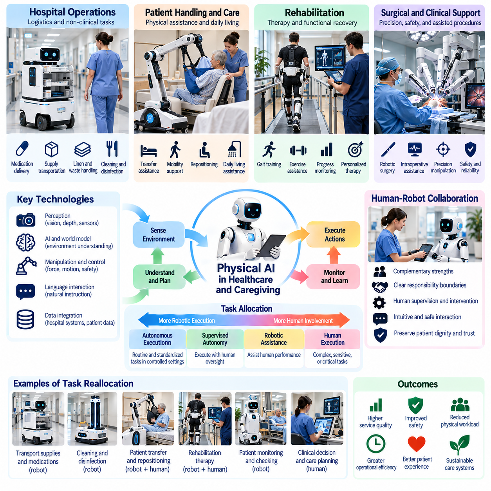{width="7.268055555555556in" height="7.268055555555556in"}

Healthcare and caregiving represent critical domains for Physical AI because they combine physical assistance, complex decision-making, and deeply human relationships. Hospitals, rehabilitation centers, and long-term care facilities depend on labor-intensive activities that require both technical competence and personal attention. Intelligent robotics can reduce physical workloads and improve service continuity, but its adoption must preserve patient safety, dignity, and professional accountability.

Healthcare labor includes clinical treatment, patient transportation, equipment handling, environmental cleaning, and administrative coordination. These activities differ substantially in their suitability for automation. Standardized logistical tasks may be performed by autonomous machines, while diagnosis, treatment decisions, and emotionally sensitive interactions require qualified human oversight. Physical AI therefore encourages selective task reallocation rather than indiscriminate occupational replacement.

Demographic aging and growing demand for long-term care increase interest in robotic assistance. Caregiving workers frequently perform repetitive lifting, mobility support, and daily living assistance under demanding schedules. Physical AI systems may help reduce musculoskeletal strain and improve operational efficiency. However, the quality of caregiving depends on trust, empathy, communication, and individual preferences that cannot be reduced to mechanical task completion.

Patient transportation offers an important application of healthcare robotics. Autonomous mobile robots can move medications, linens, laboratory samples, and medical supplies between hospital departments. Separating logistical transportation from direct clinical responsibilities may allow nurses and caregivers to devote more attention to patients. Reliable deployment requires safe navigation, access control, scheduling integration, and appropriate handling of sensitive materials.

Robotic patient handling presents greater technical and ethical complexity because machines interact directly with vulnerable individuals. Transfer assistance, repositioning, and mobility support require accurate force regulation, body-state estimation, and continuous monitoring. Human caregivers must remain capable of supervising interactions and responding to discomfort or unexpected movement. Mechanical assistance should improve safety without compromising patient autonomy or dignity.

Rehabilitation robotics illustrates how augmentation can improve healthcare labor rather than simply substitute for therapists. Robotic exoskeletons and therapeutic devices may provide repetitive movement assistance and measurable exercise support. Clinicians determine treatment objectives, interpret patient responses, and adjust therapy programs. Effective rehabilitation depends on combining controlled physical assistance with individualized clinical judgment and patient motivation.

Assistive robotics may also support older adults and people with disabilities in everyday activities. Mobile assistants and robotic manipulators can potentially help retrieve objects, transport household items, or support selected mobility tasks. Their practical value depends on reliability, accessibility, affordability, and user acceptance. Systems must accommodate diverse physical abilities and living environments without assuming that all individuals require identical assistance.

Clinical robotics introduces additional requirements when machines participate in procedures involving direct patient contact. Robotic surgical platforms can enhance instrument positioning and controlled manipulation under trained professional supervision. Their use does not eliminate clinical responsibility or guarantee superior outcomes in every procedure. Safety depends on appropriate training, validated performance, procedural selection, and reliable human control.

Physical AI can support hospital infection prevention through automated cleaning, disinfection assistance, and contact-reducing logistical operations. Robots may execute repetitive environmental tasks while personnel verify coverage and compliance with established procedures. These applications require careful evaluation because automated movement or disinfection does not necessarily guarantee infection control. Human inspection and validated protocols remain essential.

Caregiving environments are especially challenging because human behavior is variable and often difficult to predict. Patients may move unexpectedly, communicate discomfort indirectly, or require assistance that changes throughout the day. Robots must interpret uncertain observations and respond conservatively when safety is at risk. Contextual awareness, adaptable control, and accessible human intervention mechanisms are therefore fundamental requirements.

Human-robot collaboration in healthcare requires clear allocation of responsibilities. Robots may perform transportation, positioning assistance, or routine monitoring, while clinicians and caregivers retain authority over medical decisions and sensitive personal interactions. Effective workflows must specify when robots operate autonomously, when supervision is mandatory, and how control transfers to qualified personnel during exceptional situations.

The integration of perception, language understanding, and physical action may enable more intuitive healthcare robots. Vision-language-action systems could interpret instructions, recognize relevant objects, and execute selected assistance tasks. Nevertheless, natural-language commands may be ambiguous, and model outputs can be unreliable. Safety-critical actions require explicit authorization, constrained execution, and independent verification rather than unrestricted generative control.

World models may improve robotic assistance by representing room layouts, equipment locations, human movement, and predicted interaction outcomes. Such models can support navigation, task planning, and anticipation of potential conflicts. However, healthcare environments change continuously, and predictions about human behavior remain uncertain. Robots must recognize model limitations and prioritize safe behavior when observations contradict expectations.

Privacy and data governance are central concerns because healthcare robots may collect images, movement patterns, audio, and other sensitive information. Data collection should be limited to legitimate operational needs, with appropriate access controls and retention policies. Edge computing can support selected local processing requirements, while connected systems require secure communication. Technical convenience must not override patient confidentiality.

Healthcare automation also changes the competencies required from professional staff. Nurses, therapists, technicians, and support workers may increasingly interact with robotic interfaces, automated transport systems, and intelligent monitoring tools. Training must address normal operation, limitations, fault recognition, emergency procedures, and safe intervention. Technical proficiency should complement rather than replace clinical expertise and interpersonal skills.

Economic evaluation must consider the complete healthcare workflow rather than isolated robotic productivity. Equipment acquisition, maintenance, integration, staff training, and supervision contribute to total operating costs. Potential benefits include reduced physical strain, improved logistical efficiency, and more consistent service delivery. However, financial savings should not be assumed without evidence of reliable performance and measurable improvements in care quality.

The employment implications of healthcare robotics are likely to vary across occupations and institutions. Routine logistical activities may require fewer direct labor hours, while technical maintenance, robotic supervision, and patient-centered services may expand. Automation can relieve staffing pressures without necessarily resolving workforce shortages. Its effects depend on organizational choices, reimbursement structures, training opportunities, and the allocation of productivity gains.

Ethical considerations distinguish caregiving from many industrial automation applications. Patients may depend on caregivers for emotional reassurance, personal dignity, and social connection as well as physical assistance. Excessive substitution could reduce meaningful human contact even when routine tasks are completed efficiently. Human-centered design should therefore evaluate autonomy, consent, accessibility, and the social consequences of replacing interpersonal care.

Adaptive autonomy offers a practical framework for managing uncertainty in healthcare robotics. Machines may independently execute low-risk logistical activities while requesting supervision for direct physical assistance or unfamiliar situations. Confidence estimation, runtime monitoring, and safe fallback behaviors can support these transitions. Autonomy levels should reflect task risk, validated capability, and the availability of qualified human assistance.

Long-term progress may enable coordinated robotic systems across hospitals, rehabilitation facilities, and residential care environments. Mobile platforms, assistive manipulators, and intelligent scheduling systems could share operational information and support integrated workflows. Nevertheless, interoperability, cybersecurity, regulatory compliance, and clinical validation will remain important barriers to widespread deployment and reliable institutional adoption.

Healthcare organizations must approach robotic deployment as a transformation of care delivery rather than a simple equipment purchase. Workflows, professional responsibilities, training programs, and patient communication practices require coordinated redesign. Evaluation should include clinical safety, worker well-being, patient experience, service accessibility, and operational performance. Successful adoption depends on involving both healthcare professionals and the people receiving care.

Ultimately, Physical AI can transform healthcare and caregiving labor by reducing physically demanding tasks, supporting clinical workflows, and expanding access to selected forms of assistance. Its greatest value may arise from strengthening human caregivers rather than replacing the relationships at the center of care. Sustainable progress requires combining embodied intelligence, rigorous safety engineering, ethical governance, and continued human responsibility for patient well-being.

의료(Healthcare)와 돌봄(Caregiving)은 신체적 지원(Physical Assistance), 복잡한 의사결정(Complex Decision-Making), 깊은 인간관계(Human Relationship)가 결합되어 있기 때문에 피지컬 인공지능(Physical AI)의 중요한 적용 분야이다. 병원(Hospital), 재활센터(Rehabilitation Center), 장기요양시설(Long-Term Care Facility)은 기술적 역량(Technical Competence)과 개인적 관심(Personal Attention)을 동시에 요구하는 노동집약적 활동(Labor-Intensive Activity)에 의존한다. 지능형 로봇공학(Intelligent Robotics)은 신체적 작업 부하(Physical Workload)를 줄이고 서비스 연속성(Service Continuity)을 향상시킬 수 있지만, 도입 과정에서는 환자 안전(Patient Safety), 존엄성(Dignity), 전문적 책임(Professional Accountability)을 유지해야 한다.

의료 노동(Healthcare Labor)에는 임상 치료(Clinical Treatment), 환자 운송(Patient Transportation), 장비 취급(Equipment Handling), 환경 청소(Environmental Cleaning), 행정적 조정(Administrative Coordination)이 포함된다. 이러한 활동은 자동화 적합성(Automation Suitability)에서 상당한 차이를 보인다. 표준화된 물류 작업(Standardized Logistical Task)은 자율 기계(Autonomous Machine)가 수행할 수 있지만, 진단(Diagnosis), 치료 결정(Treatment Decision), 정서적으로 민감한 상호작용(Emotionally Sensitive Interaction)에는 자격을 갖춘 인간의 감독(Qualified Human Oversight)이 필요하다. 따라서 피지컬 인공지능은 무분별한 직업 대체(Occupational Replacement)보다 선택적인 작업 재배분(Selective Task Reallocation)을 촉진한다.

인구 고령화(Demographic Aging)와 장기 돌봄(Long-Term Care)에 대한 수요 증가는 로봇 보조(Robotic Assistance)에 대한 관심을 높이고 있다. 돌봄 종사자(Caregiving Worker)는 부담이 큰 근무 일정 속에서 반복적인 들어 올리기(Lifting), 이동 지원(Mobility Support), 일상생활 지원(Daily Living Assistance)을 수행하는 경우가 많다. 피지컬 인공지능 시스템은 근골격계 부담(Musculoskeletal Strain)을 줄이고 운영 효율성(Operational Efficiency)을 향상시키는 데 도움을 줄 수 있다. 그러나 돌봄의 품질(Caregiving Quality)은 단순한 기계적 작업 완료(Mechanical Task Completion)로 환원할 수 없는 신뢰(Trust), 공감(Empathy), 의사소통(Communication), 개인적 선호(Individual Preference)에 달려 있다.

환자 운송(Patient Transportation)은 의료 로봇공학(Healthcare Robotics)의 중요한 적용 분야이다. 자율이동로봇(Autonomous Mobile Robot)은 병원 부서 사이에서 의약품(Medication), 침구류(Linen), 검사실 검체(Laboratory Sample), 의료 물품(Medical Supply)을 운송할 수 있다. 물류 운송(Logistical Transportation)을 직접적인 임상 책임(Direct Clinical Responsibility)과 분리하면 간호사(Nurse)와 돌봄 종사자(Caregiver)가 환자에게 더 많은 관심을 기울일 수 있다. 신뢰할 수 있는 배치를 위해서는 안전한 자율주행(Safe Navigation), 접근 제어(Access Control), 일정 관리 통합(Scheduling Integration), 민감한 물품의 적절한 취급이 필요하다.

로봇 환자 취급(Robotic Patient Handling)은 기계가 취약한 환자(Vulnerable Individual)와 직접 상호작용하기 때문에 더 높은 기술적·윤리적 복잡성(Technical and Ethical Complexity)을 수반한다. 환자 이동 보조(Transfer Assistance), 자세 변경(Repositioning), 이동 지원(Mobility Support)에는 정확한 힘 조절(Force Regulation), 신체 상태 추정(Body-State Estimation), 지속적인 모니터링(Continuous Monitoring)이 필요하다. 인간 돌봄 종사자는 상호작용을 감독하고 불편함이나 예상하지 못한 움직임에 대응할 수 있어야 한다. 기계적 지원(Mechanical Assistance)은 환자의 자율성(Patient Autonomy)이나 존엄성을 훼손하지 않으면서 안전성을 향상시켜야 한다.

재활 로봇공학(Rehabilitation Robotics)은 단순히 치료사(Therapist)를 대체하는 것이 아니라 노동 증강(Augmentation)을 통해 의료 노동을 개선할 수 있음을 보여준다. 로봇 외골격(Robotic Exoskeleton)과 치료 장치(Therapeutic Device)는 반복적인 움직임 지원(Repetitive Movement Assistance)과 측정 가능한 운동 지원(Measurable Exercise Support)을 제공할 수 있다. 임상의(Clinician)는 치료 목표(Treatment Objective)를 결정하고 환자의 반응(Patient Response)을 해석하며 치료 프로그램(Therapy Program)을 조정한다. 효과적인 재활은 제어된 물리적 지원(Controlled Physical Assistance)을 개별화된 임상적 판단(Individualized Clinical Judgment) 및 환자의 동기부여(Patient Motivation)와 결합하는 데 달려 있다.

보조 로봇공학(Assistive Robotics)은 노인(Older Adult)과 장애인(People with Disabilities)의 일상생활 활동(Everyday Activity)도 지원할 수 있다. 이동형 보조 로봇(Mobile Assistant)과 로봇 매니퓰레이터(Robotic Manipulator)는 물건 가져오기(Object Retrieval), 가정용 물품 운송(Household Item Transportation), 일부 이동 지원 작업(Mobility Assistance Task)을 수행할 가능성이 있다. 실제 활용 가치는 신뢰성(Reliability), 접근성(Accessibility), 경제적 부담 가능성(Affordability), 사용자 수용성(User Acceptance)에 달려 있다. 시스템은 모든 사람이 동일한 지원을 필요로 한다고 가정하지 않고 다양한 신체 능력(Physical Ability)과 생활 환경(Living Environment)에 적응해야 한다.

임상 로봇공학(Clinical Robotics)은 기계가 환자와 직접 접촉하는 의료 절차에 참여할 때 추가적인 요구사항을 발생시킨다. 로봇 수술 플랫폼(Robotic Surgical Platform)은 훈련받은 전문 의료진(Trained Professional)의 감독 아래 수술 기구의 위치 결정(Instrument Positioning)과 제어된 조작(Controlled Manipulation)을 향상시킬 수 있다. 그러나 이러한 기술의 사용이 임상적 책임(Clinical Responsibility)을 제거하거나 모든 수술에서 우수한 결과를 보장하는 것은 아니다. 안전성은 적절한 교육(Appropriate Training), 검증된 성능(Validated Performance), 수술 절차의 선택(Procedural Selection), 신뢰할 수 있는 인간 제어(Human Control)에 달려 있다.

피지컬 인공지능(Physical AI)은 자동화된 청소(Automated Cleaning), 소독 지원(Disinfection Assistance), 접촉을 줄이는 물류 운영(Contact-Reducing Logistical Operation)을 통해 병원 감염 예방(Hospital Infection Prevention)을 지원할 수 있다. 로봇은 반복적인 환경 관리 작업(Environmental Task)을 수행하고, 담당자는 작업 범위(Coverage)와 확립된 절차(Established Procedure)의 준수 여부를 검증할 수 있다. 자동화된 이동이나 소독이 반드시 감염 관리(Infection Control)를 보장하는 것은 아니므로 이러한 적용에는 신중한 평가가 필요하다. 인간의 검사(Human Inspection)와 검증된 프로토콜(Validated Protocol)은 여전히 필수적이다.

돌봄 환경(Caregiving Environment)은 인간의 행동(Human Behavior)이 다양하고 예측하기 어려운 경우가 많기 때문에 특히 도전적이다. 환자는 예상하지 못하게 움직이거나 불편함을 간접적으로 표현하거나 하루 동안 변화하는 지원을 필요로 할 수 있다. 로봇은 불확실한 관측(Uncertain Observation)을 해석하고 안전이 위협받을 때 보수적으로 대응해야 한다. 따라서 맥락 인식(Contextual Awareness), 적응형 제어(Adaptable Control), 접근하기 쉬운 인간 개입 메커니즘(Human Intervention Mechanism)은 기본적인 요구사항이다.

의료 분야의 인간-로봇 협업(Human-Robot Collaboration)은 명확한 책임 배분(Responsibility Allocation)을 필요로 한다. 로봇은 운송(Transportation), 위치 조정 지원(Positioning Assistance), 일상적인 모니터링(Routine Monitoring)을 수행할 수 있으며, 임상의와 돌봄 종사자는 의료적 의사결정(Medical Decision-Making)과 민감한 개인적 상호작용(Sensitive Personal Interaction)에 대한 권한을 유지한다. 효과적인 작업 흐름(Workflow)은 로봇이 언제 자율적으로 작동하는지, 언제 감독이 의무적인지, 예외 상황에서 자격을 갖춘 담당자에게 어떻게 제어권을 이전하는지를 명확하게 규정해야 한다.

인식(Perception), 언어 이해(Language Understanding), 물리적 행동(Physical Action)의 통합은 더욱 직관적인 의료 로봇(Intuitive Healthcare Robot)을 가능하게 할 수 있다. 비전-언어-행동 시스템(Vision-Language-Action System)은 명령을 해석하고 관련 객체를 인식하며 일부 보조 작업(Assistance Task)을 실행할 수 있다. 그러나 자연어 명령(Natural-Language Command)은 모호할 수 있으며 모델 출력(Model Output)은 신뢰성이 부족할 수 있다. 안전 필수 행동(Safety-Critical Action)에는 제한 없는 생성형 제어(Unrestricted Generative Control)가 아니라 명시적 승인(Explicit Authorization), 제약된 실행(Constrained Execution), 독립적인 검증(Independent Verification)이 필요하다.

월드 모델(World Model)은 실내 공간 배치(Room Layout), 장비 위치(Equipment Location), 인간의 움직임(Human Movement), 예측된 상호작용 결과(Predicted Interaction Outcome)를 표현함으로써 로봇 보조(Robotic Assistance)를 개선할 수 있다. 이러한 모델은 자율주행(Navigation), 작업 계획(Task Planning), 잠재적 충돌(Potential Conflict)의 예측을 지원할 수 있다. 그러나 의료 환경은 지속적으로 변화하며 인간 행동에 대한 예측은 여전히 불확실하다. 로봇은 모델의 한계(Model Limitation)를 인식하고 관측 결과가 예상과 다를 때 안전한 행동(Safe Behavior)을 우선해야 한다.

개인정보 보호(Privacy)와 데이터 거버넌스(Data Governance)는 의료 로봇이 영상(Image), 움직임 패턴(Movement Pattern), 음성(Audio), 기타 민감한 정보(Sensitive Information)를 수집할 수 있기 때문에 핵심적인 문제이다. 데이터 수집(Data Collection)은 정당한 운영 목적(Legitimate Operational Need)에 필요한 범위로 제한되어야 하며, 적절한 접근 제어(Access Control)와 보존 정책(Retention Policy)을 적용해야 한다. 엣지 컴퓨팅(Edge Computing)은 일부 로컬 처리 요구사항(Local Processing Requirement)을 지원할 수 있으며, 연결된 시스템(Connected System)에는 안전한 통신(Secure Communication)이 필요하다. 기술적 편의성(Technical Convenience)이 환자 기밀성(Patient Confidentiality)보다 우선해서는 안 된다.

의료 자동화(Healthcare Automation)는 전문 인력(Professional Staff)에게 요구되는 역량(Competency)도 변화시킨다. 간호사(Nurse), 치료사(Therapist), 기술자(Technician), 지원 인력(Support Worker)은 로봇 인터페이스(Robotic Interface), 자동화 운송 시스템(Automated Transport System), 지능형 모니터링 도구(Intelligent Monitoring Tool)와 점점 더 많이 상호작용할 수 있다. 교육(Training)은 정상 작동(Normal Operation), 시스템 한계(System Limitation), 고장 인식(Fault Recognition), 비상 절차(Emergency Procedure), 안전한 개입(Safe Intervention)을 다루어야 한다. 기술적 숙련도(Technical Proficiency)는 임상 전문성(Clinical Expertise)과 대인관계 기술(Interpersonal Skill)을 대체하는 것이 아니라 보완해야 한다.

경제적 평가(Economic Evaluation)는 개별 로봇의 생산성(Isolated Robotic Productivity)이 아니라 전체 의료 작업 흐름(Healthcare Workflow)을 고려해야 한다. 장비 도입(Equipment Acquisition), 유지보수(Maintenance), 시스템 통합(Integration), 직원 교육(Staff Training), 감독(Supervision)은 총운영비용(Total Operating Cost)에 영향을 미친다. 잠재적인 이점에는 신체적 부담 감소(Reduced Physical Strain), 물류 효율성 향상(Improved Logistical Efficiency), 더욱 일관된 서비스 제공(Consistent Service Delivery)이 포함된다. 그러나 신뢰할 수 있는 성능과 의료 품질(Care Quality)의 측정 가능한 개선을 입증하는 근거 없이 재정적 절감(Financial Saving)을 가정해서는 안 된다.

의료 로봇공학(Healthcare Robotics)이 고용에 미치는 영향(Employment Implication)은 직업과 기관에 따라 달라질 가능성이 높다. 일상적인 물류 활동(Routine Logistical Activity)은 직접적인 노동시간(Direct Labor Hour)을 줄일 수 있는 반면, 기술적 유지보수(Technical Maintenance), 로봇 감독(Robotic Supervision), 환자 중심 서비스(Patient-Centered Service)는 확대될 수 있다. 자동화는 인력 배치 압박(Staffing Pressure)을 완화할 수 있지만 반드시 인력 부족(Workforce Shortage)을 해결하는 것은 아니다. 그 영향은 조직적 선택(Organizational Choice), 의료비 보상 체계(Reimbursement Structure), 교육 기회(Training Opportunity), 생산성 향상에 따른 이익의 배분(Allocation of Productivity Gains)에 달려 있다.

윤리적 고려사항(Ethical Consideration)은 돌봄(Caregiving)을 많은 산업 자동화(Industrial Automation) 분야와 구별한다. 환자는 신체적 지원뿐 아니라 정서적 안심(Emotional Reassurance), 개인적 존엄성(Personal Dignity), 사회적 연결(Social Connection)을 위해 돌봄 종사자에게 의존할 수 있다. 과도한 노동 대체(Excessive Substitution)는 일상적인 작업이 효율적으로 완료되더라도 의미 있는 인간 접촉(Meaningful Human Contact)을 감소시킬 수 있다. 따라서 인간 중심 설계(Human-Centered Design)는 자율성(Autonomy), 동의(Consent), 접근성(Accessibility), 대인 돌봄(Interpersonal Care)을 대체하는 데 따른 사회적 결과(Social Consequence)를 평가해야 한다.

적응형 자율성(Adaptive Autonomy)은 의료 로봇공학에서 불확실성(Uncertainty)을 관리하기 위한 실용적인 체계를 제공한다. 기계는 위험도가 낮은 물류 활동(Low-Risk Logistical Activity)을 독립적으로 실행하면서 직접적인 신체 지원(Direct Physical Assistance)이나 익숙하지 않은 상황에서는 감독을 요청할 수 있다. 신뢰도 추정(Confidence Estimation), 실행시간 모니터링(Runtime Monitoring), 안전한 대체 행동(Safe Fallback Behavior)은 이러한 전환을 지원할 수 있다. 자율성 수준(Autonomy Level)은 작업 위험(Task Risk), 검증된 능력(Validated Capability), 자격을 갖춘 인간 지원(Qualified Human Assistance)의 가용성을 반영해야 한다.

장기적인 발전(Long-Term Progress)은 병원, 재활시설(Rehabilitation Facility), 주거형 돌봄 환경(Residential Care Environment) 전반에서 조정된 로봇 시스템(Coordinated Robotic System)을 가능하게 할 수 있다. 이동 플랫폼(Mobile Platform), 보조 매니퓰레이터(Assistive Manipulator), 지능형 일정 관리 시스템(Intelligent Scheduling System)은 운영 정보(Operational Information)를 공유하고 통합된 작업 흐름(Integrated Workflow)을 지원할 수 있다. 그럼에도 불구하고 상호운용성(Interoperability), 사이버보안(Cybersecurity), 규제 준수(Regulatory Compliance), 임상 검증(Clinical Validation)은 광범위한 배치와 신뢰할 수 있는 기관 차원의 도입을 가로막는 중요한 장벽으로 남을 것이다.

의료기관(Healthcare Organization)은 로봇 도입(Robotic Deployment)을 단순한 장비 구매(Equipment Purchase)가 아니라 의료 서비스 제공(Care Delivery)의 변화로 접근해야 한다. 작업 흐름(Workflow), 전문적 책임(Professional Responsibility), 교육 프로그램(Training Program), 환자 의사소통 방식(Patient Communication Practice)은 조정된 재설계(Coordinated Redesign)를 필요로 한다. 평가에는 임상 안전(Clinical Safety), 근로자 복지(Worker Well-Being), 환자 경험(Patient Experience), 서비스 접근성(Service Accessibility), 운영 성과(Operational Performance)가 포함되어야 한다. 성공적인 도입은 의료 전문가와 돌봄을 받는 사람 모두의 참여에 달려 있다.

궁극적으로 피지컬 인공지능(Physical AI)은 신체적으로 부담이 큰 작업(Physically Demanding Task)을 줄이고, 임상 작업 흐름(Clinical Workflow)을 지원하며, 일부 지원 서비스(Assistance Service)에 대한 접근성을 확대함으로써 의료 및 돌봄 노동(Healthcare and Caregiving Labor)을 변화시킬 수 있다. 그 가장 큰 가치는 돌봄의 중심에 있는 인간관계(Human Relationship)를 대체하는 것이 아니라 인간 돌봄 종사자(Human Caregiver)의 역량을 강화하는 데서 나타날 수 있다. 지속 가능한 발전(Sustainable Progress)을 위해서는 체화 지능(Embodied Intelligence), 엄격한 안전공학(Rigorous Safety Engineering), 윤리적 거버넌스(Ethical Governance), 환자의 복지(Patient Well-Being)에 대한 지속적인 인간의 책임(Human Responsibility)을 결합해야 한다.

##  

## 01.09. Service and Household Labor

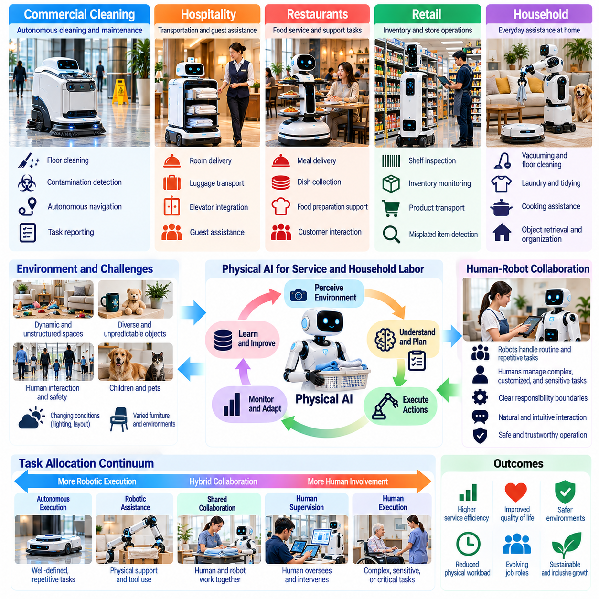{width="7.268055555555556in" height="7.268055555555556in"}

Service and household labor represent a major frontier for Physical AI because they involve diverse physical tasks performed in environments designed primarily for humans. Restaurants, hotels, retail facilities, offices, and private homes require continuous cleaning, transportation, organization, and assistance. Intelligent robots may reduce repetitive workloads and improve service availability, but practical adoption depends on reliability, affordability, safety, and human acceptance.

Unlike industrial production, service environments frequently change in response to human activity. Furniture moves, objects appear unexpectedly, and customers follow unpredictable movement patterns. Robots must recognize these changes while maintaining safe navigation and task execution. Physical AI extends traditional service automation through adaptive perception, contextual reasoning, and flexible action planning, enabling machines to operate beyond narrowly predefined routines.

Commercial cleaning provides an established application area for service robotics. Autonomous floor-cleaning machines can navigate corridors, shopping centers, airports, and office buildings while avoiding obstacles. More advanced systems may identify contaminated areas, adjust cleaning strategies, and report operational results. Human personnel remain responsible for complex surfaces, unusual contamination, equipment maintenance, and verification of cleaning quality.

Hospitality operations offer opportunities for robotic transportation and routine assistance. Mobile robots may deliver towels, supplies, meals, and guest requests within hotels and accommodation facilities. These systems can reduce repetitive walking and allow employees to concentrate on personalized service. However, reliable operation requires elevator integration, access permissions, obstacle handling, and coordination with staff during unexpected situations.

Restaurants and food-service businesses present another combination of repetitive physical work and customer interaction. Robots may transport prepared meals, collect dishes, or assist with selected food preparation activities. Human workers continue managing customer preferences, food quality, sanitation, and exceptional requests. Effective automation requires coordinated workflows that avoid disrupting service or creating additional supervision burdens.

Retail environments may use Physical AI for inventory monitoring, shelf inspection, and merchandise transportation. Mobile platforms equipped with cameras and identification sensors can identify misplaced products, detect empty shelves, and support stock management. Employees can then focus on customer assistance, merchandising decisions, and exception resolution. Automation becomes most valuable when robotic observations integrate reliably with inventory and operational systems.

Household labor presents greater technical variability than many commercial service applications. Homes differ in layout, furniture arrangement, lighting, and available space, while everyday objects vary in size, location, and fragility. Robots must operate around children, pets, and personal belongings. Consequently, general household assistance requires more robust perception, manipulation, and safety capabilities than highly structured industrial automation.

Robotic vacuum cleaners illustrate how narrowly defined household tasks can become widely automated. Their success depends on relatively constrained objectives, established navigation techniques, and acceptable performance under common conditions. Extending automation to laundry, dish handling, cooking, and general tidying is considerably harder because these activities involve deformable objects, complex contact interactions, and changing task requirements.

Household manipulation requires robots to identify objects, estimate physical properties, and select appropriate grasping strategies. A robot handling clothing must accommodate deformable materials, while one organizing kitchen items must distinguish fragile containers from durable utensils. These capabilities demand multimodal perception, force-sensitive control, and adaptive planning. Reliable execution remains difficult when unfamiliar objects or configurations appear.

Domestic assistance also requires understanding the relationship between individual tasks and broader household objectives. Cleaning a room may involve moving objects, organizing surfaces, and restoring items to preferred locations. Successful operation therefore depends on contextual knowledge, task sequencing, and memory of household preferences. Physical AI must move beyond isolated action execution toward coordinated activities that unfold across longer time horizons.

Vision-language-action models may provide more flexible interfaces for service and household robots. Users could describe objectives through natural language while robotic systems connect visual observations with physical actions. However, ambiguous instructions and uncertain environmental conditions create risks. Reliable systems need clarification mechanisms, constrained action policies, and verification procedures before executing potentially harmful or irreversible operations.

World models may help robots anticipate how household and service environments change over time. Representations of object locations, room connectivity, human movement, and physical interactions can support planning and recovery. Persistent memory may allow robots to learn recurring routines and preferred object arrangements. Such models must remain adaptable because household environments are dynamic and previously learned assumptions may become outdated.

Human-robot collaboration in service industries often involves dynamic task allocation. Robots may handle routine transportation, cleaning, or inspection while employees manage customer communication, complex manipulation, and unexpected problems. Supervisors must coordinate robot availability with staffing schedules and service demand. Poorly designed automation can shift excessive monitoring responsibilities onto workers rather than reducing their workload.

Teleoperation and remote assistance provide practical mechanisms for overcoming limitations in robotic autonomy. When a service robot encounters a blocked route, unfamiliar object, or uncertain instruction, a qualified operator may intervene. Repeated interventions can also generate useful training data for improving future performance. Nevertheless, dependence on frequent human assistance may weaken the economic advantages of automation and complicate scaling.

Privacy is particularly important when Physical AI operates inside private homes and customer-facing facilities. Cameras, microphones, spatial maps, and behavioral observations may reveal sensitive personal information. Responsible systems should minimize unnecessary collection, restrict data access, and provide understandable user controls. Local processing can reduce some external data exposure, although cybersecurity and secure software maintenance remain essential.

Safety requirements extend beyond collision avoidance because service robots may interact with fragile objects, electrical appliances, hot surfaces, and vulnerable individuals. Household environments often lack standardized safety zones or trained operators. Robots must therefore recognize uncertainty, limit applied forces, and stop safely when conditions exceed validated capabilities. User convenience should never justify uncontrolled physical actions.

Economic adoption depends on comparing the total cost of robotic assistance with the value of completed work. Commercial facilities may achieve favorable utilization through repetitive daily operations, while household robots often operate intermittently. Acquisition costs, energy consumption, maintenance, software subscriptions, and human intervention affect affordability. Broad adoption requires dependable performance at costs appropriate to individual users and organizations.

Service labor transformation may create a combination of substitution and augmentation. Routine cleaning, delivery, and monitoring activities could require fewer human labor hours, while customer service, supervision, maintenance, and personalized assistance may expand. The resulting employment effects depend on business models, productivity gains, service demand, and worker mobility. Automation does not automatically translate into complete occupational replacement.

Household automation also changes the distribution of unpaid domestic labor. Cleaning, cooking, organizing, and caregiving responsibilities often consume substantial time without appearing directly in conventional employment statistics. Reliable robotic assistance could reduce these burdens and increase time available for paid work, education, or personal activities. However, access may remain unequal if capable systems are expensive or require extensive technical support.

Accessibility and inclusive design are important considerations for domestic robotics. Older adults and people with limited mobility may benefit from assistance with retrieving objects, transporting items, or performing selected household tasks. Systems should accommodate different abilities, communication preferences, and living arrangements. Effective design must preserve user independence and avoid creating unnecessary dependence on proprietary platforms or remote services.

Large-scale deployment may eventually connect service robots through shared learning and fleet management systems. Experiences collected across hotels, commercial facilities, and households could improve navigation, manipulation, and exception handling. However, transferring learned behaviors between environments requires careful validation, particularly when private spaces and human safety are involved. Shared intelligence must coexist with strong data governance and local operational control.

The long-term development of service and household Physical AI may gradually transform robots from specialized appliances into adaptable physical assistants. Progress will depend on reliable manipulation, long-horizon planning, energy efficiency, intuitive interaction, and affordable hardware. General-purpose capability should be evaluated through successful real-world tasks rather than demonstrations alone, with attention to failure rates, supervision needs, and operational costs.

Ultimately, Physical AI may reshape service and household labor by redistributing repetitive physical tasks between humans and intelligent machines. Its societal significance extends beyond commercial productivity to domestic time use, accessibility, and everyday quality of life. Sustainable transformation requires human-centered design, trustworthy autonomy, equitable access, and a clear understanding of which responsibilities should remain under human control.

서비스 노동(Service Labor)과 가사 노동(Household Labor)은 주로 인간을 위해 설계된 환경에서 다양한 물리적 작업(Physical Task)을 수행한다는 점에서 피지컬 인공지능(Physical AI)의 중요한 개척 분야(Frontier)를 형성한다. 식당(Restaurant), 호텔(Hotel), 소매시설(Retail Facility), 사무실(Office), 일반 가정(Private Home)에서는 지속적인 청소(Cleaning), 운송(Transportation), 정리(Organization), 지원(Assistance)이 필요하다. 지능형 로봇(Intelligent Robot)은 반복적인 작업 부하(Repetitive Workload)를 줄이고 서비스 가용성(Service Availability)을 향상시킬 수 있지만, 실제 도입은 신뢰성(Reliability), 경제적 부담 가능성(Affordability), 안전성(Safety), 인간의 수용성(Human Acceptance)에 달려 있다.

산업 생산(Industrial Production)과 달리 서비스 환경(Service Environment)은 인간의 활동(Human Activity)에 따라 빈번하게 변화한다. 가구(Furniture)가 이동하고 예상하지 못한 물체(Object)가 나타나며 고객(Customer)은 예측하기 어려운 이동 패턴(Movement Pattern)을 보인다. 로봇은 안전한 자율주행(Safe Navigation)과 작업 실행(Task Execution)을 유지하면서 이러한 변화를 인식해야 한다. 피지컬 인공지능은 적응형 인식(Adaptive Perception), 맥락적 추론(Contextual Reasoning), 유연한 행동 계획(Flexible Action Planning)을 통해 전통적인 서비스 자동화(Service Automation)를 확장하여 기계가 사전에 엄격하게 정의된 작업 절차(Predefined Routine)를 넘어 작동할 수 있도록 한다.

상업용 청소(Commercial Cleaning)는 서비스 로봇공학(Service Robotics)의 적용이 확립된 분야이다. 자율 바닥 청소 기계(Autonomous Floor-Cleaning Machine)는 장애물을 회피하면서 복도(Corridor), 쇼핑센터(Shopping Center), 공항(Airport), 사무용 건물(Office Building)을 주행할 수 있다. 더욱 발전된 시스템은 오염 구역(Contaminated Area)을 식별하고 청소 전략(Cleaning Strategy)을 조정하며 운영 결과(Operational Result)를 보고할 수 있다. 인간 담당자는 복잡한 표면(Complex Surface), 특수한 오염(Unusual Contamination), 장비 유지보수(Equipment Maintenance), 청소 품질 검증(Cleaning Quality Verification)에 대한 책임을 유지한다.

접객 서비스 운영(Hospitality Operation)은 로봇 운송(Robotic Transportation)과 일상적인 지원(Routine Assistance)을 위한 기회를 제공한다. 이동로봇(Mobile Robot)은 호텔과 숙박시설(Accommodation Facility) 내부에서 수건(Towel), 비품(Supply), 식사(Meal), 고객 요청 물품(Guest Request Item)을 전달할 수 있다. 이러한 시스템은 반복적인 보행 작업(Repetitive Walking Task)을 줄이고 직원이 개인화된 서비스(Personalized Service)에 집중할 수 있도록 한다. 그러나 신뢰할 수 있는 운영을 위해서는 엘리베이터 연동(Elevator Integration), 접근 권한(Access Permission), 장애물 처리(Obstacle Handling), 예상하지 못한 상황에서 직원과의 협력(Coordination)이 필요하다.

식당(Restaurant)과 외식 서비스 사업(Food-Service Business)은 반복적인 물리적 작업(Repetitive Physical Work)과 고객 상호작용(Customer Interaction)이 결합된 또 다른 환경이다. 로봇은 준비된 음식(Prepared Meal)을 운송하고 식기를 수거하며 일부 음식 준비 작업(Food Preparation Activity)을 지원할 수 있다. 인간 근로자는 고객 선호(Customer Preference), 음식 품질(Food Quality), 위생(Sanitation), 예외적인 요청(Exceptional Request)을 계속 관리한다. 효과적인 자동화(Effective Automation)를 위해서는 서비스를 방해하거나 추가적인 감독 부담(Supervision Burden)을 발생시키지 않는 조정된 작업 흐름(Coordinated Workflow)이 필요하다.

소매 환경(Retail Environment)에서는 재고 모니터링(Inventory Monitoring), 진열대 검사(Shelf Inspection), 상품 운송(Merchandise Transportation)에 피지컬 인공지능을 활용할 수 있다. 카메라(Camera)와 식별 센서(Identification Sensor)를 장착한 이동 플랫폼(Mobile Platform)은 잘못 배치된 제품(Misplaced Product)을 식별하고 빈 진열대(Empty Shelf)를 탐지하며 재고 관리(Stock Management)를 지원할 수 있다. 직원은 고객 지원(Customer Assistance), 상품 진열 의사결정(Merchandising Decision), 예외 상황 해결(Exception Resolution)에 집중할 수 있다. 자동화는 로봇의 관측 결과(Robotic Observation)가 재고 및 운영 시스템(Inventory and Operational System)과 신뢰성 있게 통합될 때 가장 큰 가치를 제공한다.

가사 노동(Household Labor)은 많은 상업용 서비스 분야보다 더 높은 기술적 변동성(Technical Variability)을 나타낸다. 가정마다 공간 배치(Layout), 가구 배열(Furniture Arrangement), 조명(Lighting), 사용 가능한 공간(Available Space)이 다르며 일상적인 물체(Everyday Object)도 크기(Size), 위치(Location), 파손 가능성(Fragility)이 다양하다. 로봇은 어린이(Children), 반려동물(Pet), 개인 소지품(Personal Belonging) 주변에서 작동해야 한다. 따라서 범용 가사 지원(General Household Assistance)은 고도로 정형화된 산업 자동화(Structured Industrial Automation)보다 더욱 강건한 인식(Perception), 조작(Manipulation), 안전 능력(Safety Capability)을 필요로 한다.

로봇청소기(Robotic Vacuum Cleaner)는 명확하게 정의된 가사 작업(Household Task)이 어떻게 광범위하게 자동화될 수 있는지를 보여준다. 이러한 제품의 성공은 비교적 제한된 목표(Constrained Objective), 확립된 자율주행 기술(Navigation Technique), 일반적인 조건에서 수용 가능한 성능(Acceptable Performance)에 달려 있다. 자동화를 세탁(Laundry), 식기 취급(Dish Handling), 요리(Cooking), 일반적인 정리 정돈(General Tidying)으로 확장하는 것은 이러한 활동이 변형 가능한 물체(Deformable Object), 복잡한 접촉 상호작용(Complex Contact Interaction), 변화하는 작업 요구사항(Changing Task Requirement)을 포함하기 때문에 훨씬 어렵다.

가정용 로봇 조작(Household Manipulation)은 로봇이 물체를 식별하고 물리적 특성(Physical Property)을 추정하며 적절한 파지 전략(Grasping Strategy)을 선택하도록 요구한다. 의류(Clothing)를 취급하는 로봇은 변형 가능한 재료(Deformable Material)에 대응해야 하며, 주방용품(Kitchen Item)을 정리하는 로봇은 깨지기 쉬운 용기(Fragile Container)와 내구성이 높은 조리도구(Durable Utensil)를 구별해야 한다. 이러한 능력에는 다중모달 인식(Multimodal Perception), 힘 감응 제어(Force-Sensitive Control), 적응형 계획(Adaptive Planning)이 필요하다. 익숙하지 않은 물체나 배치가 나타날 경우 신뢰할 수 있는 작업 실행(Reliable Execution)은 여전히 어렵다.

가사 지원(Domestic Assistance)은 개별 작업(Individual Task)과 더 넓은 가정의 목표(Household Objective) 사이의 관계를 이해하는 능력도 필요로 한다. 방 청소(Room Cleaning)는 물체 이동(Object Movement), 표면 정리(Surface Organization), 물품을 선호하는 위치(Preferred Location)로 되돌려 놓는 작업을 포함할 수 있다. 따라서 성공적인 운영은 맥락적 지식(Contextual Knowledge), 작업 순서 계획(Task Sequencing), 가정 내 선호사항에 대한 기억(Household Preference Memory)에 달려 있다. 피지컬 인공지능은 개별 행동 실행(Isolated Action Execution)을 넘어 장기적인 시간 범위(Longer Time Horizon)에 걸쳐 진행되는 조정된 활동(Coordinated Activity)으로 발전해야 한다.

비전-언어-행동 모델(Vision-Language-Action Model)은 서비스 및 가정용 로봇(Service and Household Robot)에 더욱 유연한 인터페이스(Flexible Interface)를 제공할 수 있다. 사용자는 자연어(Natural Language)로 목표를 설명하고 로봇 시스템은 시각적 관측(Visual Observation)을 물리적 행동(Physical Action)과 연결할 수 있다. 그러나 모호한 명령(Ambiguous Instruction)과 불확실한 환경 조건(Uncertain Environmental Condition)은 위험을 발생시킨다. 신뢰할 수 있는 시스템은 잠재적으로 해롭거나 되돌릴 수 없는 작업(Potentially Harmful or Irreversible Operation)을 실행하기 전에 명확화 메커니즘(Clarification Mechanism), 제약된 행동 정책(Constrained Action Policy), 검증 절차(Verification Procedure)를 필요로 한다.

월드 모델(World Model)은 가정과 서비스 환경(Household and Service Environment)이 시간에 따라 어떻게 변화하는지를 로봇이 예측하도록 지원할 수 있다. 물체 위치(Object Location), 공간 연결성(Room Connectivity), 인간 움직임(Human Movement), 물리적 상호작용(Physical Interaction)에 대한 표현(Representation)은 계획(Planning)과 복구(Recovery)를 지원할 수 있다. 지속적 메모리(Persistent Memory)는 로봇이 반복되는 일상 절차(Recurring Routine)와 선호하는 물체 배치(Preferred Object Arrangement)를 학습하도록 할 수 있다. 그러나 가정 환경은 동적(Dynamic)이므로 이러한 모델은 적응성을 유지해야 하며 이전에 학습된 가정(Learned Assumption)은 시간이 지나면서 유효하지 않게 될 수 있다.

서비스 산업(Service Industry)에서 인간-로봇 협업(Human-Robot Collaboration)은 동적인 작업 할당(Dynamic Task Allocation)을 포함하는 경우가 많다. 로봇은 일상적인 운송(Routine Transportation), 청소(Cleaning), 검사(Inspection)를 담당하고 직원은 고객 의사소통(Customer Communication), 복잡한 조작(Complex Manipulation), 예상하지 못한 문제(Unexpected Problem)를 관리할 수 있다. 감독자(Supervisor)는 로봇 가용성(Robot Availability)을 직원 근무 일정(Staffing Schedule) 및 서비스 수요(Service Demand)와 조정해야 한다. 잘못 설계된 자동화(Poorly Designed Automation)는 근로자의 작업 부하를 줄이기보다 과도한 모니터링 책임(Monitoring Responsibility)을 근로자에게 전가할 수 있다.

원격조작(Teleoperation)과 원격 지원(Remote Assistance)은 로봇 자율성(Robotic Autonomy)의 한계를 극복하기 위한 실용적인 메커니즘(Practical Mechanism)을 제공한다. 서비스 로봇(Service Robot)이 차단된 경로(Blocked Route), 익숙하지 않은 물체(Unfamiliar Object), 불확실한 명령(Uncertain Instruction)에 직면하면 자격을 갖춘 운영자(Qualified Operator)가 개입할 수 있다. 반복적인 개입(Repeated Intervention)은 미래 성능(Future Performance)을 개선하기 위한 유용한 학습 데이터(Training Data)를 생성할 수도 있다. 그러나 빈번한 인간 지원(Frequent Human Assistance)에 대한 의존은 자동화의 경제적 이점(Economic Advantage)을 약화시키고 규모 확장(Scaling)을 복잡하게 만들 수 있다.

개인정보 보호(Privacy)는 피지컬 인공지능이 개인 가정(Private Home)과 고객 대면 시설(Customer-Facing Facility) 내부에서 작동할 때 특히 중요하다. 카메라(Camera), 마이크(Microphone), 공간 지도(Spatial Map), 행동 관측(Behavioral Observation)은 민감한 개인정보(Sensitive Personal Information)를 드러낼 수 있다. 책임 있는 시스템(Responsible System)은 불필요한 데이터 수집(Unnecessary Data Collection)을 최소화하고 데이터 접근(Data Access)을 제한하며 이해하기 쉬운 사용자 제어(User Control)를 제공해야 한다. 로컬 처리(Local Processing)는 일부 외부 데이터 노출(External Data Exposure)을 줄일 수 있지만 사이버보안(Cybersecurity)과 안전한 소프트웨어 유지보수(Secure Software Maintenance)는 여전히 필수적이다.

안전 요구사항(Safety Requirement)은 서비스 로봇이 깨지기 쉬운 물체(Fragile Object), 전기제품(Electrical Appliance), 뜨거운 표면(Hot Surface), 취약한 개인(Vulnerable Individual)과 상호작용할 수 있기 때문에 충돌 회피(Collision Avoidance)를 넘어 확장된다. 가정 환경(Household Environment)에는 표준화된 안전 구역(Standardized Safety Zone)이나 훈련된 운영자(Trained Operator)가 없는 경우가 많다. 따라서 로봇은 불확실성(Uncertainty)을 인식하고 가해지는 힘(Applied Force)을 제한하며 검증된 능력(Validated Capability)을 초과하는 조건에서는 안전하게 정지해야 한다. 사용자 편의성(User Convenience)이 통제되지 않은 물리적 행동(Uncontrolled Physical Action)을 정당화해서는 안 된다.

경제적 도입(Economic Adoption)은 로봇 보조(Robotic Assistance)의 총비용(Total Cost)과 완료된 작업의 가치(Value of Completed Work)를 비교하는 데 달려 있다. 상업시설(Commercial Facility)은 반복적인 일상 운영(Daily Operation)을 통해 높은 활용률(Utilization)을 달성할 수 있지만, 가정용 로봇(Household Robot)은 간헐적으로 작동하는 경우가 많다. 도입 비용(Acquisition Cost), 에너지 소비(Energy Consumption), 유지보수(Maintenance), 소프트웨어 구독료(Software Subscription), 인간 개입(Human Intervention)은 경제적 부담 가능성(Affordability)에 영향을 미친다. 광범위한 도입을 위해서는 개인 사용자(Individual User)와 조직(Organization)에 적합한 비용으로 신뢰할 수 있는 성능을 제공해야 한다.

서비스 노동 변화(Service Labor Transformation)는 노동 대체(Substitution)와 노동 증강(Augmentation)의 결합을 만들어낼 수 있다. 일상적인 청소(Routine Cleaning), 배송(Delivery), 모니터링(Monitoring) 활동은 인간 노동시간(Human Labor Hour)을 줄일 수 있지만 고객 서비스(Customer Service), 감독(Supervision), 유지보수(Maintenance), 개인화된 지원(Personalized Assistance)은 확대될 수 있다. 이에 따른 고용 효과(Employment Effect)는 사업 모델(Business Model), 생산성 향상(Productivity Gain), 서비스 수요(Service Demand), 근로자 이동성(Worker Mobility)에 달려 있다. 자동화가 반드시 직업 전체의 대체(Complete Occupational Replacement)로 이어지는 것은 아니다.

가사 자동화(Household Automation)는 무급 가사 노동(Unpaid Domestic Labor)의 분배 방식도 변화시킨다. 청소(Cleaning), 요리(Cooking), 정리(Organizing), 돌봄(Caregiving) 책임은 전통적인 고용 통계(Employment Statistics)에 직접 나타나지 않으면서도 상당한 시간을 소비하는 경우가 많다. 신뢰할 수 있는 로봇 보조(Reliable Robotic Assistance)는 이러한 부담을 줄이고 유급 노동(Paid Work), 교육(Education), 개인 활동(Personal Activity)에 사용할 수 있는 시간을 증가시킬 수 있다. 그러나 고성능 시스템(Capable System)이 비싸거나 광범위한 기술 지원(Technical Support)을 필요로 한다면 접근성의 불평등(Inequality of Access)은 지속될 수 있다.

접근성(Accessibility)과 포용적 설계(Inclusive Design)는 가정용 로봇공학(Domestic Robotics)에서 중요한 고려사항이다. 노인(Older Adult)과 이동 능력이 제한된 사람(People with Limited Mobility)은 물체 가져오기(Object Retrieval), 물품 운송(Item Transportation), 일부 가사 작업(Household Task)의 지원을 통해 혜택을 얻을 수 있다. 시스템은 다양한 신체 능력(Physical Ability), 의사소통 선호(Communication Preference), 주거 형태(Living Arrangement)에 대응해야 한다. 효과적인 설계(Effective Design)는 사용자의 독립성(User Independence)을 보존하고 독점적 플랫폼(Proprietary Platform)이나 원격 서비스(Remote Service)에 대한 불필요한 의존을 방지해야 한다.

대규모 배치(Large-Scale Deployment)는 궁극적으로 공유 학습(Shared Learning)과 로봇 군집 관리 시스템(Fleet Management System)을 통해 서비스 로봇(Service Robot)을 연결할 수 있다. 호텔(Hotel), 상업시설(Commercial Facility), 가정(Household) 전반에서 수집된 경험(Experience)은 자율주행(Navigation), 조작(Manipulation), 예외 상황 처리(Exception Handling)를 개선할 수 있다. 그러나 환경 간 학습된 행동(Learned Behavior)을 이전하려면 특히 개인 공간(Private Space)과 인간 안전(Human Safety)이 관련된 경우 신중한 검증(Validation)이 필요하다. 공유 지능(Shared Intelligence)은 강력한 데이터 거버넌스(Data Governance) 및 로컬 운영 제어(Local Operational Control)와 공존해야 한다.

서비스 및 가정용 피지컬 인공지능(Service and Household Physical AI)의 장기적인 발전(Long-Term Development)은 로봇을 특수 목적 가전제품(Specialized Appliance)에서 적응형 물리적 보조자(Adaptable Physical Assistant)로 점진적으로 변화시킬 수 있다. 이러한 발전은 신뢰할 수 있는 조작(Reliable Manipulation), 장기 시간 범위 계획(Long-Horizon Planning), 에너지 효율성(Energy Efficiency), 직관적인 상호작용(Intuitive Interaction), 경제적인 하드웨어(Affordable Hardware)에 달려 있다. 범용 능력(General-Purpose Capability)은 단순한 시연(Demonstration)이 아니라 실제 환경에서 성공적으로 완료된 작업(Real-World Task)을 통해 평가해야 하며 실패율(Failure Rate), 감독 필요성(Supervision Need), 운영비용(Operational Cost)을 고려해야 한다.

궁극적으로 피지컬 인공지능(Physical AI)은 인간과 지능형 기계(Intelligent Machine) 사이에서 반복적인 물리적 작업(Repetitive Physical Task)을 재분배함으로써 서비스 노동(Service Labor)과 가사 노동(Household Labor)을 재편할 수 있다. 그 사회적 중요성(Societal Significance)은 상업적 생산성(Commercial Productivity)을 넘어 가정 내 시간 활용(Domestic Time Use), 접근성(Accessibility), 일상생활의 질(Everyday Quality of Life)까지 확장된다. 지속 가능한 변화(Sustainable Transformation)를 위해서는 인간 중심 설계(Human-Centered Design), 신뢰할 수 있는 자율성(Trustworthy Autonomy), 공평한 접근성(Equitable Access), 인간의 통제(Human Control) 아래 유지되어야 할 책임에 대한 명확한 이해가 필요하다.

##  

## 01.10. Humanoids and General Purpose Robot Labor

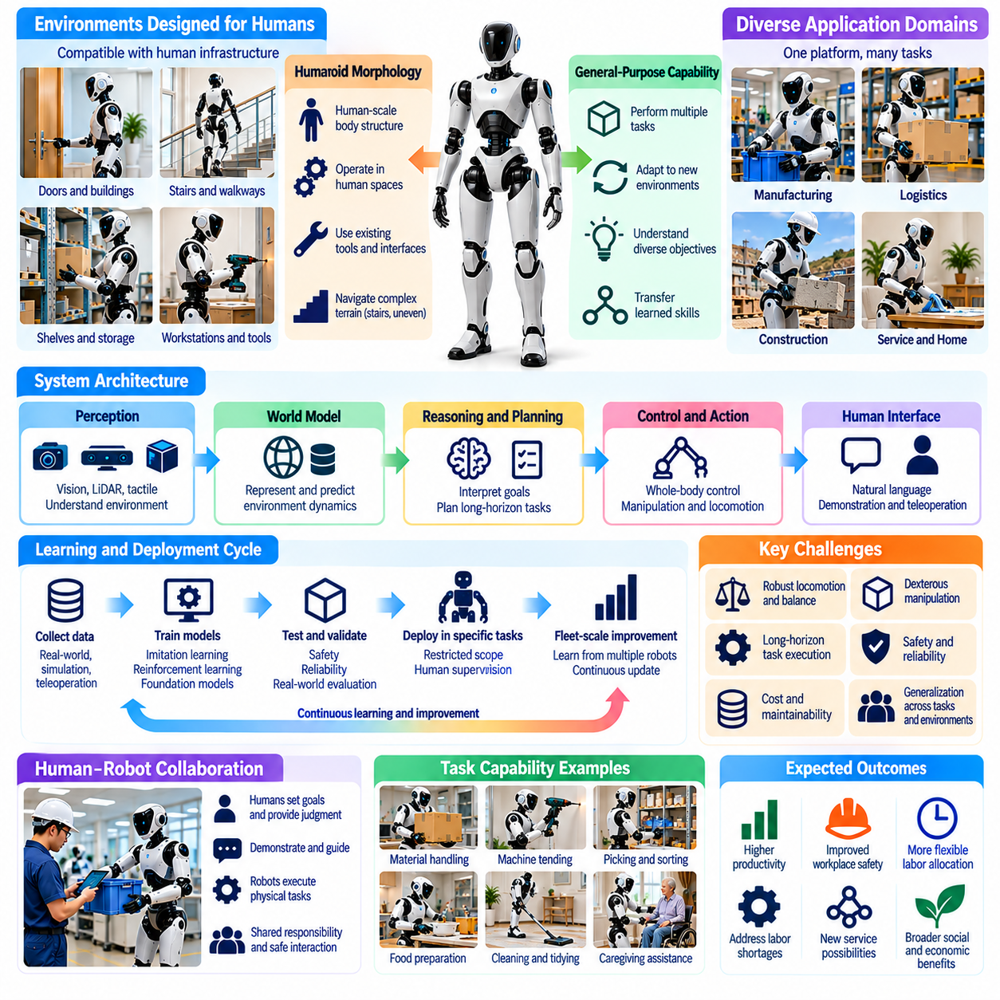{width="7.268055555555556in" height="7.268055555555556in"}

Humanoid robots and general-purpose robotic systems represent a potential turning point in the evolution of Physical AI labor. Unlike specialized machines designed for individual operations, these platforms aim to perform multiple physical tasks across changing environments. Their significance lies in the possibility of transferring intelligent automation into workplaces already organized around human movement, tools, and infrastructure.

Humanoid morphology offers potential compatibility with environments designed for the human body. Doors, stairs, shelves, workstations, and hand-operated tools often assume human proportions and movement capabilities. A humanoid robot may interact with such infrastructure without extensive modification. However, anatomical similarity does not automatically provide superior performance, and alternative robotic configurations may remain more efficient for many tasks.

General-purpose robotic labor should be defined by functional adaptability rather than appearance alone. A robot becomes more general when it can interpret different objectives, manipulate unfamiliar objects, and transfer learned skills between tasks. This capability requires coordinated perception, reasoning, planning, and control. A humanoid body may support versatility, but genuine generality depends primarily on reliable behavior across diverse operating conditions.

The mechanical complexity of humanoid robots introduces substantial engineering challenges. Bipedal locomotion requires continuous balance regulation, coordinated joint control, and rapid responses to external disturbances. Manipulation adds requirements for dexterity, force sensing, and stable whole-body motion. These demands increase computational requirements, energy consumption, and maintenance complexity compared with simpler robotic platforms.

Physical AI may improve humanoid capabilities through learned control policies and predictive world models. Perception systems estimate surrounding geometry, object states, and human activity, while planning models evaluate possible actions and their consequences. Low-level controllers translate selected behaviors into actuator commands. Reliable operation requires these components to cooperate across different time scales while respecting physical and safety constraints.

Vision-language-action models provide a possible interface between human instructions and robotic execution. A worker might request that a robot organize materials, retrieve equipment, or prepare a workstation. The system must interpret the instruction, identify relevant objects, and generate appropriate actions. Nevertheless, linguistic understanding alone does not guarantee physical competence, especially when manipulation requires precise contact and force regulation.

Learning transferable skills is essential for general-purpose robotic labor. A robot trained to grasp one category of objects should ideally adapt to unfamiliar shapes, materials, and placements. Cross-task generalization may reduce the need for separate programming of every operation. However, variations in friction, weight, deformability, and environmental geometry can cause learned policies to fail outside their training distributions.

Long-horizon task execution presents another major challenge. Activities such as preparing a workspace or restocking supplies require multiple dependent actions, persistent state tracking, and recovery from mistakes. Robots must remember completed steps, recognize unexpected outcomes, and revise plans when conditions change. Combining hierarchical planning, memory, and feedback control may enable more reliable execution of extended physical workflows.

Industrial facilities may provide the earliest economically practical environments for general-purpose robots. Factories and warehouses contain recurring tasks, established supervision procedures, and measurable performance objectives. Humanoid robots could potentially handle selected material transfers, machine tending, and workstation preparation. Initial deployments are likely to emphasize restricted task sets rather than unrestricted autonomous operation.

The economic justification for humanoid labor depends on utilization and task versatility. A robot capable of several activities may distribute its acquisition cost across different workflows, reducing idle time. However, versatility provides limited value if task transitions require extensive setup or frequent human intervention. Organizations must evaluate effective throughput, reliability, maintenance, supervision costs, and integration requirements rather than relying on nominal task capability.

Human-robot collaboration will remain central during the development of general-purpose robotic labor. Workers may assign tasks, demonstrate procedures, supervise execution, and resolve exceptions. Robots can perform repetitive physical activities while humans retain responsibility for complex judgments and operational priorities. Effective collaboration requires understandable interfaces, predictable robot behavior, and clearly defined boundaries of authority.

Teleoperation can accelerate humanoid development by providing demonstrations and assistance during difficult tasks. Human operators may remotely control robotic movements, generating examples of successful manipulation and recovery. These experiences can support imitation learning and policy improvement. Nevertheless, teleoperation-intensive systems should not be confused with fully autonomous labor, particularly when evaluating productivity and economic scalability.

Fleet-scale learning offers a pathway toward improving general-purpose capabilities across multiple robots. Operational experiences can reveal common failure patterns, unfamiliar objects, and successful task strategies. Curated data may support foundation-model training and continual adaptation. However, sharing learned behavior requires careful validation because differences in robot hardware, environmental conditions, and task requirements can affect reliability.

Cross-embodiment learning may further expand the usefulness of general-purpose robotic intelligence. Skills acquired through humanoid robots, mobile manipulators, or other platforms may share representations of objects, actions, and physical relationships. Transferring knowledge between embodiments could improve data efficiency. Yet differences in kinematics, actuator capabilities, and contact dynamics prevent straightforward reuse of every learned movement.

Safety presents particularly demanding requirements when humanoids operate near people. Their moving limbs, elevated centers of mass, and substantial mechanical power can create collision, instability, and contact risks. Safe deployment requires validated motion constraints, force limitations, emergency stopping mechanisms, and continuous monitoring. Learned intelligence must operate within independently enforced safety boundaries.

Reliability is equally important because general-purpose robots may encounter situations not anticipated during development. A system that completes most demonstrations successfully may still be unsuitable for continuous production if failures occur unpredictably. Performance evaluation should measure task completion, recovery success, intervention frequency, and safe operating duration. Robustness across changing conditions matters more than isolated demonstrations of complex behavior.

Energy efficiency and hardware durability impose additional limits on practical humanoid labor. Walking, balancing, lifting, and manipulating objects consume energy while producing mechanical wear. Battery capacity, actuator efficiency, thermal management, and maintenance intervals influence operating economics. General-purpose robots must demonstrate sustained useful work rather than merely short periods of technically impressive movement.

The workforce implications of humanoid deployment depend on which tasks become economically automatable. Repetitive handling, transportation, and routine preparation may experience partial substitution, while supervision, maintenance, integration, and exception management may expand. Entire occupations are unlikely to change uniformly because most jobs combine physical execution with communication, judgment, and organizational responsibilities.

Humanoid robots may also influence workplace design and organizational structure. Facilities could retain human-compatible infrastructure while gradually introducing robotic workers, reducing some modification costs. At the same time, charging areas, maintenance procedures, digital task interfaces, and safety protocols will require adaptation. Effective integration depends on redesigning workflows around complementary human and robotic capabilities.

The development of general-purpose robots should not be interpreted as evidence that human-equivalent physical intelligence has already been achieved. Broad autonomy requires dependable perception, physical reasoning, dexterous manipulation, memory, and adaptation under unfamiliar conditions. Progress in individual components does not automatically produce integrated competence. Evaluation must distinguish laboratory demonstrations from sustained, economically useful deployment.

Over the longer term, improvements in foundation models, world models, hardware design, and fleet learning may expand the range of tasks accessible to general-purpose robots. Systems could move between industrial, commercial, and selected domestic activities with less specialized programming. However, deployment speed will depend on safety validation, operating costs, infrastructure compatibility, and the ability to maintain reliability across diverse environments.

Humanoid and general-purpose robotic labor may ultimately change how societies organize physical work. Instead of assigning every repetitive operation to a dedicated machine, organizations could allocate tasks among adaptable robotic platforms and human specialists. The resulting division of labor would depend on comparative capabilities, economic incentives, and institutional choices rather than technological possibility alone.

Ultimately, the significance of humanoids lies not simply in reproducing human appearance but in developing machines capable of useful, adaptable, and accountable physical work. Their contribution to Physical AI will be measured by reliable task execution, safe collaboration, and sustainable economic value. Human-centered deployment must ensure that increasing robotic versatility strengthens productivity and worker well-being without neglecting responsibility, training, or social consequences.

휴머노이드 로봇(Humanoid Robot)과 범용 로봇 시스템(General-Purpose Robotic System)은 피지컬 인공지능 노동(Physical AI Labor)의 진화에서 잠재적인 전환점(Turning Point)을 나타낸다. 개별 작업(Individual Operation)을 위해 설계된 특수 목적 기계(Specialized Machine)와 달리, 이러한 플랫폼은 변화하는 환경에서 여러 물리적 작업(Physical Task)을 수행하는 것을 목표로 한다. 그 중요성은 인간의 움직임(Human Movement), 도구(Tool), 기반시설(Infrastructure)을 중심으로 구성된 기존 작업장(Workplace)에 지능형 자동화(Intelligent Automation)를 도입할 가능성에 있다.

휴머노이드 형태(Humanoid Morphology)는 인간의 신체(Human Body)에 맞춰 설계된 환경과의 잠재적인 호환성(Compatibility)을 제공한다. 문(Door), 계단(Stair), 선반(Shelf), 작업대(Workstation), 수동 조작 도구(Hand-Operated Tool)는 인간의 신체 비율(Human Proportion)과 움직임 능력(Movement Capability)을 전제로 하는 경우가 많다. 휴머노이드 로봇은 광범위한 환경 개조(Environmental Modification) 없이 이러한 기반시설과 상호작용할 수 있다. 그러나 해부학적 유사성(Anatomical Similarity)이 자동으로 우수한 성능(Superior Performance)을 제공하는 것은 아니며, 많은 작업에서는 다른 로봇 구조(Robotic Configuration)가 여전히 더 효율적일 수 있다.

범용 로봇 노동(General-Purpose Robotic Labor)은 외형(Appearance)만이 아니라 기능적 적응성(Functional Adaptability)을 기준으로 정의해야 한다. 로봇이 서로 다른 목표(Objective)를 해석하고 익숙하지 않은 물체(Unfamiliar Object)를 조작하며 작업 사이에서 학습된 기술(Learned Skill)을 전이할 수 있을 때 범용성(Generality)이 높아진다. 이러한 능력에는 인식(Perception), 추론(Reasoning), 계획(Planning), 제어(Control)의 조정된 통합이 필요하다. 휴머노이드 신체(Humanoid Body)는 다목적성(Versatility)을 지원할 수 있지만, 진정한 범용성은 주로 다양한 운영 조건(Operating Condition)에서 신뢰할 수 있는 행동(Reliable Behavior)을 수행하는 능력에 달려 있다.

휴머노이드 로봇의 기계적 복잡성(Mechanical Complexity)은 상당한 공학적 과제(Engineering Challenge)를 발생시킨다. 이족 보행(Bipedal Locomotion)에는 지속적인 균형 조절(Balance Regulation), 조정된 관절 제어(Coordinated Joint Control), 외부 교란(External Disturbance)에 대한 신속한 대응이 필요하다. 물체 조작(Manipulation)에는 정교한 조작 능력(Dexterity), 힘 감지(Force Sensing), 안정적인 전신 운동(Whole-Body Motion)이 추가로 요구된다. 이러한 요구사항은 단순한 로봇 플랫폼(Simpler Robotic Platform)과 비교하여 계산 요구량(Computational Requirement), 에너지 소비(Energy Consumption), 유지보수 복잡성(Maintenance Complexity)을 증가시킨다.

피지컬 인공지능(Physical AI)은 학습 기반 제어 정책(Learned Control Policy)과 예측형 월드 모델(Predictive World Model)을 통해 휴머노이드의 능력을 향상시킬 수 있다. 인식 시스템(Perception System)은 주변 기하 구조(Surrounding Geometry), 물체 상태(Object State), 인간 활동(Human Activity)을 추정하고, 계획 모델(Planning Model)은 가능한 행동과 그 결과를 평가한다. 저수준 제어기(Low-Level Controller)는 선택된 행동을 액추에이터 명령(Actuator Command)으로 변환한다. 신뢰할 수 있는 운영을 위해서는 이러한 구성요소가 물리적 제약(Physical Constraint)과 안전 제약(Safety Constraint)을 준수하면서 서로 다른 시간 척도(Time Scale)에 걸쳐 협력해야 한다.

비전-언어-행동 모델(Vision-Language-Action Model)은 인간의 지시(Human Instruction)와 로봇 실행(Robotic Execution)을 연결하는 인터페이스(Interface)를 제공할 수 있다. 근로자는 로봇에게 자재 정리(Material Organization), 장비 가져오기(Equipment Retrieval), 작업대 준비(Workstation Preparation)를 요청할 수 있다. 시스템은 지시를 해석하고 관련 물체를 식별하며 적절한 행동을 생성해야 한다. 그러나 언어 이해(Linguistic Understanding)만으로 물리적 수행 능력(Physical Competence)이 보장되는 것은 아니며, 특히 정밀한 접촉(Contact)과 힘 조절(Force Regulation)이 필요한 조작 작업에서는 더욱 그렇다.

전이 가능한 기술(Transferable Skill)을 학습하는 것은 범용 로봇 노동(General-Purpose Robotic Labor)의 핵심 요소이다. 특정 범주의 물체(Object Category)를 파지하도록 학습된 로봇은 이상적으로 익숙하지 않은 형태(Shape), 재료(Material), 배치(Placement)에도 적응할 수 있어야 한다. 작업 간 일반화(Cross-Task Generalization)는 모든 작업을 개별적으로 프로그래밍(Programming)해야 하는 필요성을 줄일 수 있다. 그러나 마찰(Friction), 무게(Weight), 변형 가능성(Deformability), 환경 기하 구조(Environmental Geometry)의 차이로 인해 학습된 정책(Learned Policy)이 훈련 데이터 분포(Training Distribution)를 벗어나면 실패할 수 있다.

장기 시간 범위 작업 실행(Long-Horizon Task Execution)은 또 다른 주요 과제이다. 작업 공간 준비(Workspace Preparation)나 물품 재보충(Supply Restocking)과 같은 활동에는 상호 의존적인 여러 행동(Dependent Action), 지속적인 상태 추적(Persistent State Tracking), 실수로부터의 복구(Recovery)가 필요하다. 로봇은 완료된 단계를 기억하고 예상하지 못한 결과를 인식하며 조건이 변화할 때 계획을 수정해야 한다. 계층적 계획(Hierarchical Planning), 메모리(Memory), 피드백 제어(Feedback Control)를 결합하면 확장된 물리적 작업 흐름(Extended Physical Workflow)을 더욱 신뢰성 있게 실행할 수 있다.

산업시설(Industrial Facility)은 범용 로봇(General-Purpose Robot)이 경제적으로 실용화되기 가장 적합한 초기 환경을 제공할 수 있다. 공장(Factory)과 창고(Warehouse)에는 반복적인 작업(Recurring Task), 확립된 감독 절차(Supervision Procedure), 측정 가능한 성과 목표(Performance Objective)가 존재한다. 휴머노이드 로봇은 일부 자재 이송(Material Transfer), 설비 작업 지원(Machine Tending), 작업대 준비(Workstation Preparation)를 수행할 가능성이 있다. 초기 배치(Initial Deployment)는 제한 없는 자율 운영(Unrestricted Autonomous Operation)보다 한정된 작업 집합(Restricted Task Set)에 집중할 가능성이 높다.

휴머노이드 노동(Humanoid Labor)의 경제적 타당성(Economic Justification)은 활용률(Utilization)과 작업 다목적성(Task Versatility)에 달려 있다. 여러 활동을 수행할 수 있는 로봇은 도입 비용(Acquisition Cost)을 다양한 작업 흐름(Workflow)에 분산하여 유휴시간(Idle Time)을 줄일 수 있다. 그러나 작업 전환(Task Transition)에 광범위한 설정(Setup)이나 빈번한 인간 개입(Human Intervention)이 필요하다면 다목적성의 가치는 제한적이다. 조직은 명목상의 작업 능력(Nominal Task Capability)에 의존하기보다 실효 처리량(Effective Throughput), 신뢰성(Reliability), 유지보수(Maintenance), 감독 비용(Supervision Cost), 통합 요구사항(Integration Requirement)을 평가해야 한다.

인간-로봇 협업(Human-Robot Collaboration)은 범용 로봇 노동(General-Purpose Robotic Labor)의 발전 과정에서 계속 핵심적인 역할을 할 것이다. 근로자는 작업을 할당하고 절차를 시연하며 실행을 감독하고 예외 상황(Exception)을 해결할 수 있다. 로봇은 반복적인 물리적 활동(Repetitive Physical Activity)을 수행하고 인간은 복잡한 판단(Complex Judgment)과 운영 우선순위(Operational Priority)에 대한 책임을 유지할 수 있다. 효과적인 협업에는 이해하기 쉬운 인터페이스(Understandable Interface), 예측 가능한 로봇 행동(Predictable Robot Behavior), 명확하게 정의된 권한의 경계(Boundary of Authority)가 필요하다.

원격조작(Teleoperation)은 어려운 작업에서 시연(Demonstration)과 지원(Assistance)을 제공함으로써 휴머노이드 개발(Humanoid Development)을 가속화할 수 있다. 인간 운영자(Human Operator)는 로봇의 움직임을 원격으로 제어하면서 성공적인 조작(Successful Manipulation)과 복구(Recovery)의 사례를 생성할 수 있다. 이러한 경험은 모방학습(Imitation Learning)과 정책 개선(Policy Improvement)을 지원할 수 있다. 그러나 원격조작에 크게 의존하는 시스템(Teleoperation-Intensive System)을 완전 자율 노동(Fully Autonomous Labor)과 혼동해서는 안 되며, 특히 생산성(Productivity)과 경제적 확장성(Economic Scalability)을 평가할 때 이러한 구분이 중요하다.

로봇 군집 규모 학습(Fleet-Scale Learning)은 여러 로봇에 걸쳐 범용 능력(General-Purpose Capability)을 개선하는 경로를 제공한다. 운영 경험(Operational Experience)은 공통적인 실패 패턴(Common Failure Pattern), 익숙하지 않은 물체(Unfamiliar Object), 성공적인 작업 전략(Successful Task Strategy)을 드러낼 수 있다. 선별된 데이터(Curated Data)는 파운데이션 모델 학습(Foundation-Model Training)과 지속적 적응(Continual Adaptation)을 지원할 수 있다. 그러나 로봇 하드웨어(Robot Hardware), 환경 조건(Environmental Condition), 작업 요구사항(Task Requirement)의 차이가 신뢰성에 영향을 줄 수 있으므로 학습된 행동(Learned Behavior)을 공유하려면 신중한 검증(Validation)이 필요하다.

서로 다른 로봇 신체 간 학습(Cross-Embodiment Learning)은 범용 로봇 지능(General-Purpose Robotic Intelligence)의 유용성을 더욱 확장할 수 있다. 휴머노이드 로봇(Humanoid Robot), 이동형 매니퓰레이터(Mobile Manipulator), 기타 플랫폼(Platform)을 통해 습득한 기술은 물체(Object), 행동(Action), 물리적 관계(Physical Relationship)에 대한 표현(Representation)을 공유할 수 있다. 서로 다른 신체 구조(Embodiment) 사이의 지식 전이(Knowledge Transfer)는 데이터 효율성(Data Efficiency)을 향상시킬 수 있다. 그러나 운동학(Kinematics), 액추에이터 능력(Actuator Capability), 접촉 동역학(Contact Dynamics)의 차이 때문에 학습된 모든 움직임을 직접 재사용할 수는 없다.

안전성(Safety)은 휴머노이드가 인간 가까이에서 작동할 때 특히 까다로운 요구사항을 제기한다. 움직이는 팔다리(Moving Limb), 높은 무게중심(Elevated Center of Mass), 상당한 기계적 출력(Mechanical Power)은 충돌(Collision), 불안정성(Instability), 접촉 위험(Contact Risk)을 발생시킬 수 있다. 안전한 배치(Safe Deployment)를 위해서는 검증된 운동 제약(Motion Constraint), 힘 제한(Force Limitation), 비상 정지 장치(Emergency Stopping Mechanism), 지속적인 모니터링(Continuous Monitoring)이 필요하다. 학습된 지능(Learned Intelligence)은 독립적으로 강제되는 안전 경계(Safety Boundary) 안에서 작동해야 한다.

신뢰성(Reliability) 역시 중요하다. 범용 로봇(General-Purpose Robot)은 개발 과정에서 예상하지 못한 상황에 직면할 수 있기 때문이다. 대부분의 시연(Demonstration)을 성공적으로 완료하는 시스템이라도 실패가 예측할 수 없게 발생한다면 연속 생산(Continuous Production)에는 적합하지 않을 수 있다. 성능 평가(Performance Evaluation)는 작업 완료(Task Completion), 복구 성공(Recovery Success), 개입 빈도(Intervention Frequency), 안전한 운영 지속시간(Safe Operating Duration)을 측정해야 한다. 변화하는 조건에서의 강건성(Robustness)은 복잡한 행동을 보여주는 개별 시연(Isolated Demonstration)보다 중요하다.

에너지 효율성(Energy Efficiency)과 하드웨어 내구성(Hardware Durability)은 실용적인 휴머노이드 노동(Practical Humanoid Labor)에 추가적인 제약을 부과한다. 보행(Walking), 균형 유지(Balancing), 물체 들어 올리기(Lifting), 조작(Manipulation)은 에너지를 소비하면서 기계적 마모(Mechanical Wear)를 발생시킨다. 배터리 용량(Battery Capacity), 액추에이터 효율(Actuator Efficiency), 열 관리(Thermal Management), 유지보수 주기(Maintenance Interval)는 운영 경제성(Operating Economics)에 영향을 미친다. 범용 로봇은 기술적으로 인상적인 짧은 움직임을 보여주는 데 그치지 않고 지속적으로 유용한 작업(Sustained Useful Work)을 수행할 수 있음을 입증해야 한다.

휴머노이드 배치(Humanoid Deployment)가 노동시장(Workforce)에 미치는 영향은 어떤 작업이 경제적으로 자동화 가능(Economically Automatable)해지는지에 달려 있다. 반복적인 물체 취급(Repetitive Handling), 운송(Transportation), 일상적인 준비 작업(Routine Preparation)은 부분적인 노동 대체(Partial Substitution)를 경험할 수 있으며, 감독(Supervision), 유지보수(Maintenance), 시스템 통합(Integration), 예외 상황 관리(Exception Management)는 확대될 수 있다. 대부분의 직업은 물리적 실행(Physical Execution)과 의사소통(Communication), 판단(Judgment), 조직적 책임(Organizational Responsibility)을 결합하므로 직업 전체가 동일한 방식으로 변화할 가능성은 낮다.

휴머노이드 로봇은 작업장 설계(Workplace Design)와 조직 구조(Organizational Structure)에도 영향을 미칠 수 있다. 시설은 인간 친화적 기반시설(Human-Compatible Infrastructure)을 유지하면서 로봇 근로자(Robotic Worker)를 점진적으로 도입하여 일부 개조 비용(Modification Cost)을 줄일 수 있다. 동시에 충전 구역(Charging Area), 유지보수 절차(Maintenance Procedure), 디지털 작업 인터페이스(Digital Task Interface), 안전 프로토콜(Safety Protocol)은 변화가 필요하다. 효과적인 통합(Effective Integration)은 인간과 로봇의 상호보완적 능력(Complementary Capability)을 중심으로 작업 흐름(Workflow)을 재설계하는 데 달려 있다.

범용 로봇(General-Purpose Robot)의 발전을 인간과 동등한 물리적 지능(Human-Equivalent Physical Intelligence)이 이미 달성되었다는 증거로 해석해서는 안 된다. 광범위한 자율성(Broad Autonomy)에는 신뢰할 수 있는 인식(Dependable Perception), 물리적 추론(Physical Reasoning), 정교한 조작(Dexterous Manipulation), 메모리(Memory), 익숙하지 않은 조건에서의 적응(Adaptation)이 필요하다. 개별 구성요소(Individual Component)의 발전이 자동으로 통합된 수행 능력(Integrated Competence)을 만들어내는 것은 아니다. 평가는 실험실 시연(Laboratory Demonstration)과 지속적이고 경제적으로 유용한 배치(Sustained, Economically Useful Deployment)를 구별해야 한다.

장기적으로 파운데이션 모델(Foundation Model), 월드 모델(World Model), 하드웨어 설계(Hardware Design), 로봇 군집 학습(Fleet Learning)의 발전은 범용 로봇이 수행할 수 있는 작업 범위를 확대할 수 있다. 시스템은 특수 목적 프로그래밍(Specialized Programming)을 줄이면서 산업 활동(Industrial Activity), 상업 활동(Commercial Activity), 일부 가정 활동(Domestic Activity) 사이를 이동할 수 있을 것이다. 그러나 배치 속도(Deployment Speed)는 안전 검증(Safety Validation), 운영비용(Operating Cost), 기반시설 호환성(Infrastructure Compatibility), 다양한 환경에서 신뢰성을 유지하는 능력에 달려 있다.

휴머노이드 및 범용 로봇 노동(Humanoid and General-Purpose Robotic Labor)은 궁극적으로 사회가 물리적 노동(Physical Work)을 조직하는 방식을 변화시킬 수 있다. 모든 반복 작업(Repetitive Operation)에 전용 기계(Dedicated Machine)를 배정하는 대신, 조직은 적응형 로봇 플랫폼(Adaptable Robotic Platform)과 인간 전문가(Human Specialist) 사이에 작업을 배분할 수 있다. 그 결과 나타나는 노동 분업(Division of Labor)은 기술적 가능성(Technological Possibility)만이 아니라 비교우위 능력(Comparative Capability), 경제적 유인(Economic Incentive), 제도적 선택(Institutional Choice)에 달려 있을 것이다.

궁극적으로 휴머노이드(Humanoid)의 중요성은 단순히 인간의 외형(Human Appearance)을 재현하는 것이 아니라 유용하고 적응 가능하며 책임 있는 물리적 작업(Useful, Adaptable, and Accountable Physical Work)을 수행할 수 있는 기계를 개발하는 데 있다. 피지컬 인공지능(Physical AI)에 대한 기여도는 신뢰할 수 있는 작업 실행(Reliable Task Execution), 안전한 협업(Safe Collaboration), 지속 가능한 경제적 가치(Sustainable Economic Value)를 통해 평가될 것이다. 인간 중심 배치(Human-Centered Deployment)는 로봇의 다목적성(Robotic Versatility) 증가가 책임(Responsibility), 교육(Training), 사회적 결과(Social Consequence)를 소홀히 하지 않으면서 생산성(Productivity)과 근로자 복지(Worker Well-Being)를 강화하도록 보장해야 한다.

##  

## 01.11. Human Robot Teams

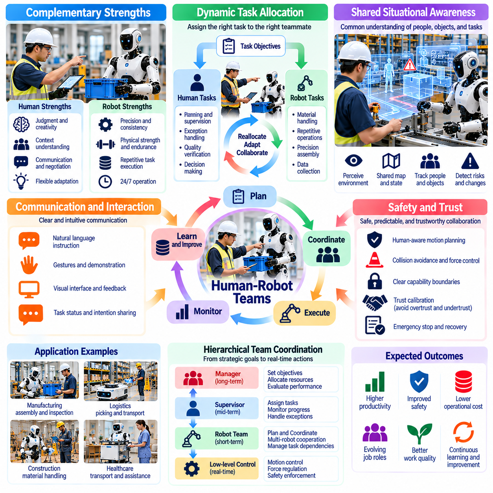{width="7.268055555555556in" height="7.268055555555556in"}

Human-robot teams represent an emerging organizational model in which human workers and intelligent machines cooperate to achieve shared physical objectives. Unlike conventional automation, where machines execute isolated tasks, collaborative systems coordinate decisions, movements, and responsibilities. Their effectiveness depends on combining human judgment, contextual understanding, and adaptability with robotic precision, endurance, and repeatability.

The fundamental principle of human-robot teamwork is complementary capability rather than simple labor substitution. Humans remain effective at interpreting ambiguous situations, negotiating priorities, and responding to social context. Robots can provide consistent execution, physical assistance, and repetitive task performance. Productive collaboration requires assigning responsibilities according to comparative strengths while recognizing the limitations of both participants.

Task allocation becomes a dynamic process when robots possess adaptive intelligence. A human supervisor may assign objectives while robotic systems select appropriate execution strategies within defined boundaries. Tasks can be reassigned when environmental conditions, workload, or system capabilities change. Effective allocation requires awareness of worker availability, robot readiness, task dependencies, and the consequences of delayed execution.

Shared situational awareness is essential for coordinated physical work. Human workers and robots must maintain sufficiently consistent representations of objects, obstacles, task progress, and operational hazards. Perception systems can update environmental information, while interfaces communicate relevant changes to workers. Differences between human understanding and robotic world representations must be detected before they produce unsafe or inefficient actions.

Communication provides the foundation for reliable human-robot coordination. Workers may express goals through speech, gestures, graphical interfaces, or direct physical guidance. Robots must interpret these signals while communicating intentions, limitations, and task status. Effective interaction should minimize ambiguity and avoid overwhelming workers with unnecessary information, particularly during time-sensitive or safety-critical operations.

Predictability strongly influences trust within human-robot teams. Workers need to understand where a robot intends to move, what action it will perform, and when human intervention may be required. Motion planning should consider human expectations as well as collision avoidance. Transparent status reporting and understandable behavior can improve coordination, although excessive confidence in robotic capability may create new safety risks.

Trust calibration requires matching human expectations to demonstrated robotic competence. Undertrust may prevent useful automation, while overtrust can encourage inappropriate delegation of dangerous tasks. Teams should develop trust through validated performance, clear capability boundaries, and consistent communication of uncertainty. Training and operational feedback help workers recognize when autonomous assistance is appropriate and when direct supervision remains necessary.

Collaborative manipulation introduces physical interaction between humans and robotic systems. Workers and robots may jointly position components, transport heavy objects, or assemble structures. Such activities require force coordination, compliant control, and accurate estimation of human movement. Robots must respond safely to unexpected resistance or changes in human intent while maintaining stability and protecting nearby personnel.

Shared workspaces require continuous risk assessment because human behavior cannot be predicted perfectly. Collaborative robots must detect proximity, estimate motion, and adjust speed or force when people approach. Safety mechanisms should remain effective even when perception or learning-based control becomes unreliable. Physical safeguards, validated operating limits, and emergency procedures must complement intelligent planning.

Hierarchical coordination can organize human-robot teams across different decision horizons. Human managers may establish production objectives, supervisors allocate tasks, and robotic controllers execute individual movements. Strategic decisions evolve over longer periods, while motion control operates at much shorter intervals. Connecting these layers requires reliable feedback, explicit authority boundaries, and mechanisms for revising plans.

World models can support teamwork by representing shared environments and predicting the consequences of coordinated actions. A robot may anticipate that a worker will occupy a particular workspace or that moving equipment will obstruct a planned route. Such predictions can improve scheduling and motion planning. However, uncertainty must remain explicit because human intentions and environmental changes cannot be inferred with complete reliability.

Multi-robot teams introduce additional coordination challenges when several machines cooperate with human personnel. Robots may share maps, exchange task status, and negotiate resource access while supervisors manage overall priorities. Fleet management systems can reduce congestion and balance workloads. Nevertheless, communication delays, inconsistent state information, and simultaneous failures can undermine coordination without robust recovery mechanisms.

Exception handling is a defining requirement of practical human-robot teamwork. Robots may encounter unfamiliar objects, blocked passages, damaged equipment, or instructions that conflict with safety constraints. Systems should identify situations beyond their validated competence and request appropriate assistance. Human intervention must be integrated into normal operations rather than treated as evidence that collaboration has failed.

Teleoperation and shared autonomy provide intermediate forms of collaboration between manual control and full robotic independence. An operator may guide a difficult manipulation while the robot maintains balance, collision avoidance, and low-level control. Authority can shift as task complexity and uncertainty change. These arrangements may improve productivity, provided that transitions are understandable and do not create excessive cognitive workload.

Human factors become increasingly important as workers supervise multiple intelligent machines. Monitoring several robots can introduce attention demands, alarm fatigue, and delayed responses to exceptional events. Interface design should prioritize actionable information and distinguish routine updates from urgent warnings. Workload-aware coordination may adjust robotic autonomy or task assignments according to the supervisor\'s available attention.

Organizational integration requires redesigning workflows rather than merely placing robots beside existing workers. Task sequences, workstation layouts, shift schedules, and maintenance responsibilities may need adjustment. Employees should participate in deployment planning because practical operational knowledge often reveals constraints overlooked during engineering. Successful integration depends on aligning technical capabilities with established working practices.

Training programs must prepare workers to cooperate with robotic teammates safely and effectively. Personnel need to understand robot capabilities, operational limits, communication procedures, and intervention mechanisms. Simulation and supervised practice can expose workers to unusual situations before live deployment. Training should also develop the ability to question robotic recommendations and maintain independent professional judgment.

Performance evaluation should measure team outcomes rather than robot productivity alone. Relevant indicators include total task completion time, quality, worker workload, intervention frequency, safety incidents, and recovery performance. A robot that operates rapidly but repeatedly interrupts colleagues may reduce overall efficiency. Team-level metrics reveal whether automation genuinely improves the combined human-machine workflow.

Economic benefits arise when collaboration increases productive capacity without proportionally increasing supervision and integration costs. Robots may reduce physical fatigue, extend operational coverage, and support workers during labor-intensive activities. However, coordination overhead and unreliable autonomy can offset these gains. Investment decisions should consider sustained team performance, employee acceptance, and the cost of maintaining safe operations.

Human-robot teamwork also raises questions about authority, accountability, and worker autonomy. Organizations must clarify who approves tasks, controls operating limits, and accepts responsibility for consequential decisions. Robotic recommendations should not obscure managerial obligations or professional accountability. Workers need practical mechanisms to stop unsafe operations and report system limitations without inappropriate pressure.

The long-term development of human-robot teams may involve increasingly adaptive cooperation supported by foundation models, persistent memory, and continual learning. Robots could recognize recurring workflows, anticipate assistance needs, and improve coordination through accumulated experience. Nevertheless, behavioral adaptation must remain observable, validated, and reversible when necessary. Learning should strengthen teamwork without introducing unpredictable operational changes.

Human-robot teams may eventually become a standard organizational structure across manufacturing, logistics, construction, healthcare, and service industries. Their configurations will differ according to task risk, environmental complexity, and the importance of interpersonal judgment. Some teams may involve direct physical collaboration, while others rely on supervision and autonomous task execution. No single collaboration model will suit every workplace.

Ultimately, effective human-robot teams depend on designing intelligence around shared responsibility and coordinated action. Their purpose is not merely to maximize robotic autonomy but to improve collective performance, safety, and human well-being. Physical AI will create lasting labor value when machines remain understandable, dependable, and adaptable partners within organizational systems that preserve meaningful human control.

인간-로봇 팀(Human-Robot Team)은 인간 근로자(Human Worker)와 지능형 기계(Intelligent Machine)가 공동의 물리적 목표(Shared Physical Objective)를 달성하기 위해 협력하는 새로운 조직 모델(Organizational Model)을 나타낸다. 기계가 개별 작업(Isolated Task)을 수행하는 기존 자동화(Conventional Automation)와 달리, 협업 시스템(Collaborative System)은 의사결정(Decision-Making), 움직임(Movement), 책임(Responsibility)을 조정한다. 그 효과는 인간의 판단력(Human Judgment), 맥락 이해(Contextual Understanding), 적응성(Adaptability)을 로봇의 정밀성(Precision), 지속 작업 능력(Endurance), 반복 재현성(Repeatability)과 결합하는 데 달려 있다.

인간-로봇 팀워크(Human-Robot Teamwork)의 기본 원칙은 단순한 노동 대체(Labor Substitution)가 아니라 상호보완적 능력(Complementary Capability)에 있다. 인간은 모호한 상황(Ambiguous Situation)을 해석하고 우선순위(Priority)를 조정하며 사회적 맥락(Social Context)에 대응하는 데 강점을 유지한다. 로봇은 일관된 실행(Consistent Execution), 물리적 지원(Physical Assistance), 반복적인 작업 수행(Repetitive Task Performance)을 제공할 수 있다. 생산적인 협업(Productive Collaboration)을 위해서는 양측의 한계를 인식하면서 비교우위(Comparative Strength)에 따라 책임을 배분해야 한다.

로봇이 적응형 지능(Adaptive Intelligence)을 갖추면 작업 할당(Task Allocation)은 동적인 과정(Dynamic Process)이 된다. 인간 감독자(Human Supervisor)는 목표를 지정하고 로봇 시스템(Robotic System)은 정의된 경계(Defined Boundary) 안에서 적절한 실행 전략(Execution Strategy)을 선택할 수 있다. 환경 조건(Environmental Condition), 작업 부하(Workload), 시스템 능력(System Capability)이 변화하면 작업을 재할당할 수 있다. 효과적인 작업 할당에는 근로자 가용성(Worker Availability), 로봇 준비 상태(Robot Readiness), 작업 의존성(Task Dependency), 실행 지연(Delayed Execution)의 결과에 대한 인식이 필요하다.

공유 상황 인식(Shared Situational Awareness)은 조정된 물리적 작업(Coordinated Physical Work)에 필수적이다. 인간 근로자와 로봇은 물체(Object), 장애물(Obstacle), 작업 진행 상태(Task Progress), 운영 위험(Operational Hazard)에 대해 충분히 일관된 표현(Representation)을 유지해야 한다. 인식 시스템(Perception System)은 환경 정보(Environmental Information)를 갱신하고 인터페이스(Interface)는 관련 변화를 근로자에게 전달할 수 있다. 인간의 이해(Human Understanding)와 로봇의 월드 표현(Robotic World Representation) 사이의 차이는 안전하지 않거나 비효율적인 행동으로 이어지기 전에 탐지되어야 한다.

의사소통(Communication)은 신뢰할 수 있는 인간-로봇 조정(Human-Robot Coordination)의 기반을 제공한다. 근로자는 음성(Speech), 제스처(Gesture), 그래픽 인터페이스(Graphical Interface), 직접적인 물리적 안내(Direct Physical Guidance)를 통해 목표를 표현할 수 있다. 로봇은 이러한 신호를 해석하면서 자신의 의도(Intention), 한계(Limitation), 작업 상태(Task Status)를 전달해야 한다. 효과적인 상호작용(Effective Interaction)은 모호성(Ambiguity)을 최소화하고, 특히 시간에 민감하거나 안전이 중요한 작업(Time-Sensitive or Safety-Critical Operation)에서 불필요한 정보로 근로자에게 과도한 부담을 주지 않아야 한다.

예측 가능성(Predictability)은 인간-로봇 팀(Human-Robot Team) 내부의 신뢰(Trust)에 큰 영향을 미친다. 근로자는 로봇이 어디로 이동하려는지, 어떤 행동을 수행할 것인지, 언제 인간의 개입(Human Intervention)이 필요할 수 있는지를 이해해야 한다. 동작 계획(Motion Planning)은 충돌 회피(Collision Avoidance)뿐 아니라 인간의 기대(Human Expectation)도 고려해야 한다. 투명한 상태 보고(Transparent Status Reporting)와 이해 가능한 행동(Understandable Behavior)은 협업을 개선할 수 있지만, 로봇 능력(Robotic Capability)에 대한 과도한 확신(Excessive Confidence)은 새로운 안전 위험(Safety Risk)을 발생시킬 수 있다.

신뢰 보정(Trust Calibration)은 인간의 기대(Human Expectation)를 실제로 입증된 로봇의 수행 능력(Demonstrated Robotic Competence)에 맞추는 과정이다. 신뢰 부족(Undertrust)은 유용한 자동화를 방해할 수 있으며, 과도한 신뢰(Overtrust)는 위험한 작업(Dangerous Task)의 부적절한 위임(Inappropriate Delegation)을 유도할 수 있다. 팀은 검증된 성능(Validated Performance), 명확한 능력 경계(Capability Boundary), 불확실성(Uncertainty)에 대한 일관된 의사소통을 통해 신뢰를 형성해야 한다. 교육(Training)과 운영 피드백(Operational Feedback)은 근로자가 자율 지원(Autonomous Assistance)이 적절한 상황과 직접 감독(Direct Supervision)이 필요한 상황을 구별하도록 돕는다.

협업 조작(Collaborative Manipulation)은 인간과 로봇 시스템(Robotic System) 사이의 물리적 상호작용(Physical Interaction)을 포함한다. 근로자와 로봇은 부품(Component)을 공동으로 배치하거나 무거운 물체(Heavy Object)를 운송하거나 구조물(Structure)을 조립할 수 있다. 이러한 활동에는 힘 조정(Force Coordination), 순응 제어(Compliant Control), 인간 움직임 추정(Human Movement Estimation)의 정확성이 필요하다. 로봇은 안정성(Stability)을 유지하고 주변 인력(Nearby Personnel)을 보호하면서 예상하지 못한 저항(Unexpected Resistance)이나 인간 의도(Human Intent)의 변화에 안전하게 대응해야 한다.

공유 작업 공간(Shared Workspace)은 인간 행동(Human Behavior)을 완벽하게 예측할 수 없기 때문에 지속적인 위험 평가(Continuous Risk Assessment)를 필요로 한다. 협동로봇(Collaborative Robot)은 근접성(Proximity)을 감지하고 움직임(Motion)을 추정하며 사람이 접근하면 속도(Speed)나 힘(Force)을 조절해야 한다. 안전 메커니즘(Safety Mechanism)은 인식(Perception)이나 학습 기반 제어(Learning-Based Control)의 신뢰성이 저하되는 상황에서도 효과적으로 작동해야 한다. 물리적 안전장치(Physical Safeguard), 검증된 운영 한계(Validated Operating Limit), 비상 절차(Emergency Procedure)는 지능형 계획(Intelligent Planning)을 보완해야 한다.

계층적 조정(Hierarchical Coordination)은 서로 다른 의사결정 시간 범위(Decision Horizon)에 걸쳐 인간-로봇 팀(Human-Robot Team)을 조직할 수 있다. 인간 관리자(Human Manager)는 생산 목표(Production Objective)를 설정하고 감독자(Supervisor)는 작업을 할당하며 로봇 제어기(Robotic Controller)는 개별 움직임(Individual Movement)을 실행할 수 있다. 전략적 의사결정(Strategic Decision)은 장기간에 걸쳐 변화하는 반면 동작 제어(Motion Control)는 훨씬 짧은 시간 간격에서 작동한다. 이러한 계층을 연결하려면 신뢰할 수 있는 피드백(Reliable Feedback), 명시적인 권한 경계(Explicit Authority Boundary), 계획 수정 메커니즘(Plan Revision Mechanism)이 필요하다.

월드 모델(World Model)은 공유 환경(Shared Environment)을 표현하고 조정된 행동(Coordinated Action)의 결과를 예측함으로써 팀워크(Teamwork)를 지원할 수 있다. 로봇은 근로자가 특정 작업 공간(Workspace)을 점유하거나 이동 중인 장비(Moving Equipment)가 계획된 경로(Planned Route)를 차단할 것이라고 예상할 수 있다. 이러한 예측(Prediction)은 일정 관리(Scheduling)와 동작 계획(Motion Planning)을 개선할 수 있다. 그러나 인간의 의도(Human Intention)와 환경 변화(Environmental Change)를 완전한 신뢰성으로 추론할 수 없으므로 불확실성(Uncertainty)을 명시적으로 유지해야 한다.

다중 로봇 팀(Multi-Robot Team)은 여러 기계가 인간 인력(Human Personnel)과 협력할 때 추가적인 조정 과제(Coordination Challenge)를 발생시킨다. 로봇은 지도(Map)를 공유하고 작업 상태(Task Status)를 교환하며 자원 접근(Resource Access)을 조정할 수 있고, 감독자는 전체적인 우선순위(Overall Priority)를 관리한다. 로봇 군집 관리 시스템(Fleet Management System)은 혼잡(Congestion)을 줄이고 작업 부하(Workload)를 균형 있게 배분할 수 있다. 그러나 통신 지연(Communication Delay), 일관되지 않은 상태 정보(Inconsistent State Information), 동시다발적 고장(Simultaneous Failure)은 강건한 복구 메커니즘(Robust Recovery Mechanism)이 없을 경우 협업을 약화시킬 수 있다.

예외 상황 처리(Exception Handling)는 실용적인 인간-로봇 팀워크(Practical Human-Robot Teamwork)의 핵심 요구사항이다. 로봇은 익숙하지 않은 물체(Unfamiliar Object), 차단된 통로(Blocked Passage), 손상된 장비(Damaged Equipment), 안전 제약(Safety Constraint)과 충돌하는 지시(Instruction)에 직면할 수 있다. 시스템은 검증된 수행 능력(Validated Competence)을 벗어나는 상황을 식별하고 적절한 지원(Appropriate Assistance)을 요청해야 한다. 인간 개입(Human Intervention)은 협업의 실패를 의미하는 것이 아니라 정상적인 운영(Normal Operation)의 일부로 통합되어야 한다.

원격조작(Teleoperation)과 공유 자율성(Shared Autonomy)은 수동 제어(Manual Control)와 완전한 로봇 독립성(Full Robotic Independence) 사이의 중간 형태 협업(Intermediate Collaboration)을 제공한다. 운영자(Operator)는 어려운 조작(Difficult Manipulation)을 안내하고 로봇은 균형 유지(Balance Maintenance), 충돌 회피(Collision Avoidance), 저수준 제어(Low-Level Control)를 담당할 수 있다. 작업 복잡성(Task Complexity)과 불확실성(Uncertainty)이 변화함에 따라 제어 권한(Control Authority)을 전환할 수 있다. 이러한 방식은 전환 과정(Transition)이 이해하기 쉽고 과도한 인지적 작업 부하(Cognitive Workload)를 발생시키지 않는다면 생산성(Productivity)을 향상시킬 수 있다.

인적 요인(Human Factor)은 근로자가 여러 지능형 기계(Intelligent Machine)를 감독하게 되면서 점점 더 중요해진다. 여러 로봇을 모니터링(Monitoring)하는 작업은 주의력 요구(Attention Demand), 경보 피로(Alarm Fatigue), 예외 상황(Exceptional Event)에 대한 대응 지연(Delayed Response)을 발생시킬 수 있다. 인터페이스 설계(Interface Design)는 실행 가능한 정보(Actionable Information)를 우선하고 일상적인 상태 갱신(Routine Update)과 긴급 경고(Urgent Warning)를 구별해야 한다. 작업 부하 인식형 조정(Workload-Aware Coordination)은 감독자의 가용 주의력(Available Attention)에 따라 로봇 자율성(Robotic Autonomy)이나 작업 할당(Task Assignment)을 조정할 수 있다.

조직적 통합(Organizational Integration)은 단순히 기존 근로자 옆에 로봇을 배치하는 것이 아니라 작업 흐름(Workflow)을 재설계할 것을 요구한다. 작업 순서(Task Sequence), 작업대 배치(Workstation Layout), 교대 근무 일정(Shift Schedule), 유지보수 책임(Maintenance Responsibility)을 조정해야 할 수 있다. 실제 운영 지식(Practical Operational Knowledge)은 공학적 설계(Engineering Design) 과정에서 간과된 제약(Constraint)을 드러내는 경우가 많으므로 직원은 배치 계획(Deployment Planning)에 참여해야 한다. 성공적인 통합은 기술적 능력(Technical Capability)을 기존 작업 관행(Established Working Practice)과 조화시키는 데 달려 있다.

교육 프로그램(Training Program)은 근로자가 로봇 팀원(Robotic Teammate)과 안전하고 효과적으로 협력할 수 있도록 준비시켜야 한다. 인력(Personnel)은 로봇 능력(Robot Capability), 운영 한계(Operational Limit), 의사소통 절차(Communication Procedure), 개입 메커니즘(Intervention Mechanism)을 이해해야 한다. 시뮬레이션(Simulation)과 감독하 실습(Supervised Practice)은 실제 배치(Live Deployment) 전에 근로자가 비정상적인 상황(Unusual Situation)을 경험하도록 할 수 있다. 교육은 로봇의 권고(Robotic Recommendation)에 의문을 제기하고 독립적인 전문적 판단(Independent Professional Judgment)을 유지하는 능력도 개발해야 한다.

성능 평가(Performance Evaluation)는 로봇 생산성(Robot Productivity)만이 아니라 팀 전체의 성과(Team Outcome)를 측정해야 한다. 관련 지표(Indicator)에는 총작업 완료시간(Total Task Completion Time), 품질(Quality), 근로자 작업 부하(Worker Workload), 개입 빈도(Intervention Frequency), 안전 사고(Safety Incident), 복구 성능(Recovery Performance)이 포함된다. 빠르게 작동하지만 동료의 작업을 반복적으로 방해하는 로봇은 전체 효율성(Overall Efficiency)을 감소시킬 수 있다. 팀 수준 지표(Team-Level Metric)는 자동화가 인간-기계 통합 작업 흐름(Combined Human-Machine Workflow)을 실제로 개선하는지를 보여준다.

경제적 이점(Economic Benefit)은 협업(Collaboration)이 감독 비용(Supervision Cost)과 통합 비용(Integration Cost)을 비례적으로 증가시키지 않으면서 생산 능력(Productive Capacity)을 확대할 때 발생한다. 로봇은 신체적 피로(Physical Fatigue)를 줄이고 운영 범위(Operational Coverage)를 확장하며 노동집약적 활동(Labor-Intensive Activity)에서 근로자를 지원할 수 있다. 그러나 조정 부담(Coordination Overhead)과 신뢰성이 부족한 자율성(Unreliable Autonomy)은 이러한 이점을 상쇄할 수 있다. 투자 결정(Investment Decision)은 지속적인 팀 성과(Sustained Team Performance), 직원 수용성(Employee Acceptance), 안전한 운영 유지비용(Cost of Maintaining Safe Operations)을 고려해야 한다.

인간-로봇 팀워크(Human-Robot Teamwork)는 권한(Authority), 책임성(Accountability), 근로자 자율성(Worker Autonomy)에 관한 문제도 제기한다. 조직은 누가 작업을 승인하고 운영 한계(Operating Limit)를 통제하며 중대한 의사결정(Consequential Decision)에 대한 책임을 수용하는지 명확히 해야 한다. 로봇의 권고(Robotic Recommendation)가 관리자의 의무(Managerial Obligation)나 전문적 책임(Professional Accountability)을 불명확하게 만들어서는 안 된다. 근로자는 부적절한 압박(Inappropriate Pressure) 없이 안전하지 않은 운영(Unsafe Operation)을 중단하고 시스템 한계(System Limitation)를 보고할 수 있는 실질적인 메커니즘(Practical Mechanism)을 필요로 한다.

인간-로봇 팀(Human-Robot Team)의 장기적인 발전(Long-Term Development)은 파운데이션 모델(Foundation Model), 지속적 메모리(Persistent Memory), 지속적 학습(Continual Learning)에 의해 지원되는 더욱 적응적인 협력(Adaptive Cooperation)을 포함할 수 있다. 로봇은 반복되는 작업 흐름(Recurring Workflow)을 인식하고 지원 필요성(Assistance Need)을 예측하며 축적된 경험(Accumulated Experience)을 통해 협업을 개선할 수 있다. 그러나 행동 적응(Behavioral Adaptation)은 관측 가능(Observable)하고 검증 가능(Validated)해야 하며 필요한 경우 되돌릴 수 있어야 한다. 학습은 예측할 수 없는 운영 변화(Unpredictable Operational Change)를 도입하지 않으면서 팀워크를 강화해야 한다.

인간-로봇 팀(Human-Robot Team)은 궁극적으로 제조업(Manufacturing), 물류(Logistics), 건설(Construction), 의료(Healthcare), 서비스 산업(Service Industry) 전반에서 표준적인 조직 구조(Standard Organizational Structure)가 될 수 있다. 팀의 구성(Configuration)은 작업 위험(Task Risk), 환경 복잡성(Environmental Complexity), 대인관계 판단(Interpersonal Judgment)의 중요성에 따라 달라질 것이다. 일부 팀은 직접적인 물리적 협업(Direct Physical Collaboration)을 수행하는 반면, 다른 팀은 감독(Supervision)과 자율 작업 실행(Autonomous Task Execution)에 의존할 수 있다. 단일한 협업 모델(Collaboration Model)이 모든 작업장(Workplace)에 적합한 것은 아니다.

궁극적으로 효과적인 인간-로봇 팀(Effective Human-Robot Team)은 공유 책임(Shared Responsibility)과 조정된 행동(Coordinated Action)을 중심으로 지능(Intelligence)을 설계하는 데 달려 있다. 그 목적은 단순히 로봇 자율성(Robotic Autonomy)을 극대화하는 것이 아니라 집단적 성과(Collective Performance), 안전성(Safety), 인간의 복지(Human Well-Being)를 개선하는 것이다. 피지컬 인공지능(Physical AI)은 의미 있는 인간 통제(Meaningful Human Control)를 유지하는 조직 시스템(Organizational System) 안에서 기계가 이해 가능하고(Understandable), 신뢰할 수 있으며(Dependable), 적응 가능한(Adaptable) 협력자로 기능할 때 지속적인 노동 가치(Lasting Labor Value)를 창출할 것이다.

##  

## 01.12. Supervision Teleoperation and Exception Handling

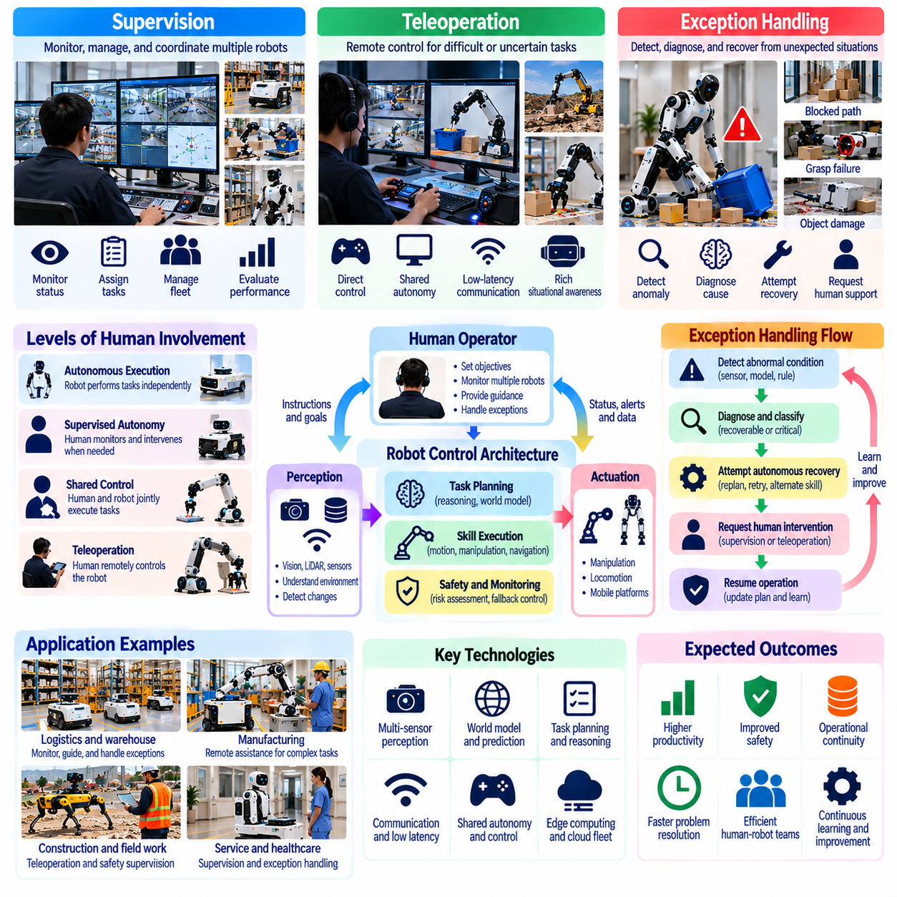{width="7.268055555555556in" height="7.268055555555556in"}

Supervision, teleoperation, and exception handling are essential components of Physical AI labor because autonomous robots cannot reliably manage every situation encountered in real environments. Even advanced systems face unfamiliar objects, unexpected human behavior, and operational failures. Human oversight provides a mechanism for maintaining safety and continuity while allowing machines to execute routine physical tasks with increasing independence.

Supervision differs from direct manual control because a human operator monitors objectives, performance, and operating conditions rather than continuously commanding individual movements. One supervisor may oversee several robots performing independent tasks. This arrangement can improve labor productivity, but its effectiveness depends on system reliability, understandable interfaces, and the frequency of situations requiring intervention.

Teleoperation enables human operators to control robotic systems remotely when autonomous capabilities are insufficient. Control may range from direct joint manipulation to high-level task guidance supported by autonomous stabilization and obstacle avoidance. The appropriate control method depends on communication latency, environmental complexity, and task risk. Effective teleoperation preserves human judgment while exploiting robotic sensing and control capabilities.

Exception handling addresses situations in which normal robotic execution cannot continue safely or successfully. Examples include blocked pathways, damaged objects, uncertain grasping conditions, conflicting instructions, and unexpected equipment behavior. A robust system must detect these deviations, classify their severity, and select an appropriate response. Not every exception requires human intervention, but unresolved uncertainty must trigger controlled escalation.

The distinction between routine operation and exceptional conditions is central to scalable automation. Robots may complete predictable tasks autonomously while requesting assistance for unusual circumstances. This approach reduces the need for continuous human control without assuming universal robotic competence. Successful deployment requires accurate identification of capability boundaries and reliable transitions between autonomous and supervised operation.

Supervisory control architectures commonly separate strategic objectives, task planning, and physical execution. Human supervisors establish priorities and operating constraints, while robotic planners determine task sequences and low-level controllers execute movements. Monitoring systems compare actual performance with expected behavior. Deviations can initiate replanning, safe stopping, or escalation according to predefined operational policies.

Adaptive autonomy allows the degree of human involvement to change according to task complexity and uncertainty. A robot may navigate familiar corridors independently but request guidance when encountering unfamiliar obstacles. During difficult manipulation, a human operator may temporarily control the end effector while autonomous controllers maintain stability. Effective transitions require explicit authority management and predictable control behavior.

Reliable exception detection depends on combining perception, state estimation, and operational monitoring. Robots must identify discrepancies between observed conditions and predicted outcomes. Unexpected contact forces, localization errors, sensor degradation, and repeated task failures may indicate emerging problems. Monitoring should distinguish recoverable disturbances from conditions that threaten safety or exceed validated operating capabilities.

World models can strengthen exception handling by predicting physical consequences and identifying inconsistencies. A robot may recognize that an object has moved unexpectedly or that a planned route is no longer traversable. Predictive models can support alternative action selection and recovery planning. However, model uncertainty must be considered because incorrect predictions may otherwise produce repeated failures or unsafe responses.

Human intervention should follow a structured escalation process rather than relying on arbitrary operator decisions. A robot may first attempt validated recovery procedures, then request remote assistance if uncertainty persists. Safety-critical conditions should trigger immediate protective behavior. Escalation policies must consider task urgency, potential damage, human proximity, and the availability of qualified operators.

Teleoperation interfaces must provide operators with sufficient situational awareness to make reliable decisions. Video streams, depth information, robot state estimates, and force feedback may support remote manipulation. Excessive information can increase cognitive workload, while insufficient feedback can impair control accuracy. Interface design should prioritize relevant observations and communicate uncertainty, system limitations, and intervention requirements clearly.

Communication latency creates significant challenges for remote robotic control. Delayed visual feedback and command transmission can destabilize precise manipulation or complicate obstacle avoidance. Shared autonomy can reduce these effects by assigning fast control loops to onboard systems while operators provide slower supervisory commands. Communication failures require safe fallback behaviors that do not depend on continuous network availability.

Edge computing and on-premise intelligence are particularly important for safety-critical robotic operations. Local controllers can maintain stabilization, collision avoidance, and emergency stopping even when cloud connectivity is unavailable. Remote infrastructure may support fleet supervision, complex reasoning, and data analysis. Effective system architecture separates functions requiring deterministic response from those that can tolerate communication delays.

Supervising multiple robots introduces a complex workload allocation problem. An operator may manage several machines during normal operation but become overloaded when simultaneous exceptions occur. Fleet management systems should estimate intervention demand and prioritize assistance requests. Robot-to-operator ratios must therefore reflect observed exception frequency, intervention duration, task criticality, and operator attention rather than theoretical autonomy alone.

Exception handling also creates opportunities for systematic learning. Human interventions can reveal limitations in perception, planning, manipulation, or environmental understanding. Recorded experiences may become training examples for imitation learning, policy refinement, and improved recovery strategies. Data pipelines should distinguish successful interventions from uncertain or unsafe behavior before incorporating them into future robotic models.

Fleet-scale learning can distribute validated improvements across multiple deployed robots. Recurring exceptions may reveal common environmental patterns, hardware weaknesses, or software limitations. Aggregated operational data can support targeted updates and preventive maintenance. However, new policies require controlled evaluation before deployment because improvements in one environment may introduce failures under different physical conditions.

Human factors strongly influence supervisory effectiveness. Operators may experience attention fatigue, reduced vigilance, and difficulty maintaining awareness across multiple robotic systems. Repeated false alarms can encourage inappropriate dismissal of warnings, while poorly timed alerts may interrupt critical decisions. Interface design, workload management, and training must support sustained attention without requiring constant observation of every robot.

Operational responsibility must remain clearly defined when control shifts between autonomous systems and human operators. Organizations should specify who authorizes remote intervention, who can override robotic decisions, and how actions are recorded. Audit trails can support incident investigation and continuous improvement. Human supervision should provide meaningful authority rather than merely assigning responsibility for decisions operators cannot realistically control.

Safety engineering requires independent protective mechanisms that remain effective during software faults, communication failures, and operator mistakes. Emergency stopping, motion constraints, force limits, and runtime assurance can restrict hazardous behavior. Teleoperation must not bypass essential safety protections without carefully controlled authorization. Robust design assumes that both autonomous intelligence and human intervention can occasionally fail.

Economic evaluation of supervised autonomy must include the hidden labor associated with robotic operation. Operator salaries, training, communication infrastructure, exception resolution, and downtime contribute to total operating costs. A robot with high nominal autonomy may deliver limited savings if frequent interventions consume substantial human time. Meaningful productivity assessment therefore requires measuring effective autonomous work and total supervisory effort.

The development of general-purpose robots may initially increase demand for skilled supervision and remote operation. New roles could include robot fleet supervisor, teleoperation specialist, exception analyst, and autonomy performance engineer. As systems improve, routine interventions may decline while complex troubleshooting and operational optimization become more important. Workforce development should prepare employees for these changing responsibilities.

Long-term progress may shift supervision from continuous monitoring toward exception-driven management. Robots could independently complete extended workflows, recognize their own limitations, and request assistance only when necessary. Persistent memory, hierarchical planning, and uncertainty-aware reasoning may support this transition. Nevertheless, increasing autonomy should be accompanied by stronger validation, transparent reporting, and reliable human override mechanisms.

Ultimately, supervision, teleoperation, and exception handling form the operational bridge between imperfect robotic intelligence and dependable physical labor. Their purpose is not simply to compensate for technological limitations but to establish a scalable framework for safe human-machine cooperation. Physical AI becomes economically and socially valuable when autonomous execution, human expertise, and systematic learning reinforce one another within accountable operational systems.

감독(Supervision), 원격조작(Teleoperation), 예외 상황 처리(Exception Handling)는 자율 로봇(Autonomous Robot)이 실제 환경(Real Environment)에서 발생하는 모든 상황을 신뢰성 있게 처리할 수 없기 때문에 피지컬 인공지능 노동(Physical AI Labor)의 필수 구성요소이다. 첨단 시스템(Advanced System)조차 익숙하지 않은 물체(Unfamiliar Object), 예상하지 못한 인간 행동(Unexpected Human Behavior), 운영 장애(Operational Failure)에 직면한다. 인간 감독(Human Oversight)은 기계가 일상적인 물리적 작업(Routine Physical Task)을 점점 더 독립적으로 수행하도록 하면서 안전성(Safety)과 운영 연속성(Operational Continuity)을 유지하는 메커니즘을 제공한다.

감독(Supervision)은 인간 운영자(Human Operator)가 개별 움직임을 지속적으로 명령하는 대신 목표(Objective), 성능(Performance), 운영 조건(Operating Condition)을 모니터링한다는 점에서 직접 수동 제어(Direct Manual Control)와 다르다. 한 명의 감독자(Supervisor)가 독립적인 작업을 수행하는 여러 로봇을 관리할 수 있다. 이러한 방식은 노동 생산성(Labor Productivity)을 향상시킬 수 있지만, 그 효과는 시스템 신뢰성(System Reliability), 이해하기 쉬운 인터페이스(Understandable Interface), 개입이 필요한 상황의 발생 빈도(Intervention Frequency)에 달려 있다.

원격조작(Teleoperation)은 자율 능력(Autonomous Capability)이 충분하지 않을 때 인간 운영자(Human Operator)가 로봇 시스템(Robotic System)을 원격으로 제어할 수 있도록 한다. 제어 방식(Control Method)은 직접적인 관절 조작(Direct Joint Manipulation)부터 자율 안정화(Autonomous Stabilization)와 장애물 회피(Obstacle Avoidance)가 지원하는 고수준 작업 안내(High-Level Task Guidance)까지 다양하다. 적절한 제어 방식은 통신 지연(Communication Latency), 환경 복잡성(Environmental Complexity), 작업 위험(Task Risk)에 따라 달라진다. 효과적인 원격조작은 로봇의 감지 및 제어 능력(Robotic Sensing and Control Capability)을 활용하면서 인간의 판단력(Human Judgment)을 유지한다.

예외 상황 처리(Exception Handling)는 정상적인 로봇 실행(Normal Robotic Execution)을 안전하거나 성공적으로 계속할 수 없는 상황을 다룬다. 대표적인 사례에는 차단된 경로(Blocked Pathway), 손상된 물체(Damaged Object), 불확실한 파지 조건(Uncertain Grasping Condition), 상충하는 지시(Conflicting Instruction), 예상하지 못한 장비 동작(Unexpected Equipment Behavior)이 포함된다. 강건한 시스템(Robust System)은 이러한 편차(Deviation)를 탐지하고 심각도(Severity)를 분류하며 적절한 대응(Response)을 선택해야 한다. 모든 예외 상황에 인간 개입(Human Intervention)이 필요한 것은 아니지만, 해결되지 않은 불확실성(Unresolved Uncertainty)은 통제된 상위 대응 절차(Controlled Escalation)를 유발해야 한다.

일상적인 운영(Routine Operation)과 예외적인 조건(Exceptional Condition)의 구분은 확장 가능한 자동화(Scalable Automation)의 핵심이다. 로봇은 예측 가능한 작업(Predictable Task)을 자율적으로 완료하면서 비정상적인 상황(Unusual Circumstance)에서는 지원을 요청할 수 있다. 이러한 접근방식은 로봇의 보편적인 수행 능력(Universal Robotic Competence)을 가정하지 않으면서 지속적인 인간 제어(Continuous Human Control)의 필요성을 줄인다. 성공적인 배치(Successful Deployment)를 위해서는 능력 경계(Capability Boundary)를 정확하게 식별하고 자율 운영(Autonomous Operation)과 감독 운영(Supervised Operation) 사이를 신뢰성 있게 전환해야 한다.

감독 제어 아키텍처(Supervisory Control Architecture)는 일반적으로 전략적 목표(Strategic Objective), 작업 계획(Task Planning), 물리적 실행(Physical Execution)을 분리한다. 인간 감독자(Human Supervisor)는 우선순위(Priority)와 운영 제약(Operating Constraint)을 설정하고, 로봇 계획기(Robotic Planner)는 작업 순서(Task Sequence)를 결정하며, 저수준 제어기(Low-Level Controller)는 움직임을 실행한다. 모니터링 시스템(Monitoring System)은 실제 성능(Actual Performance)을 예상 행동(Expected Behavior)과 비교한다. 편차(Deviation)가 발생하면 사전에 정의된 운영 정책(Operational Policy)에 따라 재계획(Replanning), 안전 정지(Safe Stopping), 상위 대응(Escalation)이 시작될 수 있다.

적응형 자율성(Adaptive Autonomy)은 작업 복잡성(Task Complexity)과 불확실성(Uncertainty)에 따라 인간의 개입 수준(Human Involvement Level)을 변화시킬 수 있다. 로봇은 익숙한 복도(Familiar Corridor)를 독립적으로 주행하다가 익숙하지 않은 장애물(Unfamiliar Obstacle)을 만나면 안내를 요청할 수 있다. 어려운 조작(Difficult Manipulation)에서는 인간 운영자가 일시적으로 말단효과기(End Effector)를 제어하는 동안 자율 제어기(Autonomous Controller)가 안정성(Stability)을 유지할 수 있다. 효과적인 전환(Effective Transition)에는 명시적인 제어 권한 관리(Explicit Authority Management)와 예측 가능한 제어 행동(Predictable Control Behavior)이 필요하다.

신뢰할 수 있는 예외 탐지(Reliable Exception Detection)는 인식(Perception), 상태 추정(State Estimation), 운영 모니터링(Operational Monitoring)의 결합에 달려 있다. 로봇은 관측된 조건(Observed Condition)과 예측된 결과(Predicted Outcome) 사이의 불일치(Discrepancy)를 식별해야 한다. 예상하지 못한 접촉력(Unexpected Contact Force), 위치 추정 오류(Localization Error), 센서 성능 저하(Sensor Degradation), 반복적인 작업 실패(Repeated Task Failure)는 문제가 발생하고 있음을 나타낼 수 있다. 모니터링은 복구 가능한 교란(Recoverable Disturbance)과 안전을 위협하거나 검증된 운영 능력(Validated Operating Capability)을 초과하는 조건을 구별해야 한다.

월드 모델(World Model)은 물리적 결과(Physical Consequence)를 예측하고 불일치(Inconsistency)를 식별함으로써 예외 상황 처리(Exception Handling)를 강화할 수 있다. 로봇은 물체가 예상과 다르게 이동했거나 계획된 경로(Planned Route)를 더 이상 통과할 수 없다는 사실을 인식할 수 있다. 예측 모델(Predictive Model)은 대체 행동 선택(Alternative Action Selection)과 복구 계획(Recovery Planning)을 지원할 수 있다. 그러나 잘못된 예측(Incorrect Prediction)이 반복적인 실패(Repeated Failure)나 안전하지 않은 대응(Unsafe Response)을 발생시킬 수 있으므로 모델 불확실성(Model Uncertainty)을 고려해야 한다.

인간 개입(Human Intervention)은 임의적인 운영자 판단(Arbitrary Operator Decision)에 의존하기보다 구조화된 상위 대응 절차(Structured Escalation Process)를 따라야 한다. 로봇은 먼저 검증된 복구 절차(Validated Recovery Procedure)를 시도하고, 불확실성이 지속되면 원격 지원(Remote Assistance)을 요청할 수 있다. 안전이 중요한 조건(Safety-Critical Condition)에서는 즉각적인 보호 행동(Protective Behavior)이 실행되어야 한다. 상위 대응 정책(Escalation Policy)은 작업 긴급성(Task Urgency), 잠재적 손상(Potential Damage), 인간과의 근접성(Human Proximity), 자격을 갖춘 운영자(Qualified Operator)의 가용성을 고려해야 한다.

원격조작 인터페이스(Teleoperation Interface)는 운영자가 신뢰할 수 있는 의사결정(Reliable Decision-Making)을 수행할 수 있도록 충분한 상황 인식(Situational Awareness)을 제공해야 한다. 영상 스트림(Video Stream), 깊이 정보(Depth Information), 로봇 상태 추정(Robot State Estimation), 힘 피드백(Force Feedback)은 원격 조작(Remote Manipulation)을 지원할 수 있다. 과도한 정보(Excessive Information)는 인지적 작업 부하(Cognitive Workload)를 증가시키는 반면, 불충분한 피드백(Insufficient Feedback)은 제어 정확도(Control Accuracy)를 저하시킬 수 있다. 인터페이스 설계(Interface Design)는 관련 관측 정보(Relevant Observation)를 우선하고 불확실성(Uncertainty), 시스템 한계(System Limitation), 개입 요구사항(Intervention Requirement)을 명확하게 전달해야 한다.

통신 지연(Communication Latency)은 원격 로봇 제어(Remote Robotic Control)에 상당한 어려움을 발생시킨다. 지연된 시각적 피드백(Delayed Visual Feedback)과 명령 전송(Command Transmission)은 정밀 조작(Precise Manipulation)을 불안정하게 만들거나 장애물 회피(Obstacle Avoidance)를 복잡하게 할 수 있다. 공유 자율성(Shared Autonomy)은 빠른 제어 루프(Fast Control Loop)를 온보드 시스템(Onboard System)에 할당하고 운영자는 상대적으로 느린 감독 명령(Supervisory Command)을 제공하도록 하여 이러한 영향을 줄일 수 있다. 통신 장애(Communication Failure)에 대비해서는 지속적인 네트워크 가용성(Continuous Network Availability)에 의존하지 않는 안전한 대체 동작(Safe Fallback Behavior)이 필요하다.

엣지 컴퓨팅(Edge Computing)과 온프레미스 지능(On-Premise Intelligence)은 안전이 중요한 로봇 운영(Safety-Critical Robotic Operation)에서 특히 중요하다. 로컬 제어기(Local Controller)는 클라우드 연결(Cloud Connectivity)을 사용할 수 없는 경우에도 안정화(Stabilization), 충돌 회피(Collision Avoidance), 비상 정지(Emergency Stopping)를 유지할 수 있다. 원격 인프라(Remote Infrastructure)는 로봇 군집 감독(Fleet Supervision), 복잡한 추론(Complex Reasoning), 데이터 분석(Data Analysis)을 지원할 수 있다. 효과적인 시스템 아키텍처(System Architecture)는 결정론적 응답(Deterministic Response)이 필요한 기능과 통신 지연을 허용할 수 있는 기능을 분리한다.

여러 로봇을 감독하는 작업(Supervising Multiple Robots)은 복잡한 작업 부하 할당 문제(Workload Allocation Problem)를 발생시킨다. 운영자 한 명은 정상 운영(Normal Operation) 중에는 여러 기계를 관리할 수 있지만, 여러 예외 상황(Simultaneous Exception)이 동시에 발생하면 과부하(Overload)에 빠질 수 있다. 로봇 군집 관리 시스템(Fleet Management System)은 개입 수요(Intervention Demand)를 추정하고 지원 요청(Assistance Request)의 우선순위를 결정해야 한다. 따라서 로봇 대 운영자 비율(Robot-to-Operator Ratio)은 이론적인 자율성(Theoretical Autonomy)만이 아니라 실제 관측된 예외 발생 빈도(Exception Frequency), 개입 지속시간(Intervention Duration), 작업 중요도(Task Criticality), 운영자의 주의력(Operator Attention)을 반영해야 한다.

예외 상황 처리(Exception Handling)는 체계적인 학습(Systematic Learning)의 기회도 제공한다. 인간 개입(Human Intervention)은 인식(Perception), 계획(Planning), 조작(Manipulation), 환경 이해(Environmental Understanding)의 한계를 드러낼 수 있다. 기록된 경험(Recorded Experience)은 모방학습(Imitation Learning), 정책 개선(Policy Refinement), 복구 전략 향상(Improved Recovery Strategy)을 위한 학습 사례(Training Example)가 될 수 있다. 데이터 파이프라인(Data Pipeline)은 이러한 경험을 향후 로봇 모델(Robotic Model)에 반영하기 전에 성공적인 개입(Successful Intervention)과 불확실하거나 안전하지 않은 행동(Uncertain or Unsafe Behavior)을 구별해야 한다.

로봇 군집 규모 학습(Fleet-Scale Learning)은 검증된 개선사항(Validated Improvement)을 여러 배치 로봇(Deployed Robot)에 배포할 수 있다. 반복적으로 발생하는 예외 상황(Recurring Exception)은 공통적인 환경 패턴(Environmental Pattern), 하드웨어 취약점(Hardware Weakness), 소프트웨어 한계(Software Limitation)를 드러낼 수 있다. 집계된 운영 데이터(Aggregated Operational Data)는 표적화된 업데이트(Targeted Update)와 예방 정비(Preventive Maintenance)를 지원할 수 있다. 그러나 한 환경에서의 개선이 다른 물리적 조건(Physical Condition)에서는 새로운 실패를 발생시킬 수 있으므로 새로운 정책(New Policy)은 배치 전에 통제된 평가(Controlled Evaluation)를 거쳐야 한다.

인적 요인(Human Factor)은 감독 효과(Supervisory Effectiveness)에 큰 영향을 미친다. 운영자는 주의력 피로(Attention Fatigue), 경계 수준 저하(Reduced Vigilance), 여러 로봇 시스템(Robotic System)에 대한 상황 인식(Situational Awareness) 유지의 어려움을 경험할 수 있다. 반복적인 오경보(False Alarm)는 경고(Warning)를 부적절하게 무시하도록 만들 수 있으며, 시점이 부적절한 경보(Poorly Timed Alert)는 중요한 의사결정(Critical Decision)을 방해할 수 있다. 인터페이스 설계(Interface Design), 작업 부하 관리(Workload Management), 교육(Training)은 모든 로봇을 지속적으로 관찰하도록 요구하지 않으면서 지속적인 주의력(Sustained Attention)을 지원해야 한다.

운영 책임(Operational Responsibility)은 자율 시스템(Autonomous System)과 인간 운영자(Human Operator) 사이에서 제어 권한(Control Authority)이 전환될 때에도 명확하게 정의되어야 한다. 조직은 누가 원격 개입(Remote Intervention)을 승인하고, 누가 로봇의 결정(Robotic Decision)을 무효화할 수 있으며, 행동 기록(Action Record)을 어떻게 관리하는지 규정해야 한다. 감사 추적(Audit Trail)은 사고 조사(Incident Investigation)와 지속적 개선(Continuous Improvement)을 지원할 수 있다. 인간 감독(Human Supervision)은 운영자가 현실적으로 통제할 수 없는 결정에 대한 책임만을 부과하는 것이 아니라 실질적인 권한(Meaningful Authority)을 제공해야 한다.

안전 공학(Safety Engineering)은 소프트웨어 결함(Software Fault), 통신 장애(Communication Failure), 운영자 실수(Operator Mistake)가 발생하더라도 효과적으로 작동하는 독립적인 보호 메커니즘(Independent Protective Mechanism)을 요구한다. 비상 정지(Emergency Stopping), 운동 제약(Motion Constraint), 힘 제한(Force Limit), 실행시간 안전 보장(Runtime Assurance)은 위험한 행동(Hazardous Behavior)을 제한할 수 있다. 원격조작(Teleoperation)은 엄격하게 통제된 승인(Carefully Controlled Authorization) 없이 필수 안전 보호장치(Essential Safety Protection)를 우회해서는 안 된다. 강건한 설계(Robust Design)는 자율 지능(Autonomous Intelligence)과 인간 개입(Human Intervention)이 모두 때때로 실패할 수 있음을 전제로 한다.

감독형 자율성(Supervised Autonomy)의 경제성 평가(Economic Evaluation)에는 로봇 운영(Robotic Operation)에 수반되는 숨겨진 노동(Hidden Labor)을 포함해야 한다. 운영자 급여(Operator Salary), 교육(Training), 통신 인프라(Communication Infrastructure), 예외 상황 해결(Exception Resolution), 가동 중단시간(Downtime)은 총운영비용(Total Operating Cost)에 기여한다. 명목상 자율성(Nominal Autonomy)이 높은 로봇이라도 빈번한 개입(Frequent Intervention)이 상당한 인간 노동시간(Human Labor Time)을 소비한다면 비용 절감 효과가 제한적일 수 있다. 따라서 의미 있는 생산성 평가(Productivity Assessment)를 위해서는 실효 자율 작업(Effective Autonomous Work)과 총감독 노력(Total Supervisory Effort)을 측정해야 한다.

범용 로봇(General-Purpose Robot)의 발전은 초기 단계에서 숙련된 감독(Skilled Supervision)과 원격 운영(Remote Operation)에 대한 수요를 증가시킬 수 있다. 새로운 직무(New Role)에는 로봇 군집 감독자(Robot Fleet Supervisor), 원격조작 전문가(Teleoperation Specialist), 예외 상황 분석가(Exception Analyst), 자율성 성능 엔지니어(Autonomy Performance Engineer)가 포함될 수 있다. 시스템이 개선되면서 일상적인 개입(Routine Intervention)은 감소하고 복잡한 문제 해결(Complex Troubleshooting)과 운영 최적화(Operational Optimization)는 더욱 중요해질 수 있다. 인력 개발(Workforce Development)은 근로자가 이러한 변화하는 책임(Changing Responsibility)에 대비하도록 해야 한다.

장기적인 발전(Long-Term Progress)은 감독 방식(Supervision Method)을 지속적인 모니터링(Continuous Monitoring)에서 예외 중심 관리(Exception-Driven Management)로 전환시킬 수 있다. 로봇은 장기간의 작업 흐름(Extended Workflow)을 독립적으로 완료하고 자신의 한계(Own Limitation)를 인식하며 필요한 경우에만 지원을 요청할 수 있을 것이다. 지속적 메모리(Persistent Memory), 계층적 계획(Hierarchical Planning), 불확실성 인식형 추론(Uncertainty-Aware Reasoning)은 이러한 전환을 지원할 수 있다. 그러나 자율성(Autonomy)의 증가는 더욱 강화된 검증(Stronger Validation), 투명한 보고(Transparent Reporting), 신뢰할 수 있는 인간 우선 제어 메커니즘(Reliable Human Override Mechanism)을 동반해야 한다.

궁극적으로 감독(Supervision), 원격조작(Teleoperation), 예외 상황 처리(Exception Handling)는 불완전한 로봇 지능(Imperfect Robotic Intelligence)과 신뢰할 수 있는 물리적 노동(Dependable Physical Labor)을 연결하는 운영상의 가교(Operational Bridge)를 형성한다. 그 목적은 단순히 기술적 한계(Technological Limitation)를 보완하는 것이 아니라 안전한 인간-기계 협력(Safe Human-Machine Cooperation)을 위한 확장 가능한 프레임워크(Scalable Framework)를 구축하는 데 있다. 피지컬 인공지능(Physical AI)은 책임 있는 운영 시스템(Accountable Operational System) 안에서 자율 실행(Autonomous Execution), 인간 전문성(Human Expertise), 체계적인 학습(Systematic Learning)이 서로를 강화할 때 경제적·사회적 가치(Economic and Social Value)를 창출하게 된다.

##  

## 01.13. New Jobs and Robot Centered Professions

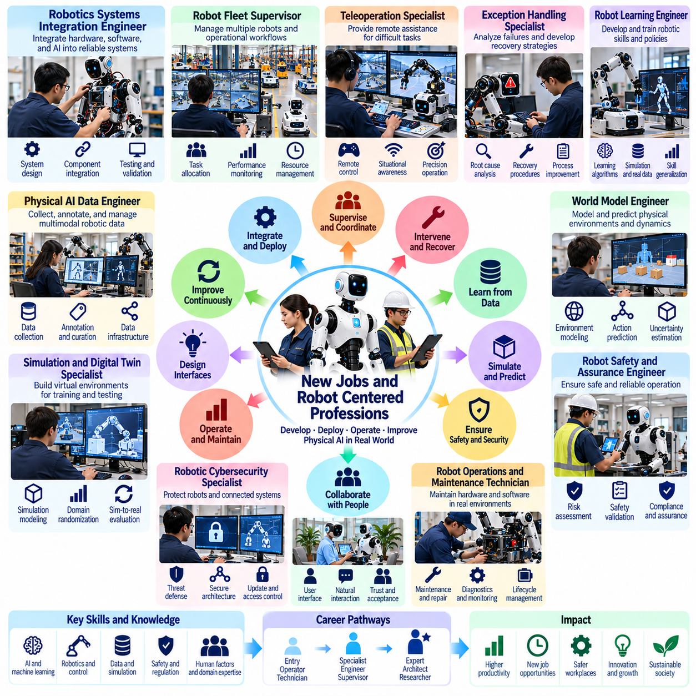{width="7.268055555555556in" height="7.268055555555556in"}

The expansion of Physical AI is expected to create new occupations centered on the development, deployment, supervision, and continuous improvement of intelligent robotic systems. Although automation may reduce demand for certain repetitive tasks, it also introduces technical and organizational responsibilities that existing professions do not fully address. The resulting labor transformation will involve occupational creation, specialization, and the restructuring of established roles.

Robot-centered professions emerge because autonomous machines require extensive support beyond their initial design and installation. Real-world operation involves environmental adaptation, hardware maintenance, software updates, safety validation, and performance monitoring. As robotic fleets expand, organizations will need specialists who understand both intelligent algorithms and physical operations. These professions connect digital intelligence with practical industrial execution.

Robotics systems integration is likely to become an increasingly important professional field. Integration engineers must connect perception models, motion planners, actuators, sensors, and enterprise software into reliable operational systems. Their responsibilities extend beyond component compatibility to workflow design, latency management, and safety coordination. Successful integration requires knowledge of mechanical engineering, embedded computing, artificial intelligence, and operational processes.

Robot fleet supervisors will coordinate groups of autonomous machines operating across factories, warehouses, hospitals, and commercial facilities. Their responsibilities may include task allocation, operational monitoring, intervention prioritization, and resource management. Unlike traditional machine operators, fleet supervisors manage multiple intelligent agents simultaneously. Their effectiveness depends on understanding autonomy limitations, operational risk, and human-machine coordination.

Teleoperation specialists will provide remote assistance when robots encounter situations beyond their autonomous capabilities. These professionals may guide complex manipulation, resolve navigation failures, or demonstrate unfamiliar procedures. Effective teleoperation requires spatial reasoning, situational awareness, and precise control under communication constraints. Over time, teleoperators may increasingly supervise difficult decisions rather than directly controlling every movement.

Exception handling specialists will analyze recurring failures and develop systematic recovery strategies. Their work involves distinguishing perception errors, planning failures, mechanical limitations, and environmental disturbances. By identifying root causes, they can improve operational procedures and recommend changes to robotic policies. This profession combines troubleshooting, safety analysis, data interpretation, and knowledge of physical task execution.

Robot learning engineers will develop policies that enable machines to acquire and refine physical skills. Their work may combine imitation learning, reinforcement learning, simulation, and real-world demonstrations. Unlike conventional software development, robotic learning requires understanding contact dynamics, actuator constraints, and environmental variability. Engineers must evaluate whether learned behaviors remain reliable outside the conditions represented in training data.

Physical AI data engineers will manage the collection, synchronization, annotation, and curation of multimodal robotic experiences. Their datasets may contain camera observations, force measurements, joint states, language instructions, and task outcomes. Maintaining temporal consistency and physical context is essential for useful training data. These specialists will support the data infrastructure required for scalable robotic intelligence.

Simulation and digital twin specialists will construct virtual environments for training, testing, and validating robotic behavior. They must represent geometry, materials, contact forces, sensor characteristics, and operational disturbances with sufficient fidelity. Their responsibilities may include domain randomization, synthetic data generation, and simulation-to-reality evaluation. These professions connect computational modeling with measurable physical performance.

World model engineers may become increasingly important as robots develop predictive representations of physical environments. Their work involves modeling object dynamics, spatial relationships, action consequences, and uncertainty across multiple time horizons. Such models can support planning, manipulation, and recovery from unexpected events. Developing reliable world models requires expertise in machine learning, robotics, physics, and sequential decision-making.

Robot safety and assurance engineers will establish mechanisms for validating autonomous behavior under operational constraints. Their responsibilities include hazard identification, risk assessment, protective control design, and systematic testing. Learning-based systems introduce additional challenges because their behavior may vary across unfamiliar conditions. Safety specialists must integrate established engineering principles with new methods for evaluating adaptive intelligence.

Robotic cybersecurity specialists will protect connected machines against unauthorized access, malicious commands, data manipulation, and software compromise. Physical robots introduce risks beyond conventional information systems because cyberattacks can produce direct mechanical consequences. Security professionals must address device authentication, secure updates, network segmentation, and operational recovery. Their work will increasingly intersect with functional safety and fleet governance.

Human-robot interaction designers will develop interfaces that enable workers to communicate with robotic systems effectively. Their responsibilities may include natural-language instructions, gesture recognition, intention visualization, and intervention workflows. Successful designs must account for human attention, trust calibration, and cognitive workload. These specialists will combine interface engineering, behavioral science, ergonomics, and operational safety.

Robot maintenance professions will also evolve as intelligent machines become mechanically and computationally sophisticated. Technicians may need to diagnose actuator degradation, sensor calibration errors, thermal problems, and software-related performance changes. Predictive maintenance systems can support early fault detection, but skilled personnel remain essential for physical inspection and repair. Maintenance roles will increasingly require combined mechanical, electrical, and digital expertise.

Robot operations analysts will evaluate the economic and operational performance of deployed fleets. They may measure task completion rates, intervention frequency, energy consumption, downtime, and total operating costs. Their analysis can reveal whether automation improves productivity or merely transfers work into hidden supervisory activities. These professionals will help organizations optimize fleet utilization and determine when robotic deployment creates sustainable value.

Robotics deployment consultants and workflow architects will support organizations introducing Physical AI into established operations. Their work may involve identifying suitable tasks, redesigning processes, estimating investment returns, and preparing employees for collaboration. Technical feasibility alone does not guarantee successful adoption. These specialists must align robotic capabilities with organizational objectives, regulatory requirements, and workforce conditions.

Training and education professionals will play a significant role in preparing workers for robot-centered occupations. Instructors may develop programs covering robotic operation, safety procedures, troubleshooting, data literacy, and human-machine collaboration. Practical simulation environments can support experiential learning without exposing trainees to unnecessary hazards. Effective education must combine technical competence with judgment, communication, and adaptability.

The expansion of robotic labor may also create demand for specialists in governance, auditing, and accountability. Organizations will need professionals capable of documenting autonomous decisions, evaluating compliance, and investigating incidents involving robotic systems. These responsibilities require understanding both technical behavior and institutional obligations. Governance roles will become particularly important in healthcare, public infrastructure, and other safety-sensitive environments.

New professions will not emerge independently of existing occupational structures. Electricians, mechanics, software engineers, production managers, and safety officers may incorporate robotic responsibilities into established careers. Some workers will transition into specialized positions, while others will develop hybrid competencies. The balance between entirely new occupations and transformed existing roles will depend on industry conditions and deployment maturity.

Regional labor markets may experience different patterns of occupational creation. Areas with strong manufacturing, robotics research, and technical education ecosystems may develop specialized employment clusters. Regions lacking training infrastructure could face difficulties accessing emerging opportunities. Public institutions, educational organizations, and employers may need to coordinate workforce development to prevent technological adoption from widening existing economic disparities.

Professional certification and competency standards may become important as robotic systems enter safety-critical workplaces. Employers will need credible methods for evaluating operator skills, maintenance competence, and supervisory readiness. Certification frameworks should reflect actual operational responsibilities rather than relying exclusively on theoretical knowledge. Periodic retraining may be necessary as robotic hardware, autonomy capabilities, and safety requirements evolve.

The economic value of robot-centered professions will depend on how effectively they support scalable autonomy. If every robot requires continuous individual supervision, labor savings may remain limited. Conversely, specialists who improve reliability, reduce intervention demand, and maintain large fleets can create substantial productivity gains. Occupational demand will therefore evolve alongside the balance between autonomous capability and human operational support.

Ultimately, Physical AI is likely to transform the structure of professional expertise rather than simply eliminate human participation in physical production. New occupations will emerge around robot intelligence, operational assurance, data infrastructure, maintenance, and human-machine coordination. Their long-term significance lies in enabling dependable automation while preserving human responsibility, professional development, and opportunities for meaningful work.

피지컬 인공지능(Physical AI)의 확산은 지능형 로봇 시스템(Intelligent Robotic System)의 개발(Development), 배치(Deployment), 감독(Supervision), 지속적 개선(Continuous Improvement)을 중심으로 새로운 직업(New Occupation)을 창출할 것으로 예상된다. 자동화(Automation)는 특정 반복 작업(Repetitive Task)에 대한 수요를 감소시킬 수 있지만, 기존 전문직(Existing Profession)이 충분히 다루지 못하는 기술적·조직적 책임(Technical and Organizational Responsibility)도 새롭게 발생시킨다. 이에 따른 노동 전환(Labor Transformation)은 직업 창출(Occupational Creation), 전문화(Specialization), 기존 직무(Established Role)의 재구조화를 포함할 것이다.

로봇 중심 전문직(Robot-Centered Profession)은 자율 기계(Autonomous Machine)가 초기 설계(Initial Design)와 설치(Installation) 이후에도 광범위한 지원을 필요로 하기 때문에 등장한다. 실제 환경 운영(Real-World Operation)에는 환경 적응(Environmental Adaptation), 하드웨어 유지보수(Hardware Maintenance), 소프트웨어 업데이트(Software Update), 안전 검증(Safety Validation), 성능 모니터링(Performance Monitoring)이 포함된다. 로봇 군집(Robotic Fleet)이 확대됨에 따라 조직은 지능형 알고리즘(Intelligent Algorithm)과 물리적 운영(Physical Operation)을 모두 이해하는 전문가를 필요로 할 것이다. 이러한 전문직은 디지털 지능(Digital Intelligence)과 실제 산업 현장의 실행(Practical Industrial Execution)을 연결한다.

로봇 시스템 통합(Robotics Systems Integration)은 점점 더 중요한 전문 분야(Professional Field)가 될 가능성이 높다. 통합 엔지니어(Integration Engineer)는 인식 모델(Perception Model), 동작 계획기(Motion Planner), 액추에이터(Actuator), 센서(Sensor), 기업용 소프트웨어(Enterprise Software)를 신뢰할 수 있는 운영 시스템(Operational System)으로 연결해야 한다. 이들의 책임은 구성요소 호환성(Component Compatibility)을 넘어 작업 흐름 설계(Workflow Design), 지연시간 관리(Latency Management), 안전 조정(Safety Coordination)까지 확장된다. 성공적인 통합에는 기계공학(Mechanical Engineering), 임베디드 컴퓨팅(Embedded Computing), 인공지능(Artificial Intelligence), 운영 프로세스(Operational Process)에 대한 지식이 필요하다.

로봇 군집 감독자(Robot Fleet Supervisor)는 공장(Factory), 창고(Warehouse), 병원(Hospital), 상업시설(Commercial Facility)에서 운영되는 자율 기계(Autonomous Machine) 집단을 조정하게 될 것이다. 이들의 책임에는 작업 할당(Task Allocation), 운영 모니터링(Operational Monitoring), 개입 우선순위 결정(Intervention Prioritization), 자원 관리(Resource Management)가 포함될 수 있다. 기존 기계 운영자(Traditional Machine Operator)와 달리 로봇 군집 감독자는 여러 지능형 에이전트(Intelligent Agent)를 동시에 관리한다. 그 효과는 자율성의 한계(Autonomy Limitation), 운영 위험(Operational Risk), 인간-기계 조정(Human-Machine Coordination)에 대한 이해에 달려 있다.

원격조작 전문가(Teleoperation Specialist)는 로봇이 자율 능력(Autonomous Capability)을 넘어서는 상황에 직면했을 때 원격 지원(Remote Assistance)을 제공한다. 이러한 전문가는 복잡한 조작(Complex Manipulation)을 안내하고 주행 실패(Navigation Failure)를 해결하거나 익숙하지 않은 절차(Unfamiliar Procedure)를 시연할 수 있다. 효과적인 원격조작(Effective Teleoperation)에는 공간 추론(Spatial Reasoning), 상황 인식(Situational Awareness), 통신 제약(Communication Constraint) 아래에서의 정밀 제어(Precise Control)가 필요하다. 시간이 지나면서 원격조작 전문가는 모든 움직임을 직접 제어하기보다 어려운 의사결정(Difficult Decision)을 감독하는 역할로 점차 전환할 수 있다.

예외 상황 처리 전문가(Exception Handling Specialist)는 반복적으로 발생하는 실패(Recurring Failure)를 분석하고 체계적인 복구 전략(Systematic Recovery Strategy)을 개발한다. 이들의 업무에는 인식 오류(Perception Error), 계획 실패(Planning Failure), 기계적 한계(Mechanical Limitation), 환경 교란(Environmental Disturbance)을 구별하는 과정이 포함된다. 근본 원인(Root Cause)을 식별함으로써 운영 절차(Operational Procedure)를 개선하고 로봇 정책(Robotic Policy)의 변경을 권고할 수 있다. 이 전문직은 문제 해결(Troubleshooting), 안전 분석(Safety Analysis), 데이터 해석(Data Interpretation), 물리적 작업 실행(Physical Task Execution)에 대한 지식을 결합한다.

로봇 학습 엔지니어(Robot Learning Engineer)는 기계가 물리적 기술(Physical Skill)을 습득하고 개선할 수 있도록 하는 정책(Policy)을 개발한다. 이들의 업무에는 모방학습(Imitation Learning), 강화학습(Reinforcement Learning), 시뮬레이션(Simulation), 실제 환경 시연(Real-World Demonstration)의 결합이 포함될 수 있다. 기존 소프트웨어 개발(Conventional Software Development)과 달리 로봇 학습(Robotic Learning)에는 접촉 동역학(Contact Dynamics), 액추에이터 제약(Actuator Constraint), 환경 변동성(Environmental Variability)에 대한 이해가 필요하다. 엔지니어는 학습된 행동(Learned Behavior)이 훈련 데이터(Training Data)에 포함된 조건을 벗어나더라도 신뢰성을 유지하는지 평가해야 한다.

피지컬 인공지능 데이터 엔지니어(Physical AI Data Engineer)는 다중모달 로봇 경험(Multimodal Robotic Experience)의 수집(Collection), 동기화(Synchronization), 주석 처리(Annotation), 데이터 선별(Curation)을 관리한다. 데이터셋(Dataset)에는 카메라 관측(Camera Observation), 힘 측정(Force Measurement), 관절 상태(Joint State), 언어 지시(Language Instruction), 작업 결과(Task Outcome)가 포함될 수 있다. 유용한 학습 데이터(Useful Training Data)를 확보하려면 시간적 일관성(Temporal Consistency)과 물리적 맥락(Physical Context)을 유지하는 것이 필수적이다. 이러한 전문가는 확장 가능한 로봇 지능(Scalable Robotic Intelligence)에 필요한 데이터 인프라(Data Infrastructure)를 지원한다.

시뮬레이션 및 디지털 트윈 전문가(Simulation and Digital Twin Specialist)는 로봇 행동(Robotic Behavior)의 학습(Training), 시험(Testing), 검증(Validation)을 위한 가상 환경(Virtual Environment)을 구축한다. 이들은 기하 구조(Geometry), 재료(Material), 접촉력(Contact Force), 센서 특성(Sensor Characteristic), 운영 교란(Operational Disturbance)을 충분한 충실도(Fidelity)로 표현해야 한다. 이들의 책임에는 도메인 무작위화(Domain Randomization), 합성 데이터 생성(Synthetic Data Generation), 시뮬레이션-현실 전이 평가(Simulation-to-Reality Evaluation)가 포함될 수 있다. 이러한 전문직은 계산 모델링(Computational Modeling)과 측정 가능한 물리적 성능(Measurable Physical Performance)을 연결한다.

월드 모델 엔지니어(World Model Engineer)는 로봇이 물리적 환경(Physical Environment)에 대한 예측적 표현(Predictive Representation)을 발전시키면서 점점 더 중요해질 수 있다. 이들의 업무에는 여러 시간 범위(Multiple Time Horizon)에 걸친 물체 동역학(Object Dynamics), 공간적 관계(Spatial Relationship), 행동 결과(Action Consequence), 불확실성(Uncertainty)의 모델링이 포함된다. 이러한 모델은 계획(Planning), 조작(Manipulation), 예상하지 못한 사건(Unexpected Event)으로부터의 복구(Recovery)를 지원할 수 있다. 신뢰할 수 있는 월드 모델(Reliable World Model)을 개발하려면 머신러닝(Machine Learning), 로봇공학(Robotics), 물리학(Physics), 순차적 의사결정(Sequential Decision-Making)에 대한 전문성이 필요하다.

로봇 안전 및 보증 엔지니어(Robot Safety and Assurance Engineer)는 운영 제약(Operational Constraint) 아래에서 자율 행동(Autonomous Behavior)을 검증하기 위한 메커니즘을 구축한다. 이들의 책임에는 위험요인 식별(Hazard Identification), 위험 평가(Risk Assessment), 보호 제어 설계(Protective Control Design), 체계적인 시험(Systematic Testing)이 포함된다. 학습 기반 시스템(Learning-Based System)은 익숙하지 않은 조건(Unfamiliar Condition)에 따라 행동이 달라질 수 있으므로 추가적인 과제를 발생시킨다. 안전 전문가는 확립된 공학 원칙(Established Engineering Principle)을 적응형 지능(Adaptive Intelligence)을 평가하는 새로운 방법과 통합해야 한다.

로봇 사이버보안 전문가(Robotic Cybersecurity Specialist)는 연결된 기계(Connected Machine)를 무단 접근(Unauthorized Access), 악의적인 명령(Malicious Command), 데이터 조작(Data Manipulation), 소프트웨어 침해(Software Compromise)로부터 보호한다. 물리적 로봇(Physical Robot)은 사이버 공격(Cyberattack)이 직접적인 기계적 결과(Direct Mechanical Consequence)를 발생시킬 수 있기 때문에 기존 정보 시스템(Conventional Information System)을 넘어서는 위험을 수반한다. 보안 전문가는 장치 인증(Device Authentication), 보안 업데이트(Secure Update), 네트워크 분리(Network Segmentation), 운영 복구(Operational Recovery)를 다루어야 한다. 이들의 업무는 기능 안전(Functional Safety) 및 로봇 군집 거버넌스(Fleet Governance)와 점점 더 밀접하게 연결될 것이다.

인간-로봇 상호작용 설계자(Human-Robot Interaction Designer)는 근로자가 로봇 시스템(Robotic System)과 효과적으로 의사소통할 수 있도록 하는 인터페이스(Interface)를 개발한다. 이들의 책임에는 자연어 지시(Natural-Language Instruction), 제스처 인식(Gesture Recognition), 의도 시각화(Intention Visualization), 개입 작업 흐름(Intervention Workflow)이 포함될 수 있다. 성공적인 설계(Successful Design)는 인간의 주의력(Human Attention), 신뢰 보정(Trust Calibration), 인지적 작업 부하(Cognitive Workload)를 고려해야 한다. 이러한 전문가는 인터페이스 공학(Interface Engineering), 행동과학(Behavioral Science), 인간공학(Ergonomics), 운영 안전(Operational Safety)을 결합하게 될 것이다.

지능형 기계(Intelligent Machine)가 기계적·계산적으로 정교해짐에 따라 로봇 유지보수 전문직(Robot Maintenance Profession)도 발전할 것이다. 기술자(Technician)는 액추에이터 성능 저하(Actuator Degradation), 센서 보정 오류(Sensor Calibration Error), 열 문제(Thermal Problem), 소프트웨어 관련 성능 변화(Software-Related Performance Change)를 진단해야 할 수 있다. 예측 유지보수 시스템(Predictive Maintenance System)은 조기 결함 탐지(Early Fault Detection)를 지원할 수 있지만, 숙련된 인력(Skilled Personnel)은 물리적 검사(Physical Inspection)와 수리(Repair)에 여전히 필수적이다. 유지보수 직무(Maintenance Role)는 기계(Mechanical), 전기(Electrical), 디지털(Digital) 전문성을 결합하는 방향으로 발전할 것이다.

로봇 운영 분석가(Robot Operations Analyst)는 배치된 로봇 군집(Deployed Fleet)의 경제적·운영적 성과(Economic and Operational Performance)를 평가한다. 이들은 작업 완료율(Task Completion Rate), 개입 빈도(Intervention Frequency), 에너지 소비(Energy Consumption), 가동 중단시간(Downtime), 총운영비용(Total Operating Cost)을 측정할 수 있다. 이러한 분석은 자동화(Automation)가 생산성(Productivity)을 실제로 개선하는지, 아니면 작업을 숨겨진 감독 활동(Hidden Supervisory Activity)으로 이전하는 데 그치는지를 드러낼 수 있다. 이 전문가들은 조직이 로봇 군집 활용률(Fleet Utilization)을 최적화하고 로봇 배치(Robotic Deployment)가 지속 가능한 가치(Sustainable Value)를 창출하는 시점을 판단하도록 지원할 것이다.

로봇 배치 컨설턴트(Robotics Deployment Consultant)와 작업 흐름 설계 전문가(Workflow Architect)는 기존 운영(Established Operation)에 피지컬 인공지능(Physical AI)을 도입하는 조직을 지원한다. 이들의 업무에는 적합한 작업(Suitable Task)의 식별, 프로세스 재설계(Process Redesign), 투자수익(Investment Return) 추정, 협업을 위한 직원 준비(Employee Preparation)가 포함될 수 있다. 기술적 실현 가능성(Technical Feasibility)만으로 성공적인 도입(Successful Adoption)이 보장되지는 않는다. 이러한 전문가는 로봇 능력(Robotic Capability)을 조직 목표(Organizational Objective), 규제 요구사항(Regulatory Requirement), 노동력 조건(Workforce Condition)과 조화시켜야 한다.

교육 및 훈련 전문가(Training and Education Professional)는 근로자가 로봇 중심 직업(Robot-Centered Occupation)에 대비하도록 준비시키는 데 중요한 역할을 수행할 것이다. 교육자는 로봇 운영(Robotic Operation), 안전 절차(Safety Procedure), 문제 해결(Troubleshooting), 데이터 활용 능력(Data Literacy), 인간-기계 협업(Human-Machine Collaboration)을 다루는 프로그램을 개발할 수 있다. 실용적인 시뮬레이션 환경(Practical Simulation Environment)은 교육생(Trainee)을 불필요한 위험(Unnecessary Hazard)에 노출시키지 않으면서 경험 기반 학습(Experiential Learning)을 지원할 수 있다. 효과적인 교육(Effective Education)은 기술적 역량(Technical Competence)을 판단력(Judgment), 의사소통(Communication), 적응성(Adaptability)과 결합해야 한다.

로봇 노동(Robotic Labor)의 확산은 거버넌스(Governance), 감사(Auditing), 책임성(Accountability) 분야의 전문가 수요도 창출할 수 있다. 조직은 자율적 의사결정(Autonomous Decision)을 문서화하고 규정 준수(Compliance)를 평가하며 로봇 시스템(Robotic System)과 관련된 사고(Incident)를 조사할 수 있는 전문가를 필요로 할 것이다. 이러한 책임에는 기술적 행동(Technical Behavior)과 제도적 의무(Institutional Obligation)에 대한 이해가 모두 필요하다. 거버넌스 직무(Governance Role)는 의료(Healthcare), 공공 기반시설(Public Infrastructure), 기타 안전 민감 환경(Safety-Sensitive Environment)에서 특히 중요해질 것이다.

새로운 전문직(New Profession)은 기존 직업 구조(Existing Occupational Structure)와 독립적으로 등장하지 않는다. 전기기술자(Electrician), 기계 정비사(Mechanic), 소프트웨어 엔지니어(Software Engineer), 생산 관리자(Production Manager), 안전 관리자(Safety Officer)는 기존 경력(Established Career)에 로봇 관련 책임(Robotic Responsibility)을 통합할 수 있다. 일부 근로자는 전문화된 직무(Specialized Position)로 전환하고, 다른 근로자는 융합 역량(Hybrid Competency)을 개발할 것이다. 완전히 새로운 직업(Entirely New Occupation)과 변화된 기존 직무(Transformed Existing Role) 사이의 균형은 산업 조건(Industry Condition)과 배치 성숙도(Deployment Maturity)에 따라 달라질 것이다.

지역 노동시장(Regional Labor Market)은 서로 다른 직업 창출 양상(Occupational Creation Pattern)을 경험할 수 있다. 제조업(Manufacturing), 로봇공학 연구(Robotics Research), 기술 교육 생태계(Technical Education Ecosystem)가 강한 지역은 전문화된 고용 집적지(Specialized Employment Cluster)를 형성할 수 있다. 교육 인프라(Training Infrastructure)가 부족한 지역은 새롭게 등장하는 기회(Emerging Opportunity)에 접근하는 데 어려움을 겪을 수 있다. 공공기관(Public Institution), 교육기관(Educational Organization), 고용주(Employer)는 기술 도입(Technological Adoption)이 기존 경제적 격차(Existing Economic Disparity)를 확대하지 않도록 인력 개발(Workforce Development)을 조정할 필요가 있다.

로봇 시스템(Robotic System)이 안전이 중요한 작업장(Safety-Critical Workplace)에 도입되면서 전문 자격 인증(Professional Certification)과 역량 표준(Competency Standard)이 중요해질 수 있다. 고용주는 운영자 기술(Operator Skill), 유지보수 역량(Maintenance Competence), 감독 준비도(Supervisory Readiness)를 평가할 수 있는 신뢰할 만한 방법을 필요로 할 것이다. 자격 인증 체계(Certification Framework)는 이론적 지식(Theoretical Knowledge)에만 의존하지 않고 실제 운영 책임(Actual Operational Responsibility)을 반영해야 한다. 로봇 하드웨어(Robotic Hardware), 자율 능력(Autonomy Capability), 안전 요구사항(Safety Requirement)이 발전함에 따라 주기적인 재교육(Periodic Retraining)이 필요할 수 있다.

로봇 중심 전문직(Robot-Centered Profession)의 경제적 가치(Economic Value)는 확장 가능한 자율성(Scalable Autonomy)을 얼마나 효과적으로 지원하는지에 달려 있다. 모든 로봇에 지속적인 개별 감독(Continuous Individual Supervision)이 필요하다면 노동비용 절감(Labor Savings)은 제한적일 수 있다. 반대로 신뢰성(Reliability)을 개선하고 개입 수요(Intervention Demand)를 줄이며 대규모 로봇 군집(Large Fleet)을 유지하는 전문가는 상당한 생산성 향상(Productivity Gain)을 창출할 수 있다. 따라서 직업 수요(Occupational Demand)는 자율 능력(Autonomous Capability)과 인간의 운영 지원(Human Operational Support) 사이의 균형에 따라 변화할 것이다.

궁극적으로 피지컬 인공지능(Physical AI)은 물리적 생산(Physical Production)에서 인간의 참여(Human Participation)를 단순히 제거하기보다 전문적 지식과 역량의 구조(Structure of Professional Expertise)를 변화시킬 가능성이 높다. 로봇 지능(Robot Intelligence), 운영 보증(Operational Assurance), 데이터 인프라(Data Infrastructure), 유지보수(Maintenance), 인간-기계 조정(Human-Machine Coordination)을 중심으로 새로운 직업이 등장할 것이다. 이러한 직업의 장기적 중요성(Long-Term Significance)은 인간의 책임(Human Responsibility), 전문적 발전(Professional Development), 의미 있는 노동 기회(Opportunity for Meaningful Work)를 유지하면서 신뢰할 수 있는 자동화(Dependable Automation)를 실현하는 데 있다.

##  

## 01.14. Skills Reskilling and Education

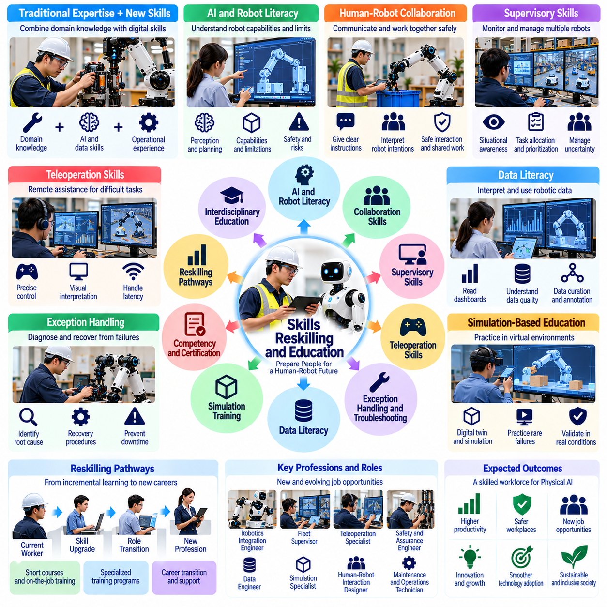{width="7.268055555555556in" height="7.268055555555556in"}

The expansion of Physical AI will transform the skills required across manufacturing, logistics, healthcare, construction, and service industries. As intelligent robots assume selected physical tasks, workers will increasingly need capabilities related to supervision, collaboration, troubleshooting, and system adaptation. Education and reskilling must therefore prepare people not only to operate robotic technologies but also to work effectively within changing human-machine production systems.

The transition toward robot-supported labor will not eliminate the importance of traditional occupational expertise. Knowledge of materials, equipment, safety procedures, and operational workflows remains essential for interpreting robotic behavior. Experienced workers often recognize subtle environmental conditions that automated systems overlook. Future training should combine established domain knowledge with digital competencies rather than treating technological literacy as a complete replacement for practical experience.

Physical AI literacy will become a foundational skill for workers interacting with autonomous machines. Employees should understand how robots perceive environments, interpret instructions, plan movements, and execute actions. They must also recognize the limitations of learned models and the possibility of unexpected behavior. Such literacy does not require every worker to become an artificial intelligence engineer, but it does require informed judgment about robotic capabilities and operational risks.

Human-robot collaboration skills will become increasingly valuable as machines and workers share physical environments. Personnel must learn how to communicate objectives, interpret robot intentions, and coordinate task execution. Understanding safe interaction distances, intervention procedures, and shared authority is essential. Training should emphasize predictable teamwork and the ability to adapt when robotic behavior or environmental conditions differ from expectations.

Supervisory competence will become a central requirement in workplaces operating multiple autonomous robots. Workers may need to monitor fleet performance, prioritize interventions, and identify situations requiring human judgment. Unlike conventional equipment operation, robotic supervision involves managing uncertainty and distributing attention across several intelligent systems. Training must therefore address situational awareness, workload management, and decision-making under time constraints.

Teleoperation skills will support workers who remotely assist robots during difficult or unfamiliar tasks. Operators may require spatial reasoning, precise manipulation, visual interpretation, and familiarity with communication delays. Shared autonomy introduces additional requirements for understanding which functions remain under robotic control. Effective education should include practical exercises that develop coordination between human commands and autonomous stabilization or safety mechanisms.

Exception handling and troubleshooting will remain important because autonomous systems cannot reliably resolve every operational disturbance. Workers should learn to distinguish perception errors, planning failures, mechanical faults, and environmental changes. Structured diagnostic procedures can reduce unnecessary downtime and prevent unsafe interventions. Training should develop systematic reasoning rather than dependence on memorized responses to isolated failure scenarios.

Data literacy will become increasingly relevant as robotic operations generate large volumes of multimodal information. Workers may need to interpret performance dashboards, task logs, sensor measurements, and intervention records. Understanding data quality, uncertainty, and operational context helps prevent misleading conclusions. Advanced specialists will additionally require skills in dataset curation, annotation, validation, and the responsible use of robotic experience data.

Simulation-based education can provide controlled environments for learning complex robotic operations. Digital twins and virtual workspaces allow trainees to practice task allocation, emergency responses, and recovery procedures without exposing people or equipment to unnecessary risks. Simulated exercises can reproduce rare failures that are difficult to encounter during ordinary training. However, practical competence must ultimately be verified under representative real-world conditions.

Reskilling programs should distinguish between incremental skill adaptation and substantial occupational transition. A maintenance technician may need additional training in robotic sensors and software diagnostics, while a displaced production worker may require preparation for an entirely different role. These pathways demand different investments, instructional methods, and support structures. Effective programs should assess existing competencies before prescribing standardized training.

Competency-based education offers a practical framework for preparing workers for Physical AI environments. Instead of measuring learning exclusively through classroom attendance, programs can evaluate demonstrated abilities in supervision, safe intervention, troubleshooting, and task coordination. Performance assessments should reflect realistic operating conditions. Certification systems may help employers identify qualified personnel, provided that standards evolve alongside robotic technologies.

Educational institutions will need to integrate robotics, artificial intelligence, and physical systems engineering across disciplinary boundaries. Mechanical engineering students should understand machine learning and embedded computing, while software specialists should study sensing, actuation, and physical dynamics. Interdisciplinary education can reduce communication barriers between development teams. Practical projects should connect algorithmic concepts with measurable robotic performance.

Vocational education and technical colleges will play a particularly important role in expanding access to robot-centered employment. Training programs can focus on equipment installation, calibration, preventive maintenance, operational supervision, and safety procedures. Partnerships with manufacturers and robotics providers may improve access to current equipment. Curricula should remain sufficiently transferable to avoid dependence on a single vendor or robotic platform.

Continuous learning will become necessary because robotic hardware, foundation models, and autonomy capabilities may evolve faster than traditional educational cycles. Workers will need opportunities to update competencies throughout their careers. Modular courses, workplace training, and periodic reassessment can support this process. Employers should allocate time and resources for learning rather than assuming employees can independently absorb every technological change.

Personalized learning systems may improve the efficiency of reskilling by adapting instruction to individual experience and demonstrated competence. AI-assisted tutors can identify knowledge gaps, recommend exercises, and provide feedback during simulated tasks. However, automated assessment must be transparent and validated. Human instructors remain important for evaluating professional judgment, practical safety awareness, and interpersonal collaboration.

Organizational responsibility is central to successful workforce adaptation. Companies introducing Physical AI should anticipate changes in job requirements and establish training pathways before large-scale deployment. Employees need clear information about emerging roles, expected competencies, and opportunities for advancement. Participatory planning can improve acceptance while ensuring that practical workplace knowledge informs both system design and educational priorities.

Reskilling also involves economic and social barriers that technical instruction alone cannot resolve. Workers may face limited training time, financial constraints, geographic isolation, or uncertainty about future employment. Programs may require wage support, flexible schedules, accessible learning facilities, and career counseling. Without such measures, opportunities created by robotic automation may remain concentrated among workers who already possess advanced technical qualifications.

Public policy can influence whether Physical AI produces inclusive workforce development. Governments may support technical education, apprenticeship programs, portable credentials, and regional training infrastructure. Coordination among employers, educational institutions, and labor organizations can help align training capacity with realistic occupational demand. Policy effectiveness should be evaluated through employment outcomes and skill utilization rather than enrollment numbers alone.

The educational implications of Physical AI extend beyond technical occupations. Managers must understand the economics and limitations of robotic deployment, while healthcare professionals may need skills for supervising assistive systems. Construction workers may interact with autonomous inspection equipment, and service employees may coordinate with mobile robots. Training should therefore be tailored to occupational context rather than restricted to specialized robotics professions.

Human-centered skills may gain importance as routine physical activities become increasingly automated. Communication, ethical judgment, creativity, leadership, and conflict resolution remain difficult to reduce to standardized robotic procedures. Workers may spend more time managing exceptions, supporting customers, and coordinating complex activities. Education should strengthen these capabilities alongside technical literacy, recognizing that valuable work often combines social understanding with practical expertise.

The effectiveness of reskilling should be measured through sustained employment, productivity, safety, and career progression. Completing a training course does not guarantee that workers can perform successfully in robot-supported environments. Employers and educators should track practical competence, job placement, wage development, and adaptation over time. Feedback from these outcomes can guide curriculum improvements and identify groups requiring additional support.

Long-term educational planning must account for uncertainty in the pace and direction of robotic adoption. Some industries may experience rapid deployment, while others face persistent technical, economic, or regulatory constraints. Overly narrow training could prepare workers for occupations that develop more slowly than expected. Broad technical foundations, transferable skills, and flexible learning pathways can improve resilience under changing technological conditions.

Ultimately, skills development, reskilling, and education will determine how broadly the benefits of Physical AI are distributed across society. Intelligent robots can increase productive capacity, but their contribution to human prosperity depends on whether workers can adapt and participate meaningfully. A successful transition requires coordinated investment in technical competence, practical experience, lifelong learning, and institutional support that connects technological progress with sustainable employment opportunities.

피지컬 인공지능(Physical AI)의 확산은 제조업(Manufacturing), 물류(Logistics), 의료(Healthcare), 건설(Construction), 서비스 산업(Service Industry) 전반에서 요구되는 기술과 역량(Skills and Competencies)을 변화시킬 것이다. 지능형 로봇(Intelligent Robot)이 일부 물리적 작업(Physical Task)을 수행하게 되면서 근로자는 감독(Supervision), 협업(Collaboration), 문제 해결(Troubleshooting), 시스템 적응(System Adaptation)과 관련된 능력을 점점 더 필요로 하게 된다. 따라서 교육(Education)과 재교육(Reskilling)은 사람들이 로봇 기술(Robotic Technology)을 운영하는 능력뿐 아니라 변화하는 인간-기계 생산 시스템(Human-Machine Production System) 안에서 효과적으로 일할 수 있는 능력을 갖추도록 준비시켜야 한다.

로봇 지원 노동(Robot-Supported Labor)으로의 전환이 전통적인 직업 전문성(Traditional Occupational Expertise)의 중요성을 제거하는 것은 아니다. 재료(Material), 장비(Equipment), 안전 절차(Safety Procedure), 운영 작업 흐름(Operational Workflow)에 대한 지식은 로봇 행동(Robotic Behavior)을 해석하는 데 여전히 필수적이다. 숙련된 근로자(Experienced Worker)는 자동화 시스템(Automated System)이 간과하는 미묘한 환경 조건(Subtle Environmental Condition)을 인식하는 경우가 많다. 미래의 교육은 기술 활용 능력(Technological Literacy)을 실무 경험(Practical Experience)의 완전한 대체물로 취급하기보다 기존의 분야별 전문지식(Domain Knowledge)과 디지털 역량(Digital Competency)을 결합해야 한다.

피지컬 인공지능 활용 능력(Physical AI Literacy)은 자율 기계(Autonomous Machine)와 상호작용하는 근로자에게 기초적인 역량(Foundational Skill)이 될 것이다. 직원은 로봇이 환경(Environment)을 인식하고 지시(Instruction)를 해석하며 움직임(Movement)을 계획하고 행동(Action)을 실행하는 방식을 이해해야 한다. 또한 학습된 모델(Learned Model)의 한계와 예상하지 못한 행동(Unexpected Behavior)의 가능성을 인식해야 한다. 이러한 활용 능력이 모든 근로자에게 인공지능 엔지니어(Artificial Intelligence Engineer)가 될 것을 요구하는 것은 아니지만, 로봇 능력(Robotic Capability)과 운영 위험(Operational Risk)에 대해 충분한 정보를 바탕으로 판단(Informed Judgment)할 수 있어야 한다.

인간-로봇 협업 역량(Human-Robot Collaboration Skill)은 기계와 근로자가 물리적 환경(Physical Environment)을 공유하면서 점점 더 중요해질 것이다. 인력(Personnel)은 목표(Objective)를 전달하고 로봇의 의도(Robot Intention)를 해석하며 작업 실행(Task Execution)을 조정하는 방법을 학습해야 한다. 안전한 상호작용 거리(Safe Interaction Distance), 개입 절차(Intervention Procedure), 공유 권한(Shared Authority)을 이해하는 것은 필수적이다. 교육은 예측 가능한 팀워크(Predictable Teamwork)와 로봇 행동 또는 환경 조건이 예상과 다를 때 적응할 수 있는 능력을 강조해야 한다.

감독 역량(Supervisory Competence)은 여러 자율 로봇(Autonomous Robot)을 운영하는 작업장에서 핵심 요구사항(Central Requirement)이 될 것이다. 근로자는 로봇 군집 성능(Fleet Performance)을 모니터링하고 개입 우선순위(Intervention Priority)를 결정하며 인간의 판단(Human Judgment)이 필요한 상황을 식별해야 할 수 있다. 기존 장비 운영(Conventional Equipment Operation)과 달리 로봇 감독(Robotic Supervision)은 불확실성(Uncertainty)을 관리하고 여러 지능형 시스템(Intelligent System)에 주의력(Attention)을 분산하는 과정을 포함한다. 따라서 교육은 상황 인식(Situational Awareness), 작업 부하 관리(Workload Management), 시간 제약(Time Constraint) 아래에서의 의사결정(Decision-Making)을 다루어야 한다.

원격조작 기술(Teleoperation Skill)은 어렵거나 익숙하지 않은 작업(Difficult or Unfamiliar Task)에서 로봇을 원격으로 지원하는 근로자에게 필요하다. 운영자(Operator)는 공간 추론(Spatial Reasoning), 정밀 조작(Precise Manipulation), 시각 정보 해석(Visual Interpretation), 통신 지연(Communication Delay)에 대한 이해를 갖추어야 할 수 있다. 공유 자율성(Shared Autonomy)은 어떤 기능이 로봇 제어(Robotic Control) 아래에 유지되는지를 이해해야 하는 추가적인 요구사항을 발생시킨다. 효과적인 교육은 인간 명령(Human Command)과 자율 안정화(Autonomous Stabilization) 또는 안전 메커니즘(Safety Mechanism) 사이의 조정 능력을 개발하는 실습을 포함해야 한다.

예외 상황 처리(Exception Handling)와 문제 해결(Troubleshooting)은 자율 시스템(Autonomous System)이 모든 운영 교란(Operational Disturbance)을 신뢰성 있게 해결할 수 없기 때문에 계속 중요할 것이다. 근로자는 인식 오류(Perception Error), 계획 실패(Planning Failure), 기계적 결함(Mechanical Fault), 환경 변화(Environmental Change)를 구별하는 방법을 학습해야 한다. 구조화된 진단 절차(Structured Diagnostic Procedure)는 불필요한 가동 중단시간(Unnecessary Downtime)을 줄이고 안전하지 않은 개입(Unsafe Intervention)을 방지할 수 있다. 교육은 개별 실패 사례(Isolated Failure Scenario)에 대한 암기된 대응(Memorized Response)에 의존하기보다 체계적인 추론(Systematic Reasoning)을 발전시켜야 한다.

로봇 운영(Robotic Operation)이 대량의 다중모달 정보(Multimodal Information)를 생성함에 따라 데이터 활용 능력(Data Literacy)은 점점 더 중요해질 것이다. 근로자는 성능 대시보드(Performance Dashboard), 작업 로그(Task Log), 센서 측정값(Sensor Measurement), 개입 기록(Intervention Record)을 해석해야 할 수 있다. 데이터 품질(Data Quality), 불확실성(Uncertainty), 운영 맥락(Operational Context)을 이해하면 잘못된 결론(Misleading Conclusion)을 방지하는 데 도움이 된다. 고급 전문가(Advanced Specialist)는 데이터셋 선별(Dataset Curation), 주석 처리(Annotation), 검증(Validation), 로봇 경험 데이터(Robotic Experience Data)의 책임 있는 활용(Responsible Use)에 관한 기술도 필요하다.

시뮬레이션 기반 교육(Simulation-Based Education)은 복잡한 로봇 운영(Complex Robotic Operation)을 학습하기 위한 통제된 환경(Controlled Environment)을 제공할 수 있다. 디지털 트윈(Digital Twin)과 가상 작업 공간(Virtual Workspace)을 통해 교육생(Trainee)은 사람이나 장비를 불필요한 위험(Unnecessary Risk)에 노출시키지 않으면서 작업 할당(Task Allocation), 비상 대응(Emergency Response), 복구 절차(Recovery Procedure)를 연습할 수 있다. 시뮬레이션 훈련(Simulated Exercise)은 일반적인 교육 과정에서 경험하기 어려운 드문 실패(Rare Failure)를 재현할 수 있다. 그러나 실무 역량(Practical Competence)은 궁극적으로 대표성 있는 실제 환경 조건(Representative Real-World Condition)에서 검증되어야 한다.

재교육 프로그램(Reskilling Program)은 점진적인 기술 적응(Incremental Skill Adaptation)과 상당한 수준의 직업 전환(Substantial Occupational Transition)을 구별해야 한다. 유지보수 기술자(Maintenance Technician)는 로봇 센서(Robotic Sensor)와 소프트웨어 진단(Software Diagnostics)에 대한 추가 교육이 필요할 수 있는 반면, 기존 직무를 잃은 생산직 근로자(Displaced Production Worker)는 완전히 다른 직무(Entirely Different Role)를 위한 준비가 필요할 수 있다. 이러한 경로에는 서로 다른 투자(Investment), 교수 방법(Instructional Method), 지원 구조(Support Structure)가 요구된다. 효과적인 프로그램은 표준화된 교육(Standardized Training)을 처방하기 전에 기존 역량(Existing Competency)을 평가해야 한다.

역량 기반 교육(Competency-Based Education)은 근로자가 피지컬 인공지능 환경(Physical AI Environment)에 대비하도록 준비시키는 실용적인 프레임워크(Practical Framework)를 제공한다. 교육 프로그램은 학습 성과(Learning Outcome)를 강의실 출석(Classroom Attendance)만으로 측정하는 대신 감독(Supervision), 안전한 개입(Safe Intervention), 문제 해결(Troubleshooting), 작업 조정(Task Coordination)에서 입증된 능력(Demonstrated Ability)을 평가할 수 있다. 수행 평가(Performance Assessment)는 현실적인 운영 조건(Realistic Operating Condition)을 반영해야 한다. 자격 인증 시스템(Certification System)은 표준(Standard)이 로봇 기술(Robotic Technology)의 발전에 맞춰 변화한다는 전제 아래 고용주가 자격을 갖춘 인력(Qualified Personnel)을 식별하도록 지원할 수 있다.

교육기관(Educational Institution)은 로봇공학(Robotics), 인공지능(Artificial Intelligence), 물리 시스템 공학(Physical Systems Engineering)을 학문 분야의 경계(Disciplinary Boundary)를 넘어 통합해야 할 것이다. 기계공학(Mechanical Engineering) 전공자는 머신러닝(Machine Learning)과 임베디드 컴퓨팅(Embedded Computing)을 이해해야 하며, 소프트웨어 전문가(Software Specialist)는 센싱(Sensing), 구동(Actuation), 물리 동역학(Physical Dynamics)을 학습해야 한다. 학제 간 교육(Interdisciplinary Education)은 개발팀(Development Team) 사이의 의사소통 장벽(Communication Barrier)을 줄일 수 있다. 실습 프로젝트(Practical Project)는 알고리즘 개념(Algorithmic Concept)을 측정 가능한 로봇 성능(Measurable Robotic Performance)과 연결해야 한다.

직업교육(Vocational Education)과 전문대학(Technical College)은 로봇 중심 고용(Robot-Centered Employment)에 대한 접근성을 확대하는 데 특히 중요한 역할을 수행할 것이다. 교육 프로그램은 장비 설치(Equipment Installation), 보정(Calibration), 예방 정비(Preventive Maintenance), 운영 감독(Operational Supervision), 안전 절차(Safety Procedure)에 집중할 수 있다. 제조업체(Manufacturer) 및 로봇 공급업체(Robotics Provider)와의 협력은 최신 장비(Current Equipment)에 대한 접근성을 개선할 수 있다. 교육과정(Curriculum)은 특정 공급업체(Single Vendor)나 로봇 플랫폼(Robotic Platform)에 종속되지 않도록 충분한 전이 가능성(Transferability)을 유지해야 한다.

로봇 하드웨어(Robotic Hardware), 파운데이션 모델(Foundation Model), 자율 능력(Autonomy Capability)은 기존 교육 주기(Traditional Educational Cycle)보다 빠르게 발전할 수 있으므로 지속적 학습(Continuous Learning)이 필요해질 것이다. 근로자는 직업 경력(Career) 전반에 걸쳐 역량(Competency)을 갱신할 기회를 필요로 한다. 모듈형 교육과정(Modular Course), 직장 내 교육(Workplace Training), 주기적인 재평가(Periodic Reassessment)는 이러한 과정을 지원할 수 있다. 고용주(Employer)는 직원이 모든 기술적 변화(Technological Change)를 독립적으로 습득할 수 있다고 가정하기보다 학습을 위한 시간과 자원을 배정해야 한다.

개인화 학습 시스템(Personalized Learning System)은 개인의 경험(Individual Experience)과 입증된 역량(Demonstrated Competence)에 맞춰 교육 내용을 조정함으로써 재교육 효율성(Reskilling Efficiency)을 개선할 수 있다. 인공지능 기반 학습 보조 시스템(AI-Assisted Tutor)은 지식 격차(Knowledge Gap)를 식별하고 연습 과제(Exercise)를 추천하며 시뮬레이션 작업(Simulated Task) 중 피드백(Feedback)을 제공할 수 있다. 그러나 자동화된 평가(Automated Assessment)는 투명하고 검증되어야 한다. 인간 교육자(Human Instructor)는 전문적 판단(Professional Judgment), 실질적인 안전 인식(Practical Safety Awareness), 대인 협업(Interpersonal Collaboration)을 평가하는 데 여전히 중요하다.

조직의 책임(Organizational Responsibility)은 성공적인 인력 적응(Workforce Adaptation)의 핵심이다. 피지컬 인공지능(Physical AI)을 도입하는 기업은 직무 요구사항(Job Requirement)의 변화를 예상하고 대규모 배치(Large-Scale Deployment) 전에 교육 경로(Training Pathway)를 구축해야 한다. 직원은 새롭게 등장하는 직무(Emerging Role), 기대 역량(Expected Competency), 경력 발전 기회(Career Advancement Opportunity)에 관한 명확한 정보를 필요로 한다. 참여형 계획(Participatory Planning)은 실제 작업장 지식(Practical Workplace Knowledge)이 시스템 설계(System Design)와 교육 우선순위(Educational Priority)에 반영되도록 하면서 기술 수용성(Technology Acceptance)을 높일 수 있다.

재교육(Reskilling)은 기술 교육(Technical Instruction)만으로 해결할 수 없는 경제적·사회적 장벽(Economic and Social Barrier)도 포함한다. 근로자는 제한된 교육 시간(Limited Training Time), 재정적 제약(Financial Constraint), 지리적 고립(Geographic Isolation), 미래 고용(Future Employment)에 대한 불확실성에 직면할 수 있다. 프로그램에는 임금 지원(Wage Support), 유연한 일정(Flexible Schedule), 접근 가능한 학습시설(Accessible Learning Facility), 진로 상담(Career Counseling)이 필요할 수 있다. 이러한 조치가 없다면 로봇 자동화(Robotic Automation)가 창출하는 기회는 이미 높은 수준의 기술 자격(Advanced Technical Qualification)을 보유한 근로자에게 집중될 수 있다.

공공정책(Public Policy)은 피지컬 인공지능(Physical AI)이 포용적인 인력 개발(Inclusive Workforce Development)을 실현할 수 있는지에 영향을 미친다. 정부(Government)는 기술 교육(Technical Education), 견습 프로그램(Apprenticeship Program), 이동 가능한 자격 인증(Portable Credential), 지역 교육 인프라(Regional Training Infrastructure)를 지원할 수 있다. 고용주(Employer), 교육기관(Educational Institution), 노동단체(Labor Organization) 사이의 조정은 교육 공급 능력(Training Capacity)을 현실적인 직업 수요(Realistic Occupational Demand)와 일치시키는 데 도움이 된다. 정책 효과(Policy Effectiveness)는 단순한 등록 인원(Enrollment Number)이 아니라 고용 성과(Employment Outcome)와 기술 활용도(Skill Utilization)를 통해 평가해야 한다.

피지컬 인공지능(Physical AI)의 교육적 영향(Educational Implication)은 기술직(Technical Occupation)을 넘어 확장된다. 관리자(Manager)는 로봇 배치(Robotic Deployment)의 경제성과 한계를 이해해야 하며, 의료 전문가(Healthcare Professional)는 보조 시스템(Assistive System)을 감독하는 기술이 필요할 수 있다. 건설 근로자(Construction Worker)는 자율 검사 장비(Autonomous Inspection Equipment)와 상호작용할 수 있으며, 서비스 직원(Service Employee)은 이동형 로봇(Mobile Robot)과 작업을 조정할 수 있다. 따라서 교육은 전문 로봇 직업(Specialized Robotics Profession)에만 한정하지 않고 직업별 맥락(Occupational Context)에 맞춰 설계되어야 한다.

일상적인 물리적 활동(Routine Physical Activity)이 점점 더 자동화되면서 인간 중심 역량(Human-Centered Skill)의 중요성이 높아질 수 있다. 의사소통(Communication), 윤리적 판단(Ethical Judgment), 창의성(Creativity), 리더십(Leadership), 갈등 해결(Conflict Resolution)은 표준화된 로봇 절차(Standardized Robotic Procedure)로 환원하기 어려운 영역이다. 근로자는 예외 상황(Exception)을 관리하고 고객(Customer)을 지원하며 복잡한 활동(Complex Activity)을 조정하는 데 더 많은 시간을 사용할 수 있다. 교육은 가치 있는 노동(Valuable Work)이 사회적 이해(Social Understanding)와 실무 전문성(Practical Expertise)을 결합하는 경우가 많다는 점을 인식하면서 기술 활용 능력(Technical Literacy)과 함께 이러한 역량을 강화해야 한다.

재교육의 효과(Reskilling Effectiveness)는 지속적인 고용(Sustained Employment), 생산성(Productivity), 안전성(Safety), 경력 발전(Career Progression)을 통해 측정해야 한다. 교육과정(Training Course)을 수료했다고 해서 근로자가 로봇 지원 환경(Robot-Supported Environment)에서 성공적으로 업무를 수행할 수 있다는 보장은 없다. 고용주와 교육자는 실무 역량(Practical Competence), 취업 성과(Job Placement), 임금 발전(Wage Development), 시간에 따른 적응(Adaptation Over Time)을 추적해야 한다. 이러한 결과에서 얻은 피드백(Feedback)은 교육과정 개선(Curriculum Improvement)을 안내하고 추가 지원(Additional Support)이 필요한 집단을 식별하는 데 활용될 수 있다.

장기적인 교육 계획(Long-Term Educational Planning)은 로봇 도입(Robotic Adoption)의 속도와 방향에 존재하는 불확실성(Uncertainty)을 고려해야 한다. 일부 산업은 빠른 배치(Rapid Deployment)를 경험할 수 있지만, 다른 산업은 지속적인 기술적·경제적·규제적 제약(Technical, Economic, or Regulatory Constraint)에 직면할 수 있다. 지나치게 좁은 범위의 교육(Overly Narrow Training)은 예상보다 느리게 발전하는 직업을 위해 근로자를 준비시키는 결과를 초래할 수 있다. 폭넓은 기술적 기초(Broad Technical Foundation), 전이 가능한 기술(Transferable Skill), 유연한 학습 경로(Flexible Learning Pathway)는 변화하는 기술 조건(Changing Technological Condition)에서 회복탄력성(Resilience)을 향상시킬 수 있다.

궁극적으로 기술 개발(Skills Development), 재교육(Reskilling), 교육(Education)은 피지컬 인공지능(Physical AI)의 혜택이 사회 전반에 얼마나 폭넓게 분배되는지를 결정할 것이다. 지능형 로봇(Intelligent Robot)은 생산 능력(Productive Capacity)을 증가시킬 수 있지만, 인간의 번영(Human Prosperity)에 대한 기여는 근로자가 변화에 적응하고 의미 있게 참여할 수 있는지에 달려 있다. 성공적인 전환(Successful Transition)을 위해서는 기술적 역량(Technical Competence), 실무 경험(Practical Experience), 평생학습(Lifelong Learning), 기술 발전(Technological Progress)을 지속 가능한 고용 기회(Sustainable Employment Opportunity)와 연결하는 제도적 지원(Institutional Support)에 대한 조정된 투자가 필요하다.

##  

## 01.15. Productivity Wages and Labor Displacement

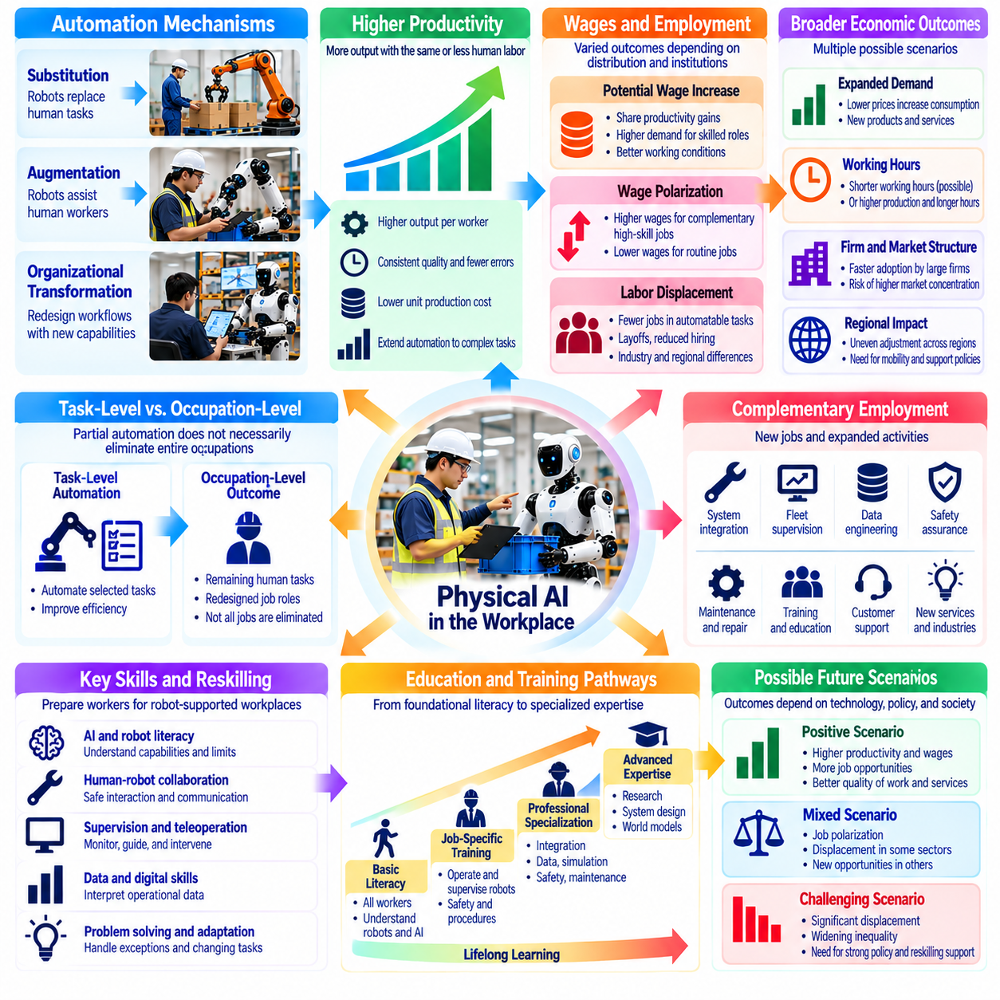{width="7.268055555555556in" height="7.268055555555556in"}

Physical AI has the potential to reshape the relationship between productivity, wages, and employment by extending automation into physical tasks previously dependent on human labor. Intelligent robots may increase output, improve operational consistency, and reduce production costs. However, higher productivity does not automatically translate into higher wages or greater employment. Economic outcomes depend on how technological gains are distributed across workers, firms, and consumers.

Labor productivity measures the amount of output produced per unit of human labor input. When robots perform repetitive handling, transportation, inspection, or assembly tasks, human workers may produce more output with less direct physical effort. Yet productivity improvements must account for robotic capital, maintenance, supervision, and integration costs. Measuring output per worker alone may conceal the additional resources required to sustain automated operations.

Physical AI can influence productivity through substitution, augmentation, and organizational transformation. Substitution occurs when robotic systems replace human execution of specific tasks. Augmentation allows workers to accomplish more through robotic assistance, while organizational transformation redesigns workflows around new capabilities. These mechanisms can operate simultaneously, making the employment consequences of automation more complex than simple worker replacement.

Task-level automation does not necessarily imply occupation-level displacement. Most occupations combine physical execution, communication, judgment, coordination, and exception handling. Robots may automate selected activities while leaving other responsibilities with human workers. Consequently, employment effects depend on the proportion of tasks automated, the importance of remaining duties, and whether organizations redesign jobs around complementary human capabilities.

Wage outcomes depend partly on how automation changes demand for different skills. Workers who supervise robots, integrate systems, or manage complex operations may experience stronger demand for their expertise. Employees whose primary tasks become inexpensive to automate may face weaker bargaining positions. These effects can produce wage polarization if high-skill complementary roles expand while routine occupations experience reduced opportunities.

Productivity growth can support wage increases when workers share in the additional economic value created by automation. Higher output per employee may enable firms to raise compensation while maintaining profitability. However, wage growth also depends on labor market competition, bargaining institutions, organizational policies, and ownership structures. Without mechanisms linking productivity gains to compensation, a larger share of benefits may accrue to capital owners.

Labor displacement occurs when automation reduces demand for human workers in particular tasks, occupations, or industries. Displacement may appear through layoffs, reduced hiring, shorter working hours, or declining opportunities for new entrants. These changes need not occur immediately after robotic deployment. Organizations may initially use automation to address labor shortages or expand capacity before adjusting their employment structures.

The timing of displacement depends on technological maturity and economic feasibility. Robots must achieve sufficient reliability, throughput, and cost efficiency before replacing established labor processes. High acquisition costs, maintenance requirements, and frequent human interventions can delay adoption. Consequently, technical demonstrations of robotic competence should not be interpreted as direct evidence of imminent large-scale employment displacement.

Physical AI may also create complementary employment through new products, services, and operational activities. Robot deployment requires systems integration, fleet supervision, maintenance, data engineering, safety assurance, and training. Increased production capacity may stimulate demand for logistics, customer support, and related services. Nevertheless, newly created positions may differ geographically and professionally from jobs affected by automation.

Demand expansion can partially offset labor displacement when productivity improvements reduce prices and increase consumption. Lower production costs may make goods and services accessible to additional customers, supporting higher output and employment in related activities. The magnitude of this effect depends on demand responsiveness, market competition, and industry structure. Some sectors may expand substantially, while others experience limited additional demand.

The distribution of productivity gains may differ between large corporations and smaller enterprises. Organizations with access to capital, robotics expertise, and extensive operational data may adopt Physical AI more rapidly. Smaller firms may struggle with initial investment and integration complexity. Such differences could increase market concentration unless affordable robotic services, shared infrastructure, and accessible financing broaden participation.

Regional labor markets may experience uneven adjustment as Physical AI spreads across industries. Manufacturing centers, logistics hubs, and technologically advanced regions may undergo rapid changes in task composition. Areas with limited educational resources or alternative employment opportunities may face greater displacement risks. Regional outcomes will depend on industrial specialization, workforce mobility, infrastructure, and institutional support.

The effects of automation on working hours are not predetermined. Higher productivity could enable shorter schedules while maintaining output, but firms may instead increase production or extend operating periods. Workers may benefit from reduced physical strain without experiencing fewer paid hours. The actual outcome depends on labor contracts, market demand, organizational objectives, and the distribution of bargaining power between employers and employees.

Physical AI may improve job quality by reducing dangerous, repetitive, and physically exhausting activities. Robots can assist with heavy lifting, hazardous inspection, and operations in uncomfortable environments. Such improvements may reduce injuries and support longer working careers. However, automation can also introduce intensive monitoring, higher performance expectations, and new supervisory burdens if workplace design prioritizes output without considering worker well-being.

Labor market adjustment involves more than transferring workers from declining occupations into expanding ones. Employees may face mismatches in technical skills, professional experience, geographic location, and wage expectations. Training programs require time, funding, and credible employment pathways. Without coordinated support, productivity gains at the aggregate level may coexist with prolonged unemployment or reduced earnings for affected individuals.

The relationship between automation and inequality depends on ownership and institutional arrangements. When robotic capital is concentrated among a limited number of firms or investors, automation profits may increase wealth disparities. Broader access to capital, employee participation, and competitive markets can influence distributional outcomes. Policy discussions must distinguish between the creation of economic value and the mechanisms through which that value reaches households.

Measuring the economic impact of Physical AI requires separating technical capability from realized productivity. A robot may successfully demonstrate a task yet provide limited economic benefit because of downtime, supervision, or environmental restrictions. Evaluation should consider effective utilization, intervention frequency, quality, capital expenditure, and operating expenses. Reliable measurement is essential for estimating both labor substitution and genuine productivity improvement.

Firm-level productivity gains may not immediately appear as economy-wide growth. Adoption costs, organizational learning, infrastructure limitations, and slow diffusion can delay aggregate benefits. Industries must often redesign workflows and develop complementary capabilities before realizing substantial returns. This adjustment period may create a temporary gap between technological progress and measurable improvements in wages or national productivity.

Public policy can influence how societies manage productivity gains and labor displacement. Education, reskilling, employment services, and transitional income support can reduce adjustment costs for affected workers. Competition policy and infrastructure investment may help broaden access to robotic technologies. Effective interventions should respond to observed labor market conditions rather than assuming that all industries will experience identical automation trajectories.

Long-term employment outcomes remain uncertain because technological progress interacts with demographic change, consumer demand, and institutional choices. Aging populations may use robots to compensate for labor shortages, while other regions may experience stronger displacement pressures. New industries and services could create additional demand for human expertise. Forecasts should therefore use multiple scenarios rather than treating any single employment trajectory as inevitable.

The economic challenge of Physical AI is not simply whether robots can perform human tasks at lower cost. It is whether productivity improvements generate broadly shared prosperity while maintaining opportunities for meaningful employment. This requires attention to wage formation, labor mobility, education, ownership, and organizational design. Technological efficiency and social welfare are related objectives, but they are not automatically equivalent.

Ultimately, Physical AI may increase productive capacity while transforming the composition and value of human labor. Some tasks will become automated, others will be augmented, and new responsibilities will emerge around intelligent machines. The balance between higher productivity, wage growth, and displacement will depend on deployment choices and economic institutions. Sustainable progress requires evaluating automation through both operational performance and its consequences for workers and society.

피지컬 인공지능(Physical AI)은 이전까지 인간 노동(Human Labor)에 의존했던 물리적 작업(Physical Task)으로 자동화(Automation)를 확장함으로써 생산성(Productivity), 임금(Wages), 고용(Employment) 사이의 관계를 재편할 잠재력을 가지고 있다. 지능형 로봇(Intelligent Robot)은 생산량(Output)을 증가시키고 운영 일관성(Operational Consistency)을 개선하며 생산비용(Production Cost)을 절감할 수 있다. 그러나 생산성 향상(Productivity Improvement)이 자동으로 임금 상승(Wage Growth)이나 고용 증가(Employment Growth)로 이어지는 것은 아니다. 경제적 결과(Economic Outcome)는 기술 발전의 이익(Technological Gain)이 근로자(Worker), 기업(Firm), 소비자(Consumer) 사이에 어떻게 분배되는지에 달려 있다.

노동 생산성(Labor Productivity)은 인간 노동 투입량(Human Labor Input) 단위당 생산되는 산출량(Output)을 측정한다. 로봇이 반복적인 물체 취급(Repetitive Handling), 운송(Transportation), 검사(Inspection), 조립(Assembly) 작업을 수행하면 인간 근로자는 직접적인 육체적 노력(Direct Physical Effort)을 줄이면서 더 많은 산출량을 생산할 수 있다. 그러나 생산성 개선(Productivity Improvement)을 평가할 때는 로봇 자본(Robotic Capital), 유지보수(Maintenance), 감독(Supervision), 시스템 통합 비용(Integration Cost)을 고려해야 한다. 근로자 1인당 생산량(Output per Worker)만 측정하면 자동화 운영(Automated Operation)을 유지하는 데 필요한 추가 자원(Additional Resource)이 드러나지 않을 수 있다.

피지컬 인공지능(Physical AI)은 대체(Substitution), 증강(Augmentation), 조직적 전환(Organizational Transformation)을 통해 생산성(Productivity)에 영향을 미칠 수 있다. 대체는 로봇 시스템(Robotic System)이 특정 작업(Specific Task)의 인간 실행(Human Execution)을 대신할 때 발생한다. 증강은 로봇 지원(Robotic Assistance)을 통해 근로자가 더 많은 일을 수행하도록 하며, 조직적 전환은 새로운 능력(New Capability)을 중심으로 작업 흐름(Workflow)을 재설계한다. 이러한 메커니즘은 동시에 작용할 수 있으므로 자동화의 고용 영향(Employment Consequence)은 단순한 근로자 대체(Worker Replacement)보다 복잡하다.

작업 수준 자동화(Task-Level Automation)가 반드시 직업 수준의 노동 대체(Occupation-Level Displacement)를 의미하는 것은 아니다. 대부분의 직업(Occupation)은 물리적 실행(Physical Execution), 의사소통(Communication), 판단(Judgment), 조정(Coordination), 예외 상황 처리(Exception Handling)를 결합한다. 로봇은 일부 활동(Selected Activity)을 자동화하면서 다른 책임(Remaining Responsibility)은 인간 근로자에게 남겨둘 수 있다. 따라서 고용 효과(Employment Effect)는 자동화되는 작업의 비율(Proportion of Automated Tasks), 남아 있는 업무의 중요성(Importance of Remaining Duties), 조직이 인간의 상호보완적 능력(Complementary Human Capability)을 중심으로 직무를 재설계하는지에 달려 있다.

임금 결과(Wage Outcome)는 자동화가 서로 다른 기술(Skill)에 대한 수요(Demand)를 어떻게 변화시키는지에 부분적으로 달려 있다. 로봇을 감독(Supervision)하고 시스템을 통합(System Integration)하거나 복잡한 운영(Complex Operation)을 관리하는 근로자는 자신의 전문성(Expertise)에 대한 수요가 증가할 수 있다. 반면 주요 업무(Primary Task)가 저렴하게 자동화될 수 있는 직원은 협상력(Bargaining Position)이 약화될 수 있다. 이러한 효과는 고숙련 상호보완 직무(High-Skill Complementary Role)가 확대되는 동시에 반복적 직업(Routine Occupation)의 기회가 감소할 경우 임금 양극화(Wage Polarization)를 발생시킬 수 있다.

생산성 증가(Productivity Growth)는 근로자가 자동화로 창출된 추가 경제적 가치(Additional Economic Value)를 공유할 때 임금 상승(Wage Increase)을 지원할 수 있다. 직원 1인당 산출량(Output per Employee)이 증가하면 기업은 수익성(Profitability)을 유지하면서 보상(Compensation)을 인상할 수 있다. 그러나 임금 상승(Wage Growth)은 노동시장 경쟁(Labor Market Competition), 교섭 제도(Bargaining Institution), 조직 정책(Organizational Policy), 소유 구조(Ownership Structure)에도 달려 있다. 생산성 향상(Productivity Gain)을 보상과 연결하는 메커니즘이 없다면 더 큰 비중의 이익이 자본 소유자(Capital Owner)에게 돌아갈 수 있다.

노동 대체(Labor Displacement)는 자동화(Automation)가 특정 작업(Task), 직업(Occupation), 산업(Industry)에서 인간 근로자에 대한 수요를 감소시킬 때 발생한다. 노동 대체는 해고(Layoff), 신규 채용 감소(Reduced Hiring), 근로시간 단축(Shorter Working Hours), 신규 노동시장 진입자(New Entrant)의 기회 감소로 나타날 수 있다. 이러한 변화가 로봇 배치(Robotic Deployment) 직후에 반드시 발생하는 것은 아니다. 조직은 초기에는 자동화를 활용하여 노동력 부족(Labor Shortage)을 해결하거나 생산 능력(Production Capacity)을 확대한 뒤 고용 구조(Employment Structure)를 조정할 수 있다.

노동 대체의 시기(Timing of Displacement)는 기술 성숙도(Technological Maturity)와 경제적 실현 가능성(Economic Feasibility)에 달려 있다. 로봇이 기존 노동 프로세스(Established Labor Process)를 대체하려면 충분한 신뢰성(Reliability), 처리량(Throughput), 비용 효율성(Cost Efficiency)을 달성해야 한다. 높은 도입 비용(High Acquisition Cost), 유지보수 요구사항(Maintenance Requirement), 빈번한 인간 개입(Frequent Human Intervention)은 도입을 지연시킬 수 있다. 따라서 로봇 수행 능력(Robotic Competence)에 대한 기술적 시연(Technical Demonstration)을 대규모 고용 대체(Large-Scale Employment Displacement)가 임박했다는 직접적인 증거로 해석해서는 안 된다.

피지컬 인공지능(Physical AI)은 새로운 제품(New Product), 서비스(Service), 운영 활동(Operational Activity)을 통해 상호보완적 고용(Complementary Employment)을 창출할 수도 있다. 로봇 배치(Robot Deployment)에는 시스템 통합(Systems Integration), 로봇 군집 감독(Fleet Supervision), 유지보수(Maintenance), 데이터 엔지니어링(Data Engineering), 안전 보증(Safety Assurance), 교육(Training)이 필요하다. 생산 능력(Production Capacity)의 증가는 물류(Logistics), 고객 지원(Customer Support), 관련 서비스(Related Service)에 대한 수요를 촉진할 수 있다. 그러나 새롭게 창출되는 일자리(Newly Created Position)는 자동화의 영향을 받는 일자리와 지역적·직업적 특성(Geographical and Professional Characteristics)이 다를 수 있다.

수요 확대(Demand Expansion)는 생산성 향상(Productivity Improvement)이 가격(Price)을 낮추고 소비(Consumption)를 증가시킬 때 노동 대체(Labor Displacement)를 부분적으로 상쇄할 수 있다. 생산비용(Production Cost)의 감소는 상품과 서비스(Goods and Services)를 더 많은 소비자(Additional Customer)가 이용할 수 있도록 하여 관련 활동(Related Activity)의 생산량(Output)과 고용(Employment)을 지원할 수 있다. 이러한 효과의 크기(Magnitude)는 수요 반응성(Demand Responsiveness), 시장 경쟁(Market Competition), 산업 구조(Industry Structure)에 달려 있다. 일부 산업은 상당히 확대될 수 있지만 다른 산업은 추가 수요(Additional Demand)가 제한적일 수 있다.

생산성 향상의 분배(Distribution of Productivity Gains)는 대기업(Large Corporation)과 중소기업(Smaller Enterprise) 사이에서 다르게 나타날 수 있다. 자본(Capital), 로봇공학 전문성(Robotics Expertise), 광범위한 운영 데이터(Extensive Operational Data)에 접근할 수 있는 조직은 피지컬 인공지능(Physical AI)을 더 빠르게 도입할 수 있다. 중소기업은 초기 투자(Initial Investment)와 통합 복잡성(Integration Complexity)으로 어려움을 겪을 수 있다. 저렴한 로봇 서비스(Affordable Robotic Service), 공유 인프라(Shared Infrastructure), 접근 가능한 금융(Accessible Financing)이 참여를 확대하지 못한다면 이러한 차이는 시장 집중(Market Concentration)을 증가시킬 수 있다.

지역 노동시장(Regional Labor Market)은 피지컬 인공지능(Physical AI)이 산업 전반에 확산됨에 따라 불균등한 조정(Uneven Adjustment)을 경험할 수 있다. 제조업 중심지(Manufacturing Center), 물류 거점(Logistics Hub), 기술 선진 지역(Technologically Advanced Region)은 작업 구성(Task Composition)의 급격한 변화를 겪을 수 있다. 교육 자원(Educational Resource)이나 대체 고용 기회(Alternative Employment Opportunity)가 제한된 지역은 더 큰 노동 대체 위험(Displacement Risk)에 직면할 수 있다. 지역별 결과(Regional Outcome)는 산업 전문화(Industrial Specialization), 노동력 이동성(Workforce Mobility), 기반시설(Infrastructure), 제도적 지원(Institutional Support)에 달려 있다.

자동화(Automation)가 근로시간(Working Hours)에 미치는 영향은 미리 결정되어 있지 않다. 생산성 향상(Higher Productivity)은 산출량(Output)을 유지하면서 근무시간을 단축(Shorter Schedule)할 수 있게 하지만, 기업은 대신 생산량을 증가시키거나 운영시간(Operating Period)을 연장할 수도 있다. 근로자는 유급 근로시간(Paid Working Hours)의 감소 없이도 육체적 부담(Physical Strain)이 줄어드는 혜택을 얻을 수 있다. 실제 결과(Actual Outcome)는 근로계약(Labor Contract), 시장 수요(Market Demand), 조직 목표(Organizational Objective), 고용주와 근로자 사이의 교섭력 분포(Distribution of Bargaining Power)에 달려 있다.

피지컬 인공지능(Physical AI)은 위험하고 반복적이며 육체적으로 소모적인 활동(Dangerous, Repetitive, and Physically Exhausting Activity)을 줄임으로써 일자리의 질(Job Quality)을 개선할 수 있다. 로봇은 무거운 물체 들어 올리기(Heavy Lifting), 위험 환경 검사(Hazardous Inspection), 불편한 환경(Uncomfortable Environment)에서의 작업을 지원할 수 있다. 이러한 개선은 부상(Injury)을 줄이고 더 긴 직업 경력(Longer Working Career)을 지원할 수 있다. 그러나 작업장 설계(Workplace Design)가 근로자 복지(Worker Well-Being)를 고려하지 않고 산출량만 우선한다면 자동화는 집중적인 감시(Intensive Monitoring), 높은 성과 기대(Higher Performance Expectation), 새로운 감독 부담(Supervisory Burden)을 초래할 수도 있다.

노동시장 조정(Labor Market Adjustment)은 쇠퇴하는 직업(Declining Occupation)의 근로자를 성장하는 직업(Expanding Occupation)으로 이동시키는 것 이상의 문제를 포함한다. 직원은 기술 역량(Technical Skill), 전문 경험(Professional Experience), 지리적 위치(Geographic Location), 임금 기대(Wage Expectation)의 불일치(Mismatch)에 직면할 수 있다. 교육 프로그램(Training Program)에는 시간(Time), 자금(Funding), 신뢰할 수 있는 고용 경로(Credible Employment Pathway)가 필요하다. 조정된 지원(Coordinated Support)이 없다면 경제 전체 수준(Aggregate Level)의 생산성 향상과 영향을 받는 개인(Affected Individual)의 장기 실업(Prolonged Unemployment) 또는 소득 감소(Reduced Earnings)가 동시에 발생할 수 있다.

자동화(Automation)와 불평등(Inequality)의 관계는 소유 구조(Ownership Arrangement)와 제도적 체계(Institutional Arrangement)에 달려 있다. 로봇 자본(Robotic Capital)이 소수 기업이나 투자자(Limited Number of Firms or Investors)에게 집중되면 자동화 이익(Automation Profit)은 부의 격차(Wealth Disparity)를 확대할 수 있다. 자본에 대한 폭넓은 접근(Broader Access to Capital), 직원 참여(Employee Participation), 경쟁적 시장(Competitive Market)은 분배 결과(Distributional Outcome)에 영향을 미칠 수 있다. 정책 논의(Policy Discussion)는 경제적 가치의 창출(Creation of Economic Value)과 그 가치가 가계(Household)에 전달되는 메커니즘을 구별해야 한다.

피지컬 인공지능(Physical AI)의 경제적 영향(Economic Impact)을 측정하려면 기술적 능력(Technical Capability)과 실현된 생산성(Realized Productivity)을 구분해야 한다. 로봇은 작업을 성공적으로 시연할 수 있지만 가동 중단시간(Downtime), 감독(Supervision), 환경적 제약(Environmental Restriction)으로 인해 경제적 이익(Economic Benefit)이 제한적일 수 있다. 평가(Evaluation)는 실효 활용률(Effective Utilization), 개입 빈도(Intervention Frequency), 품질(Quality), 자본적 지출(Capital Expenditure), 운영비용(Operating Expense)을 고려해야 한다. 신뢰할 수 있는 측정(Reliable Measurement)은 노동 대체(Labor Substitution)와 실질적인 생산성 향상(Genuine Productivity Improvement)을 모두 추정하는 데 필수적이다.

기업 수준의 생산성 향상(Firm-Level Productivity Gain)이 즉시 경제 전체의 성장(Economy-Wide Growth)으로 나타나는 것은 아니다. 도입 비용(Adoption Cost), 조직 학습(Organizational Learning), 기반시설의 한계(Infrastructure Limitation), 느린 기술 확산(Slow Diffusion)은 총체적인 이익(Aggregate Benefit)의 실현을 지연시킬 수 있다. 산업은 상당한 수익(Substantial Return)을 실현하기 전에 작업 흐름(Workflow)을 재설계하고 상호보완적 역량(Complementary Capability)을 개발해야 하는 경우가 많다. 이러한 조정 기간(Adjustment Period)은 기술 발전(Technological Progress)과 측정 가능한 임금 또는 국가 생산성(National Productivity) 개선 사이에 일시적인 격차(Temporary Gap)를 발생시킬 수 있다.

공공정책(Public Policy)은 사회가 생산성 향상(Productivity Gain)과 노동 대체(Labor Displacement)를 관리하는 방식에 영향을 미칠 수 있다. 교육(Education), 재교육(Reskilling), 고용 서비스(Employment Service), 전환기 소득 지원(Transitional Income Support)은 영향을 받는 근로자의 조정 비용(Adjustment Cost)을 줄일 수 있다. 경쟁정책(Competition Policy)과 기반시설 투자(Infrastructure Investment)는 로봇 기술(Robotic Technology)에 대한 접근성을 확대하는 데 도움이 될 수 있다. 효과적인 정책 개입(Effective Intervention)은 모든 산업이 동일한 자동화 경로(Automation Trajectory)를 경험할 것이라고 가정하기보다 관측된 노동시장 조건(Observed Labor Market Condition)에 대응해야 한다.

장기적인 고용 결과(Long-Term Employment Outcome)는 기술 발전(Technological Progress)이 인구구조 변화(Demographic Change), 소비자 수요(Consumer Demand), 제도적 선택(Institutional Choice)과 상호작용하기 때문에 여전히 불확실하다. 고령화 사회(Aging Population)는 노동력 부족(Labor Shortage)을 보완하기 위해 로봇을 활용할 수 있는 반면, 다른 지역에서는 더 강한 노동 대체 압력(Displacement Pressure)이 발생할 수 있다. 새로운 산업(New Industry)과 서비스(Service)는 인간 전문성(Human Expertise)에 대한 추가 수요(Additional Demand)를 창출할 수 있다. 따라서 전망(Forecast)은 단일한 고용 변화 경로(Employment Trajectory)를 불가피한 결과로 취급하기보다 여러 시나리오(Multiple Scenario)를 활용해야 한다.

피지컬 인공지능(Physical AI)의 경제적 과제(Economic Challenge)는 단순히 로봇이 인간의 작업(Human Task)을 더 낮은 비용(Lower Cost)으로 수행할 수 있는지에 관한 문제가 아니다. 핵심은 생산성 향상(Productivity Improvement)이 의미 있는 고용 기회(Meaningful Employment Opportunity)를 유지하면서 폭넓게 공유되는 번영(Broadly Shared Prosperity)을 창출하는지에 있다. 이를 위해서는 임금 결정(Wage Formation), 노동 이동성(Labor Mobility), 교육(Education), 소유권(Ownership), 조직 설계(Organizational Design)에 대한 관심이 필요하다. 기술적 효율성(Technological Efficiency)과 사회적 복지(Social Welfare)는 서로 관련된 목표이지만 자동으로 동일한 결과를 의미하지는 않는다.

궁극적으로 피지컬 인공지능(Physical AI)은 인간 노동(Human Labor)의 구성(Composition)과 가치(Value)를 변화시키면서 생산 능력(Productive Capacity)을 증가시킬 수 있다. 일부 작업은 자동화(Automation)되고 다른 작업은 증강(Augmentation)되며 지능형 기계(Intelligent Machine)를 중심으로 새로운 책임(New Responsibility)이 등장할 것이다. 생산성 향상(Higher Productivity), 임금 상승(Wage Growth), 노동 대체(Labor Displacement) 사이의 균형은 배치 방식(Deployment Choice)과 경제 제도(Economic Institution)에 달려 있다. 지속 가능한 발전(Sustainable Progress)을 위해서는 자동화를 운영 성능(Operational Performance)뿐 아니라 근로자와 사회에 미치는 영향(Consequences for Workers and Society)을 통해 평가해야 한다.

##  

## 01.16. Future of Human Work with Physical AI

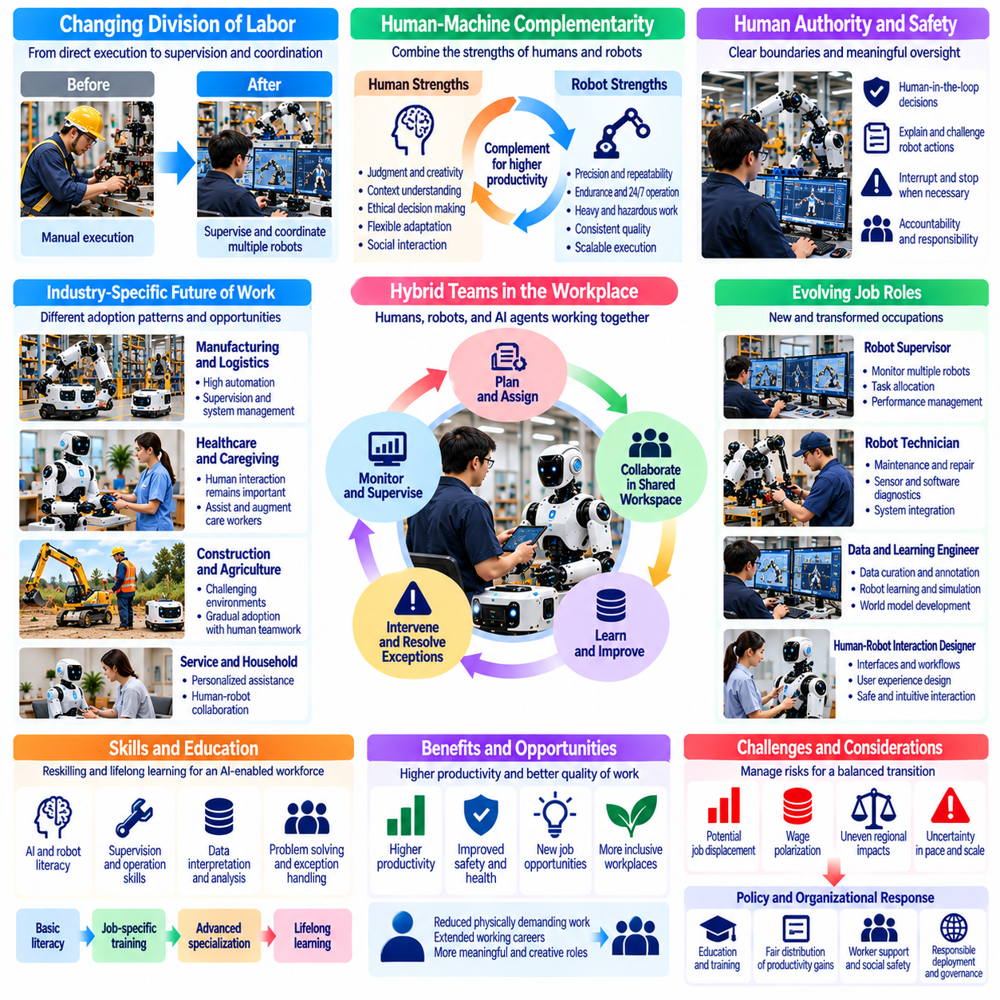{width="7.268055555555556in" height="7.268055555555556in"}

The future of human work with Physical AI will be shaped by the changing relationship between human capabilities and autonomous machines. As robots become capable of performing increasingly complex physical tasks, employment structures may shift from direct execution toward supervision, coordination, and problem solving. However, the significance of this transition extends beyond replacing manual labor. It involves reconsidering how human judgment, responsibility, and creativity contribute to productive activity.

Human work is unlikely to disappear simply because robotic systems become more capable. Most economic activities involve combinations of physical execution, communication, adaptation, and social interaction. Even highly automated environments require people to define objectives, resolve unexpected situations, and evaluate outcomes. The future division of labor will therefore depend on which responsibilities can be delegated reliably and which continue to benefit from human participation.

Physical AI may gradually transform workers from direct operators into supervisors of intelligent physical systems. Instead of manually performing every movement, employees may assign goals, monitor progress, and intervene when autonomous behavior becomes uncertain. One person could potentially coordinate multiple robots, increasing operational leverage. However, effective supervision requires interfaces that preserve situational awareness and prevent excessive cognitive workload.

The concept of human-machine complementarity will become central to future workplace design. Robots may provide precision, endurance, repeatability, and continuous operation, while humans contribute contextual understanding, ethical judgment, and flexible coordination. These strengths are not absolute distinctions, since artificial intelligence capabilities continue to evolve. Successful organizations will allocate responsibilities according to demonstrated reliability rather than assumptions about permanent human or machine superiority.

Human authority over important decisions will remain a significant consideration in safety-sensitive applications. Robots may recommend actions or execute approved procedures, but organizations must establish clear boundaries for autonomous decision-making. Human oversight should include meaningful opportunities to understand, challenge, and interrupt robotic behavior. Responsibility cannot be preserved merely by assigning a nominal supervisor who lacks the information or practical ability to intervene.

The expansion of robotic autonomy may change the meaning of professional expertise. Traditional competence often involves directly performing specialized physical activities through accumulated experience. Future expertise may increasingly include interpreting machine behavior, managing uncertainty, and coordinating complex systems. Nevertheless, practical domain knowledge remains essential because understanding physical processes helps workers recognize failures that automated monitoring may overlook.

Workplace organization may evolve toward hybrid teams consisting of humans, robots, and software agents. Such teams will require mechanisms for assigning tasks, sharing information, resolving conflicts, and coordinating resources. Human workers may supervise physical robots while interacting with digital planning systems that optimize schedules and workflows. Organizational performance will depend on the integration of these participants rather than the isolated intelligence of individual machines.

Physical AI may enable more personalized and adaptive forms of human work. Robotic assistants could adjust their behavior to individual preferences, physical capabilities, and task requirements. Workers may use natural-language instructions or demonstrations to configure assistance without extensive programming. This flexibility could expand access to sophisticated tools, although successful deployment requires reliable interpretation of instructions and appropriate safeguards against unintended actions.

The reduction of physically demanding labor may improve occupational health and extend working careers. Robots can assist with heavy lifting, repetitive manipulation, hazardous inspection, and tasks performed in uncomfortable environments. These benefits may be particularly valuable for aging workforces and employees with physical limitations. However, ergonomic improvements should be assessed alongside possible increases in monitoring pressure, mental fatigue, and supervisory responsibility.

The relationship between Physical AI and employment will differ across industries and regions. Manufacturing and logistics may experience extensive task automation, while healthcare and personal services may retain substantial human interaction requirements. Construction and agriculture present environmental variability that can limit autonomous reliability. Consequently, the future of work should be understood through industry-specific adoption patterns rather than a single universal prediction.

New forms of employment may emerge around robot learning, fleet operations, safety assurance, maintenance, and human-machine interaction. At the same time, existing occupations may incorporate robotic responsibilities without disappearing entirely. Electricians, technicians, healthcare workers, and production managers could develop hybrid roles combining established expertise with intelligent automation. The scale of occupational creation will depend on technological maturity and economic demand.

Education and lifelong learning will become essential components of workforce adaptation. Workers may need competencies in robotic supervision, data interpretation, safety procedures, and exception handling. Training should emphasize transferable skills that remain useful across different robotic platforms and industries. Educational institutions and employers will need to coordinate learning opportunities so technological transitions do not disproportionately disadvantage workers with limited access to training.

The economic benefits of Physical AI will depend on whether productivity gains improve wages, working conditions, and opportunities for participation. Greater output per worker could support higher compensation or shorter working hours, but neither outcome is automatic. Ownership structures, labor institutions, market competition, and organizational policies influence how gains are distributed. A technologically advanced workplace is not necessarily a socially beneficial workplace.

Human dignity and occupational identity will remain important as machines assume responsibilities previously associated with skilled labor. Employment provides more than income; it can offer purpose, recognition, social relationships, and opportunities for achievement. Rapid automation may disrupt these sources of meaning even when aggregate productivity increases. Workforce transition strategies should therefore address professional identity and participation alongside technical retraining and financial support.

The future workplace may place greater emphasis on creativity, interpersonal understanding, and complex decision-making. Workers could spend less time executing routine movements and more time designing processes, assisting customers, coordinating teams, and resolving unusual problems. However, these changes will vary according to organizational choices. Automation does not automatically produce more meaningful work unless institutions deliberately redesign responsibilities around human development and autonomy.

Physical AI may also alter relationships between workers and employers through expanded monitoring capabilities. Robotic systems can generate detailed records of task execution, movement patterns, productivity, and intervention behavior. Such information may improve safety and operational planning, but it can also enable intrusive surveillance or unfair performance evaluation. Transparent data governance, proportional monitoring, and appropriate worker participation will become important workplace safeguards.

As autonomous systems become more capable, questions of accountability will become increasingly complex. Operational failures may involve interactions among robotic hardware, learned policies, human instructions, and organizational procedures. Assigning responsibility requires clear documentation of system behavior and decision authority. Future labor arrangements should ensure that workers are not held accountable for outcomes they could neither reasonably predict nor effectively control.

Physical AI may create opportunities for more inclusive employment when robots compensate for physical limitations or provide accessible assistance. Adaptive interfaces, remote operation, and robotic manipulation could enable participation in tasks previously restricted by strength, mobility, or environmental hazards. Yet accessibility must be incorporated into system design from the beginning. Otherwise, technological complexity may introduce new barriers for workers with limited resources or specialized needs.

Long-term changes in human work will also depend on demographic and social conditions. Aging populations may increasingly rely on robotic assistance to sustain production and essential services. Regions with growing labor forces may face different challenges related to employment creation and wage competition. Public institutions must consider these differences when designing education, social protection, and technology adoption policies. A uniform response is unlikely to address every labor market effectively.

The emergence of increasingly general-purpose robots could expand the range of activities performed autonomously across multiple environments. Nevertheless, general-purpose capability does not guarantee dependable operation under every physical condition. Uncertainty, rare events, and safety constraints may continue to require human involvement. Future systems should therefore support adjustable autonomy, allowing responsibilities to shift between humans and machines according to task difficulty and operational risk.

The long-term objective of Physical AI should not be defined exclusively as minimizing human labor. A broader objective is to increase productive capability while expanding human freedom, safety, and opportunities for meaningful contribution. Robots may reduce the necessity of dangerous or exhausting work, allowing people to pursue activities that require judgment, creativity, and social engagement. Achieving this outcome depends on deliberate technological, organizational, and institutional decisions.

Ultimately, the future of human work with Physical AI will emerge from the interaction of autonomous capability, economic incentives, educational systems, and social values. Some occupations will contract, others will evolve, and new forms of collaboration will develop. The central challenge is ensuring that intelligent machines strengthen human agency rather than merely reducing labor costs. Sustainable progress requires a future in which robotic productivity and human well-being advance together.

피지컬 인공지능(Physical AI)과 함께하는 인간 노동의 미래(Future of Human Work)는 인간의 능력(Human Capability)과 자율 기계(Autonomous Machine) 사이의 변화하는 관계에 의해 형성될 것이다. 로봇이 점점 더 복잡한 물리적 작업(Physical Task)을 수행할 수 있게 되면서 고용 구조(Employment Structure)는 직접적인 작업 수행(Direct Execution)에서 감독(Supervision), 조정(Coordination), 문제 해결(Problem Solving) 중심으로 이동할 수 있다. 그러나 이러한 전환의 의미는 단순한 육체노동(Manual Labor)의 대체를 넘어선다. 이는 인간의 판단(Human Judgment), 책임(Responsibility), 창의성(Creativity)이 생산 활동(Productive Activity)에 어떻게 기여하는지를 재검토하는 과정을 포함한다.

로봇 시스템(Robotic System)의 능력이 향상된다고 해서 인간 노동(Human Work)이 단순히 사라질 가능성은 높지 않다. 대부분의 경제 활동(Economic Activity)은 물리적 실행(Physical Execution), 의사소통(Communication), 적응(Adaptation), 사회적 상호작용(Social Interaction)의 결합으로 이루어진다. 고도로 자동화된 환경(Highly Automated Environment)에서도 목표(Objective)를 정의하고 예상하지 못한 상황(Unexpected Situation)을 해결하며 결과(Outcome)를 평가하는 사람이 필요하다. 따라서 미래의 노동 분업(Division of Labor)은 어떤 책임을 신뢰성 있게 위임(Delegation)할 수 있고 어떤 책임에서 인간의 참여(Human Participation)가 계속 유용한지에 따라 결정될 것이다.

피지컬 인공지능(Physical AI)은 근로자를 직접 운영자(Direct Operator)에서 지능형 물리 시스템(Intelligent Physical System)의 감독자(Supervisor)로 점진적으로 변화시킬 수 있다. 직원은 모든 움직임을 수동으로 수행하는 대신 목표(Goal)를 할당하고 진행 상황(Progress)을 모니터링하며 자율 행동(Autonomous Behavior)이 불확실해질 때 개입할 수 있다. 한 사람이 여러 로봇(Multiple Robot)을 조정함으로써 운영 효율성(Operational Leverage)을 높일 가능성도 있다. 그러나 효과적인 감독(Effective Supervision)을 위해서는 상황 인식(Situational Awareness)을 유지하고 과도한 인지적 작업 부하(Excessive Cognitive Workload)를 방지하는 인터페이스(Interface)가 필요하다.

인간-기계 상호보완성(Human-Machine Complementarity)은 미래 작업장 설계(Future Workplace Design)의 핵심 개념이 될 것이다. 로봇은 정밀성(Precision), 지속성(Endurance), 반복 재현성(Repeatability), 연속 운영(Continuous Operation)을 제공할 수 있으며, 인간은 맥락적 이해(Contextual Understanding), 윤리적 판단(Ethical Judgment), 유연한 조정(Flexible Coordination)에 기여한다. 그러나 인공지능 능력(Artificial Intelligence Capability)이 계속 발전하기 때문에 이러한 강점이 절대적으로 구분되는 것은 아니다. 성공적인 조직은 인간 또는 기계의 영구적인 우월성(Permanent Superiority)에 대한 가정보다 입증된 신뢰성(Demonstrated Reliability)에 따라 책임을 배분할 것이다.

중요한 의사결정(Important Decision)에 대한 인간의 권한(Human Authority)은 안전 민감 응용 분야(Safety-Sensitive Application)에서 계속 중요한 고려사항이 될 것이다. 로봇은 행동(Action)을 권고하거나 승인된 절차(Approved Procedure)를 실행할 수 있지만, 조직은 자율적 의사결정(Autonomous Decision-Making)에 대한 명확한 경계(Clear Boundary)를 설정해야 한다. 인간 감독(Human Oversight)에는 로봇 행동(Robotic Behavior)을 이해하고 이의를 제기하며 중단할 수 있는 실질적인 기회(Meaningful Opportunity)가 포함되어야 한다. 정보를 얻거나 실제로 개입할 능력이 없는 명목상의 감독자(Nominal Supervisor)를 지정하는 것만으로는 책임성(Responsibility)을 유지할 수 없다.

로봇 자율성(Robotic Autonomy)의 확대는 전문적 숙련성(Professional Expertise)의 의미를 변화시킬 수 있다. 전통적인 역량(Traditional Competence)은 축적된 경험(Accumulated Experience)을 바탕으로 전문적인 물리적 활동(Specialized Physical Activity)을 직접 수행하는 능력을 포함하는 경우가 많다. 미래의 전문성(Future Expertise)은 기계 행동(Machine Behavior)의 해석, 불확실성 관리(Uncertainty Management), 복잡한 시스템 조정(Complex System Coordination)을 점점 더 많이 포함할 수 있다. 그럼에도 실제 물리적 프로세스(Physical Process)에 대한 이해는 자동화된 모니터링(Automated Monitoring)이 놓칠 수 있는 실패(Failure)를 근로자가 인식하도록 돕기 때문에 실무 분야 지식(Practical Domain Knowledge)은 여전히 필수적이다.

작업장 조직(Workplace Organization)은 인간(Human), 로봇(Robot), 소프트웨어 에이전트(Software Agent)로 구성된 하이브리드 팀(Hybrid Team)으로 발전할 수 있다. 이러한 팀에는 작업 할당(Task Assignment), 정보 공유(Information Sharing), 갈등 해결(Conflict Resolution), 자원 조정(Resource Coordination)을 위한 메커니즘이 필요하다. 인간 근로자는 일정(Schedule)과 작업 흐름(Workflow)을 최적화하는 디지털 계획 시스템(Digital Planning System)과 상호작용하면서 물리적 로봇(Physical Robot)을 감독할 수 있다. 조직 성과(Organizational Performance)는 개별 기계의 독립적인 지능(Isolated Intelligence)보다 이러한 참여자들의 통합(Integration)에 달려 있을 것이다.

피지컬 인공지능(Physical AI)은 더욱 개인화되고 적응적인 인간 노동(Personalized and Adaptive Human Work)을 가능하게 할 수 있다. 로봇 보조 시스템(Robotic Assistant)은 개인의 선호(Individual Preference), 신체적 능력(Physical Capability), 작업 요구사항(Task Requirement)에 맞춰 행동을 조정할 수 있다. 근로자는 광범위한 프로그래밍(Extensive Programming) 없이 자연어 지시(Natural-Language Instruction)나 시연(Demonstration)을 통해 지원 기능(Assistance)을 설정할 수 있다. 이러한 유연성(Flexibility)은 정교한 도구(Sophisticated Tool)에 대한 접근성을 확대할 수 있지만, 성공적인 배치를 위해서는 신뢰할 수 있는 지시 해석(Reliable Instruction Interpretation)과 의도하지 않은 행동(Unintended Action)을 방지하는 적절한 안전장치(Safeguard)가 필요하다.

육체적으로 부담이 큰 노동(Physically Demanding Labor)의 감소는 직업 건강(Occupational Health)을 개선하고 근로 가능 기간(Working Career)을 연장할 수 있다. 로봇은 무거운 물체 들어 올리기(Heavy Lifting), 반복 조작(Repetitive Manipulation), 위험 환경 검사(Hazardous Inspection), 불편한 환경(Uncomfortable Environment)에서 수행되는 작업을 지원할 수 있다. 이러한 혜택은 고령화된 노동력(Aging Workforce)과 신체적 제약(Physical Limitation)이 있는 직원에게 특히 가치가 있을 수 있다. 그러나 인간공학적 개선(Ergonomic Improvement)은 감시 압력(Monitoring Pressure), 정신적 피로(Mental Fatigue), 감독 책임(Supervisory Responsibility)의 증가 가능성과 함께 평가되어야 한다.

피지컬 인공지능(Physical AI)과 고용(Employment)의 관계는 산업(Industry)과 지역(Region)에 따라 다르게 나타날 것이다. 제조업(Manufacturing)과 물류(Logistics)는 광범위한 작업 자동화(Task Automation)를 경험할 수 있는 반면, 의료(Healthcare)와 개인 서비스(Personal Service)는 상당한 수준의 인간 상호작용(Human Interaction)을 계속 필요로 할 수 있다. 건설(Construction)과 농업(Agriculture)은 자율 시스템의 신뢰성(Autonomous Reliability)을 제한할 수 있는 환경 변동성(Environmental Variability)을 가지고 있다. 따라서 노동의 미래(Future of Work)는 단일한 보편적 예측(Universal Prediction)이 아니라 산업별 도입 양상(Industry-Specific Adoption Pattern)을 통해 이해해야 한다.

로봇 학습(Robot Learning), 로봇 군집 운영(Fleet Operation), 안전 보증(Safety Assurance), 유지보수(Maintenance), 인간-기계 상호작용(Human-Machine Interaction)을 중심으로 새로운 고용 형태(New Form of Employment)가 등장할 수 있다. 동시에 기존 직업(Existing Occupation)은 완전히 사라지지 않고 로봇 관련 책임(Robotic Responsibility)을 통합할 수 있다. 전기기술자(Electrician), 기술자(Technician), 의료 종사자(Healthcare Worker), 생산 관리자(Production Manager)는 기존 전문성(Established Expertise)과 지능형 자동화(Intelligent Automation)를 결합한 융합 직무(Hybrid Role)를 발전시킬 수 있다. 직업 창출(Occupational Creation)의 규모는 기술 성숙도(Technological Maturity)와 경제적 수요(Economic Demand)에 달려 있을 것이다.

교육(Education)과 평생학습(Lifelong Learning)은 노동력 적응(Workforce Adaptation)의 필수적인 구성요소가 될 것이다. 근로자는 로봇 감독(Robotic Supervision), 데이터 해석(Data Interpretation), 안전 절차(Safety Procedure), 예외 상황 처리(Exception Handling)에 관한 역량을 필요로 할 수 있다. 교육은 서로 다른 로봇 플랫폼(Robotic Platform)과 산업 전반에서 유용하게 활용할 수 있는 전이 가능한 기술(Transferable Skill)을 강조해야 한다. 교육기관(Educational Institution)과 고용주(Employer)는 기술 전환(Technological Transition)이 교육 접근성(Access to Training)이 제한된 근로자에게 불균형한 불이익을 주지 않도록 학습 기회(Learning Opportunity)를 조정해야 한다.

피지컬 인공지능(Physical AI)의 경제적 혜택(Economic Benefit)은 생산성 향상(Productivity Gain)이 임금(Wage), 근로조건(Working Condition), 참여 기회(Opportunity for Participation)를 개선하는지에 달려 있을 것이다. 근로자 1인당 생산량(Output per Worker)의 증가는 더 높은 보상(Higher Compensation)이나 더 짧은 근로시간(Shorter Working Hours)을 가능하게 할 수 있지만, 어느 결과도 자동으로 실현되는 것은 아니다. 소유 구조(Ownership Structure), 노동 제도(Labor Institution), 시장 경쟁(Market Competition), 조직 정책(Organizational Policy)은 이익의 분배(Distribution of Gains)에 영향을 미친다. 기술적으로 발전된 작업장(Technologically Advanced Workplace)이 반드시 사회적으로 유익한 작업장(Socially Beneficial Workplace)을 의미하는 것은 아니다.

기계가 이전까지 숙련 노동(Skilled Labor)과 관련되었던 책임을 수행하게 되면서 인간의 존엄성(Human Dignity)과 직업적 정체성(Occupational Identity)은 계속 중요하게 유지될 것이다. 고용(Employment)은 소득(Income) 이상의 가치를 제공하며, 목적의식(Purpose), 인정(Recognition), 사회적 관계(Social Relationship), 성취 기회(Opportunity for Achievement)를 제공할 수 있다. 급격한 자동화(Rapid Automation)는 전체 생산성(Aggregate Productivity)이 증가하더라도 이러한 의미의 원천(Source of Meaning)을 약화시킬 수 있다. 따라서 노동력 전환 전략(Workforce Transition Strategy)은 기술 재교육(Technical Retraining)과 재정적 지원(Financial Support)뿐 아니라 직업적 정체성(Professional Identity)과 참여(Participation)도 다루어야 한다.

미래의 작업장(Future Workplace)은 창의성(Creativity), 대인관계 이해(Interpersonal Understanding), 복잡한 의사결정(Complex Decision-Making)을 더욱 강조할 수 있다. 근로자는 반복적인 움직임(Routine Movement)을 수행하는 시간을 줄이고 프로세스 설계(Process Design), 고객 지원(Customer Assistance), 팀 조정(Team Coordination), 비정상적인 문제 해결(Unusual Problem Resolution)에 더 많은 시간을 사용할 수 있다. 그러나 이러한 변화는 조직의 선택(Organizational Choice)에 따라 달라질 것이다. 조직과 제도가 인간의 발전(Human Development)과 자율성(Human Autonomy)을 중심으로 책임을 의도적으로 재설계하지 않는다면 자동화가 자동으로 더 의미 있는 노동(Meaningful Work)을 만들어 내지는 않는다.

피지컬 인공지능(Physical AI)은 확장된 모니터링 능력(Expanded Monitoring Capability)을 통해 근로자와 고용주 사이의 관계(Worker-Employer Relationship)도 변화시킬 수 있다. 로봇 시스템(Robotic System)은 작업 실행(Task Execution), 이동 패턴(Movement Pattern), 생산성(Productivity), 개입 행동(Intervention Behavior)에 관한 상세한 기록(Detailed Record)을 생성할 수 있다. 이러한 정보는 안전(Safety)과 운영 계획(Operational Planning)을 개선할 수 있지만, 침해적인 감시(Intrusive Surveillance)나 불공정한 성과 평가(Unfair Performance Evaluation)를 가능하게 할 수도 있다. 투명한 데이터 거버넌스(Transparent Data Governance), 비례적인 모니터링(Proportional Monitoring), 적절한 근로자 참여(Worker Participation)는 중요한 작업장 보호장치(Workplace Safeguard)가 될 것이다.

자율 시스템(Autonomous System)의 능력이 향상될수록 책임성(Accountability)에 관한 문제는 점점 더 복잡해질 것이다. 운영 실패(Operational Failure)는 로봇 하드웨어(Robotic Hardware), 학습된 정책(Learned Policy), 인간의 지시(Human Instruction), 조직 절차(Organizational Procedure) 사이의 상호작용으로 발생할 수 있다. 책임을 배분(Assigning Responsibility)하려면 시스템 행동(System Behavior)과 의사결정 권한(Decision Authority)에 대한 명확한 문서화(Clear Documentation)가 필요하다. 미래의 노동 체계(Future Labor Arrangement)는 근로자가 합리적으로 예측(Reasonably Predict)할 수도 없고 효과적으로 통제(Effectively Control)할 수도 없었던 결과에 대해 책임을 지지 않도록 보장해야 한다.

피지컬 인공지능(Physical AI)은 로봇이 신체적 제약(Physical Limitation)을 보완하거나 접근 가능한 지원(Accessible Assistance)을 제공할 때 더욱 포용적인 고용(Inclusive Employment)의 기회를 창출할 수 있다. 적응형 인터페이스(Adaptive Interface), 원격조작(Remote Operation), 로봇 조작(Robotic Manipulation)은 이전까지 근력(Strength), 이동성(Mobility), 환경적 위험(Environmental Hazard)으로 인해 제한되었던 작업에 대한 참여를 가능하게 할 수 있다. 그러나 접근성(Accessibility)은 시스템 설계(System Design)의 초기 단계부터 반영되어야 한다. 그렇지 않으면 기술적 복잡성(Technological Complexity)이 자원(Resource)이 제한되거나 특별한 요구(Specialized Need)가 있는 근로자에게 새로운 장벽(New Barrier)을 만들 수 있다.

인간 노동(Human Work)의 장기적인 변화(Long-Term Change)는 인구구조(Demographic Condition)와 사회적 조건(Social Condition)에도 달려 있을 것이다. 고령화 사회(Aging Population)는 생산(Production)과 필수 서비스(Essential Service)를 유지하기 위해 로봇 지원(Robotic Assistance)에 점점 더 의존할 수 있다. 노동인구(Labor Force)가 증가하는 지역은 고용 창출(Employment Creation)과 임금 경쟁(Wage Competition)에 관련된 다른 과제에 직면할 수 있다. 공공기관(Public Institution)은 교육(Education), 사회적 보호(Social Protection), 기술 도입 정책(Technology Adoption Policy)을 설계할 때 이러한 차이를 고려해야 한다. 획일적인 대응(Uniform Response)으로는 모든 노동시장(Labor Market)의 문제를 효과적으로 해결하기 어려울 것이다.

점점 더 범용화되는 로봇(General-Purpose Robot)의 등장은 여러 환경(Multiple Environment)에서 자율적으로 수행되는 활동의 범위(Range of Activities)를 확대할 수 있다. 그러나 범용 능력(General-Purpose Capability)이 모든 물리적 조건(Physical Condition)에서 신뢰할 수 있는 운영(Dependable Operation)을 보장하는 것은 아니다. 불확실성(Uncertainty), 드문 사건(Rare Event), 안전 제약(Safety Constraint)은 계속 인간의 개입(Human Involvement)을 필요로 할 수 있다. 따라서 미래 시스템(Future System)은 작업 난이도(Task Difficulty)와 운영 위험(Operational Risk)에 따라 인간과 기계 사이의 책임을 전환할 수 있도록 조정 가능한 자율성(Adjustable Autonomy)을 지원해야 한다.

피지컬 인공지능(Physical AI)의 장기적인 목표(Long-Term Objective)는 인간 노동(Human Labor)을 최소화하는 것으로만 정의되어서는 안 된다. 더 폭넓은 목표는 인간의 자유(Human Freedom), 안전(Safety), 의미 있는 기여 기회(Opportunity for Meaningful Contribution)를 확대하면서 생산 능력(Productive Capability)을 증가시키는 것이다. 로봇은 위험하거나 소모적인 노동(Dangerous or Exhausting Work)의 필요성을 줄여 사람들이 판단(Judgment), 창의성(Creativity), 사회적 참여(Social Engagement)가 필요한 활동을 추구할 수 있도록 할 수 있다. 이러한 결과를 달성하려면 의도적인 기술적·조직적·제도적 결정(Technological, Organizational, and Institutional Decision)이 필요하다.

궁극적으로 피지컬 인공지능(Physical AI)과 함께하는 인간 노동의 미래(Future of Human Work)는 자율 능력(Autonomous Capability), 경제적 유인(Economic Incentive), 교육 시스템(Educational System), 사회적 가치(Social Value)의 상호작용을 통해 형성될 것이다. 일부 직업(Occupation)은 축소되고 다른 직업은 발전하며 새로운 협업 형태(New Form of Collaboration)가 등장할 것이다. 핵심 과제(Central Challenge)는 지능형 기계(Intelligent Machine)가 단순히 노동비용(Labor Cost)을 줄이는 데 그치지 않고 인간의 주체성(Human Agency)을 강화하도록 보장하는 것이다. 지속 가능한 발전(Sustainable Progress)을 위해서는 로봇 생산성(Robotic Productivity)과 인간의 복지(Human Well-Being)가 함께 향상되는 미래가 필요하다.
