**Volume 13. Future of Physical AI and Civilization**

# Chapter 02. Physical AI and Economics

## 02.01. Physical AI as Productive Capital

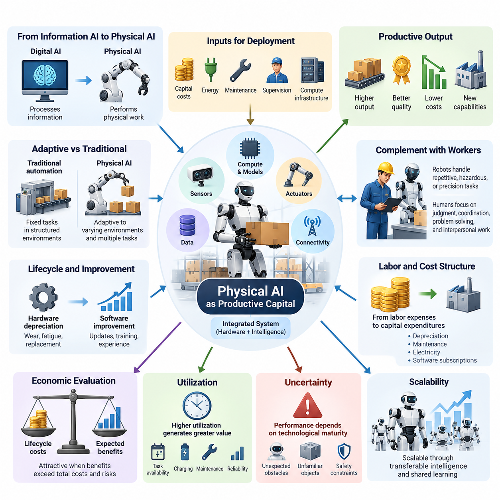{width="7.268055555555556in" height="7.268055555555556in"}

Physical AI represents an emerging form of productive capital that combines intelligent computation with the capacity to perform physical work. Unlike conventional digital AI, which primarily processes information, Physical AI can directly influence production through perception, decision-making, manipulation, and autonomous movement. Its economic significance arises from converting machine intelligence into measurable physical output across industries.

Traditional productive capital includes machinery, buildings, vehicles, and infrastructure that support the production of goods and services. Physical AI extends this definition by introducing adaptive capabilities into capital equipment. Intelligent robots can interpret changing environments, adjust operational strategies, and execute tasks without requiring every action to be explicitly programmed, potentially increasing the flexibility and economic usefulness of installed assets.

The distinction between conventional automation and Physical AI lies in the relationship between capital investment and operational adaptability. Traditional machines generally perform predetermined functions within structured environments. Physical AI systems can potentially handle variations in objects, workflows, and environmental conditions. This adaptability may allow a single robotic platform to support multiple production activities over its operational lifetime.

From an economic perspective, productive capital generates value by increasing output, improving quality, reducing operating costs, or enabling activities that would otherwise be impractical. Physical AI can contribute through each of these mechanisms. Autonomous mobile robots improve material transportation, robotic manipulators support flexible manufacturing, and intelligent inspection systems identify defects before they generate substantial downstream losses.

The productive capacity of Physical AI depends on more than the physical robot itself. Sensors, actuators, embedded processors, communication systems, software, learned models, and operational data collectively determine its capabilities. Consequently, the economic value of an intelligent robot emerges from an integrated capital system in which physical equipment and continuously evolving computational intelligence operate together.

An important characteristic of Physical AI capital is the separation between hardware depreciation and software improvement. Mechanical components experience wear, fatigue, and eventual replacement, while software models may improve through updates, additional training, and accumulated operational experience. This creates the possibility that certain robotic assets become more capable during their service lives, although hardware limitations and maintenance costs remain unavoidable.

The economic productivity of a robotic system can be evaluated through its contribution to output relative to the resources required for deployment and operation. Relevant inputs include acquisition costs, integration expenses, energy consumption, maintenance, supervision, and computational infrastructure. A robot becomes economically attractive when the discounted value of its expected benefits exceeds its total lifecycle costs and associated operational risks.

Capital productivity also depends strongly on utilization. A sophisticated robot operating only a few hours each day may generate less economic value than a simpler machine working continuously. Utilization is influenced by task availability, charging requirements, maintenance intervals, workflow coordination, and operational reliability. Effective deployment therefore requires aligning robotic capabilities with the production environment rather than maximizing technical performance alone.

Physical AI introduces a new relationship between capital intensity and labor requirements. In conventional production systems, increasing output often requires additional workers, equipment, or operating hours. Intelligent robotic capital may allow organizations to expand production with a smaller proportional increase in human labor. However, deployment also creates demand for engineering, maintenance, supervision, safety management, and system integration activities.

The relationship between robots and workers should not be interpreted exclusively as substitution. Physical AI can complement human labor by handling physically demanding, repetitive, hazardous, or precision-intensive tasks. Human workers may then concentrate on judgment, coordination, problem solving, and interpersonal responsibilities. The resulting productivity improvement depends on how effectively organizations redesign tasks and coordinate human and robotic capabilities.

At the enterprise level, Physical AI investment changes the structure of production costs. Some recurring labor expenses may be replaced by capital expenditures, depreciation, maintenance contracts, electricity, and software subscriptions. This transition increases the importance of financing conditions, asset utilization, and technological obsolescence. Organizations must evaluate whether the resulting cost structure remains advantageous under realistic production volumes.

Physical AI capital also introduces uncertainty because its economic performance depends on technological maturity. A robot that performs successfully in controlled demonstrations may encounter substantial difficulties in complex operational environments. Unexpected obstacles, unfamiliar objects, sensor degradation, and safety constraints can reduce effective productivity. Economic models must therefore distinguish theoretical task capacity from validated performance under representative working conditions.

The scalability of Physical AI capital is closely related to the transferability of learned intelligence. Conventional industrial equipment often requires substantial reconfiguration when production tasks change. Foundation models, world models, and generalist robotic policies may reduce the software adaptation required across similar tasks and platforms. Successful transfer could increase the economic return on both individual robots and shared intelligence infrastructure.

A particularly important development is the possibility of separating intelligence investment from individual physical assets. A company may train or license a shared robotic model and deploy it across numerous machines. In such architectures, the cost of developing intelligence can be distributed across a growing installed base. Nevertheless, physical deployment, validation, integration, and safety assurance continue to impose costs on each operating system.

The combination of shared intelligence and distributed robotic hardware creates potential economies of scale. As more robots adopt compatible software architectures, organizations may reduce duplicated development efforts and standardize maintenance procedures. Common perception models, navigation capabilities, and task policies can support multiple deployments. The magnitude of these benefits depends on interoperability, environmental similarity, and the reliability of software transfer.

Operational data represents another important contributor to productive capital formation. Robots generate information about physical environments, task execution, equipment behavior, and operational failures. When collected and governed appropriately, these observations can support model improvement and process optimization. The resulting learning feedback loop may increase the productivity of an entire robotic fleet rather than merely improving individual machines.

However, accumulated data does not automatically create economic value. Its usefulness depends on quality, representativeness, accessibility, and the ability to convert observations into improved decisions. Data processing, labeling, storage, training, and validation require additional investment. The economic value of robotic learning therefore depends on whether improvements in performance justify the costs of maintaining the associated data and computational infrastructure.

Physical AI may also influence the geographic organization of production. When automated systems reduce dependence on certain categories of labor, businesses may place greater emphasis on energy availability, infrastructure quality, logistics connectivity, and proximity to customers. Some production activities could become economically viable closer to consumption markets. Nevertheless, raw materials, specialized expertise, regulation, and supply-chain dependencies will continue to shape industrial location decisions.

At the macroeconomic level, Physical AI has the potential to contribute to capital deepening, where more productive equipment becomes available relative to the labor force. Capital deepening can increase output per worker when complementary infrastructure, skills, and organizational practices are available. Its effects on aggregate productivity will depend on adoption rates, sectoral coverage, resource constraints, and the efficiency with which intelligent capital is deployed.

Physical AI may also contribute to total factor productivity by improving how labor, capital, energy, and materials are combined. Adaptive robotic systems can potentially reduce downtime, optimize material flows, improve precision, and respond more effectively to operational uncertainty. Such improvements represent gains beyond simply adding more machines. Their economic importance depends on whether they produce sustained efficiency increases across real production systems.

The ownership of Physical AI capital introduces important distributional questions. Organizations controlling robotic fleets, proprietary models, computing infrastructure, and operational datasets may capture substantial portions of the resulting economic returns. Workers and consumers may benefit through higher productivity, improved services, or lower prices, but these outcomes are not automatic. Competition, bargaining institutions, ownership structures, and public policy influence how benefits are distributed.

Financing arrangements will strongly influence the diffusion of intelligent robotic capital. Large enterprises may purchase and integrate robotic systems directly, while smaller organizations may prefer leasing or Robot-as-a-Service arrangements. Subscription-based access can reduce initial investment barriers and transfer some technical responsibilities to service providers. However, long-term costs, contractual dependence, service reliability, and data ownership remain important economic considerations.

Physical AI investment must also account for risk-adjusted returns. Technological obsolescence, cybersecurity vulnerabilities, operational accidents, regulatory changes, and unexpected maintenance requirements can alter projected financial performance. Investment decisions should incorporate alternative deployment scenarios and sensitivity analysis. A system with lower theoretical productivity but stronger reliability and predictable operating costs may deliver superior economic results.

Energy and material constraints remain fundamental limitations on the expansion of Physical AI capital. Robots require electricity, batteries, motors, semiconductors, structural materials, and supporting infrastructure. Large-scale deployment could increase demand for certain resources even while improving efficiency in other activities. Consequently, the economic contribution of Physical AI should be evaluated using lifecycle resource requirements rather than operational labor savings alone.

Over longer horizons, increasingly capable Physical AI could change the relationship between intelligence, physical work, and capital accumulation. If intelligent machines become more versatile, reliable, and affordable, a wider range of physical tasks may become economically automatable. This could expand productive capacity across manufacturing, logistics, agriculture, construction, and services, although adoption will remain constrained by technical feasibility and institutional conditions.

Ultimately, Physical AI should be understood not merely as a replacement for existing machinery but as an evolving category of intelligent productive capital. Its distinctive economic potential comes from combining physical execution, adaptive decision-making, transferable learning, and scalable deployment. The transformation of this potential into sustained prosperity will depend on engineering reliability, economic efficiency, complementary human capabilities, and the institutions governing capital ownership and access.

## 02.02. Robot Cost Performance Curves

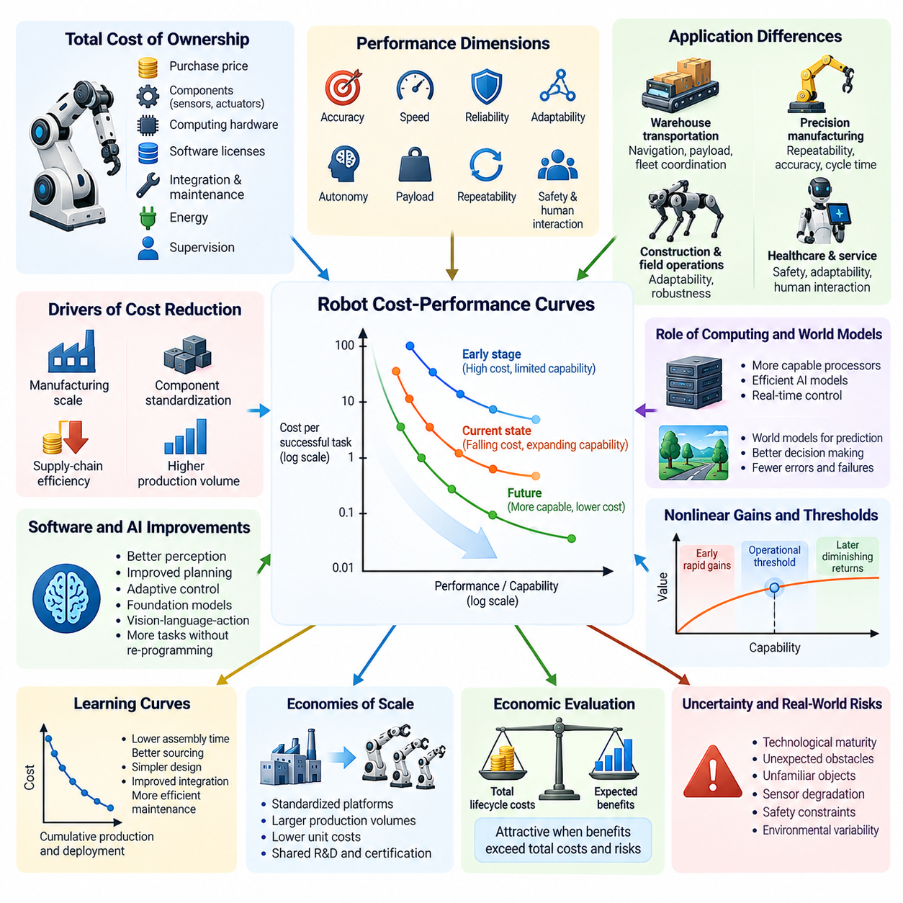{width="7.268055555555556in" height="7.268055555555556in"}

Robot cost-performance curves describe the relationship between the economic cost of robotic systems and their ability to perform useful physical tasks. These curves provide a framework for understanding how advances in hardware, artificial intelligence, manufacturing, and operational efficiency influence robotic productivity. Their importance lies in identifying when robotic capabilities become sufficiently affordable and reliable for widespread economic adoption.

The cost of a robotic system extends beyond its initial purchase price. Total ownership costs include mechanical components, sensors, actuators, computing hardware, software licenses, integration, maintenance, energy, and operational supervision. Performance must similarly be evaluated across multiple dimensions, including task accuracy, execution speed, reliability, adaptability, and autonomy. Meaningful comparisons require consistent definitions of both cost and useful output.

Traditional industrial robots have historically followed cost-performance improvements driven by manufacturing scale, component standardization, and advances in control technology. Their economic advantages are strongest in repetitive, structured environments where high utilization justifies substantial initial investment. Physical AI introduces additional improvement mechanisms by enabling robots to perform more variable tasks without requiring extensive task-specific programming or mechanical reconfiguration.

A useful cost-performance metric is the total cost per successfully completed task. This measure combines equipment costs, operating expenses, execution time, and task success probability into a single economic perspective. A robot with a lower purchase price may become more expensive if it frequently fails or requires human intervention. Conversely, a higher-cost robot may provide better economic performance through superior reliability and sustained productivity.

Robot performance curves are inherently multidimensional because different applications require different capabilities. Warehouse transportation emphasizes navigation reliability, payload capacity, and fleet coordination, while precision manufacturing prioritizes repeatability, positioning accuracy, and cycle time. Healthcare and service robotics place greater importance on safety, adaptability, and human interaction. Consequently, no universal performance measure can adequately represent every robotic application.

Hardware cost reductions arise from improvements in manufacturing processes, component integration, supply-chain efficiency, and production volume. Motors, gearboxes, sensors, batteries, and embedded processors may become less expensive as designs mature and production expands. However, cost declines are neither guaranteed nor uniform. Precision components, specialized materials, certification requirements, and low-volume manufacturing can preserve substantial cost barriers.

Computing performance is another important factor shaping robotic cost-performance curves. More capable processors and accelerators enable sophisticated perception, planning, and control algorithms to operate directly on robotic platforms. Improvements in computational efficiency can reduce the hardware required for a given intelligence capability. Nevertheless, thermal constraints, electrical power consumption, memory bandwidth, and real-time latency remain important limitations.

Software improvements can shift cost-performance curves even when robotic hardware remains unchanged. Better perception models may reduce recognition errors, improved planning algorithms may shorten task execution times, and adaptive control systems may increase operational robustness. Foundation models and vision-language-action architectures may also reduce engineering effort across related tasks, although their economic benefits depend on demonstrated reliability in physical environments.

World models contribute to robotic performance by representing environmental states, predicting physical interactions, and supporting action planning. When sufficiently accurate, these models can reduce unnecessary movements, anticipate failures, and improve decision quality. Their economic contribution is particularly relevant in complex environments where reactive control alone is insufficient. However, inaccurate predictions can introduce additional costs through inefficient or unsafe actions.

The relationship between cost and performance is often nonlinear. Early improvements may deliver substantial economic benefits by overcoming fundamental technical limitations, while later improvements may produce diminishing returns. For example, increasing task success from an unreliable level to an operationally acceptable threshold can dramatically improve productivity. Further improvements may remain valuable but require increasingly expensive engineering and validation efforts.

Learning curves provide another explanation for changing robotic economics. As manufacturers accumulate production experience, they may reduce assembly time, improve component sourcing, and eliminate unnecessary design complexity. Similarly, repeated deployment can improve integration procedures and maintenance practices. These effects can lower the cost of delivering comparable robotic capabilities, although the magnitude of improvement depends on production consistency and organizational learning.

Economies of scale can accelerate cost reductions when demand supports larger production volumes. Standardized robotic platforms allow manufacturers to distribute research, tooling, testing, and certification expenses across more units. Larger component orders may improve purchasing conditions and supply-chain stability. However, excessive customization can weaken these advantages by fragmenting production and increasing engineering complexity.

Robot cost-performance curves must also account for operational utilization. A robot with excellent technical specifications may provide poor economic value when deployed in workflows with limited task demand. Conversely, moderate-cost systems operating across multiple shifts may achieve attractive lifecycle economics. Utilization affects how fixed capital expenses are distributed across completed tasks, making scheduling efficiency and operational availability central economic variables.

Reliability creates a particularly important connection between technical performance and economic value. Unexpected failures can interrupt production, require maintenance personnel, damage materials, or create safety risks. Mean time between failures, repair duration, and system availability therefore influence effective cost-performance. A modest improvement in reliability can produce substantial economic benefits when interruptions affect tightly coordinated production systems.

The effective cost of robotic autonomy includes the human assistance required to maintain operations. Teleoperation, exception handling, supervision, and recovery procedures can substantially increase operating expenses. As autonomous capabilities improve, the frequency and duration of human interventions may decline. However, complete elimination of supervision is neither necessary nor always economically desirable, particularly in safety-critical environments.

Task complexity influences the shape of cost-performance curves. Simple transportation and repetitive manipulation tasks can often be automated using relatively specialized systems. Unstructured manipulation, deformable objects, dynamic environments, and long-horizon activities generally require more advanced perception and reasoning. The additional intelligence needed for complex tasks may increase computational, training, integration, and validation costs.

General-purpose robots introduce a tradeoff between flexibility and specialization. A specialized robot may deliver superior speed, precision, and cost efficiency within a narrow application. A general-purpose platform may perform multiple tasks with less physical reconfiguration, potentially improving utilization across changing workflows. Its economic competitiveness depends on whether flexibility compensates for additional hardware complexity and potentially lower task-specific performance.

Fleet-level deployment can alter cost-performance relationships by sharing infrastructure and intelligence across multiple robots. Centralized fleet management, coordinated scheduling, common maps, and shared software updates can improve aggregate productivity. Fleet learning may also distribute knowledge acquired from individual operational experiences. However, communication infrastructure, coordination complexity, and system-wide failure risks introduce additional economic considerations.

Simulation and synthetic data can influence robotic cost-performance by reducing dependence on expensive physical experimentation. Virtual environments enable repeated testing of perception, planning, and control policies across varied conditions. When simulation results transfer effectively to real systems, development costs and deployment preparation time may decrease. Nevertheless, simulation fidelity and real-world validation remain essential to achieving measurable economic improvements.

The economic adoption threshold occurs when a robotic solution becomes competitive with available alternatives for a specific task or workflow. This threshold depends on acquisition costs, labor expenses, productivity, safety requirements, financing conditions, and operational constraints. Different industries and geographic regions may therefore adopt identical robotic technologies at different rates, even when their underlying technical performance is comparable.

Cost-performance trajectories should be evaluated through scenarios rather than assuming continuous exponential improvement. Hardware prices may decline gradually, while software capabilities may advance through discontinuous breakthroughs. Supply shortages, regulatory changes, energy costs, and technical bottlenecks can interrupt expected progress. Scenario analysis helps distinguish plausible improvement pathways from overly optimistic projections.

Benchmarking provides a foundation for measuring changes in robotic cost-performance. Evaluations should use representative tasks, consistent environmental conditions, clearly defined success criteria, and transparent cost assumptions. Metrics such as successful tasks per operating hour, energy per task, intervention frequency, and lifecycle cost per output unit support meaningful comparisons. Laboratory performance alone is insufficient for estimating commercial productivity.

Over time, improvements in robot cost-performance may expand the range of economically automatable physical activities. Tasks previously considered too variable, expensive, or technically difficult may become feasible as intelligence improves and deployment costs decline. This expansion could increase demand for robotic systems across manufacturing, logistics, agriculture, construction, and services, while creating new requirements for infrastructure, maintenance, and workforce adaptation.

Ultimately, robot cost-performance curves provide a practical connection between technological progress and economic transformation. Their evolution depends on the combined effects of hardware affordability, intelligent software, operational reliability, learning efficiency, and deployment scale. Understanding these relationships is essential for evaluating robotic investment, forecasting adoption, and determining how Physical AI may reshape the productivity and cost structure of physical work.

## 02.03. AI Compute Data and Hardware Economics

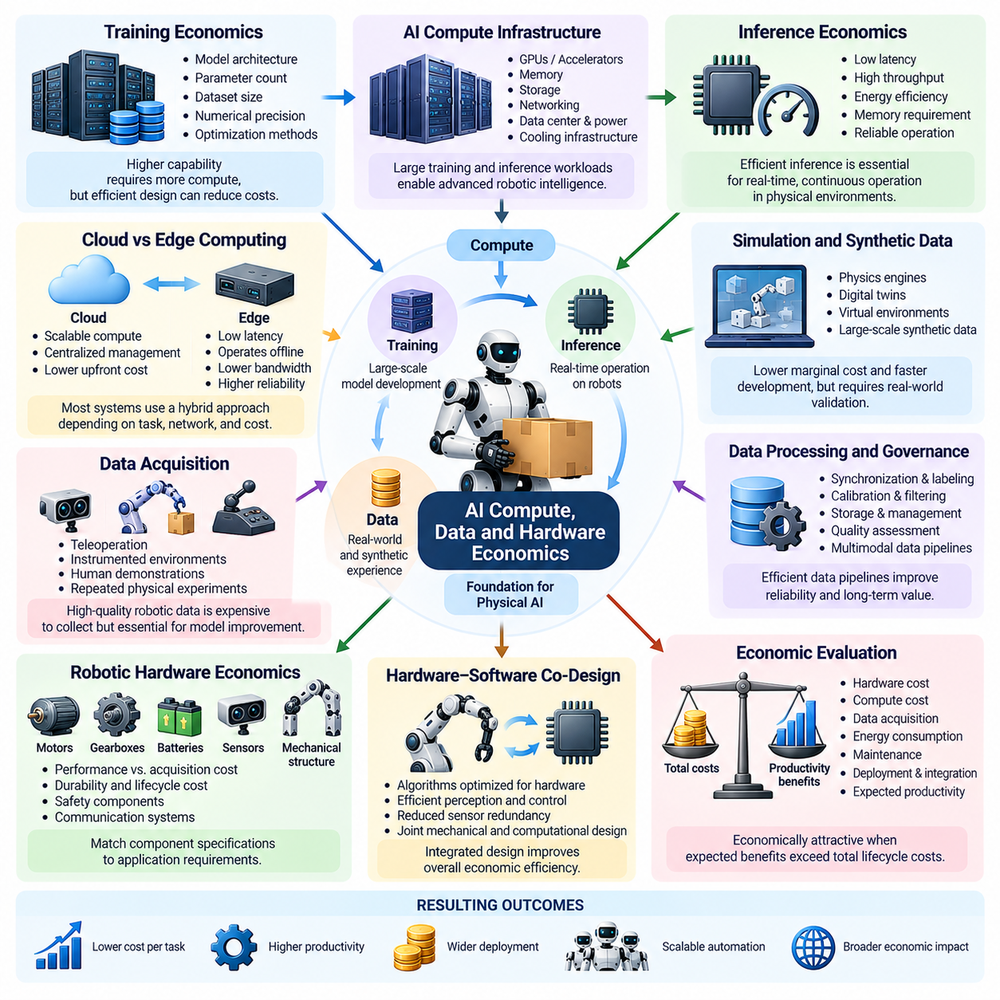{width="7.268055555555556in" height="7.268055555555556in"}

The economics of AI compute, data, and hardware form a fundamental foundation for the development and deployment of Physical AI. Unlike purely digital intelligence, Physical AI requires computational models to interact continuously with sensors, actuators, and physical environments. Its economic viability depends on balancing the costs of model training, inference, data acquisition, robotic hardware, and operational infrastructure against measurable improvements in physical productivity.

AI compute represents a major component of Physical AI investment because intelligent robots require substantial processing capabilities during both development and operation. Training advanced perception models, world models, and robotic foundation models often involves large computational workloads. These workloads require accelerators, memory, storage, networking, and supporting infrastructure. Their costs influence which organizations can develop sophisticated robotic intelligence independently.

Training economics depend on model architecture, parameter count, dataset size, numerical precision, and optimization efficiency. Larger models may offer broader capabilities, but their training requirements can increase substantially. Efficient architectures, distributed training, parameter sharing, and improved optimization methods can reduce computational expenses. The economically optimal model is therefore not necessarily the largest model, but the one delivering sufficient performance at an acceptable total cost.

Inference economics become particularly important when AI models operate continuously on physical machines. Robots must process sensor observations, estimate environmental states, generate actions, and respond to unexpected events within strict timing constraints. Computational delays can reduce productivity or compromise safety. Consequently, inference efficiency must be evaluated through latency, throughput, energy consumption, memory requirements, and reliability rather than processing speed alone.

The distinction between cloud computing and edge computing introduces an important economic tradeoff. Cloud infrastructure provides scalable processing resources and centralized model management, while edge processors support low-latency decisions and operation during communication disruptions. Physical AI systems frequently require both approaches. The optimal distribution of computation depends on task criticality, network reliability, energy constraints, privacy requirements, and infrastructure costs.

Edge AI hardware must satisfy demanding physical constraints. Embedded processors, GPUs, neural processing units, and specialized accelerators operate within limited power and thermal budgets. Increasing computational capability may improve perception and reasoning but also increase battery consumption, cooling requirements, and equipment costs. Hardware selection therefore requires balancing intelligence performance against mobility, endurance, reliability, and lifecycle economics.

Data acquisition constitutes another major economic component of Physical AI development. High-quality robotic datasets may require teleoperation, instrumented environments, synchronized sensors, human demonstrations, and repeated physical experiments. Unlike internet-scale text datasets, physical interaction data often involves expensive equipment and operational supervision. The cost of collecting useful experience can therefore become a significant limitation on model development.

The economic value of robotic data depends on its diversity, accuracy, relevance, and contribution to model improvement. Repeated observations from nearly identical conditions may provide diminishing learning benefits, while rare failures and unfamiliar environments may contain valuable information. Data selection strategies should prioritize experiences that improve generalization and operational reliability. The objective is to maximize learning value rather than simply accumulate the largest possible dataset.

Simulation and synthetic data provide alternative methods for expanding training resources. Physics engines, digital twins, and virtual environments can generate large quantities of interaction data without requiring equivalent physical experiments. These approaches may reduce marginal data-generation costs and accelerate development. However, simulation infrastructure, environment construction, computational resources, and real-world validation introduce expenses that must be included in economic evaluations.

Data processing and governance also influence overall development costs. Raw sensor streams require synchronization, calibration, filtering, labeling, storage, and quality assessment before they become reliable training resources. Multimodal datasets combining images, depth measurements, force signals, and robot actions can be especially demanding. Efficient data pipelines reduce redundant processing while improving reproducibility, traceability, and long-term dataset value.

Hardware economics extend beyond processors to the complete robotic embodiment. Motors, gearboxes, batteries, sensors, mechanical structures, safety components, and communication systems determine both manufacturing costs and operational capabilities. High-performance components may improve precision, payload capacity, and durability but increase acquisition expenses. Economically effective robot design requires matching component specifications to actual application requirements.

Hardware-software co-design provides a mechanism for improving system-level economic efficiency. Algorithms can be optimized for available processors, while mechanical and electronic architectures can be selected to support computational requirements. For example, efficient perception may reduce sensor redundancy, and predictive control may improve actuator utilization. These interactions demonstrate why optimizing individual components independently does not necessarily minimize total system cost.

The relationship between compute investment and robotic performance is not always proportional. Additional computational resources may improve model accuracy, planning quality, or adaptability, but improvements can diminish beyond certain operating thresholds. A robot performing repetitive transportation may require less intelligence than one manipulating unfamiliar objects. Economic optimization therefore requires identifying the minimum computational capability necessary to achieve acceptable task performance.

Model compression and efficient inference techniques can significantly influence deployment economics. Quantization, pruning, distillation, and optimized execution engines may reduce memory requirements, energy consumption, and processor costs. However, aggressive optimization can degrade accuracy or robustness, particularly under unfamiliar environmental conditions. Deployment decisions must therefore consider the relationship between computational savings and the potential economic consequences of reduced reliability.

The lifecycle economics of AI models differ from those of physical hardware. Training may require substantial initial expenditure, while inference costs accumulate throughout deployment. A model deployed across thousands of robots can distribute development expenses across a large installed base. However, software updates, validation, cybersecurity maintenance, and adaptation to changing environments continue to generate recurring costs that must be incorporated into long-term financial planning.

Fleet-scale deployment creates opportunities for sharing computational and data infrastructure. Multiple robots may use common foundation models, mapping systems, learning pipelines, and cloud services. Centralized training can incorporate experiences collected across different operational environments. Such arrangements may improve economies of scale, although communication expenses, data transfer requirements, system integration, and infrastructure reliability introduce additional operational complexity.

Learning efficiency becomes a critical economic variable when robotic systems improve through accumulated experience. A model that achieves reliable performance using fewer demonstrations or training iterations can substantially reduce development expenses. Transfer learning, self-supervised learning, and reusable world representations may improve data efficiency. Their economic significance depends on whether knowledge acquired in one environment can be transferred effectively to other tasks and robotic embodiments.

Energy consumption connects AI computing economics with broader operational and environmental considerations. Large-scale training facilities require substantial electrical power and cooling infrastructure, while deployed robots consume energy for both computation and physical movement. Improvements in processor efficiency, battery technology, and motion planning can reduce operating costs. Nevertheless, energy requirements must be evaluated across the complete system rather than considering AI inference independently.

Supply-chain conditions strongly influence the economics of Physical AI hardware. Semiconductor availability, specialized actuator production, battery materials, and precision manufacturing capabilities affect component pricing and delivery schedules. Geographic concentration of suppliers may introduce procurement risks and strategic dependencies. Organizations developing robotic platforms must therefore consider supplier diversity, component standardization, and long-term availability when evaluating capital investments.

The distribution of costs between model developers, robot manufacturers, and system operators shapes emerging Physical AI business models. Some organizations may develop proprietary intelligence and hardware, while others integrate licensed models with standardized robotic platforms. Cloud subscriptions, software licensing, hardware sales, and managed robotic services distribute investment requirements differently. Each arrangement creates distinct incentives regarding interoperability, upgrades, and ownership of operational data.

Economic competitiveness ultimately depends on the relationship between total system expenditure and productive output. A low-cost processor or inexpensive dataset does not necessarily create an economical robotic solution if task reliability remains inadequate. Conversely, substantial investment in compute and data may be justified when it enables higher utilization, lower intervention rates, and improved operational performance. System-level evaluation is therefore essential for rational investment decisions.

Future developments may alter the relative importance of compute, data, and hardware costs. More efficient learning algorithms could reduce training requirements, while increasingly capable foundation models may distribute intelligence development expenses across many applications. Advances in semiconductor integration and robotic manufacturing could further improve affordability. However, physical constraints, validation requirements, and operational uncertainty will continue to influence economic feasibility.

Ultimately, AI compute, data, and hardware should be understood as interconnected forms of productive investment rather than independent technical resources. Their combined economic value emerges when computational intelligence can be translated into reliable physical action at sustainable cost. The long-term expansion of Physical AI will depend on reducing the cost of acquiring intelligence, improving the efficiency of deploying it, and converting technological capabilities into measurable economic productivity.

## 02.04. Robot Labor Cost vs Human Labor Cost

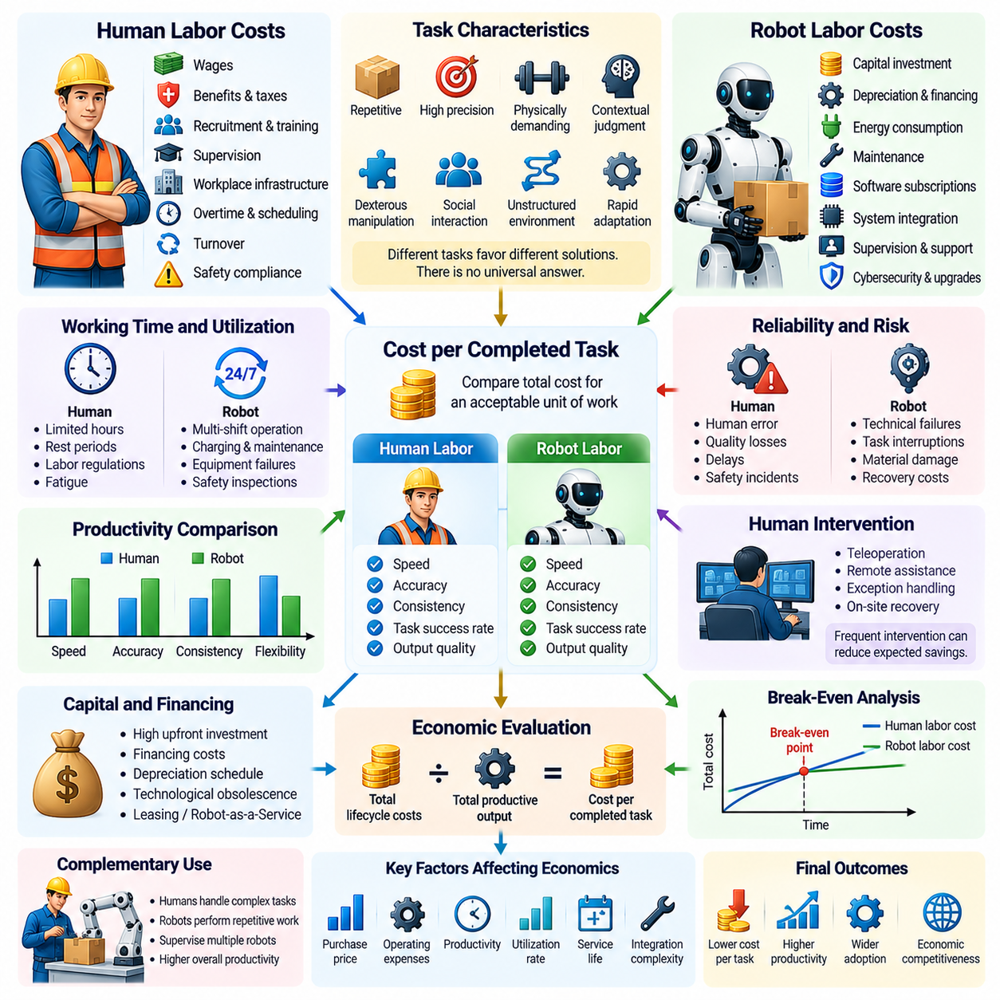{width="7.268055555555556in" height="7.268055555555556in"}

The comparison between robot labor cost and human labor cost is a fundamental economic consideration in Physical AI adoption. Robots and human workers differ in acquisition requirements, operating expenses, productivity, flexibility, and risk exposure. A meaningful comparison must therefore extend beyond hourly wages or equipment prices and examine the total cost of producing equivalent quantities of acceptable work under realistic operational conditions.

Human labor costs include direct wages, employer contributions, benefits, recruitment, training, supervision, and workplace infrastructure. Additional expenses may arise from overtime, employee turnover, safety compliance, and workforce scheduling. These costs vary substantially across industries, regions, and skill categories. Consequently, the economic attractiveness of robotic automation depends partly on local labor markets and institutional conditions.

Robot labor costs involve capital investment, financing, depreciation, energy, maintenance, software subscriptions, and system integration. Autonomous systems may also require remote supervision, exception handling, cybersecurity management, and periodic upgrades. Although robots do not receive wages, their operation is never entirely free of recurring expenses. Economic comparisons must include the complete lifecycle cost of maintaining productive robotic capacity.

A useful analytical approach compares the cost per successfully completed unit of work rather than the nominal hourly cost of a worker or robot. Human and robotic productivity may differ in speed, accuracy, consistency, and task completion rates. A robot operating at a lower hourly cost may still be economically inferior if it performs fewer useful tasks or requires frequent intervention. Equivalent output quality is essential for valid comparisons.

The effective hourly cost of robotic labor can be estimated by distributing annualized capital and operating expenses across productive operating hours. This approach accounts for equipment depreciation, financing, maintenance, electricity, software, and supervision. However, scheduled operating hours should not be confused with productive hours. Downtime, charging, calibration, and task interruptions reduce the actual output generated by robotic capital.

Human workers and robots also differ in their available working time. Robots may operate across multiple shifts without conventional rest periods, potentially spreading fixed costs over more productive hours. Nevertheless, charging, preventive maintenance, equipment failures, and safety inspections limit continuous operation. Human labor availability is shaped by working schedules, employment regulations, fatigue management, and organizational staffing requirements.

Productivity comparisons must consider the nature of the task. Industrial robots may outperform humans in repetitive, high-precision, or physically demanding operations, particularly within structured environments. Humans often retain advantages in unfamiliar situations requiring contextual judgment, dexterous manipulation, social understanding, and rapid adaptation. The economically preferred solution depends on the specific distribution of tasks rather than generalized assumptions about intelligence.

Reliability has a direct influence on comparative labor economics. Robotic failures can interrupt production, damage materials, and require specialized technical assistance. Human errors can also create quality losses, delays, or safety incidents. Both alternatives should therefore be evaluated using expected task success, recovery costs, and operational availability. Comparing ideal robot performance against average human performance can produce misleading investment conclusions.

Human intervention represents an important hidden cost of robotic autonomy. Teleoperation, remote assistance, exception handling, and on-site recovery may be required when robots encounter unfamiliar conditions. If one supervisor manages several robots effectively, these costs can be distributed across the fleet. However, frequent interventions may eliminate anticipated savings, particularly when specialized personnel must remain continuously available.

Capital expenditure creates another distinction between robotic and human labor. Purchasing robots generally requires substantial upfront investment, whereas employment expenses are distributed over time. Financing costs, interest rates, depreciation schedules, and technological obsolescence influence the economic burden of robotic ownership. Leasing and Robot-as-a-Service arrangements can reduce initial expenditure but introduce contractual payments and long-term service dependencies.

The economic break-even point occurs when the discounted costs of robotic deployment become comparable to the costs of performing equivalent work through human labor. This threshold depends on purchase price, operating expenses, productivity, utilization, and expected service life. Higher labor costs or greater robotic utilization may accelerate break-even, while integration difficulties and maintenance expenses may delay it.

Task utilization is especially important because robotic capital generates economic returns only when deployed productively. A robot purchased for occasional tasks may have a high cost per completed operation despite low energy consumption. Conversely, a machine performing several compatible tasks throughout the day may achieve favorable economics. Flexible task allocation and effective scheduling can therefore be as important as reducing hardware prices.

The comparison also changes when robots complement rather than replace workers. Human-robot collaboration may allow employees to supervise automated processes, perform complex exceptions, and concentrate on higher-value activities. In such arrangements, the relevant economic question is whether the combined system produces more valuable output per unit of total labor and capital expenditure than the original workflow.

Labor shortages can strengthen the economic case for robotics even when direct cost savings are limited. Manufacturing, agriculture, logistics, and caregiving may face difficulties recruiting workers for demanding or repetitive activities. Robots can potentially stabilize production capacity and reduce dependence on scarce labor. However, technical limitations, infrastructure requirements, and the availability of maintenance specialists can constrain their effectiveness.

Safety and working conditions introduce additional economic dimensions. Robots may reduce human exposure to hazardous chemicals, extreme temperatures, heavy lifting, and dangerous machinery. These benefits can lower certain injury-related costs while improving working conditions. Nevertheless, robotic deployment introduces machinery hazards, software failures, and cybersecurity risks that require appropriate engineering controls and safety management.

Quality consistency can significantly affect the relative cost of human and robotic labor. Robots may maintain repeatable motion and inspection procedures under controlled conditions, reducing variability and rework. Humans may provide superior adaptive judgment when products or environments change unexpectedly. The economic value of each approach depends on defect rates, inspection requirements, material losses, and the cost of correcting unsuccessful operations.

Robotic labor economics are also influenced by technological learning. Software updates, improved perception models, and better planning algorithms may increase the productivity of existing hardware. Fleet learning can distribute improvements across multiple robots, potentially reducing intervention requirements. However, model retraining, testing, validation, and software maintenance create additional expenses that must be included in long-term comparisons.

The cost of human labor evolves through wage growth, productivity improvements, education, and institutional changes. Robotic costs evolve through manufacturing scale, component pricing, computational efficiency, and technological maturity. These trajectories do not necessarily move at constant rates. Long-term investment models should therefore consider multiple scenarios rather than assuming that robot costs will continuously decline while human labor costs rise.

Regional economic conditions can produce different automation decisions for identical tasks. High wages, limited labor availability, and expensive night shifts may favor robotic deployment. Lower wages, uncertain demand, or limited technical infrastructure may favor human-centered operations. Exchange rates, import duties, electricity prices, and financing conditions further influence the comparative economics of robotic and human labor.

General-purpose robots may eventually change the economics of task allocation by performing several activities using shared hardware. Their flexibility could increase utilization and reduce the need for specialized machines. However, generalized capabilities may involve higher acquisition costs, lower task-specific efficiency, and additional validation requirements. Their economic competitiveness must be demonstrated through sustained operational performance.

The broader economic consequences extend beyond individual enterprise decisions. Increasing robotic adoption may raise productivity, change occupational demand, and alter the distribution of income between labor and capital. Lower production costs could benefit consumers, while displaced workers may face adjustment challenges. The eventual distribution of economic gains depends on ownership structures, competition, education, labor institutions, and public policy.

A rigorous comparison should incorporate uncertainty through sensitivity analysis and realistic deployment scenarios. Important variables include robot acquisition costs, productive utilization, task success rates, maintenance expenses, human intervention frequency, wage levels, and financing conditions. Evaluating optimistic, baseline, and adverse cases helps identify whether projected savings remain credible when operating conditions differ from initial assumptions.

Ultimately, robot labor cost and human labor cost should be compared as alternative or complementary methods of producing valuable physical outcomes. The decisive measure is not whether machines are universally cheaper than people, but whether a particular combination of human capabilities and robotic capital improves productivity, reliability, safety, and economic sustainability. Physical AI becomes economically transformative when these improvements can be achieved consistently across diverse real-world environments.

## 02.05. Capital Expenditure vs Robot as a Service

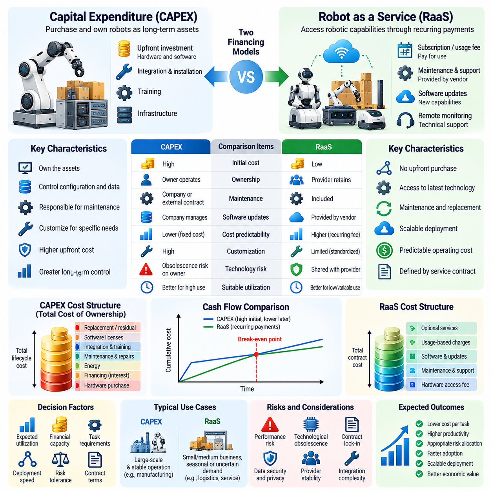{width="7.268055555555556in" height="7.268055555555556in"}

Capital expenditure and Robot-as-a-Service represent two distinct financing and ownership approaches for deploying Physical AI systems. Capital expenditure involves purchasing robotic assets and assuming responsibility for their operation, while Robot-as-a-Service provides access through recurring contractual payments. The choice influences financial flexibility, technological risk, operational responsibility, and the speed at which organizations can adopt intelligent automation.

Under the capital expenditure model, an organization acquires robots as long-term productive assets. Initial investment typically includes hardware, software integration, installation, training, and supporting infrastructure. Ownership provides greater control over equipment configuration, operational data, and maintenance strategies. However, substantial upfront spending can constrain available capital and increase exposure to technological obsolescence.

Robot-as-a-Service, commonly abbreviated as RaaS, changes the financial relationship between robotic technology providers and customers. Instead of purchasing equipment outright, customers pay subscription, usage-based, or performance-linked fees for robotic capabilities. Service providers may retain ownership of the hardware and assume responsibility for maintenance, software updates, and technical support. Contractual arrangements determine the actual allocation of responsibilities.

The economic distinction between these approaches extends beyond converting capital expenditure into operating expenditure. Purchasing equipment creates an owned asset with depreciation and potential residual value, whereas service contracts establish continuing payment obligations. Accounting treatment depends on contractual substance and applicable standards, and some service arrangements may create recognized assets or liabilities. Financial comparisons must therefore consider both cash flows and accounting consequences.

Upfront investment requirements strongly influence adoption decisions. Capital purchases may require significant financing before operational benefits become available. This creates barriers for smaller organizations or businesses with uncertain demand. RaaS can reduce initial cash requirements and allow gradual deployment. Nevertheless, recurring payments may produce higher cumulative expenditure over long operating periods, particularly when utilization remains consistently high.

Total cost of ownership provides a useful framework for evaluating capital purchases. Relevant expenses include acquisition, financing, depreciation, maintenance, energy, insurance, integration, software licensing, and eventual replacement. Residual asset value and potential redeployment should also be considered. The economic attractiveness of ownership depends on whether these lifecycle costs remain below the value generated through productive robotic operation.

RaaS economics require evaluating total contractual cost rather than subscription prices alone. Monthly fees may include hardware access, maintenance, software, monitoring, and replacement services. Additional charges can arise from installation, customization, usage limits, emergency support, or contract termination. Service-level agreements define performance commitments and remedies. Transparent contract analysis is essential for comparing providers and determining effective cost per completed task.

Utilization is a critical variable in determining which financing model is economically preferable. Organizations operating robots continuously may benefit from ownership because fixed acquisition costs can be distributed across many productive hours. Businesses experiencing seasonal demand or uncertain workloads may prefer flexible service arrangements. However, minimum contractual commitments can reduce the flexibility that RaaS is intended to provide.

Technological obsolescence introduces another important distinction. Physical AI capabilities may improve through advances in sensors, actuators, processors, foundation models, and autonomous control. Organizations purchasing equipment risk owning platforms that become less competitive before the end of their expected service lives. RaaS agreements may transfer some upgrade responsibilities to providers, although access to newer technology depends on explicit contractual provisions.

Maintenance responsibility significantly affects operational economics. Under direct ownership, organizations may establish internal technical teams or purchase external maintenance contracts. RaaS providers may offer preventive maintenance, remote diagnostics, spare parts, and equipment replacement. Such arrangements can improve cost predictability, but their effectiveness depends on response times, service coverage, equipment availability, and the provider\'s financial stability.

Performance risk should be evaluated separately from ownership risk. A robot may fail to achieve expected productivity because of environmental complexity, software limitations, workflow incompatibility, or excessive human intervention. Purchasing transfers much of this risk to the operator, while performance-based RaaS contracts may allocate portions to the provider. However, contractual performance guarantees must specify measurable outcomes and clearly defined operating conditions.

The pricing structure of RaaS can align payments with delivered economic value. Usage-based contracts may charge per operating hour, completed delivery, transported pallet, or inspected item. Performance-linked pricing can encourage providers to improve reliability and productivity. Nevertheless, disagreements may arise over task definitions, unsuccessful operations, environmental interruptions, and responsibilities for production delays.

Financial evaluation should compare the net present value of expected cash flows under both models. Capital purchases involve substantial initial outflows followed by recurring operating costs and possible residual value. RaaS involves recurring contractual payments that may change with utilization or service requirements. Discount rates, inflation, financing conditions, contract duration, and tax treatment influence which arrangement produces lower economic cost.

Risk-adjusted comparisons are particularly important when deploying emerging Physical AI technologies. Technical uncertainty, changing regulations, cybersecurity requirements, and limited operational experience can make long-term forecasts unreliable. Flexible service contracts may preserve the ability to modify deployment strategies. Conversely, ownership may provide stronger control over customization and operational continuity when service providers change their commercial terms.

Data ownership and intellectual property introduce strategic considerations beyond immediate financial costs. Robots generate operational information about environments, workflows, equipment performance, and task execution. Ownership of hardware does not automatically establish unrestricted rights to software or collected data. RaaS agreements should clarify data access, permitted uses, model training rights, retention policies, cybersecurity responsibilities, and procedures for transferring information when contracts end.

System integration costs can differ substantially between the two approaches. Purchased robots may require internal engineering resources for integration with warehouse management systems, manufacturing execution systems, and enterprise software. RaaS providers may supply standardized integration packages and managed deployment services. However, complex customization can increase recurring fees or create dependence on proprietary interfaces and specialized technical support.

Scalability represents a major potential advantage of service-based deployment. Organizations may begin with a limited number of robots, evaluate operational performance, and expand capacity as demand increases. This approach can reduce uncertainty during early adoption. Yet rapid scaling requires providers to maintain sufficient hardware inventory, technical personnel, financing capacity, and reliable supply chains.

Ownership may become more attractive when robotic platforms support multiple applications over long periods. A company controlling its equipment can potentially redeploy robots between facilities, modify software, and optimize scheduling without renegotiating service agreements. Such flexibility can increase asset utilization and residual economic value. However, successful redeployment still requires compatible environments, appropriate technical capabilities, and additional validation.

RaaS providers face economic challenges that differ from those of customers. They must finance robotic assets, manage depreciation, maintain service networks, and recover investment through contractual revenue. Their profitability depends on utilization, customer retention, maintenance efficiency, financing costs, and asset longevity. Poorly structured pricing or unexpected failure rates can undermine the sustainability of the service model.

Fleet-scale operations may strengthen both financing approaches through shared infrastructure and centralized management. Common mapping systems, software updates, remote monitoring, and fleet learning can reduce operating costs across multiple robots. Under ownership, these benefits accrue primarily to the operator. Under RaaS, providers may distribute development and maintenance expenses across multiple customers, potentially improving service affordability.

Hybrid financing arrangements may combine elements of capital ownership and managed services. Organizations might purchase robotic hardware while subscribing to intelligence software, cloud infrastructure, maintenance, or fleet management. Other contracts may provide purchase options after an initial service period. These structures allow businesses to allocate financial and technical responsibilities according to their capabilities, risk preferences, and operational requirements.

The long-term economic choice depends on more than identifying the lowest nominal payment. Organizations must consider lifecycle productivity, contractual flexibility, technological evolution, operational reliability, data governance, and strategic control. Ownership may be preferable for stable, high-utilization applications with strong internal engineering capabilities, while RaaS may offer advantages when demand is uncertain or technical support requirements are substantial.

Ultimately, capital expenditure and Robot-as-a-Service represent alternative mechanisms for converting Physical AI technology into productive economic capacity. Neither approach is universally superior. Their relative value depends on financing conditions, utilization, technological uncertainty, provider capabilities, and organizational strategy. Effective evaluation requires connecting financial structures to measurable robotic performance and the long-term economics of physical automation.

## 02.06. Utilization Uptime and Fleet Economics

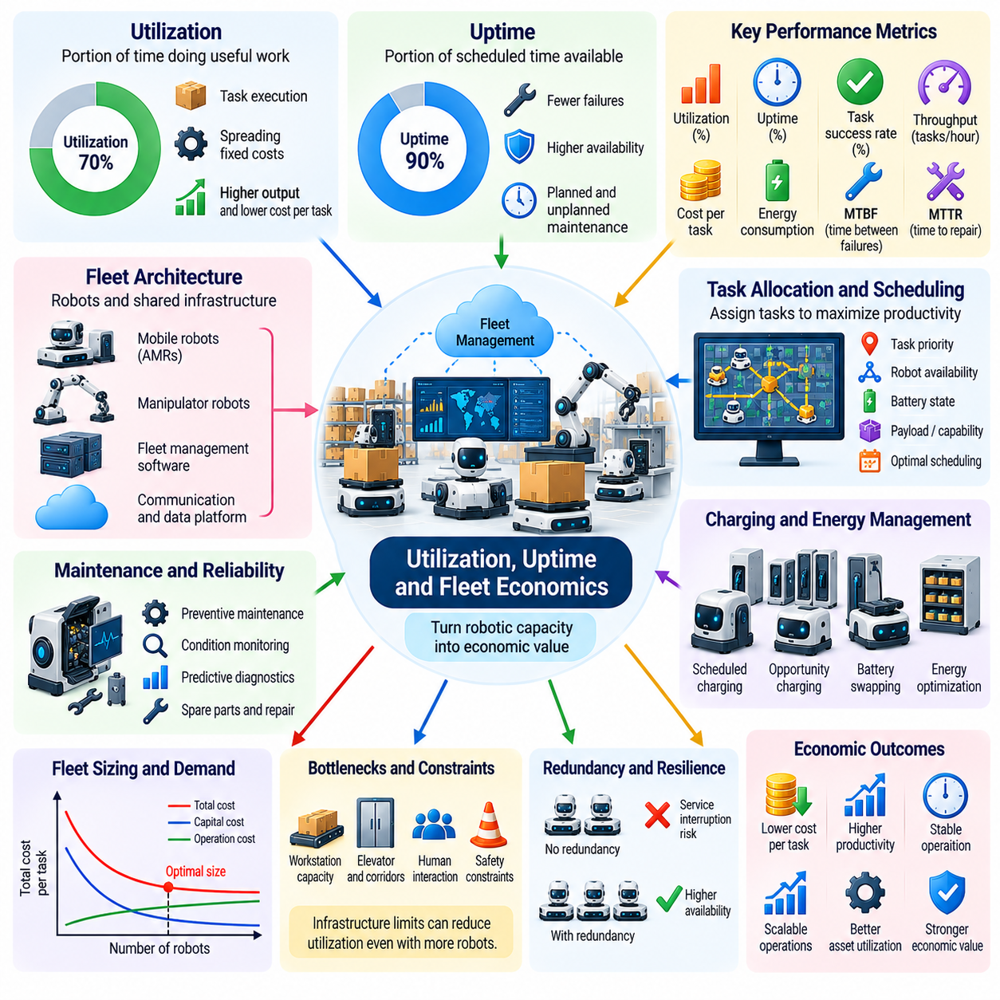{width="7.268055555555556in" height="7.268055555555556in"}

Utilization, uptime, and fleet economics are fundamental determinants of whether Physical AI systems generate sustainable economic value. A robot may possess advanced perception, reasoning, and control capabilities, yet remain economically inefficient if it spends substantial time idle or unavailable. The profitability of robotic deployment therefore depends not only on technical performance but also on how effectively installed robotic capacity is converted into productive physical work.

Utilization measures the proportion of available operating time during which a robot performs economically useful activities. A robot may be technically operational but remain idle because of insufficient demand, poor scheduling, or workflow interruptions. High utilization spreads fixed investment costs across more completed tasks. However, utilization must be evaluated alongside task quality, energy consumption, maintenance requirements, and operational flexibility.

Uptime represents the proportion of scheduled operating time during which a robotic system remains available for productive operation. Equipment failures, software faults, communication disruptions, and maintenance activities can reduce uptime. Although uptime and utilization are related, they measure different aspects of performance. A robot can achieve high availability while generating limited output if its productive workload remains insufficient.

The economic distinction between availability and productivity becomes important when calculating the effective cost of robotic work. Capital expenses continue to accumulate even when robots are inactive, while software subscriptions, infrastructure, and support services may generate recurring charges. As productive operating hours decrease, the effective cost per completed task rises. Accurate economic models must therefore distinguish scheduled time, available time, active time, and successful task completion.

Fleet economics extends these principles from individual robots to coordinated groups of autonomous machines. A fleet may share charging stations, maintenance personnel, computing infrastructure, mapping systems, and operational management software. Shared resources can reduce average operating costs, but coordination failures may create congestion and idle time. Economic efficiency depends on balancing fleet capacity with actual demand and supporting infrastructure.

Fleet sizing is a critical optimization problem because insufficient capacity creates delays while excessive capacity increases capital costs. Demand may fluctuate across shifts, production cycles, seasons, and operating locations. Determining the appropriate number of robots requires estimating workload distributions, task durations, travel distances, and operational uncertainty. Effective fleet planning must consider both average demand and peak service requirements.

Task allocation strongly influences robotic utilization. Fleet management systems assign missions according to robot availability, location, battery state, payload capacity, and task priority. Poor allocation may cause unnecessary travel, repeated waiting, or uneven equipment usage. Intelligent scheduling can reduce unproductive movement and distribute workloads more effectively, improving output without necessarily increasing the number of deployed robots.

Charging strategies introduce an additional constraint on fleet productivity. Battery-powered robots must periodically interrupt operations to restore energy, and simultaneous charging demand can overwhelm shared infrastructure. Opportunity charging, battery swapping, and predictive energy management may improve availability. However, charging equipment, electrical capacity, battery degradation, and maintenance costs must be included when assessing the economic benefits of alternative strategies.

Reliability engineering plays a central role in maintaining economically useful uptime. Preventive maintenance, condition monitoring, predictive diagnostics, and systematic failure analysis can reduce unexpected interruptions. Sensors and operational logs may identify deterioration before critical components fail. Nevertheless, maintenance itself consumes resources and scheduled operating time, requiring optimization between preventive intervention and the risk of unplanned downtime.

Mean time between failures and mean time to repair provide useful indicators of fleet reliability. Longer intervals between failures generally support greater availability, while faster repair processes reduce operational disruption. These indicators must be interpreted alongside failure severity, spare-parts availability, and recovery complexity. A robot with infrequent but prolonged failures may impose greater economic losses than one experiencing minor interruptions that can be resolved quickly.

Operational bottlenecks can prevent high fleet utilization even when individual robots perform reliably. Narrow corridors, loading stations, elevators, shared workspaces, and human-operated equipment may limit system throughput. Adding more robots can increase congestion rather than productivity when infrastructure capacity is constrained. Fleet economics therefore requires analyzing the complete workflow instead of assuming that output increases proportionally with fleet size.

The relationship between fleet size and economic efficiency often exhibits nonlinear behavior. Small fleets may suffer from limited redundancy and high fixed management costs, while larger fleets can distribute infrastructure expenses across more machines. Beyond certain thresholds, congestion, coordination overhead, and maintenance complexity may reduce marginal benefits. Identifying economically efficient fleet scale requires simulation, operational measurement, and sensitivity analysis.

Redundancy improves service continuity but creates a tradeoff between resilience and utilization. Spare robots can replace unavailable machines during maintenance or unexpected failures, protecting production schedules. However, unused reserve capacity increases capital expenditure and may reduce average utilization. The economically appropriate redundancy level depends on the cost of interrupted operations, service commitments, failure probabilities, and recovery times.

Fleet management software provides a mechanism for coordinating operational efficiency across multiple robots. Centralized systems can monitor assignments, traffic conditions, battery levels, equipment health, and task completion. Decentralized coordination may improve responsiveness and reduce dependence on a single controller. The preferred architecture depends on fleet scale, communication reliability, safety requirements, and the economic consequences of system-wide failures.

Data collected from fleet operations can improve both technical performance and economic decision-making. Task execution logs, failure events, charging histories, and environmental observations reveal recurring inefficiencies. Analytical models can identify underutilized equipment, inefficient routes, and maintenance patterns. These insights support continuous improvement, provided that data collection and processing costs remain justified by measurable operational benefits.

Fleet learning introduces the possibility of distributing improvements across deployed robots. Experiences from one machine may help others recognize obstacles, optimize navigation, or handle recurring exceptions. Shared models can reduce repeated failures and improve task completion rates. However, transferring learned behavior requires validation because differences in hardware, environments, and operating conditions may limit the reliability of shared improvements.

Human supervision remains an important component of fleet economics. Operators may oversee multiple robots, respond to exceptions, and coordinate recovery procedures. The number of robots supported per supervisor depends on autonomy, task complexity, communication quality, and intervention frequency. Increasing this ratio can improve labor productivity, but excessive supervisory workload may increase response delays and reduce operational safety.

Service-level agreements and production requirements influence the optimal balance between utilization and spare capacity. Operations requiring immediate response or continuous material flow may need additional robots to maintain service quality during demand peaks. Less time-sensitive applications can tolerate longer queues and operate with fewer machines. Economic optimization must therefore consider delivery deadlines, customer expectations, and penalties associated with missed performance targets.

The cost per successful task provides a practical measure for evaluating fleet performance. This metric combines capital recovery, operating expenditure, productive throughput, and task success rates. It allows comparisons between alternative fleet sizes, scheduling policies, and equipment configurations. However, differences in task complexity and service quality must be normalized to prevent misleading conclusions about relative economic efficiency.

Digital twins and discrete-event simulation can support fleet investment decisions before physical deployment. Virtual environments can represent task arrivals, robot movements, charging behavior, equipment failures, and infrastructure constraints. Scenario analysis helps estimate congestion, utilization, and throughput under alternative operating conditions. Simulation results nevertheless require calibration against real-world measurements to support credible economic forecasts.

Fleet economics also changes as robots become more adaptable and capable of performing multiple tasks. General-purpose systems may shift between transportation, inspection, manipulation, and other activities according to demand. Such flexibility can reduce idle time and improve capital productivity. However, task switching, equipment reconfiguration, safety validation, and differences in task-specific performance may introduce additional costs.

Ultimately, utilization, uptime, and fleet economics connect robotic intelligence with measurable financial performance. High technical capability does not automatically guarantee economic efficiency, and maximizing utilization alone may undermine reliability or service quality. Sustainable Physical AI deployment requires coordinated optimization of availability, workload allocation, maintenance, energy management, and infrastructure. The central objective is to maximize valuable completed work over the full lifecycle of the robotic fleet.

## 02.07. Economies of Scale in Robot Production

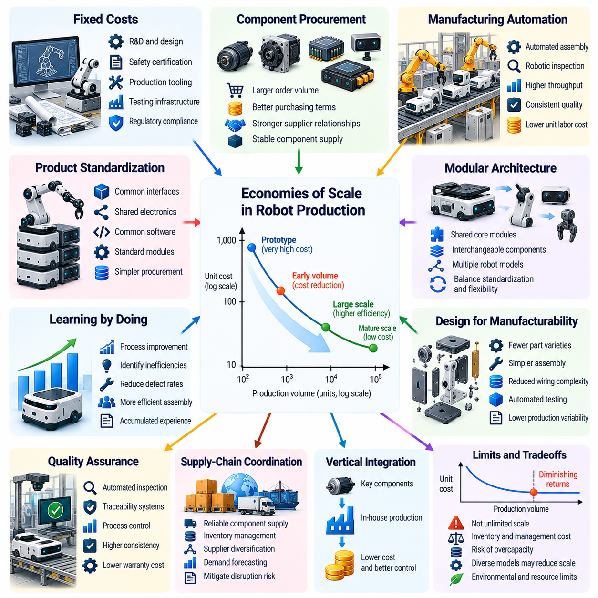{width="7.268055555555556in" height="7.268055555555556in"}

Economies of scale in robot production describe how increasing manufacturing volume can reduce the average cost of producing Physical AI systems. As production expands, fixed engineering expenses, factory investments, tooling, and administrative costs can be distributed across more units. This process can improve affordability and accelerate adoption. However, cost reductions depend on manufacturing efficiency, component availability, product standardization, and sustained market demand.

Robotic manufacturing involves substantial fixed costs before large-scale production becomes possible. Mechanical design, electronics development, software integration, safety certification, production tooling, and testing infrastructure require significant investment. When production volumes remain low, these expenses contribute heavily to the cost of each robot. Higher output can reduce fixed cost per unit, provided that manufacturing capacity is utilized effectively.

Component procurement represents another important source of scale economies. Motors, gearboxes, sensors, batteries, processors, and structural materials account for substantial portions of robotic hardware costs. Larger production orders may improve purchasing terms and strengthen supplier relationships. Nevertheless, purchasing advantages depend on supplier capacity, market competition, contract conditions, and the availability of suitable components.

Manufacturing automation can further reduce unit production costs when output reaches sufficient scale. Automated assembly, robotic inspection, precision machining, and standardized testing may improve throughput and consistency. These systems require initial capital investment and specialized engineering expertise. Their economic value emerges when production volume is sufficient to recover investment costs while maintaining acceptable quality and operational flexibility.

Product standardization plays a central role in achieving economies of scale. Common mechanical interfaces, electronic architectures, communication protocols, and software platforms allow manufacturers to reuse components across multiple robot models. Standardization can simplify procurement, assembly, testing, and maintenance. However, excessive standardization may restrict performance when applications require different payload capacities, mobility systems, or environmental protection levels.

Modular robot architectures provide a compromise between standardization and application-specific requirements. Manufacturers can develop shared computing units, drive modules, battery systems, and control software while offering interchangeable sensors or manipulators. This approach can increase component production volumes without requiring identical robots. Its effectiveness depends on interface compatibility, modularity overhead, and the ability to preserve task-specific performance.

Learning-by-doing contributes to manufacturing cost reductions as cumulative production increases. Engineers and production workers identify assembly inefficiencies, improve quality control, reduce material waste, and refine manufacturing procedures. Repeated production can reveal design weaknesses that remain hidden during prototyping. These improvements may reduce labor hours and defect rates, although their magnitude varies with product complexity and organizational capabilities.

The manufacturing learning curve differs from conventional economies of scale. Scale economies primarily arise from producing more units within a given production structure, while learning effects reflect accumulated experience and process improvement. Both mechanisms can operate simultaneously. Distinguishing them is important because temporary production expansion may not deliver the same benefits as sustained manufacturing experience and systematic organizational learning.

Robot design for manufacturability is essential for converting production volume into economic advantage. Reducing unnecessary part variety, simplifying mechanical assemblies, minimizing wiring complexity, and improving component accessibility can lower assembly costs. Design for assembly and automated testing can also reduce production variability. These decisions should be incorporated early because late-stage redesign may require expensive changes to tooling and supply chains.

Quality assurance becomes increasingly important as production expands. Small defect rates can generate substantial warranty expenses, repair requirements, and customer dissatisfaction when thousands of robots are deployed. Automated inspection, traceability systems, statistical process control, and reliability testing can improve consistency. Although quality infrastructure adds expense, preventing failures may reduce total lifecycle costs and protect manufacturer reputation.

Supply-chain coordination strongly influences the realization of scale economies. High-volume production requires predictable deliveries of semiconductors, actuators, precision components, and battery materials. A shortage of one critical component can interrupt entire assembly lines. Manufacturers must balance inventory costs against disruption risks through supplier diversification, demand forecasting, component qualification, and appropriate procurement agreements.

Vertical integration offers one strategy for controlling costs and technical dependencies. A manufacturer may develop proprietary actuators, motor controllers, embedded computers, or battery systems rather than purchasing complete assemblies. Integration can improve coordination between design and production while reducing certain supplier margins. However, it requires substantial investment and may be economically disadvantageous when external suppliers achieve greater specialization and production scale.

Economies of scale are not unlimited. Expanding factories, managing global suppliers, and coordinating increasingly complex production operations can introduce additional overhead. Rapid growth may increase defect rates, logistics expenses, or workforce training requirements. Beyond certain thresholds, diseconomies of scale can emerge. Sustainable expansion therefore requires careful capacity planning, process control, and organizational coordination.

Production scale also influences research and development economics. Common software platforms, perception systems, control architectures, and safety frameworks can serve multiple robot products. Engineering costs can be distributed across larger product families, potentially supporting more frequent improvements. However, maintaining compatibility across hardware generations and application environments creates continuing development obligations that must be considered.

The economics of humanoid and general-purpose robots present distinctive manufacturing challenges. Their complex joints, dexterous hands, sensors, and structural requirements may increase component counts and assembly difficulty. High production volume could reduce some costs through standardization and specialized tooling. Nevertheless, mechanical complexity, reliability requirements, and precision manufacturing may limit the extent to which prices decline.

Specialized robots may achieve favorable manufacturing economics through simpler designs optimized for particular applications. Autonomous mobile robots, inspection platforms, and agricultural machines can avoid components unnecessary for their intended tasks. However, narrow application markets may restrict production volume. Manufacturers must therefore balance the benefits of specialized efficiency against the scale advantages of platforms serving multiple industries.

Manufacturing scale can create reinforcing relationships with market adoption. Lower unit costs may make robotic systems economically viable for additional customers, increasing demand and supporting further production expansion. This positive feedback can accelerate market growth. However, adoption also depends on integration expenses, reliability, productivity, financing availability, and customer confidence, so lower hardware prices alone cannot guarantee market expansion.

Global production networks introduce additional economic considerations. Manufacturers may locate component production, assembly, and testing in different regions to access specialized capabilities or reduce costs. International operations can provide purchasing and manufacturing advantages but introduce transportation expenses, tariffs, exchange-rate exposure, and geopolitical risks. Supply-chain resilience must therefore be evaluated alongside nominal manufacturing efficiency.

The relationship between production scale and pricing depends on market structure. Competitive markets may transfer manufacturing savings to customers through lower robot prices. Concentrated markets may allow manufacturers to retain a larger share of cost reductions as profit. Intellectual property, software ecosystems, distribution networks, and switching costs can influence competitive dynamics. Consequently, manufacturing economies of scale do not automatically translate into proportional reductions in customer expenditure.

Capital requirements can create barriers to entry in robotic manufacturing. Established producers may benefit from accumulated tooling, supplier contracts, engineering experience, and established distribution networks. New entrants may struggle to match their unit costs at low production volumes. However, contract manufacturing, standardized components, and open software platforms can reduce some barriers and enable smaller firms to compete through differentiated capabilities.

Environmental and resource efficiency also influence large-scale robotic production. Material utilization, energy-efficient manufacturing, component repairability, and recycling can affect both costs and sustainability. Standardized components may simplify refurbishment and spare-parts management, extending useful equipment life. Yet high production volumes increase aggregate demand for metals, batteries, semiconductors, and industrial energy, requiring responsible resource planning.

Future cost trajectories will depend on the interaction between manufacturing scale, technological innovation, and market demand. Advances in integrated actuators, semiconductor efficiency, automated assembly, and modular design may reduce production expenses. Nevertheless, safety certification, precision requirements, material constraints, and product diversity will continue to impose economic limits. Cost projections should therefore use realistic learning assumptions rather than assuming indefinite exponential price reductions.

Ultimately, economies of scale in robot production can accelerate the transformation of Physical AI from specialized equipment into widely accessible productive capital. Their significance extends beyond lower factory costs to include standardized platforms, supplier development, quality improvement, and broader market participation. Sustainable cost reduction requires combining production volume with engineering efficiency, reliable supply chains, and products that deliver measurable value throughout their operational lifetimes.

## 02.08. Economies of Learning and Data Flywheels

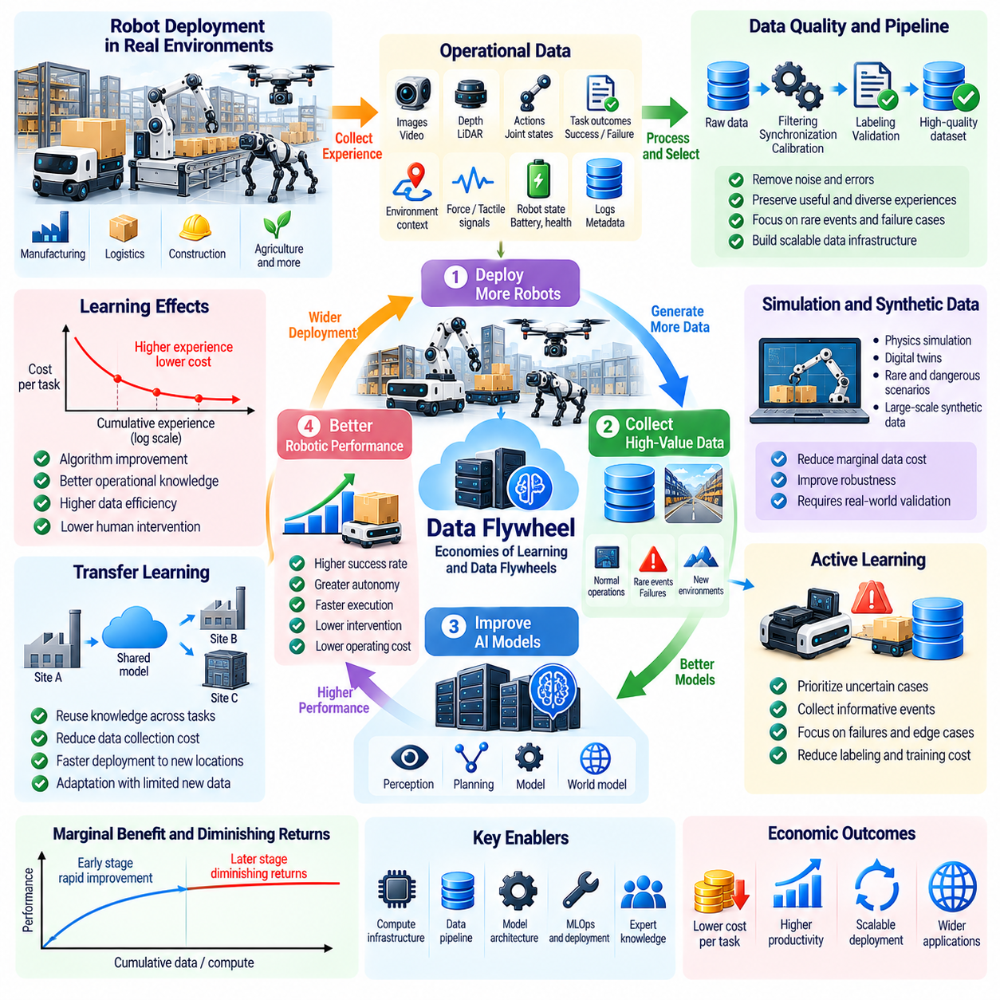{width="7.268055555555556in" height="7.268055555555556in"}

Economies of learning describe how the cost of developing and operating Physical AI systems can decline as experience accumulates. Unlike conventional economies of scale, which depend primarily on production volume, learning economies arise from improvements in algorithms, data quality, operational knowledge, and task execution. Their economic significance lies in the possibility that every deployed robot contributes experience that improves the performance of an entire robotic fleet.

A data flywheel is a reinforcing process in which deployed robots generate operational data, learning systems convert that data into improved models, and improved models enable more reliable deployment. Greater deployment can then produce additional experience, potentially accelerating subsequent improvements. This cycle connects physical operations with computational learning and creates opportunities for cumulative productivity gains beyond those achievable through hardware improvements alone.

The economic value of a data flywheel depends on whether collected experience contains information that improves future decisions. Sensor recordings, robot actions, environmental observations, and task outcomes provide different forms of learning evidence. Repeatedly collecting nearly identical successful operations may offer limited additional value. Rare failures, unfamiliar objects, changing environments, and difficult recovery situations may provide disproportionately useful training information.

Data quality is therefore more important than raw collection volume. Robotic observations may contain sensor noise, calibration errors, incomplete action histories, or inconsistent task labels. Training on unreliable information can reduce model robustness and increase operational risk. Effective data pipelines must synchronize multimodal signals, validate task outcomes, remove corrupted records, and preserve the contextual information necessary to interpret physical interactions.

Learning economies emerge when improved models reduce the resources required to perform subsequent tasks. Better perception may decrease inspection errors, improved planning may shorten travel distances, and more reliable manipulation may reduce human intervention. These benefits can lower energy consumption, maintenance requirements, and cost per successful operation. Their economic value must be measured through actual operational outcomes rather than model accuracy alone.

Fleet learning expands the potential benefits of individual robotic experience. A failure encountered by one robot may reveal an environmental condition or control limitation relevant to many other machines. After appropriate analysis and validation, the resulting improvement can be distributed across compatible robots. This creates a shared learning advantage, although differences in hardware configurations, environments, and tasks can restrict transferability.

The marginal cost of distributing learned intelligence can be relatively low compared with the cost of acquiring physical experience. Once a model improvement has been developed and validated, software deployment may allow many robots to benefit from the same advancement. However, testing, compatibility verification, cybersecurity, and operational monitoring introduce recurring expenses. Learning economies therefore depend on the balance between shared benefits and the cost of safely distributing updates.

Experience accumulation does not guarantee continuous improvement. Datasets may become increasingly repetitive, while additional training may deliver diminishing performance gains. Changes in environmental conditions can also reduce the relevance of previously collected experience. Sustainable learning requires identifying knowledge gaps, monitoring performance drift, and selecting new experiences that address limitations rather than simply increasing storage capacity.

Active learning and event-driven data collection can improve the economics of robotic experience. Instead of recording and processing every interaction equally, systems can prioritize uncertain predictions, unexpected outcomes, near failures, and unfamiliar operating conditions. This approach can reduce communication, labeling, and training expenses while preserving valuable information. Its effectiveness depends on reliable criteria for identifying informative events.

Simulation and synthetic data can strengthen learning economies by generating experiences that are expensive, rare, or dangerous to collect physically. Virtual environments allow robots to encounter variations in objects, terrain, lighting, dynamics, and disturbances. These experiences can improve robustness when simulation adequately represents relevant physical conditions. Nevertheless, simulation-to-reality gaps require calibration and real-world validation before learned behavior is trusted.

World models provide another mechanism for increasing the economic value of accumulated experience. By learning representations of environmental states, physical dynamics, and action consequences, robots may reuse knowledge across related tasks. Predictive models can support planning, failure anticipation, and simulated experimentation. Their economic advantage depends on generalization accuracy, computational efficiency, and the ability to transfer learned dynamics to unfamiliar situations.

Transfer learning can reduce the cost of deploying robots in new environments. Knowledge acquired in one warehouse, factory, or inspection site may provide useful representations for another location. Reusing perception features, navigation strategies, or manipulation skills can reduce the amount of additional training data required. However, differences in equipment, workflows, and environmental conditions may necessitate adaptation and renewed safety validation.

Learning efficiency can be evaluated through the relationship between additional experience and improvements in productive performance. Useful indicators include training cost per performance gain, demonstrations required for task mastery, and reductions in intervention frequency. Economic analysis should also consider the computational expense of retraining and validating models. The objective is to maximize operational improvement per unit of learning investment.

The data flywheel can create competitive advantages for organizations operating large robotic fleets. More deployments may generate broader experience, enabling better models and potentially improving customer value. Improved performance may then support further adoption. However, this reinforcing mechanism is not automatic. Fragmented datasets, inconsistent hardware, weak data governance, or ineffective learning architectures can prevent operational scale from becoming a learning advantage.

Data network effects differ from conventional network effects because additional robots do not necessarily improve system value simply by joining a fleet. Their contribution depends on the novelty, relevance, and accessibility of the experience they generate. A smaller fleet operating across diverse environments may provide more useful learning information than a larger fleet repeatedly performing identical tasks. Data diversity and effective knowledge integration are therefore essential.

Shared learning also introduces questions concerning data ownership, privacy, and commercial incentives. Customers may be reluctant to contribute operational information that reveals proprietary workflows or sensitive environments. Federated learning, privacy-preserving processing, and contractual data governance can support cooperation while limiting unnecessary data exposure. These approaches introduce technical complexity and may affect the efficiency of centralized model improvement.

The cost structure of learning systems includes data storage, transmission, annotation, computing, experimentation, and deployment validation. As fleets expand, these expenses can become substantial unless data pipelines are carefully optimized. Edge processing can filter irrelevant observations, while centralized infrastructure can consolidate selected experiences. Economic efficiency requires allocating computational and storage resources according to expected learning value.

Human expertise remains important within robotic learning loops. Engineers, operators, and domain specialists may investigate failures, provide demonstrations, correct labels, and validate updated policies. Their knowledge can improve learning efficiency, particularly when automated systems cannot reliably interpret unusual events. The economic objective is not necessarily to eliminate human participation, but to use specialized expertise where it produces the greatest improvement.

Learning economies can influence the useful lifespan of robotic hardware. Software improvements may enable existing machines to perform additional tasks or operate more reliably without major mechanical changes. This can increase returns on previously installed capital. However, processor limitations, sensor deficiencies, actuator constraints, and safety requirements may prevent older platforms from benefiting fully from newer models.

The relationship between learning and production scale can produce complementary economic effects. Larger manufacturing volumes may lower hardware acquisition costs, allowing more robots to be deployed. Expanded deployment may generate additional experience, improving software performance and reducing operating costs. Better economics can then support further adoption. The strength of this feedback depends on market demand, reliable deployment, and effective learning infrastructure.

Learning-based improvements can also alter the economics of general-purpose robotics. Reusable skills and shared world representations may reduce the development effort required for each new task. However, broad capability does not guarantee reliable execution in every environment. Task-specific validation, safety constraints, and physical embodiment differences continue to impose costs. Generalization must therefore be evaluated as an economic capability rather than an assumed property of larger models.

Long-term data flywheel strategies require continuous measurement and governance. Organizations must monitor task success, intervention rates, failure patterns, model drift, and the costs of collecting and processing experience. Controlled deployment and systematic evaluation help distinguish genuine learning improvements from changes in operating conditions. Without these safeguards, repeated model updates may introduce instability or increase operational expenses.

Ultimately, economies of learning and data flywheels can transform robotic deployment from a collection of independent machines into a continuously improving productive system. Their value emerges when physical experience becomes reusable intelligence that reduces future operating costs and expands reliable capabilities. The decisive economic factor is not the quantity of accumulated data, but the efficiency with which experience is converted into validated improvements in real-world productivity.

## 02.09. Productivity and Total Factor Productivity

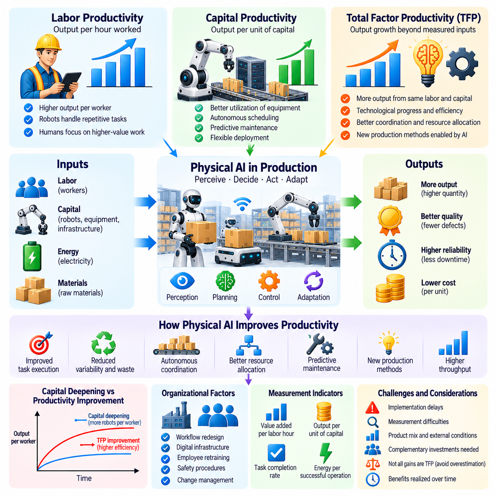{width="7.268055555555556in" height="7.268055555555556in"}

Productivity measures how efficiently economic inputs are transformed into useful goods and services. Physical AI can influence productivity by enabling machines to perceive environments, make decisions, and execute physical tasks with reduced human intervention. Unlike conventional automation, which often depends on predefined operating conditions, Physical AI may adapt to changing workflows. Its economic importance lies in increasing valuable output relative to the labor, capital, energy, and materials consumed.

Labor productivity is commonly measured as output or value added per hour worked. Robotic systems can improve this measure by performing repetitive operations, reducing delays, and allowing human workers to concentrate on higher-value activities. However, increased labor productivity does not necessarily imply that total production becomes more efficient. Replacing human labor with expensive robotic capital may raise output per worker while generating limited overall economic gains.

Capital productivity evaluates the output generated by investments in machinery, equipment, and infrastructure. Physical AI can improve capital utilization through autonomous scheduling, predictive maintenance, and more flexible equipment deployment. A robotic production system that operates reliably across multiple shifts may generate greater output from existing facilities. Nevertheless, additional computing hardware, sensors, and integration expenses can offset some of these improvements.

Total Factor Productivity, or TFP, measures the portion of output growth that cannot be explained by measured increases in labor and capital inputs under a specified production model. It is often interpreted as an indicator of technological progress and organizational efficiency. Physical AI may contribute to TFP growth when improved intelligence, coordination, and processes enable more output from comparable resources, rather than merely increasing the quantity of robotic capital.

A conventional production framework represents economic output as a function of capital, labor, and productivity. In this framework, investment in robots initially appears as an increase in capital inputs. Genuine TFP improvement emerges when robotic intelligence changes how effectively production factors are combined. For example, autonomous coordination may reduce bottlenecks, improve resource allocation, and enable production methods that were previously impractical.

The distinction between capital deepening and productivity improvement is essential for evaluating Physical AI. Capital deepening occurs when more equipment becomes available per worker, potentially increasing labor productivity. TFP growth reflects improvements beyond the contribution attributed to additional measured inputs. Both mechanisms can occur simultaneously, but treating every increase in robotic output as technological efficiency would overestimate the economic contribution of Physical AI.

Physical AI may increase productivity through improved task execution and reduced operational variability. Robots equipped with perception, planning, and adaptive control can potentially maintain consistent performance despite moderate environmental changes. Better precision may reduce defective products, material waste, and repeated operations. These improvements increase economically useful output without requiring proportional increases in physical inputs.

Autonomous coordination can generate productivity gains at the system level rather than only within individual machines. Multiple robots may share information about workloads, equipment availability, and environmental conditions. Intelligent scheduling can reduce waiting times, unnecessary transportation, and production interruptions. Such improvements may increase overall throughput even when the number of robots and workers remains unchanged.

The productivity contribution of Physical AI depends strongly on complementary organizational investments. Firms may need to redesign workflows, establish digital infrastructure, retrain employees, and modify safety procedures before realizing meaningful gains. Installing autonomous machines without changing inefficient processes may deliver disappointing results. Consequently, productivity improvements often depend on the interaction between technological capability and organizational transformation.

Implementation delays can create a gap between technological progress and measured productivity growth. Early deployments may require extensive integration, experimentation, supervision, and troubleshooting. During this period, operating costs may increase before measurable output improvements appear. As organizations accumulate experience and reorganize production processes, productivity benefits may become more visible. This adjustment process can extend over several investment cycles.

Measurement challenges complicate the evaluation of Physical AI productivity. Conventional output statistics may overlook improvements in quality, reliability, safety, and service responsiveness. Conversely, apparent productivity gains may reflect changes in product mix or outsourcing rather than genuine efficiency improvements. Accurate assessment requires consistent output definitions, appropriate input measurement, and careful separation of technological effects from other operational changes.

At the enterprise level, productivity evaluation should compare performance before and after robotic deployment while accounting for relevant external conditions. Useful indicators include value added per labor hour, output per unit of capital, task completion rates, and energy consumption per successful operation. Controlled comparisons can help identify causal effects. However, differences in demand, product complexity, and workforce composition may complicate interpretation.

Industry-level productivity effects can differ substantially from improvements observed within individual firms. Leading manufacturers may adopt advanced robotics rapidly, while smaller enterprises face financial, technical, and organizational barriers. Productivity gains may therefore remain concentrated among early adopters. Broad economic improvements require diffusion across supply chains, service providers, and firms with varying technological capabilities.

Physical AI may generate spillover effects when improvements in one industry increase efficiency elsewhere. More reliable logistics can reduce manufacturing delays, autonomous inspection can improve infrastructure availability, and robotic agriculture can stabilize certain production activities. These indirect benefits may extend beyond the organizations purchasing robots. However, quantifying spillovers requires distinguishing genuine productivity improvements from redistributed costs and benefits.

General-purpose robotic capabilities could eventually influence productivity across multiple sectors. A reusable perception and control platform may support manufacturing, warehousing, construction, healthcare, and maintenance applications. Shared software improvements could lower the cost of adapting automation to new tasks. Nevertheless, physical environments impose different safety, mobility, manipulation, and reliability requirements, limiting immediate transferability.

The economic impact of Physical AI may depend on whether robots complement or substitute human capabilities. Complementary deployment can increase the effectiveness of skilled workers through assistance, inspection, transportation, and decision support. Substitution may reduce labor requirements for specific tasks. Both approaches can raise measured labor productivity, but their consequences for employment, wages, and income distribution may differ considerably.

Productivity improvements can also influence prices and aggregate demand. Lower production costs may enable firms to reduce prices, expand output, or improve product quality. Consumers may benefit from increased purchasing power, while businesses may invest additional resources in innovation. However, the distribution of these benefits depends on competition, market concentration, bargaining power, and the ownership of productive robotic assets.

At the macroeconomic level, sustained TFP growth can support higher potential output without requiring proportional increases in measured production inputs. Physical AI could contribute through improved manufacturing efficiency, more reliable infrastructure, and better coordination of physical resources. Yet aggregate outcomes depend on investment allocation, labor adaptation, energy availability, and institutional conditions. Technological potential alone does not determine national productivity growth.

Productivity gains may be constrained by bottlenecks outside the automated task itself. Faster robotic assembly offers limited benefits when material deliveries, quality inspections, or downstream processing remain slow. Similarly, autonomous transportation may not improve overall logistics performance when loading infrastructure is insufficient. System-wide analysis is necessary to identify whether robotic improvements increase final output or merely relocate operational constraints.

Energy and resource requirements introduce additional considerations into productivity measurement. Robots consume electricity, computing capacity, replacement components, and maintenance resources. A system that reduces labor hours but substantially increases energy or material consumption may offer smaller net efficiency gains than expected. Broader productivity evaluation should therefore consider resource-adjusted output and the economic costs of supporting infrastructure.

Long-term productivity effects may become stronger as learning systems, hardware improvements, and organizational adaptation reinforce one another. Operational data can improve robotic policies, while cheaper hardware may support wider deployment. Accumulated experience can reduce integration costs and expand feasible applications. Nevertheless, diminishing returns, physical constraints, and uneven adoption may prevent productivity growth from following a continuously accelerating trajectory.

Ultimately, Physical AI can contribute to productivity growth through capital deepening, improved operational efficiency, and potential advances in Total Factor Productivity. Its greatest economic significance may arise when intelligent physical systems enable fundamentally better ways of organizing production rather than simply replacing existing workers or machines. Evaluating this transformation requires distinguishing measured output gains from additional inputs and identifying sustainable improvements in economy-wide resource efficiency.

## 02.10. Marginal Cost of Physical Work

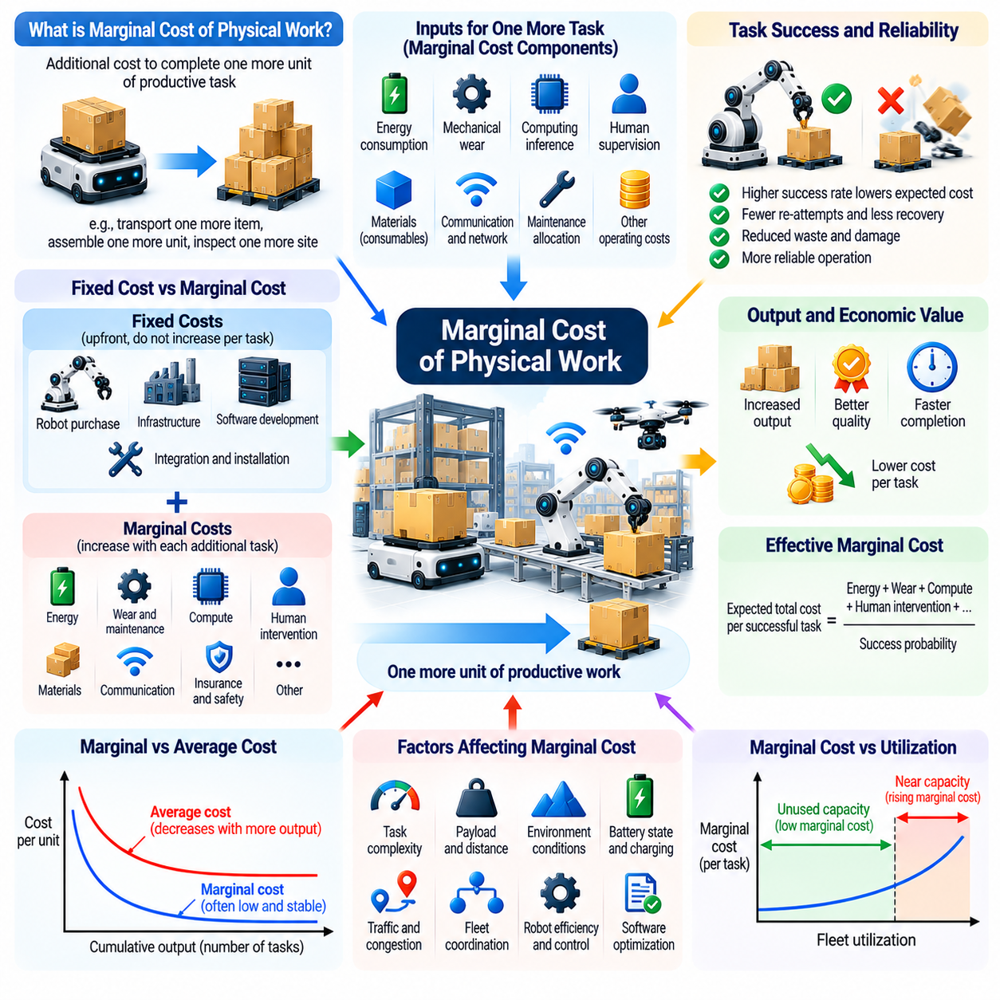{width="7.268055555555556in" height="7.268055555555556in"}

The marginal cost of physical work represents the additional expense required to complete one more unit of productive activity. In Physical AI systems, this may involve transporting an object, assembling a component, inspecting infrastructure, or performing a service task. Unlike the cost of acquiring a robot, marginal cost focuses on incremental operation. Understanding this distinction is essential for evaluating how intelligent automation may transform the economics of physical production.

Traditional physical work often requires additional labor hours, equipment usage, and supporting resources as output increases. Human workers must be compensated, while machines consume energy, materials, and maintenance capacity. Physical AI introduces the possibility of performing additional tasks through already deployed robotic systems. When unused capacity exists, incremental operations may require relatively small expenditures compared with the initial investment.

The marginal cost of robotic work differs from average cost because fixed investments are distributed across completed operations. Purchasing robots, installing infrastructure, and developing software create substantial upfront expenses. These costs influence average production economics but do not necessarily increase when one additional task is performed. Marginal cost instead depends on the resources consumed or additional obligations created by that specific operation.

Energy consumption is a direct contributor to the marginal cost of physical work. Mobile robots require electricity for propulsion, sensing, computing, and communication, while manipulators consume energy during motion and force generation. The energy required varies with payload, speed, terrain, and task complexity. Improvements in actuator efficiency, motion planning, and energy management can reduce incremental operating expenses without changing the number of deployed robots.

Mechanical wear introduces another important cost component. Every movement contributes to the accumulated usage of motors, gearboxes, bearings, wheels, and other components. Although individual operations may generate limited wear, repeated execution eventually requires maintenance or replacement. Accurate marginal cost estimation should allocate expected wear-related expenses according to operating conditions rather than treating mechanical deterioration as economically negligible.

Robotic intelligence can reduce marginal costs by improving the efficiency of task execution. Better perception may prevent unnecessary movements, predictive control may reduce energy consumption, and adaptive planning may avoid collisions or failed attempts. These improvements can increase the probability that an operation succeeds on its first attempt. The resulting savings arise from reduced resource consumption, shorter execution time, and fewer recovery interventions.

Task success probability is particularly important when evaluating the economics of autonomous physical work. A robot may consume little energy during a single attempt but become expensive if failures require repeated execution or human assistance. The expected cost per successful task must therefore incorporate unsuccessful attempts, recovery procedures, and potential damage. Reliability improvements can reduce effective marginal costs even when the direct cost of each attempt remains unchanged.

Human supervision and exception handling remain significant sources of incremental expenditure. Autonomous robots may require operators to resolve unexpected obstacles, manipulate unfamiliar objects, or recover from software failures. The frequency and duration of these interventions determine their economic contribution. As autonomy improves, fewer human interventions may be required per completed task, although safety-critical operations may continue to demand oversight.

Computational inference also contributes to the marginal cost of intelligent physical work. Perception models, world models, planning algorithms, and control policies consume processing resources during execution. Edge computing introduces electricity and hardware utilization costs, while cloud-based inference may involve communication and service charges. The economic objective is to achieve sufficient decision quality without allocating excessive computational resources to routine operations.

The distinction between fixed and variable computing costs becomes important when robotic systems share computational infrastructure. A fleet may operate within existing processing capacity, making the incremental cost of an additional inference relatively small. However, increased workloads may eventually require new processors, network capacity, or software licenses. Marginal costs can therefore rise discontinuously when system utilization reaches infrastructure limits.

Fleet utilization strongly influences the relationship between marginal and average costs. When robots have unused operating capacity, additional tasks may be completed without purchasing new machines. This can reduce average cost as output increases. Once fleet capacity approaches saturation, however, additional demand may require overtime operation, extra robots, charging infrastructure, or human supervision. Marginal cost can rise sharply near these capacity constraints.

Congestion and coordination effects can further increase the marginal cost of physical work. Additional robots or tasks may compete for corridors, loading stations, elevators, and shared workspaces. Waiting times and unnecessary movement can increase energy consumption and reduce throughput. Consequently, adding one more operation may impose costs on other activities within the system. Economic analysis should include these indirect effects rather than examining tasks independently.

The marginal cost of physical work varies substantially across application domains. Transporting lightweight materials across a controlled warehouse may require relatively little energy and supervision. Manipulating fragile objects, navigating construction sites, or performing medical assistance may involve greater precision, risk, and verification requirements. General claims about extremely low robotic marginal costs must therefore be evaluated against specific task conditions.

Physical AI may reduce the incremental cost of producing customized goods by improving manufacturing flexibility. Conventional production systems often require specialized tooling and expensive reconfiguration when product designs change. Intelligent robotic systems may adapt to variations through software updates, perception, and flexible manipulation. However, customization can still require additional materials, validation, programming, and quality assurance, preventing marginal costs from approaching zero.

Software reuse creates an important economic distinction between digital intelligence and physical execution. Once developed, a robotic policy may be distributed across many compatible machines at relatively low incremental software cost. Yet executing that policy requires physical hardware, energy, maintenance, and operating space. Physical AI can therefore reduce the intelligence-related cost of additional work without eliminating the material costs imposed by the physical world.

Learning economies may progressively reduce marginal costs as robotic fleets accumulate operational experience. Shared data can improve navigation, manipulation, task planning, and failure recovery. Better policies may shorten execution times and reduce wasted movements across many machines. Nevertheless, model training, validation, deployment, and monitoring require investment. The economic benefits depend on whether operational savings exceed the costs of generating and distributing improvements.

Marginal cost reduction can influence business models for robotic services. Providers may charge customers per completed task, operating hour, transported item, or verified outcome. When incremental operating costs decline, service providers may gain flexibility to lower prices or improve margins. However, sustainable pricing must also recover capital investment, financing expenses, infrastructure costs, and business risks that are not fully represented by marginal cost alone.

Demand variability complicates the economics of low-marginal-cost robotic operations. During periods of low demand, available robots may perform additional tasks at relatively small incremental expense. During peak demand, capacity constraints can create substantial additional costs. Dynamic scheduling, workload forecasting, and flexible fleet allocation may help reduce these fluctuations. The economic value of capacity depends on when and where productive work is required.

Marginal cost analysis must also account for safety and environmental externalities. Additional robotic operations may increase congestion, noise, electricity demand, or risks to surrounding people and equipment. Some consequences may not appear directly in a manufacturer\'s operating accounts. Responsible economic evaluation should consider regulatory compliance, environmental impacts, and expected accident-related costs when assessing the broader cost of physical automation.

The relationship between marginal cost and market prices depends on competition and industry structure. Lower incremental production costs can support lower prices, increased output, and broader access to goods and services. However, firms may retain part of the savings when competition is limited or when proprietary technologies create market power. Consequently, declining robotic operating costs do not automatically produce equivalent reductions in consumer prices.

At the macroeconomic level, lower marginal costs of physical work could influence manufacturing, logistics, construction, agriculture, and infrastructure services. More affordable task execution may support additional production and enable activities previously considered uneconomical. Yet physical resources, land, energy, materials, and infrastructure remain scarce. The economic consequences therefore depend on how reductions in robotic operating costs interact with these persistent constraints.

Ultimately, Physical AI may significantly reduce the marginal cost of selected physical activities by combining reusable intelligence, efficient hardware, and increasingly autonomous execution. However, physical work cannot become entirely costless because energy consumption, material wear, capacity limits, and safety requirements remain unavoidable. The long-term economic transformation will depend on reducing the cost per successful operation while maintaining reliability, resource efficiency, and sustainable capital recovery.

## 02.11. Supply Chain and Manufacturing Transformation

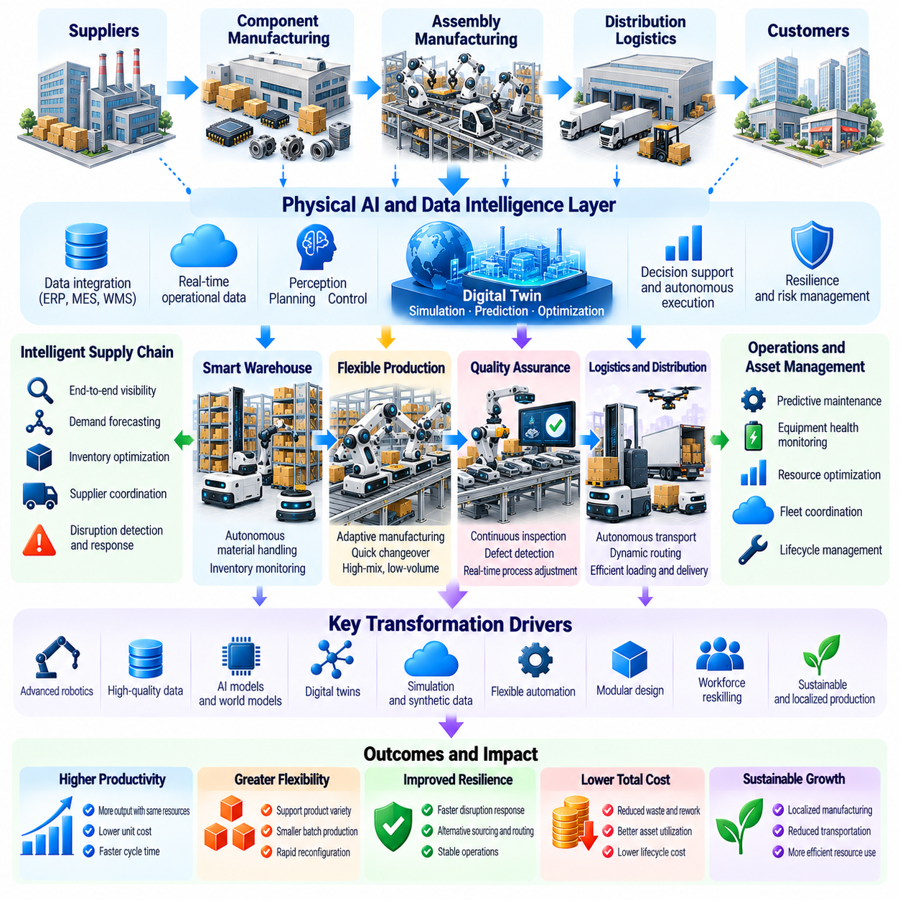{width="7.268055555555556in" height="7.268055555555556in"}

Physical AI may transform global supply chains by connecting intelligent perception, autonomous decision-making, and physical execution across production and distribution networks. Traditional supply chains often depend on fragmented information systems and human coordination between facilities. Physical AI can reduce these limitations by enabling robots to observe operational conditions, respond to disruptions, and execute tasks. Its economic significance extends beyond individual factories to the organization of entire production ecosystems.

Manufacturing transformation begins when robotic systems evolve from fixed automation toward adaptable production capabilities. Conventional industrial robots excel in repetitive operations under controlled conditions, but product variations often require costly reprogramming and tooling changes. Physical AI can introduce perception-guided manipulation, adaptive planning, and flexible task execution. These capabilities may support greater product diversity without requiring complete production-line reconstruction.

Supply chain visibility is essential for coordinating materials, equipment, and production schedules. Intelligent sensors and autonomous inspection systems can continuously observe inventory conditions, component availability, and equipment performance. When connected with manufacturing execution and enterprise planning systems, these observations can improve operational decisions. However, effective coordination requires reliable data integration, consistent identifiers, and accurate representations of physical assets.

Autonomous material handling can improve the movement of components between warehouses, production lines, and distribution facilities. Mobile robots may transport materials according to changing production priorities, while robotic manipulators perform loading, unloading, and sorting operations. Dynamic task allocation can reduce unnecessary movement and waiting times. The resulting productivity gains depend on facility layout, traffic coordination, payload requirements, and system reliability.

Physical AI can strengthen manufacturing resilience by improving responses to unexpected disruptions. Equipment failures, material shortages, quality deviations, and transportation delays can interrupt production. Intelligent systems may detect emerging problems and recommend alternative schedules, routes, or resource allocations. Some adjustments can be executed autonomously within established safety limits. Nevertheless, severe disruptions may require human judgment, external coordination, and strategic decisions.

Predictive maintenance provides an important connection between intelligent manufacturing and supply chain continuity. Robots and industrial equipment generate signals related to vibration, temperature, electrical consumption, and operating conditions. Machine learning systems can analyze these observations to estimate degradation and identify abnormal behavior. Earlier maintenance decisions may reduce unplanned downtime and component shortages, although inaccurate predictions can create unnecessary servicing costs.

Quality assurance can become more continuous and adaptive through Physical AI. Vision systems, force sensors, and robotic inspection platforms can evaluate components during production rather than relying exclusively on final inspection. Detected deviations may trigger corrective adjustments before defects propagate downstream. This approach can reduce scrap, rework, and warranty exposure. Its effectiveness depends on measurement accuracy, traceability, and validated decision thresholds.

Digital twins and world models may support the coordination of manufacturing operations across multiple facilities. A digital representation of equipment, inventory, and production flows can help evaluate alternative schedules and identify bottlenecks. Predictive models may estimate the consequences of disruptions or process changes before physical implementation. However, model usefulness depends on current data, realistic dynamics, and continuous verification against actual operating conditions.

Flexible manufacturing can change the economics of product customization. Traditional production systems frequently achieve low unit costs through long production runs and standardized products. Physical AI may reduce changeover expenses by allowing robots to recognize different components and adapt their actions. Smaller production batches could become more economical, particularly when software-defined workflows replace some dedicated tooling. Material availability and verification requirements remain important constraints.

The integration of Physical AI with additive manufacturing and advanced fabrication could expand production flexibility. Robotic systems may support automated material preparation, component handling, post-processing, and inspection. Adaptive control can potentially compensate for variations in manufacturing conditions. These capabilities may reduce manual coordination between process stages, but they do not eliminate the physical limitations of fabrication speed, material properties, or energy consumption.

Supply chain localization may become more attractive when automation reduces dependence on labor-intensive production. Firms could evaluate regional manufacturing based on transportation costs, delivery speed, geopolitical exposure, and access to customers rather than wages alone. Physical AI may support smaller, highly automated facilities located closer to demand. However, access to components, energy, technical expertise, and supplier networks will continue to influence location decisions.

Reshoring and regionalization should not be interpreted as inevitable consequences of robotic automation. Large manufacturing clusters benefit from specialized suppliers, infrastructure, accumulated expertise, and economies of scale. Even highly automated factories may depend on globally sourced semiconductors, actuators, sensors, and critical materials. Physical AI may therefore reshape the geography of selected production activities without eliminating international interdependence.

Inventory management may improve when physical automation is combined with more accurate demand and supply information. Autonomous systems can support frequent stock verification, rapid replenishment, and dynamic warehouse organization. Better synchronization between production and logistics may reduce unnecessary safety stock. Nevertheless, minimizing inventories too aggressively can increase vulnerability to unexpected disruptions, making resilience an essential consideration.

Physical AI can enable tighter integration between suppliers and manufacturers through automated verification and traceability. Incoming components may be inspected, identified, and associated with digital production records before entering assembly processes. This can improve defect isolation and supplier performance analysis. Shared information may also support faster corrective action, although interoperability, cybersecurity, and commercial confidentiality remain significant challenges.

Manufacturing networks may increasingly operate through distributed intelligence rather than exclusively centralized planning. Local robotic controllers can respond rapidly to immediate physical conditions, while higher-level systems coordinate production objectives across facilities. This hierarchical approach may improve responsiveness and reduce communication dependence. Successful implementation requires consistent operating rules, clear decision authority, and mechanisms for resolving conflicting objectives.

Workforce transformation is another major consequence of intelligent manufacturing. Routine material movement, repetitive assembly, and inspection tasks may become increasingly automated, while demand grows for system integration, maintenance, robotics engineering, and operational supervision. Human workers may concentrate on exception handling, process improvement, and complex decisions. The overall employment outcome depends on adoption rates, industry growth, training opportunities, and labor market adjustment.

The economics of supply chain automation depend on total system costs rather than individual robot performance alone. Capital investment, integration, software licensing, maintenance, cybersecurity, and operational support must be compared with savings in labor, waste, inventory, and downtime. Improvements in one process may offer limited value when other stages remain constrained. Consequently, investment decisions should evaluate end-to-end throughput, reliability, and return on capital.

Small and medium-sized manufacturers may face particular difficulties adopting Physical AI. Limited engineering resources, uncertain demand, and high integration expenses can restrict investment. Modular robotic platforms, standardized interfaces, and service-based business models may lower adoption barriers. However, affordability alone is insufficient if systems require specialized maintenance or cannot accommodate existing workflows. Accessible deployment methods are therefore important for broad productivity diffusion.

Environmental performance may also change as supply chains become more automated and responsive. Improved production precision can reduce material waste, while optimized logistics may lower unnecessary transportation. Predictive maintenance may extend equipment life and reduce premature replacement. Conversely, increased computing demand, robotic hardware production, and accelerated consumption can generate additional environmental burdens. Net sustainability outcomes require lifecycle assessment.

Cybersecurity and operational resilience become increasingly important when production facilities depend on connected autonomous systems. Compromised software, manipulated sensor data, or interrupted communications could affect physical processes and product quality. Secure architectures should separate critical control functions from less trusted information services and provide safe fallback procedures. Supply chain transformation must therefore integrate digital security with functional safety and operational continuity.

Industry structure may evolve as Physical AI platforms connect hardware suppliers, software developers, manufacturers, and logistics operators. Shared robotic operating systems and learning infrastructure could reduce integration costs and accelerate deployment. At the same time, dependence on proprietary platforms may create switching costs and concentrate market power. Open interfaces, interoperable data standards, and competitive supplier ecosystems can influence how widely productivity benefits are distributed.

Long-term manufacturing transformation will depend on the interaction between intelligent robotics, organizational redesign, and industrial infrastructure. Physical AI may enable factories and supply chains to become more adaptive, observable, and coordinated. Yet material constraints, supplier dependencies, safety requirements, and economic uncertainty will remain. The greatest opportunity lies in improving the performance of entire production networks rather than automating isolated operations without considering their wider consequences.

## 02.12. Automated Production and Abundance

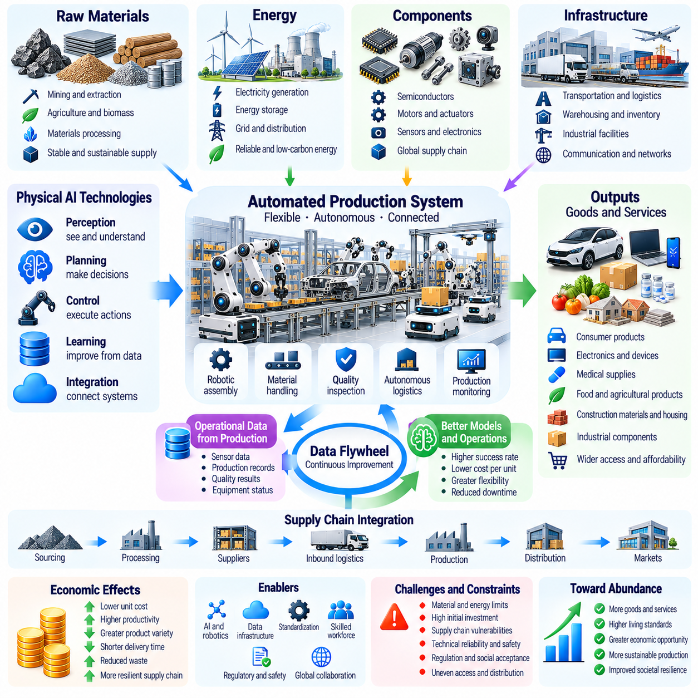{width="7.268055555555556in" height="7.268055555555556in"}

Automated production refers to the use of machines and intelligent systems to transform materials into goods with progressively less direct human intervention. Physical AI extends this concept by enabling robots to perceive changing conditions, make operational decisions, and adapt their actions. Its potential contribution to abundance lies in expanding productive capacity while reducing the labor and coordination required for each additional unit of output.

Economic abundance describes a condition in which goods and services become sufficiently available and affordable to satisfy a broad range of human needs. It does not necessarily imply unlimited resources or the elimination of scarcity. Physical AI may contribute by lowering production costs, improving reliability, and expanding access to essential products. However, abundance depends on distribution, infrastructure, and purchasing power as well as production capacity.

Traditional automation achieves high efficiency when products and processes remain standardized. Dedicated machinery can produce large quantities at low unit costs, but changes in design or operating conditions may require substantial reconfiguration. Physical AI introduces adaptive perception, planning, and manipulation that could reduce these limitations. Flexible automation may make smaller production batches and diverse products economically practical.

The transition toward highly automated factories requires coordination among production equipment, material handling systems, quality inspection, and maintenance operations. Intelligent robots can potentially manage tasks across these functions, reducing delays and manual transfers. Integrated planning systems may synchronize resources according to changing demand. Nevertheless, complete production autonomy remains difficult because unexpected failures and complex exceptions require reliable recovery mechanisms.

The economic foundation of automated abundance is declining cost per successful unit of production. Robotic systems can distribute capital investment across many operations while reducing repetitive labor requirements. Improvements in energy efficiency, task reliability, and equipment utilization may further lower unit costs. However, raw materials, electricity, maintenance, depreciation, and financing remain significant expenses that automation cannot simply eliminate.

Physical AI may enable continuous production across extended operating periods. Autonomous machines can perform repetitive tasks during nights, weekends, and other periods when human staffing is limited. Higher equipment utilization may increase output without proportional expansion of factory space. Yet continuous operation requires maintenance scheduling, energy availability, component replenishment, and safety supervision, which impose practical limits on achievable throughput.

Adaptive manufacturing may reduce the economic tradeoff between mass production and customization. Intelligent robotic systems can recognize different components, adjust manipulation strategies, and execute varied assembly sequences. This flexibility may allow factories to produce personalized goods without extensive mechanical retooling. Nevertheless, customization still introduces complexity in materials management, design verification, and quality assurance.

Abundance also depends on the efficiency of upstream supply chains. A highly automated factory cannot produce goods when essential materials or components are unavailable. Physical AI may improve mining operations, agricultural production, warehousing, and transportation, thereby supporting more reliable material flows. However, geological constraints, resource concentration, transportation capacity, and geopolitical disruptions can continue to limit production.

Energy availability is a fundamental constraint on automated production. Robots, industrial machinery, computing systems, and transportation infrastructure require reliable power. Expanding automated capacity may increase electricity demand even when individual processes become more efficient. Renewable generation, energy storage, grid modernization, and intelligent demand management can support production growth. Their costs and deployment limitations remain economically important.

Physical AI may strengthen the production of essential goods such as food, medical supplies, construction materials, and household necessities. Agricultural robots can support planting, monitoring, and harvesting, while automated manufacturing can improve production consistency. Autonomous logistics may reduce delivery delays and handling costs. These developments could improve availability, although affordability and equitable access depend on market institutions and distribution systems.

Automated construction presents opportunities to expand housing and infrastructure supply. Robotic systems may assist with surveying, material transport, assembly, inspection, and repetitive site operations. Better coordination could reduce construction delays and material waste. However, land availability, building regulations, financing, skilled supervision, and site variability remain major constraints. Greater construction automation does not automatically guarantee affordable housing.

The relationship between abundance and marginal cost requires careful interpretation. Software intelligence can often be reproduced at relatively low incremental cost, but physical goods require materials, energy, equipment, and transportation. Even highly autonomous production systems face positive marginal costs and capacity limitations. Physical AI may substantially reduce selected production expenses without creating the near-zero reproduction costs associated with some digital products.

Learning systems can improve automated production through cumulative operational experience. Data collected across robotic fleets may reveal better assembly strategies, maintenance schedules, and material handling methods. Shared models can distribute these improvements across compatible facilities. Such learning economies may gradually reduce production costs, although data collection, computing, validation, and software deployment introduce additional expenses.

Advanced world models and predictive control may further increase production efficiency. By estimating equipment behavior, material interactions, and future process states, intelligent systems can evaluate alternative actions before execution. Predictive capabilities may reduce defects, interruptions, and unnecessary resource consumption. However, model uncertainty and unexpected physical conditions require monitoring, validation, and safe fallback procedures.

The possibility of automated abundance depends partly on the scalability of robotic hardware. Manufacturing more robots requires motors, sensors, processors, batteries, structural materials, and specialized components. Expanding robotic production may create bottlenecks in these supply chains. Standardization, modular design, and manufacturing innovation can reduce costs, but rapid deployment remains constrained by industrial capacity and critical resource availability.

Automation can change the relationship between economic growth and human labor. As machines perform more physical tasks, additional output may require fewer direct labor hours. Human workers may increasingly concentrate on engineering, supervision, creative development, and complex problem-solving. However, reduced labor demand in certain occupations can disrupt wages and employment. Abundance in production does not automatically translate into economic security for displaced workers.

Ownership of automated productive capital strongly influences how the benefits of abundance are distributed. Firms controlling robotic infrastructure may capture substantial returns from lower operating costs. Consumers may benefit through lower prices when competitive pressures encourage savings to be passed on. If ownership and market power become highly concentrated, increased productive capacity could coexist with significant income and wealth inequality.

Public policy and institutional design may therefore influence whether automated production produces broadly shared prosperity. Competition policy, education, workforce transition programs, infrastructure investment, and access to essential services can shape economic outcomes. Taxation and redistribution may also affect purchasing power and the distribution of automation gains. These choices involve tradeoffs between investment incentives, innovation, efficiency, and social protection.

Environmental sustainability presents another condition for meaningful abundance. Automated production can improve material precision, reduce defects, and optimize energy consumption. Yet lower prices may stimulate additional demand, potentially increasing total resource extraction and waste. Circular manufacturing, recycling, repair, and product longevity can help reduce environmental pressure. Sustainable abundance requires improvements in resource efficiency alongside expanding productive capacity.

The concept of abundance must also account for goods that cannot be expanded through automation alone. Land in desirable locations, certain natural resources, unique cultural objects, and time-sensitive human services remain limited. Even when manufacturing becomes highly automated, scarcity may persist in complementary resources and institutional access. Physical AI can change the boundaries of economic scarcity without removing every constraint on consumption.

Different industries are likely to approach automated abundance at different speeds. Structured manufacturing and warehouse operations may achieve high levels of autonomy earlier than construction, caregiving, or complex field services. Technical reliability, regulatory requirements, capital availability, and customer acceptance will influence adoption. Consequently, economic abundance is more plausibly understood as a gradual and uneven transformation than a single technological event.

Long-term scenarios of automated production range from moderate productivity improvements to extensive networks of autonomous factories, logistics systems, and resource-processing facilities. More advanced scenarios could involve robotic systems coordinating production with limited human intervention. However, their realization depends on breakthroughs in generalization, manipulation, safety, energy systems, and institutional adaptation. These possibilities should be treated as conditional scenarios rather than inevitable outcomes.

Ultimately, Physical AI may expand the productive capacity of civilization by reducing the human effort required to manufacture, transport, inspect, and maintain physical goods. Its contribution to abundance will depend not only on technological capability but also on resource availability, environmental sustainability, market competition, and social distribution. The central economic challenge is transforming greater automated production into reliable, affordable, and widely accessible material well-being.

## 02.13. Industrial Concentration and Platform Economics

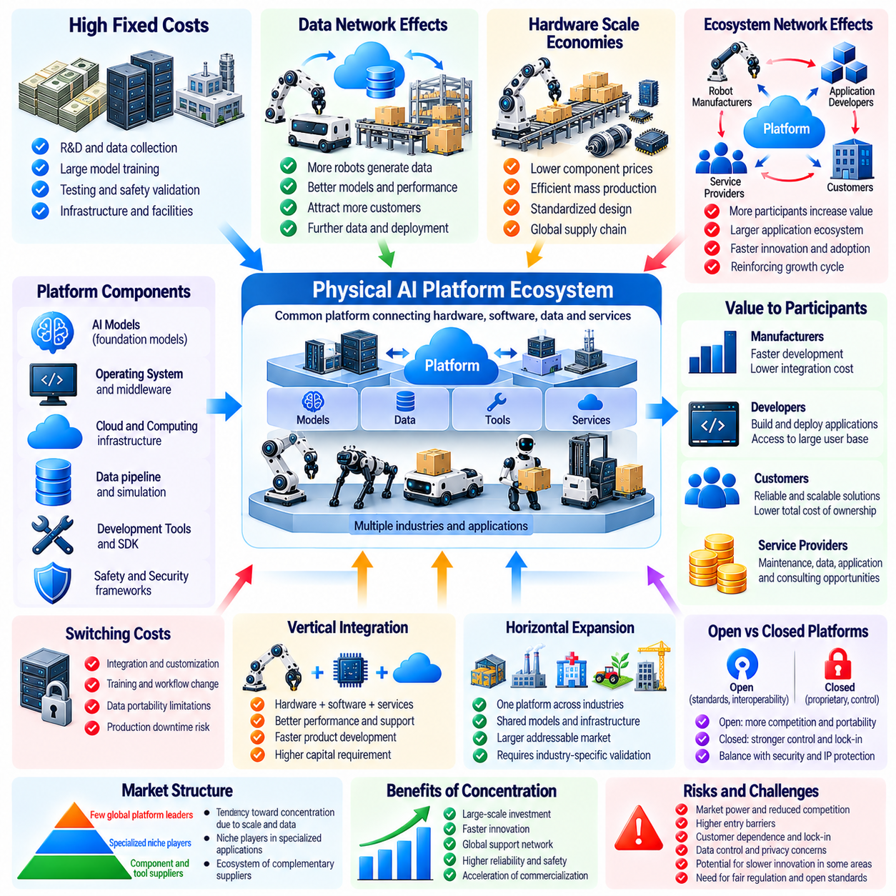{width="7.268055555555556in" height="7.268055555555556in"}

Industrial concentration refers to the extent to which production, technological capabilities, and market power are controlled by a limited number of firms. Physical AI may influence concentration by combining robotics hardware, advanced software, data infrastructure, and large-scale deployment capabilities. Although automation can lower operating costs, the investment required to develop and maintain sophisticated robotic systems may favor organizations with substantial financial and technical resources.

Platform economics examines how shared technological foundations support interactions among manufacturers, developers, service providers, and customers. In Physical AI, platforms may include robotic operating systems, foundation models, simulation environments, fleet management software, and cloud infrastructure. A common platform can reduce duplicated development efforts and accelerate adoption. However, control over essential platform components can create significant economic influence.

The development of general-purpose robotic intelligence may involve substantial fixed costs. Collecting diverse physical interaction data, training large models, validating safety, and integrating hardware require specialized expertise and infrastructure. Once developed, portions of the resulting software may be distributed across many compatible robots at relatively low incremental cost. This combination of high fixed costs and lower replication costs can create economies of scale that favor large providers.

Data network effects may reinforce industrial concentration when deployed robots generate information that improves shared intelligence. Larger fleets can potentially collect more diverse operational experiences, including rare failures and unfamiliar environments. Improved models may attract additional customers, producing further deployment and data collection. Nevertheless, these advantages depend on data quality, learning efficiency, privacy restrictions, and whether additional experiences provide genuinely useful information.

Hardware manufacturing introduces another source of scale advantage. Large robot producers may negotiate favorable component prices, invest in specialized production equipment, and spread engineering costs across greater output volumes. Standardized designs can simplify assembly, maintenance, and spare-parts management. However, specialized manufacturers may remain competitive by serving demanding applications where precision, reliability, environmental resistance, or regulatory compliance outweigh production volume.

Platform ecosystems can create indirect network effects between different groups of participants. More robot manufacturers supporting a common software platform may attract additional application developers. A larger application ecosystem can increase the platform\'s usefulness to customers and encourage further hardware adoption. Such reinforcing interactions may accelerate innovation, but they can also make it difficult for alternative platforms to achieve sufficient market participation.

Switching costs become important when customers integrate robotic platforms into operational workflows. Manufacturing facilities may invest heavily in software interfaces, employee training, safety validation, and data infrastructure. Replacing a platform can require substantial engineering work and temporary production interruptions. These costs may create customer dependence even when competing technologies offer better performance. Interoperability and standardized interfaces can reduce such barriers.

Proprietary data formats and closed software interfaces may strengthen platform control. When operational histories, robotic policies, and simulation assets cannot be transferred easily, customers may face difficulties adopting alternative suppliers. Open standards can improve portability and support competition among hardware and software vendors. However, openness must be balanced with cybersecurity, intellectual property protection, and the technical requirements of reliable physical control.

Vertical integration may become an important strategy for Physical AI companies. A vertically integrated provider can coordinate robot hardware, sensors, actuators, operating systems, learning models, and deployment services. Such integration may improve performance, simplify troubleshooting, and accelerate product development. Yet it can also increase capital requirements and limit customer choice when components from competing suppliers cannot be incorporated easily.

Horizontal platform expansion presents a different form of industrial concentration. A company that initially provides robotic intelligence for warehouses may extend its software into manufacturing, healthcare, agriculture, and construction. Shared models and infrastructure can distribute development costs across multiple industries. However, physical environments differ substantially, and expansion requires application-specific validation, integration, and safety engineering.

Cloud and computing infrastructure can create additional dependencies within the Physical AI economy. Training advanced models may require substantial computational capacity, while deployed fleets may rely on cloud services for analytics, updates, and coordination. Providers controlling critical computing resources can influence costs and market access. Edge computing and alternative infrastructure arrangements may reduce some dependencies, although they introduce their own engineering and maintenance requirements.

Industrial concentration does not necessarily imply technological stagnation. Large firms may finance long-term research, build extensive testing facilities, and establish reliable global support networks. Their resources can accelerate safety engineering and large-scale commercialization. At the same time, excessive concentration may weaken competitive pressure, restrict interoperability, and discourage experimentation with alternative architectures. Economic outcomes depend on the balance between scale benefits and market contestability.

Smaller companies may compete by specializing in particular components or operational domains. High-precision manipulation, rugged mobility, medical robotics, specialized sensors, and safety certification represent areas where focused expertise can provide advantages. These firms may participate in larger ecosystems without developing complete robotic platforms. Their opportunities depend partly on fair access to interfaces, distribution channels, and customers.

Robot-as-a-Service models may reshape competition by separating equipment ownership from operational consumption. Customers can purchase robotic capabilities through subscriptions, usage-based contracts, or outcome-based agreements. Large providers may benefit from financing advantages, fleet management experience, and maintenance networks. However, specialized service firms can compete through local support, application knowledge, and flexible deployment arrangements.

The concentration of robotic intelligence may also affect bargaining power throughout industrial supply chains. Platform owners could influence licensing conditions, software updates, data access, and compatibility requirements. Manufacturers and service operators dependent on these systems may have limited negotiating flexibility. Conversely, customers with substantial deployment volumes may negotiate favorable terms or develop internal alternatives. Market power therefore emerges through relationships across the entire ecosystem.

Standards organizations and industry consortia may influence the structure of Physical AI markets. Common communication protocols, safety interfaces, data representations, and testing methods can reduce integration costs. Shared standards may allow competing products to operate within the same industrial environment. Nevertheless, standards development can be influenced by dominant participants, making transparent governance and broad stakeholder representation important.

Competition policy may need to consider how control over robotic platforms affects adjacent markets. Exclusive agreements, restrictive licensing, discriminatory access, and acquisitions of emerging competitors could influence future industry structure. Regulators may evaluate whether such practices undermine competition or protect legitimate investment and safety requirements. Effective oversight requires understanding the technical dependencies that distinguish Physical AI from purely digital services.

Geographic concentration may emerge around regions possessing advanced semiconductor industries, robotics research institutions, manufacturing clusters, and investment capital. These locations can benefit from specialized labor markets and knowledge spillovers. However, excessive geographic dependence may expose global supply chains to regional disruptions. International collaboration, diversified manufacturing, and regional research capacity can influence the resilience of the emerging industry.

Open-source robotics software may provide an alternative foundation for platform development. Shared frameworks can reduce entry barriers, support academic research, and allow organizations to build customized systems. Community contributions may accelerate improvements in perception, planning, and simulation. However, deploying open-source technology in safety-critical environments still requires validation, maintenance responsibility, security management, and sustainable financial support.

The distribution of economic value within Physical AI ecosystems may differ from the distribution of physical production. Companies providing foundational intelligence, computing infrastructure, or operating platforms could capture revenue from numerous downstream applications. Hardware manufacturers and deployment operators may face different cost structures and competitive pressures. Understanding these relationships is essential for evaluating profitability, investment incentives, and the allocation of innovation benefits.

Long-term market structures may range from concentrated ecosystems dominated by a few integrated providers to more modular industries with competing hardware and software suppliers. Technological breakthroughs, open standards, customer preferences, and regulatory choices will influence which arrangements emerge. Hybrid structures are also plausible, with shared intelligence platforms supporting diverse specialized machines. No single industrial organization is inevitable across all application domains.

Ultimately, Physical AI creates both opportunities for economic concentration and mechanisms for broader industrial participation. Scale advantages in computing, data, manufacturing, and deployment may strengthen major platforms, while modular architectures and specialized expertise can support competitive ecosystems. The central economic challenge is preserving the productivity benefits of integration without allowing technological dependence to unnecessarily restrict innovation, market access, or customer choice.

## 02.14. Global Competition and Robot Productivity

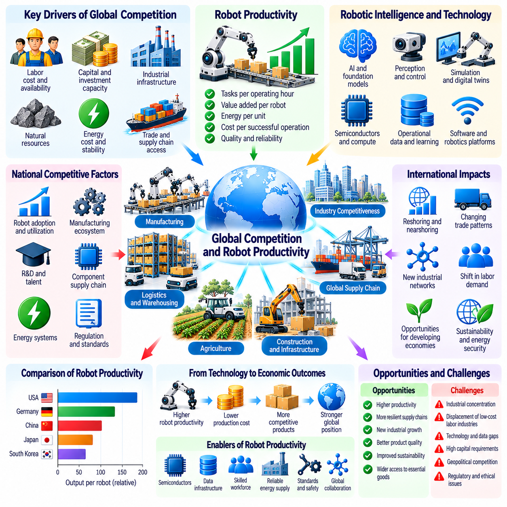{width="7.268055555555556in" height="7.268055555555556in"}

Global competition in the era of Physical AI may increasingly depend on the productivity of robotic systems rather than labor costs alone. Countries and industries capable of deploying intelligent machines efficiently could gain advantages in manufacturing, logistics, agriculture, and infrastructure. However, robotic productivity depends on more than the number of installed robots. System reliability, operational integration, technological capabilities, and access to resources determine whether automation produces sustainable competitive advantages.

Robot productivity measures the economic output generated by robotic systems relative to the resources they consume. Relevant measures include completed tasks per operating hour, value added per robot, energy consumption per unit, and cost per successful operation. These indicators provide different perspectives on efficiency. International comparisons must account for task complexity, product quality, utilization rates, and differences in industrial environments.

Traditional international competitiveness has often reflected labor availability, wage levels, industrial infrastructure, and access to natural resources. Physical AI may alter the relative importance of these factors by reducing the labor required for selected production activities. Economies with higher wages could become more competitive in automated manufacturing. Nevertheless, material costs, energy prices, supply networks, and technical expertise remain essential determinants of production location.

Robotic capital intensity may become an increasingly important feature of national industrial development. Firms investing in autonomous production equipment can potentially increase output without proportional increases in employment. However, capital accumulation alone does not guarantee productivity growth. Poorly integrated robots may remain underutilized or create additional operational complexity. Competitive performance requires complementary investments in software, infrastructure, maintenance, and organizational capabilities.

Differences in robot utilization can generate substantial productivity gaps between otherwise similar factories. A facility operating robots reliably across multiple shifts may distribute fixed costs over more completed products. Another facility with frequent downtime, inefficient scheduling, or limited demand may achieve much lower returns. Therefore, national robot installation statistics should not be interpreted as direct measurements of economic productivity or industrial competitiveness.

The development of robotic intelligence introduces another dimension of international competition. Countries with strong capabilities in artificial intelligence, machine learning, simulation, and robotics research may develop more adaptable production systems. Advanced perception and control can reduce failures and support operations in less structured environments. Yet translating research achievements into commercial productivity requires manufacturing expertise, deployment experience, and sustained technical support.

Data infrastructure may influence competitive advantages through cumulative learning. Large robotic fleets can generate operational experience that improves navigation, manipulation, inspection, and maintenance strategies. Shared learning systems may distribute improvements across many production sites. However, the economic value of data depends on diversity, accuracy, governance, and effective model training. Greater data volume does not automatically guarantee superior robotic performance.

Semiconductor manufacturing and computing infrastructure are important foundations of Physical AI competitiveness. Advanced processors support model training, perception, planning, and real-time decision-making. Countries with access to reliable computing supply chains may face fewer constraints when scaling intelligent automation. Nevertheless, computing capability must be balanced against energy consumption, cost, latency, and the practical requirements of industrial deployment.

Energy systems may become increasingly important in determining the geographic economics of robotic production. Highly automated factories require dependable electricity for machinery, computing, charging, and environmental control. Regions offering reliable power at competitive prices may attract energy-intensive production. However, grid capacity, carbon regulations, infrastructure investment, and energy security can influence whether these advantages remain sustainable over time.

Industrial ecosystems provide competitive benefits that individual robotic technologies cannot easily reproduce. Specialized component suppliers, precision manufacturers, system integrators, universities, and experienced operators contribute to deployment efficiency. Geographic clusters may accelerate knowledge exchange and shorten development cycles. Consequently, countries possessing established manufacturing ecosystems may retain advantages even when robotic software becomes widely accessible.

Physical AI may influence reshoring, nearshoring, and international production networks. Reduced dependence on direct labor can make production closer to customers more attractive, particularly when transportation costs and delivery times are significant. However, global supply chains may remain efficient for specialized components and resource-intensive processes. The outcome is likely to involve selective relocation and network diversification rather than universal domestic production.

Developing economies may encounter both opportunities and challenges as robotic productivity increases. Affordable automation could improve local manufacturing capabilities, agricultural efficiency, and infrastructure services. Conversely, countries relying heavily on low-cost labor for export competitiveness may face increasing pressure. Their adaptation will depend on access to capital, technical education, reliable infrastructure, and opportunities to participate in emerging robotic supply chains.

The relationship between wages and robotic competitiveness is more complex than simple labor substitution. Automation may reduce direct labor costs while increasing demand for engineers, technicians, software specialists, and maintenance personnel. Countries with strong technical education systems may capture greater value from robotic deployment. Workforce development therefore becomes a strategic component of productivity policy rather than merely a response to employment displacement.

International competition may also accelerate innovation in robot hardware. Improvements in actuators, batteries, sensors, transmissions, and mechanical design can reduce acquisition costs and improve operating efficiency. Standardized components may support large-scale production, while specialized designs may serve demanding industrial applications. Competitive advantage depends on the relationship between hardware cost, durability, performance, and lifecycle maintenance requirements.

Government policies can influence robotic productivity through research investment, industrial infrastructure, education, and technology diffusion programs. Public support may help firms overcome early adoption barriers and develop domestic capabilities. However, subsidies can also encourage inefficient investment if deployment targets emphasize robot quantities rather than measurable productivity improvements. Policy evaluation should therefore consider utilization, economic value added, and long-term sustainability.

Trade policy and technological restrictions may reshape the global distribution of Physical AI capabilities. Export controls, tariffs, investment screening, and intellectual property rules can influence access to advanced components and software. Such measures may encourage domestic development but also increase costs or fragment technical ecosystems. Their economic effects depend on supply chain dependencies, substitution possibilities, and international cooperation.

Robot productivity may affect exchange relationships and comparative advantage between countries. Industries capable of producing goods with lower resource consumption and higher reliability may strengthen their export positions. However, productivity improvements do not guarantee trade dominance because market access, product differentiation, currency movements, and customer preferences also matter. International competitiveness remains a multidimensional economic outcome.

Safety standards and regulatory compatibility may become important determinants of international market access. Robotic systems deployed across borders must satisfy applicable requirements for machinery safety, cybersecurity, data protection, and operational responsibility. Harmonized standards can reduce duplicated testing and support international expansion. Fragmented regulations may increase compliance expenses, particularly for smaller manufacturers and service providers.

The concentration of Physical AI platforms could influence global economic dependencies. Countries relying on foreign robotic operating systems, foundation models, or cloud infrastructure may face licensing costs and technological vulnerabilities. Domestic alternatives can improve strategic flexibility but may require substantial investment. Open architectures and diversified suppliers offer another approach to reducing dependence without duplicating every technological capability.

Measuring national robotic competitiveness requires a broader framework than robot density alone. Useful indicators include productivity-adjusted robot utilization, cost per successful task, domestic integration capability, software adaptability, and reliability across operating conditions. Additional measures may examine energy efficiency, supply chain resilience, and workforce readiness. Such comparisons must distinguish technological capacity from realized economic performance.

Global productivity gains from Physical AI may generate both competitive rivalry and opportunities for cooperation. Shared safety standards, scientific research, interoperability frameworks, and cross-border supply chains can reduce development costs. At the same time, firms and governments may compete for talent, capital, manufacturing capacity, and technological leadership. The resulting industrial landscape will reflect interactions between cooperation, specialization, and strategic competition.

Long-term differences in robotic productivity could influence national income, industrial specialization, and economic resilience. Economies that combine intelligent automation with reliable infrastructure and effective institutions may achieve sustained productivity advantages. However, technological diffusion may gradually narrow some gaps as equipment and software become more accessible. Outcomes will depend on learning speed, investment quality, resource constraints, and institutional adaptation.

Ultimately, Physical AI may redefine global competitiveness around the ability to convert robotic intelligence into reliable and economically valuable physical work. Installing more machines is insufficient without effective integration, efficient operation, and continuous improvement. The strongest competitive positions are likely to emerge where robotics, computing, manufacturing, energy, and human expertise reinforce one another. Sustainable leadership will depend on productive capability rather than automation scale alone.

## 02.15. Distribution of Income and Capital Ownership

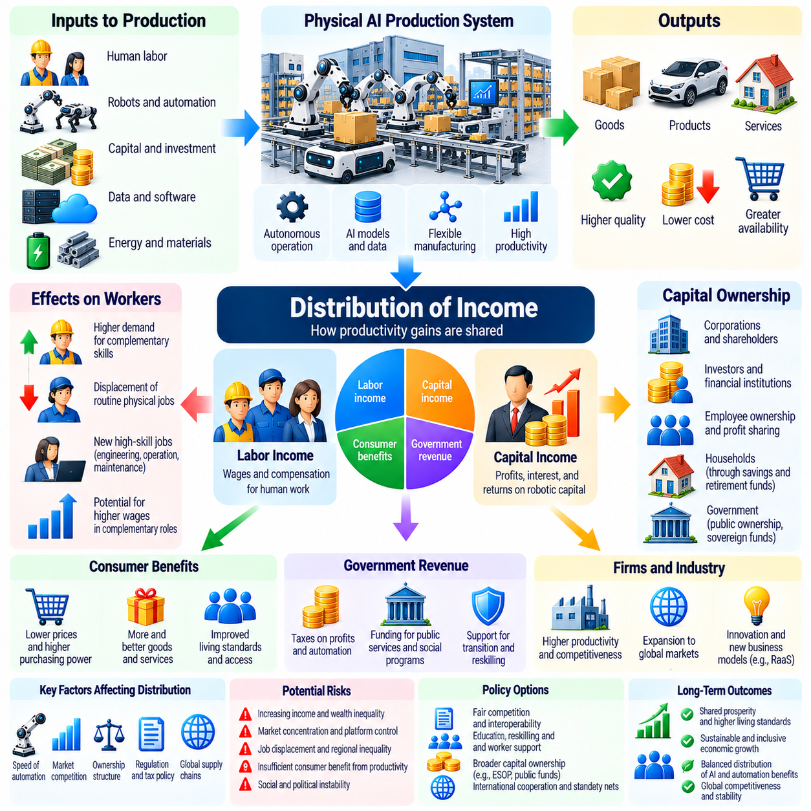{width="7.268055555555556in" height="7.268055555555556in"}

The distribution of income in a Physical AI economy depends on how productivity gains are divided among workers, capital owners, consumers, and governments. As intelligent robots perform more physical tasks, production may expand while direct labor requirements decline. This transformation can increase total economic output without guaranteeing proportional income growth for every household. Ownership structures and market institutions will strongly influence who receives the resulting benefits.

Traditional income distribution distinguishes labor income from capital income. Labor income includes wages and compensation earned through human work, while capital income includes profits, interest, and returns on productive assets. Physical AI introduces increasingly autonomous robotic capital capable of performing activities previously requiring human labor. This development may change the relative contribution of labor and capital to economic production.

The labor share of income measures the proportion of economic output paid to workers. When robotic systems substitute for human tasks, firms may reduce labor expenditures relative to production value. However, automation can also increase demand for complementary workers and expand economic activity. The resulting labor share depends on substitution patterns, productivity growth, wage bargaining, and market competition rather than robotic deployment alone.

Capital ownership becomes particularly important when intelligent machines generate substantial productive value. Companies and investors owning robots, computing infrastructure, and foundational software may receive income from automated operations. If ownership is concentrated, productivity improvements could disproportionately benefit a limited group of shareholders. Broad participation in capital ownership may therefore influence whether automation contributes to shared prosperity or greater wealth concentration.

The distinction between income inequality and wealth inequality is essential. Income inequality concerns differences in earnings and financial flows, while wealth inequality reflects unequal ownership of accumulated assets. Physical AI may influence both by changing wages, profits, and asset valuations. Rising returns on robotic capital could increase wealth concentration over time, particularly when profits are reinvested and ownership remains narrowly distributed.

Automation does not necessarily reduce every worker\'s income. Employees whose skills complement robotic systems may become more productive and command higher wages. Robotics engineers, maintenance specialists, system integrators, and operational managers may benefit from expanding demand. Conversely, workers performing highly automatable tasks may face reduced bargaining power or employment opportunities. These effects can create substantial differences across occupations.

Skill-biased technological change provides one framework for understanding these outcomes. Advanced automation may increase demand for workers capable of designing, supervising, and improving complex systems. At the same time, some routine physical occupations may experience declining demand. However, Physical AI could eventually automate portions of highly skilled work as well. The distributional consequences depend on which tasks become automated and which human capabilities remain complementary.

Task-based economic models offer a more detailed perspective than dividing occupations into automated and nonautomated categories. Most jobs contain multiple activities with different technical requirements. Robots may replace selected tasks while allowing workers to concentrate on judgment, coordination, and interpersonal responsibilities. Whether employment expands or contracts depends on the balance between displaced tasks, newly created tasks, and increased demand resulting from lower production costs.

Consumer benefits represent another channel through which automation gains may be distributed. Lower manufacturing, logistics, and service costs can reduce prices and increase the purchasing power of household income. Such improvements may particularly benefit consumers who spend large portions of their budgets on essential goods. However, price reductions depend on competition, supply constraints, and the willingness of producers to pass productivity savings to customers.

Market concentration may affect the relationship between robotic productivity and income distribution. Dominant platform providers could capture substantial profits through licensing, software subscriptions, and control over critical infrastructure. Smaller manufacturers and service operators may face limited bargaining power when dependent on proprietary technologies. Competitive markets and interoperable systems can influence whether productivity gains reach a broader range of businesses and households.

Robot-as-a-Service models may broaden access to automated production without requiring customers to purchase expensive equipment. Small firms can potentially obtain robotic capabilities through recurring payments or usage-based contracts. This may distribute productivity opportunities across more businesses. Nevertheless, ownership of the underlying robotic assets may remain concentrated among service providers and investors, separating operational access from capital ownership.

Employee ownership and profit-sharing arrangements offer possible mechanisms for distributing automation-related returns. Workers may participate through company shares, cooperative structures, retirement investments, or performance-based compensation. Such arrangements can connect household income to the productivity of robotic capital. Their effectiveness depends on participation rates, governance, investment risk, and whether benefits extend beyond employees of highly profitable firms.

Public investment can also influence ownership patterns in a Physical AI economy. Governments may support robotics research, infrastructure, education, and technology diffusion through public institutions. Depending on financing and governance arrangements, public investments may generate social benefits or direct financial returns. The distribution of these returns depends on policy design, accountability, and how public resources are allocated across competing priorities.

Taxation and redistribution may become important when automated capital generates a growing share of economic income. Governments could evaluate existing taxes on profits, capital gains, consumption, and labor to determine whether revenue systems remain effective. Proposals for robot-specific taxation raise questions about measurement, investment incentives, and technological neutrality. Policy choices should consider productivity, employment transitions, administrative feasibility, and distributional objectives.

Social protection systems may require adaptation as automation changes employment patterns. Workers displaced by robotic systems may experience temporary unemployment, wage reductions, or geographic mobility constraints. Income support, retraining, portable benefits, and employment services can help reduce transition costs. However, successful adjustment also requires realistic opportunities for productive work, particularly when technological change affects several industries simultaneously.

Universal basic income and related income-support proposals are frequently discussed in scenarios involving extensive automation. Such policies could provide households with purchasing power when labor income becomes less reliable. However, their feasibility depends on fiscal capacity, program design, inflationary pressures, and political choices. Physical AI does not automatically establish the economic conditions required to finance universal transfers at a particular level.

Regional inequality may increase if robotic capital and high-value technical employment concentrate in a limited number of industrial centers. Regions dependent on routine manufacturing or logistics employment could experience difficult transitions. Conversely, affordable automation may support new production facilities in underserved areas. Infrastructure investment, technical education, and regional development strategies can influence whether Physical AI reinforces or reduces geographic economic disparities.

International income distribution may also change as robotic productivity alters comparative advantage. Countries possessing advanced computing, manufacturing, and robotics capabilities may capture significant economic returns. Economies relying on labor-intensive exports could face competitive pressure as production becomes less dependent on wage differences. However, accessible robotic technologies may also enable developing economies to improve domestic productivity and participate in higher-value industries.

The relationship between capital ownership and political influence deserves attention in highly automated economies. Concentrated control over productive infrastructure can create economic dependencies affecting workers, suppliers, and customers. Large technology providers may also influence standards, procurement decisions, and regulatory discussions. Transparent governance, competitive institutions, and accountable public policy can help manage these risks without assuming that large-scale investment is inherently harmful.

Long-term scenarios depend on whether robotic intelligence primarily complements human labor or increasingly substitutes for it. In complementary scenarios, productivity growth may support higher wages and broader employment opportunities. In substitution-intensive scenarios, capital income could become more important relative to wages. Mixed outcomes are plausible across industries and time periods. Distributional analysis should therefore examine alternative technological pathways rather than assume one inevitable result.

Economic measurement will be essential for understanding the distributional effects of Physical AI. Relevant indicators include labor income share, capital returns, wage dispersion, household wealth ownership, employment transitions, and consumer price changes. Researchers should also examine differences across regions, industries, and demographic groups. Longitudinal evidence will be necessary to distinguish temporary adjustment costs from persistent structural changes in income distribution.

Ultimately, Physical AI may expand society\'s productive capacity while transforming the relationship between work, income, and ownership. Whether this produces broadly shared prosperity depends on access to productive capital, competitive markets, workforce adaptation, and institutional arrangements. Technological progress alone cannot determine the distribution of economic rewards. The central challenge is ensuring that increasing robotic productivity supports material well-being across society rather than benefiting capital owners exclusively.

## 02.16. Physical AI and Post Scarcity Debates

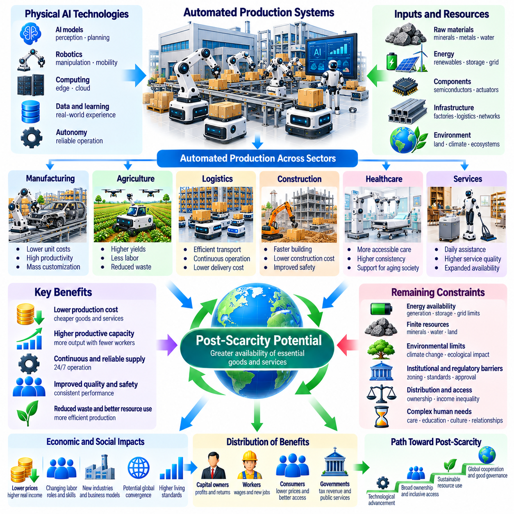{width="7.268055555555556in" height="7.268055555555556in"}

Post-scarcity refers to an economic condition in which essential goods and services become sufficiently abundant that material deprivation is greatly reduced. Physical AI may contribute to this possibility by automating production, transportation, maintenance, and resource management. However, post-scarcity does not necessarily mean unlimited resources or the disappearance of economic constraints. It describes a potential transformation in the availability, affordability, and distribution of material necessities.

Traditional economic scarcity arises because human needs and desires exceed the resources available to satisfy them. Labor, energy, materials, land, and production capacity impose limits on economic activity. Physical AI could relax some constraints by increasing productive efficiency and reducing dependence on direct human labor. Nevertheless, automation changes the structure of scarcity rather than eliminating every limitation. Physical resources and environmental boundaries remain economically significant.

The strongest argument for a post-scarcity transition involves declining costs of essential physical work. Intelligent robots may eventually perform repetitive manufacturing, agricultural, logistics, and maintenance tasks with limited human supervision. As reliability improves and equipment costs decline, the cost of producing certain goods may fall substantially. Yet physical production continues to require energy, raw materials, machinery, infrastructure, and replacement components.

Digital abundance provides an imperfect analogy for understanding physical abundance. Software and digital information can often be replicated at extremely low marginal cost after initial development. Physical goods cannot be reproduced without material inputs and energy expenditure. Even highly automated factories must acquire resources and operate physical equipment. Therefore, the economics of Physical AI may resemble increasingly efficient industrial production rather than unrestricted digital replication.

Energy availability is a fundamental condition for any transition toward material abundance. Robotic factories, autonomous transportation, data centers, and automated agriculture require dependable energy supplies. Advances in renewable generation, storage, grid infrastructure, and energy efficiency could reduce important production constraints. However, energy systems involve capital investment, physical materials, geographic limitations, and environmental impacts that cannot be ignored.

Resource extraction and material processing represent another major boundary. Even if robotic mining, recycling, and manufacturing become highly autonomous, minerals, water, fertile soil, and industrial materials remain finite or costly to access. Improved recovery rates and circular production systems may reduce waste and increase resource availability. Nevertheless, expanding production without accounting for ecological limits could shift scarcity into environmental degradation.

Food production illustrates both the opportunities and limitations of automated abundance. Physical AI could support precision agriculture, autonomous harvesting, crop monitoring, and efficient distribution networks. These capabilities may reduce losses and improve agricultural productivity. However, food systems remain dependent on climate, water, soil quality, biological processes, and regional infrastructure. Technological efficiency cannot fully eliminate these dependencies.

Housing demonstrates why automation alone may not produce universal affordability. Robotic construction, automated fabrication, and intelligent inspection could reduce building costs and accelerate development. Yet housing prices also reflect land scarcity, zoning regulations, financing conditions, infrastructure availability, and geographic demand. Lower construction costs may improve accessibility, but institutional and spatial constraints can continue to restrict housing supply.

Healthcare provides another example of partial rather than absolute abundance. Robotic assistance, automated logistics, and intelligent medical equipment may expand service capacity and reduce selected operational costs. However, medical care also depends on professional judgment, regulation, clinical evidence, and human relationships. Expanding technological capacity does not automatically ensure equal access, especially where financing and healthcare institutions remain fragmented.

Post-scarcity debates must distinguish production abundance from distributional abundance. An economy may produce sufficient essential goods while some households remain unable to afford them. Ownership concentration, market power, income inequality, and geographic barriers can prevent productivity gains from reaching everyone. Consequently, material abundance requires attention to purchasing power, public infrastructure, competition, and institutions governing access to essential resources.

The ownership of robotic capital may become a central issue in post-scarcity scenarios. If autonomous production systems generate substantial output while ownership remains concentrated, economic rewards may accumulate among investors and platform providers. Alternative arrangements could include broader capital participation, employee ownership, cooperative enterprises, and public investment. Each approach involves different incentives, governance requirements, and distributional consequences.

Labor and income relationships may change as machines perform a larger share of economically valuable physical work. Some workers may transition toward supervision, design, maintenance, education, and interpersonal services. Others may face displacement or reduced employment opportunities. If labor income becomes less central to production, societies may need to reconsider how households obtain purchasing power. The appropriate response depends on actual productivity gains and employment outcomes.

A distinction must also be made between basic necessities and positional goods. Automated production may make standardized clothing, household products, and some services increasingly affordable. However, desirable locations, unique experiences, social recognition, and exclusive assets remain limited by their nature. Competition for such goods can persist even when essential material needs are widely satisfied. Post-scarcity therefore cannot imply the disappearance of every form of economic competition.

Environmental sustainability is essential to evaluating claims of abundance. Lower production costs may increase consumption and total resource demand, potentially offsetting efficiency improvements. This rebound effect means that technological progress does not automatically reduce environmental pressure. Sustainable abundance would require efficient energy systems, durable products, recycling, responsible material sourcing, and institutions capable of managing ecological externalities.

The transition toward greater abundance is likely to be uneven across sectors and regions. Standardized manufacturing environments may automate more rapidly than complex construction sites or unpredictable service settings. Wealthier economies may deploy advanced robotic infrastructure earlier, while others face financing and technical constraints. Differences in energy availability, governance, education, and industrial capacity could produce unequal access to automation benefits.

Physical AI may also generate new forms of scarcity while reducing existing ones. Advanced semiconductors, specialized actuators, training data, computing capacity, and qualified technical personnel could become strategic bottlenecks. Dependence on proprietary robotic platforms may create additional economic constraints. As production systems evolve, the most valuable scarce resources may shift from routine labor toward infrastructure, expertise, and control over critical technologies.

World models and adaptive robotic intelligence could improve the feasibility of highly automated production networks. Robots capable of predicting physical consequences, coordinating actions, and recovering from failures may operate across more diverse environments. Such capabilities could reduce supervision requirements and improve system utilization. However, robust autonomy remains difficult because real environments contain uncertainty, unexpected events, and safety-critical interactions.

The concept of universal abundance also raises questions about economic measurement. Conventional indicators such as gross domestic product may not fully capture improvements in access to essential goods or reductions in required working time. Researchers may examine affordability, household consumption, service availability, environmental quality, and economic security. These measures can help distinguish genuine improvements in living standards from increases in production volume alone.

Post-scarcity scenarios should be understood as conditional possibilities rather than inevitable technological outcomes. Optimistic pathways assume continuing improvements in robotics, computing, energy, manufacturing, and institutional coordination. More constrained pathways involve persistent resource bottlenecks, uneven automation, market concentration, and environmental pressures. Actual outcomes may combine substantial abundance in selected goods with continuing scarcity in other domains.

Public policy may influence whether Physical AI productivity translates into broadly shared material security. Infrastructure investment, competitive markets, education, social protection, and environmental regulation can shape the distribution of automation benefits. However, policy interventions involve tradeoffs between investment incentives, fiscal capacity, efficiency, and fairness. Effective institutions must adapt to technological change without assuming that automation eliminates economic decision-making.

The philosophical significance of post-scarcity extends beyond production costs. If societies can satisfy essential material needs with less compulsory human labor, individuals may have greater freedom to pursue education, creativity, caregiving, and community participation. Yet meaningful work, social identity, and personal agency remain important. A technologically abundant society must therefore consider human well-being and social participation alongside material productivity.

Ultimately, Physical AI may move some economic activities toward conditions of greater abundance without eliminating scarcity as a general principle. Its contribution will depend on reliable autonomy, affordable energy, efficient resource use, competitive institutions, and equitable access to productive capacity. The central question is not whether intelligent robots can produce unlimited goods, but whether their productivity can substantially reduce deprivation while preserving environmental sustainability and human opportunity.

## 02.17. Long Term Physical AI Economic Scenarios [w/Code]

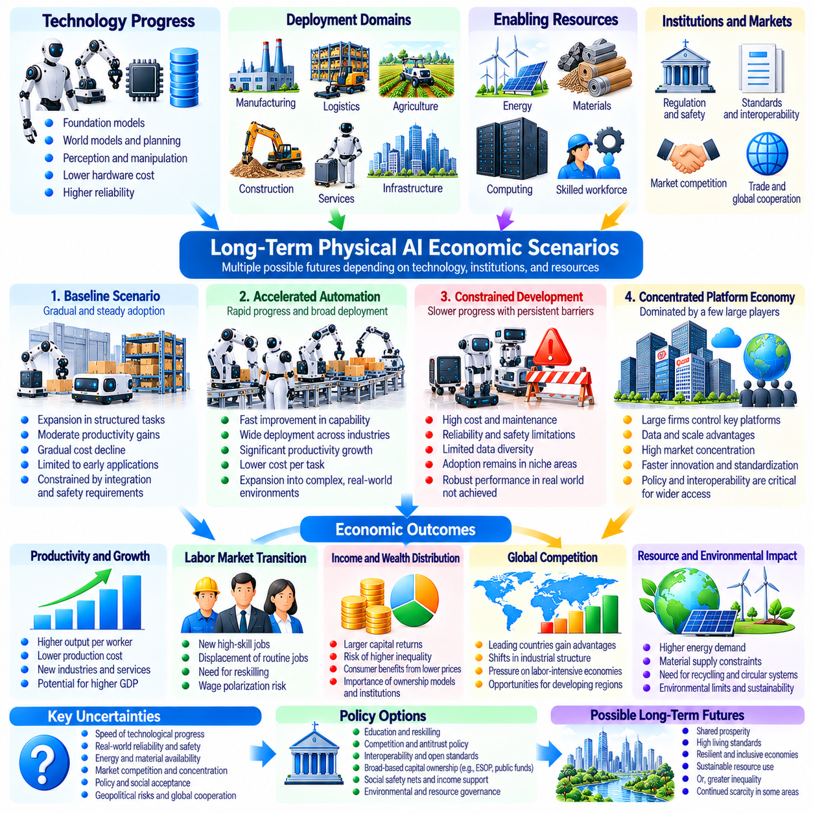{width="7.268055555555556in" height="7.268055555555556in"}

Long-term economic scenarios for Physical AI examine how intelligent robotic systems could transform production, employment, investment, and global competitiveness over several decades. These scenarios are not precise forecasts but structured representations of possible futures. Their purpose is to identify the conditions under which automation generates sustained prosperity, uneven growth, or economic disruption. Outcomes depend on technological progress, institutional adaptation, and resource availability.

A baseline scenario assumes gradual improvements in robotic intelligence, hardware reliability, and deployment economics. Physical AI expands first in structured environments where tasks are repetitive and operational conditions are predictable. Manufacturing, warehousing, and selected logistics applications achieve measurable productivity gains. Adoption remains constrained by capital costs, integration complexity, safety requirements, and the availability of skilled technical personnel.

An accelerated automation scenario assumes rapid advances in foundation models, world models, and adaptive control. Robots become capable of performing increasingly diverse physical tasks with reduced human supervision. Improvements in perception, manipulation, and long-horizon planning expand automation into construction, agriculture, and service industries. Economic growth accelerates when declining deployment costs coincide with reliable performance and expanding market demand.

A constrained development scenario emerges when technological progress fails to overcome practical deployment barriers. Robotic systems may demonstrate impressive capabilities in controlled environments while remaining unreliable in complex real-world operations. High maintenance expenses, limited data diversity, expensive computing, and safety concerns can delay commercialization. Under these conditions, Physical AI adoption remains concentrated in applications with predictable economic returns.

The productivity implications of these scenarios depend on the relationship between robotic capital and human labor. When robots complement workers, automation can increase output while supporting higher wages and new occupations. When substitution dominates, production may expand without equivalent employment growth. The resulting economic structure depends on task characteristics, labor mobility, educational systems, and the ability of institutions to distribute productivity benefits.

Capital accumulation plays a central role in long-term Physical AI development. Firms must finance robotic equipment, computing infrastructure, software integration, and operational support. High initial investment may favor large organizations, while declining hardware costs and service-based financing can broaden adoption. Economic outcomes depend not only on investment volume but also on utilization, equipment lifespan, maintenance efficiency, and realized productive value.

A high-productivity scenario assumes that robotic systems achieve substantial improvements in cost per successful task. Greater reliability, continuous operation, and shared learning reduce the resources required for physical work. Lower production costs may improve affordability and stimulate demand across multiple industries. However, these benefits depend on competitive markets and sufficient supplies of energy, materials, infrastructure, and complementary services.

A concentration scenario assumes that a limited number of firms control foundational robotic intelligence, computing resources, and deployment platforms. Strong economies of scale and data network effects may reinforce their advantages. Such organizations could accelerate innovation and standardization while capturing a large share of economic returns. Market access, interoperability, and competition policy would become important determinants of broader participation.

An open ecosystem scenario assumes widespread adoption of interoperable software, standardized hardware interfaces, and accessible robotic development tools. Specialized manufacturers and service providers can build solutions using shared technological foundations. This structure may encourage experimentation, regional innovation, and competition. However, open ecosystems still require sustainable maintenance, cybersecurity, safety validation, and mechanisms for coordinating technical standards.

Global economic outcomes may diverge according to national technological capabilities and industrial structures. Countries possessing advanced manufacturing, reliable energy systems, computing infrastructure, and skilled workforces may adopt Physical AI more rapidly. Economies dependent on labor-intensive exports could face adjustment pressures. Conversely, affordable robotic systems may enable developing regions to improve productivity and participate in more sophisticated production networks.

The energy and resource scenario examines whether physical constraints limit automation-driven expansion. Robotic production requires electricity, industrial materials, semiconductors, and supporting infrastructure. Improvements in energy generation, storage, recycling, and resource efficiency can expand feasible production capacity. Nevertheless, environmental limits and supply bottlenecks may prevent technological progress from translating into unrestricted material abundance.

Labor market transitions represent a major source of uncertainty across all scenarios. Physical AI may create demand for robotics engineers, maintenance technicians, system supervisors, and specialized service providers. Simultaneously, some routine occupations may experience declining demand. The net employment outcome depends on the pace of automation, the creation of complementary tasks, wage adjustments, and the capacity of workers to acquire new skills.

Income distribution may determine whether productivity growth translates into broad improvements in living standards. If robotic capital ownership remains concentrated, a growing share of income may flow to investors and platform providers. Broader ownership, competitive markets, and effective social institutions could distribute benefits more widely. Rising output alone does not guarantee equitable outcomes, particularly when labor income becomes less important.

A partial abundance scenario assumes that automation substantially reduces the cost of selected essential goods and services. Standardized manufactured products, logistics operations, and some agricultural activities may become increasingly affordable. However, land, energy, natural resources, and specialized human services remain constrained. The resulting economy may exhibit abundance in certain sectors while preserving scarcity and competition in others.

Long-term scenario analysis benefits from combining technological and economic variables rather than extrapolating robot installation numbers alone. Relevant variables include task success rates, autonomy levels, capital costs, energy consumption, utilization, and learning efficiency. Economic indicators may include labor productivity, capital returns, employment transitions, consumer prices, and income distribution. These measures help connect engineering performance to economic consequences.

Scenario models can represent robotic adoption as a function of expected economic value and implementation risk. Firms compare projected productivity gains with acquisition expenses, integration costs, operating expenditures, and financing requirements. Adoption becomes more attractive when reliable performance improves expected returns. However, uncertainty about maintenance, regulation, and technological obsolescence can delay investment even when theoretical productivity gains appear substantial.

Sensitivity analysis is essential because small changes in technical assumptions can produce different economic outcomes. Improvements in task success rates may reduce human intervention costs, while higher utilization can spread fixed expenses across more operations. Conversely, unexpected downtime or energy price increases can weaken projected profitability. Evaluating multiple parameter combinations helps distinguish robust economic opportunities from scenarios dependent on optimistic assumptions.

Dynamic feedback effects may amplify both favorable and unfavorable developments. Larger deployments can generate additional operational data, improve shared models, and lower future costs. Increased productivity may expand demand and finance further investment. However, concentrated ownership, infrastructure shortages, or weak competition can limit the distribution of benefits. Long-term models should therefore represent reinforcing learning cycles alongside economic and physical constraints.

The timing of technological adoption matters as much as eventual capability. Rapid deployment may generate significant productivity improvements but also increase adjustment pressure on workers and institutions. Gradual adoption may provide more time for retraining and infrastructure development while delaying potential economic benefits. Different industries will follow different trajectories because task complexity, regulation, and capital replacement cycles vary substantially.

Public policy can influence the direction of long-term Physical AI development through research funding, education, infrastructure, competition rules, and social protection. Governments may support technology diffusion while addressing displacement and concentration risks. However, policy interventions must balance innovation incentives, fiscal sustainability, safety, and distributional objectives. Institutional flexibility becomes important when technological capabilities evolve faster than existing regulatory frameworks.

A useful scenario framework distinguishes technological capability, economic feasibility, and realized societal benefit. A robot may be technically capable of performing a task without being economically competitive. Economically attractive automation may still produce unequal outcomes if ownership and market structures restrict benefit distribution. Evaluating all three dimensions prevents technological demonstrations from being mistaken for evidence of economy-wide transformation.

Ultimately, the long-term economic future of Physical AI is best understood as a range of conditional pathways rather than a predetermined destination. Intelligent automation could support sustained productivity growth, broader material abundance, and new forms of industrial organization. It could also intensify inequality, technological dependence, and resource pressures. The decisive factors will be the interaction of reliable robotic capability, productive investment, institutional adaptation, and equitable access to economic opportunity.
