**Volume 13. Future of Physical AI and Civilization**

# Chapter 03. Physical AI and Cities

## 03.01. Physical AI and the Future City

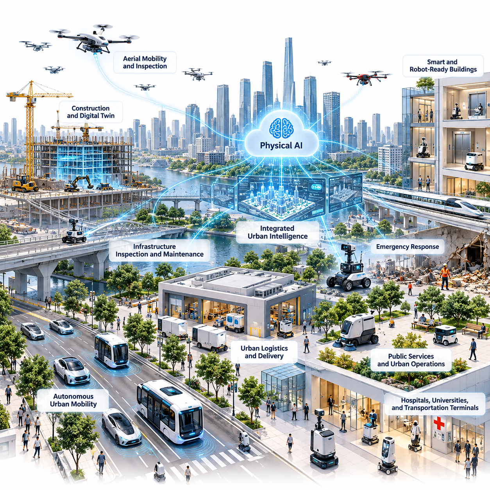{width="7.268055555555556in" height="7.268055555555556in"}

미래 도시(Future City)는 디지털로 연결된 기반시설(Infrastructure)의 집합에서 지능형 기계(Intelligent Machines)가 물리적 세계(Physical World)를 지속적으로 인식하고 해석하며 상호작용하는 환경으로 발전할 수 있다. 피지컬 AI(Physical AI)는 자율 이동(Autonomous Mobility), 조작(Manipulation), 검사(Inspection), 유지보수(Maintenance), 서비스 제공(Service Delivery)을 가능하게 함으로써 도시 지능(Urban Intelligence)을 정보처리 영역을 넘어 확장한다. 이러한 변화는 도시의 운영, 적응 및 시민 서비스 제공 방식을 근본적으로 바꿀 수 있다.

기존 스마트 시티(Smart City)는 센서(Sensor), 통신 네트워크(Communication Network), 클라우드 플랫폼(Cloud Platform), 데이터 분석(Data Analytics)을 활용하여 도시 관리(Urban Management)를 개선하는 데 중점을 두었다. 피지컬 AI는 자율 시스템(Autonomous System)이 디지털 의사결정(Digital Decision)을 실제 물리적 행동(Physical Action)으로 전환하는 운영 계층(Operational Layer)을 추가한다. 미래 도시 시스템은 교통 혼잡, 기반시설 노후화, 서비스 수요를 단순히 감지하는 것을 넘어 지능형 기계를 투입하여 변화하는 상황에 직접 대응할 수 있다.

피지컬 AI 기반 도시(Physical AI-Enabled City)로의 전환은 복잡한 도시 환경(Urban Environment)에서 인식(Perception), 추론(Reasoning), 계획(Planning), 제어(Control)를 통합하는 능력에 달려 있다. 자율이동로봇(Autonomous Mobile Robot), 배송 차량(Delivery Vehicle), 검사 플랫폼(Inspection Platform), 항공 시스템(Aerial System), 서비스 로봇(Service Robot)은 보행자, 건물, 교통망 및 예측하기 어려운 장애물 사이에서 작동해야 한다. 이러한 시스템의 효과적인 운영은 도시의 물리적 구조와 지속적으로 변화하는 활동을 함께 이해하는 능력에 달려 있다.

도시 환경은 구조화된 기반시설(Structured Infrastructure)과 매우 역동적인 인간 행동(Human Behavior)이 결합되어 있어 체화 지능(Embodied Intelligence)에 특히 까다로운 과제를 제시한다. 도로, 보도, 엘리베이터, 교차로 및 공공시설은 일정한 패턴을 따르지만 운영 조건은 하루 동안에도 계속 변화한다. 피지컬 AI 시스템은 이러한 패턴을 인식하는 동시에 예상하지 못한 사건, 일시적인 통행 제한 및 익숙하지 않은 상황에 안전하게 적응해야 한다.

자율 도시 이동성(Autonomous Urban Mobility)은 피지컬 AI의 잠재적 응용 분야 중 가장 가시적인 영역이다. 자율주행차(Self-Driving Vehicle), 자율 셔틀(Autonomous Shuttle), 로봇 배송 플랫폼(Robotic Delivery Platform), 지능형 교통 기반시설(Intelligent Transportation Infrastructure)은 대도시 전역의 이동 효율성을 높이기 위해 협력할 수 있다. 성공적인 통합을 위해서는 신뢰성 높은 위치 추정(Localization), 예측적 인식(Predictive Perception), 협력 항법(Coordinated Navigation), 불확실성(Uncertainty)을 처리할 수 있는 의사결정 시스템(Decision-Making System)이 필요하다.

도시 물류(Urban Logistics) 역시 자율 기계(Autonomous Machine)가 물류센터, 지역 거점시설, 상업용 건물 및 주거지역을 연결하면서 상당한 변화를 경험할 수 있다. 이동로봇(Mobile Robot)은 엘리베이터 및 출입통제 시스템(Access-Control System)과 협력하면서 창고, 보도, 건물 내부에서 물품을 운송할 수 있다. 이러한 통합은 더욱 연속적인 물류 운영(Continuous Logistics Operations)을 가능하게 하지만 실제 도입은 기반시설 호환성(Infrastructure Compatibility), 규제(Regulation), 운영 경제성(Operational Economics)에 달려 있다.

건물 자체도 점차 자율 기계에 적합한 환경으로 발전할 수 있다. 로봇 친화적 기반시설(Robot-Friendly Infrastructure)에는 표준화된 항법 인터페이스(Navigation Interface), 접근 가능한 이동 경로(Accessible Pathway), 자동문(Automated Door), 통신 기능을 갖춘 엘리베이터(Communication-Enabled Elevator), 지정된 서비스 구역(Service Zone)이 포함될 수 있다. 이러한 기능은 로봇 배치( Robot Deployment)의 복잡성을 줄이고 광범위한 환경 변경 없이 여러 로봇 플랫폼이 공동시설에서 작동하도록 지원한다.

피지컬 AI는 더욱 빈번한 상태 관찰(Condition Observation)과 목표 지향적 개입(Targeted Intervention)을 가능하게 하여 기반시설 유지보수(Infrastructure Maintenance)를 변화시킬 수 있다. 카메라(Camera), 라이다(LiDAR), 열화상 센서(Thermal Sensor) 및 기타 계측 장비를 탑재한 검사 로봇(Inspection Robot)은 교량, 터널, 배관, 도로 및 공공설비를 검사할 수 있다. 검사 측정값(Inspection Measurement)과 예측 모델(Predictive Model)을 결합하면 도시 운영자는 시설의 열화를 조기에 발견하고 위험도, 긴급성 및 가용 자원에 따라 유지보수 우선순위를 결정할 수 있다.

건설 활동(Construction Activities)은 자율 도시 기반시설 관리(Autonomous Urban Infrastructure Management)와 점차 긴밀하게 연결될 수 있다. 로봇 측량(Robotic Surveying), 자동 자재 운송(Automated Material Transportation), 건설현장 모니터링(Construction-Site Monitoring), 디지털 검증 시스템(Digital Verification System)은 설계 모델(Design Model)과 실제 구조물(Physical Structure) 사이의 조정 능력을 향상시킬 수 있다. 건축정보모델링(Building Information Modeling, BIM) 및 디지털 트윈(Digital Twin)과의 통합은 계획된 시공 상태와 실제 현장 진행 상황을 지속적으로 비교하도록 지원할 수 있다.

공공 서비스 로봇(Public Service Robot)은 위생관리, 청소, 폐기물 처리, 조경 및 일상적인 시설 유지보수를 지원할 수 있다. 이러한 시스템은 반복적이거나 위험한 작업을 수행하고 인간 작업자는 감독(Supervision), 복잡한 문제 해결(Complex Intervention), 시민 대면 업무(Public-Facing Responsibilities)에 집중하도록 할 수 있다. 그러나 도시 서비스 자동화(Urban Service Automation)는 보행자, 환경 변화, 접근성 요구사항(Accessibility Requirements), 공공장소에 대한 다양한 사회적 기대를 고려해야 한다.

긴급 대응(Emergency Response)은 피지컬 AI의 또 다른 중요한 응용 분야이다. 지상 로봇(Ground Robot)과 항공 플랫폼(Aerial Platform)은 인간 구조대원이 접근하기 어렵거나 위험한 환경에서 정찰(Reconnaissance), 유해물질 탐지(Hazardous-Material Detection), 재난 평가(Disaster Assessment), 수색 작업(Search Operations)을 지원할 수 있다. 이러한 시스템의 가치는 인간의 판단을 완전히 대체하는 것이 아니라 강건한 통신(Robust Communication), 신뢰성 높은 자율성(Reliable Autonomy), 기존 긴급관리 절차와의 협력에 달려 있다.

병원(Hospital), 대학교(University), 교통 터미널(Transportation Terminal), 정부시설(Government Facility)은 협력형 피지컬 AI(Coordinated Physical AI)를 조기에 도입할 수 있는 환경이 될 수 있다. 이러한 장소는 비교적 명확하게 정의된 운영 구역, 반복적인 운송 작업, 중앙집중식 시설관리(Centralized Facility Management)를 갖추는 경우가 많다. 자율 시스템은 내부 물류, 장비 이동, 청소 및 기반시설 검사를 지원하면서 더 넓은 도시 응용 분야에 활용할 운영 경험(Operational Experience)을 축적할 수 있다.

도시 항공 이동성(Urban Aerial Mobility)은 피지컬 AI의 운영 범위를 3차원 운송 및 검사 환경(Three-Dimensional Transportation and Inspection Environment)으로 확장할 수 있다. 무인항공시스템(Uncrewed Aerial System)은 허용된 범위에서 기반시설 조사, 긴급 상황 관측 및 특수 물류를 지원할 수 있다. 이를 통합하기 위해서는 공역 조정(Airspace Coordination), 장애물 회피(Obstacle Avoidance), 소음 관리(Noise Management), 보안 통신(Secure Communication), 비행 경로 아래의 사람과 재산을 보호하는 체계가 필요하다.

로봇 배치가 확대되면 개별 자율성(Individual Autonomy)만으로는 도시 규모의 운영을 관리하기 어려워진다. 다중 로봇 군집 관리 플랫폼(Multi-Robot Fleet Management Platform)은 작업 우선순위(Task Priority), 지리적 분포(Geographic Distribution), 배터리 가용성(Battery Availability), 교통 상황 및 서비스 요구사항에 따라 이기종 로봇(Heterogeneous Robot)을 조정할 수 있다. 조직 간 협력을 위해서는 상호운용성 표준(Interoperability Standard), 접근 권한(Access Permission), 상충하는 운영 요구사항을 해결하는 메커니즘도 필요하다.

공유 지도(Shared Map)와 월드 모델(World Model)은 미래 도시 지능(Future Urban Intelligence)의 핵심 구성요소가 될 수 있다. 각 로봇 시스템이 완전히 독립된 환경 표현(Environment Representation)을 유지하는 대신 승인된 시스템 사이에서 공간정보(Spatial Information), 주행 가능성(Traversability), 장애물 관측정보(Obstacle Observation), 기반시설 변경사항을 선택적으로 공유할 수 있다. 이러한 정보 공유는 항법 효율성(Navigation Efficiency)을 높이고 반복적인 환경 탐색을 줄일 수 있지만 데이터 품질(Data Quality)과 보안(Security)에 대한 중요한 요구사항을 수반한다.

도시 디지털 트윈(City Digital Twin)은 물리적 기반시설(Physical Infrastructure)을 예측 시뮬레이션(Predictive Simulation) 및 운영 계획(Operational Planning)과 연결하는 컴퓨팅 환경(Computational Environment)을 제공할 수 있다. 신뢰할 수 있는 센서 관측정보로 갱신되는 디지털 트윈은 교통 흐름, 건물 상태, 로봇 활동 및 환경 변화를 표현할 수 있다. 피지컬 AI 시스템은 이를 활용하여 실제 행동을 실행하기 전에 계획된 행동을 평가할 수 있지만 시뮬레이션의 불확실성(Simulation Uncertainty)은 명시적으로 고려해야 한다.

도시 규모의 피지컬 AI 아키텍처(City-Scale Physical AI Architecture)는 온보드 지능(Onboard Intelligence), 엣지 컴퓨팅(Edge Computing), 중앙집중식 조정 서비스(Centralized Coordination Service)를 결합할 수 있다. 로봇은 통신이 중단되더라도 작동하는 로컬 인식(Local Perception)과 안전 필수 제어(Safety-Critical Control)를 필요로 한다. 엣지 기반시설은 저지연 협력(Low-Latency Coordination)을 지원하고 클라우드 플랫폼(Cloud Platform)은 군집 분석(Fleet Analytics), 과거 경험 학습(Historical Learning), 대규모 시뮬레이션 및 공유 환경 표현의 갱신을 제공할 수 있다.

도시 로봇 데이터 기반시설(Urban Robot Data Infrastructure)은 수집된 모든 데이터를 중앙에 집중해야 한다고 가정하지 않으면서 신뢰성 높은 정보 교환을 지원해야 한다. 센서 관측정보, 운영 이벤트(Operational Event), 유지보수 이력(Maintenance History), 환경 변화 데이터는 저장(Storage), 보존(Retention), 접근(Access), 처리(Processing)에 서로 다른 요구사항을 가질 수 있다. 개인정보 보호 학습(Privacy-Preserving Learning), 선택적 데이터 공유(Selective Data Sharing), 명확한 거버넌스 정책(Governance Policy)은 시민의 신뢰를 유지하는 데 필수적이다.

자율 기계가 주로 인간 활동을 위해 설계된 환경에서 작동할 때 안전성(Safety)은 특히 중요해진다. 피지컬 AI 시스템은 보행자, 자전거 이용자, 어린이, 장애인 및 기타 취약한 참여자를 고려해야 한다. 실행시간 모니터링(Runtime Monitoring), 불확실성 인식 계획(Uncertainty-Aware Planning), 비상 정지(Emergency Stopping), 운영 경계(Operational Boundary), 인간 개입 메커니즘(Human Intervention Mechanism)은 책임 있는 도시 로봇 배치의 필수 구성요소이다.

사이버보안(Cybersecurity)과 운영 복원력(Operational Resilience)도 중요하다. 연결된 로봇은 물리적 기반시설과 공공 서비스에 직접 영향을 미칠 수 있기 때문이다. 승인되지 않은 명령(Unauthorized Command), 손상된 지도(Corrupted Map), 통신 장애(Communication Failure), 침해된 군집 관리 플랫폼(Compromised Fleet Platform)은 기존 정보보안 사고를 넘어서는 결과를 초래할 수 있다. 따라서 미래 도시는 안전한 신원 관리(Secure Identity Management), 인증된 통신(Authenticated Communication), 장애 격리(Fault Isolation), 자율 물리 시스템의 복구 절차(Recovery Procedure)를 필요로 한다.

시민 수용성(Public Acceptance)은 기술적 성능뿐 아니라 투명성(Transparency), 책임성(Accountability), 사회적 가치(Social Value)에 대한 인식에도 달려 있다. 시민은 자율 기계가 어디에서 작동하고 어떤 정보를 수집하며 사고가 발생했을 때 어떻게 조사되는지 이해할 수 있어야 한다. 명확한 운영 규칙(Operating Rule), 접근 가능한 신고 채널(Accessible Reporting Channel), 실질적인 인간 감독(Human Oversight)은 신뢰를 구축하고 로봇 배치에 관한 의사결정이 공공 거버넌스(Public Governance)의 통제를 받도록 지원할 수 있다.

접근성(Accessibility)은 부차적인 설계 요소가 아니라 피지컬 AI 기반시설의 초기 단계부터 반영되어야 한다. 로봇은 이동 보조기구(Mobility Aid), 보행자 통로(Pedestrian Pathway), 비상구(Emergency Exit), 대중교통 접근로(Public Transportation Access)를 방해하지 않으면서 이동해야 한다. 포용적 설계(Inclusive Design)는 다양한 신체 능력(Physical Ability), 디지털 활용 능력(Digital Literacy), 사회경제적 조건(Socioeconomic Circumstances)을 가진 사람들이 로봇 서비스를 이용할 수 있도록 보장하는 것도 의미한다.

피지컬 AI 기반 도시의 경제적 영향(Economic Implication)은 개별 수작업(Manual Task)을 대체하는 수준을 넘어선다. 자율 서비스(Autonomous Service)는 기반시설 투자(Infrastructure Investment), 유지보수 비용(Maintenance Cost), 운송 생산성(Transportation Productivity), 도시 노동의 조직 방식(Organization of Urban Labor)을 변화시킬 수 있다. 그 효과는 활용률(Utilization), 신뢰성(Reliability), 에너지 소비(Energy Consumption), 통합 비용(Integration Expense), 공공 및 민간 이해관계자 사이의 소유권과 접근성 분배에 달려 있다.

환경적 지속가능성(Environmental Sustainability) 역시 미래 로봇 도시(Robotic City)의 발전에 영향을 미친다. 자율 시스템은 불필요한 운송을 줄이고 효율적인 유지보수를 지원하며 에너지 및 자원 소비에 대한 모니터링을 개선할 수 있다. 그러나 로봇 제조(Robot Manufacturing), 배터리 생산(Battery Production), 컴퓨팅 기반시설(Computing Infrastructure), 추가 전력 수요(Additional Electricity Demand)는 환경적 비용(Environmental Cost)을 발생시키므로 전체 시스템 수명주기(System Lifecycle)에 걸친 평가가 필요하다.

장기적인 도시 변화(Long-Term Urban Transformation)는 기존 기반시설을 즉시 대체하기보다는 점진적인 통합(Gradual Integration)을 통해 진행될 가능성이 높다. 통제된 시설(Controlled Facility)과 명확하게 정의된 서비스 경로(Service Route)에서 초기 배치가 이루어지고 신뢰성과 상호운용성이 개선되면서 점차 복잡한 공공 환경으로 확대될 수 있다. 도시마다 발전 속도는 규제, 기반시설 준비 수준(Infrastructure Readiness), 경제적 조건(Economic Conditions), 사회적 우선순위(Social Priorities)에 따라 달라질 것이다.

궁극적으로 피지컬 AI 기반 미래 도시는 완전히 자동화된 도시 유기체(Fully Automated Urban Organism)가 아니라 인간과 기계가 협력하는 환경(Coordinated Human-Machine Environment)으로 이해해야 한다. 핵심 역량은 센싱(Sensing), 예측적 이해(Predictive Understanding), 집단적 계획(Collective Planning), 책임 있는 물리적 행동(Responsible Physical Action)을 연결하는 데 있다. 이러한 변화의 성공 여부는 자율 지능(Autonomous Intelligence)이 실질적인 인간 통제(Meaningful Human Control)를 유지하면서 도시의 안전성, 접근성, 복원력, 지속가능성 및 인간의 복지(Human Well-Being)를 얼마나 개선하는지에 달려 있다.

## 03.02. Autonomous Urban Mobility

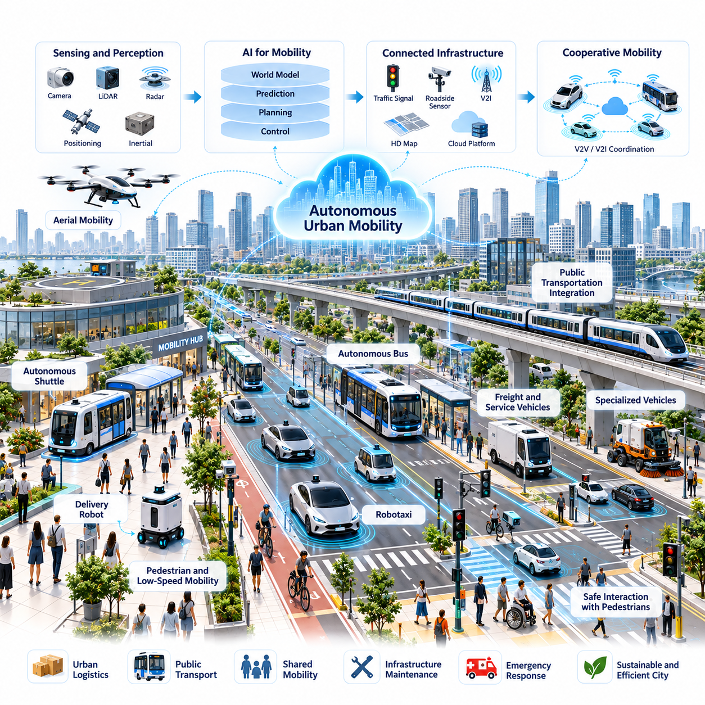{width="7.268055555555556in" height="7.268055555555556in"}

자율 도시 이동성(Autonomous Urban Mobility)은 사람, 물품 및 서비스가 도시 내에서 이동하는 방식을 근본적으로 변화시키는 기술적 전환을 의미한다. 피지컬 AI(Physical AI)는 교통 시스템이 주변 환경을 인식하고 복잡한 교통 상황을 해석하며 지속적인 인간 제어에 대한 의존도를 줄이면서 물리적 행동(Physical Action)을 수행하도록 한다. 이러한 발전은 개별 차량의 자동화를 넘어 지능형 이동 시스템(Intelligent Mobility System)이 상호 협력하는 도시 교통 네트워크로 확장될 수 있다.

기존 도시 교통 시스템(Urban Transportation System)은 인간 운전자(Human Driver), 고정된 교통 규칙(Traffic Regulation), 수동 운전 차량을 중심으로 설계된 기반시설(Infrastructure)에 의존한다. 자율 이동성(Autonomous Mobility)은 실시간 환경 조건(Real-Time Environmental Conditions)에 대응하는 적응형 의사결정(Adaptive Decision-Making) 능력을 도입한다. 차량과 이동로봇(Mobile Robot)은 교통 밀도(Traffic Density), 보행자 활동(Pedestrian Activity), 도로 상태(Road Conditions), 변화하는 교통 수요(Transportation Demand)에 따라 경로, 속도 및 운영 전략을 조정할 수 있다.

자율 도시 이동성의 기술적 기반은 인식(Perception), 위치 추정(Localization), 예측(Prediction), 계획(Planning), 제어(Control)를 결합하는 것이다. 카메라(Camera), 라이다(LiDAR), 레이더(Radar), 위치 측정 시스템(Positioning System), 관성 센서(Inertial Sensor)는 주변 환경에 대한 상호보완적인 관측정보를 제공한다. 센서 융합 알고리즘(Sensor Fusion Algorithm)은 이러한 측정값을 일관된 환경 표현(Environment Representation)으로 통합하여 장애물 탐지, 도로 이해, 차량 위치 추정 및 복잡한 도시 공간에서의 신뢰성 높은 항법(Navigation)을 지원한다.

도시 환경 인식(Urban Perception)은 정적인 객체를 인식하거나 교통신호를 식별하는 것 이상의 능력을 요구한다. 자율 시스템(Autonomous System)은 보행자, 자전거 이용자, 인간 운전 차량 및 다른 자율 기계의 의도와 가능한 움직임을 이해해야 한다. 예측 모델(Predictive Model)은 서로 다른 시간 범위(Time Horizon)에서 이러한 교통 참여자의 행동을 추정하며, 이동 시스템이 적절한 행동을 선택하기 전에 잠재적인 상호작용을 평가하도록 지원한다.

월드 모델(World Model)은 환경 인식(Environmental Perception)과 미래 지향적 추론(Future-Oriented Reasoning)을 연결하는 중요한 프레임워크(Framework)를 제공한다. 자율주행차(Autonomous Vehicle)는 도로 형상(Road Geometry), 이동 객체(Moving Object), 교통 규칙(Traffic Rule), 불확실한 환경 조건을 포함하는 동적 표현(Dynamic Representation)을 유지할 수 있다. 행동 조건부 예측 모델(Action-Conditioned Predictive Model)은 서로 다른 주행 결정에 따른 미래 상태를 추정하여 더욱 안전한 궤적 선택(Trajectory Selection)과 익숙하지 않은 상황에서의 적응형 행동(Adaptive Behavior)을 지원한다.

신뢰성 높은 위치 추정(Reliable Localization)은 도시 환경에 터널, 고가도로, 밀집된 건물 및 위성 위치 측정(Satellite Positioning)이 불안정한 지역이 존재하기 때문에 필수적이다. 자율 이동 시스템은 시각 기반 위치 추정(Visual Localization), 라이다 매핑(LiDAR Mapping), 관성 항법(Inertial Navigation), 휠 오도메트리(Wheel Odometry), 기반시설 기반 위치 측정(Infrastructure-Based Positioning)을 결합할 수 있다. 이러한 상호보완적 기술은 단일 위치 측정 기술에 대한 의존도를 줄이면서 정확한 차량 상태 추정(Vehicle State Estimation)을 유지하도록 지원한다.

운동 계획(Motion Planning)은 환경에 대한 이해를 실제 실행 가능한 차량 궤적(Vehicle Trajectory)으로 변환한다. 계획 시스템(Planning System)은 충돌 회피(Collision Avoidance), 교통 규정(Traffic Regulation), 승객 승차감(Passenger Comfort), 차량 동역학(Vehicle Dynamics), 운영 효율성(Operational Efficiency)을 동시에 고려해야 한다. 계층적 계획 아키텍처(Hierarchical Planning Architecture)는 경로 선택(Route Selection), 행동 결정(Behavioral Decision), 단기 궤적 최적화(Short-Horizon Trajectory Optimization)를 분리하면서 새로운 센서 정보가 입력될 때마다 의사결정을 지속적으로 갱신할 수 있다.

차량 제어(Vehicle Control)는 계획된 궤적을 조향(Steering), 제동(Braking), 추진(Propulsion) 및 기타 물리적 구동기(Physical Actuator)의 동작과 연결한다. 모델 예측 제어(Model Predictive Control, MPC)와 피드백 기반 제어(Feedback-Based Control)는 외란(Disturbance), 구동기 한계(Actuator Limitation), 도로 조건 변화에 대응할 수 있다. 그러나 효과적인 제어를 위해서는 차량 동역학, 타이어와 노면의 상호작용(Tire-Road Interaction), 시스템 지연(System Latency), 불확실성(Uncertainty)에 대한 정확한 추정이 필요하며, 특히 비상 기동(Emergency Maneuver)이나 악천후 상황에서 중요하다.

자율 도시 이동성은 단일한 범용 플랫폼(Universal Platform)이 아니라 다양한 차량 유형(Vehicle Category)을 포함한다. 로보택시(Robotaxi), 자율주행 버스(Autonomous Bus), 지역 셔틀(Neighborhood Shuttle), 배송 로봇(Delivery Robot), 특수 서비스 차량(Specialized Service Vehicle)은 서로 다른 물리적 제약(Physical Constraint)과 규제 조건(Regulatory Constraint)에서 작동한다. 이들의 지능형 아키텍처(Intelligence Architecture)는 공통적인 인식 및 계획 기능을 공유할 수 있지만 서로 다른 안전 메커니즘(Safety Mechanism), 이동 구조(Mobility Configuration), 운영 정책(Operational Policy)이 필요하다.

자율 대중교통(Autonomous Public Transportation)은 대용량 교통망(High-Capacity Transit Network)과 인구 밀도가 낮은 지역 또는 교통 서비스가 부족한 목적지를 연결함으로써 서비스 유연성(Service Flexibility)을 향상시킬 수 있다. 소형 자율 셔틀(Small Autonomous Shuttle)은 특히 예측 가능한 경로에서 수요 대응형 교통(Demand-Responsive Transportation)을 지원할 수 있다. 경제적 실현 가능성(Economic Feasibility)은 차량 활용률(Vehicle Utilization), 유지보수 요구사항(Maintenance Requirements), 감독 비용(Supervision Cost), 접근성(Accessibility), 기존 대중교통 시스템과의 통합 수준에 달려 있다.

보행자가 밀집된 환경(Pedestrian-Rich Environment)은 일반적인 도로 주행과 상당히 다른 과제를 제시한다. 보도 배송 로봇(Sidewalk Delivery Robot)과 저속 자율주행차(Low-Speed Autonomous Vehicle)는 좁은 통로, 일시적인 장애물, 군중 및 예측하기 어려운 인간 상호작용을 처리해야 한다. 안전한 운영을 위해서는 보수적인 이동 정책(Conservative Motion Policy), 사회적 상황을 고려한 항법(Socially Aware Navigation), 보행자 및 이동에 제약이 있는 사람에게 적절하게 양보하는 메커니즘이 필요하다.

연결형 기반시설(Connected Infrastructure)은 개별 차량이 신뢰성 있게 관측하기 어려운 정보를 제공함으로써 자율 이동성을 향상시킬 수 있다. 교통신호(Traffic Signal), 도로변 센서(Roadside Sensor), 교차로 모니터링 시스템(Intersection Monitoring System), 차량-인프라 통신(Vehicle-to-Infrastructure Communication, V2I)은 선택된 교통 상황 및 운영 경고 정보를 공유할 수 있다. 그러나 자율주행차는 통신 기반시설을 사용할 수 없거나 통신이 지연되거나 보안이 침해된 상황에서도 안전하게 작동할 수 있어야 한다.

협력형 이동성(Cooperative Mobility)은 차량과 교통 기반시설 사이의 협력을 위한 새로운 가능성을 제공한다. 연결형 자율주행차(Connected Autonomous Vehicle)는 의도(Intention), 계획된 주행 동작(Planned Maneuver), 위험 정보(Hazard Information)를 교환하여 상황 인식(Situational Awareness)을 향상시킬 수 있다. 이러한 협력은 더욱 원활한 교차로 운영과 협력형 합류(Coordinated Merging)를 지원할 수 있지만 상호운용성(Interoperability), 통신 신뢰성(Communication Reliability), 사이버보안(Cybersecurity), 혼합 교통 행동(Mixed-Traffic Behavior)은 여전히 중요한 기술적 과제로 남아 있다.

도시 규모의 이동성 조정(City-Scale Mobility Coordination)은 개별 차량의 행동을 최적화하는 범위를 넘어선다. 군집 관리 플랫폼(Fleet Management Platform)은 운송 요청을 할당하고 차량 가용성을 조절하며 충전 일정을 관리하고 수요에 따라 서비스 제공 범위를 조정할 수 있다. 교통관리 시스템(Traffic Management System)과의 통합은 전체 네트워크 효율성(Network Efficiency)을 향상시킬 수 있지만 중앙집중식 최적화(Centralized Optimization)는 개별 차량의 안전 의사결정(Local Safety Decision)과 운영 제약(Operational Constraint)을 존중해야 한다.

디지털 트윈(Digital Twin)과 시뮬레이션 환경(Simulation Environment)은 자율 도시 교통(Autonomous Urban Transportation)의 개발을 가속할 수 있다. 도로, 교차로, 교통 참여자 및 환경 조건을 상세하게 표현한 가상 환경(Virtual Environment)은 개발자가 다양한 시나리오에서 이동성 알고리즘(Mobility Algorithm)을 평가하도록 지원한다. 시뮬레이션은 희귀 사건 시험(Rare-Event Testing)과 운영 계획(Operational Planning)을 지원할 수 있지만 성공적인 실제 배치를 위해서는 광범위한 실세계 검증(Real-World Validation)과 시뮬레이션-현실 차이(Simulation-to-Reality Gap)에 대한 신중한 평가가 여전히 필요하다.

데이터 기반 학습(Data-Driven Learning)은 자율 이동 시스템의 성능 개선을 위한 또 다른 기반을 제공한다. 차량 군집(Vehicle Fleet)은 운영 관측정보(Operational Observation), 개입 기록(Intervention Record), 비정상적인 교통 사건(Unusual Traffic Event), 환경 변화(Environmental Change)를 수집할 수 있다. 신중하게 선별된 데이터셋(Curated Dataset)은 인식 성능 개선(Perception Refinement), 예측 모델링(Predictive Modeling), 정책 개선(Policy Improvement)을 지원할 수 있으며, 책임 있는 대규모 학습을 위해 개인정보 보호(Privacy Protection)와 안전한 데이터 거버넌스(Secure Data Governance)가 필요하다.

안전성 보증(Safety Assurance)은 일반적인 교통 상황뿐 아니라 발생 빈도는 낮지만 결과가 심각한 사건(High-Consequence Event)까지 고려해야 한다. 자율 시스템은 성능이 저하된 센서(Degraded Sensor), 예상하지 못한 장애물(Unexpected Obstacle), 불확실한 예측(Uncertain Prediction), 계획 또는 제어 실패를 탐지하는 메커니즘을 필요로 한다. 실행시간 보증 아키텍처(Runtime Assurance Architecture)는 시스템 행동을 모니터링하고 운영 조건이 검증된 능력 범위를 벗어날 때 보수적인 대체 전략(Conservative Fallback Strategy)을 활성화할 수 있다.

운행설계영역(Operational Design Domain, ODD)은 자율 이동 시스템이 안전하게 작동하도록 설계된 조건을 정의한다. 이러한 조건에는 지리적 경계(Geographic Boundary), 도로 유형(Road Category), 기상 제한(Weather Limit), 속도 범위(Speed Range), 기반시설 요구사항(Infrastructure Requirement)이 포함될 수 있다. 도시 전역으로 자율 이동성을 확장하려면 특정 지역에서 확보한 성능이 다른 지역에도 자동으로 적용된다고 가정하기보다 추가적인 운영 조건에 대한 체계적인 검증(Systematic Validation)이 필요하다.

혼합 교통(Mixed Traffic)은 상당한 전환 기간 동안 도시 교통의 주요 특징으로 남을 가능성이 높다. 인간 운전 차량(Human-Driven Vehicle), 자율 플랫폼(Autonomous Platform), 자전거 이용자(Cyclist), 보행자(Pedestrian)는 서로 다른 행동 특성을 보이면서 동일한 기반시설을 공유하게 된다. 따라서 자율 시스템은 교통 규칙의 불완전한 준수(Imperfect Compliance), 모호한 사회적 신호(Ambiguous Social Signal), 예상하지 못한 인간 의사결정에 대응해야 하며 모든 교통수단이 연결형 기술을 채택한다는 가정에 의존해서는 안 된다.

접근성(Accessibility)과 시민 수용성(Public Acceptance)은 자율 이동성의 성공을 결정하는 핵심 요소이다. 차량은 서로 다른 신체 능력(Physical Ability), 의사소통 요구사항(Communication Need), 기술 친숙도(Technological Familiarity)를 가진 승객을 수용해야 한다. 투명한 운영 절차(Transparent Operating Procedure), 접근 가능한 승객 인터페이스(Accessible Passenger Interface), 긴급 지원 메커니즘(Emergency Assistance Mechanism), 사고에 대한 명확한 책임성(Accountability)은 자율 교통 서비스에 대한 신뢰를 형성하는 데 기여할 수 있다.

경제적 성과(Economic Performance)는 자율 이동성의 배치 규모와 속도에 영향을 미친다. 자율 이동성은 운전 관련 노동 수요(Driving-Related Labor Requirement)를 일부 줄일 수 있지만 센서, 컴퓨팅 하드웨어(Computing Hardware), 군집 감독(Fleet Supervision), 유지보수, 보험(Insurance), 소프트웨어 검증(Software Validation)과 관련된 새로운 비용을 발생시킨다. 지속가능한 비즈니스 모델(Sustainable Business Model)은 자동화 능력만을 평가하는 것이 아니라 총운영비용(Total Operating Cost), 차량 활용률, 서비스 신뢰성(Service Reliability), 교통 수요를 종합적으로 고려해야 한다.

환경적 성과(Environmental Outcome)는 자율 이동성이 교통 행동(Transportation Behavior)과 에너지 소비(Energy Consumption)를 어떻게 변화시키는지에 따라 달라진다. 협력형 경로 계획(Coordinated Routing)과 효율적인 주행(Efficient Driving)은 불필요한 이동을 줄일 수 있으며 전동화된 차량 군집(Electrified Fleet)은 운행 단계의 배출량(Operational Emission) 감소에 기여할 수 있다. 그러나 빈 차량의 재배치(Empty Vehicle Repositioning), 교통 수요 증가(Increased Travel Demand), 배터리 생산(Battery Production), 컴퓨팅 에너지 소비(Computing Energy Consumption)는 일부 이점을 상쇄할 수 있으므로 광범위한 지속가능성 정책(Sustainability Policy)과 통합된 배치가 필요하다.

도시 거버넌스(Urban Governance)는 자율 교통이 공공 기반시설 및 지역사회 우선순위와 어떻게 상호작용하는지를 결정한다. 관계 당국은 운행 허가(Operating Permission), 안전 보고 요구사항(Safety Reporting Requirement), 도로변 접근 정책(Curbside Access Policy), 데이터 공유 표준(Data-Sharing Standard), 법적 책임 체계(Liability Framework)를 수립해야 할 수 있다. 효과적인 규제(Effective Regulation)는 혁신을 장려하면서도 집행 가능한 안전 기준(Enforceable Safety Expectation), 공정한 교통 접근성(Fair Transportation Access), 상업적 이동 서비스 운영자에 대한 실질적인 감독(Meaningful Oversight)을 유지해야 한다.

시간이 지남에 따라 자율 도시 이동성은 개별 차량의 독립적인 배치에서 상호 연결된 교통 생태계(Interconnected Transportation Ecosystem)로 발전할 수 있다. 공유 환경 표현(Shared Environmental Representation), 협력형 군집 관리(Cooperative Fleet Management), 예측적 교통 조정(Predictive Traffic Coordination), 로봇 호환 기반시설(Robot-Compatible Infrastructure)은 시스템 전체의 대응 능력을 향상시킬 수 있다. 그러나 기술적 상호운용성과 협력 운영(Coordinated Operation)을 실현하기 위해서는 지속적인 투자, 기관 간 협력(Institutional Cooperation), 검증된 안전 메커니즘이 필요하다.

자율 도시 이동성의 장기적 중요성(Long-Term Significance)은 기계 지능(Machine Intelligence)을 도시의 물리적 조직(Physical Organization)과 연결할 수 있다는 가능성에 있다. 교통 시스템은 변화하는 인간의 요구에 더욱 적응적이고 접근 가능하며 신속하게 대응하는 방향으로 발전할 수 있다. 이러한 비전을 실현하기 위해서는 체화 지능(Embodied Intelligence), 신뢰성 높은 제어(Reliable Control), 기반시설 통합(Infrastructure Integration), 공공 거버넌스(Public Governance), 인간과 자율 이동 시스템 사이의 책임 있는 협력(Responsible Coordination)에서 지속적인 발전이 필요하다.

## 03.03. Urban Logistics and Autonomous Delivery

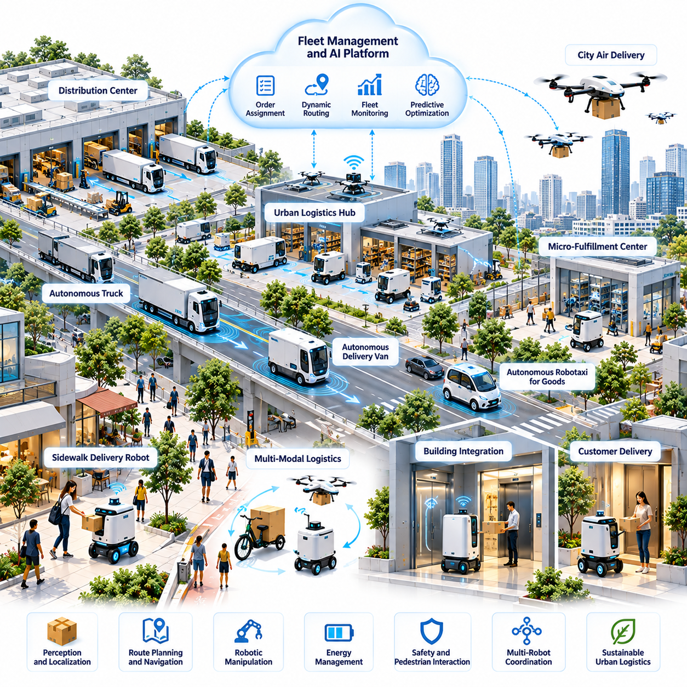{width="7.268055555555556in" height="7.268055555555556in"}

도시 물류(Urban Logistics)는 운송 중심의 활동에서 지능형 자율 물리 운영(Intelligent Autonomous Physical Operations) 네트워크로 발전하고 있다. 피지컬 AI(Physical AI)는 배송 차량(Delivery Vehicle), 이동로봇(Mobile Robot), 물류 기반시설(Logistics Infrastructure)이 변화하는 환경을 인식하고 이동을 조정하며 인간의 개입을 줄이면서 운송 작업을 수행하도록 한다. 이러한 변화는 점점 복잡해지는 대도시 환경(Metropolitan Environment)에서 물품 유통의 효율성(Efficiency), 대응성(Responsiveness), 복원력(Resilience)을 향상시킬 수 있다.

기존 도시 물류(Urban Logistics)는 중앙집중식 물류센터(Centralized Distribution Center), 인간이 운전하는 차량(Human-Operated Vehicle), 수동으로 조정되는 최종 배송(Last-Mile Delivery) 과정에 의존한다. 전자상거래(E-Commerce) 수요 증가, 교통 혼잡(Traffic Congestion), 노동력 제약(Labor Constraints), 고객 기대 수준의 상승은 더욱 적응적인 시스템의 필요성을 높이고 있다. 자율 배송(Autonomous Delivery)은 물류 거점(Logistics Hub), 상업시설(Commercial Facility), 주거용 건물(Residential Building), 지역 수령 거점(Neighborhood Collection Point) 사이에서 물품을 운송할 수 있는 지능형 기계를 도입한다.

자율 도시 물류 아키텍처(Autonomous Urban Logistics Architecture)는 인식(Perception), 위치 추정(Localization), 경로 계획(Route Planning), 조작(Manipulation), 군집 조정(Fleet Coordination)을 통합한다. 이동로봇은 카메라(Camera), 라이다(LiDAR), 관성 센서(Inertial Sensor), 위치 측정 기술(Positioning Technology)을 활용하여 주변 환경을 이해한다. 온보드 지능(Onboard Intelligence)은 로컬 항법(Local Navigation)을 지원하고, 군집 관리 플랫폼(Fleet Management Platform)은 배송 작업 할당, 차량 가용성, 충전 일정 및 물류 기반시설과의 상호작용을 조정한다.

최종 배송(Last-Mile Delivery)은 마지막 운송 구간에서 운영 복잡성(Operational Complexity)이 높고 배송 밀도(Delivery Density)가 상대적으로 낮은 경우가 많기 때문에 특히 중요한 응용 분야이다. 보도 주행 로봇(Sidewalk Robot), 자율 배송 차량(Autonomous Delivery Vehicle), 특수 이동 플랫폼(Specialized Mobile Platform)은 서로 다른 지리적 조건과 상업적 요구사항에 대응할 수 있다. 이러한 시스템의 효과는 신뢰성 높은 항법(Reliable Navigation), 보행자와의 안전한 상호작용(Safe Interaction), 배송 목적지에서의 효율적인 물품 인계(Efficient Goods Transfer)에 달려 있다.

자율 배송은 역동적인 도시 환경(Dynamic Urban Environment)에 대한 지속적인 이해를 요구한다. 로봇은 보도, 횡단보도, 출입구, 장애물, 공사 구역(Construction Zone), 일시적인 접근 제한(Temporary Access Restriction)을 인식해야 한다. 월드 모델(World Model)은 이러한 환경의 공간 표현(Spatial Representation)을 유지하면서 상황이 어떻게 변화할 수 있는지 추정할 수 있다. 예측적 계획(Predictive Planning)은 예상하지 못한 상황이 발생했을 때 로봇이 대체 경로(Alternative Route)를 선택하고 행동을 조정하도록 지원한다.

도시 배송 로봇(Urban Delivery Robot)은 서로 다른 물리적 제약(Physical Constraint)을 가진 환경에서 작동한다. 공공도로(Public Road), 보행자 통로(Pedestrian Pathway), 주차장(Parking Area), 상하차 구역(Loading Zone), 건물 내부(Building Interior)는 각각 다른 항법 및 안전 요구사항을 가진다. 따라서 배송 시스템은 여러 종류의 로봇 플랫폼(Robotic Platform)이나 신중하게 설계된 환적 거점(Transfer Point)을 필요로 할 수 있다. 끊김 없는 물류 운영(Seamless Logistics)은 각 운송 구간을 독립적으로 취급하기보다 이러한 환경을 통합적으로 조정하는 데 달려 있다.

마이크로 풀필먼트 센터(Micro-Fulfillment Center)와 지역 물류 거점(Neighborhood Logistics Hub)은 자율 배송 네트워크(Autonomous Delivery Network)의 중요한 구성요소가 될 수 있다. 이러한 시설은 재고(Inventory)를 고객 가까이에 배치하고 소형 로봇 차량(Small Robotic Vehicle)을 위한 대기 및 작업 공간(Staging Area)을 제공한다. 광역 물류센터(Regional Distribution Center)와 지역 배송 로봇(Local Delivery Robot)을 연결하면 도시는 일부 장거리 배송 이동을 줄이면서 대응 시간을 개선하고 더욱 유연한 유통 전략(Distribution Strategy)을 지원할 수 있다.

건물 통합(Building Integration)은 자율 배송을 보도와 상하차 구역을 넘어 확장하기 위한 필수 요소이다. 로봇은 자동문(Automated Door), 엘리베이터(Elevator), 출입통제 시스템(Access-Control System), 배송 보관함(Delivery Locker), 실내 항법 기반시설(Indoor Navigation Infrastructure)과 상호작용해야 할 수 있다. 표준화된 인터페이스(Standardized Interface)는 승인된 기계가 실외와 실내 환경 사이를 이동하도록 지원할 수 있지만 보안(Security), 개인정보 보호(Privacy), 접근성(Accessibility), 건물별 운영 정책(Building-Specific Operating Policy)은 핵심 고려사항으로 유지되어야 한다.

로봇 조작(Robotic Manipulation)은 자율 운송을 넘어서는 추가적인 기능을 제공한다. 이동형 매니퓰레이터(Mobile Manipulator)는 소포 적재, 컨테이너 이송, 호환 가능한 보관 시스템 조작, 지정된 배송 인터페이스와의 상호작용을 수행할 수 있다. 이러한 작업에는 객체 인식(Object Recognition), 파지 계획(Grasp Planning), 힘 제어(Force Control), 성공적인 물품 인계에 대한 신뢰성 높은 검증(Reliable Verification)이 필요하다. 조작과 이동성을 통합하면 도시 물류의 일부 단계에서 수작업 취급(Manual Handling)을 줄일 수 있다.

군집 수준 지능(Fleet-Level Intelligence)은 자율 배송 시스템이 동시에 작동하는 다수의 로봇을 조정하도록 한다. 중앙집중식 플랫폼(Centralized Platform)은 지리적 근접성(Geographic Proximity), 적재 용량(Payload Capacity), 배터리 상태(Battery State), 배송 긴급성(Delivery Urgency), 운영 제한(Operational Restriction)에 따라 주문을 할당할 수 있다. 로컬 자율성(Local Autonomy)은 즉각적인 안전 의사결정(Immediate Safety Decision)을 담당하고, 군집 조정(Fleet Coordination)은 유통 네트워크 전반의 자원 할당(Resource Allocation)과 서비스 연속성(Service Continuity)을 최적화한다.

동적 경로 계획(Dynamic Routing)은 배송 수요가 하루 동안 변화할 때 더욱 중요해진다. 피지컬 AI 시스템은 과거 수요 패턴(Historical Demand Pattern), 실시간 교통 관측정보(Real-Time Traffic Observation), 기상 조건(Weather Condition), 가용 차량 용량(Available Vehicle Capacity)을 결합하여 배송 일정을 갱신할 수 있다. 예측적 최적화(Predictive Optimization)는 불필요한 이동을 줄이고 서비스 신뢰성(Service Reliability)을 개선할 수 있지만 예상하지 못한 수요와 환경 불확실성(Environmental Uncertainty)에 대응하기 위해 지속적인 운영 적응(Operational Adaptation)이 필요하다.

에너지 관리(Energy Management)는 자율 도시 물류에서 중요한 고려사항이다. 배터리 구동 로봇(Battery-Powered Robot)은 적재량(Payload), 이동 거리(Travel Distance), 지형 조건(Terrain Condition), 센싱 요구사항(Sensing Requirement), 온보드 컴퓨팅 소비전력(Onboard Computing Consumption) 사이의 균형을 유지해야 한다. 군집 관리 플랫폼은 충전 기회(Charging Opportunity)를 조정하고 긴급 작업을 위한 예비 용량(Reserve Capacity)을 확보할 수 있다. 에너지 인식 스케줄링(Energy-Aware Scheduling)은 배송 중단 위험과 과도한 배터리 열화(Battery Degradation)를 줄이면서 활용률(Utilization)을 향상시킬 수 있다.

다중 운송수단 물류(Multi-Modal Logistics)는 자율 트럭(Autonomous Truck), 배송 밴(Delivery Van), 보도 주행 로봇(Sidewalk Robot), 화물 자전거(Cargo Bicycle), 항공 플랫폼(Aerial Platform)을 협력형 운송 네트워크(Coordinated Transportation Network)로 연결할 수 있다. 서로 다른 플랫폼은 지리적 조건, 규제 조건 및 적재 조건에 따라 각기 다른 장점을 가진다. 효과적인 통합을 위해서는 표준화된 화물 식별(Standardized Shipment Identification), 인계 검증(Transfer Verification), 스케줄링 인터페이스(Scheduling Interface), 독립적으로 운영되는 운송 시스템 사이의 신뢰성 높은 조정이 필요하다.

항공 배송(Aerial Delivery)은 험난한 지형이나 혼잡한 지역에서 경량 화물(Lightweight Goods) 또는 시간에 민감한 물품(Time-Sensitive Goods)을 운송하는 특수 기능을 제공할 수 있다. 그러나 실제 배치는 공역 규제(Airspace Regulation), 기상 대응 능력(Weather Tolerance), 적재량 제한(Payload Limitation), 소음 규제(Noise Restriction), 안전한 착륙 기반시설(Safe Landing Infrastructure)에 달려 있다. 따라서 항공 로봇(Aerial Robot)은 지상 운송(Ground Transportation)을 보편적으로 대체하는 수단이 아니라 상호보완적인 물류 플랫폼(Complementary Logistics Platform)으로 고려하는 것이 적절하다.

디지털 트윈(Digital Twin)은 자율 도시 물류 네트워크의 계획과 평가를 지원할 수 있다. 도로, 건물, 물류 거점, 로봇 군집을 표현하는 가상 모델(Virtual Model)을 활용하면 운영자는 배송 수요, 기반시설 제약(Infrastructure Constraint), 운영 중단(Operational Disruption)을 시뮬레이션할 수 있다. 이러한 환경은 대규모 배치 이전에 군집 규모(Fleet Size), 물류 거점 위치(Hub Placement), 충전 기반시설(Charging Infrastructure), 경로 계획 전략(Routing Strategy)을 평가하는 데 도움이 될 수 있다.

자율 배송 운영 중 수집되는 데이터는 로봇 지능(Robotic Intelligence)의 지속적인 개선(Continuous Improvement)을 지원할 수 있다. 항법 실패(Navigation Failure), 예상하지 못한 장애물(Unexpected Obstacle), 배송 지연(Delayed Delivery), 인간 개입(Human Intervention)은 운영상 한계(Operational Limitation)에 대한 정보를 제공한다. 신중하게 선별된 경험 데이터셋(Curated Experience Dataset)은 인식, 예측 및 계획 모델을 개선할 수 있으며 군집 간 공유 학습(Shared Learning)은 유사한 환경에서 반복되는 실패를 줄일 수 있다.

안전성 보증(Safety Assurance)은 자율 배송 시스템이 보행자, 차량 및 공공 기반시설과 직접 상호작용하기 때문에 기본적인 요구사항이다. 로봇은 검증된 속도, 적재량 및 환경 제한(Validated Environmental Limit) 내에서 작동하면서 신뢰성 높은 장애물 탐지(Obstacle Detection)와 비상 정지(Emergency Stopping) 기능을 유지해야 한다. 센서 성능이 저하되거나 통신이 실패하거나 운영 조건이 불확실해질 때 실행시간 모니터링(Runtime Monitoring)과 보수적인 대체 행동(Conservative Fallback Behavior)이 필수적이다.

인간 감독(Human Supervision)은 실제 자율 배송 운영에서 계속 중요한 역할을 담당한다. 원격 운영자(Remote Operator)는 통행이 차단된 경로(Blocked Pathway), 접근할 수 없는 출입구(Inaccessible Entrance), 비정상적인 고객 상호작용(Unusual Customer Interaction), 기계적 고장(Mechanical Failure)에 직면한 로봇을 지원할 수 있다. 효과적인 감독 시스템(Supervision System)은 지속적인 수동 제어(Continuous Manual Control)보다 예외 상황(Exception)에 우선적으로 대응하여 인간 운영자가 안전에 대한 명확한 책임을 유지하면서 여러 로봇을 관리할 수 있도록 해야 한다.

사이버보안(Cybersecurity)과 화물 무결성(Shipment Integrity)은 추가적인 운영 요구사항을 제시한다. 자율 배송 플랫폼은 항법 명령(Navigation Command), 고객 정보(Customer Information), 접근 자격증명(Access Credential), 화물 추적 기록(Package Tracking Record)을 보호해야 한다. 안전한 인증(Secure Authentication), 암호화 통신(Encrypted Communication), 변조 탐지(Tamper Detection), 검증된 배송 확인(Verified Delivery Confirmation)은 무단 접근과 부정 거래(Fraudulent Transaction)를 방지하는 데 도움이 된다. 이러한 보호 기능은 로봇이 민간 건물과 공유 물류 기반시설에 접근할수록 더욱 중요해진다.

자율 배송의 경제적 실현 가능성(Economic Viability)은 직접적인 운전 노동(Driving Labor)을 제거하는 것 이상의 요인에 달려 있다. 자본적 지출(Capital Expenditure), 유지보수(Maintenance), 감독(Supervision), 보험(Insurance), 충전 기반시설, 소프트웨어 운영(Software Operations), 배송 밀도는 모두 화물당 총비용(Total Cost per Shipment)에 영향을 미친다. 높은 활용률(High Utilization)과 예측 가능한 서비스 지역(Predictable Service Region)은 재무 성과(Financial Performance)를 개선할 수 있지만 복잡한 환경과 빈번한 인간 개입은 예상 절감 효과를 감소시킬 수 있다.

환경적 성과(Environmental Performance)는 전체 물류 시스템을 대상으로 평가해야 한다. 전동화 배송 로봇(Electrified Delivery Robot)은 적합한 배송 작업에서 지역 배기가스 배출(Local Exhaust Emission)을 줄이고 에너지 효율(Energy Efficiency)을 향상시킬 수 있다. 그러나 추가적인 차량 이동(Additional Vehicle Movement), 배터리 제조(Battery Manufacturing), 컴퓨팅 요구사항(Computing Requirement), 분산된 배송 패턴(Fragmented Delivery Pattern)은 일부 이점을 상쇄할 수 있다. 지속가능한 배치(Sustainable Deployment)를 위해서는 협력형 경로 계획(Coordinated Routing), 적절한 차량 선택(Appropriate Vehicle Selection), 수명주기 기반 환경 평가(Lifecycle-Based Environmental Assessment)가 필요하다.

도시 거버넌스(Urban Governance)는 자율 배송 플랫폼이 어디에서 운영될 수 있고 공공장소와 어떻게 상호작용하는지를 결정하는 데 영향을 미친다. 지방자치단체(Municipal Authority)는 보도 접근 규칙(Sidewalk Access Rule), 속도 제한(Speed Restriction), 상하차 허가(Loading Permission), 접근성 요구사항(Accessibility Requirement), 사고 보고 절차(Incident Reporting Procedure)를 수립할 수 있다. 규제는 혁신(Innovation)과 보행자 안전(Pedestrian Safety), 공정한 기반시설 접근(Equitable Infrastructure Access), 과도한 상업적 점유로부터 공공장소를 보호하는 목표 사이의 균형을 유지해야 한다.

자율 도시 물류의 장기적 발전(Long-Term Development)은 창고(Warehouse), 건물(Building), 운송 플랫폼(Transportation Platform), 지능형 배송 기계(Intelligent Delivery Machine)가 점점 더 긴밀하게 연결된 네트워크로 이어질 수 있다. 공유 지도(Shared Map), 표준화된 기반시설 인터페이스(Standardized Infrastructure Interface), 예측적 월드 모델(Predictive World Model), 협력형 군집 지능(Coordinated Fleet Intelligence)은 더욱 적응적인 유통 시스템(Adaptive Distribution System)을 지원할 수 있다. 발전 속도는 상호운용성(Interoperability), 신뢰성 높은 자율성(Reliable Autonomy), 지속가능한 경제성(Sustainable Economics), 시민 수용성(Public Acceptance)에 달려 있다.

궁극적으로 자율 배송(Autonomous Delivery)은 수동으로 조정되는 물품 운송(Manually Coordinated Goods Transportation)에서 지능형 물리 유통 시스템(Intelligent Physical Distribution System)으로 전환하는 광범위한 변화를 의미한다. 피지컬 AI는 도시가 상호 연결된 기반시설을 통해 물품을 더욱 유연하고 신속하게 이동하도록 지원할 수 있다. 이러한 기술의 지속적인 가치(Lasting Value)는 안전성(Safety)과 인간 감독(Human Oversight)을 유지하면서 자율 물류(Autonomous Logistics)가 서비스 접근성(Service Accessibility), 운영 복원력(Operational Resilience), 환경적 지속가능성(Environmental Sustainability), 도시 생활의 질(Urban Quality of Life)을 얼마나 개선하는지에 달려 있다.

## 03.04. Robot Friendly Buildings and Infrastructure

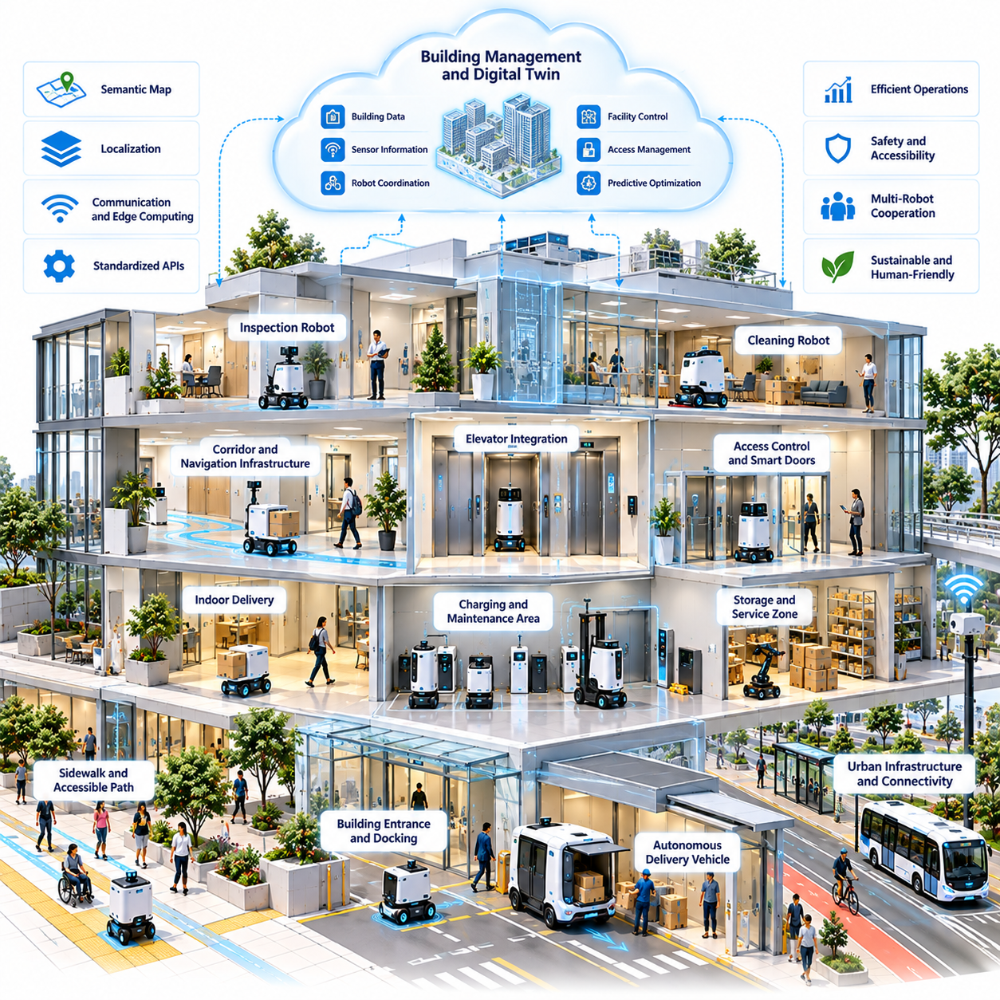{width="7.268055555555556in" height="7.268055555555556in"}

로봇 친화적 건물 및 기반시설(Robot-Friendly Buildings and Infrastructure)은 미래 도시에 피지컬 AI(Physical AI)를 통합하기 위한 중요한 기반을 의미한다. 기존 도시 환경(Urban Environment)은 주로 인간의 이동성(Mobility), 접근성(Accessibility), 운영 요구사항(Operational Requirements)을 중심으로 설계되어 왔다. 자율 로봇(Autonomous Robot)이 보편화됨에 따라 건물과 공공 기반시설(Public Infrastructure)은 인간의 안전과 편의성을 저해하지 않으면서 기계의 항법(Navigation), 물리적 상호작용(Physical Interaction), 통신(Communication), 에너지 관리(Energy Management)를 지원하도록 발전해야 할 수 있다.

로봇 친화적 환경(Robot-Friendly Environment)을 구축하기 위해 반드시 기존 시설을 대규모로 재건축할 필요는 없다. 대신 불필요한 운영 복잡성(Operational Complexity)을 줄이는 물리적 공간(Physical Space)과 디지털 인터페이스(Digital Interface)를 설계하는 데 중점을 둔다. 표준화된 접근 지점(Standardized Access Point), 예측 가능한 이동 경로(Predictable Pathway), 기계 판독 가능 정보(Machine-Readable Information), 상호운용 가능한 제어 시스템(Interoperable Control System)은 건물과 기반시설의 본래 기능을 유지하면서 자율 플랫폼(Autonomous Platform)이 더욱 신뢰성 있게 작업을 수행하도록 지원할 수 있다.

건물의 기하학적 구조(Building Geometry)는 로봇의 이동성(Robotic Mobility)과 운영 효율성(Operational Efficiency)에 직접적인 영향을 미친다. 복도 폭(Corridor Width), 출입문 크기(Doorway Dimension), 바닥 단차(Floor Transition), 회전 공간(Turning Space), 엘리베이터 용량(Elevator Capacity)은 어떤 로봇 플랫폼이 시설 내부를 이동할 수 있는지를 결정한다. 설계자는 건축 계획(Architectural Planning)에 로봇 이동 요구사항(Robot Mobility Requirements)을 반영하여 자율이동로봇(Autonomous Mobile Robot)과 서비스 플랫폼(Service Platform)이 보행자나 비상 대피 경로(Emergency Evacuation Route)를 방해하지 않고 안전하게 이동하도록 할 수 있다.

실내 항법 기반시설(Indoor Navigation Infrastructure)은 로봇 호환 건물(Robot-Compatible Building)의 또 다른 필수 구성요소이다. 로봇은 라이다(LiDAR), 시각 기반 위치 추정(Visual Localization), 관성 측정(Inertial Measurement), 의미 지도(Semantic Map)를 결합하여 자신의 위치를 결정할 수 있다. 안정적인 환경 랜드마크(Environmental Landmark), 일관된 층별 배치(Floor Layout), 최신 디지털 지도(Digital Map)는 특히 반복적인 건축 구조로 인해 위치 식별의 모호성(Localization Ambiguity)이 발생하는 대형 시설에서 위치 추정 신뢰성(Localization Reliability)을 향상시킬 수 있다.

출입문(Door), 엘리베이터(Elevator), 출입통제 시스템(Access-Control System)은 자율 로봇과 건물 기반시설 사이의 핵심 인터페이스(Critical Interface)이다. 로봇은 접근을 요청하고 권한을 확인하며 이동을 조정하고 운영 제한(Operational Restriction)을 인식해야 한다. 표준화된 응용 프로그램 인터페이스(Application Programming Interface, API)와 보안 통신 프로토콜(Secure Communication Protocol)을 활용하면 서로 다른 로봇 플랫폼이 배치할 때마다 개별적인 맞춤형 통합(Customized Integration)을 수행하지 않고도 건물 시스템과 상호작용할 수 있다.

엘리베이터 통합(Elevator Integration)은 로봇이 인간 승객 및 다른 자율 기계와 협력해야 하기 때문에 추가적인 과제를 제시한다. 건물 관리 시스템(Building Management System, BMS)은 승객 수요(Passenger Demand), 로봇 우선순위(Robot Priority), 적재량 제한(Payload Restriction), 서비스 일정(Service Schedule)에 따라 엘리베이터 이용을 할당할 수 있다. 안전한 운영을 위해서는 신뢰성 높은 출입문 감지(Door Detection), 탑승 상태 인식(Occupancy Awareness), 비상 상황 처리(Emergency Handling), 로봇 활동이 접근성이나 대피를 방해하지 않도록 하는 절차가 필요하다.

로봇 친화적 건물은 전용 대기 공간(Dedicated Waiting Area), 충전소(Charging Station), 유지보수 구역(Maintenance Zone), 보안 저장시설(Secure Storage Facility)을 포함할 수 있다. 이러한 공간은 중요한 보행자 통로를 점유하지 않으면서 지속적인 로봇 운영(Continuous Robotic Operations)을 지원한다. 충전 기반시설(Charging Infrastructure)은 특히 여러 로봇이 제한된 에너지 자원(Energy Resource)을 공유하는 경우 전력 용량(Electrical Capacity), 배터리 안전(Battery Safety), 열 관리(Thermal Management), 운영 일정 관리(Operational Scheduling)를 고려해야 한다.

피지컬 AI와 건물 관리 시스템의 통합은 시설 운영(Facility Operations)을 협력적으로 관리할 수 있는 기회를 제공한다. 냉난방(Heating), 환기(Ventilation), 조명(Lighting), 보안(Security), 유지보수 플랫폼(Maintenance Platform)은 이미 건물 상태에 관한 정보를 생성하고 있다. 승인된 로봇은 선택된 운영 데이터(Operational Data)를 활용하여 검사를 예약하거나 제한 구역을 이동하거나 유지보수 요청에 대응할 수 있으며, 건물 시스템은 접근 권한(Access Permission)과 관련 환경 갱신정보(Environmental Update)를 제공할 수 있다.

건축정보모델링(Building Information Modeling, BIM)은 설계, 시공 및 운영 전 과정에서 로봇 친화적 기반시설을 지원할 수 있다. 공간(Room), 복도(Corridor), 구조 요소(Structural Element), 기계설비(Mechanical System)의 디지털 표현(Digital Representation)은 로봇 항법과 작업 계획(Task Planning)에 유용한 정보를 제공할 수 있다. 그러나 설계 모델(Design Model)이 자율 기계의 신뢰성 높은 운영 참조정보(Operational Reference)로 활용되기 위해서는 실제 건물 상태(Actual Building Condition)를 반영하도록 갱신되어야 한다.

디지털 트윈(Digital Twin)은 센서 관측정보(Sensor Observation), 운영 상태(Operational State), 환경 변화(Environmental Change)를 통합하여 정적인 건물 모델(Static Building Model)을 확장한다. 건물 디지털 트윈(Building Digital Twin)은 엘리베이터 가용성(Elevator Availability), 일시적인 장애물(Temporary Obstacle), 유지보수 활동(Maintenance Activity), 로봇 위치(Robot Location)를 표현할 수 있다. 이러한 관측정보를 예측 모델(Predictive Model)과 결합하면 시설 운영자는 실제 작업을 실행하기 전에 로봇 작업 흐름(Robotic Workflow)을 시뮬레이션하고 잠재적인 충돌을 식별하며 협력을 개선할 수 있다.

공유 의미 지도(Shared Semantic Map)는 이기종 로봇(Heterogeneous Robot)이 동일한 건물에서 작동하도록 지원할 수 있다. 청소 로봇(Cleaning Robot), 배송 플랫폼(Delivery Platform), 검사 기계(Inspection Machine), 이동형 매니퓰레이터(Mobile Manipulator)는 공간, 접근 지점(Access Point), 제한 구역(Restricted Zone), 주행 가능한 경로(Traversable Pathway)에 대한 공통 표현(Common Representation)을 활용할 수 있다. 상호운용성(Interoperability)을 위해서는 일관된 좌표계(Coordinate System), 지도 버전 관리(Map Version Management), 의미 정의(Semantic Definition), 상충하는 환경 관측정보를 처리하는 메커니즘이 필요하다.

통신 기반시설(Communication Infrastructure)은 단일 장애점(Single Point of Failure)이 되지 않으면서 신뢰성 높은 협력을 지원해야 한다. 무선 네트워크(Wireless Network), 엣지 컴퓨팅 시스템(Edge Computing System), 건물 자동화 인터페이스(Building Automation Interface)는 항법 갱신정보(Navigation Update), 작업 할당(Task Assignment), 접근 권한(Access Permission)을 교환할 수 있다. 그러나 통신이 중단되더라도 로봇은 필수적인 로컬 안전 기능(Local Safety Capability)을 유지해야 하며 안전 필수 작업(Critical Operation)은 원격 컴퓨팅 서비스(Remote Computing Service)에만 의존해서는 안 된다.

로봇 친화적 기반시설은 개별 건물을 넘어 보도(Sidewalk), 교통 터미널(Transportation Terminal), 물류 거점(Logistics Hub), 공공시설(Public Facility)로 확장된다. 평탄한 표면 연결(Smooth Surface Transition), 접근 가능한 횡단시설(Accessible Crossing), 예측 가능한 상하차 구역(Predictable Loading Zone), 표준화된 도킹 인터페이스(Standardized Docking Interface)는 실내외 환경 사이의 이동을 지원할 수 있다. 도시 계획(Urban Planning)은 로봇 접근성(Robotic Accessibility)과 보행자 우선 원칙(Pedestrian Priority), 유니버설 디자인(Universal Design), 기존 교통 요구사항 사이의 균형을 유지해야 한다.

자율 물류(Autonomous Logistics)는 통합 기반시설 설계(Integrated Infrastructure Design)의 중요성을 보여주는 대표적인 사례이다. 배송 로봇(Delivery Robot)은 지역 물류 거점(Neighborhood Logistics Hub)에서 건물 출입구까지 이동한 후 접근 권한을 인증하고 엘리베이터를 이용하여 보안 수령 장소(Secure Receiving Station)에 소포를 전달할 수 있다. 이러한 작업 흐름(Workflow)을 완성하려면 교통 기반시설(Transportation Infrastructure), 건물 제어 시스템(Building Control System), 로봇 항법(Robotic Navigation), 화물 인계 검증(Shipment Verification Mechanism) 사이의 협력이 필요하다.

기반시설 검사 로봇(Infrastructure Inspection Robot)은 배송 또는 청소 플랫폼과 다른 설계 요구사항(Design Requirements)을 가진다. 이러한 기계는 기계실(Mechanical Room), 설비 통로(Utility Corridor), 검사구(Inspection Port), 옥상(Rooftop), 협소한 유지보수 공간(Confined Maintenance Space)에 접근해야 할 수 있다. 로봇 호환 검사 경로(Robot-Compatible Inspection Pathway)와 표준화된 센싱 위치(Standardized Sensing Location)는 운영 위험(Operational Risk)을 줄이면서 구조물 및 기계설비 상태(Structural and Mechanical Conditions)에 대한 더욱 빈번한 모니터링을 지원할 수 있다.

물리적 인터페이스(Physical Interface)는 다양한 로봇 형태(Morphology)를 고려해야 한다. 바퀴형 로봇(Wheeled Robot), 다족 보행 플랫폼(Legged Platform), 이동형 매니퓰레이터(Mobile Manipulator), 특수 검사 기계(Specialized Inspection Machine)는 지상고(Ground Clearance), 회전 반경(Turning Radius), 적재물 취급(Payload Handling), 수직 이동성(Vertical Mobility)에 대해 서로 다른 요구사항을 가진다. 기반시설 설계자는 모든 환경을 하나의 로봇 유형에 최적화하기보다 여러 종류의 자율 기계를 수용할 수 있는 능력 등급(Capability Class)과 상호운용 가능한 인터페이스를 정의할 수 있다.

안전 공학(Safety Engineering)은 로봇 친화적 기반시설의 핵심 요소이다. 건물은 명확한 보행자 경로(Pedestrian Route), 접근 가능한 비상구(Accessible Emergency Exit), 화재 방호 요구사항(Fire Protection Requirement), 로봇과 건물 이용자 사이의 안전한 상호작용을 유지해야 한다. 자율 기계는 검증된 속도 및 힘 제한(Validated Speed and Force Limit) 내에서 작동하고 제한 구역을 인식하며 예상하지 못한 상황이나 기반시설 장애(Infrastructure Failure)가 발생할 경우 안전 상태(Safe State)로 전환해야 한다.

사이버보안(Cybersecurity)은 로봇이 건물 출입 시스템(Building Access System) 및 운영기술(Operational Technology, OT)과 상호작용할 때 특히 중요해진다. 승인되지 않은 명령(Unauthorized Command)이나 침해된 인터페이스(Compromised Interface)는 물리적 보안(Physical Security), 엘리베이터 운영(Elevator Operation), 민감한 시설 정보(Sensitive Facility Information)에 영향을 미칠 수 있다. 안전한 인증(Secure Authentication), 역할 기반 권한(Role-Based Permission), 암호화 통신(Encrypted Communication), 감사 로그(Audit Logging), 네트워크 분리(Network Segmentation)는 운영상 상호운용성을 유지하면서 이러한 위험을 줄일 수 있다.

개인정보 보호(Privacy)는 건물 내 로봇이 이미지(Image), 공간 측정정보(Spatial Measurement), 재실 정보(Occupancy Information), 운영 이력(Operational History)을 수집할 수 있기 때문에 중요한 고려사항이다. 데이터 거버넌스 정책(Data Governance Policy)은 어떤 정보를 수집하고 얼마나 오랫동안 보존하며 어떤 조직이 접근할 수 있는지를 정의해야 한다. 개인정보 보호형 인식(Privacy-Preserving Perception), 선택적 데이터 처리(Selective Data Processing), 엣지 기반 컴퓨팅(Edge-Based Computing)은 건물 이용자와 방문객에 관한 정보가 불필요하게 노출되는 것을 줄이는 데 도움이 될 수 있다.

접근성(Accessibility)은 로봇 효율성(Robotic Efficiency)에 종속되는 요소가 아니라 기본적인 설계 요구사항(Fundamental Design Requirement)으로 유지되어야 한다. 로봇 이동 경로(Robot Pathway)는 휠체어 사용자(Wheelchair User), 시각장애 보행자(Visually Impaired Pedestrian), 이동 보조가 필요한 사람의 통행을 방해해서는 안 된다. 인간 중심 설계(Human-Centered Design)는 예측 가능한 로봇 행동(Predictable Robotic Behavior), 명확한 의사소통 신호(Clear Communication Signal), 적절한 양보 정책(Yielding Policy), 자율 시스템을 사용할 수 없는 상황에서도 이용 가능한 기반시설을 요구한다.

경제적 실현 가능성(Economic Feasibility)은 로봇 친화적 기반시설이 얼마나 빠르게 보급되는지에 영향을 미친다. 기존 건물의 개조(Retrofitting)는 출입문, 엘리베이터, 네트워크, 충전시설 및 건물 관리 소프트웨어(Building Management Software)의 변경을 필요로 할 수 있다. 투자 결정(Investment Decision)은 로봇 활용률(Robot Utilization), 통합 비용(Integration Expense), 유지보수 비용 절감(Maintenance Savings), 서비스 신뢰성(Service Reliability), 공유 기반시설을 통해 여러 로봇 응용 분야를 지원할 수 있는 잠재적 가치를 고려해야 한다.

신축 건설 프로젝트(New Construction Project)는 초기 건축 설계(Initial Architectural Design) 단계에서 로봇 요구사항을 통합할 수 있는 더 큰 기회를 제공한다. 건축가(Architect), 엔지니어(Engineer), 시설 운영자(Facility Operator), 로봇 개발자(Robotics Developer) 사이의 조기 협력(Early Coordination)은 이후 통합 비용을 줄일 수 있다. 모듈형 인터페이스(Modular Interface)와 적응형 기반시설(Adaptable Infrastructure)은 물리적 구조와 지능 능력(Intelligence Capability)이 아직 완전히 확립되지 않은 미래 로봇 플랫폼까지 건물이 수용하도록 지원할 수 있다.

표준(Standards)과 인증 프레임워크(Certification Framework)는 상호운용 가능한 로봇 친화적 환경의 개발을 가속할 수 있다. 출입통제(Access Control), 엘리베이터 통신(Elevator Communication), 도킹 스테이션(Docking Station), 공간 표현(Spatial Representation), 안전 절차(Safety Procedure)에 대한 공통 규격(Common Specification)은 독점적 통합(Proprietary Integration)에 대한 의존도를 줄일 수 있다. 그러나 표준화(Standardization)는 혁신을 제한하지 않으면서 서로 다른 건물 유형(Building Category), 지역 규제(Local Regulation), 발전하는 로봇 기술(Evolving Robotic Technology)을 수용해야 한다.

로봇 친화적 기반시설의 장기적 발전(Long-Term Evolution)은 건물을 수동적인 물리적 환경(Passive Physical Environment)에서 자율 운영(Autonomous Operation)에 능동적으로 참여하는 시스템으로 변화시킬 수 있다. 건물은 지능형 기계(Intelligent Machine)에 구조화된 정보(Structured Information), 운영 권한(Operational Permission), 공유 환경 맥락(Shared Environmental Context), 협력 서비스(Coordinated Service)를 제공할 수 있다. 이러한 변화는 건축 설계(Architectural Design), 디지털 기반시설(Digital Infrastructure), 체화 지능(Embodied Intelligence)을 점점 더 적응적인 도시 생태계(Adaptive Urban Ecosystem) 안에서 연결할 것이다.

궁극적으로 로봇 친화적 건물 및 기반시설은 자동화(Automation)만을 우선시하기보다 인간과 자율 기계 사이의 협력(Cooperation)을 지원하도록 설계되어야 한다. 그 가치는 안전성(Safety), 접근성(Accessibility), 보안(Security), 운영 복원력(Operational Resilience)을 유지하면서 신뢰성 높은 로봇 서비스(Reliable Robotic Service)를 가능하게 하는 데 있다. 피지컬 AI가 발전함에 따라 기반시설 준비 수준(Infrastructure Readiness)은 미래 도시의 실질적인 능력(Practical Capability)을 결정하는 데 로봇 지능(Robotic Intelligence)만큼 중요한 요소가 될 수 있다.

## 03.05. Autonomous Public Infrastructure Inspection

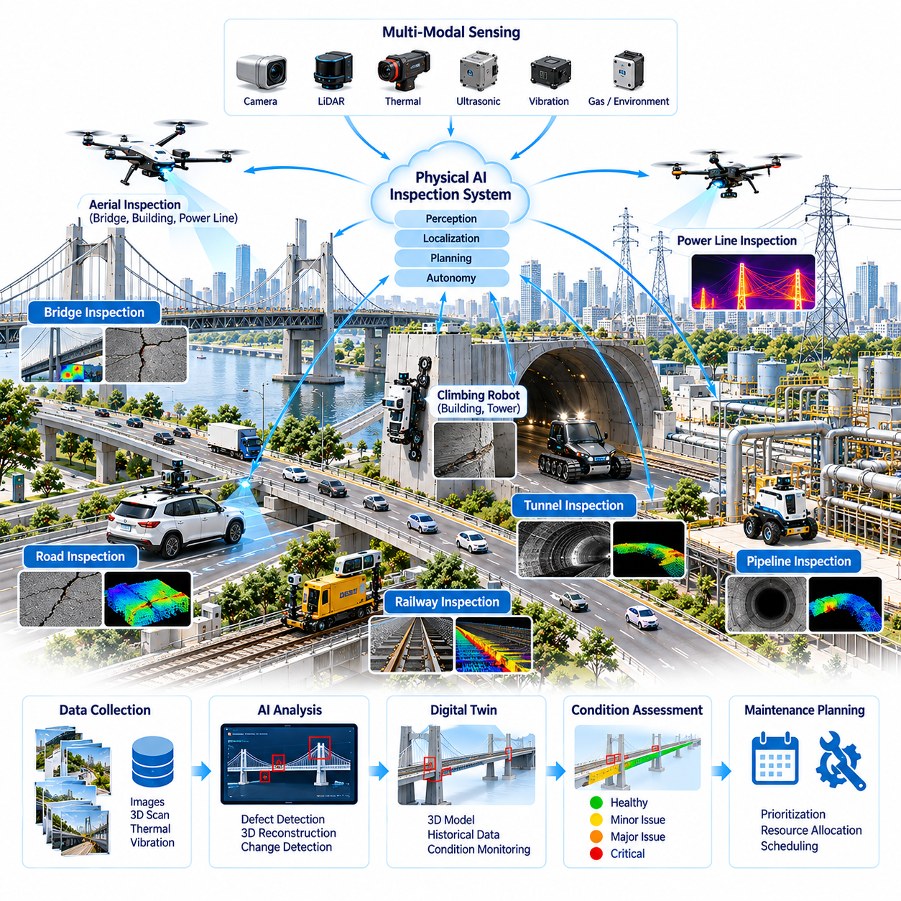{width="7.268055555555556in" height="7.268055555555556in"}

자율 공공 기반시설 검사(Autonomous Public Infrastructure Inspection)는 미래 도시 관리에서 피지컬 AI(Physical AI)의 주요 응용 분야를 의미한다. 교량(Bridge), 터널(Tunnel), 도로(Road), 철도(Railway), 파이프라인(Pipeline), 공공설비 네트워크(Utility Network)는 안전성과 운영 신뢰성(Operational Reliability)을 유지하기 위해 지속적인 모니터링이 필요하다. 지능형 로봇 시스템(Intelligent Robotic System)은 물리적 측정정보를 수집하고 이상 상태(Abnormal Condition)를 식별하며 유지보수 의사결정(Maintenance Decision)을 지원하는 동시에 위험한 검사 환경에서 인간의 노출을 줄일 수 있다.

기존 기반시설 검사(Traditional Infrastructure Inspection)는 정기적인 현장 방문(Scheduled Site Visit), 수동 측정(Manual Measurement), 전문가의 시각적 평가(Expert Visual Assessment)에 크게 의존한다. 이러한 접근방식은 유용한 정보를 제공하지만 높은 인건비(Labor Cost), 제한된 검사 빈도(Inspection Frequency), 일관되지 않은 관측 조건(Observation Condition)을 수반할 수 있다. 자율 검사(Autonomous Inspection)는 반복 가능한 데이터 수집(Repeatable Data Collection)과 지속적인 모니터링(Continuous Monitoring) 기능을 도입하여 기반시설 상태 평가(Infrastructure Condition Assessment)의 적시성(Timeliness)과 일관성(Consistency)을 개선할 수 있다.

피지컬 AI 기반 검사 시스템(Physical AI Inspection System)은 로봇 이동성(Robotic Mobility), 환경 인식(Environmental Perception), 센싱(Sensing), 위치 추정(Localization), 자율 의사결정(Autonomous Decision-Making)을 결합한다. 지상 로봇(Ground Robot), 항공 플랫폼(Aerial Platform), 등반 로봇(Climbing Robot), 특수 검사 차량(Specialized Inspection Vehicle)은 서로 다른 기반시설 환경에서 작동할 수 있다. 온보드 지능(Onboard Intelligence)은 구조적 장애물 주변의 항법(Navigation), 관측 시점(Viewpoint) 선택, 검사 임무(Inspection Mission) 수행 중 변화하는 환경 조건에 대한 적응을 가능하게 한다.

센서 통합(Sensor Integration)은 자율 기반시설 검사의 핵심 요소이다. RGB 카메라(RGB Camera), 라이다(LiDAR), 열화상 영상(Thermal Imaging), 초음파 센서(Ultrasonic Sensor), 진동 측정 장치(Vibration Measurement Device)는 구조물 및 기계설비 상태(Structural and Mechanical Conditions)에 관한 상호보완적인 정보를 제공한다. 다중모달 센서 융합(Multimodal Sensor Fusion)은 기하학적 측정정보(Geometric Measurement)와 시각적 및 물리적 지표(Visual and Physical Indicator)를 결합하여 개별 센싱 기술만으로 얻는 결과보다 포괄적인 평가를 지원할 수 있다.

구조물 검사(Structural Inspection)는 균열(Crack), 부식(Corrosion), 변형(Deformation), 표면 열화(Surface Deterioration), 재료 변위(Material Displacement)와 같은 결함을 식별해야 한다. 컴퓨터 비전 모델(Computer Vision Model)은 눈에 보이는 이상을 탐지할 수 있으며, 3차원 재구성 기술(Three-Dimensional Reconstruction Technique)은 시간에 따른 기하학적 변화(Geometric Change)를 추정할 수 있다. 그러나 자동 결함 탐지(Automated Defect Detection)는 조명 변화(Lighting Variation), 표면 오염(Surface Contamination), 센서 불확실성(Sensor Uncertainty), 표면적 손상(Superficial Damage)과 구조적 중요성(Structural Significance)의 차이를 고려해야 한다.

자율 교량 검사(Autonomous Bridge Inspection)는 이동성과 인식의 통합이 얼마나 중요한지를 보여준다. 항공 로봇(Aerial Robot)은 높은 위치의 구조 부재(Elevated Structural Component)를 검사할 수 있으며, 지상 또는 등반 플랫폼(Ground or Climbing Platform)은 접근 가능한 표면과 구조적 연결부(Structural Connection)를 검사할 수 있다. 정확한 위치 추정(Accurate Localization)과 관측 시점 계획(Viewpoint Planning)은 반복 가능한 관측을 확보하도록 지원하며, 엔지니어가 검사 기록(Inspection Record)을 비교하고 상세 조사가 필요한 변화를 식별할 수 있도록 한다.

터널 및 지하 기반시설 검사(Tunnel and Underground Infrastructure Inspection)는 위성 기반 위치 측정(Satellite Positioning)을 사용할 수 없는 경우가 많고 통신 조건(Communication Condition)이 불안정할 수 있기 때문에 추가적인 과제를 제시한다. 로봇은 협소한 통로(Confined Passage), 저조도 환경(Low-Light Environment), 잠재적 위험 구역(Potentially Hazardous Area)을 이동해야 한다. 라이다 기반 위치 추정(LiDAR-Based Localization), 관성 항법(Inertial Navigation), 시각 지도 작성(Visual Mapping), 온보드 자율성(Onboard Autonomy)은 외부 위치 측정 기반시설에 대한 의존도를 최소화하면서 검사 연속성(Inspection Continuity)을 지원할 수 있다.

도로 및 포장면 검사(Road and Pavement Inspection)는 고해상도 카메라(High-Resolution Camera), 레이저 스캐너(Laser Scanner), 관성 측정 시스템(Inertial Measurement System)을 장착한 자율 차량(Autonomous Vehicle)을 통해 개선될 수 있다. 이러한 플랫폼은 표면 균열(Surface Cracking), 포트홀(Pothole), 변형(Deformation), 포장면 불규칙성(Pavement Irregularity)에 관한 정보를 수집할 수 있다. 결함 관측정보(Defect Observation)를 지리적 참조정보(Geographic Reference)와 결합하면 유지보수 기관(Maintenance Authority)이 심각도(Severity), 위치(Location), 교통 노출도(Traffic Exposure), 예상 열화(Expected Deterioration)에 따라 보수 우선순위를 결정할 수 있다.

파이프라인 및 공공설비 검사(Pipeline and Utility Inspection)는 제약된 환경(Constrained Environment)에서 작동할 수 있는 특수 로봇 플랫폼(Specialized Robotic Platform)을 필요로 한다. 관로 주행 로봇(Pipe-Crawling Robot)과 검사 차량(Inspection Vehicle)은 부식, 누출 징후(Leakage Indicator), 기하학적 변형(Geometric Deformation), 내부 장애물(Internal Obstruction)을 탐지할 수 있다. 센서 선택(Sensor Selection)은 재료 특성(Material Property), 접근성(Accessibility), 검사 목적(Inspection Objective)에 따라 달라지며, 탐지된 이상을 특정 기반시설 구간(Infrastructure Segment)과 연결하려면 신뢰성 높은 위치 추정이 필요하다.

월드 모델(World Model)은 기반시설의 기하학적 구조(Infrastructure Geometry), 환경 조건(Environmental Condition), 검사 대상 자산(Inspected Asset)의 변화하는 상태를 표현하여 자율 검사를 개선할 수 있다. 로봇은 사전에 정의된 경로(Predefined Route)에만 의존하지 않고 예측적 환경 표현(Predictive Environmental Representation)을 활용하여 장애물을 예상하고 정보 가치가 높은 관측 위치(Informative Observation Location)를 식별할 수 있다. 이러한 모델은 관측되지 않았거나 측정이 불충분한 영역의 불확실성(Uncertainty)을 유지하면서 적응형 검사 계획(Adaptive Inspection Planning)을 지원한다.

검사 계획(Inspection Planning)은 운영 제약(Operational Constraint) 내에서 유용한 정보(Useful Information)를 최대화할 수 있는 경로(Route), 관측 시점(Viewpoint), 센싱 구성(Sensing Configuration), 측정 순서(Measurement Sequence)를 선택하는 과정이다. 로봇은 배터리 용량(Battery Capacity), 이동 거리(Travel Distance), 센서 관측 범위(Sensor Coverage), 환경 위험(Environmental Hazard), 검사 우선순위(Inspection Priority)를 고려해야 한다. 정보 인식 계획(Information-Aware Planning)은 기존 관측이 불충분하거나 열화가 의심되는 영역에 검사 자원을 집중하도록 할 수 있다.

디지털 트윈(Digital Twin)은 검사 측정정보(Inspection Measurement)를 기반시설 수명주기 관리(Infrastructure Lifecycle Management)와 연결하기 위한 프레임워크(Framework)를 제공한다. 교량, 터널 또는 공공설비 네트워크의 디지털 표현(Digital Representation)은 설계 형상(Design Geometry), 시공 기록(Construction Record), 과거 검사 이력(Historical Inspection), 현재 센서 관측정보(Current Sensor Observation)를 통합할 수 있다. 적절하게 유지관리되는 이러한 모델은 상태 비교(Condition Comparison), 유지보수 시뮬레이션(Maintenance Simulation), 검사팀과 기반시설 운영자 사이의 의사소통을 지원할 수 있다.

시간적 분석(Temporal Analysis)은 기반시설 열화(Infrastructure Deterioration)가 점진적으로 진행되는 경우가 많기 때문에 필수적이다. 반복적인 로봇 검사(Repeated Robotic Inspection)는 균열, 변형, 온도 패턴(Temperature Pattern), 기타 관측 가능한 상태에 관한 시계열 측정정보(Time-Series Measurement)를 생성할 수 있다. 일관된 기준 좌표계(Consistent Reference Frame)에서 측정정보를 비교하면 개별 검사로는 탐지하기 어려운 추세(Trend)를 발견할 수 있지만, 실제 열화가 발생했다고 판단하기 전에 환경 변동성(Environmental Variability)과 측정 불확실성(Measurement Uncertainty)을 고려해야 한다.

예측 유지보수 시스템(Predictive Maintenance System)은 검사 이력(Inspection History), 환경 노출(Environmental Exposure), 운영 하중(Operating Load), 공학 모델(Engineering Model)을 활용하여 미래 기반시설 상태(Future Infrastructure Condition)를 추정할 수 있다. 기계학습(Machine Learning)은 관측된 지표(Observed Indicator)와 유지보수 결과(Maintenance Outcome) 사이의 통계적 관계(Statistical Relationship)를 식별할 수 있다. 그러나 이러한 예측은 구조적 파손(Structural Failure)에 대한 확정적인 전망으로 취급하기보다 물리 기반 공학 지식(Physical Engineering Knowledge), 검증된 열화 모델(Validated Degradation Model), 전문가 평가(Expert Assessment)와 함께 해석해야 한다.

자율 검사는 상태 정보(Condition Information)의 가용성을 개선하여 위험 기반 유지보수(Risk-Based Maintenance)를 지원할 수 있다. 기반시설 관리자는 결함 심각도(Defect Severity), 자산 중요도(Asset Importance), 고장 결과(Failure Consequence), 유지보수 비용(Maintenance Cost)을 결합하여 개입 우선순위(Intervention Priority)를 결정할 수 있다. 이러한 접근방식은 대규모 도시 네트워크에 운영 이력(Operating History)과 열화 메커니즘(Deterioration Mechanism)이 서로 다른 다수의 자산이 존재하는 경우 제한된 자원을 더욱 효과적으로 배분하도록 지원한다.

여러 검사 로봇이 광범위한 공공 기반시설 네트워크에서 작동할 경우 군집 조정(Fleet Coordination)이 중요해진다. 중앙집중식 플랫폼(Centralized Platform)은 검사 임무(Inspection Mission)를 할당하고 충전 일정(Charging Schedule)을 관리하며 장비 가용성(Equipment Availability)을 추적하고 수집된 측정정보를 통합할 수 있다. 이기종 로봇 군집(Heterogeneous Robot Fleet)은 항공형(Aerial), 바퀴형(Wheeled), 등반형(Climbing), 특수 로봇 플랫폼을 결합하여 각 자산의 물리적 특성(Physical Characteristic)에 적합한 검사 능력을 제공할 수 있다.

엣지 컴퓨팅(Edge Computing)은 검사 로봇이 데이터 수집 지점 가까이에서 센서 데이터를 처리하도록 한다. 온보드 추론(Onboard Inference)은 잠재적 결함(Potential Defect)을 식별하고 위치 추정 신뢰도(Localization Confidence)를 평가하며 추가 관측이 필요한지를 결정할 수 있다. 클라우드 플랫폼(Cloud Platform)은 계산 집약적인 재구성(Computationally Intensive Reconstruction), 과거 데이터 분석(Historical Analysis), 모델 학습(Model Training), 대규모 기반시설 자산군(Infrastructure Portfolio) 전반의 조정을 지원할 수 있으며, 핵심 안전 기능(Critical Safety Function)은 로컬에서 유지되어야 한다.

시뮬레이션(Simulation)과 디지털 환경(Digital Environment)은 자율 검사 시스템의 개발을 가속할 수 있다. 가상 교량(Virtual Bridge), 터널, 파이프라인, 도시 시설은 개발자가 다양한 조건에서 항법, 센싱, 임무 계획(Mission Planning)을 평가하도록 한다. 도메인 랜덤화(Domain Randomization)는 조명(Lighting), 기하학적 구조(Geometry), 표면 외관(Surface Appearance), 센서 노이즈(Sensor Noise)의 변화를 도입할 수 있지만 신뢰성 높은 성능을 확립하기 위해서는 실제 환경 검증(Real-World Validation)이 여전히 필요하다.

안전성 보증(Safety Assurance)은 검사 로봇이 교통 구역(Traffic Area), 전기설비(Electrical Equipment), 고소 구조물(Elevated Structure), 밀폐 공간(Confined Space) 근처에서 작동할 수 있기 때문에 특히 중요하다. 자율 시스템은 검증된 운영 범위(Validated Operating Boundary), 충돌 회피(Collision Avoidance), 비상 정지(Emergency Stopping), 안전 복구 절차(Safe Recovery Procedure)를 필요로 한다. 위험한 임무(Hazardous Mission), 예상하지 못한 환경 조건, 구조적 안전(Structural Safety) 또는 공공 접근 제한(Public Access Restriction)과 관련된 의사결정에는 인간 감독(Human Supervision)이 계속 필요하다.

검사 데이터 품질(Inspection Data Quality)은 자동 상태 평가(Automated Condition Assessment)의 신뢰성에 직접적인 영향을 미친다. 측정정보에는 보정된 센서(Calibrated Sensor), 정확한 타임스탬프(Accurate Timestamp), 일관된 좌표계(Consistent Coordinate System), 문서화된 운영 조건(Documented Operating Condition)이 연결되어야 한다. 데이터 검증 절차(Data Validation Procedure)는 검사 결과가 유지보수 의사결정에 사용되기 전에 불완전한 관측 범위(Incomplete Coverage), 손상된 관측정보(Corrupted Observation), 불확실한 결함 분류(Uncertain Defect Classification), 반복 검사 사이의 불일치(Inconsistency)를 식별해야 한다.

사이버보안(Cybersecurity)과 데이터 거버넌스(Data Governance)는 공공 기반시설 정보가 민감한 운영 특성(Sensitive Operational Characteristic)을 드러낼 수 있기 때문에 중요하다. 검사 플랫폼(Inspection Platform)은 자산 지도(Asset Map), 센서 기록(Sensor Record), 접근 자격증명(Access Credential), 통신 채널(Communication Channel)을 보호해야 한다. 안전한 인증(Secure Authentication), 통제된 데이터 공유(Controlled Data Sharing), 감사 추적(Audit Trail), 적절한 보존 정책(Retention Policy)은 민감한 정보의 불필요한 노출 없이 기반시설 소유자, 계약업체, 공공기관 사이의 협력을 지원할 수 있다.

자율 검사의 경제적 가치(Economic Value)는 검사 빈도(Inspection Frequency), 로봇 활용률(Robot Utilization), 노동력 요구사항(Labor Requirement), 배치 복잡성(Deployment Complexity), 유지보수 성과(Maintenance Outcome)에 달려 있다. 로봇 시스템은 접근 장비 비용(Access Equipment Cost)과 위험 환경에서 인간의 노출을 줄이면서 더욱 빈번한 측정을 가능하게 할 수 있다. 그러나 도입 비용(Acquisition Cost), 센서 보정(Calibration), 감독(Supervision), 소프트웨어 유지보수(Software Maintenance), 데이터 해석(Data Interpretation) 비용을 수명주기 비용 평가(Lifecycle Cost Evaluation)에 포함해야 한다.

공공 기반시설 검사는 로봇 플랫폼(Robotic Platform), 공학 데이터베이스(Engineering Database), 지리정보시스템(Geographic Information System, GIS), 자산 관리 소프트웨어(Asset Management Software) 사이의 상호운용성(Interoperability)을 점점 더 요구하게 될 것이다. 표준화된 결함 설명(Standardized Defect Description), 공간 참조정보(Spatial Reference), 검사 기록(Inspection Record), 데이터 교환 인터페이스(Data Exchange Interface)는 기반시설 정보의 연속성(Information Continuity)을 개선할 수 있다. 이러한 통합은 로봇 관측정보를 실행 가능한 공학 및 유지보수 작업 흐름(Actionable Engineering and Maintenance Workflow)으로 전환하는 데 필수적이다.

궁극적으로 자율 공공 기반시설 검사(Autonomous Public Infrastructure Inspection)는 주로 주기적 관측(Periodic Observation)에 의존하던 도시 유지보수를 더욱 지속적이고 증거 기반의 자산 관리(Evidence-Based Asset Management)로 변화시킬 수 있다. 피지컬 AI는 자율 센싱(Autonomous Sensing), 환경 이해(Environmental Understanding), 예측 분석(Predictive Analysis), 협력형 검사 운영(Coordinated Inspection Operations)을 연결하는 능력을 제공한다. 장기적인 기여는 신뢰성 높은 측정(Reliable Measurement), 검증된 공학적 해석(Validated Engineering Interpretation), 책임 있는 배치(Responsible Deployment), 인간 기반시설 전문가(Human Infrastructure Expert)의 전문지식과 효과적으로 통합하는 능력에 달려 있다.

## 03.06. Cleaning Maintenance and City Service Robots

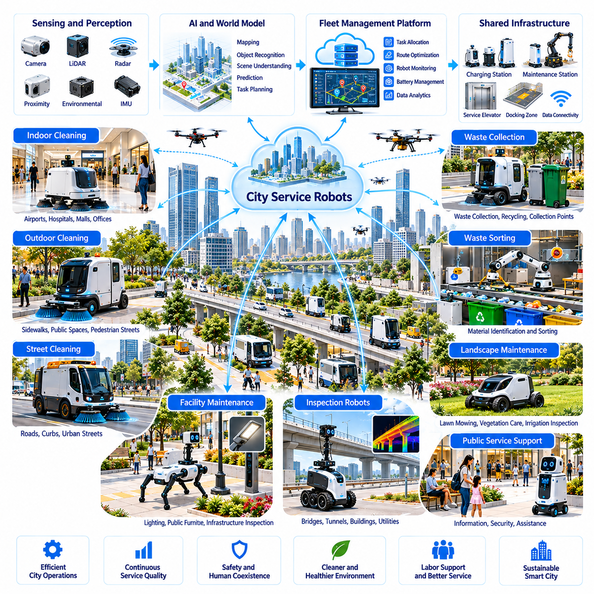{width="7.268055555555556in" height="7.268055555555556in"}

청소, 유지보수 및 도시 서비스 로봇(Cleaning, Maintenance, and City Service Robots)은 도시 환경(Urban Environment)에서 피지컬 AI(Physical AI)의 중요성이 점점 높아지는 응용 분야이다. 도시는 공중보건(Public Health)과 운영 품질(Operational Quality)을 유지하기 위해 지속적인 청소(Cleaning), 폐기물 수거(Waste Collection), 조경 관리(Landscape Maintenance), 시설 관리(Facility Servicing)가 필요하다. 자율 로봇 시스템(Autonomous Robotic System)은 지능형 인식(Intelligent Perception), 이동성(Mobility), 작업 수행(Task Execution)을 통해 이러한 활동을 지원하며, 반복적이거나 위험한 작업에 대한 인간의 노출을 줄이면서 서비스 일관성(Service Consistency)을 향상시킬 수 있다.

기존 도시 유지보수(Traditional City Maintenance)는 인간이 조작하는 장비(Human-Operated Equipment), 고정된 일정(Fixed Schedule), 노동집약적인 검사 및 청소 과정(Labor-Intensive Inspection and Cleaning Process)에 의존한다. 이러한 접근방식은 여전히 필수적이지만 변동하는 서비스 수요(Fluctuating Service Demand), 광범위한 지리적 서비스 범위(Geographic Coverage), 인력 부족(Workforce Limitation)에 대응하는 데 어려움이 있을 수 있다. 피지컬 AI는 환경 조건(Environmental Condition)에 대응하고 작업 우선순위(Task Priority)를 결정하며 여러 도시 지역에 걸친 운영을 조정할 수 있는 적응형 서비스 플랫폼(Adaptive Service Platform)을 도입한다.

자율 청소 로봇(Autonomous Cleaning Robot)은 환경 인식(Environmental Perception), 위치 추정(Localization), 동작 계획(Motion Planning), 특수 청소 메커니즘(Specialized Cleaning Mechanism)을 결합한다. 카메라(Camera), 라이다(LiDAR), 근접 센서(Proximity Sensor), 표면 감지 시스템(Surface Detection System)은 로봇이 주행 가능한 영역(Traversable Area)과 잠재적 장애물(Potential Obstacle)을 식별하도록 지원한다. 청소 모듈(Cleaning Module)에는 브러시(Brush), 진공 시스템(Vacuum System), 물 분사 장치(Water Dispenser), 이물질 수거 장치(Debris Collection Mechanism)가 포함될 수 있으며, 이를 통해 로봇 플랫폼은 다양한 표면과 오염 조건(Contamination Condition)에 맞게 작업을 조정할 수 있다.

실내 청소 로봇(Indoor Cleaning Robot)은 공항(Airport), 병원(Hospital), 쇼핑센터(Shopping Center), 교통 터미널(Transportation Terminal), 공공건물(Public Building)에 점점 더 폭넓게 적용될 수 있다. 이러한 환경에는 빈번한 유지관리가 필요한 넓은 바닥 면적(Floor Area)이 존재하는 경우가 많다. 자율 플랫폼(Autonomous Platform)은 사전에 정의된 서비스 구역(Predefined Service Zone)을 이동하고 보행자를 회피하며 재실 패턴(Occupancy Pattern)에 따라 청소 일정을 조정할 수 있지만, 비정상적인 상황과 복잡한 청소 작업에는 여전히 인간 감독(Human Supervision)이 필요하다.

실외 청소(Outdoor Cleaning)는 도시 환경이 상대적으로 비정형적(Unstructured)이고 변동성이 크기 때문에 추가적인 과제를 제시한다. 보도(Sidewalk), 공공광장(Public Square), 공원(Park), 보행자 전용도로(Pedestrian Street)에는 불규칙한 표면(Irregular Surface), 일시적인 장애물(Temporary Obstacle), 변화하는 기상 조건(Changing Weather Condition), 예측하기 어려운 인간 활동(Unpredictable Human Activity)이 존재한다. 실외 서비스 로봇(Outdoor Service Robot)은 이러한 역동적인 공공장소(Dynamic Public Space)에서 신뢰성 있게 작동하기 위해 견고한 이동성(Robust Mobility), 환경 이해(Environmental Understanding), 보수적인 안전 행동(Conservative Safety Behavior)을 필요로 한다.

도로 청소 로봇(Street-Cleaning Robot)은 자율 항법(Autonomous Navigation)과 노면 청소(Sweeping), 이물질 수거(Debris Collection), 표면 모니터링(Surface Monitoring) 기능을 결합할 수 있다. 운영 성능(Operational Performance)은 연석(Curb), 도로 경계(Road Boundary), 주차 차량(Parked Vehicle), 보행자(Pedestrian), 공사 차단물(Construction Barrier)을 인식하는 능력에 달려 있다. 경로 계획(Route Planning)은 교통 규정(Traffic Regulation), 청소 범위(Cleaning Coverage), 가용 작업 시간대(Available Operating Window), 대중교통(Public Transportation)과 보행자 접근성(Pedestrian Accessibility)을 방해하지 않아야 한다는 요구사항을 고려해야 한다.

폐기물 관리(Waste Management)는 도시 로봇 서비스(Robotic City Service)의 또 다른 기회를 제공한다. 자율 수거 플랫폼(Autonomous Collection Platform)은 폐기물 용기(Waste Container)를 운반하고 재활용 작업(Recycling Operation)을 지원하거나 지정된 수거 지점(Designated Collection Point)에서 작업자를 보조할 수 있다. 컴퓨터 비전(Computer Vision)과 재료 분류 시스템(Material Classification System)은 폐기물 유형(Waste Category)을 식별하는 데 도움이 될 수 있지만 오염(Contamination), 혼합 재료(Mixed Material), 불확실한 객체 특성(Uncertain Object Property)은 신중한 검증과 인간 개입(Human Intervention)이 필요한 한계를 발생시킨다.

로봇 기반 폐기물 분류(Robotic Waste Sorting)는 자동화된 수거 및 처리 시설(Automated Collection and Processing Facility)과 통합될 수 있다. 시각 센서(Visual Sensor)와 로봇 팔(Robotic Arm)을 장착한 조작 시스템(Manipulation System)은 폐기물 흐름(Waste Stream)에서 특정 재료를 식별하고 분리할 수 있다. 성공적인 운영을 위해서는 신뢰성 높은 객체 인식(Object Recognition), 파지 계획(Grasp Planning), 오염물 처리(Contamination Handling), 컨베이어 시스템(Conveyor System)과의 협력이 필요하며, 위험하거나 분류가 모호한 재료는 특수 절차(Specialized Procedure)를 필요로 할 수 있다.

조경 관리 로봇(Landscape Maintenance Robot)은 잔디 깎기(Lawn Mowing), 식생 모니터링(Vegetation Monitoring), 관개시설 검사(Irrigation Inspection), 일부 녹지 관리 작업(Groundskeeping Activity)을 지원할 수 있다. 공원과 공공 녹지(Public Green Space)에는 고르지 않은 지형(Uneven Terrain), 움직이는 장애물(Moving Obstacle), 계절에 따른 환경 변화(Seasonal Environmental Change)가 존재한다. 피지컬 AI 시스템은 다양한 지면 조건(Ground Condition)에 맞춰 항법과 작업 계획(Task Planning)을 조정하면서 식생(Vegetation)을 사람, 동물, 보호 대상 조경 요소(Protected Landscape Feature)와 구분해야 한다.

도시 시설 유지보수(Urban Facility Maintenance)는 로봇 서비스를 청소와 폐기물 수거 이상의 영역으로 확장한다. 로봇은 조명설비(Lighting Equipment)를 검사하고 공공시설물(Public Furniture)을 모니터링하며 손상된 표면(Damaged Surface)을 식별하거나 교통시설(Transportation Facility)의 정기 유지보수(Routine Maintenance)를 지원할 수 있다. 이동형 매니퓰레이터(Mobile Manipulator)는 장기적으로 일부 물리적 수리(Physical Repair)를 수행할 수 있지만 신뢰성 높은 도구 사용(Tool Use), 힘 제어(Force Control), 작업 완료 검증(Verification of Completed Work)은 여전히 중요한 기술적 과제이다.

월드 모델(World Model)은 도시의 기하학적 구조(Urban Geometry), 표면 상태(Surface Condition), 장애물(Obstacle), 작업 관련 환경 상태(Task-Relevant Environmental State)를 표현하여 서비스 로봇의 자율성(Service Robot Autonomy)을 향상시킬 수 있다. 로봇은 지속적으로 유지되는 지도(Persistent Map)와 실시간 관측정보(Real-Time Observation)를 결합하여 일시적인 변화(Temporary Change)와 안정적인 기반시설 특징(Stable Infrastructure Feature)을 구분할 수 있다. 예측 모델(Predictive Model)은 보행자 움직임(Pedestrian Movement)을 예상하고 서비스 요구사항(Service Requirement)을 추정하며 더욱 안전하거나 효율적인 운영 전략(Operational Strategy)을 선택하도록 지원할 수 있다.

도시 서비스 로봇의 작업 계획(Task Planning)은 단순히 이동 경로(Navigation Route)를 결정하는 것 이상을 포함한다. 시스템은 어떤 장소에 서비스가 필요한지, 어떤 장비가 적합한지, 언제 작업을 수행해야 하는지를 결정해야 한다. 센서 정보(Sensor Information), 서비스 요청(Service Request), 과거 유지보수 기록(Historical Maintenance Record), 환경 조건(Environmental Condition)은 동적 우선순위 결정(Dynamic Prioritization)을 지원하여 로봇이 변화하는 운영 요구사항(Operational Need)에 대응하도록 할 수 있다.

다중 로봇 군집 관리(Multi-Robot Fleet Management)는 대규모 시설이나 도시 구역(Urban District)에 걸친 청소 및 유지보수 활동을 조정하도록 한다. 군집 관리 플랫폼(Fleet Management Platform)은 로봇 능력(Robot Capability), 위치(Location), 배터리 상태(Battery State), 장비 가용성(Equipment Availability), 서비스 긴급성(Service Urgency)에 따라 작업을 분배할 수 있다. 협력형 일정 관리(Coordinated Scheduling)는 중복 작업 범위(Redundant Coverage)를 줄이고 활용률(Utilization)을 향상시킬 수 있으며, 로컬 로봇 제어기(Local Robotic Controller)는 즉각적인 항법 및 안전에 대한 책임을 유지한다.

공유 기반시설(Shared Infrastructure)은 도시 서비스 로봇 군집(Urban Service Fleet)의 지속적인 운영을 지원할 수 있다. 충전소(Charging Station), 물 보충 지점(Water Replenishment Point), 폐기물 배출 인터페이스(Waste Disposal Interface), 유지보수 시설(Maintenance Facility)은 서비스 지역(Service Region) 전반에 분산 배치될 수 있다. 표준화된 도킹(Standardized Docking)과 자원 교환 시스템(Resource Exchange System)은 수동 보급 작업(Manual Servicing Requirement)을 줄일 수 있지만 자동 보충(Automated Replenishment)은 오염 관리(Contamination Control), 기계적 신뢰성(Mechanical Reliability), 기반시설 호환성(Infrastructure Compatibility)을 고려해야 한다.

디지털 트윈(Digital Twin)은 로봇 기반 도시 서비스(Robotic City Service)의 계획과 모니터링을 위한 프레임워크(Framework)를 제공한다. 건물(Building), 도로(Street), 공원(Park), 서비스 장비(Service Equipment)의 가상 표현(Virtual Representation)은 유지보수 일정(Maintenance Schedule), 로봇 위치(Robot Location), 환경 관측정보(Environmental Observation)를 통합할 수 있다. 운영자는 이러한 모델을 활용하여 서비스 범위(Service Coverage)를 평가하고 운영 중단(Operational Disruption)을 시뮬레이션하며 실제 환경에서 변경사항을 적용하기 전에 군집 배치(Fleet Deployment)를 최적화할 수 있다.

데이터 기반 학습(Data-Driven Learning)은 시간이 지남에 따라 로봇 서비스 품질(Robotic Service Quality)을 향상시킬 수 있다. 청소 효과(Cleaning Effectiveness), 누락된 구역(Missed Area), 장애물 조우(Obstacle Encounter), 장비 고장(Equipment Failure), 인간 개입(Human Intervention)은 운영 피드백(Operational Feedback)을 생성한다. 신중하게 선별된 데이터셋(Curated Dataset)은 인식(Perception), 작업 계획(Task Planning), 장비 제어(Equipment Control)의 개선을 지원할 수 있으며, 군집 수준 학습(Fleet-Level Learning)은 서비스 성능을 저하시키는 반복적인 환경 조건(Recurring Environmental Condition)을 식별하도록 도울 수 있다.

서비스 품질 평가(Service Quality Assessment)는 작업 완료 기록(Task Completion Record)에만 의존하지 않고 측정 가능한 성능 지표(Measurable Performance Indicator)를 필요로 한다. 청소 범위(Cleaning Coverage), 잔류 오염(Residual Contamination), 대응 시간(Response Time), 장비 가용성(Equipment Availability), 자원 소비(Resource Consumption)는 효과성을 평가하기 위한 상호보완적인 척도를 제공한다. 센서 기반 검증(Sensor-Based Verification)은 일관된 평가를 지원할 수 있지만 불확실한 측정값(Uncertain Measurement)과 환경 간 차이(Difference Between Environments)에 대해서는 적절한 검증 절차(Validation Procedure)가 필요하다.

인간-로봇 협력(Human-Robot Collaboration)은 복잡한 도시 유지보수 작업(Complex City Maintenance Operation)에서 여전히 필수적이다. 인간 작업자(Human Worker)는 로봇 군집을 감독하고 예외 상황(Exceptional Situation)을 처리하며 특수 수리(Specialized Repair)를 수행하고 서비스 품질을 평가할 수 있다. 로봇은 반복적이거나 육체적으로 부담이 큰 작업(Physically Demanding Task)을 담당하여 인력이 판단 중심 활동(Judgment-Intensive Activity)에 집중하도록 할 수 있지만, 인력 전환(Workforce Transition)에는 교육훈련(Training), 운영 재설계(Operational Redesign), 책임 있는 조직 계획(Responsible Organizational Planning)이 필요하다.

안전 요구사항(Safety Requirement)은 서비스 로봇이 혼잡한 공공 환경(Crowded Public Environment)에서 작동할 때 특히 엄격하다. 자율 플랫폼은 보행자(Pedestrian), 어린이(Child), 이동 보조기기(Mobility Aid), 동물(Animal), 예상하지 못한 장애물(Unexpected Obstacle)을 인식해야 한다. 속도 제한(Speed Limit), 충돌 회피(Collision Avoidance), 비상 정지(Emergency Stopping), 안전한 장비 운영(Safe Equipment Operation)은 필수적이며, 특히 로봇이 회전 브러시(Rotating Brush), 절단 장치(Cutting Mechanism), 고압수(Pressurized Water) 또는 기타 잠재적으로 위험한 도구(Potentially Hazardous Tool)를 사용할 때 중요하다.

환경적 지속가능성(Environmental Sustainability)은 로봇 기반 도시 서비스에서 중요한 고려사항이다. 전동화 플랫폼(Electrified Platform)은 지역 배기가스 배출(Local Exhaust Emission)을 줄일 수 있으며, 적응형 청소 일정(Adaptive Cleaning Schedule)은 불필요한 물(Water), 화학약품(Chemical), 에너지(Energy) 소비를 줄일 가능성이 있다. 그러나 전체 환경 성과(Overall Environmental Performance)를 평가할 때는 배터리 생산(Battery Production), 장비 제조(Equipment Manufacturing), 유지보수(Maintenance), 추가적인 로봇 이동(Additional Robotic Travel)을 포함해야 한다.

사이버보안(Cybersecurity)과 개인정보 보호(Privacy)는 서비스 로봇이 주민(Resident) 가까이에서 작동하고 환경 관측정보(Environmental Observation)를 수집할 때 중요해진다. 카메라(Camera), 위치 기록(Location Record), 운영 로그(Operational Log)에는 개인이나 시설에 관한 민감한 정보(Sensitive Information)가 포함될 수 있다. 보안 통신(Secure Communication), 접근통제(Access Control), 선택적 데이터 보존(Selective Data Retention), 개인정보 보호형 처리(Privacy-Preserving Processing)는 공공 서비스 제공자(Public Service Provider)의 정당한 운영 요구사항을 지원하면서 정보를 보호하는 데 도움이 될 수 있다.

도시 서비스 로봇의 경제적 실현 가능성(Economic Feasibility)은 활용률(Utilization), 장비 비용(Equipment Cost), 노동력 요구사항(Labor Requirement), 유지보수 복잡성(Maintenance Complexity), 측정 가능한 서비스 성과(Measurable Service Outcome)에 달려 있다. 자율 시스템은 운영 일관성(Operational Consistency)을 향상시키고 서비스 범위를 확장할 수 있지만 감독(Supervision), 수리(Repair), 소모품(Consumable), 기반시설 통합(Infrastructure Integration)은 지속적인 비용을 발생시킨다. 수명주기 비용 분석(Lifecycle Cost Analysis)은 자동적인 비용 절감을 가정하기보다 로봇 배치를 현실적인 대안(Realistic Alternative)과 비교해야 한다.

도시 거버넌스(Municipal Governance)는 자율 서비스 플랫폼(Autonomous Service Platform)에 적합한 운영 조건(Operating Condition)을 수립해야 한다. 공공기관(Public Authority)은 허용된 운영 구역(Permitted Operating Area), 장비 안전 요구사항(Equipment Safety Requirement), 소음 제한(Noise Restriction), 환경 기준(Environmental Standard), 책임성 확보 절차(Accountability Procedure)를 정의할 수 있다. 조달 정책(Procurement Policy)과 상호운용성 요구사항(Interoperability Requirement)은 로봇 서비스가 독립적인 시스템(Isolated System)으로 발전할지, 아니면 광범위한 도시 기반시설(Broader Urban Infrastructure)의 협력형 구성요소(Coordinated Component)로 발전할지에도 영향을 미칠 수 있다.

도시 서비스 로봇의 장기적 발전(Long-Term Evolution)은 청소(Cleaning), 유지보수(Maintenance), 검사(Inspection), 환경 모니터링(Environmental Monitoring)을 공유 피지컬 AI 플랫폼(Shared Physical AI Platform) 안에서 연결할 수 있다. 로봇은 지도를 교환하고 기반시설 이상(Infrastructure Abnormality)을 보고하며 서비스 요청(Service Request)을 조정하고 도시 디지털 트윈(City Digital Twin)에 관측정보를 제공할 수 있다. 이러한 통합은 데이터 품질(Data Quality), 상호운용성(Interoperability), 안전성(Safety), 공공 책임성(Public Accountability)이 유지된다는 조건에서 더욱 신속하게 대응하는 도시 운영(Responsive Urban Operations)을 지원할 것이다.

궁극적으로 청소, 유지보수 및 도시 서비스 로봇(Cleaning, Maintenance, and City Service Robots)은 주로 일정 기반 활동(Schedule-Based Activity)에 의존하던 도시 운영(Urban Operations)을 적응형 데이터 기반 서비스 시스템(Adaptive, Data-Informed Service System)으로 변화시킬 수 있다. 피지컬 AI는 이러한 전환에 필요한 인식(Perception), 이동성(Mobility), 계획(Planning), 조정(Coordination) 능력을 제공한다. 장기적인 가치(Lasting Value)는 공공 청결도(Public Cleanliness), 기반시설 신뢰성(Infrastructure Reliability), 작업자 안전(Worker Safety), 환경적 성과(Environmental Performance), 일상적인 도시 생활의 질(Quality of Urban Life)을 얼마나 향상시키는지에 달려 있다.

## 03.07. Construction and Infrastructure Automation

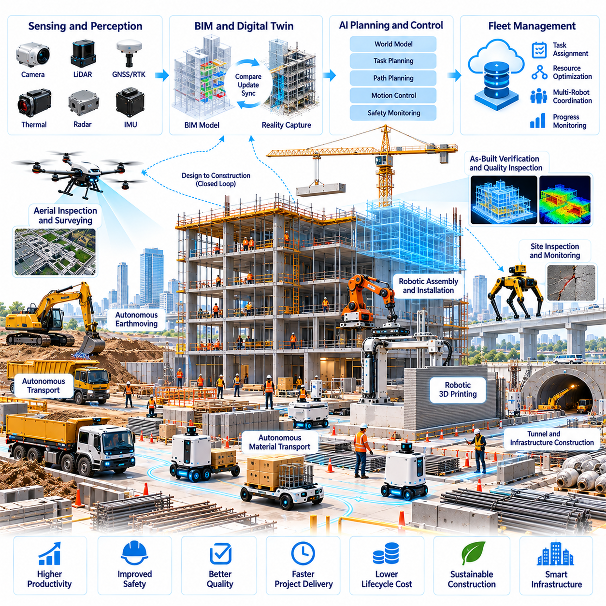{width="7.268055555555556in" height="7.268055555555556in"}

건설 및 기반시설 자동화(Construction and Infrastructure Automation)는 미래 도시에서 피지컬 AI(Physical AI)의 주요 발전 영역을 의미한다. 도시 개발(Urban Development)은 지속적으로 변화하는 건설 현장(Construction Site)에서 기계, 자재, 작업자 및 공학 정보(Engineering Information)의 복잡한 조정을 요구한다. 자율 로봇 시스템(Autonomous Robotic System)은 환경 인식(Environmental Perception), 정밀 동작 제어(Precise Motion Control), 지능형 계획(Intelligent Planning)을 결합하여 건설, 검사 및 유지보수 활동을 지원하며 생산성(Productivity), 안전성(Safety), 시공 품질(Construction Quality)을 향상시킬 수 있다.

기존 건설 방식(Traditional Construction)은 노동집약적인 공정(Labor-Intensive Process), 수동으로 조작하는 장비(Manually Operated Equipment), 설계와 시공 사이의 단절된 정보 흐름(Fragmented Information Flow)에 의존한다. 건설 현장의 조건(Site Condition)은 구조물이 조립되고 자재가 이동함에 따라 지속적으로 변화한다. 피지컬 AI는 이러한 변화를 해석하고 물리적 작업(Physical Task)을 조정하며 디지털 공학 모델(Digital Engineering Model)을 실제 건설 작업(Real-World Construction Operation)과 연결할 수 있는 적응형 자동화(Adaptive Automation)를 도입한다.

건설 로봇(Construction Robot)은 통합된 인식(Perception), 위치 추정(Localization), 계획(Planning), 제어(Control) 시스템을 필요로 한다. 카메라(Camera), 라이다(LiDAR), 관성 센서(Inertial Sensor), 위치 측정 장비(Positioning Instrument)는 현장 형상(Site Geometry), 장비 위치(Equipment Location), 주변 활동(Surrounding Activity)에 관한 정보를 제공한다. 자율 플랫폼(Autonomous Platform)은 불완전한 관측정보(Incomplete Observation)를 해석하면서 고르지 않은 지형(Uneven Terrain)을 이동하고 장애물을 회피하며 작업자 및 기계와의 안전거리(Safe Separation)를 유지해야 한다.

건축정보모델링(Building Information Modeling, BIM)은 건설 자동화(Construction Automation)를 위한 디지털 기반(Digital Foundation)을 제공한다. BIM 모델(BIM Model)은 구조 형상(Structural Geometry), 건축 구성요소(Architectural Component), 자재(Material), 시공 관계(Construction Relationship)를 설명한다. 로봇 시스템은 이러한 정보를 활용하여 목표 위치(Target Location)를 식별하고 작업을 계획하며 완료된 시공 결과(Completed Work)를 설계 사양(Design Specification)과 비교할 수 있다. 신뢰성 높은 통합을 위해서는 정확한 좌표 정합(Coordinate Alignment)과 실제 현장 조건을 반영하는 지속적인 갱신(Continuous Update)이 필요하다.

디지털 건설 작업 흐름(Digital Construction Workflow)은 BIM, 현실 데이터 획득(Reality Capture), 로봇 실행(Robotic Execution)을 점점 더 긴밀하게 연결하고 있다. 레이저 스캐닝(Laser Scanning), 사진측량(Photogrammetry), 이동형 지도 작성 시스템(Mobile Mapping System)은 부분적으로 완성된 구조물(Partially Completed Structure)의 표현을 생성할 수 있다. 측정된 형상(Measured Geometry)을 설계 모델(Design Model)과 비교하면 편차(Deviation), 누락된 구성요소(Missing Component), 설치 오류(Installation Error)를 식별하는 데 도움이 된다. 이러한 관측정보는 결함이 후속 시공 단계(Subsequent Construction Stage)로 확산되기 전에 시정 조치(Corrective Action)를 수행하도록 지원할 수 있다.

자율이동로봇(Autonomous Mobile Robot)은 건설 현장에서 도구(Tool), 자재(Material), 구성요소(Component)를 운송할 수 있다. 이러한 플랫폼은 변화하는 이동 경로(Changing Pathway), 임시 자재 보관 구역(Temporary Storage Area), 불규칙한 지면(Uneven Surface), 예측하기 어려운 인간 활동(Unpredictable Human Activity)에 대응해야 한다. 군집 조정 시스템(Fleet Coordination System)은 자재 수요(Material Demand), 차량 적재 용량(Vehicle Capacity), 공사 일정(Construction Schedule)에 따라 운송 임무(Transport Mission)를 할당하여 불필요한 이동을 줄이고 더욱 안정적인 자재 공급(Material Availability)을 지원할 수 있다.

로봇 조작(Robotic Manipulation)은 일부 조립 및 설치 작업(Assembly and Installation Task)의 자동화를 가능하게 한다. 산업용 로봇 팔(Industrial Arm), 이동형 매니퓰레이터(Mobile Manipulator), 특수 건설 기계(Specialized Construction Machine)는 천공(Drilling), 체결(Fastening), 용접(Welding), 위치 결정(Positioning), 구성요소 취급(Component Handling)을 수행할 수 있다. 성공적인 작업 수행을 위해서는 정확한 객체 위치 추정(Object Localization), 접촉 인식 동작 계획(Contact-Aware Motion Planning), 힘 제어(Force Control), 설치된 구성요소가 기하학적 및 기계적 요구사항(Geometric and Mechanical Requirements)을 충족하는지에 대한 검증이 필요하다.

자율 토공 작업(Autonomous Earthmoving)과 중장비 운영(Heavy Equipment Operation)은 대규모 기반시설 개발(Large-Scale Infrastructure Development)에 새로운 가능성을 제공한다. 굴착기(Excavator), 로더(Loader), 다짐 장비(Compactor), 운송 차량(Transport Vehicle)은 인식 및 기계 제어 시스템(Perception and Machine Control System)을 활용하여 제한된 범위의 작업을 수행할 수 있다. 이러한 자율성(Autonomy)은 지형 변동성(Terrain Variability), 토양 거동(Soil Behavior), 장비 동역학(Equipment Dynamics), 주변 작업자(Nearby Personnel)를 고려해야 하며 검증된 안전 범위(Validated Safety Boundary) 내에서 운영되어야 한다.

시공 위치 표시(Construction Layout)와 측량(Surveying)은 로봇 기반 측정 및 마킹 시스템(Robotic Measurement and Marking System)을 통해 개선될 수 있다. 자율 플랫폼은 설계 좌표(Design Coordinate)를 바닥, 벽 또는 구조물 표면(Structural Surface)에 표시하여 설치 작업팀(Installation Team)에 일관된 공간 기준(Spatial Reference)을 제공할 수 있다. 작은 위치 오차(Positioning Error)도 여러 시공 단계에 걸쳐 누적되어 후속 조립 정확도(Downstream Assembly Accuracy)에 영향을 미칠 수 있으므로 고정밀 위치 추정(High-Precision Localization)과 보정(Calibration)이 필수적이다.

기반시설 건설(Infrastructure Construction)은 로봇 자동화를 도로(Road), 교량(Bridge), 터널(Tunnel), 공공설비 네트워크(Utility Network)로 확장한다. 특수 기계(Specialized Machine)는 포장 작업(Pavement Operation), 철근 배치(Reinforcement Placement), 콘크리트 처리(Concrete Processing), 지하 설비 설치(Underground Installation)를 지원할 수 있다. 서로 다른 작업에는 각기 다른 이동성(Mobility)과 조작 능력(Manipulation Capability)이 필요하므로 모듈형 로봇 아키텍처(Modular Robotic Architecture)와 작업별 전용 도구(Task-Specific Tooling)가 실제 배치(Practical Deployment)에 중요하다.

월드 모델(World Model)은 건설 로봇이 지속적으로 변화하는 현장 조건(Evolving Site Condition)을 이해하도록 지원할 수 있다. 이러한 모델은 구조 요소(Structural Element), 임시 장애물(Temporary Obstacle), 장비 이동(Equipment Movement), 자재 위치(Material Location), 부분적으로 완료된 작업(Partially Completed Work)을 표현할 수 있다. 로봇은 지속적으로 유지되는 공간 정보(Persistent Spatial Information)와 현재 관측정보(Current Observation)를 결합하여 공사 진행(Construction Progress)에 따라 환경이 변화하거나 기존에 접근 가능했던 경로가 차단되는 경우 계획을 조정할 수 있다.

건설 자동화는 작업 계획(Task Planning)과 프로젝트 일정 관리(Project Scheduling) 사이의 긴밀한 통합을 요구한다. 로봇 작업(Robotic Operation)은 자재 준비 상태(Material Readiness), 선행 작업 완료(Completed Prerequisite Activity), 장비 가용성(Equipment Availability), 접근 권한(Access Permission)에 따라 달라진다. 계획 시스템(Planning System)은 프로젝트 정보(Project Information)를 활용하여 실행 가능한 작업(Feasible Task)을 식별하고 작업 수행을 조정할 수 있지만 불확실한 진행 상황(Uncertain Progress)과 예상하지 못한 현장 조건(Unexpected Site Condition)에 대응하기 위해 지속적인 재평가(Continuous Reassessment)가 필요하다.

자율 기계가 공유 건설 환경(Shared Construction Environment)에서 운송(Transportation), 측량(Surveying), 검사(Inspection), 조립(Assembly)을 수행함에 따라 다중 로봇 조정(Multi-Robot Coordination)의 중요성이 높아진다. 군집 관리 시스템(Fleet Management System)은 작업을 분배하고 로봇 상태(Robot Status)를 모니터링하며 작업 간 충돌(Conflict Between Activities)을 줄일 수 있다. 효과적인 조정은 사전에 정의된 일정에 따라 움직이지 않을 수 있는 인간 조작 장비(Human-Operated Machinery)와 건설 작업팀(Construction Crew)의 움직임도 고려해야 한다.

디지털 트윈(Digital Twin)은 건설 계획(Construction Planning)과 관측된 물리적 진행 상황(Observed Physical Progress)을 연결할 수 있다. 건설 디지털 트윈(Construction Digital Twin)은 설계 모델(Design Model), 로봇 측정정보(Robotic Measurement), 장비 상태(Equipment State), 프로젝트 일정(Project Schedule)을 통합할 수 있다. 이러한 표현은 기초 데이터(Underlying Data)가 정확하고 충분히 최신 상태로 유지된다는 조건에서 공정 진행 검증(Progress Verification), 자원 계획(Resource Planning), 예상 조건과 실제 조건 사이의 불일치(Discrepancy)를 식별하는 데 도움이 될 수 있다.

시뮬레이션 환경(Simulation Environment)은 실제 배치 이전에 로봇 건설 작업 흐름(Robotic Construction Workflow)을 시험할 기회를 제공한다. 가상 건설 현장(Virtual Construction Site)은 장비 이동(Equipment Movement), 구조 형상(Structural Geometry), 자재 취급(Material Handling), 일부 상호작용 동역학(Interaction Dynamics)을 재현할 수 있다. 도메인 랜덤화(Domain Randomization)는 조명(Lighting), 지형(Terrain), 장애물 배치(Obstacle Placement)의 변화를 로봇에 경험하게 할 수 있지만 불확실한 접촉(Contact)과 재료 거동(Material Behavior)이 포함된 작업에는 실제 환경 검증(Real-World Validation)이 필수적이다.

품질 보증(Quality Assurance)은 건설 자동화의 핵심 목표이다. 로봇 측정 시스템(Robotic Measurement System)은 치수 공차(Dimensional Tolerance), 구성요소 정렬(Component Alignment), 표면 상태(Surface Condition), 설치 완료 여부(Installation Completeness)를 평가할 수 있다. 설계 기준 정보(As-Designed Information)와 시공 완료 정보(As-Built Information) 사이의 자동 비교(Automated Comparison)는 편차를 조기에 식별할 수 있지만 공학적 합격 판정(Engineering Acceptance)은 측정 불확실성(Measurement Uncertainty), 적용 기준(Applicable Standard), 탐지된 차이의 구조적 중요성(Structural Significance)을 고려해야 한다.

정밀 제어(Precision Control)는 로봇 작업에 천공(Drilling), 체결(Fastening), 구성요소 위치 결정(Component Positioning), 기하학적 검증(Geometric Verification)이 포함될 때 특히 중요해진다. 시스템 정확도(System Accuracy)는 위치 추정(Localization), 센서 보정(Sensor Calibration), 액추에이터 성능(Actuator Performance), 구조적 강성(Structural Rigidity), 환경 외란(Environmental Disturbance)에 따라 달라진다. 오차 예산(Error Budget)은 반복정밀도(Repeatability)와 절대정확도(Absolute Accuracy)를 구분해야 하며 독립적인 측정(Independent Measurement)을 통해 완료된 작업이 요구 공차(Required Tolerance)를 충족하는지 검증해야 한다.

안전 공학(Safety Engineering)은 로봇, 중장비(Heavy Machinery), 작업자, 불안정한 건설 환경(Unstable Construction Environment) 사이의 상호작용을 다루어야 한다. 자율 플랫폼은 장애물 탐지(Obstacle Detection), 보호 작업 구역(Protective Operating Zone), 비상 정지(Emergency Stopping), 안전 복구 절차(Safe Recovery Procedure)를 필요로 한다. 위험 평가(Risk Assessment)는 통제된 산업 환경(Controlled Industrial Environment)을 가정하기보다 낙하물(Falling Object), 이동 장비(Moving Equipment), 임시 구조물(Temporary Structure), 변화하는 현장 접근 조건(Changing Site Access Condition)을 고려해야 한다.

인간-로봇 협력(Human-Robot Collaboration)은 건설 자동화가 발전하는 전 과정에서 핵심 요소로 유지될 가능성이 높다. 숙련 작업자(Skilled Worker)는 로봇 작업을 감독하고 예상하지 못한 상황을 해결하며 복잡한 조립(Complex Assembly)을 수행하고 중요한 공학적 결과(Engineering Outcome)를 검증할 수 있다. 효과적인 배치를 위해서는 명확한 책임 범위(Responsibility Boundary), 이해하기 쉬운 시스템 행동(Understandable System Behavior), 작업자가 자율 장비(Autonomous Equipment)와 안전하게 협력하도록 하는 교육훈련(Training)이 필요하다.

엣지 컴퓨팅(Edge Computing)과 신뢰성 높은 통신 기반시설(Reliable Communication Infrastructure)은 대규모 건설 현장에서 작동하는 건설 로봇을 지원할 수 있다. 온보드 처리(Onboard Processing)는 즉각적인 인식과 제어를 가능하게 하며 로컬 서버(Local Server) 또는 클라우드 플랫폼(Cloud Platform)은 계획 조정(Planning Coordination), 데이터 저장(Data Storage), 모델 갱신(Model Update)을 지원할 수 있다. 특히 로봇이 중량물(Heavy Load)을 조작하거나 작업자 근처에서 작동할 때 안전 필수 기능(Safety-Critical Function)은 네트워크 중단(Network Interruption) 상황에서도 유지되어야 한다.

건설 작업 중 생성되는 데이터는 미래 로봇 성능(Future Robotic Performance)을 개선할 수 있다. 항법 실패(Navigation Failure), 위치 결정 오차(Positioning Error), 조작 결과(Manipulation Outcome), 검사 결과(Inspection Result)는 시스템 한계(System Limitation)에 관한 정보를 제공한다. 구조화된 데이터셋(Structured Dataset)은 학습(Learning)과 보정(Calibration)을 지원할 수 있으며 군집 수준 분석(Fleet-Level Analysis)은 여러 프로젝트에서 반복되는 문제(Recurring Problem)를 발견할 수 있다. 데이터 거버넌스(Data Governance)는 상업적으로 민감한 설계(Commercially Sensitive Design)와 운영 기록(Operational Record)을 보호해야 한다.

건설 로봇의 경제적 실현 가능성(Economic Feasibility)은 장비 활용률(Equipment Utilization), 통합 복잡성(Integration Complexity), 노동력 요구사항(Labor Requirement), 유지보수 비용(Maintenance Cost), 달성 가능한 품질 개선(Achievable Quality Improvement)에 달려 있다. 반복적이고 명확하게 정의된 작업(Repetitive and Well-Defined Task)은 변동성이 높은 작업(Highly Variable Activity)보다 자동화를 조기에 적용하기에 유리할 수 있다. 투자 평가(Investment Evaluation)는 직접적인 노동력 대체(Direct Labor Substitution)에만 집중하기보다 재작업 감소(Reduced Rework), 안전성 향상(Improved Safety), 일정 신뢰성(Schedule Reliability), 수명주기 비용(Lifecycle Cost)을 고려해야 한다.

표준화(Standardization)와 상호운용성(Interoperability)은 로봇 시스템을 건설 소프트웨어(Construction Software) 및 공학 작업 흐름(Engineering Workflow)과 연결하는 데 중요하다. 공통 좌표 기준(Common Coordinate Reference), BIM 인터페이스(BIM Interface), 작업 설명(Task Description), 검사 기록(Inspection Record), 안전 프로토콜(Safety Protocol)은 통합 장벽(Integration Barrier)을 줄일 수 있다. 개방적이고 명확하게 정의된 인터페이스(Open and Well-Defined Interface)는 시공업체(Contractor)가 프로젝트마다 운영 시스템을 새롭게 구축하지 않고도 서로 다른 공급업체의 장비를 결합하도록 지원할 수 있다.

건설 자동화의 장기적 발전(Long-Term Evolution)은 설계(Design), 시뮬레이션(Simulation), 로봇 실행(Robotic Execution), 기반시설 유지보수(Infrastructure Maintenance)를 연속적인 디지털-물리 작업 흐름(Continuous Digital-Physical Workflow)으로 연결할 수 있다. 피지컬 AI는 자동 검증(Automated Verification)과 협력형 운영(Coordinated Operations)을 지원하면서 건설 현장을 더욱 적응적이고 측정 가능한 환경으로 발전시킬 수 있다. 실제 성공 여부는 공학적 정확도(Engineering Accuracy), 안전한 배치(Safe Deployment), 상호운용성(Interoperability), 자율 기계와 건설 전문가 사이의 효과적인 협력(Effective Cooperation)에 달려 있다.

## 03.08. Emergency Response and Disaster Robotics

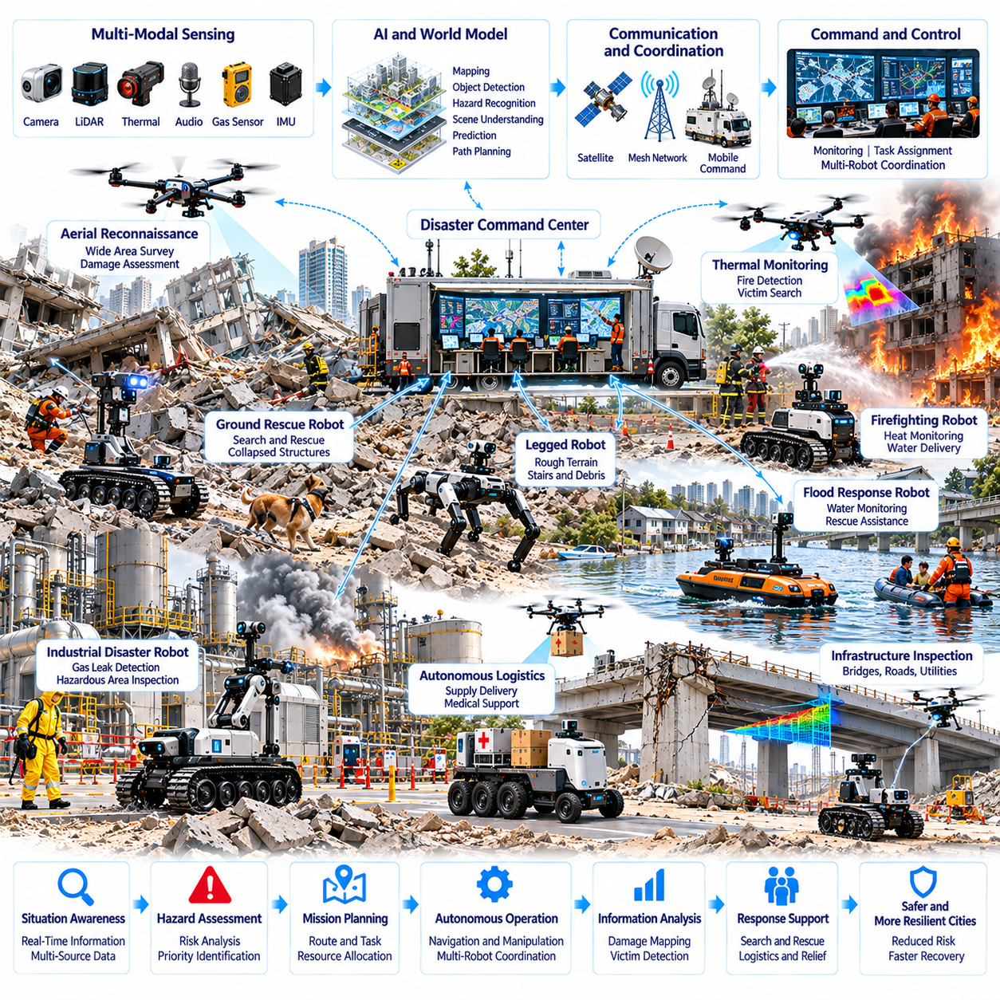{width="7.268055555555556in" height="7.268055555555556in"}

긴급 대응 및 재난 로봇(Emergency Response and Disaster Robotics)은 도시 인구와 기반시설을 보호하는 데 있어 피지컬 AI(Physical AI)의 핵심 응용 분야이다. 지진(Earthquake), 홍수(Flood), 화재(Fire), 산업재해(Industrial Accident), 구조물 붕괴(Structural Collapse)는 인간의 접근이 위험하거나 불가능한 환경을 발생시킨다. 자율 로봇 시스템(Autonomous Robotic System)은 이동성(Mobility), 인식(Perception), 지능형 의사결정(Intelligent Decision-Making)을 결합하여 현장 정찰(Reconnaissance), 위험 평가(Hazard Assessment), 수색 및 구조(Search and Rescue), 긴급 물류(Emergency Logistics)를 지원할 수 있다.

기존 긴급 대응 작업(Traditional Emergency Operation)은 훈련된 대응 인력(Trained Responder), 특수 장비(Specialized Equipment), 신속하게 구축되는 지휘 체계(Command Structure)에 의존한다. 그러나 손상된 기반시설(Damaged Infrastructure), 불확실한 위험요소(Uncertain Hazard), 불완전한 정보(Incomplete Information)는 대응을 지연시킬 수 있다. 피지컬 AI는 위험 지역(Hazardous Area)에 진입하여 환경 관측정보(Environmental Observation)를 수집하고 운영 의사결정(Operational Decision)을 지원하면서 긴급 대응 인력(Emergency Personnel)의 불필요한 위험 노출을 줄일 수 있는 로봇 플랫폼(Robotic Platform)을 도입한다.

재난 로봇(Disaster Robotics)은 불확실성이 매우 높은 조건에서 통합된 인식(Perception), 위치 추정(Localization), 계획(Planning), 제어(Control)를 필요로 한다. 카메라(Camera), 라이다(LiDAR), 열 센서(Thermal Sensor), 가스 검출기(Gas Detector), 관성 측정 시스템(Inertial Measurement System)은 손상된 환경에 관한 상호보완적인 정보를 제공한다. 로봇은 불완전한 관측정보(Incomplete Observation)를 해석하고 불안정한 지형(Unstable Terrain)을 이동하며 시야 저하(Degraded Visibility), 예측하기 어려운 장애물(Unpredictable Obstacle), 제한된 통신(Limited Communication) 상황에서도 안전한 행동(Safe Behavior)을 유지해야 한다.

지상 구조 로봇(Ground Rescue Robot)은 붕괴된 건물(Collapsed Building), 지하 통로(Underground Passage), 산업시설(Industrial Facility), 잔해로 가득한 환경(Debris-Filled Environment)을 탐색할 수 있다. 궤도형(Tracked), 바퀴형(Wheeled), 다족형(Legged) 플랫폼은 지형과 접근 제약조건(Access Constraint)에 따라 서로 다른 이동 특성(Mobility Characteristic)을 제공한다. 효과적인 운영은 장애물 극복(Obstacle Negotiation), 기계적 내구성(Mechanical Durability), 센서 신뢰성(Sensor Reliability), 항법(Navigation)이나 조작(Manipulation)이 어려워졌을 때 안전하게 복구할 수 있는 능력에 달려 있다.

공중 로봇(Aerial Robot)은 재난 피해 지역(Disaster-Affected Region) 전반에 걸쳐 신속한 상황 인식(Situational Awareness)을 제공한다. 무인항공기(Unmanned Aerial Vehicle, UAV)는 손상된 구조물(Damaged Structure), 침수 지역(Flooded Neighborhood), 차단된 도로(Blocked Road), 접근하기 어려운 지형(Inaccessible Terrain)을 상공에서 조사할 수 있다. 열영상(Thermal Imaging)과 시각 지도 작성(Visual Mapping)은 정밀 조사가 필요한 지역을 식별하는 데 도움이 될 수 있지만 기상 조건(Weather Condition), 연기(Smoke), 배터리 한계(Battery Limitation), 공역 제한(Airspace Restriction)은 배치를 제약할 수 있다.

수색 및 구조 작업(Search and Rescue Operation)은 여러 감지 방식(Sensing Modality)을 결합함으로써 효과를 높일 수 있다. 열화상 카메라(Thermal Camera)는 열 신호(Heat Signature)를 탐지하고 마이크로폰(Microphone)은 음향 신호(Acoustic Signal)를 수집하며 시각 시스템(Visual System)은 사람의 존재를 나타내는 징후(Sign of Human Presence)를 식별할 수 있다. 센서 융합(Sensor Fusion)은 탐지 후보(Candidate Detection)의 정확도를 높일 수 있지만 환경적 간섭(Environmental Interference)과 오탐(False Positive)이 구조 우선순위(Rescue Priority)에 영향을 미칠 수 있으므로 불확실한 관측정보를 신중하게 해석해야 한다.

자율 항법(Autonomous Navigation)은 재난으로 인해 기존 지도 환경(Previously Mapped Environment)이 변경될 때 특히 어려워진다. 붕괴된 구조물(Collapsed Structure), 이동된 물체(Displaced Object), 침수(Water Accumulation), 손상된 도로(Damaged Road)는 기존 지도(Existing Map)를 무효화할 수 있다. 로봇은 위치 추정 불확실성(Localization Uncertainty)을 평가하면서 갱신된 공간 표현(Updated Spatial Representation)을 구축해야 한다. 적응형 지도 작성(Adaptive Mapping)과 탐색 전략(Exploration Strategy)은 환경의 구조적 안정성(Structural Stability)을 가정하지 않고 접근 가능한 경로(Accessible Route)를 식별하도록 지원할 수 있다.

월드 모델(World Model)은 지형 형상(Terrain Geometry), 환경 위험요소(Environmental Hazard), 기반시설 손상(Infrastructure Damage), 시간에 따른 잠재적 변화(Potential Change Over Time)를 표현하여 재난 대응(Disaster Response)을 지원할 수 있다. 예측 모델(Predictive Model)은 장애물(Obstacle), 연기(Smoke), 침수(Flooding), 불안정한 구조물(Unstable Structure)이 로봇 운영에 미치는 영향을 추정할 수 있다. 그러나 재난 환경에는 상당한 불확실성(Substantial Uncertainty)이 존재하므로 예측 조건(Predicted Condition)에 과도하게 의존하기보다 지속적인 관측(Continuous Observation)과 보수적인 의사결정(Conservative Decision)이 필요하다.

다중 로봇 조정(Multi-Robot Coordination)은 대규모 긴급 상황(Large-Scale Emergency)에서 탐색 범위(Coverage)와 운영 효율성(Operational Efficiency)을 향상시킬 수 있다. 공중 플랫폼(Aerial Platform)은 광역 정찰(Regional Reconnaissance)을 수행하고 지상 로봇(Ground Robot)은 특정 위치를 조사하거나 장비를 운송할 수 있다. 군집 조정 시스템(Fleet Coordination System)은 로봇 능력(Robot Capability), 배터리 상태(Battery State), 통신 가용성(Communication Availability), 운영 긴급성(Operational Urgency)에 따라 임무를 할당하면서 긴급 지휘 인력(Emergency Command Personnel)의 명확한 감독을 유지할 수 있다.

통신 복원력(Communication Resilience)은 재난이 이동통신망(Cellular Network), 전력 시스템(Power System), 고정 통신 기반시설(Fixed Communication Infrastructure)을 자주 손상시키기 때문에 필수적이다. 로봇은 로컬 무선 링크(Local Wireless Link), 임시 중계국(Temporary Relay Station), 이동형 통신 노드(Mobile Communication Node)를 사용하여 정보를 교환할 수 있다. 그러나 안전 필수 자율 기능(Safety-Critical Autonomy)은 네트워크 중단(Network Interruption) 상황에서도 유지되어야 하며, 로봇은 조정 기능을 사용할 수 없을 때 통제된 대체 동작(Controlled Fallback Behavior)을 지원해야 한다.

긴급 물류(Emergency Logistics)는 자율 로봇 시스템(Autonomous Robotic System)의 또 다른 중요한 응용 분야이다. 지상 차량(Ground Vehicle)과 공중 플랫폼(Aerial Platform)은 접근하기 어려운 장소로 의료 물품(Medical Supply), 통신 장비(Communication Equipment), 센서(Sensor), 필수 자재(Essential Material)를 운송할 수 있다. 임무 계획(Mission Planning)은 특히 교통 기반시설(Transportation Infrastructure)이 손상된 상황에서 적재량 제한(Payload Limitation), 경로 안전성(Route Safety), 배송 확인(Delivery Verification), 인간의 긴급한 필요(Urgency of Human Needs)를 고려해야 한다.

소방 로봇(Firefighting Robot)은 극심한 열(Extreme Heat), 유독성 연기(Toxic Smoke), 불안정한 구조물(Unstable Structure)에 대한 인간의 노출을 줄일 수 있다. 특수 지상 로봇(Specialized Ground Robot)은 열 센서(Thermal Sensor), 방수 시스템(Water Delivery System), 소방 장비(Firefighting Equipment)를 위험 지역으로 운반할 수 있다. 자율 지원(Autonomous Assistance)을 위해서는 신뢰성 높은 열 관리(Thermal Management), 장애물 인식(Obstacle Awareness), 안전한 장비 제어(Safe Equipment Control)가 필요하며 전술적 소방 의사결정(Tactical Firefighting Decision)은 자격을 갖춘 인간 지휘관(Qualified Human Command)의 통제를 받아야 한다.

홍수 대응 로봇(Flood Response Robot)은 수위 모니터링(Water-Level Monitoring), 환경 지도 작성(Environmental Mapping), 기반시설 검사(Infrastructure Inspection), 일부 구조 지원 작업(Rescue Assistance Task)을 수행할 수 있다. 수륙양용 차량(Amphibious Vehicle), 무인수상정(Unmanned Surface Vessel), 공중 플랫폼(Aerial Platform)은 침수 환경의 서로 다른 영역에 접근할 수 있다. 이러한 로봇의 운영은 수류(Water Current), 부유 잔해(Floating Debris), 수중 장애물(Submerged Obstacle), 기존 항법 시스템(Conventional Navigation System)에 어려움을 주는 급격한 환경 변화(Rapidly Changing Condition)를 고려해야 한다.

산업재해 대응(Industrial Disaster Response)에는 화학물질 누출(Chemical Leak), 가스 방출(Gas Release), 전기적 위험(Electrical Hazard), 손상된 공정 시설(Damaged Processing Facility)이 포함될 수 있다. 특수 센서(Specialized Sensor)를 장착한 로봇은 인간이 진입하기 전에 위험 구역(Hazardous Zone)을 조사하고 측정정보(Measurement)를 수집할 수 있다. 신뢰성 높은 운영을 위해서는 적절한 환경 보호(Environmental Protection), 보정된 검출 장비(Calibrated Detection Instrument), 엄격한 임무 경계(Strict Mission Boundary)가 필요하며 센서 고장(Sensor Failure)이나 잘못된 위험 해석(Incorrect Hazard Interpretation)은 심각한 결과를 초래할 수 있다.

기반시설 손상 평가(Infrastructure Damage Assessment)는 긴급 대응 우선순위(Emergency Prioritization)와 복구 계획(Recovery Planning)을 지원할 수 있다. 로봇은 교량(Bridge), 도로(Road), 터널(Tunnel), 건물(Building), 공공설비 시스템(Utility System)을 검사하여 눈에 보이는 손상(Visible Damage)과 접근 제한(Access Restriction)을 식별할 수 있다. 3차원 지도 작성(Three-Dimensional Mapping)과 영상 분석(Image Analysis)은 관측된 상태(Observed Condition)를 기록할 수 있지만 구조적 안전성 판단(Structural Safety Conclusion)은 자동 시각 분류(Automated Visual Classification)에만 의존하지 않고 공학적 검증(Engineering Validation)을 필요로 한다.

디지털 트윈(Digital Twin)은 재난 이전 기반시설 정보(Pre-Disaster Infrastructure Information)와 긴급 대응 중 수집된 관측정보를 연결할 수 있다. 갱신된 가상 표현(Updated Virtual Representation)은 손상된 도로(Damaged Road), 차단된 출입구(Blocked Entrance), 공공설비 장애(Utility Failure), 로봇 정찰 결과(Robotic Reconnaissance Result)를 포함할 수 있다. 이러한 모델은 오래되었거나 불확실한 관측정보(Outdated or Uncertain Observation)를 명확하게 구분한다는 조건에서 긴급 대응팀(Emergency Team)이 대응 방안(Response Option)을 비교하고 자원(Resource)을 조정하며 정보 공백(Information Gap)을 식별하도록 지원할 수 있다.

시뮬레이션 환경(Simulation Environment)은 실제 배치 이전에 재난 로봇(Disaster Robot)을 훈련하고 평가하도록 지원할 수 있다. 가상 환경(Virtual Environment)은 잔해 지대(Debris Field), 연기(Smoke), 침수(Flooding), 불안정한 지형(Unstable Terrain), 통신 장애(Communication Disruption)를 재현할 수 있다. 도메인 랜덤화(Domain Randomization)는 제어 및 인식 시스템(Control and Perception System)을 다양한 조건에 노출시킬 수 있지만 시뮬레이션 성공(Simulated Success)만으로 운영 신뢰성(Operational Reliability)이 입증되는 것은 아니며 현실적인 시험(Realistic Testing)과 신중하게 설계된 현장 훈련(Field Exercise)이 필요하다.

인간-로봇 협력(Human-Robot Collaboration)은 긴급 대응이 윤리적 판단(Ethical Judgment), 불확실한 정보(Uncertain Information), 빠르게 변화하는 우선순위(Rapidly Changing Priority)를 포함하기 때문에 기본적으로 중요하다. 로봇은 관측정보를 제공하고 일부 위험 작업(Hazardous Task)을 수행할 수 있으며 훈련된 대응 인력(Trained Responder)은 구조 전략(Rescue Strategy)과 핵심 의사결정(Critical Decision)에 대한 권한을 유지한다. 사용자 인터페이스(User Interface)는 대응 인력에게 과도한 정보 부담을 주지 않으면서 로봇 상태(Robot Status), 신뢰도 수준(Confidence Level), 탐지된 위험요소(Detected Hazard), 운영 한계(Operational Limitation)를 전달해야 한다.

안전 보증(Safety Assurance)은 재난 환경에서 일반적인 충돌 회피(Conventional Collision Avoidance) 이상의 기능을 요구한다. 로봇은 불안정한 잔해(Unstable Debris), 유해물질(Hazardous Substance), 손상된 전기 시스템(Damaged Electrical System), 예측하기 어려운 구조물 움직임(Unpredictable Structural Movement)을 마주할 수 있다. 위험 인식 계획(Risk-Aware Planning), 비상 정지(Emergency Stopping), 통제된 후퇴(Controlled Retreat), 장비별 안전 절차(Equipment-Specific Safety Procedure)는 로봇 작업이 생존자(Survivor)나 대응 인력(Responder)에게 추가적인 위험을 발생시키지 않도록 하는 데 필요하다.

데이터 품질(Data Quality)과 불확실성 관리(Uncertainty Management)는 긴급 의사결정(Emergency Decision)이 로봇 관측정보(Robotic Observation)에 의존할 때 특히 중요하다. 센서 측정값(Sensor Reading)에는 타임스탬프(Timestamp), 지리적 참조정보(Geographic Reference), 신뢰도 추정값(Confidence Estimate), 관련 환경 조건(Environmental Condition)이 포함되어야 한다. 시스템은 확인된 발견사항(Confirmed Finding)을 의심되는 위험요소(Suspected Hazard) 및 불완전한 관측정보(Incomplete Observation)와 구분하여 지휘 인력(Command Personnel)이 조치를 취하기 전에 정보 신뢰성(Information Reliability)을 평가하도록 해야 한다.

사이버보안(Cybersecurity)은 긴급 상황에서 로봇 시스템이 민감한 운영 정보(Sensitive Operational Information)를 교환할 때 매우 중요해진다. 무단 접근(Unauthorized Access), 통신 간섭(Communication Interference), 조작된 센서 데이터(Manipulated Sensor Data)는 구조 조정(Rescue Coordination)을 방해할 수 있다. 보안 인증(Secure Authentication), 보호된 통신(Protected Communication), 통제된 시스템 접근(Controlled System Access), 운영 감사 기록(Operational Audit Record)은 대응 기관(Response Organization) 사이의 신속한 협력을 지원하면서 정보 무결성(Information Integrity)을 유지하는 데 도움이 될 수 있다.

재난 로봇의 경제성 평가(Economic Evaluation)는 장비가 필수적으로 사용되기 전까지 장기간 활용되지 않을 수 있다는 점에서 일반적인 상업용 자동화(Conventional Commercial Automation)와 다르다. 조달 결정(Procurement Decision)은 대비 태세(Readiness), 유지보수(Maintenance), 훈련(Training), 배치 속도(Deployment Speed), 기존 긴급 대응 시스템(Existing Emergency System)과의 상호운용성(Interoperability)을 고려해야 한다. 지역 간 자원 공유(Shared Regional Resource)와 표준화된 운영 절차(Standardized Operating Procedure)는 모든 기관이 동일한 로봇 군집(Robotic Fleet)을 유지하지 않고도 재난 대비 역량(Preparedness)을 향상시킬 수 있다.

거버넌스(Governance)와 운영 표준(Operational Standard)은 긴급 대응 로봇(Emergency Robot)의 안전한 배치에 영향을 미친다. 공공기관(Public Authority)은 공역 접근(Airspace Access), 위험 현장 진입(Hazardous-Site Entry), 데이터 공유(Data Sharing), 기관 간 조정(Interagency Coordination)에 대한 책임을 수립해야 한다. 정기 훈련(Regular Exercise)과 성능 검증(Performance Validation)은 운영 준비 상태(Operational Readiness)를 향상시킬 수 있으며 명확한 책임성(Accountability)은 로봇의 권고(Robotic Recommendation)가 권한을 부여받은 긴급 의사결정(Authorized Emergency Decision-Making)을 대체하지 않도록 보장한다.

재난 로봇의 장기적 발전(Long-Term Development)은 도시 센싱 네트워크(Urban Sensing Network), 기반시설 디지털 트윈(Infrastructure Digital Twin), 자율 로봇 군집(Autonomous Fleet), 긴급 지휘 플랫폼(Emergency Command Platform)을 연결할 수 있다. 피지컬 AI는 더욱 이른 위험 탐지(Earlier Hazard Detection), 신속한 상황 평가(Faster Situational Assessment), 보다 조정된 복구 작업(Coordinated Recovery Operation)을 지원할 수 있다. 그 효과는 견고한 자율성(Robust Autonomy), 복원력 있는 통신(Resilient Communication), 신뢰성 높은 데이터(Reliable Data), 기존 긴급 관리 체계(Established Emergency Management Practice)와의 통합에 달려 있다.

궁극적으로 긴급 대응 및 재난 로봇(Emergency Response and Disaster Robotics)은 기존 방식으로 접근하기에 지나치게 위험하거나 접근이 불가능하거나 불확실성이 높은 환경까지 인간의 능력(Human Capability)을 확장할 수 있다. 피지컬 AI는 자율 탐색(Autonomous Exploration), 위험 감지(Hazard Sensing), 물류 지원(Logistical Support), 협력형 개입(Coordinated Intervention)을 위한 수단을 제공한다. 가장 중요한 기여는 대응 인력 안전(Responder Safety), 의사결정 품질(Decision Quality), 구조 효과성(Rescue Effectiveness), 예상하지 못한 재난에 직면한 도시의 복원력(Urban Resilience)을 얼마나 향상시키는지에 따라 평가될 것이다.

## 03.09. Hospitals Campuses and Public Service Robots

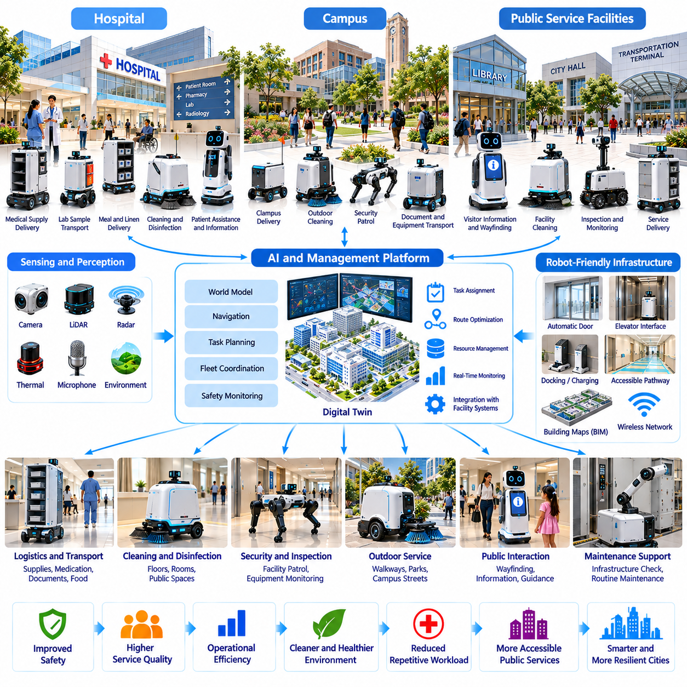{width="7.268055555555556in" height="7.268055555555556in"}

병원, 캠퍼스 및 공공 서비스 시설(Hospitals, Campuses, and Public Service Facilities)은 미래 도시에서 피지컬 AI(Physical AI)를 배치하기 위한 중요한 환경이다. 이러한 기관은 지속적으로 운영되고 다양한 인구 집단에 서비스를 제공하며 사람, 물자 및 정보의 신뢰성 높은 이동을 필요로 한다. 자율 로봇(Autonomous Robot)은 운송(Transportation), 안내 및 지원(Assistance), 청소(Cleaning), 검사(Inspection), 시설 운영(Facility Operations)을 지원하면서 서비스 접근성(Service Accessibility)을 향상시키고 인간 작업자의 반복적인 업무 부담(Repetitive Workload)을 줄일 수 있다.

병원(Hospital)은 운영 효율성(Operational Efficiency)이 환자 안전(Patient Safety), 감염 예방(Infection Prevention), 임상적 우선순위(Clinical Priority)와 공존해야 하므로 특히 까다로운 환경을 제공한다. 의료시설(Medical Facility)에는 서로 연결된 복도(Corridor), 엘리베이터(Elevator), 치료 구역(Treatment Area), 출입 제한 구역(Restricted Zone)이 존재한다. 피지컬 AI 시스템은 접근 권한(Access Permission)을 준수하고 변화하는 조건에 대응하며 필수 의료 활동(Essential Healthcare Activity)을 방해하지 않으면서 이러한 환경을 신뢰성 있게 이동해야 한다.

자율이동로봇(Autonomous Mobile Robot, AMR)은 병원 부서 사이에서 의약품(Medication), 검사실 검체(Laboratory Sample), 의료용품(Medical Supply), 식사(Meal), 린넨류(Linen)를 운송할 수 있다. 항법 시스템(Navigation System)은 위치 추정(Localization), 장애물 탐지(Obstacle Detection), 경로 계획(Route Planning)을 결합하여 환자, 의료진 및 방문객 주변에서 작동한다. 엘리베이터, 자동문(Automatic Door), 병원정보시스템(Hospital Information System)과의 통합은 협력형 배송(Coordinated Delivery)을 가능하게 하지만 민감한 물품(Sensitive Material)은 안전한 취급(Secure Handling)과 검증(Verification)을 필요로 한다.

병원 물류 자동화(Hospital Logistics Automation)는 반복적인 운송 작업에 소요되는 시간을 줄이고 필수 물품(Essential Supply)의 가용성을 향상시킬 수 있다. 군집 관리 플랫폼(Fleet Management Platform)은 긴급 배송(Urgent Delivery)의 우선순위를 결정하고 적재 요구사항(Payload Requirement)에 따라 로봇을 할당하며 작업 완료(Task Completion)를 모니터링할 수 있다. 그러나 임상적 긴급성(Clinical Urgency), 오염 위험(Contamination Risk), 예상하지 못한 응급 상황(Unexpected Emergency)은 유연한 일정 관리(Flexible Scheduling)와 명확하게 정의된 인간 개입 절차(Human Intervention Procedure)를 필요로 한다.

감염 관리(Infection Control)는 병원 로봇(Hospital Robotics)에 추가적인 요구사항을 부여한다. 청소 및 소독 로봇(Cleaning and Disinfection Robot)은 복도, 병실 및 지정된 임상 공간(Designated Clinical Space)의 정기적인 위생 관리(Routine Sanitation)를 지원할 수 있다. 효과성(Effectiveness)은 표면 처리 범위(Surface Coverage), 적절한 청소 방법(Appropriate Cleaning Method), 검증된 운영 절차(Validated Operating Procedure)에 달려 있다. 특히 인간 노출(Human Exposure)이나 민감한 장비(Sensitive Equipment)가 운영상 제약을 발생시키는 경우, 자동 소독(Automated Disinfection)이 병원체(Pathogen)를 제거한다고 충분한 근거 없이 가정해서는 안 된다.

환자 대면 로봇(Patient-Facing Robot)은 길 안내(Navigation Assistance), 진료 예약 안내(Appointment Guidance), 정보 서비스(Information Service), 일부 이동 지원(Mobility Support)을 제공할 수 있다. 자연어 인터페이스(Natural Language Interface)와 다중모달 인식(Multimodal Perception)은 로봇이 환자 및 방문객과 상호작용하도록 지원할 수 있다. 그러나 언어 장벽(Language Barrier), 인지적 제약(Cognitive Limitation), 장애(Disability), 정서적 요구(Emotional Need)를 고려하면 자동화된 상호작용에 무제한으로 의존하기보다 접근성 높은 인터페이스(Accessible Interface)와 인간의 지원(Human Assistance)이 필요하다.

캠퍼스 환경(Campus Environment)은 자율 서비스 배치(Autonomous Service Deployment)를 위한 더욱 폭넓은 기회를 제공한다. 대학(University), 연구단지(Research Park), 기업 캠퍼스(Corporate Campus), 대규모 기관 복합시설(Large Institutional Complex)에는 분산된 건물(Distributed Building), 보행자 네트워크(Pedestrian Network), 공유 시설(Shared Facility)이 존재한다. 로봇은 서로 다른 접근 조건(Access Condition)을 가진 실내외 공간에서 이동을 조정하면서 배송(Delivery), 청소(Cleaning), 보안 관련 관측(Security-Related Observation), 유지보수 지원(Maintenance Support)을 수행할 수 있다.

캠퍼스 배송 로봇(Campus Delivery Robot)은 건물 사이에서 문서(Document), 음식(Food), 장비(Equipment), 소형 소포(Small Package)를 운송할 수 있다. 이러한 로봇의 운영에는 실내 복도(Indoor Corridor)와 실외 보행로(Outdoor Pathway) 사이를 이동하는 과정에서 신뢰성 높은 위치 추정(Reliable Localization)이 필요하다. 기상 조건(Weather), 보행자 혼잡(Pedestrian Congestion), 불규칙한 표면(Uneven Surface), 임시 공사(Temporary Construction)는 항법(Navigation)에 영향을 미칠 수 있다. 성공적인 배치는 접근 가능한 경로(Accessible Route), 적절한 운행 속도(Appropriate Operating Speed), 주변 보행자와의 예측 가능한 상호작용(Predictable Interaction)에 달려 있다.

공공 서비스 로봇(Public Service Robot)은 행정기관 건물(Administrative Building), 도서관(Library), 박물관(Museum), 교통 터미널(Transportation Terminal), 지역사회 시설(Community Facility)을 지원할 수 있다. 주요 기능에는 길 안내(Wayfinding), 방문객 정보 제공(Visitor Information), 문서 운송(Document Transportation), 정기적인 환경 모니터링(Routine Environmental Monitoring)이 포함될 수 있다. 피지컬 AI는 이러한 시스템이 대화형 지원(Conversational Assistance)과 물리적 이동(Physical Movement)을 결합하도록 하지만 서비스 정확성(Service Accuracy)은 최신 기관 정보(Current Institutional Information)와 신뢰성 높은 작업 수행(Reliable Task Execution)에 달려 있다.

로봇 친화형 기반시설(Robot-Friendly Infrastructure)은 병원과 캠퍼스에서 운영 성능(Operational Performance)을 크게 향상시킬 수 있다. 자동문(Automated Door), 엘리베이터 인터페이스(Elevator Interface), 지정된 적재 지점(Designated Loading Point), 충전소(Charging Station), 접근 가능한 이동 경로(Accessible Pathway)는 항법과 장비 관리의 어려움을 줄인다. 표준화된 건물 인터페이스(Standardized Building Interface)는 기존 기반시설(Existing Infrastructure)을 광범위하게 수정하지 않고도 서로 다른 공급업체의 로봇이 공유 시설(Shared Facility)에서 작동하도록 지원할 수 있다.

월드 모델(World Model)은 복잡한 기관 환경(Complex Institutional Environment)을 이해하기 위한 기반을 제공한다. 로봇은 건물 형상(Building Geometry), 공간 기능(Room Function), 보행자 활동(Pedestrian Activity), 출입 제한 구역(Restricted Area), 운영상 변화(Operational Change)를 지속적인 공간 모델(Persistent Spatial Model)로 표현할 수 있다. 이러한 표현을 실시간 관측정보(Real-Time Observation)와 결합하면 적응형 항법(Adaptive Navigation)과 작업 계획(Task Planning)이 가능해지며, 불확실성 추정(Uncertainty Estimate)은 환경 정보가 오래되었을 때 안전하지 않은 의사결정을 방지하도록 지원한다.

다중 로봇 군집 관리(Multi-Robot Fleet Management)는 부서, 건물 및 서비스 구역 전반에 걸친 협력형 운영(Coordinated Operation)을 지원한다. 중앙 플랫폼(Central Platform)은 로봇 능력(Robot Capability), 위치(Location), 배터리 상태(Battery Status), 서비스 긴급성(Service Urgency)에 따라 작업을 할당할 수 있다. 로컬 제어기(Local Controller)는 즉각적인 안전에 대한 책임을 유지하며, 군집 수준 조정(Fleet-Level Coordination)은 혼잡을 줄이고 작업 부하(Workload)를 균형 있게 분배하며 대규모 기관 전반에 걸쳐 예측 가능한 서비스 가용성(Predictable Service Availability)을 지원할 수 있다.

디지털 트윈(Digital Twin)은 시설 관리 정보(Facility Management Information)와 로봇 운영(Robotic Operation)을 연결할 수 있다. 병원과 캠퍼스의 가상 표현(Virtual Representation)은 평면도(Floor Plan), 장비 위치(Equipment Location), 유지보수 기록(Maintenance Record), 로봇 활동(Robot Activity)을 통합할 수 있다. 이러한 모델은 건물 배치(Building Layout)와 운영 제한(Operational Restriction)의 변경사항이 정확하게 반영된다는 조건에서 경로 최적화(Route Optimization), 기반시설 계획(Infrastructure Planning), 서비스 평가(Service Evaluation)를 지원할 수 있다.

인간-로봇 협력(Human-Robot Collaboration)은 취약한 인구 집단(Vulnerable Population)과 복잡한 사회적 상호작용(Complex Social Interaction)이 포함된 환경에서 여전히 필수적이다. 로봇은 정기적인 운송 및 정보 제공 작업(Routine Transportation and Information Task)을 담당하여 인력이 임상 진료(Clinical Care), 교육(Education), 행정(Administration), 개별화된 지원(Individualized Assistance)에 집중하도록 할 수 있다. 로봇이 예상하지 못한 요청(Unexpected Request), 심리적으로 불안정한 사람(Distressed Individual), 전문적 판단(Professional Judgment)이 필요한 상황을 마주할 경우 명확한 상위 대응 절차(Escalation Procedure)가 필요하다.

안전 요구사항(Safety Requirement)은 일반적인 장애물 회피(Conventional Obstacle Avoidance)를 넘어선다. 병원 및 캠퍼스 로봇은 휠체어(Wheelchair), 들것(Stretcher), 이동 보조기기(Mobility Aid), 어린이(Child), 혼잡한 보행자 구역(Crowded Pedestrian Area) 주변에서 작동해야 한다. 보수적인 속도 제어(Conservative Speed Control), 비상 정지(Emergency Stopping), 접근성 높은 인터페이스(Accessible Interface), 취약한 사용자(Vulnerable User)에 대한 신뢰성 높은 탐지가 중요하다. 로봇은 비상구(Emergency Exit), 임상 장비(Clinical Equipment), 필수 이동 통로(Essential Circulation Route)를 방해하지 않아야 한다.

개인정보 보호(Privacy)와 사이버보안(Cybersecurity)은 기관 로봇(Institutional Robot)이 민감한 개인 및 운영 정보(Sensitive Personal and Operational Information)를 접할 수 있기 때문에 특히 중요하다. 카메라(Camera), 상호작용 로그(Interaction Log), 배송 기록(Delivery Record), 접근 인증정보(Access Credential)는 적절한 보호가 필요하다. 보안 인증(Secure Authentication), 데이터 최소화(Data Minimization), 통제된 데이터 보존(Controlled Retention), 네트워크 분리(Network Segmentation)는 로봇 시스템이 승인된 기관 서비스(Authorized Institutional Service)와 통합되도록 하면서 위험을 줄일 수 있다.

접근성(Accessibility)과 포용적 설계(Inclusive Design)는 공공 서비스 로봇(Public Service Robot)의 개발 방향을 결정하는 기준이 되어야 한다. 인터페이스(Interface)는 언어(Language), 시각(Vision), 청각(Hearing), 이동성(Mobility), 디지털 활용 능력(Digital Literacy)의 차이를 수용해야 한다. 음성 상호작용(Voice Interaction)만으로는 많은 사용자의 요구를 충족할 수 없으므로 시각적 디스플레이(Visual Display), 촉각 제어장치(Tactile Control), 대체 지원 채널(Alternative Assistance Channel)이 중요하다. 로봇 서비스는 자동화를 사용할 수 없거나 사용하기를 원하지 않는 사람들에게 장벽을 만들지 않으면서 접근성을 확대해야 한다.

운영 신뢰성(Operational Reliability)은 항법 성능(Navigation Performance), 배송 정확도(Delivery Accuracy), 장비 가용성(Equipment Availability), 서비스 중단(Service Interruption)에 대한 체계적인 모니터링(Systematic Monitoring)을 필요로 한다. 로봇은 고장(Failure)을 탐지하고 상태를 전달하며 필요한 경우 안전한 대체 상태(Safe Fallback State)로 전환해야 한다. 유지보수 계획(Maintenance Planning)은 특히 서비스 중단이 필수 기관 운영(Essential Institutional Operation)에 영향을 미칠 수 있는 환경에서 배터리(Battery), 센서(Sensor), 바퀴(Wheel), 매니퓰레이터(Manipulator), 소프트웨어 업데이트(Software Update)를 고려해야 한다.

운영 데이터(Operational Data)로부터의 학습은 유사한 시설 전반에서 로봇 성능(Robotic Performance)을 개선할 수 있다. 항법 장애(Navigation Difficulty), 반복적인 서비스 요청(Repeated Service Request), 인간 개입(Human Intervention), 작업 완료 기록(Task Completion Record)은 유용한 피드백(Feedback)을 제공한다. 군집 수준 학습(Fleet-Level Learning)은 반복적으로 발생하는 병목현상(Recurring Bottleneck)을 식별하고 일정 관리 정책(Scheduling Policy)을 개선할 수 있지만 데이터 수집(Data Collection)은 개인정보 보호 요구사항(Privacy Requirement)과 기관 환경 사이의 차이(Difference Between Institutional Environments)를 존중해야 한다.

기관 로봇(Institutional Robotics)의 경제적 실현 가능성(Economic Feasibility)은 서비스 규모(Service Volume), 노동력 배분(Labor Allocation), 장비 활용률(Equipment Utilization), 기반시설 통합(Infrastructure Integration), 지속적인 유지보수 비용(Ongoing Maintenance Cost)에 달려 있다. 병원은 신뢰성(Reliability)과 임상 지원(Clinical Support)을 우선시할 수 있으며 캠퍼스는 접근성(Accessibility)과 서비스 편의성(Service Convenience)을 강조할 수 있다. 평가(Evaluation)는 배송 시간(Delivery Time), 직원 업무 부담(Staff Workload), 서비스 가용성(Service Availability), 사용자 만족도(User Satisfaction)와 같은 측정 가능한 성과(Measurable Outcome)를 고려해야 한다.

공공 조달(Public Procurement)과 거버넌스(Governance)는 기관 환경에서 로봇 배치(Robot Deployment)에 영향을 미친다. 관리자는 운영 권한(Operating Permission), 책임 범위(Responsibility Boundary), 안전 절차(Safety Procedure), 데이터 관리 요구사항(Data Management Requirement)을 정의해야 한다. 상호운용성 표준(Interoperability Standard)은 특정 공급업체에 대한 의존도(Supplier Dependence)를 줄일 수 있으며 투명한 평가(Transparent Evaluation)와 이해관계자 참여(Stakeholder Participation)는 직원, 환자, 학생 및 방문객 사이의 신뢰(Trust)를 향상시킬 수 있다.

기관 로봇의 장기적 발전(Long-Term Evolution)은 운송(Transportation), 청소(Cleaning), 유지보수(Maintenance), 안내 및 지원(Assistance), 시설 모니터링(Facility Monitoring)을 공유 피지컬 AI 플랫폼(Shared Physical AI Platform) 안에서 연결할 수 있다. 로봇은 공간 정보(Spatial Information)를 교환하고 서비스 요청(Service Request)을 조정하며 기관 디지털 트윈(Institutional Digital Twin)에 관측정보(Observation)를 제공할 수 있다. 이러한 통합은 인간 감독(Human Oversight)과 명확하게 정의된 서비스 책임(Service Responsibility)을 유지하면서 더욱 신속하게 대응하는 운영(Responsive Operation)을 지원할 것이다.

병원과 캠퍼스는 더욱 광범위한 도시 로봇 역량(Urban Robotic Capability)을 개발하기 위한 통제된 환경(Controlled Environment)으로도 활용될 수 있다. 구조화된 시설(Structured Facility), 반복적인 서비스 작업(Repeated Service Task), 측정 가능한 운영 요구사항(Measurable Operational Requirement)은 체계적인 평가(Systematic Evaluation)를 위한 기회를 제공한다. 이러한 환경에서 축적된 경험은 공공건물(Public Building)과 도시 구역(Urban District) 전반의 로봇 배치에 활용될 수 있지만 성공적인 기술 이전(Successful Transfer)을 위해서는 서로 다른 인구 집단(Population)과 환경 조건(Environmental Condition)에 대한 적응이 필요하다.

궁극적으로 병원, 캠퍼스 및 공공 서비스 로봇(Hospitals, Campuses, and Public Service Robots)은 피지컬 AI가 일상적인 도시 기반시설(Everyday Urban Infrastructure)의 일부가 될 수 있음을 보여준다. 그 가치는 단순히 개별 작업(Individual Task)을 대체하는 데 있는 것이 아니라 지능형 이동성(Intelligent Mobility), 기관 서비스(Institutional Service), 인간 중심 지원(Human-Centered Assistance)을 연결하는 데 있다. 지속 가능한 도입(Sustainable Adoption)은 안전성(Safety), 접근성(Accessibility), 신뢰성(Reliability), 개인정보 보호(Privacy Protection), 공공 서비스 품질(Quality of Public Services)의 입증 가능한 개선(Demonstrable Improvement)에 달려 있다.

## 03.10. Aerial Mobility and Urban Air Logistics

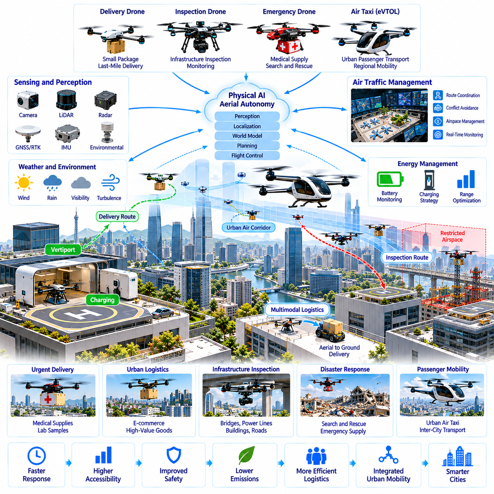{width="7.268055555555556in" height="7.268055555555556in"}

공중 이동성 및 도시 항공 물류(Aerial Mobility and Urban Air Logistics)는 미래 도시에서 피지컬 AI(Physical AI)가 발전하는 새로운 영역을 나타낸다. 자율 항공기(Autonomous Aircraft)는 운송(Transportation), 배송(Delivery), 검사(Inspection), 긴급 서비스(Emergency Service)를 3차원 도시 공간(Three-Dimensional Urban Space)으로 확장할 수 있다. 이러한 시스템은 지능형 인식(Intelligent Perception), 비행 제어(Flight Control), 항법(Navigation), 협력형 계획(Coordinated Planning)을 결합하여 지상 교통망(Ground Transportation Network)을 보완할 수 있지만 실질적인 가치는 안전성(Safety), 규제(Regulation), 기반시설(Infrastructure), 경제적 실현 가능성(Economic Feasibility)에 달려 있다.

도시 공중 이동성(Urban Aerial Mobility)에는 무인 배송 항공기(Unmanned Delivery Aircraft), 검사 드론(Inspection Drone), 긴급 대응 플랫폼(Emergency Response Platform), 잠재적으로 자율 여객 항공기(Autonomous Passenger Aircraft)가 포함된다. 이러한 응용 분야는 적재량(Payload), 운항 고도(Operating Altitude), 항속거리(Range), 안전 요구사항(Safety Requirement)에서 상당한 차이를 보인다. 소형 드론(Small Drone)은 지역 물류 임무(Localized Logistics Mission)를 수행할 수 있으며, 대형 전기 항공기(Larger Electric Aircraft)는 기술적 신뢰성(Technical Reliability), 인증(Certification), 지원 기반시설(Supporting Infrastructure)이 충분히 성숙하면 지역 간 운송(Regional Transportation)을 지원할 수 있다.

도시 항공 환경(Urban Air Environment)은 복잡한 운영상 과제(Operational Challenge)를 제시한다. 건물(Building), 통신탑(Communication Tower), 전력선(Power Line), 교량(Bridge), 임시 구조물(Temporary Structure)은 여러 고도에 걸쳐 장애물을 형성한다. 난기류(Wind Turbulence), 강수(Precipitation), 시정(Visibility), 전자기 간섭(Electromagnetic Interference)은 비행을 더욱 복잡하게 만들 수 있다. 피지컬 AI 시스템은 빠르게 변화하는 조건과 운항 제한 구역(Restricted Operating Area)에 비행 궤적(Flight Trajectory)을 적응시키면서 신뢰성 높은 환경 인식(Environmental Awareness)을 유지해야 한다.

자율 공중 항법(Autonomous Aerial Navigation)은 위성 위치 측정(Satellite Positioning), 관성 측정(Inertial Measurement), 시각 인식(Visual Perception), 환경 지도 작성(Environmental Mapping)을 결합한다. 도시 협곡(Urban Canyon)에서는 신호 차단(Obstruction)과 다중경로 효과(Multipath Effect)로 인해 위성 신호(Satellite Signal)의 품질이 저하될 수 있다. 시각-관성 오도메트리(Visual-Inertial Odometry), 라이다 기반 위치 추정(LiDAR-Based Localization), 지도 정합(Map Matching)은 상호보완적인 위치정보(Positioning Information)를 제공할 수 있지만 견고한 시스템(Robust System)은 불확실성(Uncertainty)을 추정하고 위치 추정 정확도(Localization Accuracy)가 저하될 때에도 안전한 동작(Safe Behavior)을 유지해야 한다.

비행 계획(Flight Planning)은 장애물(Obstacle), 공역 제한(Airspace Restriction), 기상 조건(Weather Condition), 에너지 소비(Energy Consumption), 임무 우선순위(Mission Priority)에 대한 3차원 추론(Three-Dimensional Reasoning)을 필요로 한다. 지상 로봇(Ground Robot)과 달리 공중 이동체(Aerial Vehicle)는 고도(Altitude), 속도(Velocity), 비행 안정성(Flight Stability)을 지속적으로 관리해야 한다. 계획 시스템(Planning System)은 이동체 동역학(Vehicle Dynamics)과 비상 착륙 선택지(Emergency Landing Option)를 고려하면서 충돌 없는 궤적(Collision-Free Trajectory)을 생성할 수 있으며, 안전 제약조건(Safety Constraint)은 배송 속도(Delivery Speed)나 경로 효율성(Route Efficiency)보다 우선해야 한다.

월드 모델(World Model)은 도시 형상(Urban Geometry), 동적 장애물(Dynamic Obstacle), 기상 조건(Weather Condition), 변화하는 공역 활동(Evolving Airspace Activity)을 표현하여 공중 자율성(Aerial Autonomy)을 향상시킬 수 있다. 예측 모델(Predictive Model)은 인근 항공기(Nearby Aircraft)의 움직임이나 환경 조건(Environmental Condition)의 변화를 추정할 수 있다. 그러나 예측 구간(Prediction Horizon)이 길어질수록 불확실성(Uncertainty)이 증가하므로 신뢰성 높은 도시 비행(Urban Flight)을 위해서는 빈번한 관측(Frequent Observation), 궤적 재평가(Trajectory Reassessment), 보수적인 분리 정책(Conservative Separation Policy)이 필수적이다.

도시 항공 물류(Urban Air Logistics)는 의료용품(Medical Supply), 검사실 검체(Laboratory Sample), 긴급 부품(Urgent Component), 소형 상업용 소포(Small Commercial Package)의 운송을 지원할 수 있다. 항공 배송(Aerial Delivery)은 도로 혼잡(Road Congestion)이나 지리적 장벽(Geographic Barrier)으로 인해 기존 운송(Conventional Transportation)이 지연되는 지역에서 유용할 수 있다. 그러나 적재 용량(Payload Capacity), 배터리 지속시간(Battery Endurance), 기상 제약(Weather Limitation), 배송 기반시설(Delivery Infrastructure)은 적용 범위를 제한하므로 지상 물류(Ground Logistics)를 전면적으로 대체하기보다는 선택적인 고부가가치 임무(High-Value Mission)에 활용하는 것이 더 현실적이다.

배송 과정(Delivery Process)은 단순히 두 좌표 사이를 자율 비행(Autonomous Flight)하는 것 이상의 기능을 포함한다. 로봇은 화물 식별정보(Cargo Identity)를 검증하고 안전한 적재물 보관(Secure Payload Containment)을 유지하며 적절한 착륙 또는 인계 장소(Landing or Transfer Location)를 식별하고 배송 완료(Successful Delivery)를 확인해야 한다. 옥상 스테이션(Rooftop Station), 지정 착륙장(Designated Landing Pad), 자동 보관함(Automated Locker)은 항공 이동체(Aerial Vehicle)와 건물(Building) 사이에 통제된 인터페이스(Controlled Interface)를 제공하여 보행자 주변에서 통제되지 않은 배송(Uncontrolled Delivery)으로 발생하는 위험을 줄일 수 있다.

공중 로봇(Aerial Robot)과 지상 로봇(Ground Robot)의 통합은 다중모달 도시 물류망(Multimodal Urban Logistics Network)을 형성할 수 있다. 드론(Drone)은 물류 거점(Distribution Hub) 사이에서 긴급 소포(Urgent Package)를 운송하고 자율이동로봇(Autonomous Mobile Robot, AMR)은 건물 내부나 보행자 구역(Pedestrian Area)에서 최종 배송(Local Delivery)을 완료할 수 있다. 협력형 일정 관리(Coordinated Scheduling)와 표준화된 화물 인터페이스(Standardized Cargo Interface)는 서로 다른 로봇 플랫폼(Robotic Platform) 사이의 물품 교환을 가능하게 하지만 인계 신뢰성(Transfer Reliability)과 기반시설 비용(Infrastructure Cost)은 여전히 중요한 고려사항이다.

도시 항공 교통 관리(Urban Air Traffic Management)는 다수의 자율 항공기(Autonomous Aircraft)가 제한된 공역(Limited Airspace)을 공유할 때 필수적이다. 교통 조정 시스템(Traffic Coordination System)은 비행 허가(Flight Permission)를 배분하고 경로 충돌(Route Conflict)을 관리하며 임시 제한사항(Temporary Restriction)을 전달할 수 있다. 신뢰성 높은 식별(Identification), 위치 보고(Position Reporting), 분리 관리(Separation Management)가 필요하며, 관제 공역(Controlled Airspace)과 비관제 공역(Uncontrolled Airspace) 모두에서 안전한 운영을 위해 기존 항공 당국(Conventional Aviation Authority)과의 협력이 기본적으로 중요하다.

통신 기반시설(Communication Infrastructure)은 공중 로봇 군집(Aerial Fleet)의 임무 조정(Mission Coordination), 항법 갱신(Navigation Update), 원격 감독(Remote Supervision)을 지원한다. 이동통신망(Cellular Network), 전용 무선 링크(Dedicated Radio Link), 위성통신(Satellite Communication)은 상호보완적인 연결성(Connectivity)을 제공할 수 있다. 그러나 비행 안전(Flight Safety)이 지속적인 네트워크 접속(Continuous Network Access)에 전적으로 의존해서는 안 된다. 항공기는 통신 장애(Communication Failure)를 탐지하고 안전한 궤적(Safe Trajectory)을 유지하며 적절한 비상 대응 절차(Contingency Procedure)를 수행할 수 있는 온보드 기능(Onboard Capability)을 갖추어야 한다.

에너지 관리(Energy Management)는 전기 공중 이동성(Electric Aerial Mobility)의 주요 제약조건이다. 배터리 용량(Battery Capacity), 적재물 질량(Payload Mass), 비행 속도(Flight Speed), 풍속 조건(Wind Condition), 예비 에너지 요구사항(Reserve Requirement)은 달성 가능한 항속거리(Achievable Range)와 운영 유연성(Operational Flexibility)을 결정한다. 지능형 임무 계획(Intelligent Mission Planning)은 에너지 소비(Energy Consumption)를 추정하고 예상하지 못한 지연(Unexpected Delay)이나 우회 비행(Diversion)에 대비한 충분한 예비 에너지(Energy Reserve)를 확보해야 한다. 충전 기반시설(Charging Infrastructure)과 배터리 관리 전략(Battery Servicing Strategy)은 군집 활용률(Fleet Utilization)과 운영 경제성(Operating Economics)에 큰 영향을 미친다.

버티포트(Vertiport), 옥상 시설(Rooftop Facility), 지정 드론 스테이션(Designated Drone Station)은 도시 항공 기반시설(Urban Aerial Infrastructure)의 중요한 구성요소가 될 수 있다. 이러한 시설에는 적절한 접근 경로(Approach Path), 안전한 착륙 구역(Secure Landing Area), 충전 장비(Charging Equipment), 지상 접근성(Ground Access)이 필요하다. 시설 위치는 소음(Noise), 주변 건물(Surrounding Building), 긴급 접근(Emergency Access), 공공 안전(Public Safety)을 고려해야 한다. 기반시설 계획(Infrastructure Planning)은 유지보수 작업(Maintenance Operation)과 기존 교통 시스템(Existing Transportation System)과의 통합도 고려해야 한다.

다중 로봇 군집 관리(Multi-Robot Fleet Management)는 도시 구역(Urban District) 전반에 걸친 공중 임무(Aerial Mission)를 조정할 수 있다. 군집 플랫폼(Fleet Platform)은 적재 요구사항(Payload Requirement), 배터리 상태(Battery State), 이동체 가용성(Vehicle Availability), 기상 조건(Weather Condition)에 따라 항공기를 할당할 수 있다. 동적 일정 관리(Dynamic Scheduling)는 자원 활용률(Resource Utilization)과 서비스 대응성(Service Responsiveness)을 향상시킬 수 있으며, 안전 필수 비행 의사결정(Safety-Critical Flight Decision)은 온보드 제어 시스템(Onboard Control System)과 적용 가능한 공역 관리 요구사항(Airspace Management Requirement)을 준수해야 한다.

디지털 트윈(Digital Twin)은 도시 공중 운영(Urban Aerial Operation)의 계획과 모니터링을 지원할 수 있다. 3차원 도시 모델(Three-Dimensional City Model)은 건물(Building), 지형(Terrain), 항공 회랑(Air Corridor), 착륙 시설(Landing Facility), 일부 환경 조건(Environmental Condition)을 표현할 수 있다. 운영자는 이러한 표현을 사용하여 경로 실현 가능성(Route Feasibility)을 평가하고 교통 밀도(Traffic Density)를 시뮬레이션하며 기반시설의 한계(Infrastructure Limitation)를 식별할 수 있다. 활용 가치는 정확한 형상 정보(Accurate Geometry)와 임시 위험요소(Temporary Hazard)에 관한 적시 갱신(Timely Update)에 달려 있다.

시뮬레이션(Simulation)은 공중 피지컬 AI 시스템(Aerial Physical AI System)의 개발에서 중요한 역할을 수행한다. 가상 환경(Virtual Environment)은 도시 장애물(Urban Obstacle), 바람 교란(Wind Disturbance), 센서 성능 저하(Sensor Degradation), 다중 항공기 상호작용(Multi-Aircraft Interaction)을 재현할 수 있다. 도메인 랜덤화(Domain Randomization)는 다양한 조건에서 강건성(Robustness)을 향상시킬 수 있지만 공기역학적 효과(Aerodynamic Effect)와 드문 고장 시나리오(Rare Failure Scenario)를 완전하게 재현하기 어렵기 때문에 시뮬레이션 결과(Simulation Result)는 통제된 비행 시험(Controlled Flight Testing)을 통해 검증되어야 한다.

안전 공학(Safety Engineering)은 공중 시스템 고장(Aerial System Failure)이 항공기 아래의 사람과 재산에 위험을 초래할 수 있기 때문에 특히 엄격한 요구사항을 가진다. 중복 센싱(Redundant Sensing), 고장 탐지(Fault Detection), 비행 영역 보호(Flight Envelope Protection), 비상 착륙 절차(Emergency Landing Procedure)는 운영 위험(Operational Risk)을 줄일 수 있다. 위험 평가(Risk Assessment)는 항법 성능(Navigation Performance)만 평가하는 것이 아니라 이동체 질량(Vehicle Mass), 인구 밀도(Population Density), 지상 충돌 결과(Ground Impact Consequence), 핵심 구성요소의 신뢰성(Reliability of Critical Components)을 고려해야 한다.

자율 여객 이동성(Autonomous Passenger Mobility)은 소형 배송 드론(Small Delivery Drone)을 넘어서는 요구사항을 도입한다. 승객 탑승 항공기(Passenger-Carrying Aircraft)는 감항성(Airworthiness), 추진 시스템 신뢰성(Propulsion Reliability), 비상 절차(Emergency Procedure), 운영 감독(Operational Oversight)에 관한 엄격한 기준을 충족해야 한다. 전기 수직이착륙 항공기(Electric Vertical Takeoff and Landing Aircraft, eVTOL)는 장기적으로 도시 교통 선택지(Urban Transportation Option)를 확대할 수 있지만 광범위한 자율 운항(Widespread Autonomy)은 입증된 안전성(Demonstrated Safety), 인증(Certification), 기반시설 준비 상태(Infrastructure Readiness), 대중 수용성(Public Acceptance)에 달려 있다.

소음(Noise)과 환경 성능(Environmental Performance)은 도시 항공 시스템 배치(Urban Aerial Deployment)에서 중요한 고려사항이다. 전기 추진(Electric Propulsion)은 지역 배기가스(Local Exhaust Emission)를 줄일 수 있지만 회전익 소음(Rotor Noise)과 반복적인 저고도 비행(Repeated Low-Altitude Flight)은 주민에게 영향을 미칠 수 있다. 환경 평가(Environmental Evaluation)는 전력 생산(Electricity Generation), 배터리 생산(Battery Production), 기반시설 건설(Infrastructure Construction), 전 생애주기 배출량(Lifecycle Emissions)을 고려해야 한다. 효율적인 경로 설정(Efficient Routing)만으로 항공 배송(Aerial Delivery)이 지상 운송 대안(Ground Alternative)보다 환경적으로 우수하다고 보장할 수는 없다.

개인정보 보호(Privacy)와 사이버보안(Cybersecurity) 문제는 공중 플랫폼(Aerial Platform)이 인구 밀집 지역(Populated Area) 상공에서 영상(Image), 위치정보(Location Information), 운영 데이터(Operational Data)를 수집할 때 발생한다. 카메라(Camera)와 기타 센서(Sensor)는 승인된 임무(Authorized Mission)와 무관한 정보를 수집할 수 있다. 데이터 최소화(Data Minimization), 보안 통신(Secure Communication), 접근 제어(Access Control), 적절한 보존 정책(Retention Policy)은 개인정보 보호 위험(Privacy Risk)을 줄일 수 있으며, 복원력 있는 항법(Resilient Navigation)과 인증 시스템(Authentication System)은 악의적인 간섭(Malicious Interference)으로부터 항공기를 보호하는 데 도움이 된다.

대중 수용성(Public Acceptance)은 공중 이동성 서비스(Aerial Mobility Service)의 규모와 운영 위치에 영향을 미친다. 주민은 소음(Noise), 시각적 침해(Visual Intrusion), 안전(Safety), 감시(Surveillance), 편익의 불균등한 분배(Unequal Distribution of Benefits)에 대한 우려를 제기할 수 있다. 투명한 운영 규칙(Transparent Operating Rule), 실질적인 지역사회 협의(Meaningful Community Consultation), 접근 가능한 민원 처리 체계(Accessible Complaint Mechanism)는 책임성(Accountability)을 향상시킬 수 있다. 배치 전략(Deployment Strategy)은 기술적 실현 가능성(Technical Feasibility)만을 충분한 근거로 간주하지 않고 지역별 영향(Neighborhood Impact)을 평가해야 한다.

도시 항공 물류(Urban Air Logistics)의 경제적 실현 가능성(Economic Viability)은 항공기 취득 비용(Aircraft Acquisition Cost), 에너지 소비(Energy Consumption), 유지보수(Maintenance), 인력 운영(Staffing), 보험(Insurance), 기반시설(Infrastructure), 활용률(Utilization)에 달려 있다. 고빈도 운영(High-Frequency Operation)은 자산 생산성(Asset Productivity)을 향상시킬 수 있지만 소음과 공역 관리 부담(Airspace Management Demand)도 증가시킨다. 경제성 평가(Economic Assessment)는 현실적인 배송 물량(Delivery Volume), 서비스 요구사항(Service Requirement), 전 생애주기 비용(Full Lifecycle Cost)을 사용하여 항공 서비스(Aerial Service)와 지상 운송(Ground Transportation)을 비교해야 한다.

규제(Regulation)와 표준화(Standardization)는 안전한 공중 운영(Safe Aerial Operation)을 위한 제도적 기반(Institutional Foundation)을 제공한다. 당국(Authority)은 항공기 인증(Aircraft Certification), 운영자 책임(Operator Responsibility), 공역 접근(Airspace Access), 유지보수(Maintenance), 사고 보고(Incident Reporting)에 관한 요구사항을 수립해야 한다. 상호운용 가능한 통신 프로토콜(Interoperable Communication Protocol)과 표준화된 운영 인터페이스(Standardized Operational Interface)는 서로 다른 군집 운영자(Fleet Operator) 사이의 조정을 지원할 수 있지만 규제 체계(Regulatory Framework)는 기술 역량(Technological Capability)의 발전에 맞추어 진화해야 한다.

도시 공중 이동성(Urban Aerial Mobility)의 장기적 발전(Long-Term Development)은 자율 항공기(Autonomous Aircraft), 지상 로봇(Ground Robot), 디지털 트윈(Digital Twin), 지능형 교통 기반시설(Intelligent Transportation Infrastructure)을 연결할 수 있다. 피지컬 AI는 협력형 도시 네트워크(Coordinated Urban Network) 안에서 통합 물류(Integrated Logistics), 기반시설 검사(Infrastructure Inspection), 긴급 대응(Emergency Response), 일부 여객 서비스(Passenger Service)를 지원할 수 있다. 성공 여부는 신뢰성 높은 자율성(Reliable Autonomy), 복원력 있는 기반시설(Resilient Infrastructure), 효과적인 거버넌스(Effective Governance), 도시 이동성(Urban Mobility)과 공공 복지(Public Welfare)의 측정 가능한 개선(Measurable Improvement)에 달려 있다.

## 03.11. Multi Robot Fleet Management at City Scale

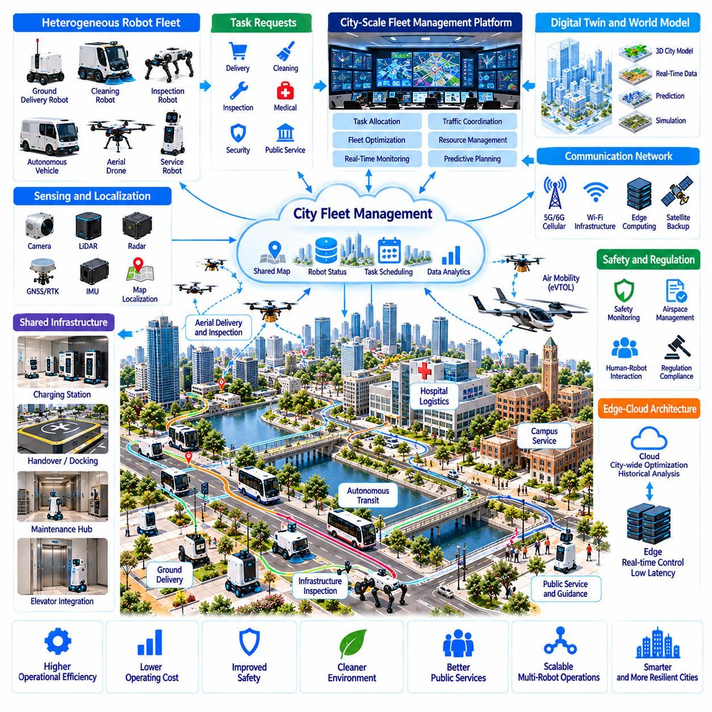{width="7.268055555555556in" height="7.268055555555556in"}

도시 규모 다중 로봇 군집 관리(City-Scale Multi-Robot Fleet Management)는 피지컬 AI(Physical AI)를 도시 기반시설(Urban Infrastructure)에 통합하기 위한 핵심 역량이다. 자율 로봇(Autonomous Robot)이 교통(Transportation), 물류(Logistics), 유지보수(Maintenance), 의료(Healthcare), 공공 서비스(Public Service) 전반으로 확산됨에 따라 개별적으로 분리된 운영(Isolated Operation)은 점차 비효율적이 된다. 협력형 군집 관리(Coordinated Fleet Management)는 이기종 로봇 시스템(Heterogeneous Robotic System)이 자원을 공유하고 정보를 교환하며 안전성과 운영 책임성(Operational Accountability)을 유지하면서 분산 작업(Distributed Task)을 수행하도록 한다.

공장이나 창고 내부의 기존 군집 관리(Conventional Fleet Management)와 달리 도시 규모의 조정(City-Scale Coordination)은 지리적으로 분산된 환경(Geographically Distributed Environment)과 다양한 운영 조건(Diverse Operating Condition)을 포함한다. 로봇은 서로 다른 규제(Regulation)가 적용되는 보도(Sidewalk), 도로(Road), 건물(Building), 터널(Tunnel), 공공시설(Public Facility)을 이동할 수 있다. 이러한 시스템을 관리하려면 로컬 자율성(Local Autonomy), 지역별 조정(Regional Coordination), 도시 전체 운영 감독(Citywide Operational Supervision)을 연결하는 확장 가능한 아키텍처(Scalable Architecture)가 필요하다.

이기종 로봇 군집(Heterogeneous Fleet)에는 자율이동로봇(Autonomous Mobile Robot), 자율 배송 차량(Autonomous Delivery Vehicle), 검사 플랫폼(Inspection Platform), 청소 로봇(Cleaning Robot), 공중 드론(Aerial Drone), 특수 서비스 기계(Specialized Service Machine)가 포함될 수 있다. 각 플랫폼은 이동성(Mobility), 센싱(Sensing), 적재 능력(Payload Capability), 에너지 특성(Energy Characteristic)이 서로 다르다. 효과적인 관리를 위해서는 모든 로봇을 상호 교환 가능한 자원(Interchangeable Resource)으로 취급하는 대신 운영 적합성(Operational Suitability)에 따라 작업을 할당할 수 있도록 로봇 역량에 대한 표준화된 기술(Standardized Capability Description)이 필요하다.

작업 할당(Task Allocation)은 도시 규모 군집 지능(City-Scale Fleet Intelligence)의 핵심 기능이다. 관리 시스템(Management System)은 위치(Location), 이동 시간(Travel Time), 적재 용량(Payload Capacity), 배터리 상태(Battery State), 임무 우선순위(Mission Priority)를 고려하면서 서비스 요청(Service Request)을 사용 가능한 로봇(Available Robot)과 연결해야 한다. 동적 할당 알고리즘(Dynamic Allocation Algorithm)은 변화하는 수요(Changing Demand), 장비 고장(Equipment Failure), 예상하지 못한 운영 중단(Unexpected Disruption)에 대응할 수 있지만 안전 필수 작업(Safety-Critical Assignment)은 추가 승인(Additional Authorization)과 인간 감독(Human Supervision)이 필요할 수 있다.

계층적 조정 아키텍처(Hierarchical Coordination Architecture)는 개별 로봇(Individual Robot), 로컬 군집 제어기(Local Fleet Controller), 도시 전체 관리 플랫폼(Citywide Management Platform) 사이에 책임을 분배할 수 있다. 온보드 제어기(Onboard Controller)는 즉각적인 인식(Perception), 항법(Navigation), 충돌 회피(Collision Avoidance)를 담당한다. 지역 시스템(Regional System)은 작업과 공유 기반시설(Shared Infrastructure)을 조정하며 상위 플랫폼(Higher-Level Platform)은 모든 저수준 움직임(Low-Level Movement)을 직접 제어하지 않고도 자원 배분(Resource Distribution)과 서비스 우선순위(Service Priority)를 최적화한다.

도시 로봇 군집 운영(Urban Fleet Operation)은 서로 다른 환경 전반에서 신뢰성 높은 위치 추정(Reliable Localization)과 공유 공간 표현(Shared Spatial Representation)을 필요로 한다. 로봇은 실외 위성 항법(Outdoor Satellite Navigation), 실내 시각 위치 추정(Indoor Visual Localization), 기반시설 지원 위치 측정(Infrastructure-Assisted Positioning) 사이를 전환할 수 있다. 공유 지도(Shared Map)는 경로 계획(Route Planning)과 운영 일관성(Operational Consistency)을 향상시킬 수 있지만 센서 정확도(Sensor Accuracy), 지도 최신성(Map Freshness), 환경 조건(Environmental Condition)의 차이로 인해 명시적인 불확실성 관리(Uncertainty Management)가 필요하다.

월드 모델(World Model)은 기하학적 구조(Geometry), 동적 객체(Dynamic Object), 교통 패턴(Traffic Pattern), 기반시설 상태(Infrastructure State)를 결합하여 도시 운영 환경(Urban Operating Environment)을 더욱 깊이 있게 표현한다. 예측 모델(Predictive Model)은 보행자 혼잡(Pedestrian Congestion), 도로 접근성(Road Accessibility), 임시 서비스 제한(Temporary Service Restriction)을 추정할 수 있다. 군집 계획 시스템(Fleet Planner)은 이러한 표현을 활용하여 운영 충돌(Operational Conflict)을 예측할 수 있지만 도시 환경이 변화함에 따라 예측 결과(Prediction)는 지속적으로 갱신되어야 한다.

통신 네트워크(Communication Network)는 분산된 로봇(Distributed Robot)을 군집 조정 서비스(Fleet Coordination Service)와 연결한다. 이동통신망(Cellular Network), 로컬 무선 기반시설(Local Wireless Infrastructure), 엣지 컴퓨팅 노드(Edge Computing Node)는 작업 갱신(Task Update), 원격 측정정보(Telemetry), 공유 관측정보(Shared Observation)를 지원할 수 있다. 건물과 도시 구역에 따라 연결성(Connectivity)이 달라지므로 로봇은 통신 중단(Communication Interruption) 상황에서도 필수 자율 기능(Essential Autonomous Function)을 유지하고 연결이 복구되면 운영 기록(Operational Record)을 동기화해야 한다.

엣지-클라우드 아키텍처(Edge-Cloud Architecture)는 실시간 응답성(Real-Time Responsiveness)과 대규모 계산 효율성(Large-Scale Computational Efficiency) 사이의 균형을 유지할 수 있다. 엣지 시스템(Edge System)은 로컬 관측정보(Local Observation)를 처리하고 인근 로봇(Nearby Robot)을 조정하며 지연시간에 민감한 서비스(Latency-Sensitive Service)를 관리할 수 있다. 클라우드 플랫폼(Cloud Platform)은 이력 분석(Historical Analysis), 군집 최적화(Fleet Optimization), 모델 갱신(Model Update), 구역 간 조정(Cross-District Coordination)을 지원할 수 있다. 명확한 기능 경계(Functional Boundary)는 네트워크 지연(Network Delay)이 즉각적인 안전 의사결정(Immediate Safety Decision)을 저해하지 않도록 한다.

교통 조정(Traffic Coordination)은 여러 로봇이 공유 보행 공간(Shared Pedestrian Space), 건물 출입구(Building Entrance), 적재 구역(Loading Zone), 서비스 통로(Service Corridor)에서 작동할 때 중요해진다. 군집 시스템(Fleet System)은 제약된 경로(Constrained Route)에 대한 접근을 예약하고 불필요한 혼잡(Unnecessary Congestion)을 방지할 수 있다. 그러나 중앙 집중식 일정 관리(Centralized Scheduling)가 공유 환경의 예측 가능성을 보장할 수 없으므로 로봇은 보행자(Pedestrian), 긴급 차량(Emergency Vehicle), 예상하지 못한 장애물(Unexpected Obstacle)을 독립적으로 인식해야 한다.

상호운용성(Interoperability)은 서로 다른 제조업체(Manufacturer)의 로봇이 공통 도시 기반시설(Common Urban Infrastructure)에서 작동할 때 필수적이다. 작업 요청(Task Request), 역량 기술(Capability Description), 상태 보고(Status Reporting), 시설 접근(Facility Access)을 위한 표준화된 인터페이스(Standardized Interface)는 통합 비용(Integration Cost)을 줄일 수 있다. 개방형 통신 프로토콜(Open Communication Protocol)은 협력형 운영(Coordinated Operation)을 지원할 수 있지만 기술적 호환성(Technical Compatibility)에는 일관된 안전 요구사항(Consistent Safety Requirement)과 명확하게 할당된 책임(Clearly Assigned Responsibility)이 함께 수반되어야 한다.

공유 기반시설(Shared Infrastructure)은 도시 로봇 군집(Urban Robotic Fleet)의 경제적 효율성(Economic Efficiency)을 향상시킬 수 있다. 충전소(Charging Station), 유지보수 시설(Maintenance Facility), 적재 구역(Loading Area), 통신 노드(Communication Node)는 여러 로봇 유형(Robot Category)이 공동으로 사용할 수 있다. 협력형 일정 관리(Coordinated Scheduling)는 기반시설 사용 충돌(Infrastructure Conflict)과 불필요한 이동(Unnecessary Travel)을 줄일 수 있다. 그러나 공용 시설(Common Facility)에는 적절한 접근 제어(Access Control), 장비 호환성(Equipment Compatibility), 제한된 용량(Limited Capacity)을 배분하기 위한 투명한 규칙(Transparent Rule)이 필요하다.

에너지 인식 군집 관리(Energy-Aware Fleet Management)는 배터리 용량(Battery Capacity), 충전 가용성(Charging Availability), 이동 거리(Travel Distance), 임무 긴급성(Mission Urgency)을 고려해야 한다. 일정 관리 시스템(Scheduling System)은 운영 예비량(Operational Reserve)을 확보하고 과도한 배터리 열화(Battery Degradation)를 방지하면서 작업을 할당할 수 있다. 예측 에너지 모델(Predictive Energy Model)은 충전 의사결정(Charging Decision)을 개선할 수 있지만 불확실한 지형(Uncertain Terrain), 적재량 변화(Payload Variation), 기상 조건(Weather Condition)을 고려한 보수적인 추정(Conservative Estimate)이 필요하다.

디지털 트윈(Digital Twin)은 도시 기반시설 정보(City Infrastructure Information)와 군집 운영(Fleet Operation)을 연결할 수 있다. 3차원 도시 모델(Three-Dimensional Urban Model)은 도로(Road), 건물(Building), 보행 경로(Pedestrian Route), 충전 시설(Charging Facility), 로봇 활동(Robot Activity)을 포함할 수 있다. 운영자는 이러한 표현을 사용하여 서비스 수요(Service Demand)를 시뮬레이션하고 배치 전략(Deployment Strategy)을 평가하며 혼잡 위험(Congestion Risk)을 식별할 수 있다. 신뢰성 높은 통합(Reliable Integration)은 정확한 기반시설 데이터(Accurate Infrastructure Data)와 운영 시스템(Operational System)의 적시 갱신(Timely Update)에 달려 있다.

군집 규모 학습(Fleet-Scale Learning)은 분산된 로봇 경험(Distributed Robotic Experience)을 전체 네트워크의 성능 개선(Performance Improvement)으로 전환할 수 있다. 항법 실패(Navigation Failure), 서비스 지연(Service Delay), 인간 개입(Human Intervention), 비정상적인 환경 사건(Unusual Environmental Event)은 가치 있는 운영 데이터(Operational Data)를 제공한다. 중앙 집중식 학습(Centralized Learning) 또는 연합학습(Federated Learning)은 반복적인 문제(Recurring Problem)를 식별하고 공유 모델(Shared Model)을 개선할 수 있지만 갱신된 모델은 배치 이전에 검증되어야 하며 개인정보 보호 제약조건(Privacy Constraint)을 준수해야 한다.

지속적 군집 메모리(Persistent Fleet Memory)는 반복적으로 발생하는 도시 환경 조건(Recurring Urban Condition)에 관한 유용한 지식을 보존할 수 있다. 로봇은 통과하기 어려운 교차로(Difficult Intersection), 위치 추정이 불안정한 구역(Unreliable Positioning Area), 임시 장애물(Temporary Obstacle), 기반시설 변화(Infrastructure Change)에 관한 관측정보를 제공할 수 있다. 공유 경험(Shared Experience)은 반복적인 탐색(Repeated Exploration)을 줄이고 경로 선택(Route Selection)을 개선할 수 있지만 메모리 시스템(Memory System)은 안정적인 환경 특성(Stable Environmental Property)을 일시적인 사건(Transient Event) 및 오래된 관측정보(Outdated Observation)와 구분해야 한다.

안전 보증(Safety Assurance)은 군집 규모(Fleet Size)와 운영 다양성(Operational Diversity)이 증가할수록 더욱 복잡해진다. 개별 로봇(Individual Robot)에는 충돌 회피(Collision Avoidance), 비상 정지(Emergency Stopping), 고장 탐지(Fault Detection)가 필요하며 군집 플랫폼(Fleet Platform)은 협력 과정에서 발생하는 혼잡(Coordinated Congestion)이나 광범위한 소프트웨어 고장(Widespread Software Failure)과 같은 시스템적 위험(Systemic Risk)을 관리해야 한다. 런타임 모니터링(Runtime Monitoring), 통제된 배치(Controlled Deployment), 독립적인 안전 메커니즘(Independent Safety Mechanism)은 중앙 집중식 오류(Centralized Error)가 대규모 군집으로 전파될 가능성을 줄일 수 있다.

사이버보안(Cybersecurity)은 군집 관리 기반시설(Fleet Management Infrastructure)이 침해될 경우 다수의 물리적 시스템(Physical System)이 동시에 영향을 받을 수 있기 때문에 매우 중요하다. 보안 인증(Secure Authentication), 암호화 통신(Encrypted Communication), 접근 영역 분리(Access Segmentation), 소프트웨어 무결성 검증(Software Integrity Verification)은 분산 운영(Distributed Operation)을 보호하는 데 도움이 된다. 군집 운영자(Fleet Operator)는 사고 대응 절차(Incident Response Procedure)와 복원력 있는 로컬 자율성(Resilient Local Autonomy)을 통해 통신 공격(Communication Attack), 무단 명령(Unauthorized Command), 손상된 업데이트(Corrupted Update)에 대비해야 한다.

인간 감독(Human Supervision)은 예외적인 상황(Exceptional Situation)을 해결하고 제도적 책임성(Institutional Accountability)을 유지하기 위해 여전히 필요하다. 원격 운영자(Remote Operator)는 접근할 수 없는 경로(Inaccessible Route), 장비 고장(Equipment Failure), 모호한 상호작용(Ambiguous Interaction)에 직면한 로봇을 지원할 수 있다. 효과적인 인터페이스(Effective Interface)는 긴급 사건(Urgent Event)에 우선순위를 부여하고 불확실성(Uncertainty)을 표시하며 통제된 개입 메커니즘(Controlled Intervention Mechanism)을 제공해야 한다. 감독 역량(Supervision Capacity)은 한 명의 운영자가 무제한의 로봇을 안전하게 관리할 수 있다고 가정하지 않고 적절하게 확장되어야 한다.

운영 성능(Operational Performance)은 서비스 완료율(Service Completion Rate), 응답 시간(Response Time), 군집 활용률(Fleet Utilization), 에너지 소비(Energy Consumption), 안전 성과(Safety Outcome)를 통해 평가해야 한다. 도시 규모 시스템(City-Scale System)에는 혼잡(Congestion), 기반시설 가용성(Infrastructure Availability), 개입 빈도(Intervention Frequency), 지리적 서비스 범위(Geographic Service Coverage)에 관한 지표도 필요하다. 이러한 지표(Metric)는 공공 기반시설(Public Infrastructure)에 비용을 전가하여 얻은 외형적인 효율성 향상(Apparent Efficiency Gain)과 실질적인 생산성 개선(Genuine Productivity Improvement)을 구분하는 데 도움이 된다.

경제적 최적화(Economic Optimization)는 군집 도입 비용(Fleet Acquisition Cost), 유지보수(Maintenance), 연결성(Connectivity), 충전(Charging), 보험(Insurance), 소프트웨어 운영(Software Operation), 인건비(Personnel Cost)를 고려해야 한다. 공유 기반시설(Shared Infrastructure)과 협력형 일정 관리(Coordinated Scheduling)는 활용률(Utilization)을 높일 수 있지만 대규모 군집(Larger Fleet)은 조직적 복잡성(Organizational Complexity)도 증가시킨다. 지속 가능한 비즈니스 모델(Sustainable Business Model)을 위해서는 현실적인 수요 예측(Realistic Demand Forecast), 측정 가능한 서비스 품질(Measurable Service Quality), 참여 기관(Participating Organization) 사이의 투명한 운영 비용 배분(Transparent Allocation of Operating Costs)이 필요하다.

거버넌스 프레임워크(Governance Framework)는 공공기관(Public Authority), 기반시설 소유자(Infrastructure Owner), 로봇 제조업체(Robot Manufacturer), 군집 운영자(Fleet Operator)가 책임을 어떻게 분담하는지 정의해야 한다. 보도 접근(Sidewalk Access), 건물 출입(Building Entry), 데이터 교환(Data Exchange), 긴급 운영(Emergency Operation)에 대한 권한에는 집행 가능한 규칙(Enforceable Rule)이 필요하다. 민간에서 운영하는 로봇 군집(Privately Operated Robotic Fleet)이 공유 도시 자원(Shared Urban Resource)에 의존하거나 보행자 접근성(Pedestrian Accessibility) 및 공공 안전(Public Safety)에 영향을 미치는 경우 공공 감독(Public Oversight)이 특히 중요하다.

도시 규모 군집 관리(City-Scale Fleet Management)의 장기적 발전(Long-Term Evolution)은 자율 교통(Autonomous Transportation), 공공시설 유지보수(Public Maintenance), 긴급 대응(Emergency Response), 기관 서비스(Institutional Service)를 상호운용 가능한 피지컬 AI 네트워크(Interoperable Physical AI Network)로 연결할 수 있다. 계층적 조정(Hierarchical Coordination), 공유 월드 모델(Shared World Model), 집단 학습(Collective Learning)은 도시 구역 전반의 적응성(Adaptability)을 향상시킬 수 있다. 그러나 기술적 통합(Technical Integration)은 로컬 안전 자율성(Local Safety Autonomy), 공공 책임성(Public Accountability), 공평한 서비스 접근성(Equitable Access to Services)을 유지해야 한다.

궁극적으로 도시 규모 다중 로봇 군집 관리(City-Scale Multi-Robot Fleet Management)는 자율 로봇(Autonomous Robot)을 개별적으로 작동하는 기계(Isolated Machine)에서 도시 기반시설(Urban Infrastructure)의 협력형 구성요소(Coordinated Component)로 전환한다. 그 가치는 단순한 군집 규모(Fleet Size)가 아니라 집단적 효율성(Collective Efficiency), 공유 지능(Shared Intelligence), 신뢰성 높은 서비스 제공(Reliable Service Delivery)에서 발생한다. 성공적인 구현(Successful Implementation)은 상호운용성(Interoperability), 복원력 있는 컴퓨팅(Resilient Computing), 신뢰할 수 있는 거버넌스(Trustworthy Governance), 복잡한 인간 환경(Complex Human Environment)에서 안전하게 작동할 수 있는 능력에 달려 있다.

## 03.12. Shared Maps World Models and City Digital Twins

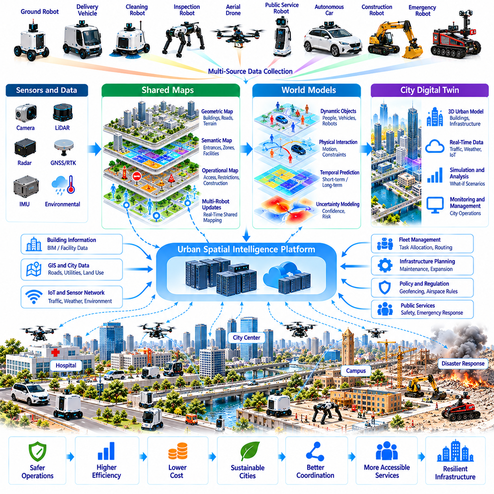{width="7.268055555555556in" height="7.268055555555556in"}

공유 지도(Shared Map), 월드 모델(World Model), 도시 디지털 트윈(City Digital Twin)은 미래 도시 환경에서 피지컬 AI(Physical AI)를 위한 핵심 지능 기반시설(Intelligence Infrastructure)을 형성한다. 자율 로봇(Autonomous Robot)이 건물(Building), 도로(Road), 보도(Sidewalk), 공공시설(Public Facility) 전반에서 작동함에 따라 물리적 공간(Physical Space)에 대한 일관된 표현(Consistent Representation)이 필요하다. 기하학적 지도(Geometric Map), 의미론적 지식(Semantic Knowledge), 동적 관측정보(Dynamic Observation), 예측 모델(Predictive Model)을 통합하면 협력형 항법(Coordinated Navigation), 기반시설 관리(Infrastructure Management), 지능형 도시 서비스(Intelligent Urban Service)를 지원할 수 있다.

기존 디지털 지도(Traditional Digital Map)는 주로 지리적 위치(Geographic Location), 도로망(Road Network), 비교적 안정적인 기반시설(Relatively Stable Infrastructure)을 설명한다. 피지컬 AI는 이동 가능성(Traversability), 장애물(Obstacle), 접근 권한(Access Permission), 환경 조건(Environmental Condition), 인간 활동(Human Activity)을 포함하는 더욱 풍부한 표현(Richer Representation)을 필요로 한다. 이러한 표현은 단순한 지리적 시각화(Geographic Visualization)가 아니라 물리적 의사결정(Physical Decision-Making)을 지원해야 하며, 로봇이 이동 가능한 위치와 적절한 행동을 판단할 수 있도록 해야 한다.

공유 지도 작성(Shared Mapping)은 여러 로봇이 공통 공간 표현(Common Spatial Representation)에 관측정보(Observation)를 제공하도록 한다. 이동 로봇(Mobile Robot), 자율주행차(Autonomous Vehicle), 공중 플랫폼(Aerial Platform), 검사 시스템(Inspection System)은 카메라(Camera), 라이다(LiDAR), 레이더(Radar), 위치 측정 센서(Positioning Sensor)를 사용하여 상호보완적인 정보를 수집할 수 있다. 이러한 관측정보를 결합하면 공간 범위(Coverage)와 지도 최신성(Map Freshness)을 향상시킬 수 있지만 센서 정확도(Sensor Accuracy), 좌표계(Coordinate System), 관측 품질(Observation Quality)의 차이를 신중하게 통합해야 한다.

도시 규모 공간 표현(City-Scale Spatial Representation)은 일반적으로 기하학적 정보(Geometric Information), 의미론적 정보(Semantic Information), 운영 정보(Operational Information)를 결합한다. 기하학적 계층(Geometric Layer)은 도로(Road), 건물(Building), 지형(Terrain), 장애물(Obstacle)을 설명하며 의미론적 계층(Semantic Layer)은 출입구(Entrance), 보행자 구역(Pedestrian Zone), 적재 구역(Loading Area), 제한 구역(Restricted Space)을 식별한다. 운영 계층(Operational Layer)은 임시 폐쇄(Temporary Closure), 유지보수 활동(Maintenance Activity), 접근 조건(Access Condition)을 포함할 수 있으며 로봇이 할당된 임무(Assigned Mission)에 따라 도시 환경을 해석하도록 한다.

위치 추정(Localization)과 지도 작성(Mapping)은 실내외 환경(Indoor and Outdoor Environment) 전반에서 일관성을 유지해야 한다. 로봇은 위성 위치 측정(Satellite Positioning), 시각-관성 오도메트리(Visual-Inertial Odometry), 라이다 위치 추정(LiDAR Localization), 기반시설 지원 항법(Infrastructure-Assisted Navigation) 사이를 전환할 수 있다. 공유 좌표 기준(Shared Coordinate Reference)과 신뢰성 높은 지도 정합(Reliable Map Alignment)은 건물과 도로를 연결하는 연속적인 운영(Continuous Operation)을 가능하게 하지만 누적 위치 오차(Accumulated Positioning Error)를 방지하기 위해 위치 추정 불확실성(Localization Uncertainty)을 명시적으로 표현해야 한다.

월드 모델(World Model)은 환경이 어떻게 변화하고 행동에 어떻게 반응하는지를 표현함으로써 공유 지도(Shared Map)를 확장한다. 월드 모델은 동적 객체(Dynamic Object), 물리적 상호작용(Physical Interaction), 시간적 관계(Temporal Relationship), 예측된 환경 상태(Predicted Environmental State)를 인코딩할 수 있다. 정적 지도(Static Map)와 달리 월드 모델은 미래 조건(Future Condition)에 대한 추론(Reasoning)을 지원하며 로봇이 혼잡(Congestion), 이동 장애물(Moving Obstacle), 계획된 이동의 잠재적 결과(Potential Consequence)를 예측하도록 한다.

예측형 월드 모델(Predictive World Model)은 단기 및 장기 환경 예측(Short-Term and Long-Term Environmental Forecast)을 통해 도시 항법(Urban Navigation)과 작업 계획(Task Planning)을 개선할 수 있다. 단기 예측(Short-Term Prediction)은 보행자 움직임(Pedestrian Motion)과 차량 궤적(Vehicle Trajectory)을 추정할 수 있으며 장기 예측(Long-Term Prediction)은 반복적인 교통 패턴(Recurring Traffic Pattern)이나 기반시설 가용성(Infrastructure Availability)을 표현할 수 있다. 예측 불확실성(Prediction Uncertainty)은 시간이 지날수록 증가하므로 로봇은 모델 예측(Model Forecast)과 현재 센서 관측정보(Current Sensor Observation)를 지속적으로 비교하고 조정해야 한다.

도시 디지털 트윈(City Digital Twin)은 물리적 기반시설(Physical Infrastructure)과 일부 운영 프로세스(Operational Process)에 대한 가상 표현(Virtual Representation)을 제공한다. 지리정보시스템(Geographic Information System, GIS), 건물정보모델(Building Information Model, BIM), 교통망(Transportation Network), 유틸리티 자산(Utility Asset), 실시간 센서 관측정보(Real-Time Sensor Observation)를 통합할 수 있다. 그 목적은 단순한 시각화(Visualization)를 넘어 시뮬레이션(Simulation), 모니터링(Monitoring), 계획(Planning), 협력형 의사결정 지원(Coordinated Decision Support)으로 확장되지만 각 표현의 충실도(Fidelity)는 사용 가능한 데이터(Available Data)에 따라 달라진다.

공유 지도(Shared Map), 월드 모델(World Model), 디지털 트윈(Digital Twin)의 관계는 상호 대체적(Interchangeable)이 아니라 상호보완적(Complementary)이다. 공유 지도는 공통 공간 기준(Common Spatial Reference)을 제공하고 월드 모델은 예측적 이해(Predictive Understanding)를 지원하며 디지털 트윈은 기반시설과 운영에 대한 표현(Infrastructure and Operational Representation)을 체계화한다. 이들은 함께 피지컬 AI 시스템(Physical AI System)을 위한 디지털 기반(Digital Foundation)을 구축하면서 항법(Navigation), 예측(Prediction), 관리(Management)에 대한 서로 다른 책임을 유지할 수 있다.

도시 데이터 통합(Urban Data Integration)은 일관된 공간 기준(Spatial Reference), 타임스탬프(Timestamp), 의미론적 정의(Semantic Definition), 메타데이터(Metadata)를 필요로 한다. 서로 다른 로봇의 관측정보(Observation)는 공유 표현(Shared Representation)을 갱신하기 전에 정렬되어야 한다. 데이터 파이프라인(Data Pipeline)은 상충하는 측정값(Conflicting Measurement)을 탐지하고 신뢰도(Confidence)를 추정하며 데이터 출처 정보(Data Provenance)를 보존해야 한다. 이를 통해 신뢰할 수 없는 관측정보(Unreliable Observation)가 검증된 기반시설 정보(Verified Infrastructure Information)를 알리지 않은 채 대체하는 것을 방지할 수 있다.

도시는 지속적으로 변화하기 때문에 지도 갱신(Map Updating)은 필수적이다. 건설 프로젝트(Construction Project), 임시 장벽(Temporary Barrier), 주차 차량(Parked Vehicle), 손상된 노면(Damaged Surface), 계절적 조건(Seasonal Condition)은 접근성(Accessibility)을 변화시킬 수 있다. 로봇은 일상적인 운영(Routine Operation) 중 이러한 변화를 탐지하고 공유 시스템(Shared System)에 갱신정보(Update)를 제출할 수 있다. 검증 메커니즘(Validation Mechanism)은 지속적인 기반시설 변경(Persistent Infrastructure Modification)과 일시적인 장애물(Transient Obstacle)을 구분하여 불필요하거나 오해를 유발하는 지도 수정(Misleading Map Revision)을 방지해야 한다.

지속적 공간 메모리(Persistent Spatial Memory)는 반복적인 로봇 운영(Repeated Robotic Operation)을 통해 축적된 지식을 보존할 수 있다. 과거 관측정보(Historical Observation)는 위치 추정이 불안정한 구역(Unreliable Navigation Area), 반복적인 혼잡(Recurring Congestion), 기반시설 노후화(Infrastructure Deterioration)를 드러낼 수 있다. 메모리 시스템(Memory System)은 시간적 맥락(Temporal Context)과 신뢰도 추정값(Confidence Estimate)을 유지해야 하며, 이를 통해 로봇은 오래된 정보를 현재 환경의 사실(Current Environmental Truth)로 취급하지 않으면서 관련 경험(Relevant Experience)을 재사용할 수 있다.

다중 로봇 협력(Multi-Robot Collaboration)은 서로 다른 플랫폼이 중첩된 환경(Overlapping Environment)에서 작동할 때 공유 공간 지능(Shared Spatial Intelligence)의 이점을 얻는다. 배송 로봇(Delivery Robot)은 인근 청소 로봇(Cleaning Robot)이나 검사 로봇(Inspection Robot)에 영향을 미치는 통로 차단(Blocked Passage)을 식별할 수 있다. 공유 갱신정보(Shared Update)는 경로 선택(Route Selection)을 개선하고 반복 탐색(Repeated Exploration)을 줄일 수 있지만 조정 시스템(Coordination System)은 로봇 크기(Robot Dimension), 이동 능력(Mobility Capability), 접근 권한(Access Permission)의 차이를 고려해야 한다.

계층적 공간 아키텍처(Hierarchical Spatial Architecture)는 도시 구역(City District) 전반의 확장성(Scalability)을 지원할 수 있다. 개별 로봇(Individual Robot)은 즉각적인 제어(Immediate Control)를 위해 로컬 지도(Local Map)를 유지하고 지역 서비스(Regional Service)는 여러 시설의 관측정보를 통합하며 도시 전체 플랫폼(Citywide Platform)은 광범위한 기반시설 표현(Broader Infrastructure Representation)을 관리한다. 이러한 아키텍처는 통신 요구량(Communication Demand)을 줄이면서 관련성(Relevance), 신뢰성(Reliability), 운영 긴급성(Operational Urgency)에 따라 계층 사이에서 정보가 전달되도록 한다.

엣지-클라우드 컴퓨팅(Edge-Cloud Computing)은 지연시간(Latency)과 계산 요구사항(Computational Requirement)에 따라 지도 작성(Mapping) 및 월드 모델 처리(World-Model Processing)를 분산할 수 있다. 엣지 시스템(Edge System)은 로컬 위치 추정(Local Localization), 장애물 추적(Obstacle Tracking), 신속한 지도 갱신(Rapid Map Update)을 지원하고 클라우드 플랫폼(Cloud Platform)은 대규모 융합(Large-Scale Fusion), 이력 분석(Historical Analysis), 모델 학습(Model Training)을 수행할 수 있다. 안전 필수 항법(Safety-Critical Navigation)은 연결이 중단되거나 공유 정보를 사용할 수 없는 상황에서도 기능을 유지해야 한다.

시뮬레이션 환경(Simulation Environment)은 도시 디지털 트윈(City Digital Twin)을 사용하여 실제 배치(Physical Deployment) 이전에 로봇 운영(Robotic Operation)을 평가할 수 있다. 도시 형상(Urban Geometry), 보행자 흐름(Pedestrian Flow), 교통 패턴(Traffic Pattern), 기반시설 제약조건(Infrastructure Constraint)을 가상 시나리오(Virtual Scenario)에 포함할 수 있다. 시뮬레이션(Simulation)은 경로 충돌(Route Conflict)과 기반시설 병목현상(Infrastructure Bottleneck)을 식별할 수 있지만 가상 환경(Simulated Environment)은 모든 불확실성을 재현할 수 없으므로 신뢰성 높은 배치를 위해 실제 환경 조건(Real-World Condition)에 대한 검증(Validation)이 필요하다.

디지털 트윈(Digital Twin)은 로봇 친화적 도시(Robot-Friendly City)를 위한 기반시설 계획(Infrastructure Planning)도 지원할 수 있다. 도시 계획자(Urban Planner)는 보도 용량(Sidewalk Capacity), 충전소 배치(Charging Station Placement), 배송 접근성(Delivery Access), 자율주행차와 보행자의 상호작용(Interaction Between Autonomous Vehicles and Pedestrians)을 평가할 수 있다. 시나리오 분석(Scenario Analysis)은 대안적인 기반시설 설계(Alternative Infrastructure Design)를 비교하여 접근성(Accessibility)이나 공공 안전(Public Safety)을 저하시키지 않으면서 로봇 효율성(Robotic Efficiency)을 개선하는 변경사항을 식별하도록 지원한다.

불확실성 관리(Uncertainty Management)는 공유 도시 지능(Shared Urban Intelligence)의 기본 요소이다. 지도(Map)는 오래된 기하학적 정보(Outdated Geometry)를 포함할 수 있고 월드 모델(World Model)은 부정확한 예측(Inaccurate Prediction)을 생성할 수 있으며 디지털 트윈(Digital Twin)은 중요한 운영 세부정보(Operational Detail)를 누락할 수 있다. 시스템은 신뢰도(Confidence), 갱신 빈도(Update Frequency), 데이터 한계(Data Limitation)를 전달하여 로봇이 검증된 관측정보(Verified Observation)와 추정값(Estimate)을 구분하고 정보 품질(Information Quality)이 저하될 때 보수적으로 대응하도록 해야 한다.

사이버보안(Cybersecurity)과 데이터 거버넌스(Data Governance)는 공유 표현(Shared Representation)이 수많은 자율 시스템(Autonomous System)을 연결함에 따라 더욱 중요해진다. 지도(Map)나 기반시설 상태(Infrastructure State)에 대한 무단 변경(Unauthorized Modification)은 로봇의 물리적 행동(Physical Robot Behavior)에 영향을 미칠 수 있다. 보안 인증(Secure Authentication), 무결성 검증(Integrity Verification), 통제된 접근(Controlled Access), 감사 기록(Audit Record)은 공유 정보를 보호하며 거버넌스 정책(Governance Policy)은 누가 갱신정보를 제공하고 검증하며 배포할 수 있는지를 결정한다.

개인정보 보호(Privacy Protection)는 도시 지도 작성 시스템(Urban Mapping System)이 식별 가능한 개인(Identifiable Individual)과 관련된 영상(Image), 이동 궤적(Trajectory), 관측정보(Observation)를 수집할 수 있기 때문에 필수적이다. 데이터 최소화(Data Minimization), 익명화(Anonymization), 접근 제한(Access Restriction), 보존 정책(Retention Policy)은 불필요한 정보 노출(Unnecessary Exposure)을 줄일 수 있다. 공유 지능 플랫폼(Shared Intelligence Platform)은 인간의 이동과 활동(Human Movement and Activity)에 관한 무제한적인 기록을 축적하기보다 로봇 운영(Robotic Operation)에 필요한 환경 정보(Environmental Information)를 우선해야 한다.

상호운용성(Interoperability)은 로봇 제조업체(Robot Manufacturer), 기반시설 운영자(Infrastructure Operator), 공공기관(Public Agency) 사이에 공통 데이터 형식(Common Data Format)과 인터페이스(Interface)를 필요로 한다. 표준화된 좌표계(Standardized Coordinate System), 의미론적 온톨로지(Semantic Ontology), 지도 교환 프로토콜(Map Exchange Protocol), 갱신 절차(Update Procedure)는 플랫폼 간 협력(Cross-Platform Collaboration)을 지원할 수 있다. 그러나 상호운용성은 데이터 소유권(Data Ownership), 검증 책임(Validation Responsibility), 상충하는 정보(Conflicting Information)의 처리에 관한 합의도 필요로 한다.

공유 지도(Shared Map)와 디지털 트윈(Digital Twin)의 경제적 가치(Economic Value)는 중복 작업 감소(Reduced Duplication), 항법 개선(Improved Navigation), 협력형 유지보수(Coordinated Maintenance), 효율적인 기반시설 계획(Efficient Infrastructure Planning)에서 발생한다. 공통 공간 기반시설(Common Spatial Infrastructure)은 여러 로봇 서비스(Robotic Service)의 배치 비용(Deployment Cost)을 낮출 수 있다. 그러나 지속적인 데이터 수집(Continuous Data Collection), 모델 유지관리(Model Maintenance), 컴퓨팅 자원(Computing Resource), 기관 간 조정(Institutional Coordination)은 측정 가능한 운영 편익(Measurable Operational Benefit)을 통해 정당화되어야 하는 비용을 발생시킨다.

장기적 발전(Long-Term Development)은 공유 도시 지도(Shared Urban Map)를 예측형 월드 모델(Predictive World Model), 자율 군집 지능(Autonomous Fleet Intelligence), 지속적으로 갱신되는 디지털 트윈(Continuously Updated Digital Twin)과 연결할 수 있다. 피지컬 AI 시스템(Physical AI System)은 집단 지식(Collective Knowledge)을 활용하여 행동을 개선하는 동시에 관측정보를 제공할 수 있다. 이러한 피드백 루프(Feedback Loop)는 학습 메커니즘(Learning Mechanism)이 검증 가능하고 투명하며 인간 감독(Human Oversight)과 양립할 수 있다는 조건에서 점점 더 적응적인 도시 기반시설(Adaptive Urban Infrastructure)을 지원할 수 있다.

궁극적으로 공유 지도(Shared Map), 월드 모델(World Model), 도시 디지털 트윈(City Digital Twin)은 도시 공간 정보(Urban Spatial Information)를 피지컬 AI(Physical AI)의 운영 기반(Operational Foundation)으로 전환할 수 있다. 그 중요성은 다양한 물리적 시스템(Physical System) 전반에서 인식(Perception), 예측(Prediction), 계획(Planning), 협력형 행동(Coordinated Action)을 연결하는 데 있다. 성공적인 구현(Successful Implementation)은 신뢰할 수 있는 데이터(Trustworthy Data), 확장 가능한 컴퓨팅(Scalable Computing), 상호운용성(Interoperability), 불확실성 인식(Uncertainty Awareness), 공유 도시 지능(Shared Urban Intelligence)에 대한 책임 있는 거버넌스(Responsible Governance)에 달려 있다.

## 03.13. Urban Robot Data Infrastructure

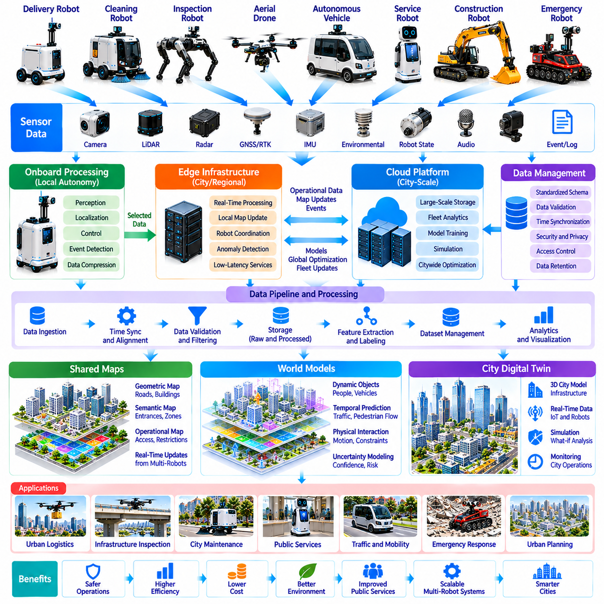{width="7.268055555555556in" height="7.268055555555556in"}

도시 로봇 데이터 기반시설(Urban Robot Data Infrastructure)은 도시 전반에서 피지컬 AI(Physical AI) 시스템을 운영하기 위한 디지털 기반(Digital Foundation)을 제공한다. 자율 로봇(Autonomous Robot)이 교통(Transportation), 물류(Logistics), 검사(Inspection), 유지보수(Maintenance), 공공 서비스(Public Service)를 수행함에 따라 센서 관측정보(Sensor Observation), 운영 기록(Operational Record), 환경 정보(Environmental Information)의 연속적인 데이터 스트림(Data Stream)을 생성한다. 협력형 데이터 기반시설(Coordinated Data Infrastructure)은 이러한 분산 시스템(Distributed System)이 지식을 교환하고 성능을 개선하며 신뢰성 높은 도시 운영(Reliable Urban Operation)을 지원하도록 한다.

기존 도시 정보 시스템(Conventional Urban Information System)과 달리 로봇 데이터 기반시설(Robot Data Infrastructure)은 물리적 행동(Physical Action)과 직접 연결된 정보를 처리해야 한다. 카메라 영상(Camera Image), 라이다 포인트 클라우드(LiDAR Point Cloud), 위치 추정값(Localization Estimate), 이동 궤적(Trajectory), 액추에이터 상태(Actuator State), 안전 이벤트(Safety Event)는 서로 다른 처리 우선순위(Processing Priority)를 요구할 수 있다. 기반시설은 시간에 민감한 운영 데이터(Time-Critical Operational Data)와 이력 분석(Historical Analysis), 모델 학습(Model Training), 장기 계획(Long-Term Planning)을 위한 정보를 구분해야 한다.

도시 규모 데이터 아키텍처(City-Scale Data Architecture)는 일반적으로 온보드 컴퓨팅(Onboard Computing), 엣지 기반시설(Edge Infrastructure), 지역 플랫폼(Regional Platform), 클라우드 서비스(Cloud Service)를 연결한다. 로봇은 즉각적인 인식(Perception)과 제어(Control)를 로컬에서 처리하고 인근 엣지 노드(Edge Node)는 저지연 조정(Low-Latency Coordination)과 데이터 집계(Data Aggregation)를 지원한다. 지역 및 클라우드 플랫폼은 광범위한 저장(Storage), 분석(Analytics), 학습 작업(Learning Workload)을 관리하며 응답성(Responsiveness)과 계산 확장성(Computational Scalability)의 균형을 유지하는 계층적 시스템(Hierarchical System)을 형성한다.

데이터 수집(Data Acquisition)은 로봇 플랫폼(Robotic Platform) 전반에 분산된 이기종 센서(Heterogeneous Sensor)와 운영 인터페이스(Operational Interface)에서 시작된다. 카메라(Camera), 레이더(Radar), 라이다(LiDAR), 관성 센서(Inertial Sensor), 위치 측정 시스템(Positioning System), 장비 제어기(Equipment Controller)는 서로 다른 주파수(Frequency)와 해상도(Resolution)로 정보를 생성한다. 신뢰성 높은 데이터 수집 파이프라인(Reliable Ingestion Pipeline)은 전송 이후에도 관측정보를 해석할 수 있도록 타임스탬프(Timestamp), 보정 매개변수(Calibration Parameter), 좌표 기준(Coordinate Reference), 장치 식별정보(Device Identity)를 보존해야 한다.

시간 동기화(Time Synchronization)는 여러 로봇과 기반시설 센서(Infrastructure Sensor)의 정보를 결합할 때 필수적이다. 작은 시간 불일치(Timing Inconsistency)조차 움직임 추정(Motion Estimation), 객체 추적(Object Tracking), 이벤트 재구성(Event Reconstruction)을 왜곡할 수 있다. 공통 시계 기준(Common Clock Reference), 동기화 프로토콜(Synchronization Protocol), 타임스탬프 검증(Timestamp Validation)은 시간적 일관성(Temporal Consistency)을 유지하는 데 도움이 되며 시스템은 분산 네트워크(Distributed Network) 전반의 통신 지연(Communication Delay)과 불완전한 동기화(Imperfect Synchronization)를 고려해야 한다.

도시 로봇 데이터(Urban Robot Data)는 상호운용성(Interoperability)을 지원하기 위해 표준화된 표현(Standardized Representation)을 필요로 한다. 공통 스키마(Common Schema)는 로봇 식별정보(Robot Identity), 센서 관측정보(Sensor Observation), 작업 상태(Task State), 항법 이벤트(Navigation Event), 기반시설 상태(Infrastructure Condition)를 기술할 수 있다. 의미론적 온톨로지(Semantic Ontology)는 객체(Object), 위치(Location), 활동(Activity)에 일관된 의미를 제공한다. 표준화(Standardization)는 특수 목적 로봇(Specialized Robot)이 응용 분야별 데이터 구조(Application-Specific Data Structure)를 유지하도록 하면서 통합 복잡성(Integration Complexity)을 줄인다.

데이터 전송(Data Transport)은 실내 무선 네트워크(Indoor Wireless Network), 이동통신 기반시설(Cellular Infrastructure), 간헐적 연결(Intermittent Connection)을 포함하는 다양한 통신 환경(Communication Environment)을 수용해야 한다. 고대역폭 센서 스트림(High-Bandwidth Sensor Stream)은 로컬에서 처리하고 압축된 관측정보(Compressed Observation)와 운영 요약정보(Operational Summary)는 선택적으로 전송할 수 있다. 적응형 통신 정책(Adaptive Communication Policy)은 로컬 안전(Local Safety)이 연결성(Connectivity)에 의존하지 않도록 하면서 안전 관련 메시지(Safety-Relevant Message)에 우선순위를 부여하고 불필요한 네트워크 트래픽(Unnecessary Network Traffic)을 줄일 수 있다.

엣지 컴퓨팅(Edge Computing)은 물리적 환경(Physical Environment) 가까이에서 신속한 처리를 지원한다. 엣지 노드(Edge Node)는 관측정보(Observation)를 집계하고 로컬 지도(Local Map)를 유지하며 운영 이상(Operational Anomaly)을 탐지하고 인근 로봇(Nearby Robot)을 조정할 수 있다. 원격 클라우드 자원(Distant Cloud Resource)에 대한 의존도를 줄임으로써 엣지 기반시설(Edge Infrastructure)은 응답성(Responsiveness)을 향상시키고 통신 비용(Communication Cost)을 제한할 수 있다. 그러나 엣지 서비스(Edge Service)에는 복원력 있는 운영(Resilient Operation), 안전한 관리(Secure Management), 명확하게 정의된 책임(Clearly Defined Responsibility)이 필요하다.

클라우드 기반시설(Cloud Infrastructure)은 장기 저장(Long-Term Storage), 대규모 분석(Large-Scale Analytics), 시뮬레이션(Simulation), 모델 개발(Model Development)을 위한 확장 가능한 자원(Scalable Resource)을 제공한다. 과거 군집 데이터(Historical Fleet Data)는 반복적인 항법 실패(Recurring Navigation Failure), 장비 성능 저하(Equipment Degradation), 변화하는 서비스 수요(Changing Service Demand)를 드러낼 수 있다. 클라우드 시스템(Cloud System)은 구역 간 최적화(Cross-District Optimization)와 공유 학습(Shared Learning)도 지원할 수 있지만 운영 연속성(Operational Continuity)을 위해서는 서비스 중단(Outage)과 중앙 집중식 서비스 고장(Centralized Service Failure)에 대한 보호 장치(Safeguard)가 필요하다.

데이터 저장 아키텍처(Data Storage Architecture)는 원시 관측정보(Raw Observation), 처리된 특징(Processed Feature), 운영 이벤트(Operational Event), 정제된 학습 데이터셋(Curated Training Dataset)을 구분해야 한다. 원시 센서 기록(Raw Sensor Record)은 상세한 증거(Detailed Evidence)를 보존하고 파생 표현(Derived Representation)은 효율적인 검색(Search)과 분석(Analysis)을 지원한다. 보존 정책(Retention Policy)은 운영 가치(Operational Value), 개인정보 보호 요구사항(Privacy Requirement), 저장 비용(Storage Cost)을 반영하여 실질적인 활용 가치가 제한적인 정보가 통제 없이 축적되는 것을 방지해야 한다.

데이터 품질 관리(Data Quality Management)는 신뢰할 수 없는 관측정보(Unreliable Observation)가 지도(Map), 모델(Model), 운영 의사결정(Operational Decision)으로 전파될 수 있기 때문에 매우 중요하다. 검증 파이프라인(Validation Pipeline)은 누락된 기록(Missing Record), 센서 드리프트(Sensor Drift), 보정 오류(Calibration Error), 일관되지 않은 좌표(Inconsistent Coordinate), 손상된 측정값(Corrupted Measurement)을 탐지해야 한다. 품질 점수(Quality Score)와 데이터 출처 메타데이터(Provenance Metadata)는 후속 시스템(Downstream System)이 항법(Navigation), 기반시설 모니터링(Infrastructure Monitoring), 머신러닝(Machine Learning)에 정보를 사용하기 전에 신뢰성을 평가하도록 지원한다.

이벤트 기반 데이터 파이프라인(Event-Driven Data Pipeline)은 모든 센서 측정값(Sensor Measurement)을 지속적으로 전송하지 않고도 중요한 운영 상황(Operational Situation)을 식별할 수 있다. 항법 실패(Navigation Failure), 예상하지 못한 장애물(Unexpected Obstacle), 비상 정지(Emergency Stop), 인간 개입(Human Intervention), 기반시설 변화(Infrastructure Change)는 우선순위가 높은 기록(Prioritized Recording)을 유발할 수 있다. 이벤트 마이닝(Event Mining)은 반복적인 고장 패턴(Recurring Failure Pattern)을 드러내어 운영자가 운영상 중요성(Operational Significance)이 가장 높은 상황에 데이터 수집(Data Collection)과 엔지니어링 자원(Engineering Resource)을 집중하도록 한다.

공유 도시 데이터(Shared Urban Data)는 지속적으로 갱신되는 지도(Continuously Updated Map), 예측형 월드 모델(Predictive World Model), 도시 디지털 트윈(City Digital Twin)을 지원할 수 있다. 로봇 관측정보(Robot Observation)는 임시 도로 폐쇄(Temporary Road Closure), 손상된 노면(Damaged Surface), 변화하는 보행자 흐름(Changing Pedestrian Flow), 접근할 수 없는 시설(Inaccessible Facility)을 식별할 수 있다. 이러한 관측정보를 검증된 기반시설 기록(Verified Infrastructure Record)과 통합하면 환경 인식(Environmental Awareness)을 향상시킬 수 있지만 갱신 메커니즘(Update Mechanism)은 일시적인 조건(Temporary Condition)과 지속적인 변화(Persistent Change)를 구분해야 한다.

군집 학습 시스템(Fleet Learning System)은 축적된 운영 경험(Accumulated Operational Experience)을 여러 로봇 플랫폼(Robotic Platform)의 성능 개선으로 전환한다. 정제된 데이터셋(Curated Dataset)은 인식 학습(Perception Training), 항법 정책 개선(Navigation Policy Refinement), 이상 탐지(Anomaly Detection)를 지원할 수 있다. 연합학습(Federated Learning)과 분산 최적화(Distributed Optimization)는 민감한 원시 데이터(Sensitive Raw Data)를 중앙에 집중시킬 필요성을 줄일 수 있지만 모델 갱신(Model Update)에는 여전히 검증(Validation), 버전 관리(Version Control), 유해한 성능 변화(Harmful Performance Change)에 대한 보호 장치(Safeguard)가 필요하다.

개인정보 보호(Privacy Protection)는 데이터 기반시설(Data Infrastructure)의 초기 설계(Initial Design) 단계부터 통합되어야 한다. 도시 로봇(Urban Robot)은 일상적인 운영(Ordinary Operation) 중 식별 가능한 개인(Identifiable Individual), 사적 공간(Private Space), 민감한 활동(Sensitive Activity)을 마주할 수 있다. 데이터 최소화(Data Minimization), 선택적 기록(Selective Recording), 익명화(Anonymization), 접근 제한(Access Restriction)은 불필요한 수집(Unnecessary Collection)과 노출(Exposure)을 줄일 수 있다. 거버넌스 정책(Governance Policy)은 정당한 목적(Legitimate Purpose), 보존 기간(Retention Period), 정보 공유 조건(Information Sharing Condition)을 정의해야 한다.

사이버보안(Cybersecurity) 역시 손상된 데이터 시스템(Compromised Data System)이 로봇의 물리적 행동(Physical Robotic Behavior)에 영향을 미칠 수 있기 때문에 중요하다. 지도(Map), 작업 지시(Task Instruction), 모델 갱신(Model Update)에 대한 무단 변경(Unauthorized Modification)은 운영 위험(Operational Hazard)을 발생시킬 수 있다. 보안 인증(Secure Authentication), 암호화 통신(Encrypted Communication), 무결성 검증(Integrity Verification), 분리된 접근 권한(Segmented Access)은 분산 기반시설(Distributed Infrastructure)을 보호하는 데 도움이 된다. 지속적인 모니터링(Continuous Monitoring)과 사고 대응 절차(Incident Response Procedure)는 공격(Attack)이나 예상하지 못한 시스템 고장(Unexpected System Failure)으로부터의 복구를 지원한다.

데이터 거버넌스(Data Governance)는 공공기관(Public Agency), 기반시설 운영자(Infrastructure Operator), 로봇 제조업체(Robot Manufacturer), 서비스 제공업체(Service Provider)가 정보를 교환하는 방식을 결정한다. 명확한 정책(Clear Policy)은 소유권(Ownership), 접근 권한(Access Permission), 검증 책임(Validation Responsibility), 허용되는 2차 활용(Permitted Secondary Use)을 정의해야 한다. 공유 데이터 체계(Shared Data Arrangement)는 운영 협력(Operational Cooperation)과 상업적 기밀성(Commercial Confidentiality), 공공 책임성(Public Accountability), 적용 가능한 법적 요구사항(Applicable Legal Requirement) 사이의 균형을 유지해야 한다.

관측 가능성(Observability)과 감사 가능성(Auditability)은 도시 규모 로봇 운영(City-Scale Robotic Operation)을 관리하는 데 필수적이다. 모니터링 플랫폼(Monitoring Platform)은 데이터 가용성(Data Availability), 통신 지연시간(Communication Latency), 모델 버전(Model Version), 센서 상태(Sensor Health), 처리 실패(Processing Failure)를 추적해야 한다. 추적 가능한 운영 기록(Traceable Operational Record)은 사고 조사(Incident Investigation)와 성능 평가(Performance Evaluation)를 가능하게 하며 감사 메커니즘(Audit Mechanism)은 특정 시점에 어떤 정보가 로봇의 의사결정(Robot Decision)에 영향을 미쳤는지를 규명하는 데 도움이 된다.

확장성(Scalability)은 로봇 개체 수(Robot Population)와 센서 밀도(Sensor Density)가 증가함에 따라 어려운 과제가 된다. 지속적인 고해상도 기록(Continuous High-Resolution Recording)은 상당한 대역폭(Bandwidth), 저장 공간(Storage), 처리 자원(Processing Resource)을 요구할 수 있다. 선택적 데이터 수집(Selective Data Collection), 압축(Compression), 분산 인덱싱(Distributed Indexing), 수명주기 관리(Lifecycle Management)는 자원 소비(Resource Consumption)를 줄일 수 있다. 기반시설 계획(Infrastructure Planning)은 최대 활동량(Peak Activity), 지리적 분포(Geographic Distribution), 급격한 군집 확장(Rapid Fleet Expansion) 가능성을 고려해야 한다.

경제적 지속 가능성(Economic Sustainability)은 기반시설 투자(Infrastructure Investment)와 측정 가능한 운영 편익(Measurable Operational Benefit) 사이의 균형에 달려 있다. 공유 데이터 서비스(Shared Data Service)는 중복 지도 작성(Duplicated Mapping)을 줄이고 군집 활용률(Fleet Utilization)을 개선하며 모델 개발(Model Development)을 가속화할 수 있다. 그러나 연결성(Connectivity), 저장(Storage), 사이버보안(Cybersecurity), 유지보수(Maintenance), 데이터 거버넌스(Data Governance)는 지속적인 비용(Ongoing Cost)을 발생시킨다. 경제성 평가(Economic Assessment)는 서비스 신뢰성(Service Reliability), 데이터 품질(Data Quality), 운영 실패 방지 가치(Value of Avoided Operational Failure)를 고려해야 한다.

공공 부문 통합(Public-Sector Integration)은 도시 로봇 데이터 기반시설(Urban Robot Data Infrastructure)의 활용 가치를 확대할 수 있다. 교통 당국(Transportation Authority), 긴급 서비스(Emergency Service), 공공설비 운영기관(Utility Operator), 도시 유지보수 조직(Municipal Maintenance Team)은 검증된 로봇 관측정보(Verified Robotic Observation)의 이점을 얻을 수 있다. 신중하게 관리되는 인터페이스(Carefully Governed Interface)는 운영 정보(Operational Information)나 개인정보(Personal Information)에 대한 무제한적인 접근을 허용하지 않으면서 기반시설 검사(Infrastructure Inspection)와 서비스 조정(Service Coordination)을 지원할 수 있다.

장기적 발전(Long-Term Development)은 로봇이 생성한 관측정보(Robot-Generated Observation)를 지속적 공간 메모리(Persistent Spatial Memory)와 예측형 도시 지능(Predictive Urban Intelligence)에 연결할 수 있다. 공유 데이터 기반시설(Shared Data Infrastructure)은 로봇이 반복적인 환경 조건(Recurring Environmental Condition)으로부터 학습하고 조직 간 경계(Organizational Boundary)를 넘어 협력하도록 할 수 있다. 이러한 시스템은 불확실성 추정값(Uncertainty Estimate)을 보존하고 오래된 지식(Outdated Knowledge)의 확산을 방지하며 자동화된 갱신(Automated Update)이 적절한 검증(Appropriate Verification)을 거치도록 해야 한다.

궁극적으로 도시 로봇 데이터 기반시설(Urban Robot Data Infrastructure)은 분산된 센서 측정값(Distributed Sensor Measurement)을 피지컬 AI(Physical AI)를 위한 신뢰성 높은 운영 지식(Reliable Operational Knowledge)으로 전환한다. 그 가치는 대규모 데이터셋(Large Dataset)을 수집하는 것 이상으로 로봇(Robot), 기반시설(Infrastructure), 인간 제도(Human Institution) 사이에 신뢰할 수 있는 정보 흐름(Trustworthy Information Flow)을 유지하는 데 있다. 성공적인 배치(Successful Deployment)를 위해서는 확장 가능한 아키텍처(Scalable Architecture), 상호운용성(Interoperability), 보안(Security), 개인정보 보호(Privacy Protection), 데이터 품질(Data Quality), 공공의 이익(Public Interest)에 부합하는 거버넌스(Governance)가 필요하다.

## 03.14. Safety Privacy and Public Acceptance

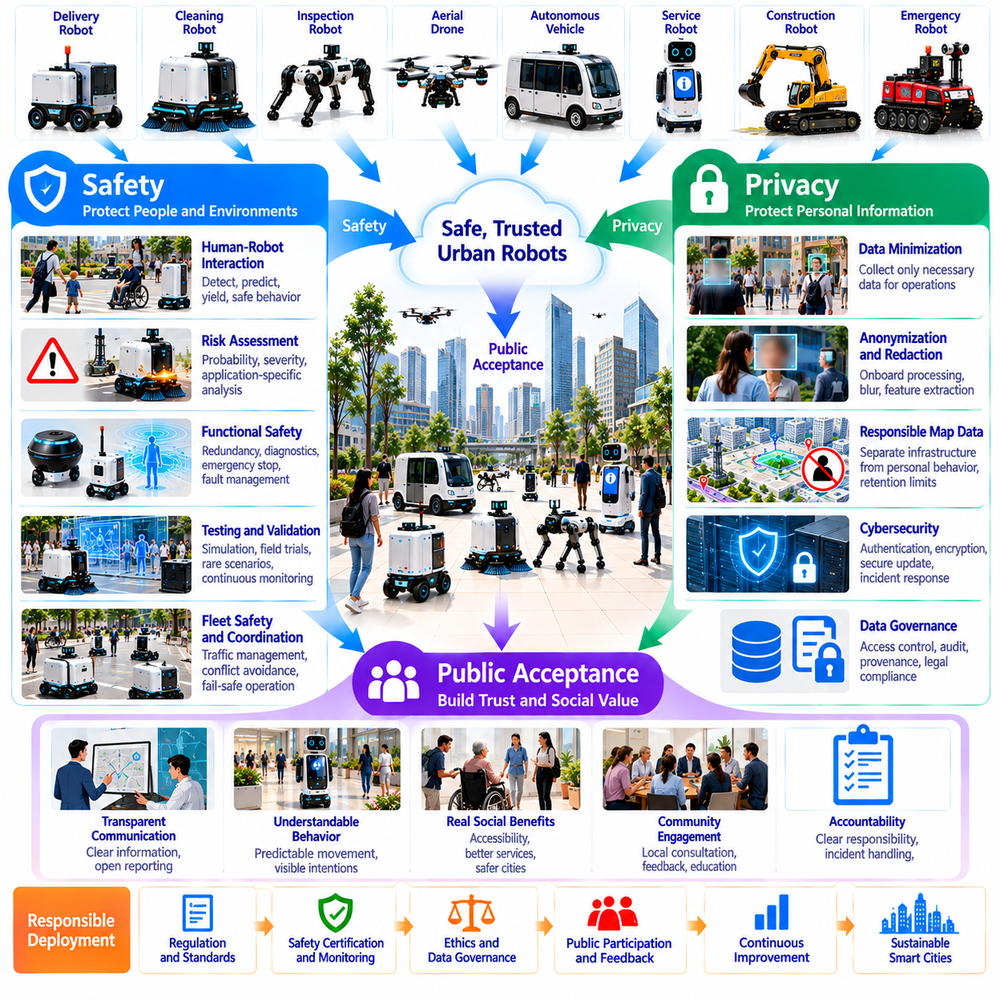{width="7.268055555555556in" height="7.268055555555556in"}

안전(Safety), 개인정보 보호(Privacy), 대중 수용성(Public Acceptance)은 피지컬 AI(Physical AI)를 도시 환경(Urban Environment)에 통합하기 위한 기본 조건이다. 자율 로봇(Autonomous Robot)은 보행자(Pedestrian), 차량(Vehicle), 작업자(Worker), 취약계층(Vulnerable Population)과 공간을 공유하면서 점점 더 광범위하게 작동하고 있다. 이러한 시스템의 배치(Deployment)는 디지털 의사결정(Digital Decision)이 물리적 결과(Physical Consequence)를 발생시키기 때문에 기존 소프트웨어 시스템(Conventional Software System)을 넘어서는 위험을 도입한다. 성공적인 도시 도입(Urban Adoption)을 위해서는 기술적 신뢰성(Technical Reliability), 제도적 책임성(Institutional Accountability), 지속적인 대중의 신뢰(Public Trust)가 필요하다.

도시 로봇 안전(Urban Robotic Safety)은 복잡하고 예측하기 어려운 인간 환경(Human Environment)에서 발생하는 상호작용(Interaction)을 다루어야 한다. 보도(Sidewalk), 교차로(Intersection), 병원(Hospital), 교통 터미널(Transportation Terminal), 공공건물(Public Building)에는 움직이는 장애물(Moving Obstacle)과 변화하는 접근성 조건(Accessibility Condition)이 존재한다. 로봇은 보행자(Pedestrian), 자전거 이용자(Cyclist), 이동 보조기기(Mobility Aid), 긴급 활동(Emergency Activity)을 인식하면서 지역 규칙(Local Rule)에 맞게 행동을 조정해야 한다. 따라서 안전성은 단순한 장애물 회피(Obstacle Avoidance)가 아니라 상황적 이해(Contextual Understanding)에 달려 있다.

위험 평가(Risk Assessment)는 잠재적인 고장(Potential Failure)의 발생 확률(Probability)과 심각도(Severity)를 모두 고려해야 한다. 이동체 질량(Vehicle Mass), 운행 속도(Operating Speed), 적재물 특성(Payload Characteristic), 환경 밀도(Environmental Density), 인간과의 근접성(Human Proximity)은 발생 가능한 결과에 영향을 미친다. 안전 공학(Safety Engineering)은 정상 운영(Normal Operation), 예측 가능한 오용(Foreseeable Misuse), 구성요소 고장(Component Failure), 비정상적인 환경 조건(Unusual Environmental Condition)을 검토해야 한다. 적절한 안전장치(Safeguard)는 각 로봇 응용 분야(Robotic Application)와 관련된 위험요소(Hazard)에 비례하여 설계되어야 한다.

기능 안전(Functional Safety)은 신뢰할 수 있는 센싱(Sensing), 제어(Control), 구동(Actuation), 고장 관리(Fault Management)를 필요로 한다. 중복 센서(Redundant Sensor), 진단 모니터링(Diagnostic Monitoring), 비상 정지(Emergency Stopping), 제어된 성능 저하(Controlled Degradation)는 개별 구성요소 고장(Individual Component Failure)의 영향을 줄일 수 있다. 로봇은 핵심 기능(Critical Capability)을 사용할 수 없게 되면 안전 상태(Safe State)로 전환해야 한다. 그러나 중복성(Redundancy)만으로는 공통 소프트웨어 결함(Shared Software Defect)이나 잘못된 환경 가정(Incorrect Environmental Assumption)에서 발생하는 고장을 완전히 제거할 수 없다.

안전 보증(Safety Assurance)은 로봇 시스템 수명주기(Robotic System Lifecycle) 전체에 걸쳐 이루어져야 한다. 요구사항 분석(Requirements Analysis), 시뮬레이션(Simulation), 실험실 시험(Laboratory Testing), 통제된 현장 시험(Controlled Field Trial), 운영 모니터링(Operational Monitoring)은 신뢰성에 관한 상호보완적인 증거를 제공한다. 시험에는 어린이(Child), 혼잡한 공간(Crowded Space), 예상하지 못한 장애물(Unexpected Obstacle), 통신 중단(Communication Interruption)이 관련된 드물지만 중대한 시나리오(Rare but Consequential Scenario)가 포함되어야 한다. 도시 환경과 배포된 소프트웨어(Deployed Software)가 지속적으로 변화하므로 연속적인 검증(Continuous Validation)이 필요하다.

인간-로봇 상호작용(Human-Robot Interaction)은 추가적인 안전 고려사항(Safety Consideration)을 도입한다. 로봇은 움직임(Movement), 조명(Lighting), 디스플레이(Display), 소리(Sound), 예측 가능한 정지 행동(Predictable Stopping Behavior)을 통해 자신의 의도(Intention)를 전달한다. 사람은 로봇이 언제 회전(Turn), 횡단(Cross), 접근(Approach), 양보(Yield)하려는지 이해할 수 있어야 한다. 기존의 시각적 표시(Visual Indicator)가 모든 보행자에게 적합하지 않을 수 있으므로 시각 장애(Visual Impairment), 청각 장애(Hearing Impairment), 이동 장애(Mobility Impairment)가 있는 사람을 위한 접근 가능한 의사소통(Accessible Communication)이 특히 중요하다.

도시 로봇 군집 안전(Urban Fleet Safety)은 여러 자율 시스템(Autonomous System) 사이의 조정(Coordination)도 필요로 한다. 개별 로봇이 올바르게 작동하더라도 혼잡(Congestion)을 발생시키거나 긴급 통행로(Emergency Route)를 차단하거나 좁은 통로(Narrow Passage)를 두고 경쟁할 수 있다. 군집 관리 플랫폼(Fleet Management Platform)은 접근을 조정하고 새롭게 발생하는 충돌(Emerging Conflict)을 탐지할 수 있다. 그러나 중앙 집중식 조정(Centralized Coordination)이나 통신(Communication)을 사용할 수 없는 상황에서도 로컬 충돌 회피(Local Collision Avoidance)와 비상 대응(Emergency Response)은 정상적으로 작동해야 한다.

개인정보 보호 위험(Privacy Risk)은 도시 로봇(Urban Robot)이 카메라(Camera), 마이크(Microphone), 위치 측정 센서(Positioning Sensor), 환경 모니터링 시스템(Environmental Monitoring System)을 빈번하게 사용하기 때문에 발생한다. 이러한 센서는 일반적인 항법(Navigation) 과정에서도 식별 가능한 개인(Identifiable Individual), 사적인 활동(Private Activity), 민감한 장소(Sensitive Location)를 기록할 수 있다. 데이터 수집(Data Collection)은 정당한 운영 목적(Legitimate Operational Purpose)으로 제한되어야 하며 보존(Retention), 2차 활용(Secondary Use), 조직 간 배포(Distribution Across Organizations)에 적절한 제한이 적용되어야 한다.

설계 단계부터 개인정보 보호를 고려하는 원칙(Privacy-by-Design Principle)은 개인정보(Personal Information)가 중앙 집중식 시스템(Centralized System)에 입력되기 전에 최소화하도록 권장한다. 온보드 처리(Onboard Processing)는 원시 관측정보(Raw Observation)를 항법 특징(Navigation Feature)이나 익명 환경 정보(Anonymous Environmental Description)로 변환할 수 있다. 선택적 기록(Selective Recording), 영상 비식별화(Image Redaction), 통제된 접근(Controlled Access)은 정보 노출(Information Exposure)을 더욱 줄일 수 있다. 그러나 결합된 데이터셋(Combined Dataset)을 통해 재식별(Reidentification)이 가능할 수 있으므로 익명화 기술(Anonymization Technique)은 신중하게 평가해야 한다.

공유 지도(Shared Map), 월드 모델(World Model), 도시 디지털 트윈(City Digital Twin)은 추가적인 정보 거버넌스(Information Governance) 과제를 도입한다. 보행자 이동(Pedestrian Movement), 건물 접근(Building Access), 서비스 활동(Service Activity)에 관한 지속적인 기록(Persistent Record)은 로봇 운영(Robotic Operation)과 무관한 행동 패턴(Behavioral Pattern)을 드러낼 수 있다. 시스템은 기반시설 지식(Infrastructure Knowledge)과 개인 행동 이력(Personal Behavioral History)을 구분해야 한다. 데이터 출처 정보(Data Provenance), 보존 기간 제한(Retention Limit), 목적 제한(Purpose Restriction)은 공유 지능(Shared Intelligence)이 제한 없는 감시 기반시설(Unrestricted Surveillance Infrastructure)로 변하는 것을 방지하는 데 도움이 된다.

사이버보안(Cybersecurity)은 공격자(Attacker)가 로봇 명령(Robot Command), 항법 지도(Navigation Map), 소프트웨어 업데이트(Software Update)를 조작할 수 있을 때 물리적 안전(Physical Safety)에 직접적인 영향을 미친다. 인증(Authentication), 암호화(Encryption), 접근 영역 분리(Access Segmentation), 무결성 검증(Integrity Verification)은 무단 간섭(Unauthorized Interference)에 대한 노출을 줄인다. 안전한 개발 관행(Secure Development Practice)과 사고 대응 역량(Incident Response Capability)도 중요하다. 로봇은 네트워크(Network)나 외부 서비스(External Service)가 침해되더라도 필수 안전 기능(Essential Safety Function)을 유지해야 한다.

대중 수용성(Public Acceptance)은 사람들이 인식하는 편익(Perceived Benefit), 이해 가능한 위험(Understandable Risk), 책임 있는 운영(Responsible Operation)에 대한 신뢰에 달려 있다. 주민은 접근성 개선(Improved Accessibility), 긴급 지원(Emergency Assistance), 신뢰성 높은 공공 서비스(Reliable Public Service)를 환영하면서도 침해적인 모니터링(Intrusive Monitoring)이나 보도 점유(Sidewalk Obstruction)에는 반대할 수 있다. 수용성은 지역(Neighborhood)과 응용 분야(Application)에 따라 달라질 수 있다. 따라서 배치 의사결정(Deployment Decision)은 기술적 성공(Technical Success)이 사회적 승인(Social Approval)을 보장한다고 가정하지 않고 지역 조건(Local Condition)을 반영해야 한다.

투명성(Transparency)은 운영 조직(Operating Organization)이 로봇의 운영 장소(Operating Location), 수집 정보(Collected Information), 안전 사고 처리 방식(Safety Incident Handling)을 설명할 때 신뢰를 강화할 수 있다. 운영자 식별정보(Operator Identification)를 명확하게 제공하고 접근 가능한 신고 채널(Accessible Reporting Channel)을 마련하면 주민이 우려사항(Concern)을 제기할 수 있다. 대중 소통(Public Communication)은 입증된 역량(Demonstrated Capability)과 실험적 기능(Experimental Function)을 구분해야 한다. 실질적인 책임성(Meaningful Accountability)을 위해서는 홍보성 주장(Promotional Claim)이 아니라 증거(Evidence)와 시정 조치(Corrective Action)가 필요하다.

형평성(Equity)은 책임 있는 도시 자동화(Responsible Urban Automation)의 중요한 차원이다. 로봇 서비스(Robotic Service)는 상업적으로 매력적인 지역(Commercially Attractive District)에 불균형적으로 혜택을 제공하면서 다른 지역에는 소음(Noise), 혼잡(Congestion), 감시 부담(Surveillance Burden)을 전가할 수 있다. 공공기관(Public Authority)은 지리적 서비스 범위(Geographic Coverage), 비용 부담 가능성(Affordability), 장애인 접근성(Disability Access), 운영 영향의 분포(Distribution of Operational Impacts)를 평가해야 한다. 포용적 계획(Inclusive Planning)은 자동화(Automation)가 기존 불평등(Existing Inequality)을 강화하지 않으면서 도시 서비스(Urban Service)를 개선하도록 돕는다.

거버넌스 프레임워크(Governance Framework)는 제조업체(Manufacturer), 소프트웨어 개발자(Software Developer), 군집 운영자(Fleet Operator), 기반시설 소유자(Infrastructure Owner), 공공기관(Public Authority) 사이의 책임을 배분해야 한다. 이러한 책임에는 인증(Certification), 유지보수(Maintenance), 사고 조사(Incident Investigation), 데이터 보호(Data Protection), 긴급 대응 조정(Emergency Coordination)이 포함된다. 규제 요구사항(Regulatory Requirement)은 통제된 혁신(Controlled Innovation)을 허용하면서 응용 분야별 위험(Application-Specific Risk)을 반영해야 한다. 여러 조직이 상호 연결된 시스템(Interconnected System)의 고장에 관여하는 경우 명확한 책임성(Clear Accountability)이 필수적이다.

궁극적으로 안전하고 대중에게 수용되는 피지컬 AI(Physical AI)를 구현하려면 신뢰성 높은 로봇 하드웨어(Robotic Hardware)와 지능형 알고리즘(Intelligent Algorithm)만으로는 충분하지 않다. 지속적인 위험 관리(Continuous Risk Management), 개인정보 보호(Privacy Protection), 사이버보안(Cybersecurity), 투명한 거버넌스(Transparent Governance), 실질적인 대중 참여(Meaningful Public Participation)가 필요하다. 자율 시스템(Autonomous System)이 일상적인 도시 생활(Everyday Urban Life)에 통합됨에 따라 그 정당성(Legitimacy)은 인권(Human Rights)을 존중하고 접근성(Accessibility)을 보존하며 측정 가능한 공공 편익(Measurable Public Benefit)을 제공할 수 있는지에 달려 있다.

## 03.15. Robot Accessibility and Inclusive City Design

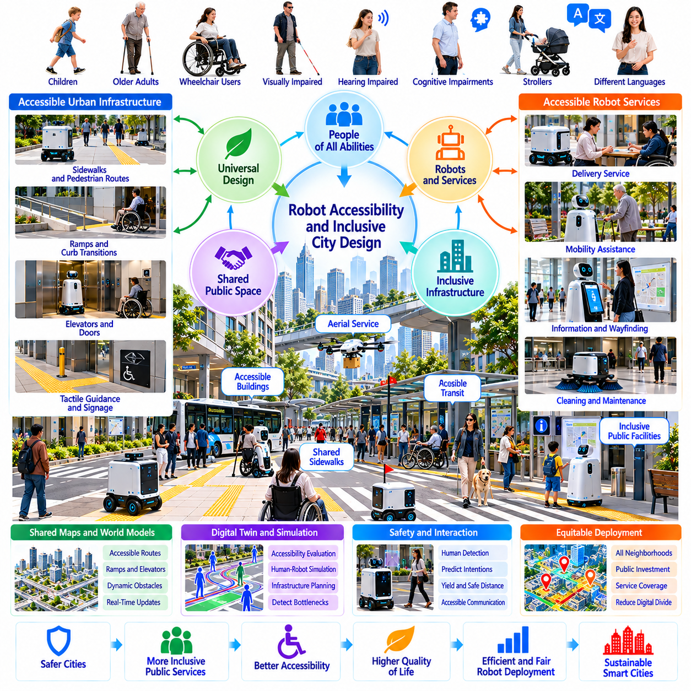{width="7.268055555555556in" height="7.268055555555556in"}

로봇 접근성(Robot Accessibility)과 포용적 도시 설계(Inclusive City Design)는 새로운 장벽을 만들지 않으면서 피지컬 AI(Physical AI)를 공공 환경(Public Environment)에 통합하기 위한 필수 요소이다. 자율 기계(Autonomous Machine)가 도로, 건물, 교통시설에서 보편화됨에 따라 도시 기반시설(Urban Infrastructure)은 로봇 운영(Robotic Operation)과 인간의 다양성(Human Diversity)을 모두 수용해야 한다. 포용적 설계(Inclusive Design)는 기술 발전(Technological Progress)이 서로 다른 신체적 능력(Physical Ability)과 인지 능력(Cognitive Ability)을 가진 사람들의 이동성(Mobility), 독립성(Independence), 공공 서비스(Public Service)를 개선하도록 보장한다.

기존 도시 접근성(Urban Accessibility)은 보행자(Pedestrian), 휠체어 사용자(Wheelchair User), 고령자(Older Adult), 감각 장애인(People with Sensory Impairments)을 위한 장벽 제거(Barrier Removal)에 중점을 둔다. 로봇 접근성(Robot Accessibility)은 항법(Navigation), 기반시설 인터페이스(Infrastructure Interface), 공유 공간 행동(Shared-Space Behavior)과 관련된 추가 요구사항을 도입한다. 이러한 목표는 함께 고려되어야 하는데, 로봇만을 위해 최적화된 기반시설(Infrastructure Optimized for Robots)이 의도하지 않게 인간의 접근성(Human Accessibility)을 저하시키거나 공공 공간(Public Space)에서 충돌을 발생시킬 수 있기 때문이다.

유니버설 디자인(Universal Design)은 로봇을 포용하는 도시 계획(Robot-Inclusive Urban Planning)을 위한 유용한 기반을 제공한다. 도로, 출입구, 엘리베이터, 공공시설은 다양한 능력을 가진 사람들이 이해하고 사용할 수 있어야 한다. 로봇 시스템(Robotic System)은 보행자에게 불이익을 주는 광범위한 시설 변경을 요구하기보다 이러한 환경에 적응해야 한다. 핵심 목표는 안전하고 효율적인 자율 운영(Autonomous Operation)을 가능하게 하면서 인간의 접근성(Human Accessibility)을 개선하는 것이다.

보도 설계(Sidewalk Design)는 인간과 로봇의 공유 이동성(Shared Human-Robot Mobility)이 직면하는 과제를 보여준다. 배송 로봇(Delivery Robot)과 유지보수 플랫폼(Maintenance Platform)은 특히 교차로(Intersection), 버스 정류장(Bus Stop), 건물 출입구(Building Entrance) 주변에서 제한된 공간을 두고 보행자와 경쟁할 수 있다. 도시 계획(Urban Planning)은 접근 가능한 보행 경로(Accessible Pedestrian Route), 충분한 회전 공간(Adequate Turning Space), 장애물이 없는 횡단 구역(Unobstructed Crossing)을 유지해야 한다. 로봇은 적절하게 양보하고 휠체어 사용자나 이동 보조기기(Mobility Aid)를 사용하는 사람들에게 장애물을 만들지 않아야 한다.

로봇 항법 시스템(Robot Navigation System)은 도시 기반시설(Urban Infrastructure)에 대한 접근성 인식 표현(Accessibility-Aware Representation)을 필요로 한다. 공유 지도(Shared Map)는 경사로(Ramp), 계단(Stair), 연석 전환 구간(Curb Transition), 엘리베이터(Elevator), 접근 가능한 출입구(Accessible Entrance), 임시 장애물(Temporary Obstruction)을 식별해야 한다. 의미론적 정보(Semantic Information)는 서로 다른 로봇 플랫폼(Robot Platform)과 인간의 이동 요구사항(Human Mobility Need)에 적합한 경로를 구분할 수 있다. 정확한 접근성 데이터(Accessibility Data)는 더 나은 계획을 지원하지만 건설, 유지보수, 환경 조건이 변화함에 따라 갱신되어야 한다.

로봇 운영(Robotic Operation)을 고려하여 설계된 건물(Building)에는 자동문(Automated Door), 표준화된 엘리베이터 인터페이스(Standardized Elevator Interface), 충전 구역(Charging Area), 접근 가능한 서비스 통로(Accessible Service Corridor)가 포함될 수 있다. 그러나 이러한 기능은 기존 접근성 표준(Accessibility Standard)을 대체하는 것이 아니라 보완해야 한다. 출입구 크기(Doorway Dimension), 엘리베이터 수용 능력(Elevator Capacity), 촉각 안내(Tactile Guidance), 비상구(Emergency Exit)는 신뢰성 높은 로봇 항법(Robotic Navigation)과 서비스 제공(Service Delivery)을 지원하면서도 인간의 요구사항(Human Requirement)을 계속 우선해야 한다.

인간-로봇 상호작용(Human-Robot Interaction)은 서로 다른 감각적 능력(Sensory Ability), 신체적 능력(Physical Ability), 인지 능력(Cognitive Ability)을 수용해야 한다. 로봇은 시각적 디스플레이(Visual Display), 음성(Speech), 소리(Sound), 조명(Lighting), 예측 가능한 움직임 패턴(Predictable Movement Pattern)을 통해 의도를 전달할 수 있다. 단일 의사소통 채널(Single Communication Channel)만으로는 모든 사람에게 적절한 정보를 제공할 수 없다. 다중모달 상호작용(Multimodal Interaction)은 시각 또는 청각 장애인(People with Visual or Hearing Impairments)이 로봇 행동(Robotic Behavior)을 이해하도록 지원하며, 단순하고 일관된 인터페이스(Simple and Consistent Interface)는 인지적 부담(Cognitive Demand)을 줄인다.

포용적 로봇 인터페이스(Inclusive Robotic Interface)는 접근 가능한 언어(Accessible Language), 조절 가능한 상호작용 속도(Adjustable Interaction Speed), 대체 입력 방식(Alternative Input Method)을 지원해야 한다. 음성 명령(Voice Command)은 일부 사용자에게 도움이 될 수 있지만 소음이 심한 환경(Noisy Environment)이나 발화가 어려운 상황에서는 다른 사용자를 배제할 수 있다. 터치 인터페이스(Touch Interface), 물리적 제어장치(Physical Control), 보조 상호작용(Assisted Interaction)은 상호보완적인 선택지를 제공할 수 있다. 설계자는 일반적인 사용성(General Usability)이 접근성(Accessibility)을 보장한다고 가정하지 않고 대표 사용자(Representative User)와 함께 이러한 메커니즘을 평가해야 한다.

물리적 안전(Physical Safety)은 이동성이 제한되거나 반응 시간이 느린 사람들 주변에서 로봇이 작동할 때 특히 중요해진다. 갑작스러운 움직임(Sudden Movement), 좁은 통과 거리(Narrow Passing Distance), 예상하지 못한 정지 행동(Unexpected Stopping Behavior)은 불균형적으로 높은 위험(Disproportionate Risk)을 발생시킬 수 있다. 항법 정책(Navigation Policy)은 인간의 편안함(Human Comfort), 개인 공간(Personal Space), 움직임 불확실성(Movement Uncertainty)을 고려해야 한다. 취약한 보행자(Vulnerable Pedestrian) 주변에서 보수적인 행동(Conservative Behavior)을 취하면 개인이 로봇의 한계(Robotic Limitation)에 적응하도록 요구하지 않으면서 안전성을 향상시킬 수 있다.

포용적 도시 설계(Inclusive City Design)는 로봇 서비스(Robotic Service) 자체의 접근성도 고려해야 한다. 자율 배송(Autonomous Delivery), 이동 보조(Mobility Assistance), 공공 안내 로봇(Public Information Robot)은 다양한 요구사항을 가진 사람들이 사용할 수 있어야 한다. 서비스 인터페이스(Service Interface)에는 접근 가능한 물품 수령 높이(Accessible Pickup Height), 이해하기 쉬운 안내(Understandable Instruction), 지원 메커니즘(Assistance Mechanism)이 필요할 수 있다. 수령자가 배송된 물품(Delivered Item)을 독립적으로 수령하거나 이용할 수 없다면 기술적으로 성공적인 배송 시스템(Delivery System)이라도 사회적 가치(Social Value)는 제한적이다.

디지털 트윈(Digital Twin)과 공유 월드 모델(Shared World Model)은 로봇 배치(Robotic Deployment) 이전에 접근성 평가(Accessibility Evaluation)를 지원할 수 있다. 도시 계획자(Urban Planner)는 보행자 흐름(Pedestrian Flow), 휠체어 이동(Wheelchair Movement), 로봇 교통(Robot Traffic), 기반시설 병목현상(Infrastructure Bottleneck)을 시뮬레이션할 수 있다. 이러한 표현은 잠재적인 충돌(Potential Conflict)을 식별하고 대안적인 설계(Alternative Design)를 비교하는 데 활용될 수 있다. 그러나 시뮬레이션된 접근성(Simulated Accessibility)은 실제 환경 관측(Real-World Observation)과 서로 다른 이동 요구사항(Mobility Requirement)을 가진 사람들의 참여를 통해 검증되어야 한다.

대중교통 통합(Public Transportation Integration)은 접근 가능한 피지컬 AI 서비스(Accessible Physical AI Service)를 위한 기회를 제공한다. 로봇은 길 안내(Wayfinding), 수하물 이동(Luggage Movement), 시설 검사(Facility Inspection), 일부 승객 지원 업무(Passenger Support Task)를 보조할 수 있다. 로봇 운영(Robotic Operation)은 접근 가능한 승하차 구역(Accessible Boarding Area), 점자블록(Tactile Paving), 엘리베이터(Elevator), 비상 이동 경로(Emergency Circulation Route)와 양립할 수 있어야 한다. 교통 당국(Transportation Authority)은 로봇 서비스가 단순한 운영 효율성(Operational Efficiency)이 아니라 전체 승객 접근성(Overall Passenger Accessibility)을 개선하는지 평가해야 한다.

공평한 배치(Equitable Deployment)를 위해서는 기반시설 품질(Infrastructure Quality)과 경제적 자원(Economic Resource)이 서로 다른 지역에 대한 관심이 필요하다. 로봇 친화적 개선(Robot-Friendly Improvement)은 상업 지구(Commercial District)나 신규 개발 지역(Newly Developed Area)에만 집중되어서는 안 된다. 공공 투자(Public Investment)는 기존 접근성 장벽(Accessibility Barrier)이 사회 참여(Participation)를 제한하는 지역을 우선할 수 있다. 포용적 계획(Inclusive Planning)은 서비스 제공 범위(Service Coverage), 비용 부담 가능성(Affordability), 기반시설 준비 상태(Infrastructure Readiness), 지역사회 전반의 편익 분배(Distribution of Benefits)를 평가한다.

참여형 설계(Participatory Design)는 접근성 요구사항(Accessibility Requirement)을 엔지니어링 사양(Engineering Specification)만으로 완전히 파악할 수 없기 때문에 필수적이다. 장애인(People with Disabilities), 고령자(Older Adult), 돌봄 제공자(Caregiver), 접근성 전문가(Accessibility Specialist), 지역 주민(Local Resident)은 기술 개발(Technical Development) 과정에서 간과된 문제를 식별할 수 있다. 현장 시험(Field Trial)과 구조화된 피드백(Structured Feedback)은 예상하지 못한 상호작용의 어려움(Interaction Difficulty)을 드러내는 데 도움이 된다. 실질적인 참여(Meaningful Participation)는 설계 의사결정(Design Decision), 배치 정책(Deployment Policy), 지속적인 서비스 개선(Ongoing Service Improvement)에 영향을 미쳐야 한다.

로봇 접근성(Robot Accessibility)과 포용적 도시 설계(Inclusive City Design)의 장기적 목표(Long-Term Objective)는 자율 시스템(Autonomous System)이 개인의 자유(Individual Freedom)를 제한하지 않으면서 인간의 능력(Human Capability)을 향상시키는 공유 도시 환경(Shared Urban Environment)을 구축하는 것이다. 피지컬 AI(Physical AI)는 다양한 인간의 요구사항(Diverse Human Need)을 중심으로 설계될 때 더욱 접근 가능한 교통(Accessible Transportation), 공공 서비스(Public Service), 기반시설 관리(Infrastructure Management)에 기여할 수 있다. 성공 여부는 독립성 향상(Improved Independence), 공평한 접근성(Equitable Access), 안전성(Safety), 도시 공간의 일상적 사용성(Everyday Usability of Urban Spaces)을 통해 평가되어야 한다.

## 03.16. From Smart Cities to Physical AI Native Cities

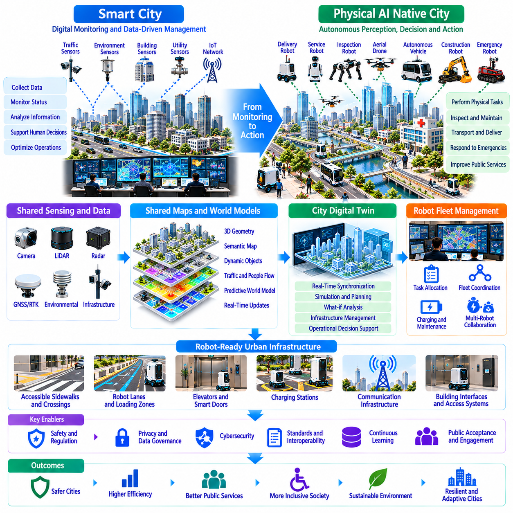{width="7.268055555555556in" height="7.268055555555556in"}

스마트 시티(Smart City)에서 피지컬 AI 네이티브 도시(Physical AI-Native City)로의 전환은 도시 환경(Urban Environment)이 설계되고 관리되며 경험되는 방식의 근본적인 변화를 의미한다. 기존 스마트 시티(Traditional Smart City)는 디지털 연결성(Digital Connectivity), 센서 네트워크(Sensor Network), 데이터 기반 의사결정 지원(Data-Driven Decision Support)을 강조한다. 피지컬 AI 네이티브 도시(Physical AI-Native City)는 이러한 역량을 자율 인식(Autonomous Perception), 계획(Planning), 행동(Action)으로 확장하여 지능형 기계(Intelligent Machine)가 도시 운영(Urban Operation)과 기반시설 관리(Infrastructure Management)에 직접 참여하도록 한다.

기존 스마트 시티 아키텍처(Conventional Smart City Architecture)는 주로 교통 시스템(Transportation System), 공공설비(Utility), 건물(Building), 공공 서비스(Public Service)에서 정보를 수집한다. 중앙 집중식 플랫폼(Centralized Platform)은 이러한 관측정보(Observation)를 분석하여 인간의 의사결정(Human Decision)과 운영 최적화(Operational Optimization)를 지원한다. 피지컬 AI(Physical AI)는 시설을 독립적으로 검사하고 자재를 운송하며 기반시설을 유지보수하고 변화하는 조건에 대응할 수 있는 체화 지능(Embodied Intelligence)을 도입한다. 이에 따라 도시 지능(Urban Intelligence)은 수동적 모니터링(Passive Monitoring)에서 능동적 물리 개입(Active Physical Intervention)으로 발전한다.

이러한 전환을 위해서는 도시가 자율 기계(Autonomous Machine)를 일상적인 운영 참여자(Operational Participant)로 지원하는 환경으로 변화해야 한다. 도로(Street), 보도(Sidewalk), 건물(Building), 엘리베이터(Elevator), 하역 구역(Loading Zone), 공공시설(Public Facility)은 로봇 이동성(Robotic Mobility)과 상호작용(Interaction)을 수용해야 한다. 로봇 호환 기반시설(Robot-Compatible Infrastructure)은 인간의 접근성(Human Accessibility)과 경쟁하는 것이 아니라 이를 보완해야 한다. 목표는 사람과 자율 시스템(Autonomous System)이 안전하고 효율적으로 운영되는 공유 도시 환경(Shared Urban Environment)을 구축하는 것이다.

피지컬 AI 네이티브 도시(Physical AI-Native City)는 로봇과 고정 기반시설(Fixed Infrastructure) 전반에 걸친 통합 인식(Integrated Perception)에 의존한다. 카메라(Camera), 라이다(LiDAR), 레이더(Radar), 위치 측정 시스템(Positioning System), 환경 센서(Environmental Sensor)는 도시 조건(Urban Condition)에 대한 상호보완적인 관측정보(Complementary Observation)를 제공한다. 분산 센싱(Distributed Sensing)은 로봇이 장애물(Obstacle)을 탐지하고 기반시설 변화(Infrastructure Change)를 식별하며 운영 제약조건(Operational Constraint)을 예측하도록 한다. 신뢰성 높은 통합(Reliable Integration)을 위해서는 동기화된 정보(Synchronized Information), 일관된 공간 기준(Consistent Spatial Reference), 불확실성 관리 메커니즘(Uncertainty Management Mechanism)이 필요하다.

공유 지도(Shared Map)와 월드 모델(World Model)은 물리적 도시(Physical City)에 대한 공통 표현(Common Representation)을 제공한다. 정적 지리정보(Static Geographic Information)는 교통(Traffic), 보행자 활동(Pedestrian Activity), 건설(Construction), 날씨(Weather), 기반시설 가용성(Infrastructure Availability)에 관한 동적 관측정보(Dynamic Observation)와 결합되어야 한다. 예측형 월드 모델(Predictive World Model)은 조건이 어떻게 변화할지 추정하고 선제적 계획(Anticipatory Planning)을 지원할 수 있다. 이러한 모델의 신뢰성(Reliability)은 지속적인 검증(Continuous Validation), 불확실성 추정(Uncertainty Estimation), 오래된 정보(Outdated Information)의 적시 수정(Timely Correction)에 달려 있다.

도시 디지털 트윈(Urban Digital Twin)은 시각화(Visualization)와 시뮬레이션 플랫폼(Simulation Platform)에서 자율 시스템(Autonomous System)과 연결된 운영 환경(Operational Environment)으로 발전할 수 있다. 실제 환경 관측정보(Real-World Observation)는 가상 표현(Virtual Representation)을 갱신하고 시뮬레이션(Simulation)은 물리적 실행(Physical Execution) 이전에 제안된 행동(Proposed Action)을 평가한다. 이러한 연결은 기반시설 유지보수(Infrastructure Maintenance), 교통 조정(Traffic Coordination), 긴급 대응 계획(Emergency Planning)을 지원할 수 있다. 그러나 디지털 예측(Digital Prediction)은 검증된 물리적 조건(Verified Physical Condition)과 명확하게 구분되어야 한다.

계층적 컴퓨팅 아키텍처(Hierarchical Computing Architecture)는 즉각적인 로봇 제어(Immediate Robotic Control)와 도시 규모 지능(City-Scale Intelligence) 사이의 균형을 유지하는 데 필요하다. 온보드 프로세서(Onboard Processor)는 안전 필수 인식(Safety-Critical Perception)과 행동(Action)을 관리하고 엣지 컴퓨팅(Edge Computing)은 인근 시스템 간 조정(Nearby Coordination)과 저지연 서비스(Low-Latency Service)를 지원한다. 지역 플랫폼(Regional Platform)과 클라우드 기반시설(Cloud Infrastructure)은 대규모 학습(Large-Scale Learning), 최적화(Optimization), 이력 분석(Historical Analysis)을 가능하게 한다. 이러한 분산 구조(Distributed Architecture)는 공유 운영 지식(Shared Operational Knowledge)을 유지하면서 중앙 집중식 의사결정(Centralized Decision)에 대한 의존도를 줄인다.

도시 규모 로봇 군집(City-Scale Robot Fleet)은 개별 항법(Individual Navigation)을 넘어서는 조정(Coordination)을 필요로 한다. 배송 로봇(Delivery Robot), 검사 플랫폼(Inspection Platform), 청소 로봇(Cleaning Machine), 자율주행 차량(Autonomous Vehicle)은 경로(Route), 시설(Facility), 기반시설 자원(Infrastructure Resource)을 공유할 수 있다. 군집 오케스트레이션 시스템(Fleet Orchestration System)은 작업 할당(Task Allocation), 혼잡(Congestion), 충전 일정(Charging Schedule), 서비스 우선순위(Service Priority)를 관리할 수 있다. 여러 로봇 생태계(Robotic Ecosystem)가 동일한 도시 환경(Urban Environment)을 사용하는 경우 제조업체(Manufacturer)와 운영자(Operator) 사이의 상호운용성(Interoperability)이 필수적이다.

피지컬 AI 네이티브 기반시설(Physical AI-Native Infrastructure)은 로봇과 건물 사이의 표준화된 인터페이스(Standardized Interface)도 필요로 한다. 엘리베이터(Elevator), 자동문(Automatic Door), 출입 통제 시스템(Access System), 충전시설(Charging Facility), 서비스 구역(Service Area)은 보안이 적용된 기계 판독 가능 기능(Secure Machine-Readable Capability)을 제공할 수 있다. 로봇은 광범위한 수동 개입(Manual Intervention) 없이 접근을 요청하거나 시설 사용(Facility Usage)을 조정할 수 있다. 이러한 인터페이스는 사이버보안(Cybersecurity), 인간 우선 원칙(Human Priority), 비상 수동 개입 메커니즘(Emergency Override Mechanism)을 유지해야 한다.

지속적 학습(Continuous Learning)은 피지컬 AI 네이티브 도시(Physical AI-Native City)를 정적인 자동화 배치(Static Automation Deployment)와 구분하는 핵심 요소이다. 운영 경험(Operational Experience)은 반복적인 항법 실패(Recurring Navigation Failure), 접근성 장벽(Accessibility Barrier), 장비 성능 저하(Equipment Degradation), 변화하는 서비스 수요(Changing Service Demand)를 드러낼 수 있다. 정제된 군집 데이터(Curated Fleet Data)는 서로 다른 환경에서 모델 개선(Model Improvement)과 정책 정교화(Policy Refinement)를 지원한다. 그러나 학습 시스템(Learning System)은 통제된 갱신(Controlled Update), 독립적인 검증(Independent Validation), 성능 퇴행(Performance Regression)에 대한 보호 장치(Safeguard)를 필요로 한다.

도시 자율화(Urban Autonomy)는 안전 보증(Safety Assurance)과 공공 거버넌스(Public Governance)에 대한 새로운 요구사항을 도입한다. 로봇의 의사결정(Robotic Decision)은 보행자 이동(Pedestrian Movement), 교통 접근성(Transportation Access), 기반시설 가용성(Infrastructure Availability), 긴급 운영(Emergency Operation)에 영향을 미칠 수 있다. 명확한 운영 경계(Operational Boundary), 사고 보고(Incident Reporting), 책임 있는 감독(Accountable Oversight)이 필요하다. 공공기관(Public Institution)은 허용할 수 없는 위험(Unacceptable Risk)이 발생할 경우 자율 서비스(Autonomous Service)를 어떻게 승인(Authorization), 모니터링(Monitoring), 수정(Correction), 중단(Suspension)할 것인지에 대한 체계를 수립해야 한다.

개인정보 보호(Privacy)와 사이버보안(Cybersecurity)은 도시 운영 환경(Urban Operating Environment)의 기본 속성이 된다. 분산 로봇(Distributed Robot)은 민감한 공간(Sensitive Space)과 잠재적으로 식별 가능한 개인(Potentially Identifiable Individual)을 지속적으로 마주한다. 데이터 최소화(Data Minimization), 보안 통신(Secure Communication), 접근 통제(Access Control), 투명한 데이터 보존 정책(Transparent Retention Policy)은 불필요한 정보 노출(Unnecessary Exposure)을 줄인다. 공유 지능(Shared Intelligence)은 제한 없는 감시(Unrestricted Surveillance)로 변해서는 안 되며 침해된 디지털 기반시설(Compromised Digital Infrastructure)이 물리적 안전(Physical Safety)을 약화시켜서도 안 된다.

피지컬 AI 네이티브 도시(Physical AI-Native City)의 발전에는 경제적 전환(Economic Transformation)도 수반될 것이다. 자율 서비스(Autonomous Service)는 기반시설 활용률(Infrastructure Utilization)을 개선하고 반복 노동 수요(Repetitive Labor Demand)를 줄이며 지속적인 검사(Continuous Inspection)와 유지보수(Maintenance)를 가능하게 할 수 있다. 그러나 시스템 배치(System Deployment)에는 연결성(Connectivity), 컴퓨팅(Computing), 시설(Facility), 에너지(Energy), 운영 지원(Operational Support)에 대한 투자가 필요하다. 지속 가능한 도입(Sustainable Adoption)은 측정 가능한 서비스 편익(Measurable Service Benefit), 현실적인 수명주기 비용(Realistic Lifecycle Cost), 경제적 가치의 공평한 분배(Equitable Distribution of Economic Value)에 달려 있다.

이러한 전환은 기존 도시 시스템(Existing Urban System)을 즉시 교체하기보다는 점진적인 통합(Incremental Integration)을 통해 진행될 가능성이 높다. 캠퍼스(Campus), 물류 지구(Logistics District), 병원(Hospital), 교통시설(Transportation Facility)에서 이루어지는 통제된 배치(Controlled Deployment)는 운영에 관한 실증 자료(Operational Evidence)를 축적할 수 있다. 성공적인 응용 사례(Successful Application)는 상호운용 가능한 기반시설(Interoperable Infrastructure)과 공유 거버넌스 프레임워크(Shared Governance Framework)를 통해 확장될 수 있다. 각각의 확장 단계(Expansion Stage)에서는 자율성(Autonomy)을 높이기 전에 안전성(Safety), 접근성(Accessibility), 신뢰성(Reliability), 대중 수용성(Public Acceptance)을 평가해야 한다.

궁극적으로 피지컬 AI 네이티브 도시(Physical AI-Native City)는 단순히 더 많은 로봇을 포함하는 스마트 시티(Smart City)가 아니다. 물리적 기반시설(Physical Infrastructure), 디지털 지능(Digital Intelligence), 자율 기계(Autonomous Machine), 인간 제도(Human Institution)가 조정된 피드백 루프(Coordinated Feedback Loop)를 통해 작동하는 도시 생태계(Urban Ecosystem)이다. 이러한 도시의 핵심적인 성과(Defining Achievement)는 인간의 통제(Human Control)와 포용적인 도시 생활(Inclusive Urban Life)을 유지하면서 변화하는 조건(Changing Condition)을 인식하고 경험으로부터 학습하며 안전한 물리적 행동(Safe Physical Action)을 통해 공공 서비스(Public Service)를 개선하는 능력이 될 것이다.
