**Volume 13. Future of Physical AI and Civilization**


# Chapter 04. Physical AI and Space Exploration

##  

## 04.01. Why Space Exploration Needs Physical AI

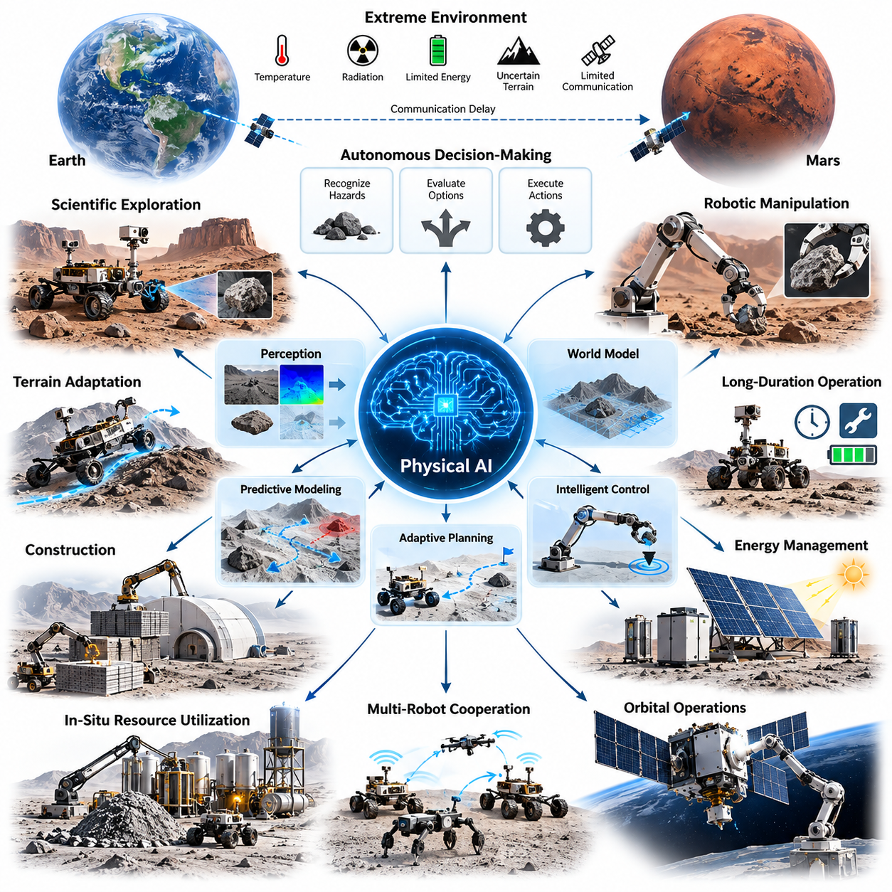{width="7.268055555555556in" height="7.268055555555556in"}

Space exploration represents one of the most demanding environments for autonomous physical intelligence. Unlike terrestrial operations, missions beyond Earth must function under extreme temperatures, radiation exposure, limited energy availability, uncertain terrain, and restricted communication. Physical AI offers a pathway toward machines capable of perceiving unfamiliar environments, reasoning about physical conditions, and performing meaningful actions without continuous human intervention.

Traditional spacecraft automation relies heavily on predefined procedures, carefully engineered control systems, and mission-specific decision rules. These approaches provide reliability but become restrictive when unexpected situations arise. Physical AI extends conventional automation by integrating perception, predictive modeling, adaptive planning, and intelligent control, allowing robotic systems to respond more flexibly to environmental uncertainty while respecting mission safety constraints.

The enormous distances separating Earth from planetary exploration sites create fundamental limitations for remote operation. Communication delays make immediate human intervention impossible during many critical activities, particularly on Mars and more distant destinations. Autonomous robots must therefore recognize hazards, evaluate alternative actions, and execute time-sensitive decisions locally, transforming onboard intelligence from an optional capability into an essential mission resource.

Space environments also contain physical conditions that are difficult to characterize completely before deployment. Planetary surfaces may include unstable regolith, steep slopes, hidden obstacles, loose rocks, and unpredictable mechanical interactions. Physical AI systems can combine visual observations, geometric mapping, contact feedback, and learned dynamics to estimate environmental properties and adapt locomotion strategies to unfamiliar terrain.

Scientific exploration requires more than reaching predetermined coordinates. Robotic explorers must identify potentially valuable geological formations, inspect unusual structures, select sampling locations, and adjust scientific priorities according to observations. Physical AI can connect scientific objectives with embodied decision-making, enabling robots to transform sensor measurements into purposeful exploration activities while preserving human oversight of major mission decisions.

The importance of physical intelligence becomes particularly evident in robotic manipulation. Collecting geological samples, positioning instruments, assembling structures, and handling delicate equipment require precise interaction with uncertain physical objects. Intelligent manipulation systems must estimate object geometry, contact forces, material behavior, and mechanical constraints while continuously correcting actions through visual and tactile feedback.

World models provide a promising foundation for these capabilities by maintaining structured representations of environmental states and predicting the consequences of possible actions. A planetary robot equipped with a predictive world model could evaluate alternative routes, estimate terrain interaction risks, and anticipate equipment behavior before execution. Such models support planning under uncertainty rather than relying exclusively on immediate sensor observations.

Long-duration exploration introduces additional challenges associated with equipment degradation, environmental changes, and limited maintenance opportunities. Robots operating for months or years must detect emerging faults, manage component wear, and modify operating strategies as system capabilities evolve. Physical AI can contribute through predictive maintenance, health-aware planning, anomaly detection, and adaptive resource management, although dependable self-repair remains a major engineering challenge.

Energy availability is another fundamental constraint shaping intelligent behavior in space. Solar illumination, battery capacity, thermal conditions, and computational power determine which activities can be performed safely. Physical AI systems must coordinate sensing, movement, computation, and scientific operations within strict energy budgets. Effective autonomy therefore requires intelligence that considers physical resource consumption alongside mission objectives.

Future lunar and Martian missions may require robotic systems to perform construction activities before human crews arrive. Autonomous machines could prepare landing areas, transport materials, excavate regolith, assemble protective structures, and install scientific infrastructure. These operations demand coordinated perception, manipulation, mobility, and planning, particularly when construction materials and environmental conditions differ from terrestrial engineering assumptions.

In-situ resource utilization further increases the importance of intelligent robotic operations. Extracting water ice, processing regolith, transporting raw materials, and maintaining production equipment involve complex physical processes that cannot always be supervised continuously from Earth. Physical AI could enable adaptive resource extraction and processing systems capable of responding to changing material properties, equipment conditions, and operational requirements.

Orbital environments present a different set of challenges involving microgravity, relative motion, orbital dynamics, and precise contact control. Autonomous servicing robots may inspect satellites, manipulate external components, or assist with assembly and maintenance. Physical AI must integrate visual tracking, dynamic state estimation, trajectory prediction, and force-aware manipulation while ensuring that unintended contact does not compromise spacecraft safety.

Multi-robot cooperation could significantly expand the scale of space exploration. Rather than depending on a single sophisticated platform, future missions may deploy heterogeneous fleets of rovers, aerial vehicles, manipulators, and stationary scientific systems. Shared environmental representations and distributed task planning could allow these machines to exchange discoveries, coordinate resources, and continue productive operations when individual units become unavailable.

Planetary aerial robotics introduces opportunities for exploration beyond the reach of ground vehicles. In environments where atmospheric conditions permit flight, autonomous aerial platforms can inspect cliffs, survey geological formations, and identify routes for surface missions. Physical AI must account for uncertain aerodynamics, limited onboard computation, navigation without satellite positioning, and rapidly changing environmental conditions during flight.

Reliable autonomy also requires learning systems that operate safely under severe restrictions on experimentation. Unlike terrestrial robots, spacecraft cannot freely explore dangerous actions to improve performance. Simulation, physics-informed learning, synthetic data, and carefully validated adaptation mechanisms become essential. These methods can improve robustness before deployment while reducing dependence on risky trial-and-error learning during actual missions.

Human-robot collaboration will remain important even as space systems become increasingly autonomous. Astronauts and ground controllers can establish scientific priorities, authorize high-consequence operations, and interpret discoveries, while robotic systems handle repetitive, hazardous, and time-sensitive physical tasks. Effective collaboration requires transparent decision-making, understandable system status, and mechanisms for transferring authority between humans and autonomous machines.

Safety and reliability distinguish space-oriented Physical AI from many commercial robotic applications. A single incorrect action may permanently damage expensive equipment or terminate an entire mission. Autonomous decisions must therefore operate within verified constraints, incorporate uncertainty estimates, and support graceful degradation. Runtime monitoring, fault containment, redundant sensing, and deterministic fallback controllers remain essential complements to learned intelligence.

The development of persistent extraterrestrial infrastructure will require autonomy extending beyond individual tasks. Robotic systems may eventually maintain power networks, transportation routes, communication equipment, scientific facilities, and resource-processing installations. These interconnected operations demand long-horizon planning, persistent environmental memory, coordinated maintenance, and the ability to recover from disturbances without continuous terrestrial supervision.

Physical AI may also reshape the economics of space exploration by reducing the operational burden associated with remote supervision. More capable autonomy could allow missions to accomplish additional scientific and engineering work with limited communication bandwidth and smaller ground-control workloads. However, these benefits must be balanced against development costs, computational requirements, verification complexity, and the consequences of autonomous failures.

The relationship between space exploration and Physical AI is mutually reinforcing. Space missions create demanding test environments for perception, predictive reasoning, adaptive control, and long-duration autonomy. Advances developed for these missions may subsequently benefit terrestrial applications involving hazardous infrastructure, remote mining, disaster response, and autonomous construction, where communication limitations and environmental uncertainty present related engineering challenges.

Ultimately, Physical AI offers a potential transition from remotely operated space machines toward autonomous systems capable of sustained physical activity beyond Earth. Its significance lies not simply in replacing human control, but in expanding what exploration missions can accomplish under extreme constraints. Achieving this vision will require combining embodied intelligence, reliable hardware, predictive world models, safety engineering, and coordinated human-machine decision-making.

우주 탐사(Space Exploration)는 자율적 물리 지능(Autonomous Physical Intelligence)에 가장 까다로운 환경 중 하나를 제공합니다. 지상 작업과 달리 지구 밖의 탐사 임무는 극한 온도(Extreme Temperatures), 방사선 노출(Radiation Exposure), 제한된 에너지 가용성(Limited Energy Availability), 불확실한 지형(Uncertain Terrain), 통신 제약(Communication Constraints) 속에서 수행되어야 합니다. 피지컬 AI(Physical AI)는 지속적인 인간 개입 없이 낯선 환경을 인식하고, 물리적 조건을 추론하며, 의미 있는 행동을 수행할 수 있는 지능형 기계를 구현하는 핵심 기술입니다.

전통적인 우주선 자동화(Spacecraft Automation)는 사전에 정의된 절차(Predefined Procedures), 정교하게 설계된 제어 시스템(Control Systems), 임무별 의사결정 규칙(Mission-Specific Decision Rules)에 크게 의존합니다. 이러한 접근 방식은 높은 신뢰성을 제공하지만 예상하지 못한 상황에서는 유연성이 제한됩니다. 피지컬 AI는 인식(Perception), 예측 모델링(Predictive Modeling), 적응형 계획(Adaptive Planning), 지능형 제어(Intelligent Control)를 통합하여 임무 안전 제약을 준수하면서 환경의 불확실성에 더욱 유연하게 대응하도록 기존 자동화 기술을 확장합니다.

지구와 행성 탐사 지역 사이의 막대한 거리는 원격 운용(Remote Operation)에 근본적인 제약을 발생시킵니다. 통신 지연(Communication Delay)으로 인해 화성(Mars)이나 더 먼 우주 공간에서는 중요한 작업 중 인간이 즉각적으로 개입하는 것이 불가능합니다. 따라서 자율 로봇(Autonomous Robots)은 위험 요소를 인식하고, 대안 행동을 평가하며, 시간에 민감한 의사결정을 현지에서 수행해야 합니다. 이러한 특성은 온보드 지능(Onboard Intelligence)을 선택적 기능이 아니라 필수적인 임무 자원으로 전환합니다.

우주 환경(Space Environments)은 배치 이전에 완전하게 파악하기 어려운 물리적 조건도 포함합니다. 행성 표면(Planetary Surfaces)에는 불안정한 표토(Regolith), 급경사, 숨겨진 장애물, 느슨한 암석, 예측하기 어려운 기계적 상호작용(Mechanical Interactions)이 존재할 수 있습니다. 피지컬 AI 시스템은 시각 관측(Visual Observations), 기하학적 지도 작성(Geometric Mapping), 접촉 피드백(Contact Feedback), 학습된 동역학(Learned Dynamics)을 결합하여 환경 특성을 추정하고 낯선 지형에 적합한 이동 전략(Locomotion Strategies)을 적용할 수 있습니다.

과학 탐사(Scientific Exploration)는 미리 지정된 좌표에 도달하는 것 이상의 능력을 요구합니다. 탐사 로봇은 과학적으로 가치 있는 지질 구조(Geological Formations)를 식별하고, 특이한 구조물을 조사하며, 시료 채취 위치(Sampling Locations)를 선정하고, 관측 결과에 따라 과학적 우선순위를 조정해야 합니다. 피지컬 AI는 과학적 목표(Scientific Objectives)와 체화된 의사결정(Embodied Decision-Making)을 연결하여 센서 측정값을 목적 지향적 탐사 활동으로 전환하면서 주요 임무 결정에 대한 인간의 감독을 유지하도록 지원합니다.

물리 지능(Physical Intelligence)의 중요성은 로봇 조작(Robotic Manipulation)에서 특히 분명하게 나타납니다. 지질 시료 수집, 계측 장비 배치, 구조물 조립, 정밀 장비 취급에는 불확실한 물체와의 정교한 물리적 상호작용이 필요합니다. 지능형 조작 시스템(Intelligent Manipulation Systems)은 물체 형상(Object Geometry), 접촉력(Contact Forces), 재료 거동(Material Behavior), 기계적 제약(Mechanical Constraints)을 추정하면서 시각 및 촉각 피드백(Visual and Tactile Feedback)을 통해 동작을 지속적으로 보정해야 합니다.

월드 모델(World Models)은 환경 상태(Environmental States)에 대한 구조화된 표현(Structured Representations)을 유지하고 가능한 행동의 결과를 예측함으로써 이러한 능력을 구현하는 유망한 기반을 제공합니다. 예측형 월드 모델(Predictive World Model)을 탑재한 행성 탐사 로봇은 실행 전에 대체 경로를 평가하고, 지형 상호작용 위험(Terrain Interaction Risks)을 추정하며, 장비의 거동을 예측할 수 있습니다. 이러한 모델은 즉각적인 센서 관측에만 의존하지 않고 불확실성 하에서의 계획 수립(Planning under Uncertainty)을 지원합니다.

장기간 우주 탐사(Long-Duration Space Exploration)는 장비 성능 저하(Equipment Degradation), 환경 변화(Environmental Changes), 제한된 유지보수 기회(Limited Maintenance Opportunities)와 관련된 추가적인 문제를 발생시킵니다. 수개월 또는 수년 동안 작동하는 로봇은 초기 고장을 감지하고, 부품 마모(Component Wear)를 관리하며, 시스템 능력 변화에 따라 운용 전략을 수정해야 합니다. 피지컬 AI는 예측 유지보수(Predictive Maintenance), 상태 인식 계획(Health-Aware Planning), 이상 탐지(Anomaly Detection), 적응형 자원 관리(Adaptive Resource Management)에 기여할 수 있지만, 신뢰할 수 있는 자가 수리(Self-Repair)는 여전히 중요한 공학적 과제입니다.

에너지 가용성(Energy Availability)은 우주에서 지능형 행동을 결정하는 또 다른 근본적인 제약입니다. 태양광 조사량(Solar Illumination), 배터리 용량(Battery Capacity), 열적 조건(Thermal Conditions), 연산 능력(Computational Power)은 안전하게 수행할 수 있는 활동을 결정합니다. 피지컬 AI 시스템은 엄격한 에너지 예산(Energy Budgets) 내에서 센싱(Sensing), 이동(Movement), 연산(Computation), 과학적 작업(Scientific Operations)을 조정해야 합니다. 따라서 효과적인 자율성(Autonomy)은 임무 목표뿐 아니라 물리적 자원 소비까지 고려하는 지능을 요구합니다.

미래의 달 및 화성 탐사 임무(Lunar and Martian Missions)에서는 인간 승무원이 도착하기 전에 로봇 시스템이 건설 작업을 수행해야 할 수 있습니다. 자율 기계(Autonomous Machines)는 착륙 구역을 준비하고, 자재를 운송하며, 표토를 굴착하고, 보호 구조물을 조립하며, 과학 기반시설(Scientific Infrastructure)을 설치할 수 있습니다. 이러한 작업에는 인식, 조작, 이동성, 계획 수립의 통합이 필요하며, 특히 건설 자재와 환경 조건이 지구의 공학적 가정과 다를 때 더욱 높은 수준의 적응 능력이 요구됩니다.

현지 자원 활용(In-Situ Resource Utilization, ISRU)은 지능형 로봇 운용의 중요성을 더욱 높입니다. 수빙(Water Ice) 추출, 표토 처리(Regolith Processing), 원자재 운송(Raw Material Transportation), 생산 장비 유지보수에는 지구에서 지속적으로 감독하기 어려운 복잡한 물리적 공정이 포함됩니다. 피지컬 AI는 재료 특성(Material Properties), 장비 상태(Equipment Conditions), 운용 요구사항(Operational Requirements)의 변화에 대응할 수 있는 적응형 자원 추출 및 처리 시스템(Adaptive Resource Extraction and Processing Systems)을 구현하는 데 기여할 수 있습니다.

궤도 환경(Orbital Environments)은 미세중력(Microgravity), 상대 운동(Relative Motion), 궤도 동역학(Orbital Dynamics), 정밀 접촉 제어(Precise Contact Control)와 관련된 서로 다른 문제를 제시합니다. 자율 정비 로봇(Autonomous Servicing Robots)은 인공위성을 검사하고, 외부 부품을 조작하며, 조립과 유지보수를 지원할 수 있습니다. 피지컬 AI는 의도하지 않은 접촉이 우주선의 안전을 위협하지 않도록 시각 추적(Visual Tracking), 동적 상태 추정(Dynamic State Estimation), 궤적 예측(Trajectory Prediction), 힘 인식 조작(Force-Aware Manipulation)을 통합해야 합니다.

다중 로봇 협력(Multi-Robot Cooperation)은 우주 탐사의 규모를 크게 확장할 수 있습니다. 미래 임무에서는 하나의 고성능 플랫폼에 의존하기보다 탐사 로버(Rovers), 비행 로봇(Aerial Vehicles), 매니퓰레이터(Manipulators), 고정형 과학 시스템(Stationary Scientific Systems)으로 구성된 이기종 로봇 군집(Heterogeneous Robot Fleets)을 배치할 수 있습니다. 공유 환경 표현(Shared Environmental Representations)과 분산 작업 계획(Distributed Task Planning)을 통해 로봇들은 탐사 결과를 교환하고, 자원을 조정하며, 일부 장비가 사용 불가능해지더라도 생산적인 임무 수행을 지속할 수 있습니다.

행성 비행 로봇(Planetary Aerial Robotics)은 지상 이동체가 접근할 수 없는 지역까지 탐사 범위를 확장할 수 있습니다. 대기 조건이 비행을 허용하는 환경에서 자율 비행 플랫폼(Autonomous Aerial Platforms)은 절벽을 조사하고, 지질 구조를 측량하며, 지상 탐사 임무를 위한 경로를 식별할 수 있습니다. 피지컬 AI는 비행 중 불확실한 공기역학(Uncertain Aerodynamics), 제한된 온보드 연산(Onboard Computation), 위성 측위 없이 수행하는 항법(Navigation), 빠르게 변화하는 환경 조건을 고려해야 합니다.

신뢰할 수 있는 자율성(Reliable Autonomy)은 실험에 대한 엄격한 제약 아래에서도 작동할 수 있는 학습 시스템을 요구합니다. 지상 로봇과 달리 우주선은 성능 개선을 위해 위험한 행동을 자유롭게 탐색할 수 없습니다. 따라서 시뮬레이션(Simulation), 물리 정보 기반 학습(Physics-Informed Learning), 합성 데이터(Synthetic Data), 신중하게 검증된 적응 메커니즘(Validated Adaptation Mechanisms)이 필수적입니다. 이러한 방법은 실제 임무 중 위험한 시행착오 학습(Trial-and-Error Learning)에 대한 의존도를 줄이면서 배치 이전의 강건성(Robustness)을 향상할 수 있습니다.

우주 시스템의 자율성이 높아지더라도 인간-로봇 협업(Human-Robot Collaboration)은 계속 중요하게 유지될 것입니다. 우주비행사(Astronauts)와 지상 관제 담당자(Ground Controllers)는 과학적 우선순위를 설정하고, 중대한 결과를 초래할 수 있는 작업을 승인하며, 탐사 결과를 해석할 수 있습니다. 반면 로봇 시스템은 반복적이고 위험하며 시간에 민감한 물리적 작업을 수행합니다. 효과적인 협업을 위해서는 투명한 의사결정(Transparent Decision-Making), 이해 가능한 시스템 상태(System Status), 인간과 자율 기계 사이의 제어 권한 이전(Authority Transfer) 메커니즘이 필요합니다.

안전성과 신뢰성(Safety and Reliability)은 우주용 피지컬 AI를 일반적인 상업용 로봇 응용 분야와 구별하는 핵심 요소입니다. 단 한 번의 잘못된 행동으로 고가의 장비가 영구적으로 손상되거나 전체 임무가 종료될 수 있습니다. 따라서 자율적 의사결정(Autonomous Decision-Making)은 검증된 제약 조건(Verified Constraints) 내에서 작동하고, 불확실성 추정(Uncertainty Estimates)을 포함하며, 점진적 성능 저하 대응(Graceful Degradation)을 지원해야 합니다. 실행 중 모니터링(Runtime Monitoring), 고장 격리(Fault Containment), 중복 센싱(Redundant Sensing), 결정론적 대체 제어기(Deterministic Fallback Controllers)는 학습 기반 지능을 보완하는 필수 요소입니다.

지속적으로 운영되는 외계 기반시설(Persistent Extraterrestrial Infrastructure)의 개발에는 개별 작업을 넘어서는 자율성이 필요합니다. 로봇 시스템은 장기적으로 전력망(Power Networks), 운송 경로(Transportation Routes), 통신 장비(Communication Equipment), 과학 시설(Scientific Facilities), 자원 처리 설비(Resource-Processing Installations)를 유지관리할 수 있습니다. 이러한 상호 연결된 작업에는 장기 계획(Long-Horizon Planning), 지속적 환경 메모리(Persistent Environmental Memory), 협력적 유지보수(Coordinated Maintenance), 지구의 지속적인 감독 없이 교란 상황에서 복구하는 능력이 요구됩니다.

피지컬 AI는 원격 감독(Remote Supervision)에 따른 운용 부담을 줄임으로써 우주 탐사의 경제성(Economics of Space Exploration)에도 변화를 가져올 수 있습니다. 더욱 발전된 자율성은 제한된 통신 대역폭(Communication Bandwidth)과 적은 지상 관제 인력(Ground-Control Workloads)으로도 추가적인 과학 및 공학 작업을 수행할 수 있게 합니다. 그러나 이러한 이점은 개발 비용(Development Costs), 연산 요구사항(Computational Requirements), 검증 복잡성(Verification Complexity), 자율 시스템 고장에 따른 결과와 균형 있게 평가되어야 합니다.

우주 탐사와 피지컬 AI 사이의 관계는 상호 강화적(Mutually Reinforcing)입니다. 우주 임무는 인식(Perception), 예측 추론(Predictive Reasoning), 적응형 제어(Adaptive Control), 장기간 자율성(Long-Duration Autonomy)을 검증할 수 있는 까다로운 시험 환경을 제공합니다. 이러한 임무를 위해 개발된 기술은 이후 위험 기반시설(Hazardous Infrastructure), 원격 채굴(Remote Mining), 재난 대응(Disaster Response), 자율 건설(Autonomous Construction)과 같은 지상 응용 분야에도 활용될 수 있으며, 이들 분야 역시 통신 제약과 환경적 불확실성이라는 유사한 공학적 문제를 가지고 있습니다.

궁극적으로 피지컬 AI는 원격으로 운용되는 우주 기계(Remotely Operated Space Machines)에서 지구 밖에서도 지속적인 물리적 활동을 수행할 수 있는 자율 시스템(Autonomous Systems)으로의 전환을 가능하게 합니다. 그 중요성은 단순히 인간의 제어를 대체하는 것이 아니라 극한의 제약 조건에서도 탐사 임무가 수행할 수 있는 활동의 범위를 확장하는 데 있습니다. 이러한 비전을 실현하려면 체화 지능(Embodied Intelligence), 신뢰성 높은 하드웨어(Reliable Hardware), 예측형 월드 모델(Predictive World Models), 안전 공학(Safety Engineering), 인간-기계 협력 의사결정(Coordinated Human-Machine Decision-Making)의 통합이 필요합니다.

##  

## 04.02. Autonomy under Communication Delay

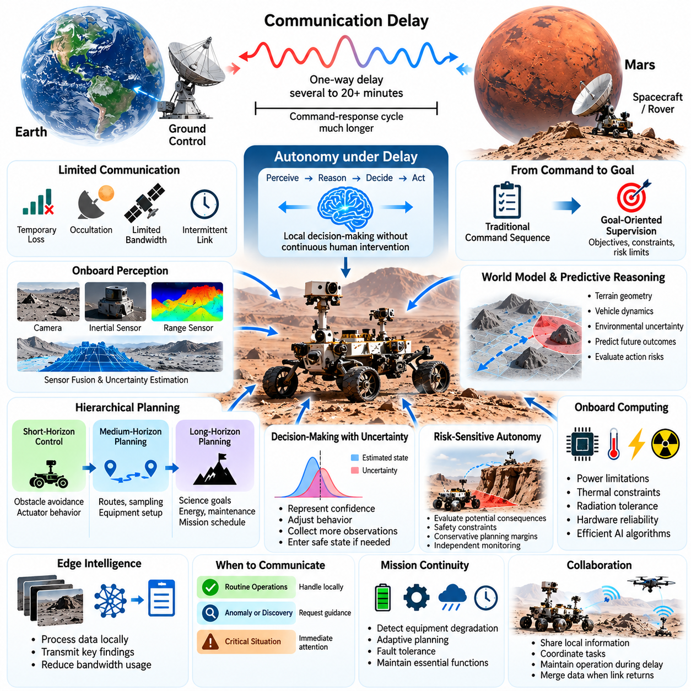{width="7.268055555555556in" height="7.268055555555556in"}

Communication delay is one of the fundamental constraints shaping autonomous space exploration. As spacecraft travel farther from Earth, the time required for radio signals to propagate increases, making immediate human intervention impossible. Physical AI addresses this limitation by enabling robotic systems to perceive their surroundings, interpret mission objectives, and make operational decisions locally without waiting for continuous instructions from ground controllers.

The speed of light establishes an unavoidable physical boundary for remote control. Communication between Earth and Mars typically involves one-way delays of several to more than twenty minutes, depending on planetary positions. A command-response cycle may therefore require substantially longer. Such delays prevent conventional real-time teleoperation and require spacecraft to manage navigation, manipulation, and unexpected environmental events independently.

Communication delay must be distinguished from communication disruption. Space missions may experience temporary signal loss caused by planetary occultation, antenna orientation, orbital geometry, or equipment limitations. Bandwidth restrictions can further reduce the amount of information transmitted. Autonomous systems must therefore remain operational not only when messages arrive late, but also when communication becomes intermittent or temporarily unavailable.

Traditional mission operations commonly separate ground-based planning from onboard execution. Engineers develop command sequences, verify expected outcomes, and transmit instructions for execution during scheduled communication opportunities. Although this approach supports careful supervision, it can reduce operational flexibility when environmental conditions differ from expectations. Physical AI introduces adaptive decision-making within predefined mission boundaries.

Autonomy under communication delay requires a shift from command-level control toward goal-oriented supervision. Instead of specifying every movement, ground operators can provide objectives, operational constraints, and acceptable risk limits. An autonomous robot then determines how to accomplish the assigned task using local observations and planning. This approach reduces dependence on frequent communication while preserving human authority over mission priorities.

Onboard perception provides the immediate information required for independent decisions. Cameras, inertial sensors, range measurements, and other instruments allow robots to estimate their position, identify obstacles, and characterize surrounding terrain. Sensor fusion combines complementary observations into a coherent environmental representation. Because perception must operate without continuous ground assistance, uncertainty estimation and fault detection become especially important.

World models extend perception by predicting how the environment may evolve in response to robot actions. A planetary rover can use an internal representation of terrain geometry, vehicle dynamics, and environmental uncertainty to evaluate possible movements before execution. Predictive reasoning allows the system to anticipate hazards, estimate action outcomes, and select strategies that remain compatible with mission safety requirements.

Autonomous planning must operate across multiple time horizons. Short-horizon control manages immediate obstacle avoidance, traction changes, and actuator behavior. Medium-horizon planning determines routes, sampling sequences, and equipment configurations. Long-horizon planning coordinates scientific objectives, energy consumption, maintenance activities, and mission schedules. These planning levels must exchange information while respecting different computational and timing constraints.

Decision-making under delayed communication also requires explicit management of uncertainty. Environmental observations may be incomplete, sensor measurements may contain errors, and learned models may produce inaccurate predictions. Physical AI systems should represent confidence in their estimates and adjust behavior accordingly. When uncertainty exceeds acceptable limits, the robot may reduce speed, collect additional observations, or enter a predefined safe state.

Risk-sensitive autonomy is particularly important because delayed communication prevents immediate human correction. A navigation error near a steep slope or an incorrect manipulation command could cause irreversible mission damage. Autonomous controllers must evaluate potential consequences rather than optimizing task completion alone. Safety constraints, conservative planning margins, and independent monitoring mechanisms help limit the consequences of uncertain decisions.

Local autonomy depends on reliable onboard computing infrastructure. Spacecraft processors operate under strict limitations involving electrical power, thermal dissipation, radiation tolerance, and hardware reliability. Physical AI algorithms must therefore balance computational complexity against available resources. Efficient perception models, compact world representations, and selective planning strategies can reduce processing demands while maintaining useful decision-making capabilities.

Edge intelligence becomes essential when communication bandwidth cannot support continuous transmission of raw sensor data. Instead of sending every image or measurement to Earth, onboard systems can process observations locally and transmit selected scientific findings, anomalies, and operational summaries. This approach improves communication efficiency while allowing ground teams to focus on information that is most relevant to mission objectives.

Autonomous systems must also determine when communication is necessary. Routine navigation adjustments may be handled locally, while unexpected scientific discoveries or high-consequence operations may require human authorization. Event-driven communication strategies prioritize important messages according to urgency, scientific value, and operational risk. Such mechanisms support efficient collaboration between onboard intelligence and ground-based mission control.

Communication-aware planning incorporates future contact opportunities into operational decisions. A robot may schedule energy-intensive activities before a communication window, postpone irreversible actions until authorization becomes available, or store observations for later transmission. This requires integrating communication schedules with task planning, resource allocation, and system health monitoring rather than treating communication as an independent subsystem.

Delayed feedback creates additional challenges for robotic manipulation. When collecting samples or positioning instruments, contact conditions can change faster than ground operators can respond. Local controllers must regulate motion and force using immediate sensor feedback. Physical AI can support higher-level decisions about grasp selection, tool positioning, and recovery from unsuccessful manipulation attempts while conventional control loops maintain precise physical interaction.

Learning and adaptation under communication delay require carefully controlled mechanisms. Robots may encounter terrain properties or operational conditions that differ from predeployment models. Online system identification can update estimates of vehicle dynamics, friction, or actuator performance. However, unrestricted learning may introduce unpredictable behavior, making validated adaptation boundaries and rollback mechanisms important for mission assurance.

Persistent memory enables autonomous systems to maintain operational continuity across communication interruptions. Robots can store environmental maps, completed tasks, equipment conditions, and previous decision outcomes. This accumulated information supports long-horizon reasoning and prevents unnecessary repetition. Memory management must also account for limited storage capacity, data integrity, and the distinction between verified observations and uncertain model predictions.

Fault management becomes increasingly important as communication delays grow. An autonomous spacecraft must recognize abnormal conditions, isolate suspected failures, and execute appropriate recovery procedures without waiting for ground instructions. Physical AI may improve diagnostic interpretation and recovery planning, but critical protection functions should remain independently verifiable. Reliable autonomy combines adaptive intelligence with deterministic fault-protection mechanisms.

Multi-robot missions introduce additional communication challenges because individual robots may experience different connectivity conditions. Local cooperation can allow robots to share maps, coordinate exploration tasks, and relay important information when communication paths are available. Distributed planning reduces dependence on a single controller, although inconsistent information and delayed synchronization must be managed to prevent conflicting actions.

Human supervision remains essential despite increasing onboard autonomy. Mission controllers define objectives, establish acceptable operating limits, review scientific findings, and authorize critical changes. The autonomous system should explain important decisions through concise operational records and uncertainty indicators. This creates a supervisory relationship in which humans govern mission intent while robots manage time-sensitive physical execution.

Verification and validation are central to deploying autonomy in delayed communication environments. Testing must reproduce realistic communication latency, signal interruptions, sensor uncertainty, hardware faults, and unexpected terrain conditions. Simulation campaigns and hardware-in-the-loop experiments can evaluate autonomous responses before deployment. Particular attention must be given to rare events, recovery behavior, and interactions between learned models and safety controllers.

As exploration extends toward distant planets, moons, and deep-space destinations, communication constraints will become even more significant. Increasing distance and limited contact opportunities will favor systems capable of independent scientific investigation, resource management, and fault recovery. The required level of autonomy will depend on mission objectives, environmental complexity, hardware capabilities, and acceptable operational risk.

Ultimately, autonomy under communication delay transforms space robotics from remotely commanded machinery into systems capable of locally governed physical action. Physical AI provides perception, predictive reasoning, adaptive planning, and intelligent interaction needed to operate beyond immediate human control. Its successful implementation requires a carefully engineered balance between machine independence, computational efficiency, verified safety, and continuing human responsibility for mission decisions.

통신 지연(Communication Delay)은 자율 우주 탐사(Autonomous Space Exploration)를 결정하는 근본적인 제약 조건 중 하나입니다. 우주선이 지구에서 멀어질수록 무선 신호(Radio Signals)가 전파되는 데 필요한 시간이 증가하여 인간의 즉각적인 개입이 불가능해집니다. 피지컬 AI(Physical AI)는 로봇 시스템이 주변 환경을 인식하고, 임무 목표(Mission Objectives)를 해석하며, 지상 관제 담당자(Ground Controllers)의 지속적인 명령을 기다리지 않고 현지에서 운용 결정을 내릴 수 있도록 함으로써 이러한 한계를 해결합니다.

빛의 속도(Speed of Light)는 원격 제어(Remote Control)에 피할 수 없는 물리적 한계를 설정합니다. 지구와 화성 사이의 통신에는 행성의 상대적 위치에 따라 일반적으로 편도 기준 수분에서 20분 이상이 소요됩니다. 따라서 명령을 전송하고 응답을 수신하는 주기(Command-Response Cycle)는 훨씬 더 긴 시간이 필요할 수 있습니다. 이러한 지연은 기존의 실시간 원격 조작(Real-Time Teleoperation)을 불가능하게 하며, 우주선이 항법(Navigation), 조작(Manipulation), 예상하지 못한 환경적 사건을 독립적으로 처리하도록 요구합니다.

통신 지연(Communication Delay)은 통신 중단(Communication Disruption)과 구별되어야 합니다. 우주 임무에서는 행성에 의한 신호 차폐(Planetary Occultation), 안테나 방향(Antenna Orientation), 궤도 기하학(Orbital Geometry), 장비의 한계(Equipment Limitations)로 인해 일시적인 신호 손실(Signal Loss)이 발생할 수 있습니다. 대역폭 제약(Bandwidth Restrictions)은 전송 가능한 정보량을 추가로 감소시킵니다. 따라서 자율 시스템(Autonomous Systems)은 메시지가 늦게 도착하는 상황뿐 아니라 통신이 간헐적으로 이루어지거나 일시적으로 불가능한 상황에서도 정상적인 운용을 유지해야 합니다.

전통적인 임무 운용(Mission Operations)은 일반적으로 지상 기반 계획(Ground-Based Planning)과 온보드 실행(Onboard Execution)을 분리합니다. 엔지니어는 명령 시퀀스(Command Sequences)를 개발하고, 예상 결과를 검증한 다음, 예정된 통신 기회에 실행 명령을 전송합니다. 이러한 접근 방식은 신중한 감독을 지원하지만 환경 조건이 예상과 다를 경우 운용 유연성을 제한할 수 있습니다. 피지컬 AI는 사전에 정의된 임무 경계(Mission Boundaries) 내에서 적응형 의사결정(Adaptive Decision-Making)을 도입합니다.

통신 지연 환경에서의 자율성(Autonomy under Communication Delay)은 명령 수준 제어(Command-Level Control)에서 목표 지향적 감독(Goal-Oriented Supervision)으로의 전환을 요구합니다. 지상 운영자는 모든 움직임을 지정하는 대신 목표(Objectives), 운용 제약(Operational Constraints), 허용 가능한 위험 한계(Acceptable Risk Limits)를 제공할 수 있습니다. 자율 로봇은 현지 관측과 계획을 활용하여 할당된 작업의 수행 방법을 결정합니다. 이러한 접근 방식은 빈번한 통신에 대한 의존도를 줄이면서 임무 우선순위에 대한 인간의 권한을 유지합니다.

온보드 인식(Onboard Perception)은 독립적인 의사결정에 필요한 즉각적인 정보를 제공합니다. 카메라(Cameras), 관성 센서(Inertial Sensors), 거리 측정(Range Measurements), 기타 계측 장비는 로봇이 자신의 위치를 추정하고, 장애물을 식별하며, 주변 지형을 분석하도록 지원합니다. 센서 융합(Sensor Fusion)은 상호 보완적인 관측을 일관된 환경 표현(Environmental Representation)으로 통합합니다. 인식 기능은 지속적인 지상 지원 없이 작동해야 하므로 불확실성 추정(Uncertainty Estimation)과 고장 탐지(Fault Detection)가 특히 중요합니다.

월드 모델(World Models)은 로봇 행동에 따라 환경이 어떻게 변화할 수 있는지 예측함으로써 인식 기능을 확장합니다. 행성 탐사 로버(Planetary Rover)는 지형 형상(Terrain Geometry), 차량 동역학(Vehicle Dynamics), 환경 불확실성(Environmental Uncertainty)에 대한 내부 표현(Internal Representation)을 활용하여 실행 전에 가능한 이동을 평가할 수 있습니다. 예측 추론(Predictive Reasoning)은 위험을 예상하고, 행동 결과를 추정하며, 임무 안전 요구사항(Mission Safety Requirements)에 부합하는 전략을 선택하도록 지원합니다.

자율 계획(Autonomous Planning)은 여러 시간 범위(Multiple Time Horizons)에 걸쳐 작동해야 합니다. 단기 제어(Short-Horizon Control)는 즉각적인 장애물 회피(Obstacle Avoidance), 접지력 변화(Traction Changes), 액추에이터 동작(Actuator Behavior)을 관리합니다. 중기 계획(Medium-Horizon Planning)은 이동 경로, 시료 채취 순서(Sampling Sequences), 장비 구성을 결정합니다. 장기 계획(Long-Horizon Planning)은 과학적 목표, 에너지 소비, 유지보수 활동, 임무 일정을 조정합니다. 이러한 계획 계층은 서로 다른 연산 및 시간 제약을 준수하면서 정보를 교환해야 합니다.

지연된 통신 환경에서의 의사결정(Decision-Making)은 불확실성(Uncertainty)에 대한 명시적인 관리도 요구합니다. 환경 관측은 불완전할 수 있고, 센서 측정에는 오류가 포함될 수 있으며, 학습된 모델(Learned Models)은 부정확한 예측을 생성할 수 있습니다. 피지컬 AI 시스템은 추정값에 대한 신뢰도(Confidence)를 표현하고 이에 따라 행동을 조정해야 합니다. 불확실성이 허용 범위를 초과하면 로봇은 속도를 줄이거나, 추가 관측을 수집하거나, 사전에 정의된 안전 상태(Safe State)로 전환할 수 있습니다.

위험 민감형 자율성(Risk-Sensitive Autonomy)은 통신 지연으로 인해 인간이 즉각적으로 오류를 수정할 수 없다는 점에서 특히 중요합니다. 급경사 근처에서 발생한 항법 오류(Navigation Error)나 잘못된 조작 명령(Manipulation Command)은 복구할 수 없는 임무 손상을 초래할 수 있습니다. 자율 제어기(Autonomous Controllers)는 작업 완료만을 최적화하는 대신 잠재적인 결과를 평가해야 합니다. 안전 제약(Safety Constraints), 보수적인 계획 여유(Conservative Planning Margins), 독립적인 모니터링 메커니즘(Independent Monitoring Mechanisms)은 불확실한 결정으로 인한 피해를 제한하는 데 기여합니다.

현지 자율성(Local Autonomy)은 신뢰성 높은 온보드 컴퓨팅 인프라(Onboard Computing Infrastructure)에 의존합니다. 우주선 프로세서(Spacecraft Processors)는 전력(Electrical Power), 열 방출(Thermal Dissipation), 방사선 내성(Radiation Tolerance), 하드웨어 신뢰성(Hardware Reliability)과 관련된 엄격한 제약 속에서 작동합니다. 따라서 피지컬 AI 알고리즘은 연산 복잡도(Computational Complexity)와 가용 자원 사이의 균형을 유지해야 합니다. 효율적인 인식 모델(Efficient Perception Models), 압축된 월드 표현(Compact World Representations), 선택적 계획 전략(Selective Planning Strategies)은 유용한 의사결정 능력을 유지하면서 연산 요구량을 줄일 수 있습니다.

통신 대역폭(Communication Bandwidth)이 원시 센서 데이터(Raw Sensor Data)의 지속적인 전송을 지원하지 못하는 경우 엣지 지능(Edge Intelligence)은 필수적입니다. 모든 이미지나 측정값을 지구로 전송하는 대신 온보드 시스템은 관측을 현지에서 처리하고, 선별된 과학적 발견(Scientific Findings), 이상 현상(Anomalies), 운용 요약(Operational Summaries)을 전송할 수 있습니다. 이러한 접근 방식은 통신 효율성(Communication Efficiency)을 높이는 동시에 지상 운영팀이 임무 목표와 가장 관련성이 높은 정보에 집중하도록 지원합니다.

자율 시스템은 통신이 언제 필요한지도 판단해야 합니다. 일상적인 항법 조정(Routine Navigation Adjustments)은 현지에서 처리할 수 있지만 예상하지 못한 과학적 발견이나 중대한 결과를 초래할 수 있는 작업은 인간의 승인이 필요할 수 있습니다. 이벤트 기반 통신 전략(Event-Driven Communication Strategies)은 긴급성(Urgency), 과학적 가치(Scientific Value), 운용 위험(Operational Risk)에 따라 중요한 메시지의 우선순위를 결정합니다. 이러한 메커니즘은 온보드 지능(Onboard Intelligence)과 지상 임무 관제(Ground-Based Mission Control) 사이의 효율적인 협업을 지원합니다.

통신 인식 계획(Communication-Aware Planning)은 향후 통신 가능 시간(Contact Opportunities)을 운용 의사결정에 반영합니다. 로봇은 통신 가능 시간대(Communication Window) 이전에 에너지 집약적인 작업을 계획하거나, 승인을 받을 때까지 되돌릴 수 없는 행동을 연기하거나, 나중에 전송하기 위해 관측 데이터를 저장할 수 있습니다. 이를 위해서는 통신을 독립적인 하위 시스템으로 취급하는 대신 통신 일정(Communication Schedules)을 작업 계획(Task Planning), 자원 할당(Resource Allocation), 시스템 상태 모니터링(System Health Monitoring)과 통합해야 합니다.

지연된 피드백(Delayed Feedback)은 로봇 조작(Robotic Manipulation)에도 추가적인 문제를 발생시킵니다. 시료를 수집하거나 계측 장비를 배치할 때 접촉 조건(Contact Conditions)은 지상 운영자가 대응할 수 있는 속도보다 빠르게 변화할 수 있습니다. 현지 제어기(Local Controllers)는 즉각적인 센서 피드백을 활용하여 움직임과 힘을 조절해야 합니다. 피지컬 AI는 파지 선택(Grasp Selection), 도구 위치 결정(Tool Positioning), 조작 실패 복구(Recovery from Manipulation Failures)에 관한 상위 수준의 의사결정을 지원하고, 기존 제어 루프(Control Loops)는 정밀한 물리적 상호작용을 유지할 수 있습니다.

통신 지연 환경에서의 학습 및 적응(Learning and Adaptation)은 신중하게 통제된 메커니즘을 요구합니다. 로봇은 배치 이전 모델(Predeployment Models)과 다른 지형 특성이나 운용 조건을 경험할 수 있습니다. 온라인 시스템 식별(Online System Identification)은 차량 동역학, 마찰(Friction), 액추에이터 성능(Actuator Performance)에 대한 추정값을 갱신할 수 있습니다. 그러나 제한 없는 학습(Unrestricted Learning)은 예측하기 어려운 행동을 유발할 수 있으므로 검증된 적응 범위(Validated Adaptation Boundaries)와 롤백 메커니즘(Rollback Mechanisms)이 임무 보증(Mission Assurance)에 중요합니다.

지속적 메모리(Persistent Memory)는 자율 시스템이 통신 중단 상황에서도 운용 연속성(Operational Continuity)을 유지하도록 지원합니다. 로봇은 환경 지도(Environmental Maps), 완료된 작업(Completed Tasks), 장비 상태(Equipment Conditions), 이전 의사결정 결과(Previous Decision Outcomes)를 저장할 수 있습니다. 이러한 축적 정보는 장기 추론(Long-Horizon Reasoning)을 지원하고 불필요한 반복을 방지합니다. 메모리 관리(Memory Management)는 제한된 저장 용량(Storage Capacity), 데이터 무결성(Data Integrity), 검증된 관측(Verified Observations)과 불확실한 모델 예측(Uncertain Model Predictions)의 구분도 고려해야 합니다.

통신 지연이 증가할수록 고장 관리(Fault Management)의 중요성도 높아집니다. 자율 우주선(Autonomous Spacecraft)은 지상 명령을 기다리지 않고 비정상 상태(Abnormal Conditions)를 인식하고, 의심되는 고장을 격리하며, 적절한 복구 절차(Recovery Procedures)를 실행해야 합니다. 피지컬 AI는 진단 해석(Diagnostic Interpretation)과 복구 계획(Recovery Planning)을 개선할 수 있지만 핵심 보호 기능(Critical Protection Functions)은 독립적으로 검증 가능해야 합니다. 신뢰성 높은 자율성은 적응형 지능(Adaptive Intelligence)과 결정론적 고장 보호 메커니즘(Deterministic Fault-Protection Mechanisms)을 결합합니다.

다중 로봇 임무(Multi-Robot Missions)는 개별 로봇이 서로 다른 연결 상태(Connectivity Conditions)를 경험할 수 있으므로 추가적인 통신 문제를 발생시킵니다. 현지 협력(Local Cooperation)을 통해 로봇들은 지도를 공유하고, 탐사 작업을 조정하며, 통신 경로가 확보되면 중요한 정보를 중계할 수 있습니다. 분산 계획(Distributed Planning)은 단일 제어기에 대한 의존도를 줄이지만, 충돌하는 행동을 방지하기 위해 정보 불일치(Inconsistent Information)와 지연된 동기화(Delayed Synchronization)를 관리해야 합니다.

온보드 자율성(Onboard Autonomy)이 증가하더라도 인간의 감독(Human Supervision)은 여전히 필수적입니다. 임무 관제 담당자(Mission Controllers)는 목표를 정의하고, 허용 가능한 운용 한계(Operating Limits)를 설정하며, 과학적 발견을 검토하고, 중요한 변경을 승인합니다. 자율 시스템은 간결한 운용 기록(Operational Records)과 불확실성 지표(Uncertainty Indicators)를 통해 중요한 의사결정을 설명할 수 있어야 합니다. 이는 인간이 임무 의도(Mission Intent)를 관리하고 로봇이 시간에 민감한 물리적 실행을 담당하는 감독 관계(Supervisory Relationship)를 형성합니다.

검증 및 유효성 확인(Verification and Validation)은 통신 지연 환경에 자율성을 배치하기 위한 핵심 과정입니다. 시험에서는 실제적인 통신 지연(Communication Latency), 신호 중단(Signal Interruptions), 센서 불확실성(Sensor Uncertainty), 하드웨어 고장(Hardware Faults), 예상하지 못한 지형 조건을 재현해야 합니다. 시뮬레이션 시험(Simulation Campaigns)과 하드웨어 인 더 루프 실험(Hardware-in-the-Loop Experiments)은 배치 이전에 자율 시스템의 대응을 평가할 수 있습니다. 특히 드문 사건(Rare Events), 복구 동작(Recovery Behavior), 학습 모델과 안전 제어기(Safety Controllers) 사이의 상호작용에 주의를 기울여야 합니다.

탐사 범위가 먼 행성, 위성(Moons), 심우주 목적지(Deep-Space Destinations)로 확장될수록 통신 제약은 더욱 중요해질 것입니다. 거리 증가와 제한된 통신 기회는 독립적인 과학 조사(Independent Scientific Investigation), 자원 관리(Resource Management), 고장 복구(Fault Recovery)를 수행할 수 있는 시스템의 필요성을 높입니다. 요구되는 자율성 수준(Level of Autonomy)은 임무 목표, 환경 복잡성(Environmental Complexity), 하드웨어 성능(Hardware Capabilities), 허용 가능한 운용 위험(Acceptable Operational Risk)에 따라 달라집니다.

궁극적으로 통신 지연 환경에서의 자율성(Autonomy under Communication Delay)은 우주 로봇을 원격 명령 기반 기계(Remotely Commanded Machinery)에서 현지에서 자율적으로 물리적 행동을 수행할 수 있는 시스템으로 전환합니다. 피지컬 AI는 즉각적인 인간 제어 범위를 벗어난 환경에서 작동하는 데 필요한 인식(Perception), 예측 추론(Predictive Reasoning), 적응형 계획(Adaptive Planning), 지능형 상호작용(Intelligent Interaction)을 제공합니다. 이를 성공적으로 구현하려면 기계의 독립성(Machine Independence), 연산 효율성(Computational Efficiency), 검증된 안전성(Verified Safety), 임무 의사결정에 대한 지속적인 인간의 책임(Human Responsibility) 사이에서 신중하게 설계된 균형이 필요합니다.

##  

## 04.03. Planetary Rovers and Surface Mobility

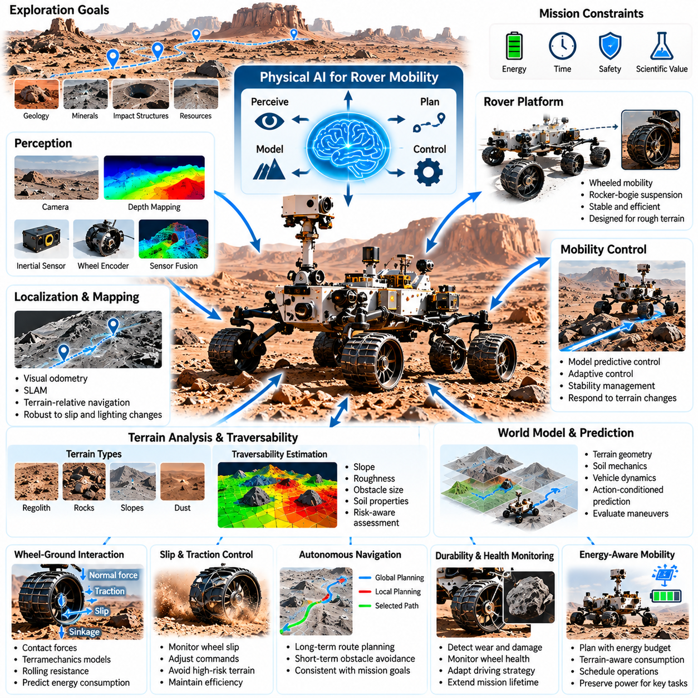{width="7.268055555555556in" height="7.268055555555556in"}

Planetary rovers represent one of the most established forms of embodied intelligence in space exploration. These robotic vehicles operate across unfamiliar surfaces where terrain geometry, soil mechanics, gravity, and environmental conditions differ significantly from those on Earth. Physical AI extends conventional rover autonomy by integrating environmental perception, predictive world models, adaptive mobility planning, and intelligent control into a unified exploration system.

Surface mobility is essential because scientific discoveries depend on reaching geographically distributed locations. Geological formations, mineral deposits, impact structures, and potential resource sites may be separated by difficult terrain. A planetary rover must therefore balance exploration distance, scientific value, mechanical safety, and energy consumption while maintaining sufficient operational capability to complete its mission.

Traditional planetary rovers commonly employ wheeled mobility platforms designed for stability, mechanical simplicity, and efficient movement. Rocker-bogie suspension systems allow multiple wheels to maintain contact with uneven surfaces while distributing loads across obstacles. However, mechanical mobility alone cannot guarantee safe traversal. Intelligent perception and control are necessary to recognize terrain hazards and determine whether a route is physically traversable.

Planetary terrain presents substantial uncertainty because surface appearance does not always reveal mechanical properties. Loose regolith, compacted soil, embedded rocks, dust deposits, and concealed cavities may produce different wheel-ground interactions. Physical AI systems must estimate terrain characteristics from visual, geometric, and proprioceptive observations, allowing mobility decisions to account for both visible geometry and uncertain subsurface behavior.

Traversability estimation is a central capability of intelligent surface mobility. A rover must determine whether a region can be crossed without excessive wheel slip, ground clearance violations, loss of stability, or mechanical damage. Learning-based traversability models can combine terrain slope, roughness, obstacle dimensions, soil appearance, and vehicle characteristics to produce risk-aware assessments of candidate paths.

Wheel-ground interaction modeling provides a physical foundation for rover mobility prediction. Contact forces, normal loading, wheel sinkage, rolling resistance, and longitudinal slip influence traction and energy consumption. Classical terramechanics models describe important aspects of deformable terrain, while data-driven models can adapt predictions using observed rover behavior. Combining these approaches supports more reliable mobility estimation under uncertain planetary conditions.

Localization is particularly challenging because planetary environments generally lack terrestrial satellite navigation infrastructure. Rovers must estimate their position through visual odometry, inertial measurements, wheel encoders, and terrain-relative observations. Simultaneous localization and mapping allows a rover to construct environmental representations while estimating its motion. Robust localization must account for wheel slip, repetitive terrain, lighting variations, and accumulated estimation errors.

Three-dimensional terrain mapping supports both scientific interpretation and safe navigation. Stereo cameras, depth estimation, and other suitable sensing methods can generate local elevation maps, obstacle representations, and surface geometry models. These maps provide spatial context for route selection and hazard avoidance. Physical AI can enrich geometric maps with semantic information about terrain classes, geological features, and expected mobility characteristics.

World models offer a more comprehensive representation of planetary mobility by connecting terrain observations with vehicle dynamics and predicted action outcomes. Instead of treating a map as a static collection of obstacles, a rover can estimate how its wheels and suspension may interact with specific terrain regions. Action-conditioned prediction enables the evaluation of candidate maneuvers before execution, improving planning under environmental uncertainty.

Autonomous navigation requires coordination between global route planning and local motion control. Global planning identifies scientifically valuable destinations and feasible corridors across larger distances. Local planning responds to immediate obstacles, terrain irregularities, and changing traction conditions. Physical AI can connect these planning levels through shared environmental representations, allowing short-term mobility decisions to remain consistent with long-term mission objectives.

Model predictive control provides a useful framework for rover motion planning under physical constraints. By predicting vehicle behavior over a finite horizon, the controller can evaluate steering commands, wheel velocities, stability margins, and expected terrain interactions. Repeated replanning allows the rover to respond to updated observations. The effectiveness of this approach depends on computational efficiency and the accuracy of the underlying dynamics models.

Wheel slip represents a particularly important challenge in loose planetary soil. Excessive slip can increase energy consumption, reduce localization accuracy, accelerate wheel wear, and cause immobilization. Intelligent traction control can monitor wheel motion relative to estimated vehicle displacement and adjust commands accordingly. Predictive models may also identify regions where high slip probability makes an alternative route preferable.

Rover mobility must account for mechanical durability over extended missions. Repeated contact with sharp rocks, abrasive particles, and uneven surfaces can damage wheels, suspension components, and drive mechanisms. Physical AI can incorporate component health estimates into navigation decisions, selecting routes that reduce cumulative mechanical stress. Such health-aware mobility planning connects immediate movement efficiency with long-term mission survivability.

Energy-aware navigation is equally important because planetary rovers operate within limited power budgets. Terrain slope, wheel slip, travel speed, temperature, and onboard computation all influence energy consumption. Intelligent planners can estimate the energy required for candidate routes and compare travel costs against available reserves. This enables the rover to preserve sufficient power for scientific operations, communication, thermal management, and emergency recovery.

Environmental conditions further complicate surface mobility. Dust accumulation, extreme temperatures, variable illumination, and seasonal changes can affect sensing, traction, and equipment performance. On Mars, atmospheric dust and changing solar conditions may influence both perception and available electrical power. On the Moon, severe thermal variations and long periods without sunlight impose different constraints on mobility and mission scheduling.

Autonomous hazard detection must operate continuously during traversal. A rover may encounter unexpected rocks, steep depressions, unstable slopes, or terrain that differs from previously generated maps. Physical AI can combine geometric reasoning, learned hazard recognition, and uncertainty estimation to evaluate these situations. When confidence is insufficient, the rover should slow down, gather additional observations, replan, or stop safely.

Recovery from mobility failures is another essential capability. Wheel entrapment, excessive sinkage, loss of traction, or unexpected vehicle orientation may prevent normal movement. Intelligent recovery planning can evaluate alternative wheel commands, reverse maneuvers, and low-risk escape strategies. However, recovery actions must respect mechanical limits because aggressive attempts can worsen entrapment or permanently damage the mobility system.

Scientific objectives and mobility decisions should be optimized together rather than treated as independent activities. A rover may choose a slightly more difficult route because it provides access to valuable geological observations, while avoiding hazardous terrain that offers limited scientific benefit. Physical AI can support this tradeoff through mission-aware planning that combines expected scientific value, traversal risk, energy expenditure, and remaining operational lifetime.

Long-horizon autonomy becomes increasingly important as exploration distances expand. A rover must remember previously traversed terrain, maintain consistent environmental maps, track resource consumption, and revise exploration strategies as new information becomes available. Persistent world memory can support repeated visits, route reuse, and cumulative understanding of planetary environments, reducing unnecessary exploration effort and improving operational continuity.

Future planetary mobility systems may incorporate heterogeneous locomotion capabilities, including articulated wheels, reconfigurable suspensions, and hybrid wheel-leg mechanisms. These designs could expand access to terrain that conventional wheeled rovers cannot safely traverse. Physical AI would coordinate mechanical configuration, motion planning, and contact control according to local conditions, although increased mobility flexibility introduces additional complexity and reliability challenges.

Ultimately, planetary rovers demonstrate how Physical AI can transform surface exploration from carefully supervised navigation into increasingly adaptive physical autonomy. Reliable progress depends on integrating terrain perception, localization, world modeling, terramechanics, risk-aware planning, and robust control. As these capabilities mature, planetary robots may explore larger areas, operate with less frequent human intervention, and accomplish more ambitious scientific missions across unfamiliar worlds.

행성 탐사 로버(Planetary Rovers)는 우주 탐사(Space Exploration)에서 가장 확립된 체화 지능(Embodied Intelligence)의 형태 중 하나입니다. 이러한 로봇 차량은 지구와 크게 다른 지형 형상(Terrain Geometry), 토양 역학(Soil Mechanics), 중력(Gravity), 환경 조건(Environmental Conditions)을 가진 낯선 표면에서 작동합니다. 피지컬 AI(Physical AI)는 환경 인식(Environmental Perception), 예측형 월드 모델(Predictive World Models), 적응형 이동 계획(Adaptive Mobility Planning), 지능형 제어(Intelligent Control)를 통합된 탐사 시스템으로 결합하여 기존 로버의 자율성을 확장합니다.

표면 이동성(Surface Mobility)은 과학적 발견이 지리적으로 분산된 여러 위치에 도달하는 능력에 의존하기 때문에 필수적입니다. 지질 구조(Geological Formations), 광물 매장지(Mineral Deposits), 충돌 구조(Impact Structures), 잠재적 자원 지역(Potential Resource Sites)은 험난한 지형으로 서로 분리되어 있을 수 있습니다. 따라서 행성 탐사 로버는 임무를 완료할 수 있는 충분한 운용 능력을 유지하면서 탐사 거리(Exploration Distance), 과학적 가치(Scientific Value), 기계적 안전성(Mechanical Safety), 에너지 소비(Energy Consumption) 사이의 균형을 유지해야 합니다.

전통적인 행성 탐사 로버는 일반적으로 안정성(Stability), 기계적 단순성(Mechanical Simplicity), 효율적인 이동(Efficient Movement)을 위해 설계된 바퀴형 이동 플랫폼(Wheeled Mobility Platforms)을 사용합니다. 로커-보기 현가장치(Rocker-Bogie Suspension Systems)는 여러 바퀴가 불규칙한 표면과 접촉을 유지하면서 장애물에 걸리는 하중을 분산하도록 합니다. 그러나 기계적 이동 능력만으로는 안전한 주행을 보장할 수 없습니다. 지형 위험(Terrain Hazards)을 인식하고 경로의 물리적 통과 가능성을 판단하려면 지능형 인식(Intelligent Perception)과 제어(Control)가 필요합니다.

행성 지형(Planetary Terrain)은 표면의 외관만으로 기계적 특성(Mechanical Properties)을 항상 파악할 수 없기 때문에 상당한 불확실성을 포함합니다. 느슨한 표토(Loose Regolith), 압축된 토양(Compacted Soil), 매립된 암석(Embedded Rocks), 먼지 퇴적층(Dust Deposits), 숨겨진 공동(Concealed Cavities)은 서로 다른 바퀴-지면 상호작용(Wheel-Ground Interactions)을 발생시킬 수 있습니다. 피지컬 AI 시스템은 시각적 관측(Visual Observations), 기하학적 관측(Geometric Observations), 고유수용성 관측(Proprioceptive Observations)을 통해 지형 특성을 추정하여 가시적인 형상과 불확실한 지표 아래의 거동을 모두 고려한 이동 결정을 수행해야 합니다.

주행 가능성 추정(Traversability Estimation)은 지능형 표면 이동성(Intelligent Surface Mobility)의 핵심 기능입니다. 로버는 과도한 바퀴 미끄러짐(Wheel Slip), 지상고 제한 위반(Ground Clearance Violations), 안정성 상실(Loss of Stability), 기계적 손상(Mechanical Damage) 없이 특정 지역을 통과할 수 있는지 판단해야 합니다. 학습 기반 주행 가능성 모델(Learning-Based Traversability Models)은 지형 경사(Terrain Slope), 거칠기(Roughness), 장애물 크기(Obstacle Dimensions), 토양 외관(Soil Appearance), 차량 특성(Vehicle Characteristics)을 결합하여 후보 경로에 대한 위험 인식 평가(Risk-Aware Assessments)를 생성할 수 있습니다.

바퀴-지면 상호작용 모델링(Wheel-Ground Interaction Modeling)은 로버의 이동 성능 예측을 위한 물리적 기반을 제공합니다. 접촉력(Contact Forces), 수직 하중(Normal Loading), 바퀴 침하(Wheel Sinkage), 구름 저항(Rolling Resistance), 종방향 미끄러짐(Longitudinal Slip)은 견인력(Traction)과 에너지 소비에 영향을 미칩니다. 고전적인 지형역학 모델(Classical Terramechanics Models)은 변형 가능한 지형(Deformable Terrain)의 중요한 특성을 설명하며, 데이터 기반 모델(Data-Driven Models)은 관측된 로버의 거동을 활용하여 예측을 조정할 수 있습니다. 이러한 접근 방식을 결합하면 불확실한 행성 환경에서 더욱 신뢰성 높은 이동 성능 추정이 가능합니다.

위치 추정(Localization)은 행성 환경에 일반적으로 지구의 위성 항법 인프라(Terrestrial Satellite Navigation Infrastructure)가 존재하지 않기 때문에 특히 어렵습니다. 로버는 시각 주행 거리 측정(Visual Odometry), 관성 측정(Inertial Measurements), 바퀴 엔코더(Wheel Encoders), 지형 상대 관측(Terrain-Relative Observations)을 통해 자신의 위치를 추정해야 합니다. 동시적 위치 추정 및 지도 작성(Simultaneous Localization and Mapping, SLAM)은 로버가 이동 상태를 추정하면서 환경 표현을 구축하도록 합니다. 강건한 위치 추정(Robust Localization)은 바퀴 미끄러짐, 반복적인 지형, 조명 변화, 누적 추정 오차(Accumulated Estimation Errors)를 고려해야 합니다.

3차원 지형 지도 작성(Three-Dimensional Terrain Mapping)은 과학적 해석(Scientific Interpretation)과 안전한 항법(Safe Navigation)을 모두 지원합니다. 스테레오 카메라(Stereo Cameras), 깊이 추정(Depth Estimation), 기타 적절한 센싱 방법(Sensing Methods)을 활용하여 국소 고도 지도(Local Elevation Maps), 장애물 표현(Obstacle Representations), 표면 형상 모델(Surface Geometry Models)을 생성할 수 있습니다. 이러한 지도는 경로 선택(Route Selection)과 위험 회피(Hazard Avoidance)에 필요한 공간적 맥락(Spatial Context)을 제공합니다. 피지컬 AI는 지형 분류(Terrain Classes), 지질학적 특징(Geological Features), 예상 이동 특성(Expected Mobility Characteristics)에 관한 의미 정보(Semantic Information)를 기하학적 지도에 추가할 수 있습니다.

월드 모델(World Models)은 지형 관측(Terrain Observations)을 차량 동역학(Vehicle Dynamics) 및 예측된 행동 결과(Predicted Action Outcomes)와 연결함으로써 행성 이동성(Planetary Mobility)에 대한 더욱 포괄적인 표현을 제공합니다. 지도를 정적인 장애물 집합으로 취급하는 대신 로버는 특정 지형에서 바퀴와 현가장치(Suspension)가 어떻게 상호작용할지 추정할 수 있습니다. 행동 조건부 예측(Action-Conditioned Prediction)은 실행 전에 후보 기동(Candidate Maneuvers)을 평가하도록 하여 환경적 불확실성 속에서 계획 수립 능력을 향상합니다.

자율 항법(Autonomous Navigation)은 전역 경로 계획(Global Route Planning)과 국소 운동 제어(Local Motion Control) 사이의 조정을 요구합니다. 전역 계획(Global Planning)은 넓은 거리에서 과학적으로 가치 있는 목적지와 이동 가능한 통로(Feasible Corridors)를 식별합니다. 국소 계획(Local Planning)은 즉각적인 장애물, 지형 불규칙성(Terrain Irregularities), 변화하는 견인 조건(Traction Conditions)에 대응합니다. 피지컬 AI는 공유 환경 표현(Shared Environmental Representations)을 통해 이러한 계획 계층을 연결하여 단기 이동 결정이 장기 임무 목표(Long-Term Mission Objectives)와 일관성을 유지하도록 지원할 수 있습니다.

모델 예측 제어(Model Predictive Control, MPC)는 물리적 제약 조건(Physical Constraints) 아래에서 로버의 운동을 계획하기 위한 유용한 프레임워크를 제공합니다. 제어기는 유한 예측 구간(Finite Horizon)에서 차량의 거동을 예측하여 조향 명령(Steering Commands), 바퀴 속도(Wheel Velocities), 안정성 여유(Stability Margins), 예상 지형 상호작용(Expected Terrain Interactions)을 평가할 수 있습니다. 반복적인 재계획(Replanning)을 통해 로버는 갱신된 관측 결과에 대응할 수 있습니다. 이러한 접근 방식의 효과는 연산 효율성(Computational Efficiency)과 기반 동역학 모델(Dynamics Models)의 정확도에 의존합니다.

바퀴 미끄러짐(Wheel Slip)은 느슨한 행성 토양(Loose Planetary Soil)에서 특히 중요한 문제입니다. 과도한 미끄러짐은 에너지 소비를 증가시키고, 위치 추정 정확도(Localization Accuracy)를 저하시키며, 바퀴 마모(Wheel Wear)를 가속하고, 로버의 이동 불능(Immobilization)을 초래할 수 있습니다. 지능형 견인력 제어(Intelligent Traction Control)는 추정된 차량 변위(Estimated Vehicle Displacement)에 대한 바퀴 운동을 모니터링하고 이에 따라 제어 명령을 조정할 수 있습니다. 예측 모델(Predictive Models)은 미끄러짐 발생 가능성이 높은 지역을 식별하여 대체 경로를 선택하도록 지원할 수도 있습니다.

로버 이동성(Rover Mobility)은 장기간 임무 수행 중 기계적 내구성(Mechanical Durability)을 고려해야 합니다. 날카로운 암석, 마모성 입자(Abrasive Particles), 불규칙한 표면과의 반복적인 접촉은 바퀴, 현가장치 부품(Suspension Components), 구동 메커니즘(Drive Mechanisms)을 손상시킬 수 있습니다. 피지컬 AI는 부품 상태 추정(Component Health Estimates)을 항법 결정에 반영하여 누적 기계적 응력(Cumulative Mechanical Stress)을 줄이는 경로를 선택할 수 있습니다. 이러한 상태 인식 이동 계획(Health-Aware Mobility Planning)은 즉각적인 이동 효율성과 장기적인 임무 생존성(Mission Survivability)을 연결합니다.

에너지 인식 항법(Energy-Aware Navigation)도 행성 탐사 로버가 제한된 전력 예산(Power Budgets) 내에서 작동하기 때문에 매우 중요합니다. 지형 경사(Terrain Slope), 바퀴 미끄러짐(Wheel Slip), 주행 속도(Travel Speed), 온도(Temperature), 온보드 연산(Onboard Computation)은 모두 에너지 소비에 영향을 미칩니다. 지능형 계획기(Intelligent Planners)는 후보 경로에 필요한 에너지를 추정하고 이동 비용(Travel Costs)을 가용 에너지 잔량(Available Reserves)과 비교할 수 있습니다. 이를 통해 로버는 과학 작업, 통신, 열 관리(Thermal Management), 비상 복구(Emergency Recovery)에 필요한 충분한 전력을 보존할 수 있습니다.

환경 조건(Environmental Conditions)은 표면 이동성(Surface Mobility)을 더욱 복잡하게 만듭니다. 먼지 축적(Dust Accumulation), 극한 온도(Extreme Temperatures), 가변적인 조명(Variable Illumination), 계절 변화(Seasonal Changes)는 센싱, 견인력, 장비 성능에 영향을 미칠 수 있습니다. 화성(Mars)에서는 대기 중 먼지(Atmospheric Dust)와 변화하는 태양광 조건(Solar Conditions)이 환경 인식과 가용 전력 모두에 영향을 줄 수 있습니다. 달(Moon)에서는 극심한 온도 변화(Severe Thermal Variations)와 장기간의 일조 부족이 이동성과 임무 일정(Mission Scheduling)에 서로 다른 제약을 부과합니다.

자율 위험 탐지(Autonomous Hazard Detection)는 주행 중 지속적으로 작동해야 합니다. 로버는 예상하지 못한 암석, 가파른 함몰 지형(Steep Depressions), 불안정한 경사면(Unstable Slopes), 기존에 생성된 지도와 다른 지형을 마주할 수 있습니다. 피지컬 AI는 기하학적 추론(Geometric Reasoning), 학습 기반 위험 인식(Learned Hazard Recognition), 불확실성 추정(Uncertainty Estimation)을 결합하여 이러한 상황을 평가할 수 있습니다. 판단 신뢰도가 충분하지 않으면 로버는 속도를 줄이거나, 추가 관측을 수집하거나, 경로를 재계획하거나, 안전하게 정지해야 합니다.

이동 실패 복구(Recovery from Mobility Failures)는 또 다른 필수 기능입니다. 바퀴 고착(Wheel Entrapment), 과도한 침하(Excessive Sinkage), 견인력 상실(Loss of Traction), 예상하지 못한 차량 자세(Unexpected Vehicle Orientation)는 정상적인 이동을 방해할 수 있습니다. 지능형 복구 계획(Intelligent Recovery Planning)은 대체 바퀴 명령(Alternative Wheel Commands), 후진 기동(Reverse Maneuvers), 저위험 탈출 전략(Low-Risk Escape Strategies)을 평가할 수 있습니다. 그러나 무리한 복구 시도는 고착 상태를 악화시키거나 이동 시스템(Mobility System)에 영구적인 손상을 줄 수 있으므로 복구 행동은 기계적 한계(Mechanical Limits)를 준수해야 합니다.

과학적 목표(Scientific Objectives)와 이동 결정(Mobility Decisions)은 독립적인 활동으로 취급하기보다 함께 최적화해야 합니다. 로버는 가치 있는 지질 관측(Geological Observations)에 접근하기 위해 약간 더 어려운 경로를 선택할 수 있지만, 과학적 이점이 제한적인 위험 지형은 회피할 수 있습니다. 피지컬 AI는 예상 과학적 가치(Expected Scientific Value), 주행 위험(Traversal Risk), 에너지 소비(Energy Expenditure), 잔여 운용 수명(Remaining Operational Lifetime)을 결합하는 임무 인식 계획(Mission-Aware Planning)을 통해 이러한 상충관계(Tradeoff)를 조정할 수 있습니다.

탐사 거리가 확대될수록 장기 자율성(Long-Horizon Autonomy)은 더욱 중요해집니다. 로버는 이전에 통과한 지형을 기억하고, 일관된 환경 지도(Environmental Maps)를 유지하며, 자원 소비(Resource Consumption)를 추적하고, 새로운 정보가 확보됨에 따라 탐사 전략(Exploration Strategies)을 수정해야 합니다. 지속적 월드 메모리(Persistent World Memory)는 반복 방문(Repeated Visits), 경로 재사용(Route Reuse), 행성 환경에 대한 누적 이해(Cumulative Understanding)를 지원하여 불필요한 탐사 활동을 줄이고 운용 연속성(Operational Continuity)을 향상할 수 있습니다.

미래의 행성 이동 시스템(Planetary Mobility Systems)은 관절형 바퀴(Articulated Wheels), 재구성 가능한 현가장치(Reconfigurable Suspensions), 바퀴-다리 하이브리드 메커니즘(Hybrid Wheel-Leg Mechanisms)을 포함한 이기종 이동 능력(Heterogeneous Locomotion Capabilities)을 도입할 수 있습니다. 이러한 설계는 기존 바퀴형 로버가 안전하게 통과할 수 없는 지형까지 접근 범위를 확장할 수 있습니다. 피지컬 AI는 현지 조건에 따라 기계적 구성(Mechanical Configuration), 운동 계획(Motion Planning), 접촉 제어(Contact Control)를 조정하지만, 이동 유연성(Mobility Flexibility)의 증가는 추가적인 복잡성과 신뢰성 문제(Reliability Challenges)를 발생시킵니다.

궁극적으로 행성 탐사 로버(Planetary Rovers)는 피지컬 AI가 표면 탐사(Surface Exploration)를 신중하게 감독되는 항법에서 점차 적응적인 물리적 자율성(Adaptive Physical Autonomy)으로 전환할 수 있음을 보여줍니다. 신뢰성 높은 발전을 위해서는 지형 인식(Terrain Perception), 위치 추정(Localization), 월드 모델링(World Modeling), 지형역학(Terramechanics), 위험 인식 계획(Risk-Aware Planning), 강건한 제어(Robust Control)의 통합이 필요합니다. 이러한 능력이 성숙함에 따라 행성 로봇은 더 넓은 지역을 탐사하고, 인간의 개입 빈도를 줄이며, 낯선 행성에서 더욱 야심 찬 과학 임무를 수행할 수 있을 것입니다.

##  

## 04.04. Legged Robots for Extreme Terrain

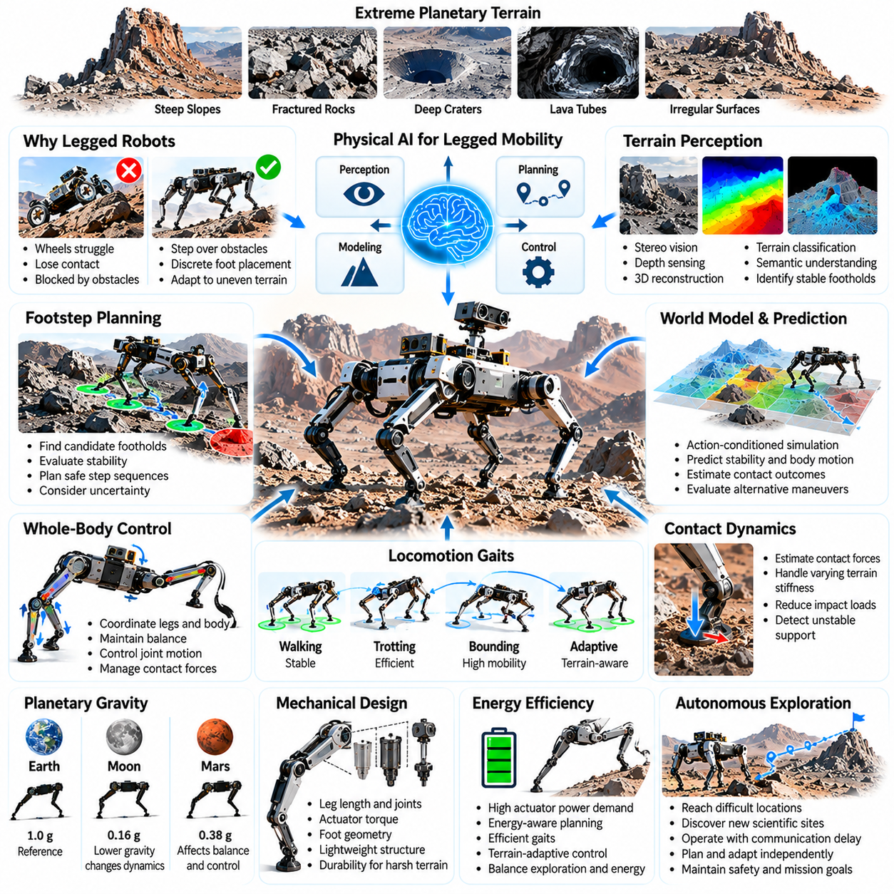{width="7.268055555555556in" height="7.268055555555556in"}

Legged robots offer a promising approach to planetary exploration in environments where conventional wheeled vehicles face severe mobility limitations. Steep slopes, fractured rocks, deep craters, lava tubes, and irregular surfaces may prevent continuous wheel contact or safe traversal. Physical AI enables legged systems to combine terrain perception, adaptive foot placement, dynamic balance, and predictive control, potentially extending robotic exploration into previously inaccessible regions.

Unlike wheeled vehicles, legged robots can select discrete contact locations and reposition their bodies independently of continuous ground support. This capability allows them to step over obstacles, cross gaps, and adapt to uneven terrain. However, legged locomotion introduces additional mechanical complexity, actuator demands, and control challenges, making reliable operation dependent on accurate environmental understanding and coordinated whole-body movement.

Extreme planetary terrain presents challenges that extend beyond visible geometric obstacles. Loose regolith, brittle rock formations, unstable slopes, and partially concealed cavities may cause unexpected foot penetration or contact failure. Intelligent legged robots must estimate both surface geometry and mechanical properties, combining visual perception with proprioceptive sensing and contact feedback to determine where stable support can be established.

Footstep planning is a fundamental capability for autonomous legged mobility. A robot must identify candidate footholds, evaluate their stability, and construct sequences of movements that preserve balance while progressing toward exploration objectives. Physical AI can integrate terrain classification, geometric mapping, contact prediction, and uncertainty estimation to select footholds that minimize slipping, excessive loading, and mechanical instability.

Whole-body control coordinates the motion of the legs, torso, and other articulated components to maintain stability during locomotion. Changes in body orientation, joint configuration, and contact forces affect the robot\'s center of mass and support conditions. Model-based controllers can enforce kinematic and dynamic constraints, while learned policies may improve adaptation to irregular terrain when operating within validated safety boundaries.

Planetary gravity significantly influences legged locomotion dynamics. Lower gravitational acceleration changes normal contact forces, ballistic motion, balance recovery, and the relationship between actuator effort and body movement. Controllers developed for terrestrial conditions cannot be assumed to transfer directly to lunar or Martian environments. Physics-informed simulation and gravity-aware control are therefore essential for predicting locomotion behavior before deployment.

Contact dynamics represent another major challenge because legged robots repeatedly establish and release physical contact with the environment. Each footfall produces forces that depend on terrain stiffness, friction, impact velocity, and foot geometry. Physical AI can use learned contact models and real-time force estimates to adjust landing behavior, reduce impact loads, and detect unstable support before a loss of balance develops.

Different locomotion gaits offer tradeoffs between stability, speed, energy consumption, and terrain adaptability. Walking gaits can maintain relatively conservative support patterns, while dynamic trotting or bounding may improve mobility under suitable conditions. In space exploration, gait selection must prioritize mission reliability and environmental uncertainty rather than maximum speed. Adaptive gait planning can modify movement patterns according to terrain conditions and system health.

Three-dimensional perception is particularly important when navigating cliffs, caves, crater rims, and fractured surfaces. Stereo vision, depth sensing, and geometric reconstruction can provide local terrain models for foothold selection and body clearance assessment. Semantic understanding may identify loose debris, rock edges, or potentially unstable structures. Combining geometry with predicted contact behavior enables more meaningful assessments of terrain accessibility.

World models can connect environmental observations with the predicted consequences of legged actions. An action-conditioned model may estimate how a planned foot placement affects body stability, joint loading, and future movement opportunities. By simulating candidate motion sequences internally, the robot can compare alternative strategies before execution. Such predictive capabilities are valuable when communication delays prevent immediate human correction.

Hierarchical planning helps manage the different timescales involved in extreme-terrain locomotion. High-level planning selects exploration targets and safe corridors, intermediate planning determines foothold sequences and body trajectories, and low-level control regulates joint motion and contact forces. Physical AI can coordinate these levels through shared terrain representations and feedback, allowing immediate balance corrections without abandoning broader mission objectives.

Mechanical design strongly influences the practical capabilities of legged exploration systems. Leg length, joint arrangement, actuator torque, foot geometry, and structural stiffness determine reachable terrain and available stability margins. Lightweight structures reduce launch mass but may increase vulnerability to impacts and fatigue. Hardware-software co-design is therefore essential for matching intelligent locomotion algorithms with the physical limitations of space-qualified robotic platforms.

Energy efficiency remains a major limitation for legged robots because repeated joint actuation can consume substantial electrical power. Unlike passive rolling, walking frequently requires active support and stabilization. Intelligent locomotion planning can reduce unnecessary movement, select efficient footholds, and adapt gait parameters to terrain difficulty. Energy-aware decisions must preserve sufficient reserves for sensing, scientific operations, communication, and thermal management.

Environmental durability is equally important. Abrasive dust, vacuum exposure, radiation, and extreme thermal cycling can affect actuators, bearings, seals, sensors, and electronic components. Legged robots contain multiple articulated joints that may create additional failure points compared with simpler mobility platforms. Physical AI can monitor joint performance, detect abnormal resistance, and adjust locomotion strategies to reduce mechanical stress, although hardware protection remains indispensable.

Fault-tolerant locomotion may allow a robot to continue operating after partial actuator degradation or sensor failure. By estimating remaining mobility capabilities, the control system can modify gait patterns, redistribute loads, or restrict movement to safer terrain. However, not every mechanical failure can be compensated through software. Reliable autonomy requires explicit operating limits, conservative recovery procedures, and safe-state mechanisms.

Exploration of subsurface environments provides a compelling application for legged robots. Lava tubes, caves, and sheltered geological structures may preserve scientific evidence and offer potential protection from surface radiation and temperature extremes. Legged mobility could enable access through irregular entrances and debris-covered passages. Such missions require autonomous mapping, reliable localization, obstacle negotiation, and communication-aware exploration strategies.

Legged robots may also support scientific manipulation by stabilizing their bodies while interacting with rocks, instruments, or sampling tools. Coordinated whole-body control can distribute contact forces across multiple limbs while positioning sensors or manipulators. This creates opportunities for mobile inspection and sampling in locations unsuitable for conventional rovers, although manipulation loads must be incorporated into balance and stability calculations.

Multi-robot exploration could combine wheeled and legged platforms to exploit their complementary capabilities. Wheeled rovers may transport equipment efficiently across relatively accessible terrain, while legged robots investigate steep slopes, fractured formations, or confined spaces. Shared maps and coordinated task allocation could extend mission coverage. Communication limitations and differing mobility capabilities must be considered when planning cooperative operations.

Training reliable locomotion policies for extraterrestrial environments presents a significant data challenge. Direct planetary experience is scarce, while terrestrial experiments cannot reproduce every relevant physical condition. High-fidelity simulation, domain randomization, physics-informed learning, and controlled hardware testing can improve robustness. Nevertheless, simulation-to-reality differences require conservative validation before learned policies are trusted in critical missions.

Long-duration autonomy requires legged robots to maintain environmental memory and monitor cumulative mechanical degradation. Repeated traversal can reveal stable footholds, hazardous regions, and routes suitable for future missions. Persistent world models may combine these observations with estimates of joint health and energy consumption. Such information supports long-horizon planning that balances scientific exploration with continued mechanical survivability.

The future of legged planetary robotics will depend on advances in compact actuation, efficient control, robust perception, and predictive physical reasoning. Greater adaptability may enable robots to investigate terrain inaccessible to traditional mobility systems, but additional complexity must be justified by scientific value and operational reliability. Legged robots are therefore best understood as complementary exploration platforms rather than universal replacements for wheeled rovers.

Ultimately, legged robots illustrate how Physical AI can expand robotic mobility beyond conventional surface navigation. Their effectiveness depends on integrating terrain understanding, contact dynamics, whole-body control, predictive world models, and safety-aware autonomy. With continued progress in hardware reliability and intelligent control, these systems may become valuable tools for exploring the most challenging geological environments on the Moon, Mars, and other planetary bodies.

다족 로봇(Legged Robots)은 기존 바퀴형 차량(Wheeled Vehicles)이 심각한 이동성 제약(Mobility Limitations)에 직면하는 환경에서 행성 탐사(Planetary Exploration)를 수행하기 위한 유망한 접근 방식입니다. 급경사(Steep Slopes), 균열된 암석(Fractured Rocks), 깊은 분화구(Deep Craters), 용암 동굴(Lava Tubes), 불규칙한 표면(Irregular Surfaces)은 지속적인 바퀴 접촉이나 안전한 주행을 어렵게 만들 수 있습니다. 피지컬 AI(Physical AI)는 다족 로봇이 지형 인식(Terrain Perception), 적응형 발 디딤 위치 선정(Adaptive Foot Placement), 동적 균형(Dynamic Balance), 예측 제어(Predictive Control)를 결합하여 기존에 접근할 수 없었던 지역까지 로봇 탐사 범위를 확장할 수 있도록 지원합니다.

바퀴형 차량과 달리 다족 로봇은 개별적인 접촉 위치(Contact Locations)를 선택하고 지속적인 지면 지지(Continuous Ground Support)에 의존하지 않으면서 몸체의 위치를 변경할 수 있습니다. 이러한 능력을 통해 장애물을 넘어가고, 틈새를 건너며, 불규칙한 지형에 적응할 수 있습니다. 그러나 다족 보행(Legged Locomotion)은 추가적인 기계적 복잡성(Mechanical Complexity), 액추에이터 요구사항(Actuator Demands), 제어 문제(Control Challenges)를 발생시키므로 신뢰성 높은 운용을 위해서는 정확한 환경 이해(Environmental Understanding)와 조정된 전신 운동(Coordinated Whole-Body Movement)이 필요합니다.

극한 행성 지형(Extreme Planetary Terrain)은 눈에 보이는 기하학적 장애물(Geometric Obstacles)을 넘어서는 문제를 제시합니다. 느슨한 표토(Loose Regolith), 부서지기 쉬운 암석 구조(Brittle Rock Formations), 불안정한 경사면(Unstable Slopes), 부분적으로 가려진 공동(Partially Concealed Cavities)은 예상하지 못한 발 침하(Foot Penetration)나 접촉 실패(Contact Failure)를 유발할 수 있습니다. 지능형 다족 로봇은 시각 인식(Visual Perception), 고유수용성 센싱(Proprioceptive Sensing), 접촉 피드백(Contact Feedback)을 결합하여 표면 형상(Surface Geometry)과 기계적 특성(Mechanical Properties)을 함께 추정하고 안정적인 지지 위치를 판단해야 합니다.

발 디딤 계획(Footstep Planning)은 자율 다족 이동(Autonomous Legged Mobility)의 기본 기능입니다. 로봇은 후보 발 디딤 위치(Candidate Footholds)를 식별하고 안정성을 평가하며, 탐사 목표를 향해 이동하는 동안 균형을 유지할 수 있는 동작 시퀀스(Movement Sequences)를 구성해야 합니다. 피지컬 AI는 지형 분류(Terrain Classification), 기하학적 지도 작성(Geometric Mapping), 접촉 예측(Contact Prediction), 불확실성 추정(Uncertainty Estimation)을 통합하여 미끄러짐, 과도한 하중, 기계적 불안정성을 최소화하는 발 디딤 위치를 선택할 수 있습니다.

전신 제어(Whole-Body Control)는 이동 중 안정성을 유지하기 위해 다리, 몸통, 기타 관절형 구성요소(Articulated Components)의 움직임을 조정합니다. 몸체 방향(Body Orientation), 관절 구성(Joint Configuration), 접촉력(Contact Forces)의 변화는 로봇의 질량 중심(Center of Mass)과 지지 조건(Support Conditions)에 영향을 미칩니다. 모델 기반 제어기(Model-Based Controllers)는 운동학적 제약(Kinematic Constraints)과 동역학적 제약(Dynamic Constraints)을 준수하도록 하며, 학습된 정책(Learned Policies)은 검증된 안전 범위(Validated Safety Boundaries) 내에서 불규칙한 지형에 대한 적응 능력을 향상할 수 있습니다.

행성 중력(Planetary Gravity)은 다족 보행 동역학(Legged Locomotion Dynamics)에 상당한 영향을 미칩니다. 낮은 중력 가속도(Lower Gravitational Acceleration)는 수직 접촉력(Normal Contact Forces), 탄도 운동(Ballistic Motion), 균형 회복(Balance Recovery), 액추에이터 출력과 몸체 운동 사이의 관계를 변화시킵니다. 지구 환경을 위해 개발된 제어기를 달이나 화성 환경에 직접 적용할 수 있다고 가정해서는 안 됩니다. 따라서 배치 이전에 보행 거동을 예측하기 위해 물리 정보 기반 시뮬레이션(Physics-Informed Simulation)과 중력 인식 제어(Gravity-Aware Control)가 필수적입니다.

접촉 동역학(Contact Dynamics)은 다족 로봇이 환경과의 물리적 접촉을 반복적으로 형성하고 해제하기 때문에 또 다른 중요한 과제입니다. 각 발 착지(Footfall)는 지형 강성(Terrain Stiffness), 마찰(Friction), 충격 속도(Impact Velocity), 발 형상(Foot Geometry)에 따라 달라지는 힘을 발생시킵니다. 피지컬 AI는 학습된 접촉 모델(Learned Contact Models)과 실시간 힘 추정(Real-Time Force Estimates)을 활용하여 착지 동작을 조정하고, 충격 하중(Impact Loads)을 줄이며, 균형 상실이 발생하기 전에 불안정한 지지 상태를 탐지할 수 있습니다.

다양한 보행 패턴(Locomotion Gaits)은 안정성(Stability), 속도(Speed), 에너지 소비(Energy Consumption), 지형 적응성(Terrain Adaptability) 사이에서 서로 다른 상충관계(Tradeoffs)를 제공합니다. 걷기 보행(Walking Gaits)은 비교적 보수적인 지지 패턴(Support Patterns)을 유지할 수 있으며, 동적 트로팅(Dynamic Trotting)이나 바운딩(Bounding)은 적절한 조건에서 이동성을 향상할 수 있습니다. 우주 탐사에서는 보행 선택(Gait Selection)이 최대 속도보다 임무 신뢰성(Mission Reliability)과 환경 불확실성(Environmental Uncertainty)을 우선해야 합니다. 적응형 보행 계획(Adaptive Gait Planning)은 지형 조건과 시스템 상태에 따라 이동 패턴을 변경할 수 있습니다.

3차원 인식(Three-Dimensional Perception)은 절벽(Cliffs), 동굴(Caves), 분화구 가장자리(Crater Rims), 균열된 표면(Fractured Surfaces)을 이동할 때 특히 중요합니다. 스테레오 비전(Stereo Vision), 깊이 센싱(Depth Sensing), 기하학적 재구성(Geometric Reconstruction)은 발 디딤 위치 선정과 몸체 여유 공간 평가(Body Clearance Assessment)를 위한 국소 지형 모델(Local Terrain Models)을 제공할 수 있습니다. 의미론적 이해(Semantic Understanding)는 느슨한 잔해(Loose Debris), 암석 가장자리(Rock Edges), 잠재적으로 불안정한 구조물을 식별할 수 있습니다. 기하학적 정보와 예측된 접촉 거동을 결합하면 지형 접근성(Terrain Accessibility)을 더욱 의미 있게 평가할 수 있습니다.

월드 모델(World Models)은 환경 관측(Environmental Observations)을 다족 로봇 행동의 예측 결과(Predicted Consequences)와 연결할 수 있습니다. 행동 조건부 모델(Action-Conditioned Model)은 계획된 발 디딤 위치가 몸체 안정성(Body Stability), 관절 하중(Joint Loading), 향후 이동 가능성(Future Movement Opportunities)에 어떤 영향을 미치는지 추정할 수 있습니다. 로봇은 후보 동작 시퀀스(Candidate Motion Sequences)를 내부적으로 시뮬레이션하여 실행 전에 대체 전략을 비교할 수 있습니다. 이러한 예측 능력은 통신 지연(Communication Delays)으로 인간의 즉각적인 수정이 불가능한 상황에서 특히 중요합니다.

계층적 계획(Hierarchical Planning)은 극한 지형 보행(Extreme-Terrain Locomotion)에 관련된 서로 다른 시간 척도(Timescales)를 관리하는 데 도움이 됩니다. 상위 수준 계획(High-Level Planning)은 탐사 목표와 안전한 이동 통로를 선택하고, 중간 수준 계획(Intermediate Planning)은 발 디딤 순서(Foothold Sequences)와 몸체 궤적(Body Trajectories)을 결정하며, 하위 수준 제어(Low-Level Control)는 관절 운동(Joint Motion)과 접촉력을 조절합니다. 피지컬 AI는 공유 지형 표현(Shared Terrain Representations)과 피드백을 통해 이러한 계층을 조정하여 전체 임무 목표를 유지하면서 즉각적인 균형 보정을 수행할 수 있습니다.

기계적 설계(Mechanical Design)는 다족 탐사 시스템(Legged Exploration Systems)의 실제 성능에 큰 영향을 미칩니다. 다리 길이(Leg Length), 관절 배치(Joint Arrangement), 액추에이터 토크(Actuator Torque), 발 형상(Foot Geometry), 구조 강성(Structural Stiffness)은 접근 가능한 지형과 안정성 여유(Stability Margins)를 결정합니다. 경량 구조(Lightweight Structures)는 발사 질량(Launch Mass)을 줄이지만 충격과 피로(Fatigue)에 대한 취약성을 증가시킬 수 있습니다. 따라서 우주용 로봇 플랫폼(Space-Qualified Robotic Platforms)의 물리적 한계에 지능형 보행 알고리즘을 적합하게 설계하기 위해 하드웨어-소프트웨어 공동 설계(Hardware-Software Co-Design)가 필수적입니다.

에너지 효율성(Energy Efficiency)은 반복적인 관절 구동(Joint Actuation)이 상당한 전력을 소비할 수 있기 때문에 다족 로봇의 주요 제약 중 하나입니다. 수동적인 구름 운동(Passive Rolling)과 달리 보행은 지속적인 능동 지지(Active Support)와 안정화(Stabilization)를 요구하는 경우가 많습니다. 지능형 보행 계획(Intelligent Locomotion Planning)은 불필요한 움직임을 줄이고, 효율적인 발 디딤 위치를 선택하며, 지형 난이도에 따라 보행 매개변수(Gait Parameters)를 조정할 수 있습니다. 에너지 인식 의사결정(Energy-Aware Decisions)은 센싱, 과학 작업, 통신, 열 관리(Thermal Management)를 위한 충분한 에너지 잔량을 보존해야 합니다.

환경 내구성(Environmental Durability)도 마찬가지로 중요합니다. 마모성 먼지(Abrasive Dust), 진공 노출(Vacuum Exposure), 방사선(Radiation), 극심한 열 순환(Extreme Thermal Cycling)은 액추에이터(Actuators), 베어링(Bearings), 밀봉 장치(Seals), 센서(Sensors), 전자 부품(Electronic Components)에 영향을 미칠 수 있습니다. 다족 로봇에는 여러 관절이 포함되어 있어 단순한 이동 플랫폼보다 추가적인 고장 지점(Failure Points)이 발생할 수 있습니다. 피지컬 AI는 관절 성능(Joint Performance)을 모니터링하고, 비정상적인 저항(Abnormal Resistance)을 탐지하며, 기계적 응력(Mechanical Stress)을 줄이도록 보행 전략을 조정할 수 있지만 하드웨어 보호(Hardware Protection)는 여전히 필수적입니다.

고장 허용 보행(Fault-Tolerant Locomotion)은 액추에이터 성능 저하(Actuator Degradation)나 센서 고장(Sensor Failure)이 부분적으로 발생한 이후에도 로봇이 작동을 지속하도록 지원할 수 있습니다. 제어 시스템(Control System)은 남아 있는 이동 능력(Remaining Mobility Capabilities)을 추정하여 보행 패턴을 변경하고, 하중을 재분배하며, 이동 범위를 더 안전한 지형으로 제한할 수 있습니다. 그러나 모든 기계적 고장을 소프트웨어로 보상할 수 있는 것은 아닙니다. 신뢰성 높은 자율성(Reliable Autonomy)을 위해서는 명확한 운용 한계(Operating Limits), 보수적인 복구 절차(Conservative Recovery Procedures), 안전 상태 메커니즘(Safe-State Mechanisms)이 필요합니다.

지하 환경 탐사(Subsurface Exploration)는 다족 로봇의 유망한 응용 분야입니다. 용암 동굴(Lava Tubes), 동굴(Caves), 보호된 지질 구조(Sheltered Geological Structures)는 과학적 증거를 보존하고 표면 방사선(Surface Radiation)과 극한 온도(Temperature Extremes)로부터 잠재적인 보호를 제공할 수 있습니다. 다족 이동성(Legged Mobility)은 불규칙한 입구와 잔해로 덮인 통로를 통한 접근을 가능하게 할 수 있습니다. 이러한 임무에는 자율 지도 작성(Autonomous Mapping), 신뢰성 높은 위치 추정(Reliable Localization), 장애물 극복(Obstacle Negotiation), 통신 인식 탐사 전략(Communication-Aware Exploration Strategies)이 요구됩니다.

다족 로봇은 암석, 계측 장비, 시료 채취 도구(Sampling Tools)와 상호작용하는 동안 몸체를 안정화함으로써 과학적 조작(Scientific Manipulation)을 지원할 수도 있습니다. 조정된 전신 제어(Coordinated Whole-Body Control)는 센서나 매니퓰레이터(Manipulators)의 위치를 조정하면서 여러 다리에 접촉력을 분산할 수 있습니다. 이는 기존 로버가 접근하기 어려운 위치에서 이동형 검사(Mobile Inspection)와 시료 채취(Sampling)를 수행할 기회를 제공하지만, 조작 하중(Manipulation Loads)을 균형 및 안정성 계산(Balance and Stability Calculations)에 반영해야 합니다.

다중 로봇 탐사(Multi-Robot Exploration)는 바퀴형 플랫폼(Wheeled Platforms)과 다족 플랫폼(Legged Platforms)을 결합하여 상호 보완적인 능력을 활용할 수 있습니다. 바퀴형 로버는 비교적 접근하기 쉬운 지형에서 장비를 효율적으로 운송하고, 다족 로봇은 급경사, 균열된 지형, 협소한 공간(Confined Spaces)을 조사할 수 있습니다. 공유 지도(Shared Maps)와 협력적 작업 할당(Coordinated Task Allocation)은 임무 수행 범위를 확장할 수 있습니다. 협력 작업(Cooperative Operations)을 계획할 때는 통신 제약(Communication Limitations)과 서로 다른 이동 능력(Mobility Capabilities)을 고려해야 합니다.

외계 환경(Extraterrestrial Environments)에 적합한 신뢰성 높은 보행 정책(Locomotion Policies)을 학습시키는 것은 상당한 데이터 문제(Data Challenge)를 제시합니다. 실제 행성에서 확보한 경험 데이터(Planetary Experience)는 부족하며, 지상 실험(Terrestrial Experiments)으로 모든 관련 물리적 조건을 재현할 수는 없습니다. 고충실도 시뮬레이션(High-Fidelity Simulation), 도메인 무작위화(Domain Randomization), 물리 정보 기반 학습(Physics-Informed Learning), 통제된 하드웨어 시험(Controlled Hardware Testing)은 강건성(Robustness)을 향상할 수 있습니다. 그러나 시뮬레이션과 현실 사이의 차이(Simulation-to-Reality Differences) 때문에 중요한 임무에서 학습된 정책을 신뢰하기 전에 보수적인 검증(Conservative Validation)이 필요합니다.

장기간 자율성(Long-Duration Autonomy)을 위해서는 다족 로봇이 환경 메모리(Environmental Memory)를 유지하고 누적 기계적 성능 저하(Cumulative Mechanical Degradation)를 모니터링해야 합니다. 반복적인 지형 통과를 통해 안정적인 발 디딤 위치(Stable Footholds), 위험 지역(Hazardous Regions), 향후 임무에 적합한 경로를 식별할 수 있습니다. 지속적 월드 모델(Persistent World Models)은 이러한 관측 결과를 관절 상태(Joint Health) 및 에너지 소비 추정값과 결합할 수 있습니다. 이러한 정보는 과학 탐사와 지속적인 기계적 생존성(Mechanical Survivability) 사이의 균형을 유지하는 장기 계획(Long-Horizon Planning)을 지원합니다.

미래의 행성 다족 로봇(Planetary Legged Robotics)은 소형 구동 기술(Compact Actuation), 효율적인 제어(Efficient Control), 강건한 인식(Robust Perception), 예측형 물리 추론(Predictive Physical Reasoning)의 발전에 의존할 것입니다. 향상된 적응성(Adaptability)은 기존 이동 시스템이 접근할 수 없는 지형을 조사하도록 지원할 수 있지만, 추가적인 복잡성은 과학적 가치(Scientific Value)와 운용 신뢰성(Operational Reliability)을 통해 정당화되어야 합니다. 따라서 다족 로봇은 바퀴형 로버를 보편적으로 대체하는 수단이 아니라 상호 보완적인 탐사 플랫폼(Complementary Exploration Platforms)으로 이해하는 것이 적절합니다.

궁극적으로 다족 로봇(Legged Robots)은 피지컬 AI가 기존 표면 항법(Conventional Surface Navigation)을 넘어 로봇 이동성(Robotic Mobility)을 확장할 수 있음을 보여줍니다. 그 효과는 지형 이해(Terrain Understanding), 접촉 동역학(Contact Dynamics), 전신 제어(Whole-Body Control), 예측형 월드 모델(Predictive World Models), 안전 인식 자율성(Safety-Aware Autonomy)의 통합에 달려 있습니다. 하드웨어 신뢰성(Hardware Reliability)과 지능형 제어(Intelligent Control)가 지속적으로 발전함에 따라 이러한 시스템은 달(Moon), 화성(Mars), 기타 행성체(Planetary Bodies)의 가장 까다로운 지질 환경을 탐사하는 중요한 도구가 될 수 있을 것입니다.

##  

## 04.05. Aerial Robots for Planetary Exploration

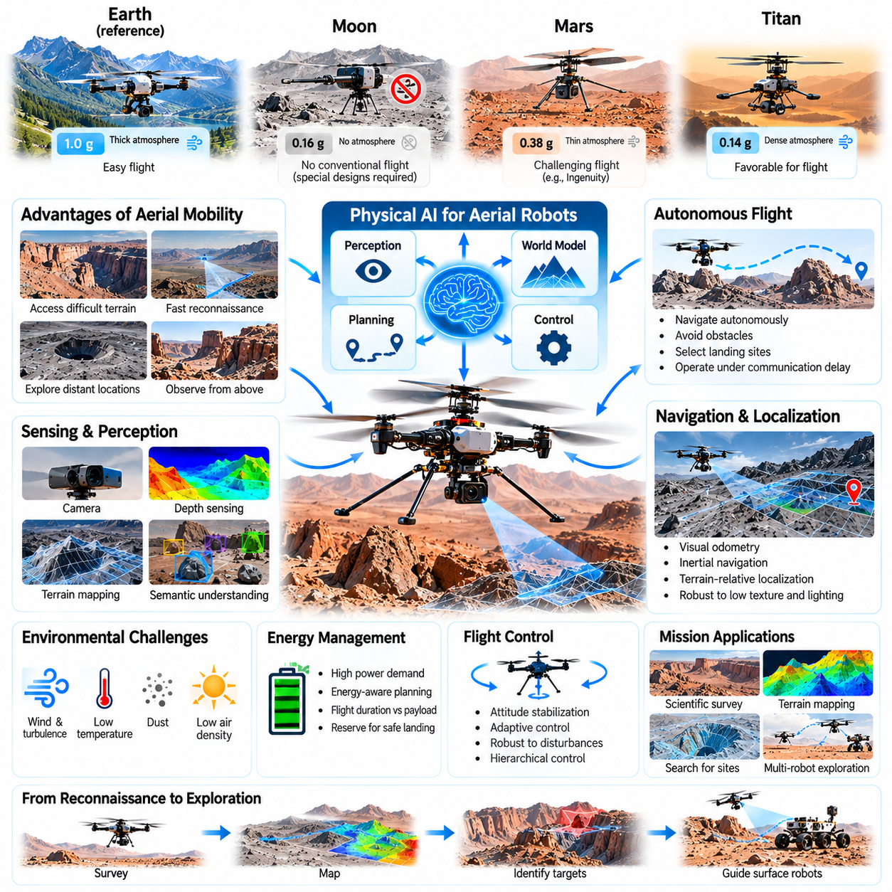{width="7.268055555555556in" height="7.268055555555556in"}

Aerial robots introduce a new dimension to planetary exploration by enabling mobility above terrain that restricts conventional surface vehicles. Flying platforms can investigate cliffs, crater walls, geological formations, and distant locations without requiring continuous ground contact. Physical AI combines autonomous perception, adaptive flight control, environmental modeling, and intelligent mission planning to extend scientific exploration beyond the operational boundaries of wheeled and legged robots.

Planetary flight differs fundamentally from terrestrial aviation because atmospheric density, gravity, temperature, and aerodynamic conditions vary across celestial bodies. Mars possesses a thin atmosphere that makes rotor-generated lift difficult, while Titan offers a dense atmosphere and relatively low gravity. The Moon lacks a substantial atmosphere, preventing conventional aerodynamic flight. Aerial robot designs must therefore reflect the specific physical conditions of each destination.

The successful flights of NASA\'s Ingenuity helicopter on Mars demonstrated that powered, controlled flight is possible in an extremely thin planetary atmosphere. Ingenuity served primarily as a technology demonstrator, establishing important knowledge about autonomous navigation and rotorcraft operation beyond Earth. Future aerial robots may build upon this experience to perform more extensive scientific surveys, reconnaissance missions, and coordinated exploration activities.

Aerial mobility provides advantages in environments where surface traversal is slow, dangerous, or physically impossible. Flying robots can cross steep slopes, fractured terrain, sand fields, and obstacle-filled regions without directly interacting with every surface feature. This capability allows rapid reconnaissance of potential exploration routes and scientific targets, although flight endurance, landing safety, and environmental uncertainty impose significant operational constraints.

Autonomous flight is essential because communication delays prevent continuous remote piloting from Earth. Planetary aerial robots must estimate their motion, maintain stability, avoid obstacles, and execute landing procedures using onboard intelligence. Physical AI can support these capabilities through integrated perception, state estimation, trajectory planning, and adaptive control, enabling aircraft to complete predefined objectives while responding to unexpected environmental conditions.

Planetary aerial navigation generally cannot depend on conventional terrestrial satellite positioning services. Visual odometry, inertial navigation, terrain-relative localization, and optical flow estimation provide alternative methods for determining aircraft motion. These techniques must account for uncertain visual textures, changing illumination, sensor noise, and accumulated estimation errors. Reliable localization becomes especially important when navigating near cliffs or selecting small landing areas.

Three-dimensional environmental perception supports safe flight through unfamiliar planetary landscapes. Cameras, depth estimation, and suitable ranging sensors can identify obstacles, terrain elevation changes, and potential landing surfaces. Physical AI can combine geometric reconstruction with semantic interpretation to distinguish scientific targets from navigation hazards. Such representations support route selection while helping aircraft avoid terrain collisions and unsuitable landing locations.

World models provide a predictive foundation for intelligent planetary flight. By representing atmospheric conditions, vehicle dynamics, terrain geometry, and environmental uncertainty, an aerial robot can estimate the consequences of candidate maneuvers before execution. Action-conditioned prediction supports trajectory evaluation, obstacle avoidance, and landing assessment. These capabilities become particularly valuable when unexpected conditions invalidate assumptions made during preflight planning.

Atmospheric uncertainty represents a major challenge for autonomous aerial systems. Wind velocity, turbulence, pressure, temperature, and atmospheric density influence aerodynamic forces and vehicle stability. Physical AI can integrate onboard measurements with adaptive dynamics models to estimate changing flight conditions. Robust controllers must maintain safe operation despite modeling errors, especially when environmental disturbances approach the aircraft\'s control limits.

Flight control requires coordination between fast stabilization loops and higher-level intelligent planning. Low-level controllers regulate attitude, angular velocity, and propulsion to maintain stable flight. Higher-level systems select routes, manage mission objectives, and respond to environmental observations. Hierarchical architectures allow learned planning components to operate alongside verified flight-control mechanisms, reducing the risk associated with unpredictable autonomous decisions.

Energy limitations strongly influence the design and operation of planetary aerial robots. Generating aerodynamic lift requires substantial power, particularly in thin atmospheres where rotor systems must compensate for low air density. Flight duration, payload mass, propulsion efficiency, and battery capacity must be balanced carefully. Energy-aware planning can determine whether proposed missions leave sufficient reserves for safe landing, communication, and thermal management.

Thermal conditions create additional challenges for planetary aircraft. Extremely low temperatures can reduce battery performance, affect mechanical components, and alter sensor characteristics. Repeated thermal cycling may accelerate material degradation and influence actuator reliability. Physical AI can incorporate temperature measurements and equipment health estimates into operational planning, allowing flight schedules and mission priorities to reflect changing hardware conditions.

Autonomous landing is one of the most safety-critical phases of planetary aerial exploration. Landing zones must provide suitable geometry, acceptable slopes, sufficient clearance, and stable surface conditions. Physical AI can evaluate candidate locations using visual observations, terrain models, and uncertainty estimates. During descent, the aircraft must continuously update its state estimate and adjust its trajectory to accommodate unexpected obstacles or navigation errors.

Scientific reconnaissance is a major potential application of planetary aerial robots. Flying platforms can survey geological boundaries, inspect crater interiors, identify exposed mineral layers, and investigate formations that are inaccessible to surface rovers. High-resolution imagery and other scientific measurements can support the selection of future exploration targets. Intelligent mission planning can prioritize observations according to scientific value, accessibility, and remaining energy.

Aerial robots may also function as reconnaissance partners for planetary rovers. An aircraft can survey terrain ahead of a ground vehicle, identify hazardous routes, and locate promising scientific sites. Shared maps and coordinated mission planning can improve exploration efficiency by combining the aircraft\'s broad spatial coverage with the rover\'s sustained surface operations. Such cooperation requires reliable information exchange and consistent environmental representations.

Planetary exploration may eventually employ multiple aerial robots operating cooperatively. Distributed aircraft could inspect different geological regions, collect complementary measurements, and establish temporary communication relays where appropriate. Multi-agent Physical AI can support task allocation, cooperative mapping, and coordinated resource management. However, limited communication bandwidth, collision risks, and synchronization delays complicate distributed autonomous operations.

Learning-based flight systems offer opportunities to improve adaptability in unfamiliar environments. Simulation-generated experience can expose control policies to variations in atmospheric density, wind, sensor noise, and vehicle parameters. Domain randomization and physics-informed learning may improve robustness across uncertain conditions. Nevertheless, safety-critical deployment requires extensive validation because simulated aerodynamics cannot perfectly reproduce extraterrestrial flight environments.

Long-duration aerial exploration requires persistent environmental memory and adaptive mission management. Aircraft may accumulate terrain maps, atmospheric observations, landing-site assessments, and records of previous flight performance. These data can support future route planning and improve estimates of environmental risk. Continual learning must remain bounded by validated safety constraints to prevent uncontrolled changes in flight behavior.

Hardware-software co-design is essential because planetary aircraft operate under severe mass, power, and reliability constraints. Rotor geometry, propulsion systems, structural materials, sensors, and onboard processors must be selected together with autonomy algorithms. More sophisticated perception and planning can improve adaptability but increase computational demand. Efficient architectures must therefore balance intelligent capability against physical resource limitations.

The scientific potential of planetary aerial robots depends on selecting destinations where flight provides meaningful advantages. Mars offers opportunities for reconnaissance across difficult terrain, while Titan\'s atmospheric conditions may support longer-range aerial scientific exploration. Other planetary environments may require alternative propulsion concepts rather than conventional rotorcraft. Mission architecture must account for environmental feasibility, scientific objectives, and acceptable operational risk.

Ultimately, aerial robots demonstrate how Physical AI can expand planetary exploration from surface-bound movement into autonomous three-dimensional mobility. Their success depends on integrating atmospheric modeling, reliable localization, predictive world models, adaptive flight control, and safety-aware mission planning. As these technologies mature, intelligent aerial platforms may become important components of future robotic exploration systems operating across diverse planetary environments.

항공 로봇(Aerial Robots)은 기존 지상 차량(Surface Vehicles)의 이동을 제한하는 지형 위를 비행할 수 있도록 함으로써 행성 탐사(Planetary Exploration)에 새로운 차원을 도입합니다. 비행 플랫폼(Flying Platforms)은 지속적인 지면 접촉 없이 절벽(Cliffs), 분화구 벽(Crater Walls), 지질 구조(Geological Formations), 원거리 지역(Distant Locations)을 조사할 수 있습니다. 피지컬 AI(Physical AI)는 자율 인식(Autonomous Perception), 적응형 비행 제어(Adaptive Flight Control), 환경 모델링(Environmental Modeling), 지능형 임무 계획(Intelligent Mission Planning)을 결합하여 바퀴형 로봇(Wheeled Robots)과 다족 로봇(Legged Robots)의 운용 범위를 넘어 과학 탐사를 확장합니다.

행성 비행(Planetary Flight)은 천체마다 대기 밀도(Atmospheric Density), 중력(Gravity), 온도(Temperature), 공기역학적 조건(Aerodynamic Conditions)이 다르기 때문에 지구의 항공 비행(Terrestrial Aviation)과 근본적으로 다릅니다. 화성(Mars)은 대기가 희박하여 회전익(Rotor)에 의한 양력(Lift) 발생이 어렵지만, 타이탄(Titan)은 밀도가 높은 대기(Dense Atmosphere)와 상대적으로 낮은 중력(Relatively Low Gravity)을 가지고 있습니다. 달(Moon)은 실질적인 대기가 존재하지 않아 기존의 공기역학적 비행(Conventional Aerodynamic Flight)이 불가능합니다. 따라서 항공 로봇 설계(Aerial Robot Design)는 각 탐사 목적지의 구체적인 물리적 조건을 반영해야 합니다.

미국 항공우주국(NASA)의 인제뉴어티(Ingenuity) 헬리콥터가 화성에서 성공적으로 비행한 것은 극도로 희박한 행성 대기에서도 동력 제어 비행(Powered, Controlled Flight)이 가능하다는 사실을 입증했습니다. 인제뉴어티는 주로 기술 실증기(Technology Demonstrator)로 운용되었으며, 지구 밖에서의 자율 항법(Autonomous Navigation)과 회전익 항공기 운용(Rotorcraft Operation)에 관한 중요한 지식을 확보했습니다. 미래의 항공 로봇은 이러한 경험을 바탕으로 더욱 광범위한 과학 조사(Scientific Surveys), 정찰 임무(Reconnaissance Missions), 협력 탐사 활동(Coordinated Exploration Activities)을 수행할 수 있습니다.

항공 이동성(Aerial Mobility)은 지상 주행(Surface Traversal)이 느리거나 위험하거나 물리적으로 불가능한 환경에서 이점을 제공합니다. 비행 로봇(Flying Robots)은 모든 지표면 특징과 직접 상호작용하지 않고도 급경사(Steep Slopes), 균열 지형(Fractured Terrain), 모래 지대(Sand Fields), 장애물이 많은 지역(Obstacle-Filled Regions)을 통과할 수 있습니다. 이러한 능력은 잠재적인 탐사 경로(Exploration Routes)와 과학적 목표물(Scientific Targets)에 대한 신속한 정찰(Rapid Reconnaissance)을 가능하게 합니다. 그러나 비행 지속 시간(Flight Endurance), 착륙 안전성(Landing Safety), 환경 불확실성(Environmental Uncertainty)은 상당한 운용 제약을 부과합니다.

자율 비행(Autonomous Flight)은 통신 지연(Communication Delays)으로 인해 지구에서 지속적인 원격 조종(Continuous Remote Piloting)이 불가능하므로 필수적입니다. 행성 항공 로봇(Planetary Aerial Robots)은 온보드 지능(Onboard Intelligence)을 사용하여 자신의 움직임을 추정하고, 안정성을 유지하며, 장애물을 회피하고, 착륙 절차(Landing Procedures)를 수행해야 합니다. 피지컬 AI는 통합 인식(Integrated Perception), 상태 추정(State Estimation), 궤적 계획(Trajectory Planning), 적응형 제어(Adaptive Control)를 통해 이러한 기능을 지원하여 예상하지 못한 환경 조건에 대응하면서 사전에 정의된 목표를 달성하도록 합니다.

행성 항공 항법(Planetary Aerial Navigation)은 일반적으로 지구의 기존 위성 위치 결정 서비스(Terrestrial Satellite Positioning Services)에 의존할 수 없습니다. 시각 주행 거리 측정(Visual Odometry), 관성 항법(Inertial Navigation), 지형 상대 위치 추정(Terrain-Relative Localization), 광학 흐름 추정(Optical Flow Estimation)은 항공기의 움직임을 파악하기 위한 대체 방법을 제공합니다. 이러한 기술은 불확실한 시각적 질감(Visual Textures), 변화하는 조명(Changing Illumination), 센서 잡음(Sensor Noise), 누적 추정 오차(Accumulated Estimation Errors)를 고려해야 합니다. 신뢰성 높은 위치 추정(Reliable Localization)은 절벽 근처를 비행하거나 좁은 착륙 지역을 선택할 때 특히 중요합니다.

3차원 환경 인식(Three-Dimensional Environmental Perception)은 낯선 행성 지형에서 안전한 비행을 지원합니다. 카메라(Cameras), 깊이 추정(Depth Estimation), 적절한 거리 측정 센서(Ranging Sensors)는 장애물, 지형 고도 변화(Terrain Elevation Changes), 잠재적인 착륙 표면(Potential Landing Surfaces)을 식별할 수 있습니다. 피지컬 AI는 기하학적 재구성(Geometric Reconstruction)과 의미론적 해석(Semantic Interpretation)을 결합하여 과학적 목표물과 항법 위험 요소(Navigation Hazards)를 구별할 수 있습니다. 이러한 환경 표현(Environmental Representations)은 항공기가 지형 충돌(Terrain Collisions)과 부적합한 착륙 위치를 피하면서 경로를 선택하도록 지원합니다.

월드 모델(World Models)은 지능형 행성 비행(Intelligent Planetary Flight)을 위한 예측 기반(Predictive Foundation)을 제공합니다. 항공 로봇은 대기 조건(Atmospheric Conditions), 차량 동역학(Vehicle Dynamics), 지형 형상(Terrain Geometry), 환경 불확실성(Environmental Uncertainty)을 표현함으로써 후보 기동(Candidate Maneuvers)의 결과를 실행 전에 추정할 수 있습니다. 행동 조건부 예측(Action-Conditioned Prediction)은 궤적 평가(Trajectory Evaluation), 장애물 회피(Obstacle Avoidance), 착륙 평가(Landing Assessment)를 지원합니다. 이러한 능력은 예상하지 못한 조건으로 인해 비행 전 계획(Preflight Planning)의 가정이 더 이상 유효하지 않을 때 특히 중요합니다.

대기 불확실성(Atmospheric Uncertainty)은 자율 항공 시스템(Autonomous Aerial Systems)의 주요 과제입니다. 풍속(Wind Velocity), 난류(Turbulence), 기압(Pressure), 온도(Temperature), 대기 밀도(Atmospheric Density)는 공기역학적 힘(Aerodynamic Forces)과 차량 안정성(Vehicle Stability)에 영향을 미칩니다. 피지컬 AI는 온보드 측정값(Onboard Measurements)을 적응형 동역학 모델(Adaptive Dynamics Models)과 통합하여 변화하는 비행 조건을 추정할 수 있습니다. 강건한 제어기(Robust Controllers)는 특히 환경 교란(Environmental Disturbances)이 항공기의 제어 한계(Control Limits)에 가까워질 때 모델링 오차(Modeling Errors)에도 불구하고 안전한 운용을 유지해야 합니다.

비행 제어(Flight Control)는 빠른 안정화 루프(Fast Stabilization Loops)와 상위 수준의 지능형 계획(Higher-Level Intelligent Planning) 사이의 조정을 요구합니다. 하위 수준 제어기(Low-Level Controllers)는 안정적인 비행을 유지하기 위해 자세(Attitude), 각속도(Angular Velocity), 추진력(Propulsion)을 조절합니다. 상위 수준 시스템(Higher-Level Systems)은 경로를 선택하고, 임무 목표를 관리하며, 환경 관측에 대응합니다. 계층적 아키텍처(Hierarchical Architectures)는 학습 기반 계획 구성요소(Learned Planning Components)가 검증된 비행 제어 메커니즘(Verified Flight-Control Mechanisms)과 함께 작동하도록 하여 예측하기 어려운 자율 의사결정의 위험을 줄일 수 있습니다.

에너지 제약(Energy Limitations)은 행성 항공 로봇의 설계와 운용에 큰 영향을 미칩니다. 공기역학적 양력(Aerodynamic Lift)을 발생시키려면 상당한 전력이 필요하며, 특히 대기가 희박한 환경에서는 회전익 시스템(Rotor Systems)이 낮은 공기 밀도를 보완해야 합니다. 비행 시간(Flight Duration), 탑재체 질량(Payload Mass), 추진 효율(Propulsion Efficiency), 배터리 용량(Battery Capacity) 사이의 균형을 신중하게 조정해야 합니다. 에너지 인식 계획(Energy-Aware Planning)은 제안된 임무가 안전한 착륙, 통신, 열 관리(Thermal Management)에 필요한 충분한 에너지 잔량을 확보하는지 판단할 수 있습니다.

열적 조건(Thermal Conditions)은 행성 항공기에 추가적인 문제를 발생시킵니다. 극도로 낮은 온도(Extremely Low Temperatures)는 배터리 성능(Battery Performance)을 저하시키고, 기계 부품(Mechanical Components)에 영향을 미치며, 센서 특성(Sensor Characteristics)을 변화시킬 수 있습니다. 반복적인 열 순환(Thermal Cycling)은 재료 열화(Material Degradation)를 가속하고 액추에이터 신뢰성(Actuator Reliability)에 영향을 줄 수 있습니다. 피지컬 AI는 온도 측정값(Temperature Measurements)과 장비 상태 추정(Equipment Health Estimates)을 운용 계획(Operational Planning)에 반영하여 변화하는 하드웨어 상태에 따라 비행 일정과 임무 우선순위를 조정할 수 있습니다.

자율 착륙(Autonomous Landing)은 행성 항공 탐사에서 안전이 가장 중요한 단계 중 하나입니다. 착륙 구역(Landing Zones)은 적절한 지형 형상(Suitable Geometry), 허용 가능한 경사(Acceptable Slopes), 충분한 여유 공간(Sufficient Clearance), 안정적인 표면 조건(Stable Surface Conditions)을 제공해야 합니다. 피지컬 AI는 시각 관측(Visual Observations), 지형 모델(Terrain Models), 불확실성 추정(Uncertainty Estimates)을 사용하여 후보 착륙 위치를 평가할 수 있습니다. 하강(Descent) 중 항공기는 상태 추정값(State Estimate)을 지속적으로 갱신하고 예상하지 못한 장애물이나 항법 오차(Navigation Errors)에 대응하도록 궤적을 조정해야 합니다.

과학적 정찰(Scientific Reconnaissance)은 행성 항공 로봇의 주요 잠재적 응용 분야입니다. 비행 플랫폼은 지질학적 경계(Geological Boundaries)를 조사하고, 분화구 내부(Crater Interiors)를 검사하며, 노출된 광물층(Exposed Mineral Layers)을 식별하고, 지상 로버가 접근할 수 없는 지형 구조를 탐색할 수 있습니다. 고해상도 영상(High-Resolution Imagery)과 기타 과학적 측정값(Scientific Measurements)은 향후 탐사 목표를 선정하는 데 활용될 수 있습니다. 지능형 임무 계획(Intelligent Mission Planning)은 과학적 가치(Scientific Value), 접근성(Accessibility), 잔여 에너지(Remaining Energy)에 따라 관측 우선순위를 결정할 수 있습니다.

항공 로봇은 행성 로버(Planetary Rovers)의 정찰 협력체(Reconnaissance Partners)로도 기능할 수 있습니다. 항공기는 지상 차량(Ground Vehicle)의 전방 지형을 조사하고, 위험한 경로를 식별하며, 유망한 과학 탐사 지점을 찾을 수 있습니다. 공유 지도(Shared Maps)와 협력적 임무 계획(Coordinated Mission Planning)은 항공기의 넓은 공간적 탐사 범위(Broad Spatial Coverage)와 로버의 지속적인 지상 운용(Sustained Surface Operations)을 결합하여 탐사 효율성을 향상할 수 있습니다. 이러한 협력에는 신뢰성 높은 정보 교환(Reliable Information Exchange)과 일관된 환경 표현(Consistent Environmental Representations)이 필요합니다.

행성 탐사에서는 궁극적으로 여러 항공 로봇이 협력하여 운용되는 방식이 도입될 수 있습니다. 분산 항공기(Distributed Aircraft)는 서로 다른 지질 지역을 조사하고, 상호 보완적인 측정값(Complementary Measurements)을 수집하며, 적절한 경우 임시 통신 중계기(Temporary Communication Relays)를 구축할 수 있습니다. 다중 에이전트 피지컬 AI(Multi-Agent Physical AI)는 작업 할당(Task Allocation), 협력 지도 작성(Cooperative Mapping), 조정된 자원 관리(Coordinated Resource Management)를 지원할 수 있습니다. 그러나 제한된 통신 대역폭(Communication Bandwidth), 충돌 위험(Collision Risks), 동기화 지연(Synchronization Delays)은 분산 자율 운용(Distributed Autonomous Operations)을 복잡하게 만듭니다.

학습 기반 비행 시스템(Learning-Based Flight Systems)은 낯선 환경에서 적응성(Adaptability)을 향상할 기회를 제공합니다. 시뮬레이션 생성 경험(Simulation-Generated Experience)은 제어 정책(Control Policies)이 대기 밀도, 바람, 센서 잡음, 차량 매개변수(Vehicle Parameters)의 다양한 변화에 노출되도록 할 수 있습니다. 도메인 무작위화(Domain Randomization)와 물리 정보 기반 학습(Physics-Informed Learning)은 불확실한 조건에서 강건성(Robustness)을 향상할 수 있습니다. 그러나 시뮬레이션된 공기역학(Simulated Aerodynamics)이 외계 비행 환경(Extraterrestrial Flight Environments)을 완벽하게 재현할 수는 없으므로 안전 필수 시스템 배치(Safety-Critical Deployment)에는 광범위한 검증(Extensive Validation)이 필요합니다.

장기간 항공 탐사(Long-Duration Aerial Exploration)에는 지속적 환경 메모리(Persistent Environmental Memory)와 적응형 임무 관리(Adaptive Mission Management)가 필요합니다. 항공기는 지형 지도(Terrain Maps), 대기 관측값(Atmospheric Observations), 착륙 지점 평가(Landing-Site Assessments), 이전 비행 성능 기록(Previous Flight Performance Records)을 축적할 수 있습니다. 이러한 데이터는 향후 경로 계획을 지원하고 환경 위험(Environmental Risk)에 대한 추정 정확도를 향상할 수 있습니다. 지속 학습(Continual Learning)은 비행 거동이 통제되지 않은 방식으로 변화하는 것을 방지하기 위해 검증된 안전 제약(Validated Safety Constraints) 내에서 수행되어야 합니다.

하드웨어-소프트웨어 공동 설계(Hardware-Software Co-Design)는 행성 항공기가 엄격한 질량, 전력, 신뢰성 제약(Mass, Power, and Reliability Constraints) 아래에서 작동하므로 필수적입니다. 회전익 형상(Rotor Geometry), 추진 시스템(Propulsion Systems), 구조 재료(Structural Materials), 센서(Sensors), 온보드 프로세서(Onboard Processors)는 자율성 알고리즘(Autonomy Algorithms)과 함께 선정되어야 합니다. 더욱 정교한 인식과 계획은 적응성을 향상하지만 연산 요구량(Computational Demand)을 증가시킵니다. 따라서 효율적인 아키텍처(Efficient Architectures)는 지능형 기능(Intelligent Capability)과 물리적 자원 제약(Physical Resource Limitations) 사이의 균형을 유지해야 합니다.

행성 항공 로봇의 과학적 잠재력(Scientific Potential)은 비행이 실질적인 이점을 제공하는 탐사 목적지를 선택하는 데 달려 있습니다. 화성(Mars)은 험난한 지형을 가로지르는 정찰 기회를 제공하며, 타이탄(Titan)의 대기 조건은 장거리 항공 과학 탐사(Longer-Range Aerial Scientific Exploration)를 지원할 수 있습니다. 다른 행성 환경에서는 기존 회전익 항공기(Conventional Rotorcraft) 대신 대체 추진 개념(Alternative Propulsion Concepts)이 필요할 수 있습니다. 임무 아키텍처(Mission Architecture)는 환경적 실현 가능성(Environmental Feasibility), 과학적 목표(Scientific Objectives), 허용 가능한 운용 위험(Acceptable Operational Risk)을 고려해야 합니다.

궁극적으로 항공 로봇(Aerial Robots)은 피지컬 AI가 행성 탐사를 지표면에 제한된 이동(Surface-Bound Movement)에서 자율적인 3차원 이동성(Autonomous Three-Dimensional Mobility)으로 확장할 수 있음을 보여줍니다. 이러한 시스템의 성공은 대기 모델링(Atmospheric Modeling), 신뢰성 높은 위치 추정(Reliable Localization), 예측형 월드 모델(Predictive World Models), 적응형 비행 제어(Adaptive Flight Control), 안전 인식 임무 계획(Safety-Aware Mission Planning)의 통합에 달려 있습니다. 이러한 기술이 성숙함에 따라 지능형 항공 플랫폼(Intelligent Aerial Platforms)은 다양한 행성 환경에서 운용되는 미래 로봇 탐사 시스템(Future Robotic Exploration Systems)의 중요한 구성요소가 될 수 있을 것입니다.

##  

## 04.06. Autonomous Manipulation and Scientific Sampling

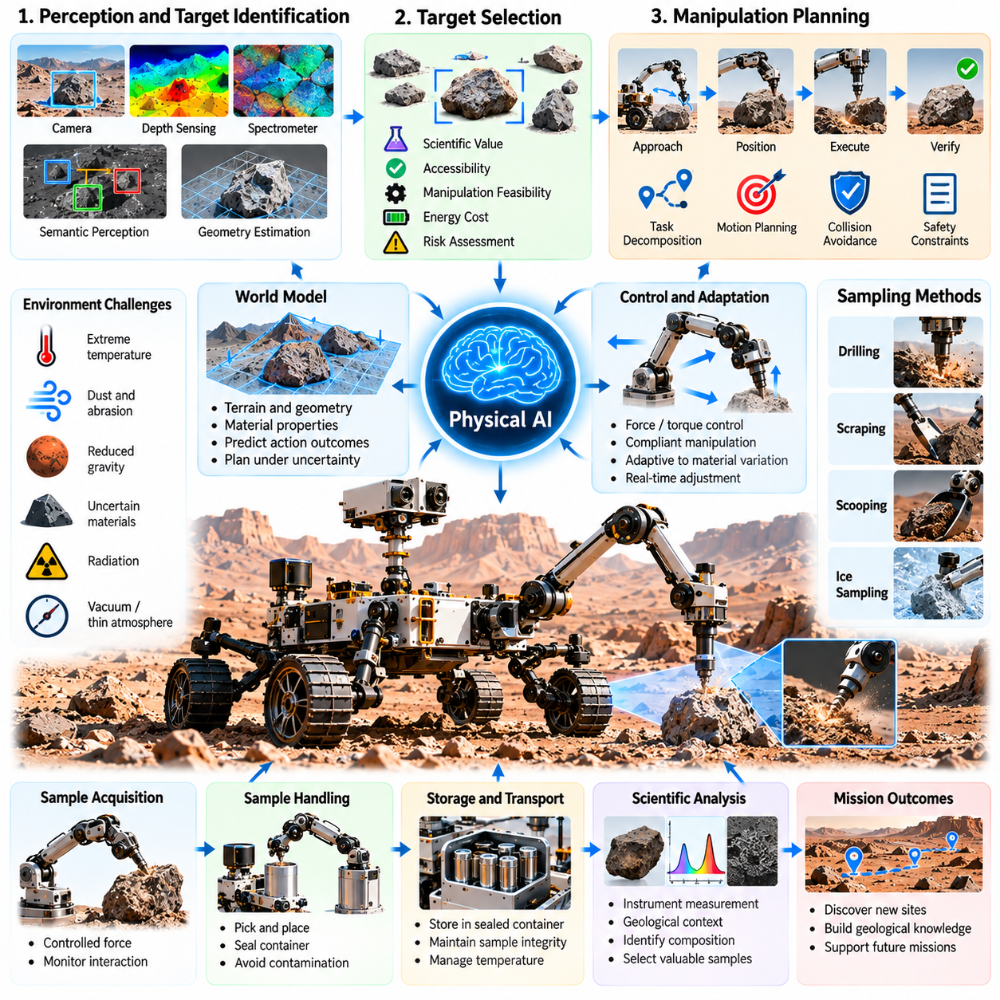{width="7.268055555555556in" height="7.268055555555556in"}

Autonomous manipulation and scientific sampling are essential capabilities for transforming planetary robots from mobile observation platforms into active scientific investigators. Beyond navigating unfamiliar terrain, robots must physically interact with rocks, soil, ice, and geological structures to obtain meaningful measurements. Physical AI integrates perception, manipulation planning, force control, and environmental reasoning to perform these operations with limited human supervision.

Scientific sampling involves more than collecting material from a planetary surface. A robotic system must identify scientifically valuable targets, determine appropriate sampling methods, and preserve the integrity of collected specimens. Geological context, material composition, accessibility, and contamination risks influence every decision. Intelligent autonomy can connect scientific objectives with physical manipulation capabilities to improve sampling effectiveness.

Planetary manipulation differs from terrestrial robotics because environmental conditions are poorly understood and difficult to reproduce. Reduced gravity, abrasive dust, extreme temperatures, vacuum exposure, and uncertain material properties affect robotic interactions. Manipulators must operate reliably despite variations in contact forces, surface resistance, and mechanical behavior. Physical AI can adapt control strategies using observations collected during each interaction.

Perception provides the foundation for autonomous scientific manipulation. Cameras, depth sensors, spectrometers, and other scientific instruments can identify candidate targets and estimate their geometry, orientation, and surface characteristics. Semantic perception helps distinguish rocks, regolith, exposed layers, and potential sampling locations. Combining geometric and scientific observations allows a robot to select targets that are both accessible and scientifically relevant.

Target selection requires reasoning about scientific value and operational feasibility. A mineral-rich formation may provide valuable information but remain difficult to reach or mechanically unstable. Physical AI can evaluate candidate targets according to expected scientific benefit, manipulation difficulty, energy requirements, and potential equipment damage. Such decisions help allocate limited mission resources toward observations with the greatest expected value.

Robotic arms provide a primary mechanism for interacting with planetary environments. Their joints and end effectors enable positioning, grasping, drilling, scraping, and instrument placement. Successful manipulation requires accurate kinematic models, collision avoidance, and coordination with the rover platform. Autonomous systems must also account for structural flexibility, joint limitations, and uncertainty in the relative position of tools and targets.

Manipulation planning connects high-level scientific instructions with executable physical actions. A command to collect a rock sample may require approaching the target, positioning the manipulator, selecting a contact location, applying controlled force, and securing the specimen. Hierarchical planning decomposes these activities into coordinated stages while maintaining awareness of safety constraints, equipment limitations, and mission priorities.

Contact-rich manipulation introduces challenges that cannot be resolved through geometric planning alone. Drilling, scraping, cutting, and gripping involve forces that depend on material stiffness, friction, tool geometry, and interaction speed. Force and torque measurements can reveal unexpected resistance or unstable contact. Physical AI can combine these signals with predictive models to adjust manipulation behavior and reduce the risk of tool damage.

Compliant control is particularly important when interacting with uncertain geological materials. Excessively rigid motion can damage instruments, fracture specimens, or destabilize the robotic platform. Impedance control and force-regulated manipulation allow a robot to respond to contact forces while maintaining desired task behavior. Adaptive controllers can modify interaction parameters as the mechanical characteristics of a target become better understood.

Scientific drilling requires careful coordination of positioning, rotational motion, axial force, and material removal. Different geological formations may produce substantial variations in drilling resistance and tool wear. Autonomous monitoring can detect abnormal vibration, excessive torque, or insufficient penetration. Physical AI may use these observations to adjust drilling parameters, interrupt unsafe operations, or recommend alternative sampling locations.

Regolith and loose-material sampling present different mechanical challenges. Granular materials can flow, compact, adhere to tools, or escape collection containers depending on particle properties and local gravity. Scooping and excavation mechanisms must account for uncertain material behavior and incomplete collection. Learning-based models and contact feedback can help estimate collected quantities and improve the reliability of repeated sampling operations.

Ice sampling introduces additional considerations involving temperature, phase transitions, and contamination control. Subsurface ice may be scientifically valuable because it can preserve information about planetary environmental history. However, extraction procedures can alter fragile samples through heating, mechanical disturbance, or exposure. Intelligent manipulation planning must coordinate tool operation, thermal conditions, and sample preservation requirements.

Sample handling and transfer are critical stages following material acquisition. Collected specimens may need to be deposited into containers, sealed, transported internally, or delivered to analytical instruments. Each transfer introduces risks of material loss, contamination, and mechanical failure. Autonomous verification can use sensor observations and actuator feedback to confirm successful placement before advancing to subsequent scientific procedures.

Contamination prevention is fundamental to trustworthy planetary science. Materials introduced by spacecraft components, previous samples, or sampling equipment can compromise scientific interpretation. Physical AI can support contamination-aware workflows by tracking tool usage, sample histories, and contact events. Nevertheless, reliable contamination control also depends on hardware cleanliness, material selection, validated procedures, and mission-specific planetary protection requirements.

World models can improve autonomous manipulation by representing both environmental structure and the predicted consequences of physical actions. An action-conditioned model may estimate whether a grasp will remain stable, whether drilling will encounter excessive resistance, or whether excavation will disturb nearby material. Such predictions support safer action selection, although uncertainty must be explicitly considered when the robot encounters unfamiliar substances.

Scientific manipulation benefits from closed-loop execution rather than fixed action sequences. A robot can observe the result of each movement, compare it with the intended outcome, and revise subsequent actions. This perception-action feedback loop enables correction of positioning errors, unexpected contact behavior, and incomplete sampling. Physical AI extends this process through learned predictions and task-level reasoning that connect local adjustments with scientific goals.

Long communication delays make onboard manipulation autonomy particularly important. Operators on Earth cannot continuously supervise every contact event or intervene immediately when unexpected resistance occurs. Robots must recognize abnormal conditions, execute bounded recovery actions, and enter safe states when necessary. Human scientists can define objectives and operational constraints while onboard intelligence manages detailed execution within approved limits.

Scientific sampling also requires uncertainty-aware decision-making. A robot may have incomplete knowledge of material composition, target stability, tool condition, or sample quality. Probabilistic estimates can help distinguish actions that are likely to succeed from those requiring additional observation. Active perception allows the system to reposition instruments or perform preliminary measurements before committing to irreversible sampling operations.

Multi-instrument coordination can increase the scientific value of autonomous manipulation. Imaging systems may identify targets, spectrometers may estimate composition, and robotic tools may expose fresh surfaces or collect specimens. Physical AI can organize these activities into adaptive workflows in which each measurement informs subsequent actions. This integration transforms isolated instrument operations into a coherent process of scientific investigation.

Simulation and digital twins provide important development environments for planetary manipulation systems. Physics-based models can reproduce robotic kinematics, contact forces, tool interactions, and representative geological materials. Domain randomization can expose learning algorithms to variations in friction, stiffness, geometry, and sensor noise. However, simulated material behavior remains imperfect, making hardware testing and conservative validation essential.

Long-duration missions require manipulation systems to monitor equipment health and preserve operational capability. Joint wear, actuator degradation, tool damage, and sensor drift can reduce precision over time. Health-aware planning can adjust motion limits, select alternative tools, or reduce contact loads according to estimated component condition. Persistent operational memory can record previous interactions and support more reliable decisions during future sampling activities.

Ultimately, autonomous manipulation and scientific sampling demonstrate how Physical AI can connect intelligent reasoning with direct physical investigation of extraterrestrial environments. Reliable operation requires the integration of perception, world models, contact dynamics, compliant control, scientific planning, and fault management. As these capabilities mature, planetary robots may perform increasingly complex experiments and collect higher-quality scientific evidence with reduced dependence on immediate human intervention.

자율 조작(Autonomous Manipulation)과 과학적 시료 채취(Scientific Sampling)는 행성 로봇(Planetary Robots)을 이동형 관측 플랫폼(Mobile Observation Platforms)에서 능동적인 과학 탐사 시스템(Active Scientific Investigators)으로 발전시키기 위한 필수 능력입니다. 로봇은 낯선 지형을 이동하는 것을 넘어 암석(Rocks), 토양(Soil), 얼음(Ice), 지질 구조(Geological Structures)와 물리적으로 상호작용하여 의미 있는 측정값을 확보해야 합니다. 피지컬 AI(Physical AI)는 인식(Perception), 조작 계획(Manipulation Planning), 힘 제어(Force Control), 환경 추론(Environmental Reasoning)을 통합하여 제한적인 인간 감독 아래에서 이러한 작업을 수행하도록 지원합니다.

과학적 시료 채취(Scientific Sampling)는 단순히 행성 표면에서 물질을 수집하는 것 이상의 과정을 포함합니다. 로봇 시스템(Robotic System)은 과학적으로 가치 있는 목표물을 식별하고, 적절한 시료 채취 방법(Sampling Methods)을 결정하며, 수집된 시료의 무결성(Sample Integrity)을 보존해야 합니다. 지질학적 맥락(Geological Context), 물질 조성(Material Composition), 접근성(Accessibility), 오염 위험(Contamination Risks)은 모든 의사결정에 영향을 미칩니다. 지능형 자율성(Intelligent Autonomy)은 과학적 목표(Scientific Objectives)와 물리적 조작 능력(Physical Manipulation Capabilities)을 연결하여 시료 채취의 효과를 향상할 수 있습니다.

행성 환경에서의 조작(Planetary Manipulation)은 환경 조건을 충분히 이해하기 어렵고 지구에서 재현하기도 어렵기 때문에 지상 로봇공학(Terrestrial Robotics)과 차이가 있습니다. 낮은 중력(Reduced Gravity), 마모성 먼지(Abrasive Dust), 극한 온도(Extreme Temperatures), 진공 노출(Vacuum Exposure), 불확실한 물질 특성(Uncertain Material Properties)은 로봇의 물리적 상호작용에 영향을 미칩니다. 매니퓰레이터(Manipulators)는 접촉력(Contact Forces), 표면 저항(Surface Resistance), 기계적 거동(Mechanical Behavior)이 변화하더라도 신뢰성 있게 작동해야 합니다. 피지컬 AI는 각 상호작용 과정에서 수집된 관측 정보를 활용하여 제어 전략(Control Strategies)을 적응적으로 조정할 수 있습니다.

인식(Perception)은 자율 과학 조작(Autonomous Scientific Manipulation)의 기반을 제공합니다. 카메라(Cameras), 깊이 센서(Depth Sensors), 분광계(Spectrometers), 기타 과학 계측 장비(Scientific Instruments)는 후보 목표물을 식별하고 형상(Geometry), 방향(Orientation), 표면 특성(Surface Characteristics)을 추정할 수 있습니다. 의미론적 인식(Semantic Perception)은 암석, 표토(Regolith), 노출 지층(Exposed Layers), 잠재적인 시료 채취 위치(Potential Sampling Locations)를 구별하는 데 도움이 됩니다. 기하학적 관측(Geometric Observations)과 과학적 관측(Scientific Observations)을 결합하면 접근 가능하면서도 과학적으로 의미 있는 목표물을 선택할 수 있습니다.

목표물 선정(Target Selection)에는 과학적 가치(Scientific Value)와 운용 실현 가능성(Operational Feasibility)에 대한 추론이 필요합니다. 광물이 풍부한 지질 구조(Mineral-Rich Formation)는 가치 있는 정보를 제공할 수 있지만 접근하기 어렵거나 기계적으로 불안정할 수 있습니다. 피지컬 AI는 예상 과학적 이익(Expected Scientific Benefit), 조작 난이도(Manipulation Difficulty), 에너지 요구량(Energy Requirements), 잠재적인 장비 손상(Potential Equipment Damage)을 기준으로 후보 목표물을 평가할 수 있습니다. 이러한 의사결정은 제한된 임무 자원(Mission Resources)을 가장 높은 기대 가치를 가진 관측 활동에 배분하도록 지원합니다.

로봇 팔(Robotic Arms)은 행성 환경과 상호작용하기 위한 주요 기계적 수단입니다. 관절(Joints)과 말단 효과기(End Effectors)를 통해 위치 조정(Positioning), 파지(Grasping), 드릴링(Drilling), 긁어내기(Scraping), 계측 장비 배치(Instrument Placement)를 수행할 수 있습니다. 성공적인 조작을 위해서는 정확한 운동학 모델(Kinematic Models), 충돌 회피(Collision Avoidance), 로버 플랫폼(Rover Platform)과의 협조가 필요합니다. 자율 시스템(Autonomous Systems)은 구조적 유연성(Structural Flexibility), 관절 제한(Joint Limitations), 도구와 목표물 사이의 상대 위치 불확실성(Relative Position Uncertainty)도 고려해야 합니다.

조작 계획(Manipulation Planning)은 상위 수준의 과학적 지시(High-Level Scientific Instructions)를 실행 가능한 물리적 행동(Executable Physical Actions)으로 연결합니다. 암석 시료를 수집하라는 명령에는 목표물 접근, 매니퓰레이터 위치 조정, 접촉 위치 선정, 제어된 힘의 적용, 시료 확보 등의 과정이 포함될 수 있습니다. 계층적 계획(Hierarchical Planning)은 안전 제약(Safety Constraints), 장비 한계(Equipment Limitations), 임무 우선순위(Mission Priorities)를 지속적으로 고려하면서 이러한 활동을 조정된 단계(Coordinated Stages)로 분해합니다.

접촉 중심 조작(Contact-Rich Manipulation)은 기하학적 계획(Geometric Planning)만으로 해결할 수 없는 문제를 발생시킵니다. 드릴링(Drilling), 긁어내기(Scraping), 절단(Cutting), 파지(Gripping)는 물질 강성(Material Stiffness), 마찰(Friction), 도구 형상(Tool Geometry), 상호작용 속도(Interaction Speed)에 따라 달라지는 힘을 수반합니다. 힘 및 토크 측정(Force and Torque Measurements)은 예상하지 못한 저항이나 불안정한 접촉을 드러낼 수 있습니다. 피지컬 AI는 이러한 신호를 예측 모델(Predictive Models)과 결합하여 조작 동작을 조정하고 도구 손상 위험을 줄일 수 있습니다.

유연 제어(Compliant Control)는 불확실한 지질 물질(Uncertain Geological Materials)과 상호작용할 때 특히 중요합니다. 지나치게 강성이 높은 운동(Excessively Rigid Motion)은 계측 장비를 손상시키거나 시료를 파괴하거나 로봇 플랫폼을 불안정하게 만들 수 있습니다. 임피던스 제어(Impedance Control)와 힘 조절 조작(Force-Regulated Manipulation)은 원하는 작업 동작을 유지하면서 접촉력에 대응하도록 합니다. 적응형 제어기(Adaptive Controllers)는 목표물의 기계적 특성(Mechanical Characteristics)에 대한 이해가 향상됨에 따라 상호작용 매개변수(Interaction Parameters)를 조정할 수 있습니다.

과학적 드릴링(Scientific Drilling)은 위치 조정(Positioning), 회전 운동(Rotational Motion), 축방향 힘(Axial Force), 물질 제거(Material Removal)의 정밀한 협조를 요구합니다. 서로 다른 지질 구조(Geological Formations)는 드릴링 저항(Drilling Resistance)과 도구 마모(Tool Wear)에 상당한 차이를 발생시킬 수 있습니다. 자율 모니터링(Autonomous Monitoring)은 비정상적인 진동(Abnormal Vibration), 과도한 토크(Excessive Torque), 불충분한 관입(Insufficient Penetration)을 탐지할 수 있습니다. 피지컬 AI는 이러한 관측을 활용하여 드릴링 매개변수(Drilling Parameters)를 조정하고, 안전하지 않은 작업을 중단하거나, 대체 시료 채취 위치를 제안할 수 있습니다.

표토(Regolith)와 느슨한 물질(Loose Materials)의 시료 채취는 서로 다른 기계적 문제를 제시합니다. 입상 물질(Granular Materials)은 입자 특성(Particle Properties)과 국소 중력(Local Gravity)에 따라 흐르거나, 압축되거나, 도구에 부착되거나, 수집 용기(Collection Containers) 밖으로 빠져나갈 수 있습니다. 퍼내기(Scooping)와 굴착 메커니즘(Excavation Mechanisms)은 불확실한 물질 거동(Material Behavior)과 불완전한 수집(Incomplete Collection)을 고려해야 합니다. 학습 기반 모델(Learning-Based Models)과 접촉 피드백(Contact Feedback)은 수집량을 추정하고 반복적인 시료 채취 작업의 신뢰성을 향상하는 데 도움이 될 수 있습니다.

얼음 시료 채취(Ice Sampling)는 온도(Temperature), 상전이(Phase Transitions), 오염 제어(Contamination Control)에 관한 추가적인 고려사항을 포함합니다. 지하 얼음(Subsurface Ice)은 행성 환경의 역사(Planetary Environmental History)에 관한 정보를 보존할 수 있으므로 과학적으로 가치가 높습니다. 그러나 추출 과정(Extraction Procedures)은 가열(Heating), 기계적 교란(Mechanical Disturbance), 외부 노출(Exposure)을 통해 취약한 시료(Fragile Samples)를 변형시킬 수 있습니다. 지능형 조작 계획(Intelligent Manipulation Planning)은 도구 작동(Tool Operation), 열적 조건(Thermal Conditions), 시료 보존 요구사항(Sample Preservation Requirements)을 함께 조정해야 합니다.

시료 취급(Sample Handling)과 이송(Sample Transfer)은 물질 획득 이후의 핵심 단계입니다. 수집된 시료는 용기에 투입되거나, 밀봉되거나, 로봇 내부에서 운송되거나, 분석 장비(Analytical Instruments)로 전달되어야 할 수 있습니다. 각 이송 단계에는 물질 손실(Material Loss), 오염(Contamination), 기계적 고장(Mechanical Failure)의 위험이 존재합니다. 자율 검증(Autonomous Verification)은 센서 관측(Sensor Observations)과 액추에이터 피드백(Actuator Feedback)을 활용하여 다음 과학 절차로 진행하기 전에 시료가 성공적으로 배치되었는지 확인할 수 있습니다.

오염 방지(Contamination Prevention)는 신뢰할 수 있는 행성 과학(Planetary Science)의 기본 조건입니다. 우주선 구성요소(Spacecraft Components), 이전 시료(Previous Samples), 시료 채취 장비(Sampling Equipment)에서 유입된 물질은 과학적 해석(Scientific Interpretation)의 신뢰성을 훼손할 수 있습니다. 피지컬 AI는 도구 사용 이력(Tool Usage), 시료 이력(Sample Histories), 접촉 사건(Contact Events)을 추적하여 오염 인식 작업 흐름(Contamination-Aware Workflows)을 지원할 수 있습니다. 그러나 신뢰성 높은 오염 제어는 하드웨어 청정도(Hardware Cleanliness), 재료 선정(Material Selection), 검증된 절차(Validated Procedures), 임무별 행성 보호 요구사항(Planetary Protection Requirements)에도 의존합니다.

월드 모델(World Models)은 환경 구조(Environmental Structure)와 물리적 행동의 예측 결과(Predicted Consequences)를 함께 표현하여 자율 조작(Autonomous Manipulation)을 향상할 수 있습니다. 행동 조건부 모델(Action-Conditioned Model)은 파지가 안정적으로 유지될지, 드릴링 중 과도한 저항이 발생할지, 굴착이 주변 물질을 교란할지를 추정할 수 있습니다. 이러한 예측은 더욱 안전한 행동 선택(Action Selection)을 지원하지만, 로봇이 익숙하지 않은 물질을 접할 때는 불확실성(Uncertainty)을 명시적으로 고려해야 합니다.

과학적 조작(Scientific Manipulation)은 고정된 행동 시퀀스(Fixed Action Sequences)보다 폐루프 실행(Closed-Loop Execution)을 통해 더 큰 효과를 얻을 수 있습니다. 로봇은 각 동작의 결과를 관측하고, 의도한 결과(Intended Outcome)와 비교하며, 후속 행동을 수정할 수 있습니다. 이러한 인식-행동 피드백 루프(Perception-Action Feedback Loop)는 위치 오차(Positioning Errors), 예상하지 못한 접촉 거동(Unexpected Contact Behavior), 불완전한 시료 채취(Incomplete Sampling)를 보정하도록 합니다. 피지컬 AI는 학습된 예측(Learned Predictions)과 작업 수준 추론(Task-Level Reasoning)을 통해 국소적인 조정을 과학적 목표와 연결함으로써 이 과정을 확장합니다.

긴 통신 지연(Long Communication Delays)은 온보드 조작 자율성(Onboard Manipulation Autonomy)을 특히 중요하게 만듭니다. 지구의 운영자(Operators)는 모든 접촉 사건을 지속적으로 감독하거나 예상하지 못한 저항이 발생했을 때 즉시 개입할 수 없습니다. 로봇은 비정상적인 조건(Abnormal Conditions)을 인식하고, 제한된 복구 행동(Bounded Recovery Actions)을 실행하며, 필요한 경우 안전 상태(Safe States)로 전환해야 합니다. 인간 과학자(Human Scientists)는 목표와 운용 제약(Operational Constraints)을 정의하고, 온보드 지능(Onboard Intelligence)은 승인된 한계 내에서 세부 실행을 관리할 수 있습니다.

과학적 시료 채취에는 불확실성 인식 의사결정(Uncertainty-Aware Decision-Making)도 필요합니다. 로봇은 물질 조성(Material Composition), 목표물 안정성(Target Stability), 도구 상태(Tool Condition), 시료 품질(Sample Quality)에 관한 불완전한 지식을 가지고 있을 수 있습니다. 확률적 추정(Probabilistic Estimates)은 성공 가능성이 높은 행동과 추가 관측이 필요한 행동을 구별하는 데 도움이 됩니다. 능동 인식(Active Perception)은 되돌릴 수 없는 시료 채취 작업(Irreversible Sampling Operations)을 수행하기 전에 계측 장비의 위치를 조정하거나 예비 측정(Preliminary Measurements)을 수행하도록 합니다.

다중 계측 장비 협조(Multi-Instrument Coordination)는 자율 조작의 과학적 가치를 높일 수 있습니다. 영상 시스템(Imaging Systems)은 목표물을 식별하고, 분광계(Spectrometers)는 조성을 추정하며, 로봇 도구(Robotic Tools)는 새로운 표면을 노출하거나 시료를 수집할 수 있습니다. 피지컬 AI는 각 측정 결과가 후속 행동에 영향을 미치는 적응형 작업 흐름(Adaptive Workflows)으로 이러한 활동을 구성할 수 있습니다. 이러한 통합은 개별적인 계측 장비 운용(Isolated Instrument Operations)을 일관된 과학적 조사 과정(Coherent Process of Scientific Investigation)으로 전환합니다.

시뮬레이션(Simulation)과 디지털 트윈(Digital Twins)은 행성 조작 시스템(Planetary Manipulation Systems)을 개발하기 위한 중요한 환경을 제공합니다. 물리 기반 모델(Physics-Based Models)은 로봇 운동학(Robotic Kinematics), 접촉력(Contact Forces), 도구 상호작용(Tool Interactions), 대표적인 지질 물질(Representative Geological Materials)을 재현할 수 있습니다. 도메인 무작위화(Domain Randomization)는 학습 알고리즘(Learning Algorithms)이 마찰(Friction), 강성(Stiffness), 형상(Geometry), 센서 잡음(Sensor Noise)의 다양한 변화에 노출되도록 할 수 있습니다. 그러나 시뮬레이션된 물질 거동(Simulated Material Behavior)은 여전히 불완전하므로 하드웨어 시험(Hardware Testing)과 보수적인 검증(Conservative Validation)이 필수적입니다.

장기간 임무(Long-Duration Missions)에서는 조작 시스템이 장비 상태(Equipment Health)를 모니터링하고 운용 능력(Operational Capability)을 보존해야 합니다. 관절 마모(Joint Wear), 액추에이터 성능 저하(Actuator Degradation), 도구 손상(Tool Damage), 센서 드리프트(Sensor Drift)는 시간이 지남에 따라 정밀도를 저하시킬 수 있습니다. 상태 인식 계획(Health-Aware Planning)은 추정된 부품 상태(Component Condition)에 따라 운동 한계(Motion Limits)를 조정하고, 대체 도구(Alternative Tools)를 선택하거나, 접촉 하중(Contact Loads)을 줄일 수 있습니다. 지속적 운용 메모리(Persistent Operational Memory)는 이전 상호작용을 기록하여 향후 시료 채취 활동에서 더욱 신뢰성 높은 의사결정을 지원할 수 있습니다.

궁극적으로 자율 조작(Autonomous Manipulation)과 과학적 시료 채취(Scientific Sampling)는 피지컬 AI가 지능형 추론(Intelligent Reasoning)을 외계 환경(Extraterrestrial Environments)에 대한 직접적인 물리적 조사(Direct Physical Investigation)와 연결할 수 있음을 보여줍니다. 신뢰성 높은 운용을 위해서는 인식(Perception), 월드 모델(World Models), 접촉 동역학(Contact Dynamics), 유연 제어(Compliant Control), 과학적 계획(Scientific Planning), 고장 관리(Fault Management)의 통합이 필요합니다. 이러한 능력이 성숙함에 따라 행성 로봇은 인간의 즉각적인 개입에 대한 의존도를 줄이면서 점점 더 복잡한 실험을 수행하고 더 높은 품질의 과학적 증거(Scientific Evidence)를 수집할 수 있을 것입니다.

##  

## 04.07. Robot Construction and In Situ Infrastructure

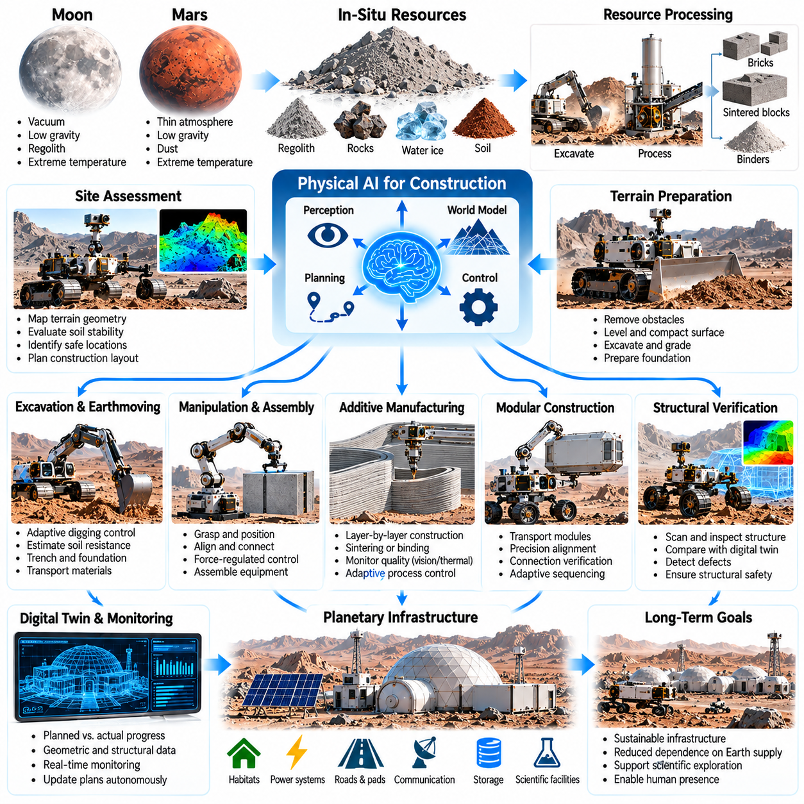{width="7.268055555555556in" height="7.268055555555556in"}

Robotic construction is a fundamental capability for establishing sustainable infrastructure beyond Earth. Lunar and Martian missions will require landing platforms, protective shelters, transportation routes, and scientific facilities that cannot all be transported fully assembled from Earth. Physical AI enables construction robots to perceive unfamiliar terrain, manipulate local materials, coordinate equipment, and execute complex building operations with limited human intervention.

In-situ infrastructure development seeks to reduce dependence on Earth-supplied construction materials and equipment. Transporting large structural components across interplanetary distances creates substantial mass, cost, and logistical constraints. Autonomous construction systems can potentially transform locally available regolith, rocks, and processed resources into useful infrastructure. This approach connects robotic intelligence with planetary resource utilization and long-term settlement planning.

Planetary construction differs significantly from terrestrial building operations because gravity, atmospheric conditions, temperature, and material behavior vary across environments. Lunar vacuum and abrasive regolith introduce challenges involving dust contamination, thermal management, and equipment durability. Martian construction must account for atmospheric dust, uncertain soil mechanics, and extreme environmental conditions. Robots must adapt construction procedures to these physical constraints.

Site assessment represents the first stage of autonomous infrastructure development. Construction robots must evaluate terrain slope, surface roughness, soil bearing capacity, geological stability, and accessibility before selecting suitable locations. Cameras, depth sensors, and geotechnical measurements can support this process. Physical AI can combine environmental observations with predictive models to identify sites that balance structural suitability and operational feasibility.

Terrain preparation is necessary before many planetary structures can be installed or assembled. Robots may need to remove obstacles, level surfaces, compact loose material, and establish stable foundations. These operations require coordinated perception, excavation, grading, and force control. Autonomous systems must continuously evaluate changes in terrain geometry and material resistance to ensure that preparation activities produce the intended physical conditions.

Regolith-based construction offers a potential pathway toward using local planetary materials. Regolith may serve as shielding, fill material, compacted structural layers, or feedstock for processed building components. Techniques such as sintering, additive manufacturing, and material binding have been investigated for extraterrestrial construction. Their practical feasibility depends on local material composition, energy availability, equipment reliability, and structural performance.

Robotic additive manufacturing could support the production of selected infrastructure components directly at planetary sites. Layer-by-layer deposition or consolidation processes may create walls, protective structures, or specialized construction elements. Physical AI can monitor material delivery, geometric accuracy, process temperature, and layer integrity. Closed-loop process control is important because variations in feedstock and environmental conditions can affect construction quality.

Autonomous excavation and earthmoving are essential for foundations, protective berms, trenches, and transportation corridors. Excavation forces depend on soil density, cohesion, friction, and tool geometry, which may be uncertain before operations begin. Physical AI can estimate material resistance from actuator feedback and observed excavation results. Adaptive planning can modify digging depth, tool trajectories, and material transport strategies to improve productivity.

Construction manipulators must handle objects that vary considerably in size, mass, geometry, and mechanical properties. Tasks may include positioning structural elements, connecting modular components, installing equipment, and assembling scientific facilities. Accurate manipulation requires coordinated perception, grasp planning, force regulation, and collision avoidance. Mobile manipulation systems must also account for vehicle stability when handling heavy or extended payloads.

Modular construction can simplify the development of planetary infrastructure by dividing complex facilities into standardized components. Robots may transport, position, align, and connect modules according to predefined assembly plans. Physical AI can support alignment correction, connection verification, and adaptive sequencing when actual conditions differ from design assumptions. Standardized interfaces may reduce manipulation complexity and improve maintainability.

World models provide an important foundation for autonomous construction planning. A construction robot must represent terrain geometry, material locations, equipment states, structural progress, and potential hazards. Action-conditioned models can predict how excavation, material placement, or component assembly will alter the environment. These predictions allow construction plans to be evaluated before execution and updated as physical conditions change.

Digital twins can connect planned infrastructure designs with observed construction progress. A digital representation may contain geometric specifications, structural requirements, equipment configurations, and operational constraints. Robots can compare sensor measurements with expected construction states to detect deviations. Physical AI can use these differences to revise task sequences, request additional inspection, or initiate bounded corrective actions.

Structural verification is essential because construction errors in extraterrestrial environments may be difficult to repair. Robots must assess dimensional accuracy, alignment, foundation stability, connection quality, and material consistency. Cameras, force sensors, and suitable inspection instruments can provide evidence of construction quality. However, autonomous inspection cannot replace validated engineering standards and mission-specific structural qualification procedures.

Multi-robot construction systems could distribute tasks among specialized machines. Excavators may prepare terrain, transport robots may deliver materials, manipulators may assemble components, and inspection robots may verify completed work. Shared maps and coordinated scheduling can improve efficiency while reducing interference between machines. Physical AI must manage resource conflicts, communication limitations, and dependencies between construction activities.

Communication delays make local construction autonomy particularly important for lunar and Martian operations. Remote operators cannot always respond immediately to unexpected terrain behavior, equipment faults, or assembly difficulties. Construction robots must execute approved tasks, detect abnormal conditions, and recover safely within defined operational boundaries. Human engineers can supervise overall objectives while onboard systems manage detailed physical execution.

Energy management is a major constraint on autonomous planetary construction. Excavation, material processing, lifting, transportation, and additive manufacturing can require substantial power. Construction schedules must account for available generation capacity, storage reserves, thermal conditions, and equipment priorities. Physical AI can coordinate energy-intensive operations to reduce peak demand and preserve essential power for communication, safety, and environmental protection.

Infrastructure construction must also consider the long-term effects of dust and material movement. Excavation and transportation may redistribute abrasive particles that interfere with mechanical joints, optical sensors, thermal surfaces, and nearby equipment. Intelligent planning can establish restricted zones, select lower-disturbance procedures, and monitor contamination risks. Environmental management therefore becomes an integral part of construction autonomy.

Protective infrastructure may be especially important for sustained human and robotic presence. Regolith shielding, covered storage areas, equipment enclosures, and appropriately engineered shelters could reduce exposure to radiation, micrometeoroids, and thermal extremes. Autonomous construction robots may assist with material placement and protective structure assembly. The required protection levels must be established through validated environmental and structural analysis.

Transportation infrastructure can improve the efficiency of repeated operations across planetary surfaces. Prepared routes, graded pathways, stable loading areas, and designated equipment zones may reduce mobility risks and mechanical wear. Physical AI can identify frequently traveled corridors and prioritize improvements according to mission demand. Infrastructure planning can therefore connect short-term construction activities with long-term logistics and resource distribution.

Maintenance and repair are necessary because planetary infrastructure will experience mechanical degradation, environmental exposure, and changing operational requirements. Robots may inspect structures, replace damaged modules, restore protective layers, or reconfigure facilities. Persistent world memory can record construction histories, inspection results, and previous repairs. This information supports predictive maintenance and more reliable infrastructure management over extended missions.

The development of autonomous construction requires extensive simulation and physical validation. Digital environments can reproduce representative terrain, material handling, assembly sequences, and multi-robot coordination. Domain randomization can expose learning systems to uncertainty in soil properties, component tolerances, and equipment performance. Nevertheless, experimental verification remains essential because simulated construction processes cannot fully capture extraterrestrial material behavior.

Ultimately, robotic construction and in-situ infrastructure demonstrate how Physical AI can evolve from exploration-oriented autonomy toward the creation and maintenance of persistent off-world facilities. Success requires integrating environmental perception, world models, manipulation, construction planning, quality verification, and resource management. As these capabilities mature, autonomous robots may become essential partners in building sustainable scientific and industrial infrastructure beyond Earth.

로봇 건설(Robotic Construction)은 지구 밖에서 지속 가능한 인프라(Sustainable Infrastructure)를 구축하기 위한 핵심 역량입니다. 달과 화성 탐사 임무(Lunar and Martian Missions)에는 착륙 플랫폼(Landing Platforms), 보호 시설(Protective Shelters), 운송 경로(Transportation Routes), 과학 시설(Scientific Facilities)이 필요하며, 이러한 시설을 모두 지구에서 완전히 조립된 상태로 운송할 수는 없습니다. 피지컬 AI(Physical AI)는 건설 로봇(Construction Robots)이 낯선 지형을 인식하고, 현지 자재를 조작하며, 장비를 조정하고, 제한적인 인간 개입으로 복잡한 건설 작업을 수행하도록 지원합니다.

현지 인프라 개발(In-Situ Infrastructure Development)은 지구에서 공급되는 건설 자재(Construction Materials)와 장비(Equipment)에 대한 의존도를 줄이는 것을 목표로 합니다. 대형 구조 부품(Large Structural Components)을 행성 간 거리(Interplanetary Distances)로 운송하는 과정에는 상당한 질량, 비용, 물류 제약(Mass, Cost, and Logistical Constraints)이 발생합니다. 자율 건설 시스템(Autonomous Construction Systems)은 현지에서 확보할 수 있는 표토(Regolith), 암석(Rocks), 가공된 자원(Processed Resources)을 유용한 인프라로 전환할 수 있습니다. 이러한 접근 방식은 로봇 지능(Robotic Intelligence)을 행성 자원 활용(Planetary Resource Utilization) 및 장기 정착 계획(Long-Term Settlement Planning)과 연결합니다.

행성 건설(Planetary Construction)은 중력(Gravity), 대기 조건(Atmospheric Conditions), 온도(Temperature), 재료 거동(Material Behavior)이 환경에 따라 달라지므로 지구의 건설 작업(Terrestrial Building Operations)과 상당한 차이가 있습니다. 달의 진공 환경(Lunar Vacuum)과 마모성 표토(Abrasive Regolith)는 먼지 오염(Dust Contamination), 열 관리(Thermal Management), 장비 내구성(Equipment Durability)에 관한 문제를 발생시킵니다. 화성 건설(Martian Construction)에서는 대기 중 먼지(Atmospheric Dust), 불확실한 토양 역학(Uncertain Soil Mechanics), 극한 환경 조건(Extreme Environmental Conditions)을 고려해야 합니다. 로봇은 이러한 물리적 제약에 맞게 건설 절차를 조정해야 합니다.

부지 평가(Site Assessment)는 자율 인프라 개발(Autonomous Infrastructure Development)의 첫 번째 단계입니다. 건설 로봇은 적합한 위치를 선정하기 전에 지형 경사(Terrain Slope), 표면 거칠기(Surface Roughness), 토양 지지력(Soil Bearing Capacity), 지질학적 안정성(Geological Stability), 접근성(Accessibility)을 평가해야 합니다. 카메라(Cameras), 깊이 센서(Depth Sensors), 지반공학적 측정(Geotechnical Measurements)은 이러한 과정을 지원할 수 있습니다. 피지컬 AI는 환경 관측(Environmental Observations)과 예측 모델(Predictive Models)을 결합하여 구조적 적합성(Structural Suitability)과 운용 실현 가능성(Operational Feasibility) 사이의 균형을 유지하는 부지를 식별할 수 있습니다.

지형 정비(Terrain Preparation)는 많은 행성 구조물을 설치하거나 조립하기 전에 필요합니다. 로봇은 장애물을 제거하고, 표면을 평탄화하며, 느슨한 재료를 다지고, 안정적인 기초(Stable Foundations)를 구축해야 할 수 있습니다. 이러한 작업에는 인식(Perception), 굴착(Excavation), 정지 작업(Grading), 힘 제어(Force Control)의 협조가 필요합니다. 자율 시스템(Autonomous Systems)은 정비 작업이 의도한 물리적 조건을 만들어 내는지 확인하기 위해 지형 형상(Terrain Geometry)과 재료 저항(Material Resistance)의 변화를 지속적으로 평가해야 합니다.

표토 기반 건설(Regolith-Based Construction)은 현지 행성 재료(Local Planetary Materials)를 활용하기 위한 잠재적인 방법을 제공합니다. 표토(Regolith)는 차폐재(Shielding), 충전재(Fill Material), 다짐 구조층(Compacted Structural Layers), 가공 건축 부품(Processed Building Components)의 원료(Feedstock)로 사용될 수 있습니다. 소결(Sintering), 적층 제조(Additive Manufacturing), 재료 결합(Material Binding)과 같은 기술이 외계 건설(Extraterrestrial Construction)을 위해 연구되어 왔습니다. 이러한 기술의 실제 실현 가능성(Practical Feasibility)은 현지 재료 조성(Local Material Composition), 에너지 가용성(Energy Availability), 장비 신뢰성(Equipment Reliability), 구조 성능(Structural Performance)에 달려 있습니다.

로봇 적층 제조(Robotic Additive Manufacturing)는 행성 현장에서 특정 인프라 부품을 직접 생산하도록 지원할 수 있습니다. 층별 적층(Layer-by-Layer Deposition) 또는 고결 공정(Consolidation Processes)을 통해 벽체(Walls), 보호 구조물(Protective Structures), 특수 건설 요소(Specialized Construction Elements)를 제작할 수 있습니다. 피지컬 AI는 재료 공급(Material Delivery), 기하학적 정확도(Geometric Accuracy), 공정 온도(Process Temperature), 층 무결성(Layer Integrity)을 모니터링할 수 있습니다. 원료 특성과 환경 조건의 변화가 건설 품질(Construction Quality)에 영향을 미칠 수 있으므로 폐루프 공정 제어(Closed-Loop Process Control)가 중요합니다.

자율 굴착(Autonomous Excavation)과 토공 작업(Earthmoving)은 기초(Foundations), 보호 둔덕(Protective Berms), 도랑(Trenches), 운송 통로(Transportation Corridors)를 구축하는 데 필수적입니다. 굴착력(Excavation Forces)은 토양 밀도(Soil Density), 점착력(Cohesion), 마찰(Friction), 도구 형상(Tool Geometry)에 따라 달라지며, 이러한 특성은 작업 전에 불확실할 수 있습니다. 피지컬 AI는 액추에이터 피드백(Actuator Feedback)과 관측된 굴착 결과(Observed Excavation Results)를 통해 재료 저항을 추정할 수 있습니다. 적응형 계획(Adaptive Planning)은 생산성을 향상하기 위해 굴착 깊이(Digging Depth), 도구 궤적(Tool Trajectories), 재료 운송 전략(Material Transport Strategies)을 수정할 수 있습니다.

건설용 매니퓰레이터(Construction Manipulators)는 크기, 질량, 형상, 기계적 특성이 크게 다른 물체를 취급해야 합니다. 작업에는 구조 부재(Structural Elements)의 위치 조정, 모듈형 부품(Modular Components)의 연결, 장비 설치(Equipment Installation), 과학 시설 조립(Scientific Facility Assembly)이 포함될 수 있습니다. 정확한 조작(Accurate Manipulation)을 위해서는 인식(Perception), 파지 계획(Grasp Planning), 힘 조절(Force Regulation), 충돌 회피(Collision Avoidance)의 협조가 필요합니다. 이동형 조작 시스템(Mobile Manipulation Systems)은 무겁거나 길게 돌출된 탑재물(Payloads)을 취급할 때 차량 안정성(Vehicle Stability)도 고려해야 합니다.

모듈형 건설(Modular Construction)은 복잡한 시설을 표준화된 구성요소(Standardized Components)로 나누어 행성 인프라 개발을 단순화할 수 있습니다. 로봇은 사전에 정의된 조립 계획(Assembly Plans)에 따라 모듈을 운송하고, 배치하고, 정렬하고, 연결할 수 있습니다. 피지컬 AI는 실제 조건이 설계 가정(Design Assumptions)과 다를 때 정렬 보정(Alignment Correction), 연결 검증(Connection Verification), 적응형 작업 순서 조정(Adaptive Sequencing)을 지원할 수 있습니다. 표준화된 인터페이스(Standardized Interfaces)는 조작 복잡성(Manipulation Complexity)을 줄이고 유지보수성(Maintainability)을 향상할 수 있습니다.

월드 모델(World Models)은 자율 건설 계획(Autonomous Construction Planning)을 위한 중요한 기반을 제공합니다. 건설 로봇은 지형 형상(Terrain Geometry), 재료 위치(Material Locations), 장비 상태(Equipment States), 구조물 시공 진행 상태(Structural Progress), 잠재적 위험(Potential Hazards)을 표현해야 합니다. 행동 조건부 모델(Action-Conditioned Models)은 굴착, 재료 배치, 부품 조립이 환경을 어떻게 변화시킬지 예측할 수 있습니다. 이러한 예측을 통해 건설 계획을 실행 전에 평가하고 실제 물리적 조건이 변화함에 따라 갱신할 수 있습니다.

디지털 트윈(Digital Twins)은 계획된 인프라 설계(Planned Infrastructure Designs)와 관측된 건설 진행 상태(Observed Construction Progress)를 연결할 수 있습니다. 디지털 표현(Digital Representation)에는 기하학적 사양(Geometric Specifications), 구조 요구사항(Structural Requirements), 장비 구성(Equipment Configurations), 운용 제약(Operational Constraints)이 포함될 수 있습니다. 로봇은 센서 측정값(Sensor Measurements)을 예상 건설 상태(Expected Construction States)와 비교하여 편차(Deviations)를 탐지할 수 있습니다. 피지컬 AI는 이러한 차이를 활용하여 작업 순서를 수정하고, 추가 검사를 요청하거나, 제한된 범위의 시정 조치(Bounded Corrective Actions)를 시작할 수 있습니다.

구조 검증(Structural Verification)은 외계 환경에서 건설 오류(Construction Errors)를 수리하기 어려울 수 있으므로 필수적입니다. 로봇은 치수 정확도(Dimensional Accuracy), 정렬 상태(Alignment), 기초 안정성(Foundation Stability), 연결 품질(Connection Quality), 재료 균일성(Material Consistency)을 평가해야 합니다. 카메라(Cameras), 힘 센서(Force Sensors), 적절한 검사 장비(Inspection Instruments)는 건설 품질에 관한 증거를 제공할 수 있습니다. 그러나 자율 검사(Autonomous Inspection)가 검증된 공학 표준(Validated Engineering Standards)과 임무별 구조 적격성 검증 절차(Mission-Specific Structural Qualification Procedures)를 대체할 수는 없습니다.

다중 로봇 건설 시스템(Multi-Robot Construction Systems)은 전문화된 기계들 사이에 작업을 분배할 수 있습니다. 굴착 로봇(Excavators)은 지형을 정비하고, 운송 로봇(Transport Robots)은 자재를 공급하며, 매니퓰레이터(Manipulators)는 부품을 조립하고, 검사 로봇(Inspection Robots)은 완료된 작업을 검증할 수 있습니다. 공유 지도(Shared Maps)와 협력적 일정 계획(Coordinated Scheduling)은 로봇 간 간섭을 줄이면서 효율성을 향상할 수 있습니다. 피지컬 AI는 자원 충돌(Resource Conflicts), 통신 제약(Communication Limitations), 건설 활동 사이의 작업 의존성(Task Dependencies)을 관리해야 합니다.

통신 지연(Communication Delays)은 달과 화성의 건설 작업에서 현지 자율성(Local Construction Autonomy)을 특히 중요하게 만듭니다. 원격 운영자(Remote Operators)는 예상하지 못한 지형 거동(Terrain Behavior), 장비 고장(Equipment Faults), 조립 문제(Assembly Difficulties)에 항상 즉시 대응할 수는 없습니다. 건설 로봇은 승인된 작업(Approved Tasks)을 실행하고, 비정상적인 조건(Abnormal Conditions)을 탐지하며, 정의된 운용 범위(Operational Boundaries) 내에서 안전하게 복구해야 합니다. 인간 엔지니어(Human Engineers)는 전체 목표를 감독하고, 온보드 시스템(Onboard Systems)은 세부적인 물리적 실행을 관리할 수 있습니다.

에너지 관리(Energy Management)는 자율 행성 건설(Autonomous Planetary Construction)의 주요 제약 조건입니다. 굴착(Excavation), 재료 가공(Material Processing), 인양(Lifting), 운송(Transportation), 적층 제조(Additive Manufacturing)는 상당한 전력을 요구할 수 있습니다. 건설 일정(Construction Schedules)은 가용 발전 용량(Available Generation Capacity), 에너지 저장 잔량(Storage Reserves), 열적 조건(Thermal Conditions), 장비 우선순위(Equipment Priorities)를 고려해야 합니다. 피지컬 AI는 에너지 집약적 작업(Energy-Intensive Operations)을 조정하여 최대 전력 수요(Peak Demand)를 줄이고 통신, 안전, 환경 보호에 필요한 필수 전력을 보존할 수 있습니다.

인프라 건설에서는 먼지와 재료 이동(Material Movement)의 장기적인 영향도 고려해야 합니다. 굴착과 운송은 마모성 입자(Abrasive Particles)를 재분산시켜 기계 관절(Mechanical Joints), 광학 센서(Optical Sensors), 열 제어 표면(Thermal Surfaces), 주변 장비(Nearby Equipment)의 작동을 방해할 수 있습니다. 지능형 계획(Intelligent Planning)은 제한 구역(Restricted Zones)을 설정하고, 교란이 적은 작업 절차(Lower-Disturbance Procedures)를 선택하며, 오염 위험(Contamination Risks)을 모니터링할 수 있습니다. 따라서 환경 관리(Environmental Management)는 건설 자율성(Construction Autonomy)의 필수적인 구성요소가 됩니다.

보호 인프라(Protective Infrastructure)는 인간과 로봇이 지속적으로 활동하기 위해 특히 중요할 수 있습니다. 표토 차폐(Regolith Shielding), 덮개가 있는 저장 공간(Covered Storage Areas), 장비 보호함(Equipment Enclosures), 적절하게 설계된 대피 시설(Engineered Shelters)은 방사선(Radiation), 미세운석(Micrometeoroids), 극한 온도(Thermal Extremes)에 대한 노출을 줄일 수 있습니다. 자율 건설 로봇은 재료 배치(Material Placement)와 보호 구조물 조립(Protective Structure Assembly)을 지원할 수 있습니다. 필요한 보호 수준(Protection Levels)은 검증된 환경 분석(Environmental Analysis)과 구조 분석(Structural Analysis)을 통해 결정해야 합니다.

운송 인프라(Transportation Infrastructure)는 행성 표면에서 반복적으로 수행되는 작업의 효율성을 향상할 수 있습니다. 정비된 경로(Prepared Routes), 평탄화된 통행로(Graded Pathways), 안정적인 적재 구역(Stable Loading Areas), 지정된 장비 구역(Designated Equipment Zones)은 이동 위험(Mobility Risks)과 기계적 마모(Mechanical Wear)를 줄일 수 있습니다. 피지컬 AI는 자주 이용되는 이동 통로(Frequently Traveled Corridors)를 식별하고 임무 수요(Mission Demand)에 따라 개선 우선순위를 결정할 수 있습니다. 따라서 인프라 계획(Infrastructure Planning)은 단기 건설 활동(Short-Term Construction Activities)을 장기 물류(Long-Term Logistics) 및 자원 분배(Resource Distribution)와 연결할 수 있습니다.

유지보수(Maintenance)와 수리(Repair)는 행성 인프라가 기계적 성능 저하(Mechanical Degradation), 환경 노출(Environmental Exposure), 변화하는 운용 요구사항(Changing Operational Requirements)을 겪기 때문에 필요합니다. 로봇은 구조물을 검사하고, 손상된 모듈(Damaged Modules)을 교체하며, 보호층(Protective Layers)을 복원하거나, 시설을 재구성할 수 있습니다. 지속적 월드 메모리(Persistent World Memory)는 건설 이력(Construction Histories), 검사 결과(Inspection Results), 이전 수리 기록(Previous Repairs)을 저장할 수 있습니다. 이러한 정보는 예측 유지보수(Predictive Maintenance)와 장기간에 걸친 더욱 신뢰성 높은 인프라 관리(Infrastructure Management)를 지원합니다.

자율 건설(Autonomous Construction)의 발전에는 광범위한 시뮬레이션(Simulation)과 물리적 검증(Physical Validation)이 필요합니다. 디지털 환경(Digital Environments)은 대표적인 지형(Representative Terrain), 자재 취급(Material Handling), 조립 순서(Assembly Sequences), 다중 로봇 협조(Multi-Robot Coordination)를 재현할 수 있습니다. 도메인 무작위화(Domain Randomization)는 학습 시스템(Learning Systems)을 토양 특성(Soil Properties), 부품 공차(Component Tolerances), 장비 성능(Equipment Performance)의 불확실성에 노출할 수 있습니다. 그러나 시뮬레이션된 건설 공정(Simulated Construction Processes)이 외계 재료 거동(Extraterrestrial Material Behavior)을 완전히 재현할 수는 없으므로 실험적 검증(Experimental Verification)은 여전히 필수적입니다.

궁극적으로 로봇 건설(Robotic Construction)과 현지 인프라(In-Situ Infrastructure)는 피지컬 AI가 탐사 중심 자율성(Exploration-Oriented Autonomy)에서 지구 밖의 지속적 시설(Persistent Off-World Facilities)을 구축하고 유지하는 능력으로 발전할 수 있음을 보여줍니다. 성공을 위해서는 환경 인식(Environmental Perception), 월드 모델(World Models), 조작(Manipulation), 건설 계획(Construction Planning), 품질 검증(Quality Verification), 자원 관리(Resource Management)의 통합이 필요합니다. 이러한 역량이 성숙함에 따라 자율 로봇(Autonomous Robots)은 지구 밖에서 지속 가능한 과학 및 산업 인프라(Sustainable Scientific and Industrial Infrastructure)를 구축하는 데 필수적인 협력자가 될 수 있을 것입니다.

##  

## 04.08. Autonomous Mining and Resource Utilization

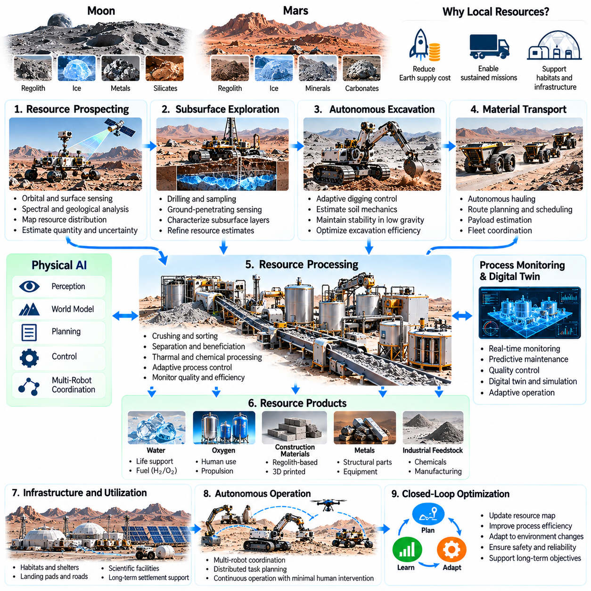{width="7.268055555555556in" height="7.268055555555556in"}

Autonomous mining and resource utilization are essential for extending planetary exploration beyond short-duration missions toward sustained operations. Transporting water, oxygen, construction materials, and industrial feedstocks from Earth imposes substantial logistical costs. Physical AI enables robotic systems to identify local resources, excavate geological materials, manage processing equipment, and coordinate production activities under limited human supervision.

In-situ resource utilization transforms locally available materials into products needed for exploration and infrastructure. Lunar regolith, Martian soil, subsurface ice, and selected mineral deposits may provide useful feedstocks for different processes. However, resource availability does not automatically imply practical recoverability. Autonomous systems must evaluate material concentration, extraction difficulty, energy requirements, and processing efficiency before selecting production strategies.

Resource prospecting begins with the identification and characterization of potentially valuable deposits. Orbital observations, surface imagery, spectroscopy, and geophysical measurements can provide complementary information about geological composition. Physical AI can integrate these observations into spatial resource maps that estimate material distribution and uncertainty. Such maps guide exploration toward locations where extraction is scientifically and economically justified.

Subsurface resources introduce challenges because their properties cannot be determined reliably from surface appearance alone. Ice deposits, buried mineral layers, and heterogeneous regolith may vary substantially across short distances. Autonomous prospecting robots can combine drilling, sampling, ground-penetrating measurements, and geological inference to refine resource estimates. Adaptive exploration planning prioritizes measurements that reduce uncertainty about recoverable material.

Autonomous excavation is a foundational operation in planetary mining. Robotic excavators must penetrate, loosen, collect, and transport materials while maintaining vehicle stability and mechanical reliability. Excavation forces depend on soil cohesion, friction, particle distribution, and tool geometry. Physical AI can use force feedback and observed material movement to adjust digging trajectories, cutting depth, and excavation speed according to local conditions.

Planetary gravity changes the mechanics of excavation and material handling. Reduced gravitational loading can decrease available traction and alter the balance between digging resistance and vehicle stability. Excavation reactions may displace lightweight robots instead of moving the intended material. Intelligent control must coordinate anchoring, contact forces, and equipment motion to maintain stability while achieving useful production rates.

Material transportation connects excavation sites with processing facilities, storage systems, and construction areas. Autonomous hauling robots must navigate uncertain terrain while carrying loads that change vehicle dynamics and energy consumption. Physical AI can coordinate route planning, payload estimation, traffic management, and delivery scheduling. Reliable transportation becomes increasingly important as mining operations expand across distributed resource deposits.

Water extraction is a particularly valuable objective for future lunar and Martian infrastructure. Water may support human consumption, life-support processes, scientific experiments, and production of hydrogen and oxygen. Extracting ice-bearing materials may require excavation, heating, vapor capture, and purification. Autonomous systems must coordinate these operations while accounting for uncertain ice concentration, thermal losses, and equipment degradation.

Oxygen production represents another important application of local resource processing. Oxygen may be extracted from suitable atmospheric constituents or oxygen-bearing minerals through processes appropriate to the planetary environment. Such systems require carefully controlled chemical, thermal, and electrical operations. Physical AI can monitor process conditions, detect abnormal behavior, and optimize equipment scheduling while maintaining validated safety limits.

Local material processing may also support construction and manufacturing. Regolith-derived aggregates, selected metals, and processed mineral compounds could become feedstocks for structural components or specialized equipment. Autonomous processing systems must manage crushing, sorting, separation, heating, and material transfer. Their effectiveness depends on resource composition, process maturity, available power, and the quality requirements of the final products.

Resource beneficiation improves processing efficiency by separating useful constituents from unwanted material before intensive treatment. Mechanical screening, particle classification, magnetic separation, and other techniques may be suitable for particular deposits. Physical AI can monitor material characteristics and adjust processing parameters according to changing feedstock conditions. Adaptive beneficiation may reduce energy consumption and improve downstream production consistency.

World models provide a unified representation of mining environments, equipment states, and material flows. A robotic mining system must track resource locations, excavation progress, storage inventories, vehicle positions, and processing capacity. Action-conditioned models can predict how extraction decisions affect terrain stability, production rates, and resource availability. Such predictive reasoning supports coordinated planning across interconnected mining operations.

Digital twins can connect physical mining equipment with continuously updated operational models. Sensor observations may describe excavator performance, processing temperatures, material throughput, energy consumption, and component health. Comparing expected and observed behavior helps identify inefficiencies or developing faults. Physical AI can use these discrepancies to revise production schedules and recommend bounded corrective actions.

Multi-robot coordination is likely to become important for sustained resource extraction. Prospecting robots may identify deposits, excavators may collect material, transport platforms may deliver feedstocks, and processing robots may manage production equipment. Shared maps and task allocation can reduce idle time and improve utilization. However, communication limitations, equipment dependencies, and conflicting resource demands complicate coordinated operations.

Energy management is a central constraint because mining and material processing can be highly energy-intensive. Excavation, crushing, heating, electrolysis, and transportation may compete for limited electrical power. Physical AI can schedule operations according to generation capacity, storage reserves, thermal conditions, and mission priorities. Production planning must preserve sufficient energy for essential safety systems, communications, and equipment protection.

Autonomous mining must also address equipment durability in abrasive and unfamiliar environments. Dust infiltration, repeated impacts, tool wear, and thermal cycling can degrade mechanical components and sensors. Predictive maintenance systems can estimate remaining component life from vibration, torque, temperature, and operational history. Health-aware planning may reduce excavation loads, redistribute tasks, or schedule repairs before critical failures occur.

Environmental disturbance requires careful consideration even in locations without established ecosystems. Excavation may alter terrain stability, redistribute dust, contaminate scientific sites, or interfere with nearby infrastructure. Autonomous planning can establish exclusion zones and monitor material movement. Responsible resource utilization must also respect planetary protection requirements, scientific preservation priorities, and applicable governance frameworks.

Long communication delays increase the need for local operational autonomy. Earth-based operators cannot continuously control excavation tools or respond immediately to processing abnormalities on Mars. Physical AI must support autonomous fault detection, safe shutdown, bounded recovery, and mission-level replanning. Human supervisors can define production targets and acceptable risks while robotic systems manage detailed execution within approved operational constraints.

Production efficiency must be evaluated across the complete resource utilization chain rather than individual machines. A high excavation rate provides limited benefit if transportation, processing, or storage becomes a bottleneck. Physical AI can coordinate throughput, equipment availability, material quality, and energy consumption across the system. Integrated optimization helps align resource production with the actual needs of exploration and infrastructure development.

Economic feasibility depends on more than the technical ability to extract materials. Equipment mass, launch costs, energy infrastructure, maintenance requirements, production reliability, and resource demand influence overall value. Autonomous systems may reduce operational labor and improve equipment utilization, but complex hardware introduces additional costs. Resource utilization strategies should therefore be assessed through realistic mission-level tradeoffs.

Long-duration mining operations require persistent environmental memory and adaptive resource planning. Robots can accumulate information about deposit quality, excavation resistance, equipment performance, and processing yields. Updated resource models may reveal better extraction locations or indicate that existing sites are becoming less productive. Continual improvement should remain subject to validated operational limits and periodic scientific review.

Ultimately, autonomous mining and resource utilization demonstrate how Physical AI can transform planetary robots from exploration tools into components of sustained extraterrestrial production systems. Their success depends on integrating resource perception, physical manipulation, world models, process control, fleet coordination, and safety-aware optimization. These capabilities may eventually support more independent scientific bases, industrial facilities, and long-term human activities beyond Earth.

자율 채굴(Autonomous Mining)과 자원 활용(Resource Utilization)은 행성 탐사(Planetary Exploration)를 단기 임무(Short-Duration Missions)에서 지속적인 운영(Sustained Operations)으로 확장하기 위한 필수적인 역량입니다. 물(Water), 산소(Oxygen), 건설 자재(Construction Materials), 산업용 원료(Industrial Feedstocks)를 지구에서 운송하는 데에는 상당한 물류 비용(Logistical Costs)이 발생합니다. 피지컬 AI(Physical AI)는 로봇 시스템(Robotic Systems)이 현지 자원(Local Resources)을 식별하고, 지질 물질(Geological Materials)을 굴착하며, 처리 장비(Processing Equipment)를 관리하고, 제한적인 인간 감독 아래에서 생산 활동(Production Activities)을 조정하도록 지원합니다.

현지 자원 활용(In-Situ Resource Utilization)은 현지에서 확보할 수 있는 물질을 탐사와 인프라에 필요한 제품으로 전환하는 과정입니다. 달 표토(Lunar Regolith), 화성 토양(Martian Soil), 지하 얼음(Subsurface Ice), 특정 광물 매장층(Mineral Deposits)은 다양한 공정에 유용한 원료(Feedstocks)를 제공할 수 있습니다. 그러나 자원이 존재한다는 사실이 반드시 실질적인 회수 가능성(Practical Recoverability)을 의미하지는 않습니다. 자율 시스템(Autonomous Systems)은 생산 전략(Production Strategies)을 선택하기 전에 물질 농도(Material Concentration), 추출 난이도(Extraction Difficulty), 에너지 요구량(Energy Requirements), 처리 효율(Processing Efficiency)을 평가해야 합니다.

자원 탐사(Resource Prospecting)는 잠재적으로 가치 있는 매장층(Deposits)을 식별하고 특성을 분석하는 것에서 시작됩니다. 궤도 관측(Orbital Observations), 지표 영상(Surface Imagery), 분광 분석(Spectroscopy), 지구물리학적 측정(Geophysical Measurements)은 지질 조성(Geological Composition)에 관한 상호 보완적인 정보를 제공할 수 있습니다. 피지컬 AI는 이러한 관측을 통합하여 물질 분포(Material Distribution)와 불확실성(Uncertainty)을 추정하는 공간 자원 지도(Spatial Resource Maps)를 생성할 수 있습니다. 이러한 지도는 자원 추출이 과학적·경제적으로 타당한 위치로 탐사 활동을 유도합니다.

지하 자원(Subsurface Resources)은 표면의 외관만으로 특성을 신뢰성 있게 판단하기 어렵기 때문에 추가적인 문제를 발생시킵니다. 얼음 매장층(Ice Deposits), 매몰된 광물층(Buried Mineral Layers), 불균질한 표토(Heterogeneous Regolith)는 짧은 거리에서도 상당한 차이를 보일 수 있습니다. 자율 탐사 로봇(Autonomous Prospecting Robots)은 시추(Drilling), 시료 채취(Sampling), 지중 투과 측정(Ground-Penetrating Measurements), 지질학적 추론(Geological Inference)을 결합하여 자원 추정(Resource Estimates)을 정교화할 수 있습니다. 적응형 탐사 계획(Adaptive Exploration Planning)은 회수 가능한 물질(Recoverable Material)에 관한 불확실성을 줄이는 측정 작업에 우선순위를 부여합니다.

자율 굴착(Autonomous Excavation)은 행성 채굴(Planetary Mining)의 기본 작업입니다. 로봇 굴착기(Robotic Excavators)는 차량 안정성(Vehicle Stability)과 기계적 신뢰성(Mechanical Reliability)을 유지하면서 물질을 관입하고, 느슨하게 만들고, 수집하고, 운송해야 합니다. 굴착력(Excavation Forces)은 토양 점착력(Soil Cohesion), 마찰(Friction), 입자 분포(Particle Distribution), 도구 형상(Tool Geometry)에 따라 달라집니다. 피지컬 AI는 힘 피드백(Force Feedback)과 관측된 물질 이동(Observed Material Movement)을 활용하여 현지 조건에 따라 굴착 궤적(Digging Trajectories), 절삭 깊이(Cutting Depth), 굴착 속도(Excavation Speed)를 조정할 수 있습니다.

행성 중력(Planetary Gravity)은 굴착과 자재 취급(Material Handling)의 역학적 특성을 변화시킵니다. 감소된 중력 하중(Reduced Gravitational Loading)은 확보할 수 있는 견인력(Available Traction)을 감소시키고 굴착 저항(Digging Resistance)과 차량 안정성(Vehicle Stability) 사이의 균형을 변화시킬 수 있습니다. 굴착 반력(Excavation Reactions)은 의도한 물질을 이동시키는 대신 경량 로봇(Lightweight Robots)을 밀어낼 수 있습니다. 지능형 제어(Intelligent Control)는 유용한 생산 속도(Production Rates)를 달성하면서 안정성을 유지하기 위해 고정 장치(Anchoring), 접촉력(Contact Forces), 장비 운동(Equipment Motion)을 협조적으로 제어해야 합니다.

자재 운송(Material Transportation)은 굴착 현장(Excavation Sites)을 처리 시설(Processing Facilities), 저장 시스템(Storage Systems), 건설 구역(Construction Areas)과 연결합니다. 자율 운반 로봇(Autonomous Hauling Robots)은 차량 동역학(Vehicle Dynamics)과 에너지 소비(Energy Consumption)를 변화시키는 적재물을 운반하면서 불확실한 지형을 주행해야 합니다. 피지컬 AI는 경로 계획(Route Planning), 적재량 추정(Payload Estimation), 교통 관리(Traffic Management), 배송 일정 계획(Delivery Scheduling)을 조정할 수 있습니다. 채굴 작업이 분산된 자원 매장층(Distributed Resource Deposits)으로 확대될수록 신뢰성 높은 운송의 중요성은 더욱 커집니다.

물 추출(Water Extraction)은 미래의 달과 화성 인프라(Lunar and Martian Infrastructure)를 위한 특히 가치 있는 목표입니다. 물은 인간의 식수(Human Consumption), 생명 유지 공정(Life-Support Processes), 과학 실험(Scientific Experiments), 수소 및 산소 생산(Hydrogen and Oxygen Production)에 활용될 수 있습니다. 얼음 함유 물질(Ice-Bearing Materials)의 추출에는 굴착(Excavation), 가열(Heating), 증기 포집(Vapor Capture), 정제(Purification)가 필요할 수 있습니다. 자율 시스템은 불확실한 얼음 농도(Ice Concentration), 열 손실(Thermal Losses), 장비 성능 저하(Equipment Degradation)를 고려하면서 이러한 작업을 조정해야 합니다.

산소 생산(Oxygen Production)은 현지 자원 처리(Local Resource Processing)의 또 다른 중요한 응용 분야입니다. 산소는 행성 환경에 적합한 공정을 통해 대기 성분(Atmospheric Constituents)이나 산소 함유 광물(Oxygen-Bearing Minerals)에서 추출할 수 있습니다. 이러한 시스템에는 정밀하게 제어되는 화학적·열적·전기적 공정(Chemical, Thermal, and Electrical Operations)이 필요합니다. 피지컬 AI는 검증된 안전 한계(Validated Safety Limits)를 유지하면서 공정 조건(Process Conditions)을 모니터링하고, 비정상적인 거동(Abnormal Behavior)을 탐지하며, 장비 운용 일정(Equipment Scheduling)을 최적화할 수 있습니다.

현지 재료 처리(Local Material Processing)는 건설(Construction)과 제조(Manufacturing)도 지원할 수 있습니다. 표토 유래 골재(Regolith-Derived Aggregates), 특정 금속(Selected Metals), 가공된 광물 화합물(Processed Mineral Compounds)은 구조 부품(Structural Components)이나 특수 장비(Specialized Equipment)의 원료가 될 수 있습니다. 자율 처리 시스템(Autonomous Processing Systems)은 파쇄(Crushing), 선별(Sorting), 분리(Separation), 가열(Heating), 자재 이송(Material Transfer)을 관리해야 합니다. 이러한 시스템의 효과는 자원 조성(Resource Composition), 공정 성숙도(Process Maturity), 가용 전력(Available Power), 최종 제품의 품질 요구사항(Quality Requirements)에 따라 달라집니다.

자원 선광(Resource Beneficiation)은 집약적인 처리 이전에 유용한 성분을 불필요한 물질과 분리하여 처리 효율(Processing Efficiency)을 향상하는 과정입니다. 기계적 체질(Mechanical Screening), 입자 분급(Particle Classification), 자기 분리(Magnetic Separation), 기타 기술은 특정 매장층에 적합할 수 있습니다. 피지컬 AI는 물질 특성(Material Characteristics)을 모니터링하고 변화하는 원료 조건(Feedstock Conditions)에 따라 처리 매개변수(Processing Parameters)를 조정할 수 있습니다. 적응형 선광(Adaptive Beneficiation)은 에너지 소비를 줄이고 후속 생산 공정(Downstream Production)의 일관성을 향상할 수 있습니다.

월드 모델(World Models)은 채굴 환경(Mining Environments), 장비 상태(Equipment States), 물질 흐름(Material Flows)을 통합적으로 표현합니다. 로봇 채굴 시스템(Robotic Mining Systems)은 자원 위치(Resource Locations), 굴착 진행 상태(Excavation Progress), 저장 재고(Storage Inventories), 차량 위치(Vehicle Positions), 처리 용량(Processing Capacity)을 추적해야 합니다. 행동 조건부 모델(Action-Conditioned Models)은 자원 추출 결정이 지형 안정성(Terrain Stability), 생산 속도(Production Rates), 자원 가용성(Resource Availability)에 미치는 영향을 예측할 수 있습니다. 이러한 예측 기반 추론(Predictive Reasoning)은 상호 연결된 채굴 작업 전반의 협조적 계획(Coordinated Planning)을 지원합니다.

디지털 트윈(Digital Twins)은 물리적 채굴 장비(Physical Mining Equipment)를 지속적으로 갱신되는 운용 모델(Operational Models)과 연결할 수 있습니다. 센서 관측(Sensor Observations)은 굴착기 성능(Excavator Performance), 처리 온도(Processing Temperatures), 물질 처리량(Material Throughput), 에너지 소비(Energy Consumption), 부품 상태(Component Health)를 나타낼 수 있습니다. 예상 거동(Expected Behavior)과 관측된 거동(Observed Behavior)을 비교하면 비효율성(Inefficiencies)이나 진행 중인 고장(Developing Faults)을 식별하는 데 도움이 됩니다. 피지컬 AI는 이러한 차이를 활용하여 생산 일정(Production Schedules)을 수정하고 제한된 범위의 시정 조치(Bounded Corrective Actions)를 제안할 수 있습니다.

다중 로봇 협조(Multi-Robot Coordination)는 지속적인 자원 추출(Sustained Resource Extraction)에 중요해질 가능성이 높습니다. 탐사 로봇(Prospecting Robots)은 매장층을 식별하고, 굴착 로봇(Excavators)은 물질을 수집하며, 운송 플랫폼(Transport Platforms)은 원료를 전달하고, 처리 로봇(Processing Robots)은 생산 장비를 관리할 수 있습니다. 공유 지도(Shared Maps)와 작업 할당(Task Allocation)은 유휴 시간(Idle Time)을 줄이고 장비 활용률(Equipment Utilization)을 향상할 수 있습니다. 그러나 통신 제약(Communication Limitations), 장비 간 의존성(Equipment Dependencies), 상충하는 자원 수요(Conflicting Resource Demands)는 협조적 운용(Coordinated Operations)을 복잡하게 만듭니다.

에너지 관리(Energy Management)는 채굴과 재료 처리가 매우 많은 에너지를 소비할 수 있기 때문에 핵심적인 제약 조건입니다. 굴착(Excavation), 파쇄(Crushing), 가열(Heating), 전기분해(Electrolysis), 운송(Transportation)은 제한된 전력을 두고 경쟁할 수 있습니다. 피지컬 AI는 발전 용량(Generation Capacity), 에너지 저장 잔량(Storage Reserves), 열적 조건(Thermal Conditions), 임무 우선순위(Mission Priorities)에 따라 작업 일정을 계획할 수 있습니다. 생산 계획(Production Planning)은 필수 안전 시스템(Essential Safety Systems), 통신(Communications), 장비 보호(Equipment Protection)에 충분한 에너지를 확보해야 합니다.

자율 채굴(Autonomous Mining)은 마모성이 높고 익숙하지 않은 환경에서 장비 내구성(Equipment Durability) 문제도 해결해야 합니다. 먼지 침투(Dust Infiltration), 반복적인 충격(Repeated Impacts), 도구 마모(Tool Wear), 열 순환(Thermal Cycling)은 기계 부품(Mechanical Components)과 센서(Sensors)의 성능을 저하시킬 수 있습니다. 예측 유지보수 시스템(Predictive Maintenance Systems)은 진동(Vibration), 토크(Torque), 온도(Temperature), 운용 이력(Operational History)을 통해 부품의 잔여 수명(Remaining Component Life)을 추정할 수 있습니다. 상태 인식 계획(Health-Aware Planning)은 심각한 고장이 발생하기 전에 굴착 하중(Excavation Loads)을 줄이거나, 작업을 재분배하거나, 수리 일정을 계획할 수 있습니다.

환경 교란(Environmental Disturbance)은 확립된 생태계(Established Ecosystems)가 없는 지역에서도 신중하게 고려해야 합니다. 굴착은 지형 안정성(Terrain Stability)을 변화시키고, 먼지를 재분산시키며, 과학 탐사 구역(Scientific Sites)을 오염시키거나, 인근 인프라(Nearby Infrastructure)에 영향을 미칠 수 있습니다. 자율 계획(Autonomous Planning)은 출입 제한 구역(Exclusion Zones)을 설정하고 물질 이동(Material Movement)을 모니터링할 수 있습니다. 책임 있는 자원 활용(Responsible Resource Utilization)은 행성 보호 요구사항(Planetary Protection Requirements), 과학적 보존 우선순위(Scientific Preservation Priorities), 적용 가능한 거버넌스 체계(Applicable Governance Frameworks)도 준수해야 합니다.

긴 통신 지연(Long Communication Delays)은 현지 운용 자율성(Local Operational Autonomy)의 필요성을 높입니다. 지구의 운영자(Earth-Based Operators)는 화성에서 굴착 도구를 지속적으로 제어하거나 처리 공정의 이상 상태(Processing Abnormalities)에 즉시 대응할 수 없습니다. 피지컬 AI는 자율 고장 탐지(Autonomous Fault Detection), 안전 정지(Safe Shutdown), 제한된 복구(Bounded Recovery), 임무 수준 재계획(Mission-Level Replanning)을 지원해야 합니다. 인간 감독자(Human Supervisors)는 생산 목표(Production Targets)와 허용 가능한 위험(Acceptable Risks)을 정의하고, 로봇 시스템은 승인된 운용 제약(Approved Operational Constraints) 내에서 세부 실행을 관리할 수 있습니다.

생산 효율(Production Efficiency)은 개별 장비가 아니라 전체 자원 활용 체계(Complete Resource Utilization Chain)를 기준으로 평가해야 합니다. 굴착 속도(Excavation Rate)가 높더라도 운송(Transportation), 처리(Processing), 저장(Storage) 과정에서 병목 현상(Bottlenecks)이 발생하면 이점은 제한적입니다. 피지컬 AI는 시스템 전반의 처리량(Throughput), 장비 가용성(Equipment Availability), 물질 품질(Material Quality), 에너지 소비(Energy Consumption)를 조정할 수 있습니다. 통합 최적화(Integrated Optimization)는 자원 생산(Resource Production)을 탐사 및 인프라 개발(Exploration and Infrastructure Development)의 실제 수요와 일치시키는 데 도움이 됩니다.

경제적 실현 가능성(Economic Feasibility)은 물질을 추출할 수 있는 기술적 능력(Technical Ability)만으로 결정되지 않습니다. 장비 질량(Equipment Mass), 발사 비용(Launch Costs), 에너지 인프라(Energy Infrastructure), 유지보수 요구사항(Maintenance Requirements), 생산 신뢰성(Production Reliability), 자원 수요(Resource Demand)는 전체 가치(Overall Value)에 영향을 미칩니다. 자율 시스템은 운용 인력(Operational Labor)을 줄이고 장비 활용률을 향상할 수 있지만, 복잡한 하드웨어(Complex Hardware)는 추가 비용을 발생시킵니다. 따라서 자원 활용 전략(Resource Utilization Strategies)은 현실적인 임무 수준의 상충관계 분석(Mission-Level Tradeoffs)을 통해 평가해야 합니다.

장기간 채굴 작업(Long-Duration Mining Operations)에는 지속적 환경 메모리(Persistent Environmental Memory)와 적응형 자원 계획(Adaptive Resource Planning)이 필요합니다. 로봇은 매장층 품질(Deposit Quality), 굴착 저항(Excavation Resistance), 장비 성능(Equipment Performance), 처리 수율(Processing Yields)에 관한 정보를 축적할 수 있습니다. 갱신된 자원 모델(Updated Resource Models)은 더 나은 추출 위치(Extraction Locations)를 발견하거나 기존 현장의 생산성이 저하되고 있음을 나타낼 수 있습니다. 지속적 개선(Continual Improvement)은 검증된 운용 한계(Validated Operational Limits)와 정기적인 과학적 검토(Periodic Scientific Review)를 전제로 이루어져야 합니다.

궁극적으로 자율 채굴(Autonomous Mining)과 자원 활용(Resource Utilization)은 피지컬 AI가 행성 로봇(Planetary Robots)을 탐사 도구(Exploration Tools)에서 지속 가능한 외계 생산 시스템(Sustained Extraterrestrial Production Systems)의 구성요소로 전환할 수 있음을 보여줍니다. 성공을 위해서는 자원 인식(Resource Perception), 물리적 조작(Physical Manipulation), 월드 모델(World Models), 공정 제어(Process Control), 로봇 군집 협조(Fleet Coordination), 안전 인식 최적화(Safety-Aware Optimization)의 통합이 필요합니다. 이러한 역량은 궁극적으로 지구 밖에서 더욱 독립적으로 운영되는 과학 기지(Scientific Bases), 산업 시설(Industrial Facilities), 장기적인 인간 활동(Long-Term Human Activities)을 지원할 수 있을 것입니다.

##  

## 04.09. Orbital Robotics and On Orbit Servicing

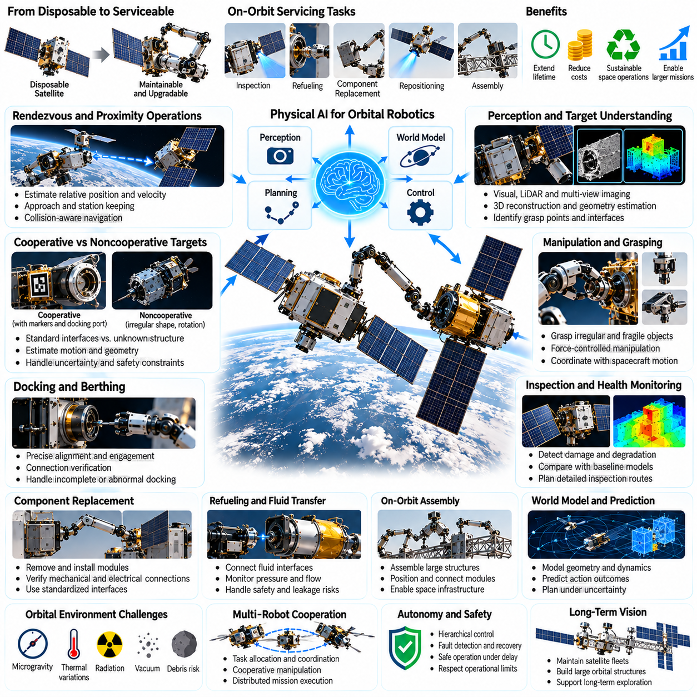{width="7.268055555555556in" height="7.268055555555556in"}

Orbital robotics and on-orbit servicing represent a major transition from disposable spacecraft toward maintainable and adaptable space infrastructure. Traditional satellites are generally designed to operate without physical intervention after launch. Physical AI enables robotic spacecraft to inspect, approach, manipulate, repair, and potentially upgrade orbital assets. These capabilities could extend mission lifetimes, reduce replacement costs, and improve the sustainability of space operations.

On-orbit servicing encompasses inspection, refueling, component replacement, repositioning, and assembly activities performed directly in space. Each operation requires precise coordination between spacecraft navigation, robotic manipulation, and environmental awareness. Unlike terrestrial maintenance, orbital servicing occurs under microgravity, vacuum, radiation, and severe thermal variations. Autonomous systems must account for these conditions while maintaining strict safety margins.

Rendezvous and proximity operations form the foundation of orbital robotic servicing. A servicing spacecraft must approach a target while estimating relative position, velocity, orientation, and rotational motion. Cameras, LiDAR, and other navigation sensors can provide complementary measurements. Physical AI can integrate these observations with orbital dynamics models to support accurate relative navigation and collision-aware approach planning.

Target spacecraft may be cooperative or noncooperative, creating fundamentally different servicing challenges. Cooperative satellites may provide navigation markers, standardized docking interfaces, and attitude stabilization. Noncooperative objects may lack these features and exhibit uncontrolled rotation. Autonomous perception must estimate target geometry and motion without relying on predefined interfaces, while recognizing uncertainty that could make physical interaction unsafe.

Orbital manipulation differs from fixed-base robotics because forces applied by a robotic arm can alter the motion of its spacecraft platform. When a manipulator accelerates or contacts another object, reaction forces and torques influence the combined system. Successful control therefore requires coupled spacecraft-manipulator dynamics. Physical AI must coordinate arm trajectories, attitude control, and momentum management to preserve operational stability.

Autonomous grasping is particularly difficult when servicing objects that were not designed for robotic capture. A target may present irregular surfaces, fragile appendages, uncertain mass properties, or rotating structures. Perception systems must identify suitable contact regions and estimate grasp feasibility. Force-controlled manipulation and compliant end effectors can reduce impact loads, although some targets may remain unsuitable for safe autonomous capture.

Docking and berthing provide mechanisms for establishing stable connections between spacecraft. Docking generally involves controlled engagement between compatible interfaces, while berthing may use robotic manipulation to position an object for attachment. Both require accurate alignment, relative-motion control, and connection verification. Autonomous systems must detect incomplete engagement and avoid applying excessive forces that could damage structural interfaces.

On-orbit inspection offers a comparatively accessible application of robotic servicing. Autonomous spacecraft can examine external structures, solar arrays, antennas, thermal surfaces, and mechanical interfaces for visible damage or degradation. Multi-view imaging and three-dimensional reconstruction can support defect localization. Physical AI can prioritize inspection regions and compare observations with historical records to identify meaningful changes.

Refueling has the potential to extend spacecraft operational lifetimes when compatible servicing interfaces and procedures are available. Robotic systems may need to approach fluid connections, secure transfer mechanisms, and monitor pressure, temperature, and flow conditions. These activities involve substantial technical and safety challenges. Physical AI can assist with positioning, process monitoring, and anomaly detection within carefully validated operational boundaries.

Component replacement could allow selected orbital systems to recover functionality without launching complete replacement spacecraft. Robotic manipulators may remove modular units, install spare components, and verify mechanical or electrical connections. Such operations depend heavily on serviceable spacecraft architecture and standardized interfaces. Physical AI can support alignment, tool selection, and task sequencing while accounting for limited access and uncertain component conditions.

On-orbit assembly enables structures larger than those conveniently accommodated within a single launch vehicle. Robotic spacecraft may position trusses, connect modules, deploy antennas, or construct supporting frameworks. Assembly requires coordination between relative navigation, structural manipulation, and connection verification. Autonomous planning can reduce dependence on continuous ground supervision, particularly during repetitive and geometrically complex operations.

World models provide an important foundation for orbital robotic intelligence. A servicing robot must represent spacecraft geometry, relative motion, component locations, mechanical constraints, and operational hazards. Action-conditioned models can predict how thruster commands, arm movements, or contact forces will influence system behavior. These predictions support planning under uncertainty and help identify potentially unstable interactions before execution.

Orbital environments require reasoning across multiple time horizons. Fast control loops regulate attitude, relative motion, and contact forces, while intermediate planning coordinates inspection and manipulation tasks. Longer-term reasoning manages servicing objectives, energy budgets, and mission schedules. Hierarchical Physical AI architectures can connect these levels while preserving the deterministic behavior required by safety-critical spacecraft control.

Digital twins can support orbital servicing by maintaining computational representations of spacecraft structure, motion, and equipment condition. Sensor measurements update estimates of target geometry, joint states, and system performance. Differences between predicted and observed behavior may reveal calibration errors or developing faults. Digital twins can also support rehearsal and verification of servicing procedures before physical execution.

Communication constraints influence the distribution of intelligence between spacecraft and ground systems. Even when orbital communication delays are relatively small, limited contact windows and intermittent connectivity can prevent continuous supervision. Autonomous robots must execute approved operations, recognize abnormal conditions, and transition safely when communication becomes unavailable. Human operators remain responsible for mission objectives and authorization of critical actions.

Space debris creates additional hazards for robotic servicing missions. Objects in orbit may travel at high relative velocities, and even small debris can damage spacecraft components. Servicing systems must account for conjunction warnings, uncertain object trajectories, and operational exclusion regions. Physical AI can assist with situational awareness and maneuver planning, but collision avoidance requires validated orbital prediction and flight safety procedures.

Energy and thermal management impose substantial constraints on orbital robotic operations. Manipulator movement, sensing, computation, and propulsion consume limited spacecraft resources. Solar illumination, eclipse periods, and equipment heat dissipation influence operational schedules. Physical AI can coordinate servicing activities with power availability and thermal limits, reducing the likelihood that demanding tasks compromise spacecraft health.

Long-duration orbital servicing requires continuous assessment of robotic equipment condition. Joint wear, actuator degradation, sensor drift, and repeated thermal cycling can reduce manipulation accuracy and reliability. Health-aware planning can adjust movement profiles, restrict risky operations, or recommend maintenance actions. Persistent operational memory helps track previous servicing attempts, component behavior, and evolving equipment limitations.

Multi-robot orbital systems could support more complex servicing and assembly missions. Specialized spacecraft may perform inspection, transportation, manipulation, or structural stabilization. Shared environmental representations and coordinated task allocation can improve operational efficiency. However, distributed autonomy introduces challenges involving relative navigation, communication reliability, synchronization, and collision prevention between cooperating robots.

Simulation is indispensable for developing and validating orbital Physical AI. High-fidelity environments can reproduce orbital mechanics, free-floating manipulation, sensor uncertainty, contact dynamics, and spacecraft disturbances. Domain randomization can expose learning systems to variations in target motion, mass properties, and sensor performance. Hardware-in-the-loop testing and carefully staged flight demonstrations remain necessary because simulation cannot capture every operational uncertainty.

Safety assurance is especially important because an unsuccessful servicing maneuver may damage valuable spacecraft or create additional orbital debris. Autonomous actions should operate within verified constraints on approach velocity, contact force, attitude stability, and collision risk. Runtime monitoring can detect violations and trigger predefined fallback behavior. Learning-based intelligence must therefore be integrated with independently validated guidance, navigation, and control systems.

The economic value of orbital servicing depends on spacecraft design, mission lifetime, servicing cost, and the feasibility of repeated operations. Refueling or repairing an expensive satellite may be advantageous when servicing costs are lower than replacement alternatives. Standardized interfaces and modular architectures could improve these economics. Nevertheless, reliable business models require realistic assessments of launch costs, operational risk, and service demand.

Ultimately, orbital robotics and on-orbit servicing demonstrate how Physical AI can transform space systems from isolated assets into maintainable infrastructure. Progress requires the integration of autonomous perception, orbital dynamics, robotic manipulation, predictive world models, and safety-aware planning. As these technologies mature, robotic servicing may enable longer-lived satellites, larger orbital structures, and more sustainable human and robotic activities in space.

궤도 로봇공학(Orbital Robotics)과 궤도상 서비스(On-Orbit Servicing)는 일회성 우주선(Disposable Spacecraft)에서 유지보수와 적응이 가능한 우주 인프라(Maintainable and Adaptable Space Infrastructure)로 전환하는 중요한 발전을 의미합니다. 기존 인공위성(Traditional Satellites)은 일반적으로 발사 이후 물리적 개입(Physical Intervention) 없이 작동하도록 설계됩니다. 피지컬 AI(Physical AI)는 로봇 우주선(Robotic Spacecraft)이 궤도 자산(Orbital Assets)을 검사하고, 접근하고, 조작하고, 수리하며, 잠재적으로 성능을 개선하도록 지원합니다. 이러한 역량은 임무 수명(Mission Lifetimes)을 연장하고, 교체 비용(Replacement Costs)을 줄이며, 우주 운영(Space Operations)의 지속 가능성(Sustainability)을 향상할 수 있습니다.

궤도상 서비스(On-Orbit Servicing)는 우주 공간에서 직접 수행되는 검사(Inspection), 연료 재보급(Refueling), 부품 교체(Component Replacement), 위치 변경(Repositioning), 조립(Assembly) 활동을 포함합니다. 각 작업에는 우주선 항법(Spacecraft Navigation), 로봇 조작(Robotic Manipulation), 환경 인식(Environmental Awareness) 사이의 정밀한 협조가 필요합니다. 지상 유지보수(Terrestrial Maintenance)와 달리 궤도상 서비스는 미세중력(Microgravity), 진공(Vacuum), 방사선(Radiation), 극심한 온도 변화(Severe Thermal Variations) 환경에서 수행됩니다. 자율 시스템(Autonomous Systems)은 엄격한 안전 여유(Safety Margins)를 유지하면서 이러한 조건을 고려해야 합니다.

랑데부 및 근접 운용(Rendezvous and Proximity Operations)은 궤도 로봇 서비스(Orbital Robotic Servicing)의 기반을 형성합니다. 서비스 우주선(Servicing Spacecraft)은 목표물의 상대 위치(Relative Position), 속도(Velocity), 자세(Orientation), 회전 운동(Rotational Motion)을 추정하면서 접근해야 합니다. 카메라(Cameras), 라이다(LiDAR), 기타 항법 센서(Navigation Sensors)는 상호 보완적인 측정 정보를 제공할 수 있습니다. 피지컬 AI는 이러한 관측을 궤도 동역학 모델(Orbital Dynamics Models)과 통합하여 정확한 상대 항법(Relative Navigation)과 충돌 인식 접근 계획(Collision-Aware Approach Planning)을 지원할 수 있습니다.

목표 우주선(Target Spacecraft)은 협조적(Cooperative)이거나 비협조적(Noncooperative)일 수 있으며, 이에 따라 서비스 작업에서 근본적으로 다른 문제가 발생합니다. 협조적 위성(Cooperative Satellites)은 항법 마커(Navigation Markers), 표준화된 도킹 인터페이스(Standardized Docking Interfaces), 자세 안정화(Attitude Stabilization) 기능을 제공할 수 있습니다. 비협조적 물체(Noncooperative Objects)는 이러한 기능이 없고 제어되지 않는 회전(Uncontrolled Rotation)을 보일 수 있습니다. 자율 인식(Autonomous Perception)은 사전에 정의된 인터페이스에 의존하지 않고 목표물의 형상(Target Geometry)과 운동(Motion)을 추정하면서 물리적 상호작용을 위험하게 만드는 불확실성(Uncertainty)을 인식해야 합니다.

궤도 조작(Orbital Manipulation)은 로봇 팔(Robotic Arm)이 가하는 힘이 우주선 플랫폼(Spacecraft Platform)의 운동을 변화시킬 수 있다는 점에서 고정 기반 로봇공학(Fixed-Base Robotics)과 다릅니다. 매니퓰레이터(Manipulator)가 가속하거나 다른 물체와 접촉하면 반력(Reaction Forces)과 반작용 토크(Reaction Torques)가 결합 시스템(Combined System)에 영향을 미칩니다. 따라서 성공적인 제어를 위해서는 우주선-매니퓰레이터 결합 동역학(Coupled Spacecraft-Manipulator Dynamics)이 필요합니다. 피지컬 AI는 운용 안정성(Operational Stability)을 유지하기 위해 로봇 팔 궤적(Arm Trajectories), 자세 제어(Attitude Control), 운동량 관리(Momentum Management)를 협조적으로 조정해야 합니다.

자율 파지(Autonomous Grasping)는 로봇 포획(Robotic Capture)을 고려하여 설계되지 않은 물체를 서비스할 때 특히 어렵습니다. 목표물에는 불규칙한 표면(Irregular Surfaces), 취약한 부속 구조물(Fragile Appendages), 불확실한 질량 특성(Uncertain Mass Properties), 회전하는 구조물(Rotating Structures)이 존재할 수 있습니다. 인식 시스템(Perception Systems)은 적절한 접촉 영역(Contact Regions)을 식별하고 파지 가능성(Grasp Feasibility)을 추정해야 합니다. 힘 제어 조작(Force-Controlled Manipulation)과 유연한 말단 효과기(Compliant End Effectors)는 충격 하중(Impact Loads)을 줄일 수 있지만, 일부 목표물은 안전한 자율 포획에 적합하지 않을 수 있습니다.

도킹(Docking)과 버싱(Berthing)은 우주선 사이에 안정적인 연결(Stable Connections)을 형성하는 방법을 제공합니다. 도킹은 일반적으로 호환 가능한 인터페이스(Compatible Interfaces) 사이의 제어된 결합(Controlled Engagement)을 의미하며, 버싱은 로봇 조작을 이용하여 물체를 부착 위치로 이동시키는 과정을 포함할 수 있습니다. 두 방식 모두 정확한 정렬(Accurate Alignment), 상대 운동 제어(Relative-Motion Control), 연결 검증(Connection Verification)이 필요합니다. 자율 시스템은 불완전한 결합(Incomplete Engagement)을 탐지하고 구조적 인터페이스(Structural Interfaces)를 손상시킬 수 있는 과도한 힘의 적용을 방지해야 합니다.

궤도상 검사(On-Orbit Inspection)는 로봇 서비스(Robotic Servicing)에서 비교적 접근하기 쉬운 응용 분야입니다. 자율 우주선(Autonomous Spacecraft)은 외부 구조물(External Structures), 태양전지 배열(Solar Arrays), 안테나(Antennas), 열 제어 표면(Thermal Surfaces), 기계적 인터페이스(Mechanical Interfaces)를 검사하여 눈에 보이는 손상이나 성능 저하를 확인할 수 있습니다. 다중 시점 영상(Multi-View Imaging)과 3차원 재구성(Three-Dimensional Reconstruction)은 결함 위치 추정(Defect Localization)을 지원할 수 있습니다. 피지컬 AI는 검사 영역(Inspection Regions)의 우선순위를 결정하고 관측 결과를 과거 기록(Historical Records)과 비교하여 의미 있는 변화를 식별할 수 있습니다.

연료 재보급(Refueling)은 호환 가능한 서비스 인터페이스(Compatible Servicing Interfaces)와 절차가 제공될 경우 우주선의 운용 수명(Operational Lifetimes)을 연장할 가능성이 있습니다. 로봇 시스템은 유체 연결부(Fluid Connections)에 접근하고, 이송 메커니즘(Transfer Mechanisms)을 고정하며, 압력(Pressure), 온도(Temperature), 유량(Flow Conditions)을 모니터링해야 할 수 있습니다. 이러한 활동에는 상당한 기술적·안전적 문제가 수반됩니다. 피지컬 AI는 신중하게 검증된 운용 범위(Validated Operational Boundaries) 내에서 위치 조정(Positioning), 공정 모니터링(Process Monitoring), 이상 탐지(Anomaly Detection)를 지원할 수 있습니다.

부품 교체(Component Replacement)는 전체 대체 우주선(Replacement Spacecraft)을 발사하지 않고도 일부 궤도 시스템(Orbital Systems)의 기능을 복구할 수 있도록 합니다. 로봇 매니퓰레이터(Robotic Manipulators)는 모듈형 장치(Modular Units)를 제거하고, 예비 부품(Spare Components)을 설치하며, 기계적 또는 전기적 연결(Mechanical or Electrical Connections)을 검증할 수 있습니다. 이러한 작업은 서비스 가능한 우주선 아키텍처(Serviceable Spacecraft Architecture)와 표준화된 인터페이스(Standardized Interfaces)에 크게 의존합니다. 피지컬 AI는 제한된 접근 공간(Limited Access)과 불확실한 부품 상태(Uncertain Component Conditions)를 고려하면서 정렬(Alignment), 도구 선택(Tool Selection), 작업 순서 계획(Task Sequencing)을 지원할 수 있습니다.

궤도상 조립(On-Orbit Assembly)은 단일 발사체(Single Launch Vehicle)에 편리하게 수용할 수 있는 크기보다 더 큰 구조물을 구축하도록 합니다. 로봇 우주선(Robotic Spacecraft)은 트러스(Trusses)를 배치하고, 모듈(Modules)을 연결하고, 안테나(Antennas)를 전개하거나, 지지 프레임(Supporting Frameworks)을 건설할 수 있습니다. 조립에는 상대 항법(Relative Navigation), 구조물 조작(Structural Manipulation), 연결 검증(Connection Verification)의 협조가 필요합니다. 자율 계획(Autonomous Planning)은 특히 반복적이고 기하학적으로 복잡한 작업에서 지속적인 지상 감독(Continuous Ground Supervision)에 대한 의존도를 줄일 수 있습니다.

월드 모델(World Models)은 궤도 로봇 지능(Orbital Robotic Intelligence)을 위한 중요한 기반을 제공합니다. 서비스 로봇(Servicing Robot)은 우주선 형상(Spacecraft Geometry), 상대 운동(Relative Motion), 부품 위치(Component Locations), 기계적 제약(Mechanical Constraints), 운용 위험(Operational Hazards)을 표현해야 합니다. 행동 조건부 모델(Action-Conditioned Models)은 추진기 명령(Thruster Commands), 로봇 팔 운동(Arm Movements), 접촉력(Contact Forces)이 시스템 거동(System Behavior)에 미치는 영향을 예측할 수 있습니다. 이러한 예측은 불확실성 아래의 계획(Planning Under Uncertainty)을 지원하고 실행 전에 잠재적으로 불안정한 상호작용(Potentially Unstable Interactions)을 식별하는 데 도움이 됩니다.

궤도 환경(Orbital Environments)에서는 여러 시간 범위(Multiple Time Horizons)에 걸친 추론이 필요합니다. 빠른 제어 루프(Fast Control Loops)는 자세(Attitude), 상대 운동(Relative Motion), 접촉력(Contact Forces)을 조절하고, 중간 수준의 계획(Intermediate Planning)은 검사 및 조작 작업을 조정합니다. 장기 추론(Longer-Term Reasoning)은 서비스 목표(Servicing Objectives), 에너지 예산(Energy Budgets), 임무 일정(Mission Schedules)을 관리합니다. 계층적 피지컬 AI 아키텍처(Hierarchical Physical AI Architectures)는 안전 필수 우주선 제어(Safety-Critical Spacecraft Control)에 요구되는 결정론적 동작(Deterministic Behavior)을 유지하면서 이러한 수준을 연결할 수 있습니다.

디지털 트윈(Digital Twins)은 우주선 구조(Spacecraft Structure), 운동(Motion), 장비 상태(Equipment Condition)에 대한 계산적 표현(Computational Representations)을 유지하여 궤도상 서비스(On-Orbit Servicing)를 지원할 수 있습니다. 센서 측정값(Sensor Measurements)은 목표물 형상(Target Geometry), 관절 상태(Joint States), 시스템 성능(System Performance)에 대한 추정치를 갱신합니다. 예측된 거동(Predicted Behavior)과 관측된 거동(Observed Behavior) 사이의 차이는 보정 오류(Calibration Errors)나 진행 중인 고장(Developing Faults)을 드러낼 수 있습니다. 디지털 트윈은 실제 물리적 실행 전에 서비스 절차(Servicing Procedures)를 예행 연습하고 검증하는 데에도 활용될 수 있습니다.

통신 제약(Communication Constraints)은 우주선과 지상 시스템(Ground Systems) 사이의 지능 분산(Intelligence Distribution)에 영향을 미칩니다. 궤도 통신 지연(Orbital Communication Delays)이 상대적으로 작더라도 제한된 통신 가능 시간(Contact Windows)과 간헐적인 연결(Intermittent Connectivity)은 지속적인 감독을 어렵게 만들 수 있습니다. 자율 로봇(Autonomous Robots)은 승인된 작업(Approved Operations)을 실행하고, 비정상적인 조건(Abnormal Conditions)을 인식하며, 통신이 불가능해질 경우 안전한 상태로 전환해야 합니다. 인간 운영자(Human Operators)는 임무 목표(Mission Objectives)와 핵심 행동(Critical Actions)의 승인에 대한 책임을 계속 유지합니다.

우주 잔해물(Space Debris)은 로봇 서비스 임무(Robotic Servicing Missions)에 추가적인 위험을 발생시킵니다. 궤도상의 물체는 높은 상대 속도(High Relative Velocities)로 이동할 수 있으며, 작은 잔해물조차 우주선 부품(Spacecraft Components)을 손상시킬 수 있습니다. 서비스 시스템(Servicing Systems)은 충돌 근접 경보(Conjunction Warnings), 불확실한 물체 궤적(Uncertain Object Trajectories), 운용상 접근 제한 구역(Operational Exclusion Regions)을 고려해야 합니다. 피지컬 AI는 상황 인식(Situational Awareness)과 기동 계획(Maneuver Planning)을 지원할 수 있지만, 충돌 회피(Collision Avoidance)에는 검증된 궤도 예측(Validated Orbital Prediction)과 비행 안전 절차(Flight Safety Procedures)가 필요합니다.

에너지 및 열 관리(Energy and Thermal Management)는 궤도 로봇 운용(Orbital Robotic Operations)에 상당한 제약을 부과합니다. 매니퓰레이터 운동(Manipulator Movement), 센싱(Sensing), 연산(Computation), 추진(Propulsion)은 제한된 우주선 자원(Spacecraft Resources)을 소비합니다. 태양광 조사(Solar Illumination), 식 기간(Eclipse Periods), 장비 방열(Equipment Heat Dissipation)은 운용 일정(Operational Schedules)에 영향을 미칩니다. 피지컬 AI는 서비스 활동(Servicing Activities)을 전력 가용성(Power Availability) 및 열적 한계(Thermal Limits)와 조정하여 고부하 작업(Demanding Tasks)이 우주선 상태(Spacecraft Health)를 악화시킬 가능성을 줄일 수 있습니다.

장기간 궤도상 서비스(Long-Duration Orbital Servicing)에는 로봇 장비 상태(Robotic Equipment Condition)에 대한 지속적인 평가가 필요합니다. 관절 마모(Joint Wear), 액추에이터 성능 저하(Actuator Degradation), 센서 드리프트(Sensor Drift), 반복적인 열 순환(Repeated Thermal Cycling)은 조작 정확도(Manipulation Accuracy)와 신뢰성(Reliability)을 저하시킬 수 있습니다. 상태 인식 계획(Health-Aware Planning)은 운동 프로파일(Movement Profiles)을 조정하고, 위험한 작업(Risky Operations)을 제한하거나, 유지보수 조치(Maintenance Actions)를 권고할 수 있습니다. 지속적 운용 메모리(Persistent Operational Memory)는 이전 서비스 시도(Previous Servicing Attempts), 부품 거동(Component Behavior), 변화하는 장비 한계(Equipment Limitations)를 추적하는 데 도움이 됩니다.

다중 로봇 궤도 시스템(Multi-Robot Orbital Systems)은 더욱 복잡한 서비스 및 조립 임무(Servicing and Assembly Missions)를 지원할 수 있습니다. 전문화된 우주선(Specialized Spacecraft)은 검사(Inspection), 운송(Transportation), 조작(Manipulation), 구조 안정화(Structural Stabilization)를 수행할 수 있습니다. 공유 환경 표현(Shared Environmental Representations)과 협조적 작업 할당(Coordinated Task Allocation)은 운용 효율성(Operational Efficiency)을 향상할 수 있습니다. 그러나 분산 자율성(Distributed Autonomy)은 상대 항법(Relative Navigation), 통신 신뢰성(Communication Reliability), 동기화(Synchronization), 협력 로봇 사이의 충돌 방지(Collision Prevention)에 관한 문제를 발생시킵니다.

시뮬레이션(Simulation)은 궤도 피지컬 AI(Orbital Physical AI)를 개발하고 검증하는 데 필수적입니다. 고충실도 환경(High-Fidelity Environments)은 궤도 역학(Orbital Mechanics), 자유 부유 조작(Free-Floating Manipulation), 센서 불확실성(Sensor Uncertainty), 접촉 동역학(Contact Dynamics), 우주선 외란(Spacecraft Disturbances)을 재현할 수 있습니다. 도메인 무작위화(Domain Randomization)는 학습 시스템(Learning Systems)을 목표물 운동(Target Motion), 질량 특성(Mass Properties), 센서 성능(Sensor Performance)의 다양한 변화에 노출할 수 있습니다. 시뮬레이션이 모든 운용 불확실성(Operational Uncertainty)을 포착할 수는 없으므로 하드웨어 인 더 루프 시험(Hardware-in-the-Loop Testing)과 단계적으로 수행되는 비행 실증(Staged Flight Demonstrations)이 여전히 필요합니다.

안전 보증(Safety Assurance)은 실패한 서비스 기동(Unsuccessful Servicing Maneuver)이 가치 있는 우주선을 손상시키거나 추가적인 궤도 잔해물(Orbital Debris)을 생성할 수 있기 때문에 특히 중요합니다. 자율 행동(Autonomous Actions)은 접근 속도(Approach Velocity), 접촉력(Contact Force), 자세 안정성(Attitude Stability), 충돌 위험(Collision Risk)에 관한 검증된 제약(Verified Constraints) 내에서 수행되어야 합니다. 런타임 모니터링(Runtime Monitoring)은 제약 위반(Constraint Violations)을 탐지하고 사전에 정의된 대체 동작(Fallback Behavior)을 실행할 수 있습니다. 따라서 학습 기반 지능(Learning-Based Intelligence)은 독립적으로 검증된 유도·항법·제어 시스템(Guidance, Navigation, and Control Systems)과 통합되어야 합니다.

궤도상 서비스(On-Orbit Servicing)의 경제적 가치(Economic Value)는 우주선 설계(Spacecraft Design), 임무 수명(Mission Lifetime), 서비스 비용(Servicing Cost), 반복 작업의 실현 가능성(Feasibility of Repeated Operations)에 따라 달라집니다. 고가의 위성(Expensive Satellite)을 재급유하거나 수리하는 것은 서비스 비용이 교체 대안(Replacement Alternatives)보다 낮을 경우 유리할 수 있습니다. 표준화된 인터페이스(Standardized Interfaces)와 모듈형 아키텍처(Modular Architectures)는 이러한 경제성을 향상할 수 있습니다. 그러나 신뢰할 수 있는 비즈니스 모델(Business Models)을 구축하려면 발사 비용(Launch Costs), 운용 위험(Operational Risk), 서비스 수요(Service Demand)에 대한 현실적인 평가가 필요합니다.

궁극적으로 궤도 로봇공학(Orbital Robotics)과 궤도상 서비스(On-Orbit Servicing)는 피지컬 AI가 우주 시스템(Space Systems)을 독립적인 자산(Isolated Assets)에서 유지보수가 가능한 인프라(Maintainable Infrastructure)로 전환할 수 있음을 보여줍니다. 이를 위해서는 자율 인식(Autonomous Perception), 궤도 동역학(Orbital Dynamics), 로봇 조작(Robotic Manipulation), 예측 월드 모델(Predictive World Models), 안전 인식 계획(Safety-Aware Planning)의 통합이 필요합니다. 이러한 기술이 성숙함에 따라 로봇 서비스(Robotic Servicing)는 더 긴 수명의 인공위성(Longer-Lived Satellites), 더 큰 궤도 구조물(Larger Orbital Structures), 우주에서의 더욱 지속 가능한 인간 및 로봇 활동(Sustainable Human and Robotic Activities)을 가능하게 할 수 있을 것입니다.

##  

## 04.10. Multi Robot and Swarm Space Systems

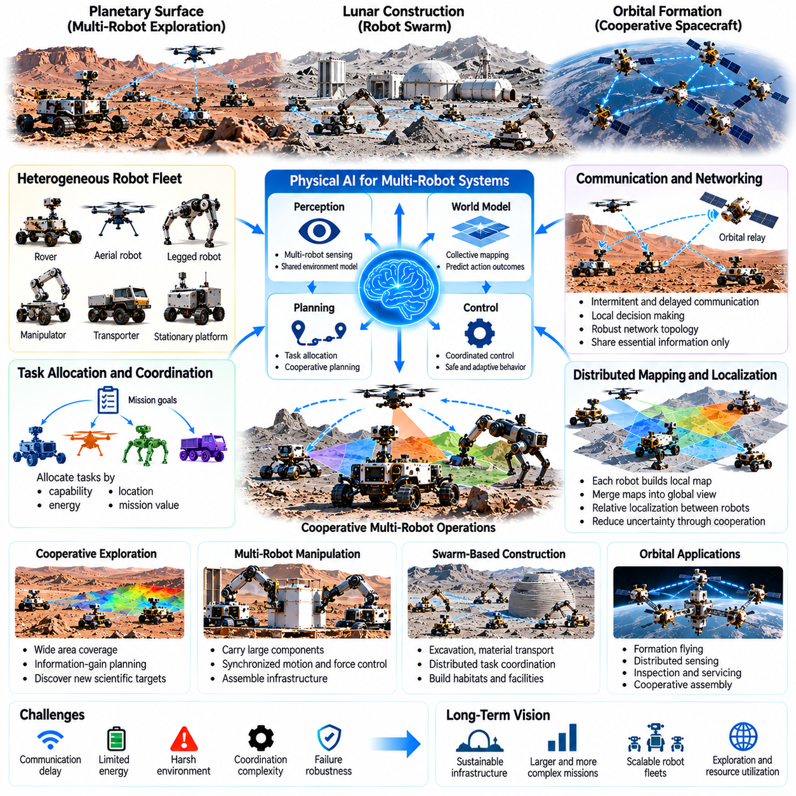{width="7.268055555555556in" height="7.268055555555556in"}

Multi-robot and swarm space systems represent an important evolution from individual autonomous spacecraft toward coordinated networks of intelligent machines. Instead of relying on a single robot to perform every task, distributed systems can divide exploration, construction, inspection, and logistics among specialized agents. Physical AI enables these robots to share information, coordinate actions, and adapt collectively to uncertain extraterrestrial environments.

Space exploration creates strong incentives for distributed robotic architectures because mission environments are extensive, unpredictable, and difficult to access. A single rover or spacecraft has limited sensing coverage, mobility, energy, and operational capacity. Multiple robots can explore different locations simultaneously and provide complementary observations. Their collective effectiveness depends on coordination quality rather than simply increasing the number of machines.

Swarm robotics emphasizes cooperation among numerous relatively simple agents that produce useful collective behavior through local interactions. Individual robots may follow limited rules for movement, communication, and task selection while contributing to broader mission objectives. In space, swarm approaches could support distributed sensing, environmental mapping, and resource reconnaissance. Their advantages depend on communication reliability and robust coordination mechanisms.

Heterogeneous robotic fleets combine machines with different physical capabilities and operational roles. Planetary rovers may transport instruments, aerial robots may survey terrain, manipulators may collect samples, and stationary platforms may provide communication or processing services. Physical AI can coordinate these complementary capabilities through shared mission representations. Effective cooperation requires understanding each robot\'s limitations, resources, and task dependencies.

Task allocation is a central problem in multi-robot space operations. Robots must determine which agents should perform particular activities according to location, capability, energy reserves, and expected mission value. Centralized scheduling can optimize global objectives when communication is available, while distributed allocation supports local adaptation. Hybrid architectures can combine strategic coordination with autonomous decisions made near the point of execution.

Communication constraints strongly influence the organization of space robot teams. Planetary terrain may obstruct wireless signals, orbital geometry may interrupt connections, and interplanetary distances introduce substantial delays. Robots cannot assume continuous access to a central controller or shared database. Physical AI must support intermittent communication, delayed information exchange, and safe independent operation when network connectivity becomes unavailable.

Shared world models allow cooperating robots to develop a more complete understanding of their environment. Individual agents may contribute terrain maps, obstacle observations, resource estimates, and equipment status information. These observations can be integrated into a collective environmental representation. However, differences in localization accuracy, sensor calibration, and observation time must be considered to prevent inconsistent or misleading shared knowledge.

Distributed mapping is particularly valuable when robots explore large planetary surfaces or complex orbital structures. Each robot can construct a local map while exchanging selected information with nearby agents. Map alignment and data association help combine observations into a consistent representation. Physical AI can prioritize the transmission of informative measurements when communication bandwidth is limited, reducing unnecessary data exchange.

Collective localization enables robots to improve their position estimates through mutual observations and shared environmental features. Relative ranging, visual recognition, and cooperative state estimation can reduce uncertainty when individual navigation sensors are insufficient. Nevertheless, errors may propagate between agents if shared measurements are unreliable. Robust estimation must account for uncertain observations and prevent local failures from destabilizing the entire fleet.

Cooperative exploration requires balancing the discovery of new information against operational risks and resource limitations. Robots may distribute themselves across different regions to maximize coverage while preserving communication links and return paths. Information-gain planning can prioritize locations expected to reduce environmental uncertainty. Physical AI can adjust exploration strategies when terrain conditions, scientific discoveries, or equipment availability change.

Multi-robot manipulation extends collective intelligence into coordinated physical interaction. Several robots may transport large components, stabilize structures, or assemble infrastructure that exceeds the capacity of an individual machine. Such operations require synchronization of motion, contact forces, and load distribution. Predictive models can estimate how actions by one robot affect the stability and mechanical constraints experienced by cooperating agents.

Swarm-based construction could support the gradual development of lunar and Martian infrastructure. Specialized robots may excavate regolith, transport materials, prepare foundations, and assemble modular structures. Distributed task coordination can reduce idle time and accommodate equipment failures. However, construction dependencies require explicit sequencing because some operations cannot begin until preceding structural or material preparation tasks are completed.

Orbital robot formations provide another application of distributed Physical AI. Multiple spacecraft may maintain coordinated relative positions for observation, communication, or scientific measurement. Formation control requires accurate relative navigation, orbital dynamics prediction, and collision avoidance. Autonomous coordination can compensate for disturbances while respecting propulsion limits and safety constraints, enabling configurations that would be difficult for isolated spacecraft.

Resource management becomes increasingly complex as robotic fleets grow. Agents compete for energy, communication bandwidth, charging infrastructure, tools, and transportation capacity. Physical AI can coordinate these shared resources according to mission priorities and expected productivity. Long-horizon planning must also consider battery degradation, maintenance requirements, and the consequences of resource shortages during critical operations.

Fleet-level world memory can preserve experience accumulated across multiple robots and mission phases. Successful traversals, hazardous terrain encounters, manipulation outcomes, and equipment failures provide information that may benefit other agents. Shared experience can improve planning and reduce repeated mistakes. Reliable knowledge transfer requires tracking environmental context, robot morphology, sensor differences, and the uncertainty associated with previous observations.

Collective learning allows robotic teams to improve from distributed operational data. Individual agents may encounter different terrain types, lighting conditions, material properties, and failure modes. Aggregating these experiences can support more generalizable perception and control models. However, onboard learning must remain compatible with validated safety constraints, and model updates require careful testing before deployment across an operational fleet.

Fault tolerance is a major potential advantage of multi-robot architectures. When one robot becomes unavailable, remaining agents may redistribute tasks or modify mission objectives. Redundancy can preserve essential capabilities, although specialized equipment may still create single points of failure. Physical AI must distinguish recoverable local faults from failures that threaten the wider system and coordinate appropriate responses.

Distributed autonomy introduces challenges involving trust, consistency, and conflict resolution. Robots may hold different estimates of environmental conditions or disagree about task priorities. Coordination protocols must resolve competing decisions without causing unsafe actions or operational deadlocks. Hierarchical supervision, explicit safety rules, and bounded local authority can help maintain coherent behavior while preserving adaptability.

Simulation is essential for evaluating collective robotic behavior before deployment. Multi-agent environments can reproduce communication interruptions, uncertain terrain, equipment failures, and competing resource demands. Large-scale experiments can reveal coordination bottlenecks and unexpected interactions. Sim-to-real validation remains necessary because simulated communication, contact dynamics, and environmental uncertainty may differ from actual space operations.

The performance of a robotic swarm should be evaluated through mission-level outcomes rather than the behavior of individual agents alone. Important measures include coverage, task completion, energy efficiency, communication overhead, resilience, and scientific return. Increasing fleet size does not guarantee proportional performance improvements. Coordination costs, interference, and shared resource bottlenecks may eventually outweigh the benefits of additional robots.

Human supervision remains important even when robotic teams operate with substantial autonomy. Mission controllers can define scientific priorities, safety boundaries, and acceptable resource expenditures while allowing robots to coordinate routine activities locally. Transparent reporting helps operators understand collective decisions and emerging risks. Human authority is particularly important when autonomous actions could create irreversible environmental changes or threaten valuable infrastructure.

Ultimately, multi-robot and swarm space systems demonstrate how Physical AI can evolve from individual machine intelligence toward coordinated collective agency. Their success depends on shared world models, distributed planning, reliable communication, cooperative control, and safety-aware learning. As these capabilities mature, robotic teams may support larger exploration campaigns, persistent planetary infrastructure, and increasingly autonomous space operations.

다중 로봇 및 군집 우주 시스템(Multi-Robot and Swarm Space Systems)은 개별 자율 우주선(Individual Autonomous Spacecraft)에서 지능형 기계(Intelligent Machines)의 협조적 네트워크(Coordinated Networks)로 발전하는 중요한 전환을 의미합니다. 단일 로봇에 모든 작업을 의존하는 대신, 분산 시스템(Distributed Systems)은 탐사(Exploration), 건설(Construction), 검사(Inspection), 물류(Logistics)를 전문화된 에이전트(Specialized Agents) 사이에 분담할 수 있습니다. 피지컬 AI(Physical AI)는 이러한 로봇들이 정보를 공유하고, 행동을 조정하며, 불확실한 외계 환경(Extraterrestrial Environments)에 집단적으로 적응하도록 지원합니다.

우주 탐사(Space Exploration)는 임무 환경(Mission Environments)이 광범위하고 예측하기 어려우며 접근하기 힘들기 때문에 분산 로봇 아키텍처(Distributed Robotic Architectures)를 도입할 강력한 필요성을 제공합니다. 단일 로버(Rover)나 우주선(Spacecraft)은 센싱 범위(Sensing Coverage), 이동성(Mobility), 에너지(Energy), 운용 능력(Operational Capacity)에 한계가 있습니다. 여러 로봇은 서로 다른 위치를 동시에 탐사하고 상호 보완적인 관측(Complementary Observations)을 제공할 수 있습니다. 이들의 집단적 효과(Collective Effectiveness)는 단순히 기계의 수를 늘리는 것이 아니라 협조 품질(Coordination Quality)에 따라 결정됩니다.

군집 로봇공학(Swarm Robotics)은 다수의 비교적 단순한 에이전트(Simple Agents)가 국소적 상호작용(Local Interactions)을 통해 유용한 집단 행동(Collective Behavior)을 만들어 내는 협력 방식에 중점을 둡니다. 개별 로봇은 이동(Movement), 통신(Communication), 작업 선택(Task Selection)에 관한 제한된 규칙을 따르면서 더 넓은 임무 목표(Mission Objectives)에 기여할 수 있습니다. 우주에서 군집 접근법(Swarm Approaches)은 분산 센싱(Distributed Sensing), 환경 지도 작성(Environmental Mapping), 자원 정찰(Resource Reconnaissance)을 지원할 수 있습니다. 이러한 접근법의 이점은 통신 신뢰성(Communication Reliability)과 견고한 협조 메커니즘(Robust Coordination Mechanisms)에 따라 달라집니다.

이종 로봇 군집(Heterogeneous Robotic Fleets)은 서로 다른 물리적 능력(Physical Capabilities)과 운용 역할(Operational Roles)을 가진 기계들을 결합합니다. 행성 로버(Planetary Rovers)는 과학 장비(Instruments)를 운송하고, 비행 로봇(Aerial Robots)은 지형을 조사하며, 매니퓰레이터(Manipulators)는 시료를 수집하고, 고정형 플랫폼(Stationary Platforms)은 통신 또는 처리 서비스(Communication or Processing Services)를 제공할 수 있습니다. 피지컬 AI는 공유 임무 표현(Shared Mission Representations)을 통해 이러한 상호 보완적 능력을 조정할 수 있습니다. 효과적인 협력에는 각 로봇의 한계(Limitations), 자원(Resources), 작업 의존성(Task Dependencies)에 대한 이해가 필요합니다.

작업 할당(Task Allocation)은 다중 로봇 우주 운용(Multi-Robot Space Operations)의 핵심 문제입니다. 로봇은 위치(Location), 능력(Capability), 에너지 잔량(Energy Reserves), 예상 임무 가치(Expected Mission Value)에 따라 어떤 에이전트가 특정 활동을 수행해야 하는지 결정해야 합니다. 중앙집중식 일정 계획(Centralized Scheduling)은 통신이 가능한 경우 전역 목표(Global Objectives)를 최적화할 수 있으며, 분산 작업 할당(Distributed Allocation)은 국소적 적응(Local Adaptation)을 지원합니다. 하이브리드 아키텍처(Hybrid Architectures)는 전략적 협조(Strategic Coordination)와 실제 실행 위치에서 이루어지는 자율적 의사결정(Autonomous Decisions)을 결합할 수 있습니다.

통신 제약(Communication Constraints)은 우주 로봇 팀(Space Robot Teams)의 조직 방식에 큰 영향을 미칩니다. 행성 지형(Planetary Terrain)은 무선 신호(Wireless Signals)를 차단할 수 있고, 궤도 기하학(Orbital Geometry)은 연결을 중단시킬 수 있으며, 행성 간 거리(Interplanetary Distances)는 상당한 통신 지연(Communication Delays)을 발생시킵니다. 로봇은 중앙 제어기(Central Controller)나 공유 데이터베이스(Shared Database)에 지속적으로 접근할 수 있다고 가정해서는 안 됩니다. 피지컬 AI는 간헐적 통신(Intermittent Communication), 지연된 정보 교환(Delayed Information Exchange), 네트워크 연결(Network Connectivity)이 불가능한 경우의 안전한 독립 운용(Safe Independent Operation)을 지원해야 합니다.

공유 월드 모델(Shared World Models)은 협력 로봇(Cooperating Robots)이 환경에 대해 더욱 완전한 이해를 형성하도록 합니다. 개별 에이전트(Individual Agents)는 지형 지도(Terrain Maps), 장애물 관측(Obstacle Observations), 자원 추정(Resource Estimates), 장비 상태 정보(Equipment Status Information)를 제공할 수 있습니다. 이러한 관측은 집단 환경 표현(Collective Environmental Representation)으로 통합될 수 있습니다. 그러나 부정확하거나 오해를 유발하는 공유 지식(Shared Knowledge)을 방지하기 위해 위치 추정 정확도(Localization Accuracy), 센서 보정(Sensor Calibration), 관측 시점(Observation Time)의 차이를 고려해야 합니다.

분산 지도 작성(Distributed Mapping)은 로봇이 넓은 행성 표면(Large Planetary Surfaces)이나 복잡한 궤도 구조물(Complex Orbital Structures)을 탐사할 때 특히 유용합니다. 각 로봇은 국소 지도(Local Map)를 구축하면서 인근 에이전트(Nearby Agents)와 선택된 정보를 교환할 수 있습니다. 지도 정렬(Map Alignment)과 데이터 연관(Data Association)은 관측을 일관된 표현(Consistent Representation)으로 결합하는 데 도움이 됩니다. 피지컬 AI는 통신 대역폭(Communication Bandwidth)이 제한된 경우 정보 가치가 높은 측정값(Informative Measurements)의 전송에 우선순위를 부여하여 불필요한 데이터 교환(Unnecessary Data Exchange)을 줄일 수 있습니다.

협력 위치 추정(Collective Localization)은 로봇들이 상호 관측(Mutual Observations)과 공유 환경 특징(Shared Environmental Features)을 통해 위치 추정치(Position Estimates)를 개선하도록 합니다. 상대 거리 측정(Relative Ranging), 시각적 인식(Visual Recognition), 협력 상태 추정(Cooperative State Estimation)은 개별 항법 센서(Individual Navigation Sensors)가 충분하지 않을 때 불확실성을 줄일 수 있습니다. 그러나 공유 측정값(Shared Measurements)의 신뢰성이 낮으면 에이전트 사이에 오류가 전파될 수 있습니다. 견고한 추정(Robust Estimation)은 불확실한 관측(Uncertain Observations)을 고려하고 국소적 오류(Local Failures)가 전체 로봇 군집(Entire Fleet)을 불안정하게 만들지 않도록 해야 합니다.

협력 탐사(Cooperative Exploration)는 새로운 정보의 발견(Discovery of New Information)과 운용 위험(Operational Risks) 및 자원 제약(Resource Limitations) 사이의 균형을 요구합니다. 로봇은 통신 연결(Communication Links)과 복귀 경로(Return Paths)를 유지하면서 탐사 범위(Coverage)를 극대화하도록 서로 다른 지역에 분산될 수 있습니다. 정보 이득 기반 계획(Information-Gain Planning)은 환경 불확실성(Environmental Uncertainty)을 줄일 것으로 예상되는 위치에 우선순위를 부여할 수 있습니다. 피지컬 AI는 지형 조건(Terrain Conditions), 과학적 발견(Scientific Discoveries), 장비 가용성(Equipment Availability)이 변화하면 탐사 전략(Exploration Strategies)을 조정할 수 있습니다.

다중 로봇 조작(Multi-Robot Manipulation)은 집단 지능(Collective Intelligence)을 협조적 물리 상호작용(Coordinated Physical Interaction)으로 확장합니다. 여러 로봇은 개별 기계의 능력을 초과하는 대형 부품(Large Components)을 운송하거나, 구조물(Structures)을 안정화하거나, 인프라(Infrastructure)를 조립할 수 있습니다. 이러한 작업에는 운동 동기화(Motion Synchronization), 접촉력(Contact Forces), 하중 분배(Load Distribution)의 협조가 필요합니다. 예측 모델(Predictive Models)은 한 로봇의 행동이 협력 에이전트가 경험하는 안정성(Stability)과 기계적 제약(Mechanical Constraints)에 어떤 영향을 미치는지 추정할 수 있습니다.

군집 기반 건설(Swarm-Based Construction)은 달과 화성 인프라(Lunar and Martian Infrastructure)의 점진적인 개발을 지원할 수 있습니다. 전문화된 로봇(Specialized Robots)은 표토 굴착(Regolith Excavation), 자재 운송(Material Transportation), 기초 준비(Foundation Preparation), 모듈형 구조물 조립(Modular Structure Assembly)을 수행할 수 있습니다. 분산 작업 협조(Distributed Task Coordination)는 유휴 시간(Idle Time)을 줄이고 장비 고장(Equipment Failures)에 대응하도록 합니다. 그러나 건설 작업의 의존성(Construction Dependencies)으로 인해 일부 작업은 선행 구조 작업(Structural Preparation)이나 자재 준비(Material Preparation)가 완료된 후에만 시작할 수 있으므로 명시적인 작업 순서 계획(Explicit Sequencing)이 필요합니다.

궤도 로봇 편대(Orbital Robot Formations)는 분산 피지컬 AI(Distributed Physical AI)의 또 다른 응용 분야입니다. 여러 우주선은 관측(Observation), 통신(Communication), 과학적 측정(Scientific Measurement)을 위해 협조적인 상대 위치(Coordinated Relative Positions)를 유지할 수 있습니다. 편대 제어(Formation Control)에는 정확한 상대 항법(Relative Navigation), 궤도 동역학 예측(Orbital Dynamics Prediction), 충돌 회피(Collision Avoidance)가 필요합니다. 자율 협조(Autonomous Coordination)는 추진력 한계(Propulsion Limits)와 안전 제약(Safety Constraints)을 준수하면서 외란(Disturbances)을 보상하여 개별 우주선으로는 구현하기 어려운 배치 구성을 가능하게 할 수 있습니다.

로봇 군집(Robotic Fleets)의 규모가 커질수록 자원 관리(Resource Management)는 더욱 복잡해집니다. 에이전트는 에너지(Energy), 통신 대역폭(Communication Bandwidth), 충전 인프라(Charging Infrastructure), 도구(Tools), 운송 능력(Transportation Capacity)을 두고 경쟁합니다. 피지컬 AI는 임무 우선순위(Mission Priorities)와 예상 생산성(Expected Productivity)에 따라 이러한 공유 자원(Shared Resources)을 조정할 수 있습니다. 장기 계획(Long-Horizon Planning)은 배터리 성능 저하(Battery Degradation), 유지보수 요구사항(Maintenance Requirements), 핵심 작업(Critical Operations) 중 자원 부족(Resource Shortages)이 초래할 결과도 고려해야 합니다.

군집 수준 월드 메모리(Fleet-Level World Memory)는 여러 로봇과 임무 단계(Mission Phases)에 걸쳐 축적된 경험을 보존할 수 있습니다. 성공적인 지형 통과(Successful Traversals), 위험 지형 경험(Hazardous Terrain Encounters), 조작 결과(Manipulation Outcomes), 장비 고장(Equipment Failures)은 다른 에이전트에도 도움이 되는 정보를 제공합니다. 공유 경험(Shared Experience)은 계획 성능을 개선하고 반복적인 실수를 줄일 수 있습니다. 신뢰할 수 있는 지식 전이(Reliable Knowledge Transfer)를 위해서는 환경 맥락(Environmental Context), 로봇 형태(Robot Morphology), 센서 차이(Sensor Differences), 과거 관측과 관련된 불확실성(Uncertainty)을 추적해야 합니다.

집단 학습(Collective Learning)은 로봇 팀(Robotic Teams)이 분산된 운용 데이터(Distributed Operational Data)를 통해 성능을 개선하도록 합니다. 개별 에이전트는 서로 다른 지형 유형(Terrain Types), 조명 조건(Lighting Conditions), 물질 특성(Material Properties), 고장 유형(Failure Modes)을 경험할 수 있습니다. 이러한 경험을 집계(Aggregation)하면 일반화 성능이 높은 인식 및 제어 모델(Generalizable Perception and Control Models)을 개발하는 데 도움이 됩니다. 그러나 온보드 학습(Onboard Learning)은 검증된 안전 제약(Validated Safety Constraints)과 양립해야 하며, 모델 업데이트(Model Updates)는 운용 중인 로봇 군집 전체에 배포하기 전에 신중한 시험이 필요합니다.

결함 허용성(Fault Tolerance)은 다중 로봇 아키텍처(Multi-Robot Architectures)의 중요한 잠재적 장점입니다. 하나의 로봇을 사용할 수 없게 되면 나머지 에이전트는 작업을 재분배하거나 임무 목표(Mission Objectives)를 수정할 수 있습니다. 중복성(Redundancy)은 필수 기능(Essential Capabilities)을 유지하도록 하지만, 전문화된 장비(Specialized Equipment)는 여전히 단일 장애점(Single Points of Failure)을 형성할 수 있습니다. 피지컬 AI는 복구 가능한 국소적 결함(Recoverable Local Faults)과 전체 시스템(Wider System)을 위협하는 고장을 구분하고 적절한 대응을 조정해야 합니다.

분산 자율성(Distributed Autonomy)은 신뢰(Trust), 일관성(Consistency), 충돌 해결(Conflict Resolution)과 관련된 문제를 발생시킵니다. 로봇은 환경 조건(Environmental Conditions)에 대해 서로 다른 추정치를 보유하거나 작업 우선순위(Task Priorities)에 관해 의견이 일치하지 않을 수 있습니다. 협조 프로토콜(Coordination Protocols)은 안전하지 않은 행동(Unsafe Actions)이나 운용 교착 상태(Operational Deadlocks)를 발생시키지 않으면서 경쟁적인 의사결정(Competing Decisions)을 해결해야 합니다. 계층적 감독(Hierarchical Supervision), 명시적 안전 규칙(Explicit Safety Rules), 제한된 국소적 권한(Bounded Local Authority)은 적응성(Adaptability)을 유지하면서 일관된 행동(Coherent Behavior)을 보장하는 데 도움이 될 수 있습니다.

시뮬레이션(Simulation)은 실제 배포(Deployment) 이전에 집단 로봇 행동(Collective Robotic Behavior)을 평가하는 데 필수적입니다. 다중 에이전트 환경(Multi-Agent Environments)은 통신 중단(Communication Interruptions), 불확실한 지형(Uncertain Terrain), 장비 고장(Equipment Failures), 경쟁적인 자원 수요(Competing Resource Demands)를 재현할 수 있습니다. 대규모 실험(Large-Scale Experiments)은 협조 병목 현상(Coordination Bottlenecks)과 예상하지 못한 상호작용(Unexpected Interactions)을 드러낼 수 있습니다. 시뮬레이션된 통신(Simulated Communication), 접촉 동역학(Contact Dynamics), 환경 불확실성(Environmental Uncertainty)은 실제 우주 운용(Actual Space Operations)과 다를 수 있으므로 시뮬레이션에서 현실로의 검증(Sim-to-Real Validation)이 여전히 필요합니다.

로봇 군집(Robotic Swarm)의 성능은 개별 에이전트의 행동만이 아니라 임무 수준의 성과(Mission-Level Outcomes)를 통해 평가해야 합니다. 중요한 지표에는 탐사 범위(Coverage), 작업 완료율(Task Completion), 에너지 효율(Energy Efficiency), 통신 오버헤드(Communication Overhead), 회복탄력성(Resilience), 과학적 성과(Scientific Return)가 포함됩니다. 로봇 군집 규모(Fleet Size)를 늘린다고 해서 성능이 비례적으로 향상되는 것은 아닙니다. 협조 비용(Coordination Costs), 상호 간섭(Interference), 공유 자원 병목 현상(Shared Resource Bottlenecks)이 추가 로봇의 이점을 초과할 수 있습니다.

로봇 팀(Robotic Teams)이 상당한 자율성(Substantial Autonomy)을 갖추고 운용되더라도 인간 감독(Human Supervision)은 여전히 중요합니다. 임무 관제사(Mission Controllers)는 과학적 우선순위(Scientific Priorities), 안전 경계(Safety Boundaries), 허용 가능한 자원 소비(Acceptable Resource Expenditures)를 정의하면서 로봇이 일상적인 활동(Routine Activities)을 현지에서 자율적으로 조정하도록 할 수 있습니다. 투명한 보고(Transparent Reporting)는 운영자가 집단적 의사결정(Collective Decisions)과 새롭게 나타나는 위험(Emerging Risks)을 이해하도록 돕습니다. 자율 행동(Autonomous Actions)이 되돌릴 수 없는 환경 변화(Irreversible Environmental Changes)를 일으키거나 중요한 인프라(Valuable Infrastructure)를 위협할 수 있는 경우 인간의 권한(Human Authority)은 특히 중요합니다.

궁극적으로 다중 로봇 및 군집 우주 시스템(Multi-Robot and Swarm Space Systems)은 피지컬 AI(Physical AI)가 개별 기계 지능(Individual Machine Intelligence)에서 협조적 집단 행위 능력(Coordinated Collective Agency)으로 발전할 수 있음을 보여줍니다. 성공을 위해서는 공유 월드 모델(Shared World Models), 분산 계획(Distributed Planning), 신뢰할 수 있는 통신(Reliable Communication), 협력 제어(Cooperative Control), 안전 인식 학습(Safety-Aware Learning)이 필요합니다. 이러한 역량이 성숙함에 따라 로봇 팀은 더 큰 규모의 탐사 활동(Larger Exploration Campaigns), 지속적인 행성 인프라(Persistent Planetary Infrastructure), 점차 자율화되는 우주 운용(Increasingly Autonomous Space Operations)을 지원할 수 있을 것입니다.

##  

## 04.11. World Models for Unknown Environments

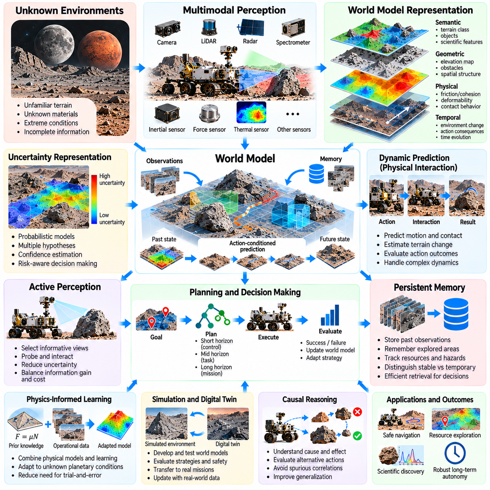{width="7.268055555555556in" height="7.268055555555556in"}

World models are essential for Physical AI operating in extraterrestrial environments where terrain, materials, dynamics, and hazards remain incompletely understood. Unlike terrestrial robots that can rely on extensive prior maps and familiar operating conditions, space robots must interpret unfamiliar observations and act under substantial uncertainty. A world model provides an internal representation of the environment and predicts how its state may evolve through natural processes and robotic actions.

Unknown environments challenge conventional robotic autonomy because perception alone cannot determine every property required for safe action. A camera may reveal the appearance of a planetary surface without establishing its mechanical strength or subsurface composition. Physical AI must infer hidden properties from indirect measurements and interactions. World models connect observations, physical hypotheses, and predicted outcomes to support decisions beyond immediate sensor information.

A useful planetary world model integrates geometric, semantic, physical, and temporal representations. Geometry describes terrain elevation, obstacles, and spatial relationships, while semantic information identifies geological structures and operationally relevant objects. Physical representations estimate friction, cohesion, deformability, and contact behavior. Temporal models capture environmental changes and the consequences of previous robotic activities.

Multimodal perception provides the observational foundation for constructing these representations. Cameras, LiDAR, radar, spectrometers, inertial sensors, and force measurements reveal different aspects of the environment. Sensor fusion combines complementary evidence while accounting for calibration errors and measurement uncertainty. Physical AI must determine which observations are reliable under unfamiliar lighting, dust, temperature, and terrain conditions.

Uncertainty representation is particularly important because extraterrestrial observations are often incomplete or ambiguous. A surface that appears solid may conceal loose material, while a geological formation may have several plausible compositions. Probabilistic world models can maintain competing hypotheses and estimate confidence in predicted outcomes. Planning systems should use these estimates to distinguish acceptable exploration risks from conditions requiring additional observation.

World models must also represent physical dynamics rather than describing static environments alone. Robotic motion can disturb regolith, displace rocks, deform terrain, or change contact conditions. Action-conditioned models predict how these interactions affect future environmental states. Such predictions help robots evaluate whether a proposed movement, excavation, or manipulation action is likely to succeed without compromising stability or equipment safety.

Learning unknown dynamics requires combining prior physical knowledge with new operational experience. Models developed from terrestrial experiments may not accurately describe reduced gravity, unfamiliar granular materials, or extreme thermal conditions. Physics-informed learning can preserve known mechanical relationships while adapting uncertain parameters from observations. This approach reduces dependence on unrestricted trial-and-error learning in hazardous environments.

Active perception enables robots to gather information specifically needed for future decisions. Instead of passively recording sensor data, an autonomous system may reposition a camera, probe a surface, or perform a controlled contact experiment. These actions reveal properties that cannot be inferred reliably from distant observations. World models can estimate the expected information gain and balance exploratory measurements against their energy, time, and safety costs.

Long-horizon prediction is necessary when robots execute missions extending across hours, days, or longer periods. Short-term models may predict immediate motion and contact forces, while longer-term models estimate terrain changes, resource consumption, and operational progress. Hierarchical world models can connect these timescales through shared state representations. Their predictions must account for increasing uncertainty as the planning horizon expands.

Persistent memory allows world models to accumulate knowledge across repeated exploration activities. Previously observed terrain, unsuccessful traversals, geological measurements, and equipment interactions provide valuable context for future operations. Memory systems should distinguish stable environmental properties from temporary conditions. This distinction helps prevent outdated observations from producing incorrect decisions when environments or equipment states change.

Spatial memory is especially important for exploration beyond direct sensor range. Robots may need to remember hazardous slopes, unstable surfaces, communication obstacles, and previously examined scientific targets. Topological maps, metric representations, and semantic memory can provide complementary levels of detail. Physical AI can retrieve relevant information according to mission objectives without processing every historical observation during each decision.

Causal reasoning strengthens world models by connecting physical actions with their consequences. A robot should recognize that excessive wheel torque may increase soil slip or that removing supporting material may destabilize a structure. Causal representations can support counterfactual evaluation of alternative actions. Such reasoning helps distinguish meaningful physical relationships from correlations that may not generalize to unfamiliar planetary conditions.

Simulation provides a controlled environment for developing predictive world models before deployment. Synthetic planetary terrains can expose models to variations in gravity, material properties, lighting, and mechanical interactions. Domain randomization broadens the range of training conditions and reduces dependence on narrow assumptions. However, simulation-derived knowledge must be validated against physical experiments because unknown environmental effects can remain unmodeled.

Online model adaptation allows robots to revise their understanding when observations contradict predictions. Unexpected wheel slip, unusual drilling resistance, or unfamiliar object motion may indicate inaccurate environmental parameters. Physical AI can update selected model components while preserving verified safety constraints. Adaptation should be monitored carefully because incorrect updates may amplify uncertainty or degrade previously reliable capabilities.

Multi-robot exploration creates opportunities for shared world modeling across distributed observations. Different robots may examine the same region from complementary viewpoints or investigate separate locations simultaneously. Their measurements can improve spatial coverage and reduce uncertainty about environmental structure. Shared models must account for inconsistent localization, communication delays, and differences in sensing capability before combining information.

World models also support scientific discovery by connecting robotic observations with testable geological hypotheses. An autonomous explorer may detect unusual mineral signatures, unexpected layering, or evidence of environmental processes. Predictive models can identify observations that would distinguish competing scientific explanations. Physical AI can then recommend sampling or measurement actions that maximize scientific value while respecting mission constraints.

Energy and computational limitations shape how extraterrestrial world models are implemented. High-resolution predictive models may require more memory and processing power than a spacecraft can continuously provide. Hierarchical representations can allocate computational resources according to environmental complexity and decision urgency. Lightweight local models may support real-time control, while more detailed models assist deliberate planning when resources permit.

Safety-aware planning requires world models to represent both expected outcomes and plausible failures. A predicted traversal path may appear efficient but involve uncertain traction, limited recovery options, or exposure to damaging terrain. Risk-sensitive planners can compare alternatives using predicted failure probabilities and consequence estimates. Independent safety monitors remain necessary because learned models cannot guarantee accurate predictions in every unfamiliar situation.

The reliability of a world model should be evaluated through physical decision outcomes rather than prediction accuracy alone. Useful measures include navigation success, manipulation reliability, uncertainty calibration, recovery performance, and scientific information gained. Testing should include unfamiliar terrain and environmental conditions outside the training distribution. A model that produces visually plausible predictions may still be unsuitable for controlling safety-critical robotic actions.

Unknown environments create a persistent tension between exploration and exploitation. Robots must acquire new knowledge while accomplishing scientific, construction, or resource utilization objectives. Excessive caution may prevent valuable discoveries, while aggressive exploration can endanger equipment and mission continuity. World-model-based planning can balance these competing demands by estimating both immediate operational value and future benefits from reduced uncertainty.

Human supervision remains important when world models encounter unfamiliar phenomena or make consequential predictions. Ground operators and scientific teams can review uncertain interpretations, establish exploration priorities, and authorize high-risk operations. Explainable model outputs can communicate assumptions, confidence estimates, and expected consequences. This collaboration combines autonomous physical reasoning with human scientific judgment and mission accountability.

Ultimately, world models for unknown environments provide the predictive foundation for increasingly autonomous space exploration. Their development requires integrating multimodal perception, physical dynamics, uncertainty estimation, causal reasoning, persistent memory, and adaptive planning. As these capabilities improve, Physical AI may enable robots to operate more safely and productively in environments that cannot be fully characterized before arrival.

월드 모델(World Models)은 지형(Terrain), 물질(Materials), 동역학(Dynamics), 위험 요소(Hazards)가 충분히 파악되지 않은 외계 환경(Extraterrestrial Environments)에서 작동하는 피지컬 AI(Physical AI)에 필수적입니다. 광범위한 사전 지도(Prior Maps)와 익숙한 운용 조건(Operating Conditions)에 의존할 수 있는 지상 로봇(Terrestrial Robots)과 달리, 우주 로봇(Space Robots)은 낯선 관측 정보를 해석하고 상당한 불확실성(Uncertainty) 속에서 행동해야 합니다. 월드 모델은 환경에 대한 내부 표현(Internal Representation)을 제공하고 자연적 과정(Natural Processes)과 로봇 행동(Robotic Actions)에 따라 환경 상태(Environmental State)가 어떻게 변화할지 예측합니다.

미지 환경(Unknown Environments)은 인식(Perception)만으로 안전한 행동(Safe Action)에 필요한 모든 특성을 판단할 수 없기 때문에 기존 로봇 자율성(Conventional Robotic Autonomy)에 어려움을 초래합니다. 카메라(Camera)는 행성 표면(Planetary Surface)의 외관을 보여줄 수 있지만, 기계적 강도(Mechanical Strength)나 지하 조성(Subsurface Composition)을 확인할 수는 없습니다. 피지컬 AI는 간접 측정(Indirect Measurements)과 상호작용(Interactions)을 통해 숨겨진 특성(Hidden Properties)을 추론해야 합니다. 월드 모델은 관측(Observations), 물리적 가설(Physical Hypotheses), 예측 결과(Predicted Outcomes)를 연결하여 즉각적인 센서 정보(Immediate Sensor Information)를 넘어서는 의사결정(Decision-Making)을 지원합니다.

유용한 행성 월드 모델(Planetary World Model)은 기하학적 표현(Geometric Representations), 의미론적 표현(Semantic Representations), 물리적 표현(Physical Representations), 시간적 표현(Temporal Representations)을 통합합니다. 기하학(Geometry)은 지형 고도(Terrain Elevation), 장애물(Obstacles), 공간적 관계(Spatial Relationships)를 설명하며, 의미론적 정보(Semantic Information)는 지질 구조(Geological Structures)와 운용상 중요한 물체(Operationally Relevant Objects)를 식별합니다. 물리적 표현은 마찰(Friction), 점착력(Cohesion), 변형 가능성(Deformability), 접촉 거동(Contact Behavior)을 추정합니다. 시간 모델(Temporal Models)은 환경 변화(Environmental Changes)와 이전 로봇 활동(Previous Robotic Activities)의 결과를 포착합니다.

다중 모달 인식(Multimodal Perception)은 이러한 표현을 구축하기 위한 관측 기반(Observational Foundation)을 제공합니다. 카메라(Cameras), 라이다(LiDAR), 레이더(Radar), 분광계(Spectrometers), 관성 센서(Inertial Sensors), 힘 측정(Force Measurements)은 환경의 서로 다른 측면을 드러냅니다. 센서 융합(Sensor Fusion)은 보정 오류(Calibration Errors)와 측정 불확실성(Measurement Uncertainty)을 고려하면서 상호 보완적인 증거(Complementary Evidence)를 결합합니다. 피지컬 AI는 익숙하지 않은 조명(Lighting), 먼지(Dust), 온도(Temperature), 지형 조건(Terrain Conditions)에서 어떤 관측이 신뢰할 수 있는지 판단해야 합니다.

불확실성 표현(Uncertainty Representation)은 외계 환경의 관측이 불완전하거나 모호한 경우가 많기 때문에 특히 중요합니다. 단단해 보이는 표면(Surface)은 느슨한 물질(Loose Material)을 감추고 있을 수 있으며, 지질 형성물(Geological Formation)은 여러 가지 가능한 조성(Plausible Compositions)을 가질 수 있습니다. 확률적 월드 모델(Probabilistic World Models)은 경쟁 가설(Competing Hypotheses)을 유지하고 예측 결과에 대한 신뢰도(Confidence)를 추정할 수 있습니다. 계획 시스템(Planning Systems)은 이러한 추정치를 활용하여 허용 가능한 탐사 위험(Acceptable Exploration Risks)과 추가 관측(Additional Observation)이 필요한 조건을 구분해야 합니다.

월드 모델은 정적인 환경(Static Environments)을 설명하는 데 그치지 않고 물리적 동역학(Physical Dynamics)도 표현해야 합니다. 로봇의 움직임(Robotic Motion)은 표토(Regolith)를 교란하고, 암석(Rocks)을 이동시키며, 지형(Terrain)을 변형하거나, 접촉 조건(Contact Conditions)을 변화시킬 수 있습니다. 행동 조건부 모델(Action-Conditioned Models)은 이러한 상호작용이 미래 환경 상태(Future Environmental States)에 미치는 영향을 예측합니다. 이러한 예측은 로봇이 제안된 이동(Movement), 굴착(Excavation), 조작(Manipulation)이 안정성(Stability)이나 장비 안전(Equipment Safety)을 훼손하지 않고 성공할 가능성을 평가하도록 지원합니다.

미지의 동역학(Unknown Dynamics)을 학습하려면 기존 물리 지식(Prior Physical Knowledge)과 새로운 운용 경험(New Operational Experience)을 결합해야 합니다. 지상 실험(Terrestrial Experiments)을 통해 개발된 모델은 저중력(Reduced Gravity), 익숙하지 않은 입상 물질(Unfamiliar Granular Materials), 극한 온도 조건(Extreme Thermal Conditions)을 정확하게 설명하지 못할 수 있습니다. 물리 정보 기반 학습(Physics-Informed Learning)은 알려진 기계적 관계(Known Mechanical Relationships)를 유지하면서 관측을 통해 불확실한 매개변수(Uncertain Parameters)를 적응적으로 갱신할 수 있습니다. 이러한 접근법은 위험한 환경에서 무제한적인 시행착오 학습(Unrestricted Trial-and-Error Learning)에 대한 의존도를 줄입니다.

능동 인식(Active Perception)은 로봇이 미래 의사결정(Future Decisions)에 특별히 필요한 정보를 수집하도록 합니다. 자율 시스템(Autonomous System)은 센서 데이터(Sensor Data)를 수동적으로 기록하는 대신 카메라 위치를 변경하거나, 표면을 탐침으로 조사하거나, 제어된 접촉 실험(Controlled Contact Experiment)을 수행할 수 있습니다. 이러한 행동은 원거리 관측(Distant Observations)만으로 신뢰성 있게 추론하기 어려운 특성을 드러냅니다. 월드 모델은 예상 정보 이득(Expected Information Gain)을 추정하고 탐색적 측정(Exploratory Measurements)의 에너지(Energy), 시간(Time), 안전 비용(Safety Costs) 사이의 균형을 조정할 수 있습니다.

장기 예측(Long-Horizon Prediction)은 수 시간, 수일 또는 그 이상 지속되는 임무(Missions)를 로봇이 수행할 때 필요합니다. 단기 모델(Short-Term Models)은 즉각적인 운동(Immediate Motion)과 접촉력(Contact Forces)을 예측할 수 있으며, 장기 모델(Longer-Term Models)은 지형 변화(Terrain Changes), 자원 소비(Resource Consumption), 운용 진행 상태(Operational Progress)를 추정합니다. 계층적 월드 모델(Hierarchical World Models)은 공유 상태 표현(Shared State Representations)을 통해 이러한 시간 척도(Timescales)를 연결할 수 있습니다. 예측 범위(Planning Horizon)가 확장될수록 증가하는 불확실성을 고려해야 합니다.

지속적 메모리(Persistent Memory)는 월드 모델이 반복적인 탐사 활동(Repeated Exploration Activities)을 통해 지식을 축적하도록 합니다. 이전에 관측한 지형(Previously Observed Terrain), 실패한 주행(Unsuccessful Traversals), 지질 측정(Geological Measurements), 장비 상호작용(Equipment Interactions)은 미래 운용에 유용한 맥락(Context)을 제공합니다. 메모리 시스템(Memory Systems)은 안정적인 환경 특성(Stable Environmental Properties)과 일시적인 조건(Temporary Conditions)을 구분해야 합니다. 이러한 구분은 환경이나 장비 상태(Equipment States)가 변화했을 때 오래된 관측(Outdated Observations)으로 인해 잘못된 의사결정이 발생하는 것을 방지하는 데 도움이 됩니다.

공간 메모리(Spatial Memory)는 직접적인 센서 범위(Direct Sensor Range)를 벗어난 탐사에서 특히 중요합니다. 로봇은 위험한 경사면(Hazardous Slopes), 불안정한 표면(Unstable Surfaces), 통신 장애물(Communication Obstacles), 이전에 조사한 과학적 목표물(Scientific Targets)을 기억해야 할 수 있습니다. 위상 지도(Topological Maps), 계량적 표현(Metric Representations), 의미론적 메모리(Semantic Memory)는 상호 보완적인 수준의 세부 정보를 제공할 수 있습니다. 피지컬 AI는 매번 의사결정을 수행할 때 모든 과거 관측을 처리하지 않고도 임무 목표(Mission Objectives)에 따라 관련 정보를 검색할 수 있습니다.

인과 추론(Causal Reasoning)은 물리적 행동(Physical Actions)과 그 결과(Consequences)를 연결하여 월드 모델을 강화합니다. 로봇은 과도한 바퀴 토크(Excessive Wheel Torque)가 토양 미끄러짐(Soil Slip)을 증가시키거나 지지 물질(Supporting Material)을 제거하면 구조물(Structure)이 불안정해질 수 있다는 사실을 인식해야 합니다. 인과 표현(Causal Representations)은 대안 행동(Alternative Actions)에 대한 반사실적 평가(Counterfactual Evaluation)를 지원할 수 있습니다. 이러한 추론은 익숙하지 않은 행성 조건(Unfamiliar Planetary Conditions)에 일반화되지 않을 수 있는 상관관계(Correlations)와 의미 있는 물리적 관계(Physical Relationships)를 구분하는 데 도움이 됩니다.

시뮬레이션(Simulation)은 실제 배포(Deployment) 이전에 예측 월드 모델(Predictive World Models)을 개발하기 위한 통제된 환경(Controlled Environment)을 제공합니다. 합성 행성 지형(Synthetic Planetary Terrains)은 모델을 중력(Gravity), 물질 특성(Material Properties), 조명(Lighting), 기계적 상호작용(Mechanical Interactions)의 다양한 변화에 노출할 수 있습니다. 도메인 무작위화(Domain Randomization)는 학습 조건(Training Conditions)의 범위를 넓히고 제한적인 가정(Narrow Assumptions)에 대한 의존도를 줄입니다. 그러나 알려지지 않은 환경 효과(Unknown Environmental Effects)는 모델링되지 않은 상태로 남을 수 있으므로 시뮬레이션에서 얻은 지식(Simulation-Derived Knowledge)은 물리적 실험(Physical Experiments)을 통해 검증해야 합니다.

온라인 모델 적응(Online Model Adaptation)은 관측 결과가 예측과 일치하지 않을 때 로봇이 환경에 대한 이해를 수정하도록 합니다. 예상하지 못한 바퀴 미끄러짐(Unexpected Wheel Slip), 비정상적인 시추 저항(Unusual Drilling Resistance), 익숙하지 않은 물체 운동(Unfamiliar Object Motion)은 부정확한 환경 매개변수(Inaccurate Environmental Parameters)를 나타낼 수 있습니다. 피지컬 AI는 검증된 안전 제약(Verified Safety Constraints)을 유지하면서 선택된 모델 구성요소(Model Components)를 갱신할 수 있습니다. 잘못된 업데이트(Incorrect Updates)는 불확실성을 증폭하거나 이전에 신뢰할 수 있었던 능력(Previously Reliable Capabilities)을 저하시킬 수 있으므로 적응 과정(Adaptation)은 신중하게 모니터링해야 합니다.

다중 로봇 탐사(Multi-Robot Exploration)는 분산된 관측(Distributed Observations)을 활용한 공유 월드 모델링(Shared World Modeling)의 기회를 제공합니다. 서로 다른 로봇은 상호 보완적인 시점(Complementary Viewpoints)에서 동일한 지역을 조사하거나 별도의 위치를 동시에 탐사할 수 있습니다. 이러한 측정값은 공간적 탐사 범위(Spatial Coverage)를 확대하고 환경 구조(Environmental Structure)에 대한 불확실성을 줄일 수 있습니다. 공유 모델(Shared Models)은 정보를 결합하기 전에 일관되지 않은 위치 추정(Inconsistent Localization), 통신 지연(Communication Delays), 센싱 능력(Sensing Capability)의 차이를 고려해야 합니다.

월드 모델은 로봇 관측(Robotic Observations)을 검증 가능한 지질학적 가설(Testable Geological Hypotheses)과 연결하여 과학적 발견(Scientific Discovery)도 지원합니다. 자율 탐사 로봇(Autonomous Explorer)은 특이한 광물 신호(Unusual Mineral Signatures), 예상하지 못한 지층 구조(Unexpected Layering), 환경 과정(Environmental Processes)의 증거를 탐지할 수 있습니다. 예측 모델(Predictive Models)은 경쟁하는 과학적 설명(Competing Scientific Explanations)을 구별할 수 있는 관측을 식별할 수 있습니다. 피지컬 AI는 임무 제약(Mission Constraints)을 준수하면서 과학적 가치(Scientific Value)를 극대화하는 시료 채취(Sampling) 또는 측정 행동(Measurement Actions)을 권고할 수 있습니다.

에너지 및 연산 제약(Energy and Computational Limitations)은 외계 환경 월드 모델(Extraterrestrial World Models)의 구현 방식을 결정합니다. 고해상도 예측 모델(High-Resolution Predictive Models)은 우주선(Spacecraft)이 지속적으로 제공할 수 있는 것보다 많은 메모리(Memory)와 처리 능력(Processing Power)을 요구할 수 있습니다. 계층적 표현(Hierarchical Representations)은 환경 복잡성(Environmental Complexity)과 의사결정 긴급성(Decision Urgency)에 따라 연산 자원(Computational Resources)을 할당할 수 있습니다. 경량 국소 모델(Lightweight Local Models)은 실시간 제어(Real-Time Control)를 지원하고, 더욱 상세한 모델(Detailed Models)은 자원이 허용되는 경우 숙고적 계획(Deliberate Planning)을 지원할 수 있습니다.

안전 인식 계획(Safety-Aware Planning)을 위해서는 월드 모델이 예상 결과(Expected Outcomes)뿐만 아니라 발생 가능한 실패(Plausible Failures)도 표현해야 합니다. 예측된 주행 경로(Predicted Traversal Path)가 효율적으로 보이더라도 불확실한 견인력(Uncertain Traction), 제한된 복구 수단(Limited Recovery Options), 손상을 유발할 수 있는 지형(Damaging Terrain)에 노출될 수 있습니다. 위험 민감형 계획기(Risk-Sensitive Planners)는 예측된 실패 확률(Predicted Failure Probabilities)과 결과의 심각도 추정(Consequence Estimates)을 활용하여 대안을 비교할 수 있습니다. 학습된 모델(Learned Models)이 모든 낯선 상황에서 정확한 예측을 보장할 수는 없으므로 독립적인 안전 감시 장치(Independent Safety Monitors)가 여전히 필요합니다.

월드 모델의 신뢰성(Reliability)은 예측 정확도(Prediction Accuracy)만이 아니라 물리적 의사결정 결과(Physical Decision Outcomes)를 통해 평가해야 합니다. 유용한 평가 지표(Measures)에는 항법 성공률(Navigation Success), 조작 신뢰성(Manipulation Reliability), 불확실성 보정(Uncertainty Calibration), 복구 성능(Recovery Performance), 획득한 과학적 정보(Scientific Information Gained)가 포함됩니다. 시험(Testing)에는 학습 분포(Training Distribution)를 벗어나는 낯선 지형(Unfamiliar Terrain)과 환경 조건(Environmental Conditions)이 포함되어야 합니다. 시각적으로 그럴듯한 예측(Visually Plausible Predictions)을 생성하는 모델이라도 안전 필수 로봇 행동(Safety-Critical Robotic Actions)을 제어하기에는 부적합할 수 있습니다.

미지 환경(Unknown Environments)은 탐색(Exploration)과 활용(Exploitation) 사이에 지속적인 긴장 관계를 형성합니다. 로봇은 과학(Scientific Objectives), 건설(Construction), 자원 활용(Resource Utilization) 목표를 달성하면서 새로운 지식(New Knowledge)을 획득해야 합니다. 지나친 신중함(Excessive Caution)은 가치 있는 발견(Valuable Discoveries)을 방해할 수 있으며, 공격적인 탐사(Aggressive Exploration)는 장비(Equipment)와 임무 지속성(Mission Continuity)을 위험하게 만들 수 있습니다. 월드 모델 기반 계획(World-Model-Based Planning)은 즉각적인 운용 가치(Immediate Operational Value)와 불확실성 감소(Reduced Uncertainty)로부터 얻는 미래 이익(Future Benefits)을 모두 추정하여 이러한 상충 요구(Competing Demands)의 균형을 조정할 수 있습니다.

월드 모델이 익숙하지 않은 현상(Unfamiliar Phenomena)을 접하거나 중대한 예측(Consequential Predictions)을 수행할 때 인간 감독(Human Supervision)은 여전히 중요합니다. 지상 운영자(Ground Operators)와 과학 연구팀(Scientific Teams)은 불확실한 해석(Uncertain Interpretations)을 검토하고, 탐사 우선순위(Exploration Priorities)를 설정하며, 고위험 작업(High-Risk Operations)을 승인할 수 있습니다. 설명 가능한 모델 출력(Explainable Model Outputs)은 가정(Assumptions), 신뢰도 추정(Confidence Estimates), 예상 결과(Expected Consequences)를 전달할 수 있습니다. 이러한 협력은 자율적 물리 추론(Autonomous Physical Reasoning)을 인간의 과학적 판단(Human Scientific Judgment) 및 임무 책임성(Mission Accountability)과 결합합니다.

궁극적으로 미지 환경을 위한 월드 모델(World Models for Unknown Environments)은 점차 자율화되는 우주 탐사(Increasingly Autonomous Space Exploration)의 예측적 기반(Predictive Foundation)을 제공합니다. 이를 개발하려면 다중 모달 인식(Multimodal Perception), 물리적 동역학(Physical Dynamics), 불확실성 추정(Uncertainty Estimation), 인과 추론(Causal Reasoning), 지속적 메모리(Persistent Memory), 적응형 계획(Adaptive Planning)을 통합해야 합니다. 이러한 역량이 향상됨에 따라 피지컬 AI는 도착 전에 완전히 특성을 파악할 수 없는 환경에서도 로봇이 더욱 안전하고 생산적으로 작동하도록 지원할 수 있을 것입니다.

##  

## 04.12. Self Repair and Long Duration Autonomy

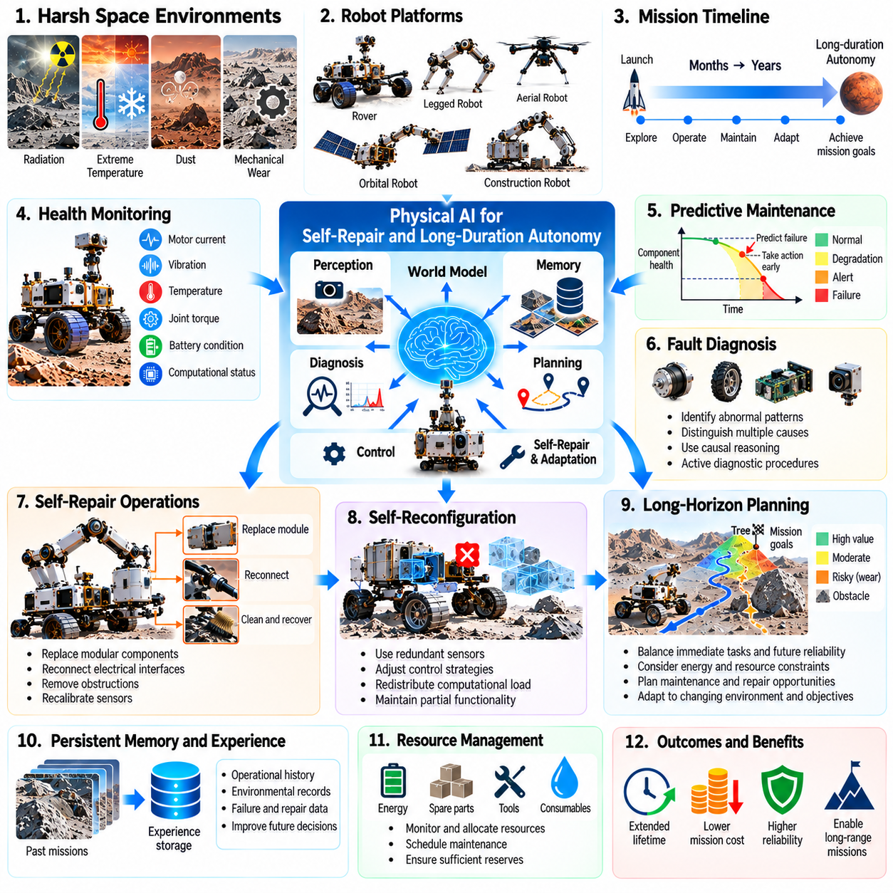{width="7.268055555555556in" height="7.268055555555556in"}

Self-repair and long-duration autonomy are essential for Physical AI systems operating far beyond immediate human assistance. Space robots may need to function for months or years while exposed to radiation, extreme temperatures, dust, and mechanical degradation. Repair missions from Earth can be prohibitively expensive or impossible. Autonomous systems must therefore detect deterioration, preserve essential functions, and recover from failures with limited external intervention.

Long-duration autonomy extends beyond executing predefined tasks without human supervision. A robotic system must maintain its operational capability while environmental conditions, equipment performance, and mission objectives evolve. This requires continuous integration of perception, planning, control, health monitoring, and resource management. Physical AI must reason about both immediate task completion and the long-term consequences of its actions.

Space environments create persistent threats to mechanical, electrical, and computational components. Radiation can disrupt electronics, thermal cycling can weaken connections, and abrasive dust can damage joints and seals. Repeated mechanical loading may gradually reduce actuator performance. Autonomous maintenance systems must distinguish normal aging from emerging faults and unexpected failures that require immediate protective responses.

Health monitoring provides the foundation for autonomous repair and recovery. Sensors can measure motor current, vibration, temperature, joint torque, battery condition, and computational errors. Physical AI can compare these observations with expected operating behavior to identify abnormal patterns. Reliable diagnosis requires combining multiple measurements because individual sensor anomalies do not always indicate actual component failures.

Predictive maintenance enables robots to respond before deterioration causes mission-critical failures. Models of component wear, fatigue, and thermal stress can estimate remaining useful life under different operating conditions. Physical AI may reduce mechanical loads, modify movement patterns, or reschedule demanding tasks. Such adjustments can extend operational life while preserving sufficient capability to accomplish essential mission objectives.

Fault diagnosis becomes particularly challenging when multiple components influence the same observable behavior. Reduced mobility may result from motor degradation, wheel damage, terrain conditions, or power limitations. Causal models can distinguish competing explanations by examining relationships between commands, sensor responses, and environmental states. Active diagnostic procedures may provide additional evidence without exposing the robot to unnecessary risk.

Self-repair involves restoring damaged or degraded functionality through actions performed by the robotic system itself. Potential approaches include replacing modular components, reconnecting electrical interfaces, clearing mechanical obstructions, and recalibrating sensors. These operations require suitable hardware architecture and accessible maintenance interfaces. Physical AI cannot compensate for every physical failure through software intelligence alone.

Modular design improves the feasibility of robotic self-repair by separating complex equipment into replaceable functional units. Standardized mechanical attachments, electrical connectors, and diagnostic interfaces simplify maintenance procedures. A robot equipped with suitable manipulators and spare modules may replace selected failed components. However, repairability must be considered during system design because inaccessible or permanently integrated parts remain difficult to service.

Autonomous manipulation is central to physical maintenance operations. Repair robots must identify damaged components, select appropriate tools, establish stable contact, and execute precise movements. Force feedback and visual sensing help manage alignment and contact uncertainty. In microgravity or reduced-gravity environments, manipulation forces may also disturb the robot platform, requiring coordinated stabilization and motion control.

Self-reconfiguration provides an alternative when direct physical repair is unavailable. A robot may compensate for a failed sensor by using redundant measurements or adjust its control strategy after partial actuator degradation. Reconfigurable systems can redistribute computational workloads and isolate malfunctioning subsystems. These adaptations preserve reduced but useful functionality, although they cannot restore capabilities that depend on irreversibly damaged hardware.

World models support long-duration autonomy by representing environmental conditions, equipment states, and expected physical interactions. A health-aware world model can predict how planned actions influence component wear, energy consumption, and failure probability. Physical AI can compare alternative strategies according to both mission productivity and equipment preservation. Such reasoning connects maintenance decisions with broader operational planning.

Persistent memory allows autonomous systems to accumulate experience across extended missions. Historical records of equipment loads, temperature exposure, repair attempts, and previous anomalies provide context for future diagnosis. Memory systems must preserve the relationships between environmental conditions and observed degradation. This accumulated knowledge can improve maintenance scheduling and reduce repeated exposure to known operational hazards.

Long-horizon planning is necessary because maintenance decisions often involve tradeoffs between immediate productivity and future reliability. A demanding excavation task may accelerate tool wear, while postponing maintenance may increase the likelihood of complete failure. Physical AI must estimate these consequences over multiple timescales. Hierarchical planning can coordinate short-term control, intermediate maintenance activities, and long-term mission objectives.

Energy management strongly influences autonomous survival and recovery. Repair procedures may require substantial power for manipulation, heating, computation, or diagnostic testing. Robots must maintain reserves for communication, thermal protection, and safe shutdown. Physical AI can schedule maintenance according to available energy and environmental conditions, ensuring that repair attempts do not compromise essential survival functions.

Thermal management is particularly important during extended planetary and orbital missions. Extreme temperature variations can affect batteries, electronics, lubricants, and mechanical tolerances. Autonomous systems may adjust operational schedules, activate heaters, or reduce computational loads to remain within acceptable limits. Predictive thermal models can anticipate hazardous conditions and coordinate protective actions before component performance deteriorates.

Software resilience is another essential dimension of long-duration autonomy. Radiation-induced errors, corrupted data, unexpected software states, and computational overload can interrupt robotic operations. Fault-tolerant architectures may use redundant processors, error detection, checkpoint recovery, and controlled software restarts. Physical AI must distinguish recoverable software faults from hardware problems while maintaining reliable safety-critical control.

Autonomous recovery requires a structured response when failures occur. A robot should first stabilize its physical state, isolate potential hazards, and preserve essential resources. It can then evaluate diagnostic evidence and select an approved recovery procedure. If recovery remains uncertain, the system may enter a safe mode and request human assistance. Unrestricted autonomous experimentation is inappropriate when unsuccessful actions could permanently disable the mission.

Multi-robot systems can extend repair capabilities through cooperative maintenance. One robot may inspect damaged equipment while another transports replacement modules or performs manipulation. Shared diagnostic information can help identify common failure patterns across a fleet. Cooperative recovery also provides redundancy when individual robots lose functionality, although repair operations must account for communication limitations and coordination risks.

Simulation and digital twins provide valuable tools for validating autonomous maintenance strategies. Digital representations can estimate equipment degradation and predict the effects of proposed repairs. Simulated fault injection allows developers to evaluate diagnostic accuracy and recovery behavior under controlled conditions. Physical testing remains necessary because actual failures may involve unexpected interactions that simplified models cannot reproduce.

Verification and safety assurance are essential because autonomous repair can introduce new failures. Incorrect component replacement, excessive manipulation forces, or unsuitable software reconfiguration may worsen existing damage. Maintenance actions should operate within validated procedures and monitored safety constraints. Systems must also recognize when available evidence is insufficient to justify intervention and when preserving the current state is safer than attempting repair.

The effectiveness of self-repair should be evaluated through mission continuity rather than repair success alone. Important measures include operational availability, fault detection accuracy, recovery time, resource consumption, and remaining functional capability. A successful maintenance strategy may restore full performance or preserve a reduced operating mode. Long-duration evaluation must also examine whether repeated repairs introduce cumulative risks or accelerate other forms of degradation.

Human oversight remains important for consequential maintenance decisions, particularly when repair procedures involve irreversible actions. Ground operators can establish acceptable risk levels, approve complex interventions, and update maintenance priorities. Communication delays require robots to manage urgent protective responses independently. Transparent diagnostic reports and interpretable recovery plans help maintain human understanding and accountability throughout extended missions.

Ultimately, self-repair and long-duration autonomy transform Physical AI from task-oriented robotic intelligence into systems capable of sustaining their own operational existence. Progress depends on integrating health monitoring, predictive maintenance, modular hardware, autonomous manipulation, world models, persistent memory, and safety-aware planning. These capabilities may enable more resilient spacecraft, planetary robots, and long-lived extraterrestrial infrastructure.

자가 수리(Self-Repair)와 장기 자율성(Long-Duration Autonomy)은 인간의 즉각적인 지원을 받을 수 없는 먼 우주에서 작동하는 피지컬 AI(Physical AI) 시스템에 필수적입니다. 우주 로봇(Space Robots)은 방사선(Radiation), 극한 온도(Extreme Temperatures), 먼지(Dust), 기계적 열화(Mechanical Degradation)에 노출된 상태에서 수개월 또는 수년 동안 작동해야 할 수 있습니다. 지구에서 수리 임무(Repair Missions)를 수행하는 것은 비용이 지나치게 높거나 불가능할 수 있습니다. 따라서 자율 시스템(Autonomous Systems)은 제한적인 외부 개입(External Intervention)만으로 성능 저하를 감지하고, 필수 기능(Essential Functions)을 유지하며, 고장(Failures)으로부터 복구할 수 있어야 합니다.

장기 자율성(Long-Duration Autonomy)은 인간의 감독(Human Supervision) 없이 사전에 정의된 작업(Predefined Tasks)을 실행하는 것 이상의 의미를 갖습니다. 로봇 시스템(Robotic System)은 환경 조건(Environmental Conditions), 장비 성능(Equipment Performance), 임무 목표(Mission Objectives)가 변화하는 동안에도 운용 능력(Operational Capability)을 유지해야 합니다. 이를 위해 인식(Perception), 계획(Planning), 제어(Control), 상태 모니터링(Health Monitoring), 자원 관리(Resource Management)의 지속적인 통합이 필요합니다. 피지컬 AI는 즉각적인 작업 완료(Immediate Task Completion)와 행동의 장기적 결과(Long-Term Consequences)를 모두 고려하여 추론해야 합니다.

우주 환경(Space Environments)은 기계적 부품(Mechanical Components), 전기적 부품(Electrical Components), 컴퓨팅 구성요소(Computational Components)에 지속적인 위협을 가합니다. 방사선(Radiation)은 전자장치(Electronics)의 작동을 방해할 수 있고, 열 순환(Thermal Cycling)은 연결부(Connections)를 약화시키며, 마모성 먼지(Abrasive Dust)는 관절(Joints)과 밀봉 장치(Seals)를 손상시킬 수 있습니다. 반복적인 기계적 하중(Repeated Mechanical Loading)은 액추에이터 성능(Actuator Performance)을 점진적으로 저하시킬 수 있습니다. 자율 유지보수 시스템(Autonomous Maintenance Systems)은 정상적인 노화(Normal Aging)와 초기 결함(Emerging Faults), 즉각적인 보호 대응(Immediate Protective Responses)이 필요한 예기치 않은 고장(Unexpected Failures)을 구분해야 합니다.

상태 모니터링(Health Monitoring)은 자율 수리(Autonomous Repair)와 복구(Recovery)의 기반을 제공합니다. 센서(Sensors)는 모터 전류(Motor Current), 진동(Vibration), 온도(Temperature), 관절 토크(Joint Torque), 배터리 상태(Battery Condition), 컴퓨팅 오류(Computational Errors)를 측정할 수 있습니다. 피지컬 AI는 이러한 관측값을 예상 운용 거동(Expected Operating Behavior)과 비교하여 비정상적인 패턴(Abnormal Patterns)을 식별할 수 있습니다. 개별 센서 이상(Sensor Anomalies)이 항상 실제 부품 고장(Component Failures)을 의미하는 것은 아니므로, 신뢰할 수 있는 진단(Reliable Diagnosis)을 위해서는 여러 측정값을 결합해야 합니다.

예측 유지보수(Predictive Maintenance)는 성능 저하가 임무에 치명적인 고장(Mission-Critical Failures)을 일으키기 전에 로봇이 대응하도록 합니다. 부품 마모(Component Wear), 피로(Fatigue), 열 응력(Thermal Stress)에 대한 모델은 다양한 운용 조건(Operating Conditions)에서 잔여 유효 수명(Remaining Useful Life)을 추정할 수 있습니다. 피지컬 AI는 기계적 하중(Mechanical Loads)을 줄이고, 이동 패턴(Movement Patterns)을 수정하거나, 높은 부하가 요구되는 작업(Demanding Tasks)의 일정을 재조정할 수 있습니다. 이러한 조정은 필수 임무 목표(Essential Mission Objectives)를 수행하는 데 필요한 충분한 능력을 유지하면서 운용 수명(Operational Life)을 연장할 수 있습니다.

결함 진단(Fault Diagnosis)은 여러 구성요소(Components)가 동일한 관측 가능한 거동(Observable Behavior)에 영향을 미칠 때 특히 어려워집니다. 이동성 저하(Reduced Mobility)는 모터 열화(Motor Degradation), 바퀴 손상(Wheel Damage), 지형 조건(Terrain Conditions), 전력 제한(Power Limitations)으로 인해 발생할 수 있습니다. 인과 모델(Causal Models)은 명령(Commands), 센서 응답(Sensor Responses), 환경 상태(Environmental States) 사이의 관계를 분석하여 경쟁하는 설명(Competing Explanations)을 구분할 수 있습니다. 능동 진단 절차(Active Diagnostic Procedures)는 로봇을 불필요한 위험에 노출시키지 않으면서 추가적인 증거를 제공할 수 있습니다.

자가 수리(Self-Repair)는 로봇 시스템 자체가 수행하는 행동을 통해 손상되거나 성능이 저하된 기능(Damaged or Degraded Functionality)을 복원하는 것을 의미합니다. 가능한 접근법에는 모듈형 부품 교체(Modular Component Replacement), 전기 인터페이스 재연결(Electrical Interface Reconnection), 기계적 장애물 제거(Mechanical Obstruction Removal), 센서 재보정(Sensor Recalibration)이 포함됩니다. 이러한 작업에는 적절한 하드웨어 아키텍처(Hardware Architecture)와 접근 가능한 유지보수 인터페이스(Accessible Maintenance Interfaces)가 필요합니다. 피지컬 AI가 소프트웨어 지능(Software Intelligence)만으로 모든 물리적 고장(Physical Failures)을 보상할 수 있는 것은 아닙니다.

모듈형 설계(Modular Design)는 복잡한 장비를 교체 가능한 기능 단위(Replaceable Functional Units)로 분리하여 로봇 자가 수리(Robotic Self-Repair)의 실현 가능성을 높입니다. 표준화된 기계적 결합부(Standardized Mechanical Attachments), 전기 커넥터(Electrical Connectors), 진단 인터페이스(Diagnostic Interfaces)는 유지보수 절차(Maintenance Procedures)를 단순화합니다. 적절한 매니퓰레이터(Manipulators)와 예비 모듈(Spare Modules)을 갖춘 로봇은 고장 난 일부 구성요소를 교체할 수 있습니다. 그러나 접근하기 어렵거나 영구적으로 통합된 부품(Permanently Integrated Parts)은 여전히 정비하기 어려우므로 시스템 설계(System Design) 단계부터 수리 가능성(Repairability)을 고려해야 합니다.

자율 조작(Autonomous Manipulation)은 물리적 유지보수 작업(Physical Maintenance Operations)의 핵심입니다. 수리 로봇(Repair Robots)은 손상된 구성요소(Damaged Components)를 식별하고, 적절한 도구(Appropriate Tools)를 선택하며, 안정적인 접촉(Stable Contact)을 확보하고, 정밀한 움직임(Precise Movements)을 실행해야 합니다. 힘 피드백(Force Feedback)과 시각 센싱(Visual Sensing)은 정렬(Alignment)과 접촉 불확실성(Contact Uncertainty)을 관리하는 데 도움이 됩니다. 미세중력(Microgravity)이나 저중력 환경(Reduced-Gravity Environments)에서는 조작력(Manipulation Forces)이 로봇 플랫폼(Robot Platform)을 교란할 수도 있으므로 협조적 안정화(Coordinated Stabilization)와 운동 제어(Motion Control)가 필요합니다.

자가 재구성(Self-Reconfiguration)은 직접적인 물리적 수리(Direct Physical Repair)가 불가능할 때 대안이 됩니다. 로봇은 중복 측정값(Redundant Measurements)을 사용하여 고장 난 센서(Failed Sensor)를 보완하거나, 액추에이터가 부분적으로 열화된 이후 제어 전략(Control Strategy)을 조정할 수 있습니다. 재구성 가능한 시스템(Reconfigurable Systems)은 컴퓨팅 작업 부하(Computational Workloads)를 재분배하고 오작동하는 하위 시스템(Malfunctioning Subsystems)을 격리할 수 있습니다. 이러한 적응(Adaptations)은 성능이 감소하더라도 유용한 기능을 유지하지만, 복구할 수 없을 정도로 손상된 하드웨어(Irreversibly Damaged Hardware)에 의존하는 능력까지 복원할 수는 없습니다.

월드 모델(World Models)은 환경 조건(Environmental Conditions), 장비 상태(Equipment States), 예상되는 물리적 상호작용(Expected Physical Interactions)을 표현하여 장기 자율성(Long-Duration Autonomy)을 지원합니다. 상태 인식 월드 모델(Health-Aware World Model)은 계획된 행동(Planned Actions)이 부품 마모(Component Wear), 에너지 소비(Energy Consumption), 고장 확률(Failure Probability)에 어떤 영향을 미치는지 예측할 수 있습니다. 피지컬 AI는 임무 생산성(Mission Productivity)과 장비 보존(Equipment Preservation)을 모두 기준으로 대안 전략(Alternative Strategies)을 비교할 수 있습니다. 이러한 추론은 유지보수 의사결정(Maintenance Decisions)을 더 넓은 운용 계획(Operational Planning)과 연결합니다.

지속적 메모리(Persistent Memory)는 자율 시스템(Autonomous Systems)이 장기간의 임무(Extended Missions)에 걸쳐 경험을 축적하도록 합니다. 장비 하중(Equipment Loads), 온도 노출(Temperature Exposure), 수리 시도(Repair Attempts), 이전 이상 현상(Previous Anomalies)에 대한 과거 기록(Historical Records)은 미래 진단(Future Diagnosis)에 필요한 맥락(Context)을 제공합니다. 메모리 시스템(Memory Systems)은 환경 조건(Environmental Conditions)과 관측된 열화(Observed Degradation) 사이의 관계를 보존해야 합니다. 이러한 축적된 지식(Accumulated Knowledge)은 유지보수 일정 계획(Maintenance Scheduling)을 개선하고 알려진 운용 위험(Known Operational Hazards)에 반복적으로 노출되는 상황을 줄일 수 있습니다.

장기 계획(Long-Horizon Planning)은 유지보수 의사결정(Maintenance Decisions)이 즉각적인 생산성(Immediate Productivity)과 미래 신뢰성(Future Reliability) 사이의 상충관계(Tradeoffs)를 수반하는 경우가 많기 때문에 필요합니다. 높은 부하의 굴착 작업(Demanding Excavation Task)은 도구 마모(Tool Wear)를 가속할 수 있으며, 유지보수를 연기하면 완전한 고장(Complete Failure)의 가능성이 증가할 수 있습니다. 피지컬 AI는 여러 시간 척도(Multiple Timescales)에 걸쳐 이러한 결과를 추정해야 합니다. 계층적 계획(Hierarchical Planning)은 단기 제어(Short-Term Control), 중기 유지보수 활동(Intermediate Maintenance Activities), 장기 임무 목표(Long-Term Mission Objectives)를 조정할 수 있습니다.

에너지 관리(Energy Management)는 자율 생존(Autonomous Survival)과 복구(Recovery)에 큰 영향을 미칩니다. 수리 절차(Repair Procedures)에는 조작(Manipulation), 가열(Heating), 연산(Computation), 진단 시험(Diagnostic Testing)을 위한 상당한 전력이 필요할 수 있습니다. 로봇은 통신(Communication), 열 보호(Thermal Protection), 안전 종료(Safe Shutdown)를 위한 예비 에너지(Energy Reserves)를 유지해야 합니다. 피지컬 AI는 가용 에너지(Available Energy)와 환경 조건(Environmental Conditions)에 따라 유지보수 일정을 계획하여 수리 시도(Repair Attempts)가 필수 생존 기능(Essential Survival Functions)을 위협하지 않도록 할 수 있습니다.

열 관리(Thermal Management)는 장기간의 행성 및 궤도 임무(Extended Planetary and Orbital Missions)에서 특히 중요합니다. 극심한 온도 변화(Extreme Temperature Variations)는 배터리(Batteries), 전자장치(Electronics), 윤활제(Lubricants), 기계적 공차(Mechanical Tolerances)에 영향을 미칠 수 있습니다. 자율 시스템은 허용 가능한 한계(Acceptable Limits) 내에서 작동하기 위해 운용 일정(Operational Schedules)을 조정하거나, 히터(Heaters)를 작동시키거나, 연산 부하(Computational Loads)를 줄일 수 있습니다. 예측 열 모델(Predictive Thermal Models)은 위험한 조건(Hazardous Conditions)을 사전에 예측하고 부품 성능(Component Performance)이 저하되기 전에 보호 행동(Protective Actions)을 조정할 수 있습니다.

소프트웨어 회복탄력성(Software Resilience)은 장기 자율성(Long-Duration Autonomy)의 또 다른 필수 요소입니다. 방사선 유발 오류(Radiation-Induced Errors), 손상된 데이터(Corrupted Data), 예상하지 못한 소프트웨어 상태(Unexpected Software States), 연산 과부하(Computational Overload)는 로봇 운용(Robotic Operations)을 중단시킬 수 있습니다. 결함 허용 아키텍처(Fault-Tolerant Architectures)는 중복 프로세서(Redundant Processors), 오류 탐지(Error Detection), 체크포인트 복구(Checkpoint Recovery), 제어된 소프트웨어 재시작(Controlled Software Restarts)을 사용할 수 있습니다. 피지컬 AI는 안전 필수 제어(Safety-Critical Control)의 신뢰성을 유지하면서 복구 가능한 소프트웨어 결함(Recoverable Software Faults)과 하드웨어 문제(Hardware Problems)를 구분해야 합니다.

자율 복구(Autonomous Recovery)는 고장이 발생했을 때 구조화된 대응(Structured Response)을 요구합니다. 로봇은 먼저 물리적 상태(Physical State)를 안정화하고, 잠재적 위험(Potential Hazards)을 격리하며, 필수 자원(Essential Resources)을 보존해야 합니다. 이후 진단 증거(Diagnostic Evidence)를 평가하고 승인된 복구 절차(Approved Recovery Procedure)를 선택할 수 있습니다. 복구 가능성이 여전히 불확실하다면 시스템은 안전 모드(Safe Mode)로 전환하여 인간의 지원(Human Assistance)을 요청할 수 있습니다. 실패한 행동이 임무를 영구적으로 불능 상태에 빠뜨릴 수 있는 경우 제한 없는 자율 실험(Unrestricted Autonomous Experimentation)은 적절하지 않습니다.

다중 로봇 시스템(Multi-Robot Systems)은 협력 유지보수(Cooperative Maintenance)를 통해 수리 능력(Repair Capabilities)을 확장할 수 있습니다. 하나의 로봇이 손상된 장비(Damaged Equipment)를 검사하는 동안 다른 로봇은 교체 모듈(Replacement Modules)을 운송하거나 조작 작업(Manipulation)을 수행할 수 있습니다. 공유 진단 정보(Shared Diagnostic Information)는 로봇 군집(Fleet) 전체에서 공통적인 고장 패턴(Common Failure Patterns)을 식별하는 데 도움이 됩니다. 협력 복구(Cooperative Recovery)는 개별 로봇이 기능을 상실했을 때 중복성(Redundancy)도 제공하지만, 수리 작업에서는 통신 제약(Communication Limitations)과 협조 위험(Coordination Risks)을 고려해야 합니다.

시뮬레이션(Simulation)과 디지털 트윈(Digital Twins)은 자율 유지보수 전략(Autonomous Maintenance Strategies)을 검증하기 위한 유용한 도구를 제공합니다. 디지털 표현(Digital Representations)은 장비 열화(Equipment Degradation)를 추정하고 제안된 수리(Proposed Repairs)의 영향을 예측할 수 있습니다. 시뮬레이션 기반 결함 주입(Simulated Fault Injection)은 개발자가 통제된 조건(Controlled Conditions)에서 진단 정확도(Diagnostic Accuracy)와 복구 행동(Recovery Behavior)을 평가하도록 합니다. 실제 고장(Actual Failures)은 단순화된 모델(Simplified Models)이 재현하지 못하는 예상 밖의 상호작용(Unexpected Interactions)을 포함할 수 있으므로 물리적 시험(Physical Testing)이 여전히 필요합니다.

검증(Verification)과 안전 보증(Safety Assurance)은 자율 수리(Autonomous Repair)가 새로운 고장을 유발할 수 있기 때문에 필수적입니다. 잘못된 부품 교체(Incorrect Component Replacement), 과도한 조작력(Excessive Manipulation Forces), 부적절한 소프트웨어 재구성(Unsuitable Software Reconfiguration)은 기존 손상(Existing Damage)을 악화시킬 수 있습니다. 유지보수 행동(Maintenance Actions)은 검증된 절차(Validated Procedures)와 감시되는 안전 제약(Monitored Safety Constraints) 내에서 수행되어야 합니다. 또한 시스템은 개입(Intervention)을 정당화할 충분한 증거가 없는 경우와 수리를 시도하는 것보다 현재 상태(Current State)를 보존하는 것이 더 안전한 경우를 인식해야 합니다.

자가 수리(Self-Repair)의 효과는 수리 성공(Repair Success)만이 아니라 임무 연속성(Mission Continuity)을 통해 평가해야 합니다. 중요한 평가 지표(Measures)에는 운용 가용성(Operational Availability), 결함 탐지 정확도(Fault Detection Accuracy), 복구 시간(Recovery Time), 자원 소비(Resource Consumption), 잔여 기능 능력(Remaining Functional Capability)이 포함됩니다. 성공적인 유지보수 전략(Maintenance Strategy)은 전체 성능(Full Performance)을 복원하거나 성능이 제한된 운용 모드(Reduced Operating Mode)를 유지할 수 있습니다. 장기 평가(Long-Duration Evaluation)에서는 반복적인 수리(Repeated Repairs)가 누적 위험(Cumulative Risks)을 발생시키거나 다른 형태의 열화(Degradation)를 가속하는지도 검토해야 합니다.

인간 감독(Human Oversight)은 특히 수리 절차(Repair Procedures)에 되돌릴 수 없는 행동(Irreversible Actions)이 포함되는 경우 중요한 유지보수 의사결정(Consequential Maintenance Decisions)에 여전히 필요합니다. 지상 운영자(Ground Operators)는 허용 가능한 위험 수준(Acceptable Risk Levels)을 설정하고, 복잡한 개입(Complex Interventions)을 승인하며, 유지보수 우선순위(Maintenance Priorities)를 갱신할 수 있습니다. 통신 지연(Communication Delays)으로 인해 로봇은 긴급한 보호 대응(Urgent Protective Responses)을 독립적으로 관리해야 합니다. 투명한 진단 보고서(Transparent Diagnostic Reports)와 해석 가능한 복구 계획(Interpretable Recovery Plans)은 장기 임무 전반에 걸쳐 인간의 상황 이해(Human Understanding)와 책임성(Accountability)을 유지하도록 지원합니다.

궁극적으로 자가 수리(Self-Repair)와 장기 자율성(Long-Duration Autonomy)은 피지컬 AI(Physical AI)를 작업 중심의 로봇 지능(Task-Oriented Robotic Intelligence)에서 자체 운용 상태(Operational Existence)를 지속적으로 유지할 수 있는 시스템으로 발전시킵니다. 이러한 발전은 상태 모니터링(Health Monitoring), 예측 유지보수(Predictive Maintenance), 모듈형 하드웨어(Modular Hardware), 자율 조작(Autonomous Manipulation), 월드 모델(World Models), 지속적 메모리(Persistent Memory), 안전 인식 계획(Safety-Aware Planning)의 통합에 달려 있습니다. 이러한 역량은 더욱 높은 회복탄력성(Resilience)을 갖춘 우주선(Spacecraft), 행성 로봇(Planetary Robots), 장수명 외계 인프라(Long-Lived Extraterrestrial Infrastructure)를 가능하게 할 수 있습니다.

##  

## 04.13. Human Robot Collaboration in Space

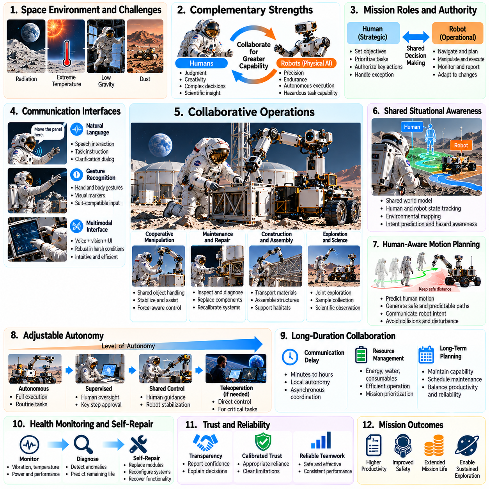{width="7.268055555555556in" height="7.268055555555556in"}

Human-robot collaboration in space represents a fundamental approach to extending human capabilities beyond Earth. Astronauts provide scientific judgment, contextual understanding, and responsibility for complex decisions, while Physical AI systems contribute precision, endurance, and autonomous execution. Effective collaboration combines these complementary strengths to improve mission safety, productivity, and adaptability in demanding extraterrestrial environments.

Space operations expose humans to radiation, reduced gravity, extreme temperatures, and limited life-support resources. Robotic assistants can reduce astronaut exposure by performing repetitive, hazardous, or physically demanding activities. These tasks include equipment inspection, material transportation, surface preparation, and infrastructure maintenance. Physical AI allows robots to adapt their actions to changing conditions rather than following rigidly predefined procedures.

Human-robot collaboration requires a clear distribution of responsibilities between astronauts and autonomous machines. Humans may define mission objectives, establish operational priorities, and authorize consequential actions, while robots handle navigation, manipulation, and routine execution. The allocation of authority should change according to task complexity, environmental uncertainty, and system reliability. Effective autonomy supports human decisions without eliminating meaningful oversight.

Shared situational awareness is essential when humans and robots operate in the same environment. Astronauts must understand robotic intentions, operating states, and potential hazards, while robots must recognize human positions, activities, and immediate needs. Multimodal perception can integrate visual observations, spatial maps, equipment information, and human activity estimates. Shared world models provide a common foundation for coordinated planning and safe interaction.

Natural language interaction can make robotic assistance more accessible during complex space missions. Astronauts may describe objectives, request information, or modify procedures through spoken instructions. Language-capable Physical AI must translate these requests into grounded actions consistent with physical constraints. Ambiguous commands should trigger clarification, especially when incorrect interpretation could damage equipment or threaten crew safety.

Gesture recognition and multimodal interfaces provide additional communication channels when speech is impractical. Astronauts wearing protective suits may experience limited mobility, restricted visibility, or communication interference. Robots can interpret pointing gestures, visual markers, and structured interface commands to support task coordination. Interface design must account for environmental conditions and avoid depending on a single potentially unreliable communication method.

Collaborative manipulation enables astronauts and robots to handle objects that are difficult for either partner to manage independently. A robot may stabilize a component while an astronaut performs assembly, or position tools and materials during maintenance. Such cooperation requires accurate estimation of forces, motion intentions, and contact conditions. Physical AI must adapt its behavior continuously while respecting human safety margins and mechanical limitations.

Physical interaction becomes particularly challenging in microgravity and reduced-gravity environments. Forces applied during manipulation can disturb both robotic platforms and astronauts, creating unexpected motion. Cooperative controllers must consider momentum exchange, anchoring conditions, and the stability of shared objects. Predictive dynamics models can estimate interaction consequences and support coordinated movements that minimize unnecessary physical disturbances.

Human-aware motion planning is necessary when robots navigate near astronauts or shared workspaces. Robots should anticipate possible human movement while maintaining safe distances and accessible escape paths. Collision avoidance alone is insufficient because sudden robotic actions may distract or destabilize crew members. Physical AI should generate predictable trajectories and communicate intended movements before entering sensitive operational areas.

Trust calibration is a central requirement for successful human-robot collaboration. Astronauts must understand what a robot can accomplish reliably and where its capabilities remain uncertain. Excessive trust may encourage unsafe delegation, while insufficient trust can increase workload and reduce operational benefits. Transparent reporting of confidence, limitations, and detected anomalies helps operators maintain appropriate expectations of autonomous performance.

Adjustable autonomy allows robotic systems to operate at different levels of independence according to mission circumstances. During routine logistics, robots may execute complete tasks autonomously, while complex repairs may require step-by-step human authorization. Shared control can combine astronaut commands with robotic stabilization and obstacle avoidance. The system should support smooth transitions between autonomous, supervised, and directly controlled operating modes.

Communication delays complicate collaboration between astronauts, robots, and Earth-based mission controllers. Lunar operations may involve noticeable delays, while Mars missions can experience delays lasting many minutes. Local robotic autonomy becomes essential for time-sensitive safety responses and routine coordination. Ground teams can establish strategic objectives, but nearby humans and robots must often resolve immediate operational problems independently.

World models support collaboration by maintaining representations of shared environments, equipment states, and ongoing human activities. A robot assisting with construction should understand which components are installed, which tools are available, and where astronauts are working. Predictive models can anticipate task dependencies and identify potential conflicts. Persistent memory helps preserve operational context across shifts, interruptions, and changing mission teams.

Long-horizon task planning becomes important when human and robotic activities must be coordinated over extended periods. Habitat construction, scientific exploration, and equipment servicing may involve complex sequences of dependent operations. Physical AI can schedule robotic work around astronaut availability, energy constraints, and environmental conditions. Effective planning should reduce human waiting time while preserving flexibility for unexpected discoveries or urgent maintenance.

Robotic assistants can improve scientific productivity by supporting field exploration and sample collection. Astronauts may identify promising geological targets while robots perform detailed scanning, instrument positioning, or sample transportation. Physical AI can recommend additional measurements based on environmental observations and scientific hypotheses. Human researchers retain responsibility for interpreting discoveries and determining which investigations deserve priority.

Collaborative maintenance is another important application in long-duration space missions. Robots may inspect inaccessible equipment, transport replacement parts, and assist astronauts during complex repairs. Autonomous diagnostics can identify likely faults and suggest maintenance procedures. However, interventions involving irreversible changes or uncertain mechanical conditions may require explicit human approval. Cooperative maintenance combines robotic precision with human adaptability.

Crew workload management must be considered when introducing autonomous assistants. A robot that frequently requests clarification or generates excessive alerts may increase cognitive demands rather than reduce them. Physical AI should prioritize important information and communicate at appropriate moments. Human-centered interfaces can present concise explanations, task progress, and actionable warnings without overwhelming astronauts during critical operations.

Human physiological and behavioral conditions also influence collaborative performance. Fatigue, stress, restricted mobility, and altered spatial orientation may affect astronaut movement and decision-making. Robots can adapt assistance levels using observable task conditions and authorized operational information. Such adaptation must respect privacy, avoid unsupported judgments about human states, and preserve the astronaut\'s ability to override automated recommendations.

Safety assurance requires systematic evaluation of human-robot interaction under realistic mission conditions. Simulation can reproduce constrained workspaces, reduced gravity, equipment failures, and communication disruptions. Human-in-the-loop testing reveals misunderstandings and coordination failures that purely robotic experiments may overlook. Verification should examine physical safety, interface usability, authority transitions, and recovery from unexpected interactions.

Ethical and organizational considerations become increasingly important as robotic autonomy expands. Mission operators must establish clear accountability for decisions involving crew safety, scientific resources, and environmental impacts. Autonomous systems should provide interpretable records of significant actions and their underlying assumptions. Human authority must remain meaningful even when robots possess superior speed, precision, or computational capacity for particular tasks.

The economic value of collaboration depends on reducing mission risk and improving the effective use of scarce human time. Astronaut activities require extensive training, life-support resources, and operational preparation. Robots can perform preparatory work before crew arrival and continue routine operations between human visits. However, robotic deployment must justify its own costs in mass, power, maintenance, reliability, and integration complexity.

Ultimately, human-robot collaboration in space provides a pathway toward sustained exploration and settlement beyond Earth. Its success depends on shared world models, adaptive autonomy, safe physical interaction, transparent communication, and coordinated long-horizon planning. As Physical AI matures, astronauts and intelligent robots may function as integrated operational teams capable of constructing, maintaining, and exploring increasingly complex extraterrestrial environments.

우주에서의 인간-로봇 협업(Human-Robot Collaboration in Space)은 지구 밖으로 인간의 능력을 확장하기 위한 근본적인 접근법을 의미합니다. 우주비행사(Astronauts)는 과학적 판단(Scientific Judgment), 상황적 이해(Contextual Understanding), 복잡한 의사결정(Complex Decisions)에 대한 책임을 제공하며, 피지컬 AI(Physical AI) 시스템은 정밀성(Precision), 지속적인 작업 능력(Endurance), 자율 실행(Autonomous Execution)에 기여합니다. 효과적인 협업(Effective Collaboration)은 이러한 상호 보완적 강점(Complementary Strengths)을 결합하여 까다로운 외계 환경(Extraterrestrial Environments)에서 임무 안전성(Mission Safety), 생산성(Productivity), 적응성(Adaptability)을 향상시킵니다.

우주 운용(Space Operations)은 인간을 방사선(Radiation), 저중력(Reduced Gravity), 극한 온도(Extreme Temperatures), 제한된 생명 유지 자원(Limited Life-Support Resources)에 노출시킵니다. 로봇 보조 시스템(Robotic Assistants)은 반복적이거나 위험하거나 신체적으로 부담이 큰 활동을 수행하여 우주비행사의 위험 노출(Astronaut Exposure)을 줄일 수 있습니다. 이러한 작업에는 장비 검사(Equipment Inspection), 자재 운송(Material Transportation), 표면 준비(Surface Preparation), 인프라 유지보수(Infrastructure Maintenance)가 포함됩니다. 피지컬 AI는 로봇이 엄격하게 사전 정의된 절차(Rigidly Predefined Procedures)만 따르는 대신 변화하는 조건(Changing Conditions)에 맞추어 행동을 조정하도록 합니다.

인간-로봇 협업(Human-Robot Collaboration)에는 우주비행사와 자율 기계(Autonomous Machines) 사이의 명확한 책임 분담(Distribution of Responsibilities)이 필요합니다. 인간은 임무 목표(Mission Objectives)를 정의하고, 운용 우선순위(Operational Priorities)를 설정하며, 중대한 행동(Consequential Actions)을 승인할 수 있고, 로봇은 항법(Navigation), 조작(Manipulation), 일상적인 작업 실행(Routine Execution)을 담당할 수 있습니다. 권한 배분(Allocation of Authority)은 작업 복잡성(Task Complexity), 환경 불확실성(Environmental Uncertainty), 시스템 신뢰성(System Reliability)에 따라 달라져야 합니다. 효과적인 자율성(Effective Autonomy)은 의미 있는 인간 감독(Meaningful Oversight)을 제거하지 않으면서 인간의 의사결정을 지원합니다.

공유 상황 인식(Shared Situational Awareness)은 인간과 로봇이 동일한 환경에서 작업할 때 필수적입니다. 우주비행사는 로봇의 의도(Robotic Intentions), 운용 상태(Operating States), 잠재적 위험(Potential Hazards)을 이해해야 하며, 로봇은 인간의 위치(Human Positions), 활동(Activities), 즉각적인 요구(Immediate Needs)를 인식해야 합니다. 다중 모달 인식(Multimodal Perception)은 시각적 관측(Visual Observations), 공간 지도(Spatial Maps), 장비 정보(Equipment Information), 인간 활동 추정(Human Activity Estimates)을 통합할 수 있습니다. 공유 월드 모델(Shared World Models)은 협조적 계획(Coordinated Planning)과 안전한 상호작용(Safe Interaction)을 위한 공통 기반(Common Foundation)을 제공합니다.

자연어 상호작용(Natural Language Interaction)은 복잡한 우주 임무(Complex Space Missions)에서 로봇 지원(Robotic Assistance)의 접근성을 높일 수 있습니다. 우주비행사는 음성 명령(Spoken Instructions)을 통해 목표(Objectives)를 설명하고, 정보를 요청하거나, 절차(Procedures)를 수정할 수 있습니다. 언어 이해 능력을 갖춘 피지컬 AI(Language-Capable Physical AI)는 이러한 요청을 물리적 제약(Physical Constraints)에 부합하는 실제 행동(Grounded Actions)으로 변환해야 합니다. 잘못된 해석(Incorrect Interpretation)이 장비를 손상시키거나 승무원 안전(Crew Safety)을 위협할 수 있는 경우, 모호한 명령(Ambiguous Commands)에 대해서는 명확화 요청(Clarification)이 이루어져야 합니다.

제스처 인식(Gesture Recognition)과 다중 모달 인터페이스(Multimodal Interfaces)는 음성 사용이 어려운 상황에서 추가적인 통신 수단(Communication Channels)을 제공합니다. 보호복(Protective Suits)을 착용한 우주비행사는 제한된 이동성(Limited Mobility), 제한된 시야(Restricted Visibility), 통신 간섭(Communication Interference)을 경험할 수 있습니다. 로봇은 손가락으로 가리키는 제스처(Pointing Gestures), 시각적 표식(Visual Markers), 구조화된 인터페이스 명령(Structured Interface Commands)을 해석하여 작업 협조(Task Coordination)를 지원할 수 있습니다. 인터페이스 설계(Interface Design)는 환경 조건(Environmental Conditions)을 고려해야 하며, 신뢰성이 떨어질 수 있는 단일 통신 방식(Single Communication Method)에 의존하지 않아야 합니다.

협력 조작(Collaborative Manipulation)은 우주비행사와 로봇이 어느 한쪽만으로는 다루기 어려운 물체를 함께 취급하도록 합니다. 로봇은 우주비행사가 조립(Assembly)을 수행하는 동안 부품(Component)을 안정화하거나, 유지보수(Maintenance) 과정에서 도구(Tools)와 자재(Materials)의 위치를 조정할 수 있습니다. 이러한 협력에는 힘(Forces), 운동 의도(Motion Intentions), 접촉 조건(Contact Conditions)에 대한 정확한 추정이 필요합니다. 피지컬 AI는 인간의 안전 여유(Safety Margins)와 기계적 한계(Mechanical Limitations)를 준수하면서 행동을 지속적으로 조정해야 합니다.

물리적 상호작용(Physical Interaction)은 미세중력(Microgravity)과 저중력 환경(Reduced-Gravity Environments)에서 특히 어려워집니다. 조작 과정에서 가해지는 힘(Manipulation Forces)은 로봇 플랫폼(Robotic Platforms)과 우주비행사 모두를 교란하여 예상하지 못한 운동(Unexpected Motion)을 발생시킬 수 있습니다. 협력 제어기(Cooperative Controllers)는 운동량 교환(Momentum Exchange), 고정 조건(Anchoring Conditions), 공유 물체의 안정성(Stability of Shared Objects)을 고려해야 합니다. 예측 동역학 모델(Predictive Dynamics Models)은 상호작용의 결과(Interaction Consequences)를 추정하고 불필요한 물리적 교란(Physical Disturbances)을 최소화하는 협조적 움직임(Coordinated Movements)을 지원할 수 있습니다.

인간 인식 운동 계획(Human-Aware Motion Planning)은 로봇이 우주비행사나 공유 작업 공간(Shared Workspaces) 근처에서 이동할 때 필요합니다. 로봇은 안전거리(Safe Distances)와 접근 가능한 탈출 경로(Accessible Escape Paths)를 유지하면서 가능한 인간의 움직임(Possible Human Movement)을 예측해야 합니다. 갑작스러운 로봇 행동(Sudden Robotic Actions)이 승무원의 주의를 분산시키거나 균형을 불안정하게 만들 수 있으므로 충돌 회피(Collision Avoidance)만으로는 충분하지 않습니다. 피지컬 AI는 예측 가능한 이동 궤적(Predictable Trajectories)을 생성하고 민감한 작업 구역(Sensitive Operational Areas)에 진입하기 전에 의도된 움직임(Intended Movements)을 전달해야 합니다.

신뢰 수준 조정(Trust Calibration)은 성공적인 인간-로봇 협업(Human-Robot Collaboration)의 핵심 요구사항입니다. 우주비행사는 로봇이 어떤 작업을 신뢰성 있게 수행할 수 있고 어떤 능력에 불확실성(Uncertainty)이 남아 있는지 이해해야 합니다. 과도한 신뢰(Excessive Trust)는 안전하지 않은 작업 위임(Unsafe Delegation)을 유도할 수 있으며, 불충분한 신뢰(Insufficient Trust)는 작업 부하(Workload)를 증가시키고 운용상 이점(Operational Benefits)을 감소시킬 수 있습니다. 신뢰도(Confidence), 한계(Limitations), 탐지된 이상 현상(Detected Anomalies)에 대한 투명한 보고(Transparent Reporting)는 운영자가 자율 성능(Autonomous Performance)에 대해 적절한 기대 수준을 유지하도록 돕습니다.

조정 가능한 자율성(Adjustable Autonomy)은 로봇 시스템이 임무 상황(Mission Circumstances)에 따라 서로 다른 독립성 수준(Levels of Independence)으로 작동하도록 합니다. 일상적인 물류 작업(Routine Logistics)에서는 로봇이 전체 작업을 자율적으로 수행할 수 있지만, 복잡한 수리(Complex Repairs)에는 단계별 인간 승인(Step-by-Step Human Authorization)이 필요할 수 있습니다. 공유 제어(Shared Control)는 우주비행사의 명령(Astronaut Commands)을 로봇의 안정화 기능(Robotic Stabilization) 및 장애물 회피(Obstacle Avoidance)와 결합할 수 있습니다. 시스템은 자율 운용(Autonomous Operation), 감독 운용(Supervised Operation), 직접 제어 운용(Directly Controlled Operation) 사이의 원활한 전환(Smooth Transitions)을 지원해야 합니다.

통신 지연(Communication Delays)은 우주비행사, 로봇, 지구 기반 임무 관제사(Earth-Based Mission Controllers) 사이의 협업을 복잡하게 만듭니다. 달 운용(Lunar Operations)에서는 체감할 수 있는 지연(Noticeable Delays)이 발생할 수 있으며, 화성 임무(Mars Missions)에서는 수십 분에 이르는 통신 지연이 발생할 수 있습니다. 현지 로봇 자율성(Local Robotic Autonomy)은 시간에 민감한 안전 대응(Time-Sensitive Safety Responses)과 일상적인 협조(Routine Coordination)에 필수적입니다. 지상 운영팀(Ground Teams)은 전략적 목표(Strategic Objectives)를 설정할 수 있지만, 현지의 인간과 로봇은 즉각적인 운용 문제(Immediate Operational Problems)를 독립적으로 해결해야 하는 경우가 많습니다.

월드 모델(World Models)은 공유 환경(Shared Environments), 장비 상태(Equipment States), 진행 중인 인간 활동(Ongoing Human Activities)에 대한 표현을 유지하여 협업을 지원합니다. 건설 작업(Construction)을 지원하는 로봇은 어떤 부품이 설치되었고, 어떤 도구를 사용할 수 있으며, 우주비행사가 어디에서 작업하고 있는지 이해해야 합니다. 예측 모델(Predictive Models)은 작업 의존성(Task Dependencies)을 예상하고 잠재적 충돌(Potential Conflicts)을 식별할 수 있습니다. 지속적 메모리(Persistent Memory)는 교대 근무(Shifts), 작업 중단(Interruptions), 임무 팀 변경(Changing Mission Teams)에 걸쳐 운용 맥락(Operational Context)을 보존하도록 돕습니다.

장기 작업 계획(Long-Horizon Task Planning)은 인간과 로봇의 활동을 장기간에 걸쳐 조정해야 할 때 중요해집니다. 거주 시설 건설(Habitat Construction), 과학 탐사(Scientific Exploration), 장비 정비(Equipment Servicing)에는 복잡한 선후 의존 관계(Dependent Operations)를 가진 작업 순서가 포함될 수 있습니다. 피지컬 AI는 우주비행사의 가용성(Astronaut Availability), 에너지 제약(Energy Constraints), 환경 조건(Environmental Conditions)에 맞추어 로봇 작업 일정을 계획할 수 있습니다. 효과적인 계획(Effective Planning)은 예상하지 못한 발견(Unexpected Discoveries)이나 긴급 유지보수(Urgent Maintenance)에 대응할 유연성(Flexibility)을 유지하면서 인간의 대기 시간(Human Waiting Time)을 줄여야 합니다.

로봇 보조 시스템(Robotic Assistants)은 현장 탐사(Field Exploration)와 시료 수집(Sample Collection)을 지원하여 과학적 생산성(Scientific Productivity)을 향상시킬 수 있습니다. 우주비행사는 유망한 지질학적 목표물(Geological Targets)을 식별하고, 로봇은 정밀 스캐닝(Detailed Scanning), 장비 위치 조정(Instrument Positioning), 시료 운송(Sample Transportation)을 수행할 수 있습니다. 피지컬 AI는 환경 관측(Environmental Observations)과 과학적 가설(Scientific Hypotheses)을 기반으로 추가 측정(Additional Measurements)을 제안할 수 있습니다. 인간 연구자(Human Researchers)는 발견을 해석하고 어떤 조사를 우선적으로 수행할지 결정하는 책임을 유지합니다.

협력 유지보수(Collaborative Maintenance)는 장기 우주 임무(Long-Duration Space Missions)의 또 다른 중요한 응용 분야입니다. 로봇은 접근하기 어려운 장비(Inaccessible Equipment)를 검사하고, 교체 부품(Replacement Parts)을 운송하며, 복잡한 수리(Complex Repairs) 과정에서 우주비행사를 지원할 수 있습니다. 자율 진단(Autonomous Diagnostics)은 가능한 결함(Likely Faults)을 식별하고 유지보수 절차(Maintenance Procedures)를 제안할 수 있습니다. 그러나 되돌릴 수 없는 변경(Irreversible Changes)이나 불확실한 기계적 조건(Uncertain Mechanical Conditions)이 포함된 개입(Interventions)에는 명시적인 인간 승인(Explicit Human Approval)이 필요할 수 있습니다. 협력 유지보수는 로봇의 정밀성(Robotic Precision)과 인간의 적응성(Human Adaptability)을 결합합니다.

자율 보조 시스템(Autonomous Assistants)을 도입할 때는 승무원 작업 부하 관리(Crew Workload Management)를 고려해야 합니다. 빈번하게 명확화 요청(Clarification Requests)을 하거나 과도한 경고(Excessive Alerts)를 생성하는 로봇은 인지적 부담(Cognitive Demands)을 줄이기보다 증가시킬 수 있습니다. 피지컬 AI는 중요한 정보(Important Information)에 우선순위를 부여하고 적절한 시점(Appropriate Moments)에 전달해야 합니다. 인간 중심 인터페이스(Human-Centered Interfaces)는 중요한 작업(Critical Operations) 중 우주비행사에게 과도한 부담을 주지 않으면서 간결한 설명(Concise Explanations), 작업 진행 상황(Task Progress), 실행 가능한 경고(Actionable Warnings)를 제공할 수 있습니다.

인간의 생리적 및 행동적 상태(Human Physiological and Behavioral Conditions)도 협업 성능(Collaborative Performance)에 영향을 미칩니다. 피로(Fatigue), 스트레스(Stress), 제한된 이동성(Restricted Mobility), 변화된 공간 방향 감각(Altered Spatial Orientation)은 우주비행사의 움직임과 의사결정에 영향을 줄 수 있습니다. 로봇은 관측 가능한 작업 조건(Observable Task Conditions)과 승인된 운용 정보(Authorized Operational Information)를 활용하여 지원 수준(Assistance Levels)을 조정할 수 있습니다. 이러한 적응은 개인정보 보호(Privacy)를 존중하고, 인간 상태(Human States)에 대한 근거 없는 판단(Unsupported Judgments)을 피하며, 우주비행사가 자동화된 권고(Automated Recommendations)를 무시하거나 변경할 수 있는 권한(Override Ability)을 보존해야 합니다.

안전 보증(Safety Assurance)을 위해서는 실제 임무 조건(Realistic Mission Conditions)에서 인간-로봇 상호작용(Human-Robot Interaction)을 체계적으로 평가해야 합니다. 시뮬레이션(Simulation)은 제한된 작업 공간(Constrained Workspaces), 저중력(Reduced Gravity), 장비 고장(Equipment Failures), 통신 장애(Communication Disruptions)를 재현할 수 있습니다. 인간 참여형 시험(Human-in-the-Loop Testing)은 로봇만을 대상으로 한 실험(Purely Robotic Experiments)에서 놓칠 수 있는 오해(Misunderstandings)와 협조 실패(Coordination Failures)를 드러냅니다. 검증(Verification)에서는 물리적 안전성(Physical Safety), 인터페이스 사용성(Interface Usability), 권한 전환(Authority Transitions), 예상하지 못한 상호작용(Unexpected Interactions)으로부터의 복구(Recovery)를 평가해야 합니다.

로봇 자율성(Robotic Autonomy)이 확대됨에 따라 윤리적 및 조직적 고려사항(Ethical and Organizational Considerations)은 더욱 중요해집니다. 임무 운영자(Mission Operators)는 승무원 안전(Crew Safety), 과학적 자원(Scientific Resources), 환경적 영향(Environmental Impacts)과 관련된 의사결정에 대해 명확한 책임성(Accountability)을 확립해야 합니다. 자율 시스템(Autonomous Systems)은 중요한 행동(Significant Actions)과 그 근거가 되는 가정(Underlying Assumptions)에 대한 해석 가능한 기록(Interpretable Records)을 제공해야 합니다. 로봇이 특정 작업에서 더 뛰어난 속도(Speed), 정밀성(Precision), 연산 능력(Computational Capacity)을 갖추더라도 인간의 권한(Human Authority)은 실질적으로 유지되어야 합니다.

협업의 경제적 가치(Economic Value)는 임무 위험(Mission Risk)을 줄이고 제한된 인간 시간(Scarce Human Time)의 효과적인 활용을 개선하는 데 달려 있습니다. 우주비행사의 활동(Astronaut Activities)에는 광범위한 훈련(Extensive Training), 생명 유지 자원(Life-Support Resources), 운용 준비(Operational Preparation)가 필요합니다. 로봇은 승무원 도착(Crew Arrival) 전에 준비 작업(Preparatory Work)을 수행하고 인간의 방문 사이에도 일상적인 운용(Routine Operations)을 계속할 수 있습니다. 그러나 로봇 배치(Robotic Deployment)는 질량(Mass), 전력(Power), 유지보수(Maintenance), 신뢰성(Reliability), 통합 복잡성(Integration Complexity) 측면에서 발생하는 자체 비용을 정당화할 수 있어야 합니다.

궁극적으로 우주에서의 인간-로봇 협업(Human-Robot Collaboration in Space)은 지구 밖에서 지속적인 탐사(Sustained Exploration)와 정착(Settlement)을 실현하기 위한 경로를 제공합니다. 성공을 위해서는 공유 월드 모델(Shared World Models), 적응형 자율성(Adaptive Autonomy), 안전한 물리적 상호작용(Safe Physical Interaction), 투명한 의사소통(Transparent Communication), 협조적 장기 계획(Coordinated Long-Horizon Planning)이 필요합니다. 피지컬 AI(Physical AI)가 성숙함에 따라 우주비행사와 지능형 로봇(Intelligent Robots)은 점점 더 복잡해지는 외계 환경(Extraterrestrial Environments)을 건설하고, 유지보수하며, 탐사할 수 있는 통합 운용팀(Integrated Operational Teams)으로 기능할 수 있을 것입니다.

##  

## 04.14. Autonomous Lunar and Martian Logistics

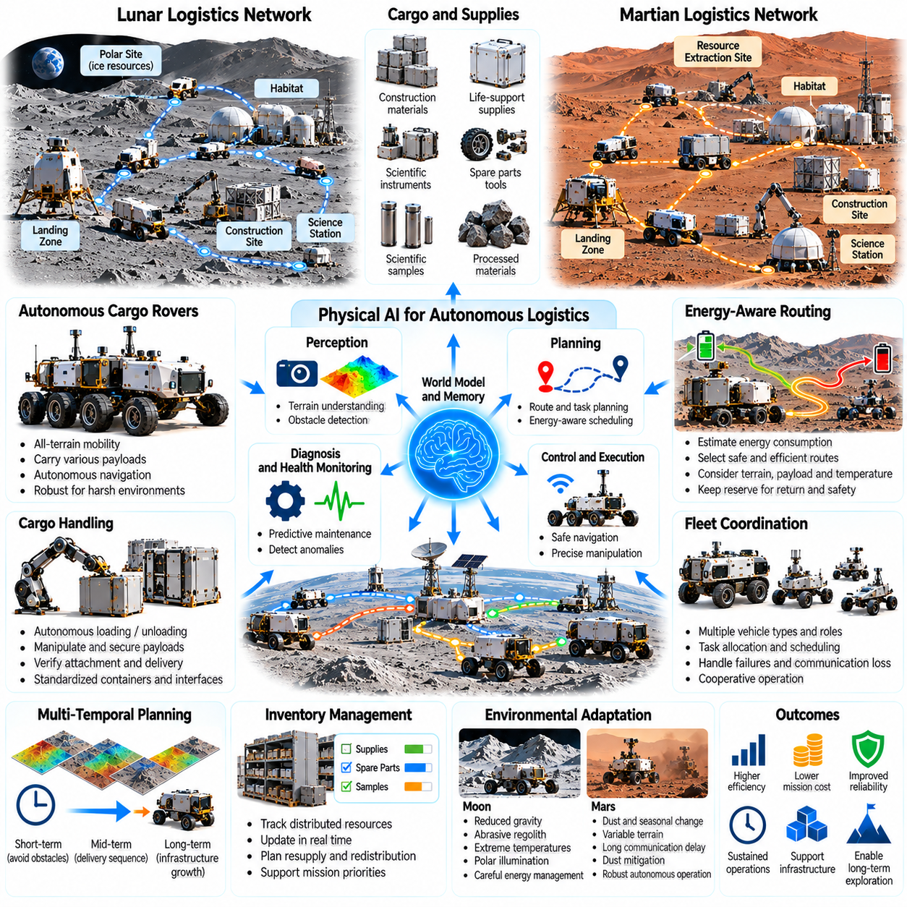{width="7.268055555555556in" height="7.268055555555556in"}

Autonomous lunar and Martian logistics will be essential for sustaining exploration, scientific operations, and future settlements beyond Earth. Transporting equipment, construction materials, scientific samples, and life-support supplies requires reliable coordination across distant locations. Physical AI enables robotic systems to manage these movements with limited human supervision, transforming isolated missions into interconnected extraterrestrial operations.

Unlike terrestrial logistics, planetary transportation must operate without established roads, extensive maintenance networks, or immediate emergency assistance. Lunar regolith, Martian dust, uneven terrain, and extreme temperatures create substantial operational challenges. Autonomous logistics systems must combine environmental perception, mobility planning, equipment monitoring, and resource management to maintain dependable transportation services.

A planetary logistics network may connect landing zones, habitats, scientific stations, resource extraction sites, and construction areas. Each location creates different transportation requirements and operational constraints. Physical AI can coordinate material flows according to mission priorities, available vehicles, and infrastructure conditions. Network planning must also consider travel distances, terrain accessibility, energy availability, and communication coverage.

Autonomous cargo rovers provide a practical foundation for surface transportation. These vehicles may carry tools, spare components, scientific instruments, and processed materials between operational sites. Their navigation systems must account for uncertain traction, obstacles, slopes, and changing surface conditions. Predictive mobility models can estimate travel feasibility while reducing the risk of immobilization or excessive mechanical wear.

Lunar logistics faces distinctive challenges arising from reduced gravity, abrasive regolith, and extreme thermal variation. Polar regions may contain permanently shadowed terrain with limited illumination and difficult navigation conditions. Solar-powered vehicles must carefully manage energy reserves and charging opportunities. Physical AI can adapt transportation schedules and route selection according to illumination, temperature, terrain risk, and infrastructure availability.

Martian logistics must address different environmental constraints, including widespread dust, variable terrain, seasonal conditions, and long communication delays. Dust accumulation may affect solar panels, sensors, and mechanical interfaces. Autonomous vehicles must maintain operational capability despite limited opportunities for direct human intervention. World models can support route prediction and anticipate environmental conditions that may threaten transportation reliability.

Cargo handling requires more than autonomous navigation. Robots must identify containers, secure payloads, transfer materials, and verify successful delivery. Manipulators and specialized loading mechanisms can support operations at depots, habitats, and construction sites. Physical AI must reason about payload mass, center of gravity, attachment integrity, and handling constraints to prevent cargo damage and vehicle instability.

Autonomous loading and unloading become especially important when human labor is scarce. Robotic systems may transfer scientific samples into protected storage, deliver replacement modules, or position construction materials for subsequent assembly. Visual perception and force feedback can support precise alignment and contact control. Standardized containers and mechanical interfaces can substantially improve reliability and reduce operational complexity.

Logistics planning must coordinate transportation tasks across multiple time horizons. Immediate decisions involve obstacle avoidance and vehicle control, while intermediate planning manages delivery sequences and charging schedules. Long-term planning anticipates future resource demands and infrastructure expansion. Hierarchical Physical AI architectures can connect these decisions while adapting to changing mission requirements and equipment availability.

Energy-aware routing is fundamental because transportation consumes resources that may be difficult to replenish. Vehicle energy demand depends on terrain resistance, payload mass, speed, temperature, and travel distance. Predictive models can compare alternative routes according to expected energy consumption and operational risk. Autonomous planners must preserve sufficient reserves for return journeys, communication, thermal protection, and emergency recovery.

Fleet coordination can improve logistics efficiency by distributing transportation responsibilities among specialized vehicles. Heavy cargo platforms may handle construction materials, while smaller robots deliver tools or scientific samples. Shared scheduling can reduce unnecessary travel and equipment idle time. However, fleet-level optimization must account for communication interruptions, vehicle failures, and competition for charging or maintenance facilities.

Distributed logistics systems benefit from shared world models and persistent operational memory. Vehicles can exchange information about hazardous routes, terrain changes, equipment conditions, and delivery locations. Historical travel records help estimate journey duration and resource consumption under different circumstances. Physical AI can update network knowledge as new infrastructure becomes available or previously accessible routes become unsuitable.

Autonomous inventory management connects physical transportation with resource planning. Robotic systems may track supplies, spare parts, scientific samples, and construction materials across distributed storage locations. Inventory records must remain consistent with actual physical quantities and container movements. Physical AI can detect shortages, prioritize critical deliveries, and recommend replenishment strategies based on projected mission demands.

In-situ resource utilization can fundamentally reshape lunar and Martian logistics. Locally extracted water, oxygen, regolith, and other materials may reduce dependence on supplies transported from Earth. Autonomous vehicles can connect extraction facilities with processing plants, storage systems, and operational sites. Coordinated logistics must account for production variability, processing capacity, material handling requirements, and consumption priorities.

Construction logistics presents additional challenges because infrastructure development requires materials to arrive in carefully coordinated sequences. Excavation robots, cargo vehicles, and assembly machines must share schedules and operational information. Delayed deliveries can interrupt construction, while premature deliveries may create storage problems. Physical AI can synchronize transportation with construction progress and adapt plans when equipment or environmental conditions change.

Landing operations create concentrated logistics demands during cargo arrival and deployment. Robotic systems may inspect delivered equipment, unload payloads, establish temporary storage, and transport supplies to designated destinations. Prepositioned autonomous vehicles could prepare infrastructure before human crews arrive. Reliable identification, cargo verification, and safe movement near landing facilities are essential for preventing mission-critical losses.

Maintenance logistics must ensure that transportation systems remain operational throughout extended missions. Vehicles require spare components, diagnostic support, charging access, and occasional physical repairs. Predictive maintenance can identify deteriorating equipment before failures disrupt essential deliveries. Autonomous scheduling can reserve maintenance periods while maintaining enough fleet capacity to support critical habitat and scientific operations.

Communication limitations require logistics networks to operate with substantial local autonomy. Mars missions cannot depend on immediate Earth-based decisions for every delivery or equipment failure. Vehicles must independently manage routine navigation, cargo handling, and recovery procedures within approved operational boundaries. Human operators can establish strategic priorities and authorize exceptional actions when communication opportunities become available.

Safety assurance is particularly important when logistics supports human survival. Delays involving oxygen, water, medical supplies, or essential replacement components may have serious consequences. Physical AI should distinguish critical deliveries from lower-priority transportation tasks and preserve redundancy where feasible. Risk-sensitive planning must consider failure consequences, recovery options, and the availability of alternative vehicles or routes.

Simulation and digital twins can support the development of autonomous planetary logistics before deployment. Virtual environments can reproduce terrain variability, vehicle degradation, communication disruptions, and changing resource demands. Mission-level simulations help evaluate fleet size, depot placement, and delivery strategies. Physical experiments remain necessary to validate mobility, cargo handling, and mechanical reliability under representative conditions.

The economic performance of planetary logistics depends on more than transportation speed. Relevant measures include delivered mass, energy consumption, vehicle utilization, maintenance burden, delivery reliability, and infrastructure cost. A slower but dependable system may provide greater mission value than a faster system with frequent failures. Physical AI can optimize these competing objectives while preserving operational flexibility and long-term sustainability.

Ultimately, autonomous lunar and Martian logistics will provide a critical foundation for persistent human and robotic activity beyond Earth. Its development requires integrating autonomous mobility, manipulation, shared world models, fleet coordination, predictive maintenance, and long-horizon resource planning. As these capabilities mature, Physical AI may transform planetary transportation into resilient infrastructure supporting exploration, industrial activity, and future settlements.

자율 달 및 화성 물류(Autonomous Lunar and Martian Logistics)는 지구 밖에서 탐사(Exploration), 과학적 운용(Scientific Operations), 미래 정착지(Future Settlements)를 지속적으로 유지하는 데 필수적입니다. 장비(Equipment), 건설 자재(Construction Materials), 과학 시료(Scientific Samples), 생명 유지 물자(Life-Support Supplies)를 운송하려면 멀리 떨어진 장소 사이에서 신뢰할 수 있는 협조(Reliable Coordination)가 필요합니다. 피지컬 AI(Physical AI)는 로봇 시스템(Robotic Systems)이 제한된 인간 감독(Human Supervision) 아래에서 이러한 물자의 이동을 관리하도록 하여 개별적으로 수행되는 임무(Isolated Missions)를 상호 연결된 외계 운용(Interconnected Extraterrestrial Operations)으로 전환합니다.

지상 물류(Terrestrial Logistics)와 달리 행성 운송(Planetary Transportation)은 구축된 도로(Established Roads), 광범위한 유지보수 네트워크(Extensive Maintenance Networks), 즉각적인 긴급 지원(Immediate Emergency Assistance) 없이 운영되어야 합니다. 달 표토(Lunar Regolith), 화성 먼지(Martian Dust), 불규칙한 지형(Uneven Terrain), 극한 온도(Extreme Temperatures)는 상당한 운용상의 어려움을 발생시킵니다. 자율 물류 시스템(Autonomous Logistics Systems)은 신뢰할 수 있는 운송 서비스(Dependable Transportation Services)를 유지하기 위해 환경 인식(Environmental Perception), 이동 계획(Mobility Planning), 장비 모니터링(Equipment Monitoring), 자원 관리(Resource Management)를 결합해야 합니다.

행성 물류 네트워크(Planetary Logistics Network)는 착륙 구역(Landing Zones), 거주 시설(Habitats), 과학 기지(Scientific Stations), 자원 채굴 현장(Resource Extraction Sites), 건설 지역(Construction Areas)을 연결할 수 있습니다. 각 장소는 서로 다른 운송 요구사항(Transportation Requirements)과 운용 제약(Operational Constraints)을 발생시킵니다. 피지컬 AI는 임무 우선순위(Mission Priorities), 사용 가능한 차량(Available Vehicles), 인프라 조건(Infrastructure Conditions)에 따라 물자 흐름(Material Flows)을 조정할 수 있습니다. 네트워크 계획(Network Planning)은 이동 거리(Travel Distances), 지형 접근성(Terrain Accessibility), 에너지 가용성(Energy Availability), 통신 범위(Communication Coverage)도 고려해야 합니다.

자율 화물 로버(Autonomous Cargo Rovers)는 지표면 운송(Surface Transportation)을 위한 실용적인 기반을 제공합니다. 이러한 차량은 도구(Tools), 예비 부품(Spare Components), 과학 장비(Scientific Instruments), 가공된 자재(Processed Materials)를 운용 거점(Operational Sites) 사이에서 운송할 수 있습니다. 항법 시스템(Navigation Systems)은 불확실한 견인력(Uncertain Traction), 장애물(Obstacles), 경사면(Slopes), 변화하는 표면 조건(Changing Surface Conditions)을 고려해야 합니다. 예측 이동성 모델(Predictive Mobility Models)은 차량의 이동 불능(Immobilization)이나 과도한 기계적 마모(Excessive Mechanical Wear) 위험을 줄이면서 주행 가능성(Travel Feasibility)을 추정할 수 있습니다.

달 물류(Lunar Logistics)는 저중력(Reduced Gravity), 마모성 표토(Abrasive Regolith), 극심한 열 변화(Extreme Thermal Variation)로 인해 고유한 어려움에 직면합니다. 극지방(Polar Regions)에는 조명이 제한되고 항법 조건(Navigation Conditions)이 까다로운 영구 음영 지역(Permanently Shadowed Terrain)이 존재할 수 있습니다. 태양광 구동 차량(Solar-Powered Vehicles)은 에너지 잔량(Energy Reserves)과 충전 기회(Charging Opportunities)를 신중하게 관리해야 합니다. 피지컬 AI는 일조 조건(Illumination), 온도(Temperature), 지형 위험(Terrain Risk), 인프라 가용성(Infrastructure Availability)에 따라 운송 일정(Transportation Schedules)과 경로 선택(Route Selection)을 조정할 수 있습니다.

화성 물류(Martian Logistics)는 광범위한 먼지(Widespread Dust), 다양한 지형(Variable Terrain), 계절적 조건(Seasonal Conditions), 긴 통신 지연(Long Communication Delays)을 포함한 서로 다른 환경 제약(Environmental Constraints)에 대응해야 합니다. 먼지 축적(Dust Accumulation)은 태양광 패널(Solar Panels), 센서(Sensors), 기계적 인터페이스(Mechanical Interfaces)에 영향을 미칠 수 있습니다. 자율 차량(Autonomous Vehicles)은 인간의 직접적인 개입(Direct Human Intervention)이 제한된 상황에서도 운용 능력(Operational Capability)을 유지해야 합니다. 월드 모델(World Models)은 경로 예측(Route Prediction)을 지원하고 운송 신뢰성(Transportation Reliability)을 위협할 수 있는 환경 조건을 사전에 예측할 수 있습니다.

화물 취급(Cargo Handling)에는 자율 항법(Autonomous Navigation) 이상의 능력이 필요합니다. 로봇은 컨테이너(Containers)를 식별하고, 적재물(Payloads)을 고정하며, 자재(Materials)를 이송하고, 배송 완료(Successful Delivery)를 확인해야 합니다. 매니퓰레이터(Manipulators)와 특수 적재 장치(Specialized Loading Mechanisms)는 물류 거점(Depots), 거주 시설(Habitats), 건설 현장(Construction Sites)에서의 작업을 지원할 수 있습니다. 피지컬 AI는 화물 손상(Cargo Damage)과 차량 불안정성(Vehicle Instability)을 방지하기 위해 적재물 질량(Payload Mass), 무게중심(Center of Gravity), 결합 상태의 건전성(Attachment Integrity), 취급 제약(Handling Constraints)을 고려하여 추론해야 합니다.

자율 적재 및 하역(Autonomous Loading and Unloading)은 인간 노동력(Human Labor)이 부족한 환경에서 특히 중요합니다. 로봇 시스템은 과학 시료(Scientific Samples)를 보호된 저장 공간(Protected Storage)으로 옮기거나, 교체 모듈(Replacement Modules)을 배송하거나, 후속 조립(Subsequent Assembly)을 위한 건설 자재(Construction Materials)를 배치할 수 있습니다. 시각 인식(Visual Perception)과 힘 피드백(Force Feedback)은 정밀한 정렬(Precise Alignment)과 접촉 제어(Contact Control)를 지원할 수 있습니다. 표준화된 컨테이너(Standardized Containers)와 기계적 인터페이스(Mechanical Interfaces)는 신뢰성(Reliability)을 크게 향상시키고 운용 복잡성(Operational Complexity)을 줄일 수 있습니다.

물류 계획(Logistics Planning)은 여러 시간 범위(Multiple Time Horizons)에 걸쳐 운송 작업(Transportation Tasks)을 조정해야 합니다. 즉각적인 의사결정(Immediate Decisions)에는 장애물 회피(Obstacle Avoidance)와 차량 제어(Vehicle Control)가 포함되며, 중기 계획(Intermediate Planning)은 배송 순서(Delivery Sequences)와 충전 일정(Charging Schedules)을 관리합니다. 장기 계획(Long-Term Planning)은 미래 자원 수요(Future Resource Demands)와 인프라 확장(Infrastructure Expansion)을 예측합니다. 계층적 피지컬 AI 아키텍처(Hierarchical Physical AI Architectures)는 변화하는 임무 요구사항(Mission Requirements)과 장비 가용성(Equipment Availability)에 적응하면서 이러한 의사결정을 연결할 수 있습니다.

에너지 인식 경로 계획(Energy-Aware Routing)은 운송 과정에서 보충하기 어려운 자원(Resources)이 소비되기 때문에 필수적입니다. 차량 에너지 수요(Vehicle Energy Demand)는 지형 저항(Terrain Resistance), 적재물 질량(Payload Mass), 속도(Speed), 온도(Temperature), 이동 거리(Travel Distance)에 따라 달라집니다. 예측 모델(Predictive Models)은 예상 에너지 소비(Expected Energy Consumption)와 운용 위험(Operational Risk)을 기준으로 대체 경로(Alternative Routes)를 비교할 수 있습니다. 자율 계획기(Autonomous Planners)는 복귀 주행(Return Journeys), 통신(Communication), 열 보호(Thermal Protection), 비상 복구(Emergency Recovery)를 위해 충분한 에너지 잔량을 보존해야 합니다.

로봇 군집 협조(Fleet Coordination)는 전문화된 차량(Specialized Vehicles) 사이에 운송 책임(Transportation Responsibilities)을 분배하여 물류 효율성(Logistics Efficiency)을 높일 수 있습니다. 대형 화물 플랫폼(Heavy Cargo Platforms)은 건설 자재(Construction Materials)를 운송하고, 소형 로봇(Smaller Robots)은 도구(Tools)나 과학 시료(Scientific Samples)를 배송할 수 있습니다. 공유 일정 계획(Shared Scheduling)은 불필요한 이동(Unnecessary Travel)과 장비 유휴 시간(Equipment Idle Time)을 줄일 수 있습니다. 그러나 군집 수준 최적화(Fleet-Level Optimization)는 통신 중단(Communication Interruptions), 차량 고장(Vehicle Failures), 충전 또는 유지보수 시설(Charging or Maintenance Facilities)에 대한 자원 경쟁도 고려해야 합니다.

분산 물류 시스템(Distributed Logistics Systems)은 공유 월드 모델(Shared World Models)과 지속적 운용 메모리(Persistent Operational Memory)를 통해 이점을 얻습니다. 차량들은 위험 경로(Hazardous Routes), 지형 변화(Terrain Changes), 장비 상태(Equipment Conditions), 배송 위치(Delivery Locations)에 관한 정보를 교환할 수 있습니다. 과거 이동 기록(Historical Travel Records)은 다양한 상황에서 이동 시간(Journey Duration)과 자원 소비(Resource Consumption)를 추정하는 데 도움이 됩니다. 피지컬 AI는 새로운 인프라가 이용 가능해지거나 이전에 접근할 수 있었던 경로가 부적합해지면 네트워크 지식(Network Knowledge)을 갱신할 수 있습니다.

자율 재고 관리(Autonomous Inventory Management)는 물리적 운송(Physical Transportation)과 자원 계획(Resource Planning)을 연결합니다. 로봇 시스템은 분산된 저장 장소(Distributed Storage Locations)에 보관된 물자(Supplies), 예비 부품(Spare Parts), 과학 시료(Scientific Samples), 건설 자재(Construction Materials)를 추적할 수 있습니다. 재고 기록(Inventory Records)은 실제 물리적 수량(Physical Quantities)과 컨테이너 이동(Container Movements)에 일치해야 합니다. 피지컬 AI는 예상 임무 수요(Projected Mission Demands)를 기반으로 부족한 물자(Shortages)를 탐지하고, 핵심 배송(Critical Deliveries)에 우선순위를 부여하며, 재보급 전략(Replenishment Strategies)을 권고할 수 있습니다.

현지 자원 활용(In-Situ Resource Utilization)은 달과 화성의 물류 구조를 근본적으로 변화시킬 수 있습니다. 현지에서 추출한 물(Local Water), 산소(Oxygen), 표토(Regolith), 기타 자재(Other Materials)는 지구에서 운송하는 보급품(Supplies Transported from Earth)에 대한 의존도를 줄일 수 있습니다. 자율 차량(Autonomous Vehicles)은 자원 채굴 시설(Extraction Facilities)을 처리 공장(Processing Plants), 저장 시스템(Storage Systems), 운용 거점(Operational Sites)과 연결할 수 있습니다. 협조적 물류(Coordinated Logistics)는 생산 변동성(Production Variability), 처리 용량(Processing Capacity), 자재 취급 요구사항(Material Handling Requirements), 소비 우선순위(Consumption Priorities)를 고려해야 합니다.

건설 물류(Construction Logistics)는 인프라 개발(Infrastructure Development)에 필요한 자재가 신중하게 조정된 순서(Carefully Coordinated Sequences)에 따라 도착해야 하므로 추가적인 어려움이 있습니다. 굴착 로봇(Excavation Robots), 화물 차량(Cargo Vehicles), 조립 기계(Assembly Machines)는 일정(Schedules)과 운용 정보(Operational Information)를 공유해야 합니다. 배송 지연(Delayed Deliveries)은 건설을 중단시킬 수 있으며, 지나치게 이른 배송(Premature Deliveries)은 저장 문제(Storage Problems)를 발생시킬 수 있습니다. 피지컬 AI는 운송(Transportation)을 건설 진행 상황(Construction Progress)과 동기화하고 장비 또는 환경 조건이 변화할 때 계획을 조정할 수 있습니다.

착륙 작업(Landing Operations)은 화물 도착(Cargo Arrival)과 배치(Deployment) 과정에서 집중적인 물류 수요(Concentrated Logistics Demands)를 발생시킵니다. 로봇 시스템은 배송된 장비(Delivered Equipment)를 검사하고, 적재물(Payloads)을 하역하며, 임시 저장 공간(Temporary Storage)을 구축하고, 보급품(Supplies)을 지정된 목적지(Designated Destinations)로 운송할 수 있습니다. 사전 배치된 자율 차량(Prepositioned Autonomous Vehicles)은 인간 승무원(Human Crews)이 도착하기 전에 인프라를 준비할 수 있습니다. 임무에 치명적인 손실(Mission-Critical Losses)을 방지하려면 착륙 시설(Landing Facilities) 주변에서 신뢰할 수 있는 식별(Reliable Identification), 화물 검증(Cargo Verification), 안전한 이동(Safe Movement)이 필수적입니다.

유지보수 물류(Maintenance Logistics)는 장기 임무(Extended Missions) 전반에 걸쳐 운송 시스템(Transportation Systems)이 계속 작동하도록 보장해야 합니다. 차량에는 예비 부품(Spare Components), 진단 지원(Diagnostic Support), 충전 시설 접근(Charging Access), 간헐적인 물리적 수리(Occasional Physical Repairs)가 필요합니다. 예측 유지보수(Predictive Maintenance)는 고장으로 인해 필수 배송(Essential Deliveries)이 중단되기 전에 성능이 저하되는 장비(Deteriorating Equipment)를 식별할 수 있습니다. 자율 일정 계획(Autonomous Scheduling)은 핵심 거주 시설 운용(Critical Habitat Operations)과 과학 활동(Scientific Operations)을 지원할 충분한 로봇 군집 운용 능력(Fleet Capacity)을 유지하면서 유지보수 시간을 확보할 수 있습니다.

통신 제약(Communication Limitations)으로 인해 물류 네트워크(Logistics Networks)는 상당한 현지 자율성(Local Autonomy)을 갖추고 작동해야 합니다. 화성 임무(Mars Missions)는 모든 배송이나 장비 고장(Equipment Failure)에 대해 지구 기반의 즉각적인 의사결정(Immediate Earth-Based Decisions)에 의존할 수 없습니다. 차량은 승인된 운용 경계(Approved Operational Boundaries) 내에서 일상적인 항법(Routine Navigation), 화물 취급(Cargo Handling), 복구 절차(Recovery Procedures)를 독립적으로 관리해야 합니다. 인간 운영자(Human Operators)는 통신 기회(Communication Opportunities)가 확보되면 전략적 우선순위(Strategic Priorities)를 설정하고 예외적인 행동(Exceptional Actions)을 승인할 수 있습니다.

안전 보증(Safety Assurance)은 물류가 인간의 생존(Human Survival)을 지원하는 경우 특히 중요합니다. 산소(Oxygen), 물(Water), 의료 물자(Medical Supplies), 필수 교체 부품(Essential Replacement Components)의 배송 지연은 심각한 결과(Serious Consequences)를 초래할 수 있습니다. 피지컬 AI는 핵심 배송(Critical Deliveries)을 낮은 우선순위의 운송 작업(Lower-Priority Transportation Tasks)과 구분하고 가능한 경우 중복성(Redundancy)을 확보해야 합니다. 위험 민감형 계획(Risk-Sensitive Planning)은 고장 결과(Failure Consequences), 복구 수단(Recovery Options), 대체 차량(Alternative Vehicles) 또는 경로(Routes)의 가용성을 고려해야 합니다.

시뮬레이션(Simulation)과 디지털 트윈(Digital Twins)은 실제 배포(Deployment) 이전에 자율 행성 물류(Autonomous Planetary Logistics)를 개발하는 데 도움이 됩니다. 가상 환경(Virtual Environments)은 지형 변동성(Terrain Variability), 차량 열화(Vehicle Degradation), 통신 장애(Communication Disruptions), 변화하는 자원 수요(Changing Resource Demands)를 재현할 수 있습니다. 임무 수준 시뮬레이션(Mission-Level Simulations)은 로봇 군집 규모(Fleet Size), 물류 거점 배치(Depot Placement), 배송 전략(Delivery Strategies)을 평가하는 데 도움이 됩니다. 대표적인 조건(Representative Conditions)에서 이동성(Mobility), 화물 취급(Cargo Handling), 기계적 신뢰성(Mechanical Reliability)을 검증하기 위해서는 물리적 실험(Physical Experiments)이 여전히 필요합니다.

행성 물류(Planetary Logistics)의 경제적 성과(Economic Performance)는 단순한 운송 속도(Transportation Speed) 이상의 요소에 따라 결정됩니다. 관련 평가 지표(Relevant Measures)에는 운송 완료 질량(Delivered Mass), 에너지 소비(Energy Consumption), 차량 활용률(Vehicle Utilization), 유지보수 부담(Maintenance Burden), 배송 신뢰성(Delivery Reliability), 인프라 비용(Infrastructure Cost)이 포함됩니다. 속도가 느리더라도 신뢰할 수 있는 시스템(Dependable System)은 고장이 빈번한 빠른 시스템보다 더 큰 임무 가치(Mission Value)를 제공할 수 있습니다. 피지컬 AI는 운용 유연성(Operational Flexibility)과 장기 지속가능성(Long-Term Sustainability)을 유지하면서 이러한 상충 목표(Competing Objectives)를 최적화할 수 있습니다.

궁극적으로 자율 달 및 화성 물류(Autonomous Lunar and Martian Logistics)는 지구 밖에서 지속적인 인간 및 로봇 활동(Persistent Human and Robotic Activity)을 가능하게 하는 핵심 기반(Critical Foundation)을 제공할 것입니다. 이를 개발하려면 자율 이동성(Autonomous Mobility), 조작(Manipulation), 공유 월드 모델(Shared World Models), 로봇 군집 협조(Fleet Coordination), 예측 유지보수(Predictive Maintenance), 장기 자원 계획(Long-Horizon Resource Planning)을 통합해야 합니다. 이러한 역량이 성숙함에 따라 피지컬 AI는 행성 운송(Planetary Transportation)을 탐사(Exploration), 산업 활동(Industrial Activity), 미래 정착지(Future Settlements)를 지원하는 회복탄력적인 인프라(Resilient Infrastructure)로 전환할 수 있을 것입니다.

##  

## 04.15. Physical AI for Off World Settlements

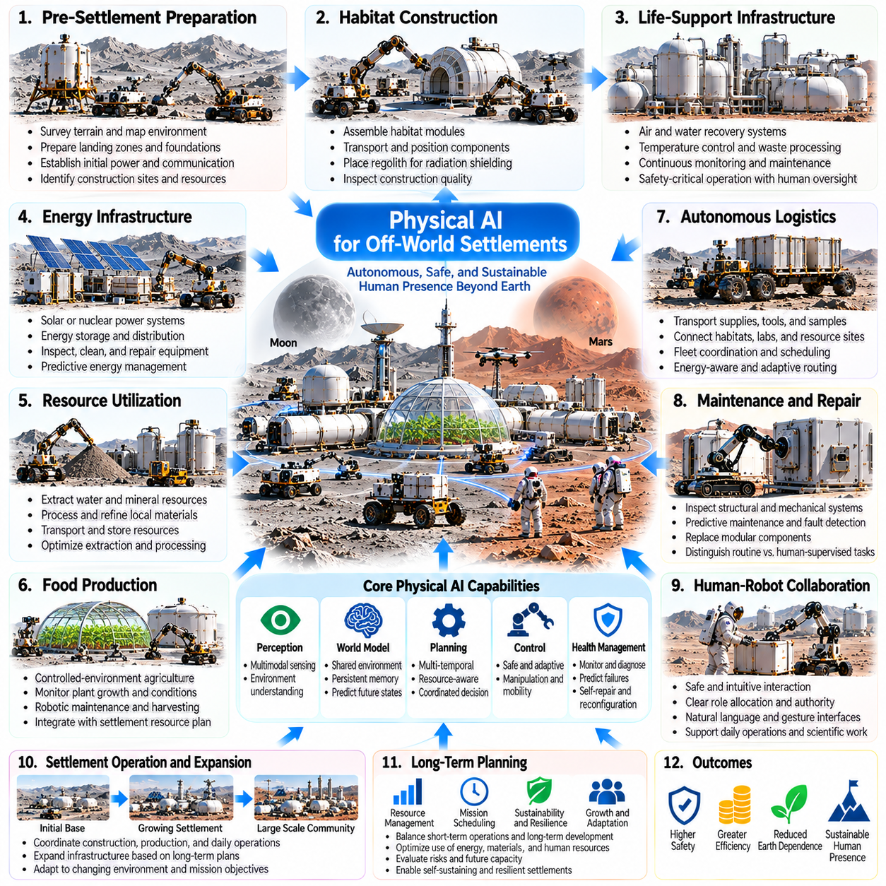{width="7.268055555555556in" height="7.268055555555556in"}

Off-world settlements represent a transition from temporary exploration missions toward sustained human presence beyond Earth. Lunar and Martian communities will require reliable systems for construction, energy, transportation, resource production, and habitat maintenance. Physical AI can coordinate these activities through autonomous machines capable of sensing, reasoning, and acting in unfamiliar environments. Its central purpose is to reduce dependence on continuous human intervention.

Unlike conventional terrestrial cities, extraterrestrial settlements must operate under severe environmental and logistical constraints. Radiation, reduced gravity, extreme temperatures, dust, and limited resources complicate everyday infrastructure operations. Deliveries from Earth may be expensive and infrequent. Physical AI must therefore support resilient local systems that can maintain essential services, recover from disruptions, and adapt to changing settlement requirements.

Settlement development will likely begin with robotic preparation before large human crews arrive. Autonomous machines may survey terrain, identify construction sites, prepare landing zones, and establish initial power infrastructure. Robotic excavation and material handling can support foundation preparation and protective shielding. World models can integrate environmental observations with construction plans, allowing systems to identify hazards and adapt operations to local conditions.

Habitat construction requires coordinated manipulation, transportation, and assembly. Robotic teams may position prefabricated modules, connect structural components, and place protective regolith around occupied facilities. Physical AI can manage task dependencies and monitor alignment, contact forces, and structural stability. Autonomous inspection systems can verify construction quality while identifying defects that require correction before human occupation.

Life-support infrastructure creates particularly demanding reliability requirements. Settlements must manage air circulation, water recovery, temperature regulation, and waste processing within tightly constrained operating conditions. Physical AI can monitor equipment performance and coordinate maintenance activities. However, safety-critical life-support control requires independently validated safeguards, redundancy, and human authority over consequential operational decisions.

Energy infrastructure will determine the practical scale of extraterrestrial settlements. Solar arrays, batteries, thermal storage, and potentially nuclear power systems must operate despite environmental disturbances and equipment degradation. Autonomous robots can inspect installations, clean exposed surfaces, and replace selected components. Predictive energy management can coordinate generation, storage, and consumption while preserving reserves for essential survival functions.

In-situ resource utilization can reduce dependence on imported materials and supplies. Autonomous systems may extract water-bearing materials, process regolith, and transport resources to production facilities. Physical AI can coordinate excavation, material classification, processing, and storage. Resource models must account for uncertain deposits, variable extraction efficiency, equipment wear, and the energy required to transform local materials into useful products.

Food production presents another opportunity for robotic assistance. Controlled-environment agriculture may require continuous monitoring of water, nutrients, illumination, temperature, and plant development. Robotic systems can inspect crops, perform selected maintenance tasks, and transport harvested materials. Physical AI can integrate agricultural observations with settlement resource planning, although biological variability requires careful validation of automated decisions.

Autonomous logistics will connect habitats, laboratories, storage facilities, construction zones, and resource production sites. Cargo robots can distribute tools, replacement components, scientific samples, and essential supplies. Fleet coordination can prioritize critical deliveries while minimizing energy consumption and unnecessary travel. Shared world models allow transportation systems to adapt when terrain, infrastructure, or operational priorities change.

Settlement maintenance must become increasingly autonomous as infrastructure expands. Robots may inspect structural seals, electrical connections, thermal systems, and exposed mechanical equipment. Predictive maintenance can identify deterioration before failures interrupt essential services. Modular hardware and accessible repair interfaces can simplify robotic intervention. Physical AI must distinguish routine servicing from operations requiring explicit human supervision.

Shared environmental world models can provide a common operational foundation for settlement infrastructure. These models may represent terrain, buildings, transportation networks, resource inventories, and equipment conditions. Persistent memory can preserve construction history, maintenance records, and environmental observations. By connecting physical infrastructure with predictive models, Physical AI can support coordinated decisions across otherwise separate operational systems.

Long-horizon planning is essential because settlement activities compete for limited energy, materials, equipment, and human attention. Construction may increase future capacity while temporarily consuming resources needed for daily operations. Physical AI can compare alternative schedules according to operational risk and expected long-term value. Hierarchical planning can connect immediate equipment control with infrastructure expansion and resource sustainability.

Human-robot collaboration will shape daily life within extraterrestrial settlements. Residents may delegate inspection, cleaning, transportation, and repetitive maintenance to autonomous assistants. Natural language interfaces can simplify task requests, while shared situational awareness supports safe physical interaction. Robotic systems should communicate their intentions, limitations, and uncertainties clearly, allowing humans to retain meaningful control over important decisions.

Medical and emergency support may also benefit from Physical AI. Robots can transport supplies, inspect hazardous areas, and assist with approved emergency procedures. Autonomous monitoring of infrastructure may identify conditions threatening crew safety before they escalate. Nevertheless, robotic systems should not replace qualified medical judgment or independently perform high-risk interventions without appropriate authorization and validated safety procedures.

Environmental protection will be an important consideration as settlements grow. Excavation, transportation, waste handling, and industrial processing can alter local terrain and distribute dust or other materials. Physical AI can monitor these effects and support operational boundaries established by mission authorities. Responsible settlement planning must consider scientific preservation, contamination prevention, and the long-term consequences of infrastructure development.

Multi-robot coordination can improve the scalability of settlement operations. Specialized machines may perform construction, inspection, agriculture, logistics, and repair while exchanging relevant information. Distributed task allocation can reduce operational bottlenecks and preserve functionality when individual robots fail. Shared scheduling and resource management must prevent competition between activities from disrupting critical services.

Communication delays make local decision-making essential for lunar and especially Martian settlements. Earth-based teams can provide scientific guidance, technical support, and strategic oversight, but cannot manage every immediate operational event. Physical AI must execute routine tasks and respond to urgent equipment conditions within approved boundaries. Transparent reporting and reliable records allow remote operators to understand decisions made during communication gaps.

Digital twins and simulation environments can support settlement planning and operational validation. Virtual models may reproduce habitat systems, transportation networks, construction activities, and resource flows. Engineers can examine infrastructure configurations and evaluate responses to equipment failures before physical deployment. However, simulations must be continuously updated using operational measurements because real environmental behavior may differ from initial assumptions.

Economic sustainability requires careful evaluation of robotic infrastructure investments. Autonomous systems introduce costs in transportation mass, energy consumption, computing hardware, maintenance, and spare components. Their value depends on reducing human workload, improving reliability, and extending the productive life of settlement assets. Physical AI can support these tradeoffs through lifecycle modeling and coordinated resource allocation rather than maximizing automation without regard to cost.

Settlement resilience depends on the ability to preserve essential functions during unexpected disruptions. Equipment failures, energy shortages, communication interruptions, and environmental hazards may occur simultaneously. Physical AI can support contingency planning, fault isolation, resource redistribution, and prioritized recovery. Critical systems should maintain independent protection mechanisms so that failures in autonomous intelligence do not directly threaten human survival.

As settlements mature, their robotic infrastructure may evolve from task-specific automation toward integrated operational intelligence. Shared world models, persistent memory, predictive maintenance, and multi-agent planning can connect previously independent services. This integration may enable settlements to anticipate resource shortages, schedule infrastructure expansion, and adapt to changing population needs while maintaining operational safety.

Ultimately, Physical AI for off-world settlements provides a technological foundation for sustained human activity beyond Earth. Its development requires integrating autonomous construction, resource utilization, life-support support systems, logistics, maintenance, and human-robot collaboration. As these capabilities mature, intelligent robotic infrastructure may help transform isolated extraterrestrial outposts into resilient, adaptable, and increasingly self-sustaining communities.

외계 정착지(Off-World Settlements)는 일시적인 탐사 임무(Temporary Exploration Missions)에서 지구 밖의 지속적인 인간 거주(Sustained Human Presence)로 전환하는 것을 의미합니다. 달과 화성의 공동체(Lunar and Martian Communities)에는 건설(Construction), 에너지(Energy), 운송(Transportation), 자원 생산(Resource Production), 거주 시설 유지보수(Habitat Maintenance)를 위한 신뢰할 수 있는 시스템이 필요합니다. 피지컬 AI(Physical AI)는 낯선 환경에서 감지(Sensing), 추론(Reasoning), 행동(Acting)을 수행할 수 있는 자율 기계(Autonomous Machines)를 통해 이러한 활동을 조정할 수 있습니다. 핵심 목적은 지속적인 인간 개입(Continuous Human Intervention)에 대한 의존도를 줄이는 것입니다.

기존 지구 도시(Conventional Terrestrial Cities)와 달리 외계 정착지(Extraterrestrial Settlements)는 극심한 환경적 및 물류적 제약(Environmental and Logistical Constraints) 아래에서 운영되어야 합니다. 방사선(Radiation), 저중력(Reduced Gravity), 극한 온도(Extreme Temperatures), 먼지(Dust), 제한된 자원(Limited Resources)은 일상적인 인프라 운용(Infrastructure Operations)을 복잡하게 만듭니다. 지구에서의 물자 배송(Deliveries from Earth)은 비용이 많이 들고 빈도가 낮을 수 있습니다. 따라서 피지컬 AI는 필수 서비스(Essential Services)를 유지하고, 장애(Disruptions)로부터 복구하며, 변화하는 정착지 요구사항(Settlement Requirements)에 적응할 수 있는 회복탄력적인 현지 시스템(Resilient Local Systems)을 지원해야 합니다.

정착지 개발(Settlement Development)은 대규모 인간 승무원(Large Human Crews)이 도착하기 전에 로봇을 이용한 사전 준비(Robotic Preparation)로 시작될 가능성이 높습니다. 자율 기계(Autonomous Machines)는 지형을 조사하고, 건설 부지(Construction Sites)를 식별하며, 착륙 구역(Landing Zones)을 준비하고, 초기 전력 인프라(Initial Power Infrastructure)를 구축할 수 있습니다. 로봇 굴착(Robotic Excavation)과 자재 취급(Material Handling)은 기초 준비(Foundation Preparation)와 보호 차폐(Protective Shielding)를 지원할 수 있습니다. 월드 모델(World Models)은 환경 관측(Environmental Observations)과 건설 계획(Construction Plans)을 통합하여 시스템이 위험 요소(Hazards)를 식별하고 현지 조건(Local Conditions)에 맞게 작업을 조정하도록 합니다.

거주 시설 건설(Habitat Construction)에는 조작(Manipulation), 운송(Transportation), 조립(Assembly)의 협조가 필요합니다. 로봇 팀(Robotic Teams)은 사전 제작 모듈(Prefabricated Modules)을 배치하고, 구조 부품(Structural Components)을 연결하며, 사람이 거주하는 시설(Occupied Facilities) 주변에 보호용 표토(Protective Regolith)를 쌓을 수 있습니다. 피지컬 AI는 작업 의존성(Task Dependencies)을 관리하고 정렬 상태(Alignment), 접촉력(Contact Forces), 구조적 안정성(Structural Stability)을 모니터링할 수 있습니다. 자율 검사 시스템(Autonomous Inspection Systems)은 건설 품질(Construction Quality)을 검증하고 인간이 거주하기 전에 수정해야 할 결함(Defects)을 식별할 수 있습니다.

생명 유지 인프라(Life-Support Infrastructure)는 특히 높은 신뢰성 요구사항(Reliability Requirements)을 발생시킵니다. 정착지는 엄격하게 제한된 운용 조건(Operating Conditions) 내에서 공기 순환(Air Circulation), 물 회수(Water Recovery), 온도 조절(Temperature Regulation), 폐기물 처리(Waste Processing)를 관리해야 합니다. 피지컬 AI는 장비 성능(Equipment Performance)을 모니터링하고 유지보수 활동(Maintenance Activities)을 조정할 수 있습니다. 그러나 안전 필수 생명 유지 제어(Safety-Critical Life-Support Control)에는 독립적으로 검증된 안전장치(Independently Validated Safeguards), 중복성(Redundancy), 중대한 운용 의사결정(Consequential Operational Decisions)에 대한 인간의 권한(Human Authority)이 필요합니다.

에너지 인프라(Energy Infrastructure)는 외계 정착지의 실질적인 규모(Practical Scale)를 결정합니다. 태양광 발전 설비(Solar Arrays), 배터리(Batteries), 열에너지 저장(Thermal Storage), 잠재적인 원자력 발전 시스템(Nuclear Power Systems)은 환경 교란(Environmental Disturbances)과 장비 열화(Equipment Degradation)에도 불구하고 작동해야 합니다. 자율 로봇(Autonomous Robots)은 설비를 검사하고, 노출된 표면을 청소하며, 일부 부품을 교체할 수 있습니다. 예측 에너지 관리(Predictive Energy Management)는 필수 생존 기능(Essential Survival Functions)을 위한 에너지 예비량(Reserves)을 보존하면서 발전(Generation), 저장(Storage), 소비(Consumption)를 조정할 수 있습니다.

현지 자원 활용(In-Situ Resource Utilization)은 수입 자재(Imported Materials)와 보급품(Supplies)에 대한 의존도를 줄일 수 있습니다. 자율 시스템(Autonomous Systems)은 물을 함유한 물질(Water-Bearing Materials)을 추출하고, 표토(Regolith)를 처리하며, 자원을 생산 시설(Production Facilities)로 운송할 수 있습니다. 피지컬 AI는 굴착(Excavation), 자재 분류(Material Classification), 처리(Processing), 저장(Storage)을 조정할 수 있습니다. 자원 모델(Resource Models)은 불확실한 매장량(Uncertain Deposits), 가변적인 추출 효율(Variable Extraction Efficiency), 장비 마모(Equipment Wear), 현지 자원을 유용한 제품으로 전환하는 데 필요한 에너지(Energy)를 고려해야 합니다.

식량 생산(Food Production)은 로봇 지원(Robotic Assistance)을 활용할 수 있는 또 다른 분야입니다. 환경 제어형 농업(Controlled-Environment Agriculture)에는 물(Water), 영양분(Nutrients), 조명(Illumination), 온도(Temperature), 식물 성장(Plant Development)에 대한 지속적인 모니터링이 필요할 수 있습니다. 로봇 시스템(Robotic Systems)은 작물을 검사하고, 일부 유지관리 작업(Maintenance Tasks)을 수행하며, 수확한 자재(Harvested Materials)를 운송할 수 있습니다. 피지컬 AI는 농업 관측(Agricultural Observations)을 정착지 자원 계획(Settlement Resource Planning)과 통합할 수 있지만, 생물학적 변동성(Biological Variability)으로 인해 자동화된 의사결정(Automated Decisions)에 대한 신중한 검증이 필요합니다.

자율 물류(Autonomous Logistics)는 거주 시설(Habitats), 실험실(Laboratories), 저장 시설(Storage Facilities), 건설 구역(Construction Zones), 자원 생산 현장(Resource Production Sites)을 연결합니다. 화물 로봇(Cargo Robots)은 도구(Tools), 교체 부품(Replacement Components), 과학 시료(Scientific Samples), 필수 보급품(Essential Supplies)을 배분할 수 있습니다. 로봇 군집 협조(Fleet Coordination)는 에너지 소비(Energy Consumption)와 불필요한 이동(Unnecessary Travel)을 최소화하면서 핵심 배송(Critical Deliveries)에 우선순위를 부여할 수 있습니다. 공유 월드 모델(Shared World Models)은 지형(Terrain), 인프라(Infrastructure), 운용 우선순위(Operational Priorities)가 변화할 때 운송 시스템이 적응하도록 합니다.

정착지 유지보수(Settlement Maintenance)는 인프라가 확장됨에 따라 점점 더 자율적으로 이루어져야 합니다. 로봇은 구조적 밀봉부(Structural Seals), 전기 연결부(Electrical Connections), 열 관리 시스템(Thermal Systems), 외부에 노출된 기계 장비(Exposed Mechanical Equipment)를 검사할 수 있습니다. 예측 유지보수(Predictive Maintenance)는 고장이 필수 서비스(Essential Services)를 중단시키기 전에 성능 저하(Deterioration)를 식별할 수 있습니다. 모듈형 하드웨어(Modular Hardware)와 접근하기 쉬운 수리 인터페이스(Accessible Repair Interfaces)는 로봇의 개입(Robotic Intervention)을 단순화할 수 있습니다. 피지컬 AI는 일상적인 정비(Routine Servicing)와 명시적인 인간 감독(Explicit Human Supervision)이 필요한 작업을 구분해야 합니다.

공유 환경 월드 모델(Shared Environmental World Models)은 정착지 인프라(Settlement Infrastructure)를 위한 공통 운용 기반(Common Operational Foundation)을 제공할 수 있습니다. 이러한 모델은 지형(Terrain), 건물(Buildings), 운송 네트워크(Transportation Networks), 자원 재고(Resource Inventories), 장비 상태(Equipment Conditions)를 표현할 수 있습니다. 지속적 메모리(Persistent Memory)는 건설 이력(Construction History), 유지보수 기록(Maintenance Records), 환경 관측(Environmental Observations)을 보존할 수 있습니다. 피지컬 AI는 물리적 인프라(Physical Infrastructure)를 예측 모델(Predictive Models)과 연결하여 서로 분리된 운용 시스템(Operational Systems) 사이의 협조적 의사결정(Coordinated Decisions)을 지원할 수 있습니다.

장기 계획(Long-Horizon Planning)은 정착지 활동(Settlement Activities)이 제한된 에너지(Energy), 자재(Materials), 장비(Equipment), 인간의 주의와 작업 시간(Human Attention)을 놓고 경쟁하기 때문에 필수적입니다. 건설(Construction)은 미래의 수용 능력(Future Capacity)을 증가시키지만 일상적인 운용(Daily Operations)에 필요한 자원을 일시적으로 소비할 수 있습니다. 피지컬 AI는 운용 위험(Operational Risk)과 예상되는 장기 가치(Expected Long-Term Value)에 따라 대안 일정(Alternative Schedules)을 비교할 수 있습니다. 계층적 계획(Hierarchical Planning)은 즉각적인 장비 제어(Immediate Equipment Control)를 인프라 확장(Infrastructure Expansion) 및 자원 지속가능성(Resource Sustainability)과 연결할 수 있습니다.

인간-로봇 협업(Human-Robot Collaboration)은 외계 정착지에서의 일상생활(Daily Life)을 형성할 것입니다. 거주자(Residents)는 검사(Inspection), 청소(Cleaning), 운송(Transportation), 반복적인 유지보수(Repetitive Maintenance)를 자율 보조 시스템(Autonomous Assistants)에 위임할 수 있습니다. 자연어 인터페이스(Natural Language Interfaces)는 작업 요청(Task Requests)을 단순화하고, 공유 상황 인식(Shared Situational Awareness)은 안전한 물리적 상호작용(Safe Physical Interaction)을 지원할 수 있습니다. 로봇 시스템은 자신의 의도(Intentions), 한계(Limitations), 불확실성(Uncertainties)을 명확하게 전달하여 인간이 중요한 의사결정(Important Decisions)에 대한 실질적인 통제권(Meaningful Control)을 유지하도록 해야 합니다.

의료 및 비상 지원(Medical and Emergency Support) 역시 피지컬 AI의 도움을 받을 수 있습니다. 로봇은 물자를 운송하고, 위험 지역(Hazardous Areas)을 검사하며, 승인된 비상 절차(Approved Emergency Procedures)를 지원할 수 있습니다. 인프라의 자율 모니터링(Autonomous Monitoring)은 승무원 안전(Crew Safety)을 위협하는 상황이 악화되기 전에 이를 식별할 수 있습니다. 그러나 로봇 시스템은 자격을 갖춘 의료 전문가의 판단(Qualified Medical Judgment)을 대체하거나, 적절한 승인(Appropriate Authorization)과 검증된 안전 절차(Validated Safety Procedures) 없이 고위험 개입(High-Risk Interventions)을 독립적으로 수행해서는 안 됩니다.

환경 보호(Environmental Protection)는 정착지가 성장함에 따라 중요한 고려사항이 될 것입니다. 굴착(Excavation), 운송(Transportation), 폐기물 취급(Waste Handling), 산업 처리(Industrial Processing)는 현지 지형(Local Terrain)을 변화시키고 먼지나 기타 물질을 확산시킬 수 있습니다. 피지컬 AI는 이러한 영향을 모니터링하고 임무 당국(Mission Authorities)이 설정한 운용 경계(Operational Boundaries)를 준수하도록 지원할 수 있습니다. 책임 있는 정착지 계획(Responsible Settlement Planning)은 과학적 보존(Scientific Preservation), 오염 방지(Contamination Prevention), 인프라 개발의 장기적 결과(Long-Term Consequences)를 고려해야 합니다.

다중 로봇 협조(Multi-Robot Coordination)는 정착지 운용(Settlement Operations)의 확장성(Scalability)을 향상시킬 수 있습니다. 전문화된 기계(Specialized Machines)는 관련 정보를 교환하면서 건설(Construction), 검사(Inspection), 농업(Agriculture), 물류(Logistics), 수리(Repair)를 수행할 수 있습니다. 분산 작업 할당(Distributed Task Allocation)은 운용 병목 현상(Operational Bottlenecks)을 줄이고 개별 로봇이 고장 나더라도 기능을 유지할 수 있습니다. 공유 일정 계획(Shared Scheduling)과 자원 관리(Resource Management)는 활동 사이의 경쟁으로 인해 핵심 서비스(Critical Services)가 중단되지 않도록 해야 합니다.

통신 지연(Communication Delays)은 달, 특히 화성 정착지(Martian Settlements)에서 현지 의사결정(Local Decision-Making)을 필수적으로 만듭니다. 지구 기반 팀(Earth-Based Teams)은 과학적 지침(Scientific Guidance), 기술 지원(Technical Support), 전략적 감독(Strategic Oversight)을 제공할 수 있지만 모든 즉각적인 운용 상황(Immediate Operational Events)을 관리할 수는 없습니다. 피지컬 AI는 승인된 범위(Approved Boundaries) 내에서 일상적인 작업(Routine Tasks)을 수행하고 긴급 장비 상황(Urgent Equipment Conditions)에 대응해야 합니다. 투명한 보고(Transparent Reporting)와 신뢰할 수 있는 기록(Reliable Records)은 원격 운영자(Remote Operators)가 통신 공백(Communication Gaps) 동안 이루어진 의사결정을 이해하도록 합니다.

디지털 트윈(Digital Twins)과 시뮬레이션 환경(Simulation Environments)은 정착지 계획(Settlement Planning)과 운용 검증(Operational Validation)을 지원할 수 있습니다. 가상 모델(Virtual Models)은 거주 시설 시스템(Habitat Systems), 운송 네트워크(Transportation Networks), 건설 활동(Construction Activities), 자원 흐름(Resource Flows)을 재현할 수 있습니다. 엔지니어는 실제 배치(Physical Deployment) 전에 인프라 구성(Infrastructure Configurations)을 검토하고 장비 고장(Equipment Failures)에 대한 대응을 평가할 수 있습니다. 그러나 실제 환경의 거동(Real Environmental Behavior)은 초기 가정(Initial Assumptions)과 다를 수 있으므로 시뮬레이션은 운용 측정값(Operational Measurements)을 이용하여 지속적으로 갱신되어야 합니다.

경제적 지속가능성(Economic Sustainability)을 위해서는 로봇 인프라 투자(Robotic Infrastructure Investments)에 대한 신중한 평가가 필요합니다. 자율 시스템(Autonomous Systems)은 운송 질량(Transportation Mass), 에너지 소비(Energy Consumption), 컴퓨팅 하드웨어(Computing Hardware), 유지보수(Maintenance), 예비 부품(Spare Components) 측면에서 비용을 발생시킵니다. 그 가치는 인간의 작업 부하(Human Workload)를 줄이고, 신뢰성(Reliability)을 향상시키며, 정착지 자산(Settlement Assets)의 생산적 수명(Productive Life)을 연장하는 데 달려 있습니다. 피지컬 AI는 비용을 고려하지 않은 자동화 극대화(Maximizing Automation)보다는 수명주기 모델링(Lifecycle Modeling)과 협조적 자원 배분(Coordinated Resource Allocation)을 통해 이러한 상충 관계(Tradeoffs)를 관리할 수 있습니다.

정착지 회복탄력성(Settlement Resilience)은 예상하지 못한 장애(Unexpected Disruptions)가 발생하더라도 필수 기능(Essential Functions)을 보존하는 능력에 달려 있습니다. 장비 고장(Equipment Failures), 에너지 부족(Energy Shortages), 통신 중단(Communication Interruptions), 환경 위험(Environmental Hazards)이 동시에 발생할 수 있습니다. 피지컬 AI는 비상 대응 계획(Contingency Planning), 결함 격리(Fault Isolation), 자원 재분배(Resource Redistribution), 우선순위 기반 복구(Prioritized Recovery)를 지원할 수 있습니다. 핵심 시스템(Critical Systems)은 자율 지능(Autonomous Intelligence)의 고장이 인간의 생존(Human Survival)을 직접 위협하지 않도록 독립적인 보호 메커니즘(Independent Protection Mechanisms)을 유지해야 합니다.

정착지가 성숙함에 따라 로봇 인프라(Robotic Infrastructure)는 작업별 자동화(Task-Specific Automation)에서 통합 운용 지능(Integrated Operational Intelligence)으로 발전할 수 있습니다. 공유 월드 모델(Shared World Models), 지속적 메모리(Persistent Memory), 예측 유지보수(Predictive Maintenance), 다중 에이전트 계획(Multi-Agent Planning)은 이전에 독립적으로 운영되던 서비스들을 연결할 수 있습니다. 이러한 통합(Integration)은 정착지가 자원 부족(Resource Shortages)을 예측하고, 인프라 확장(Infrastructure Expansion) 일정을 계획하며, 운용 안전성(Operational Safety)을 유지하면서 변화하는 인구 수요(Changing Population Needs)에 적응하도록 할 수 있습니다.

궁극적으로 외계 정착지를 위한 피지컬 AI(Physical AI for Off-World Settlements)는 지구 밖에서 지속적인 인간 활동(Sustained Human Activity)을 가능하게 하는 기술적 기반(Technological Foundation)을 제공합니다. 이를 개발하려면 자율 건설(Autonomous Construction), 자원 활용(Resource Utilization), 생명 유지 지원 시스템(Life-Support Support Systems), 물류(Logistics), 유지보수(Maintenance), 인간-로봇 협업(Human-Robot Collaboration)을 통합해야 합니다. 이러한 역량이 성숙함에 따라 지능형 로봇 인프라(Intelligent Robotic Infrastructure)는 고립된 외계 전초기지(Isolated Extraterrestrial Outposts)를 회복탄력적이고(Resilient), 적응 가능하며(Adaptable), 점차 자립적인(Increasingly Self-Sustaining) 공동체로 전환하는 데 기여할 수 있을 것입니다.

##  

## 04.16. Long Term Autonomous Space Infrastructure

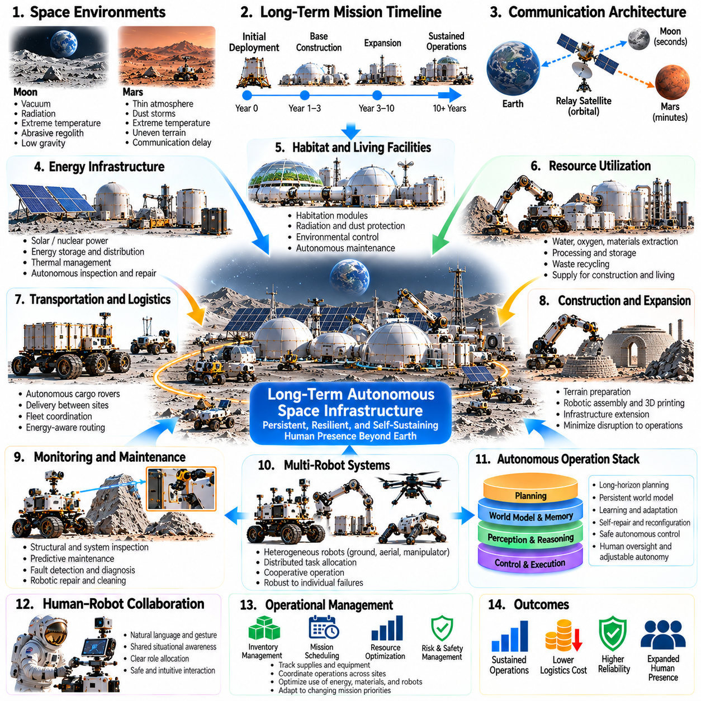{width="7.268055555555556in" height="7.268055555555556in"}

Long-term autonomous space infrastructure represents the transition from isolated robotic missions toward persistent operational systems beyond Earth. Future lunar, Martian, and orbital facilities will require continuous maintenance, resource distribution, environmental monitoring, and infrastructure expansion. Physical AI can provide the intelligence needed to coordinate these activities over years or decades, reducing dependence on constant human supervision.

Unlike short-duration missions, permanent space infrastructure must survive repeated environmental disturbances and progressive equipment degradation. Radiation, thermal cycling, abrasive dust, micrometeoroids, and mechanical fatigue can gradually compromise system performance. Autonomous infrastructure must detect deterioration, predict emerging failures, and maintain essential functions despite limited repair opportunities and delayed support from Earth.

A central requirement is the integration of distributed infrastructure into a coherent operational architecture. Power stations, communication networks, transportation systems, processing facilities, and robotic maintenance platforms must exchange information and coordinate decisions. Physical AI can connect these components through shared operational models while preserving local control capabilities that remain functional during communication interruptions.

Persistent world models provide the foundation for long-term infrastructure intelligence. These models represent physical structures, equipment conditions, environmental changes, and operational dependencies across multiple timescales. Continuous observations update the estimated state of the infrastructure, while predictive dynamics models anticipate future behavior. Persistent memory preserves historical failures, maintenance actions, and environmental patterns.

Long-horizon planning enables autonomous infrastructure to balance immediate operational needs with future sustainability. A robotic system may postpone noncritical construction to preserve energy for essential maintenance or schedule equipment replacement before anticipated degradation. Hierarchical planning connects real-time control with daily scheduling and multi-year development objectives. Decisions must account for uncertainty and changing mission priorities.

Self-monitoring infrastructure requires distributed sensing and reliable fault detection. Sensors can track structural deformation, vibration, electrical performance, thermal conditions, and mechanical wear. Physical AI can combine these measurements to identify abnormal behavior and estimate remaining useful life. Diagnostic systems should distinguish actual equipment deterioration from sensor errors, environmental disturbances, and temporary operational fluctuations.

Autonomous maintenance can reduce the logistical burden of sustaining remote facilities. Inspection robots may identify damaged components, clean contaminated surfaces, and perform selected replacement operations. Manipulators can support modular repair procedures when components are designed for robotic accessibility. Effective maintenance autonomy requires accurate perception, force-controlled interaction, validated procedures, and mechanisms for recovering from unsuccessful repairs.

Self-repair and self-reconfiguration provide additional resilience when replacement materials or human assistance are unavailable. Distributed systems may isolate damaged modules, reroute electrical power, or redistribute workloads among functioning components. Modular robotic platforms could exchange selected parts or replace specialized tools. However, self-repair capabilities must be evaluated against their added mass, complexity, energy consumption, and potential failure modes.

Energy autonomy is fundamental to persistent space operations. Solar generation, storage systems, thermal management, and potentially nuclear power must support variable infrastructure demands. Physical AI can forecast consumption, schedule energy-intensive activities, and coordinate charging across robotic fleets. Safety-critical functions require protected energy reserves and independently verified control mechanisms that remain effective when intelligent planning systems fail.

Autonomous resource management will become increasingly important as extraterrestrial infrastructure expands. Water extraction, oxygen production, material processing, and waste recovery may form interconnected industrial systems. Physical AI can coordinate production rates, storage capacity, and transportation requirements. Resource planning must consider equipment efficiency, uncertain extraction yields, environmental constraints, and the strategic value of maintaining reserves.

Robotic construction enables infrastructure to evolve beyond its initial deployment configuration. Autonomous machines may prepare terrain, assemble structures, extend transportation corridors, and install new communication or energy facilities. Construction planning must account for existing infrastructure and avoid disrupting critical services. Shared world models can connect engineering designs with observed site conditions and continuously updated construction progress.

Multi-robot systems can distribute inspection, transportation, maintenance, and construction responsibilities across specialized platforms. Fleet coordination improves operational flexibility and provides alternatives when individual machines become unavailable. Decentralized task allocation can preserve local functionality during communication failures. Shared learning may improve performance, but updates must be validated before deployment to safety-critical infrastructure.

Communication architecture must support both local autonomy and remote strategic supervision. Lunar systems experience relatively short communication delays, while Martian infrastructure may operate with delays lasting many minutes. Autonomous agents must handle routine decisions and time-sensitive failures without waiting for Earth-based instructions. Reliable logs, synchronized operational records, and explainable decisions support later review and human intervention.

Digital twins can provide a predictive environment for infrastructure management. Virtual representations may combine engineering models, live sensor measurements, maintenance histories, and environmental forecasts. Physical AI can evaluate alternative operating strategies and estimate the consequences of equipment failures. Model uncertainty must remain explicit because inaccurate simulations can produce misleading predictions and unsafe maintenance recommendations.

Cybersecurity and operational integrity become essential when infrastructure depends on interconnected autonomous controllers. Unauthorized commands, corrupted sensor information, or compromised software updates could disrupt critical facilities. Secure communication, access control, fault isolation, and authenticated updates help protect distributed systems. Physical AI should operate within independently enforced safety boundaries rather than serving as the sole mechanism of protection.

Long-duration autonomy also requires robust software lifecycle management. Algorithms, operating systems, and learned models may need updates throughout missions lasting decades. Remote deployment procedures must support compatibility testing, staged activation, rollback, and recovery from incomplete installations. Autonomous systems should preserve stable operational capabilities while incorporating improvements only after appropriate verification and validation.

Environmental stewardship must accompany infrastructure expansion beyond Earth. Mining, construction, transportation, and industrial processing may disturb scientifically valuable terrain or introduce contamination. Autonomous monitoring can document environmental changes and detect violations of established operational boundaries. Physical AI can support resource-efficient planning while preserving human responsibility for scientific protection and environmental governance.

Economic sustainability depends on the relationship between infrastructure capability and lifecycle cost. Autonomous facilities require substantial initial investments in hardware, transportation, energy, computation, and maintenance. Their value emerges through extended operational life, reduced human intervention, and reliable service delivery. Physical AI can support investment decisions by comparing redundancy, repairability, utilization, and expected long-term performance.

Infrastructure resilience must be evaluated against cascading failures across interconnected systems. A power shortage may interrupt communications, disable transportation, and delay essential maintenance simultaneously. Predictive models can identify critical dependencies and recommend protective resource allocation. Autonomous recovery strategies should prioritize life-support services, system stabilization, and restoration of essential functions before secondary objectives.

Human governance remains necessary even when infrastructure operates independently for extended periods. Mission authorities must define acceptable risks, operational priorities, and boundaries for autonomous decisions. Physical AI should maintain auditable records of consequential actions and communicate uncertainties when requesting authorization. Human oversight may occur intermittently, but responsibility for strategic direction and safety standards cannot be delegated entirely to machines.

As infrastructure networks expand, local autonomous facilities may develop into interconnected planetary and orbital ecosystems. Surface settlements, resource stations, communication relays, and orbital servicing platforms could coordinate transportation and industrial activities. Shared operational standards would support interoperability across different robotic systems. Physical AI may provide the adaptive coordination needed to manage these increasingly complex networks.

Ultimately, long-term autonomous space infrastructure requires the convergence of world models, predictive dynamics, persistent memory, hierarchical planning, robotic maintenance, and distributed coordination. Its success depends not simply on autonomous task execution but on preserving functionality through uncertainty, degradation, and environmental change. Mature Physical AI could enable resilient infrastructure that supports sustained exploration, scientific discovery, and human civilization beyond Earth.

장기 자율 우주 인프라(Long-Term Autonomous Space Infrastructure)는 개별적인 로봇 임무(Isolated Robotic Missions)에서 지구 밖의 지속적인 운용 시스템(Persistent Operational Systems)으로 전환하는 것을 의미합니다. 미래의 달, 화성 및 궤도 시설(Lunar, Martian, and Orbital Facilities)에는 지속적인 유지보수(Continuous Maintenance), 자원 분배(Resource Distribution), 환경 모니터링(Environmental Monitoring), 인프라 확장(Infrastructure Expansion)이 필요합니다. 피지컬 AI(Physical AI)는 수년 또는 수십 년에 걸쳐 이러한 활동을 조정하는 데 필요한 지능(Intelligence)을 제공하여 지속적인 인간 감독(Human Supervision)에 대한 의존도를 줄일 수 있습니다.

단기 임무(Short-Duration Missions)와 달리 영구 우주 인프라(Permanent Space Infrastructure)는 반복적인 환경 교란(Environmental Disturbances)과 점진적인 장비 열화(Equipment Degradation)를 견뎌야 합니다. 방사선(Radiation), 열 순환(Thermal Cycling), 마모성 먼지(Abrasive Dust), 미세운석(Micrometeoroids), 기계적 피로(Mechanical Fatigue)는 시스템 성능(System Performance)을 점진적으로 저하시킬 수 있습니다. 자율 인프라(Autonomous Infrastructure)는 제한된 수리 기회(Limited Repair Opportunities)와 지구로부터의 지연된 지원(Delayed Support)에도 불구하고 성능 저하를 탐지하고, 발생 가능한 고장(Emerging Failures)을 예측하며, 필수 기능(Essential Functions)을 유지해야 합니다.

핵심 요구사항(Central Requirement)은 분산된 인프라(Distributed Infrastructure)를 일관된 운용 아키텍처(Coherent Operational Architecture)로 통합하는 것입니다. 발전소(Power Stations), 통신 네트워크(Communication Networks), 운송 시스템(Transportation Systems), 처리 시설(Processing Facilities), 로봇 유지보수 플랫폼(Robotic Maintenance Platforms)은 정보를 교환하고 의사결정을 조정해야 합니다. 피지컬 AI는 공유 운용 모델(Shared Operational Models)을 통해 이러한 구성요소를 연결하면서 통신 중단(Communication Interruptions) 중에도 기능을 유지할 수 있는 현지 제어 능력(Local Control Capabilities)을 보존할 수 있습니다.

지속적 월드 모델(Persistent World Models)은 장기 인프라 지능(Long-Term Infrastructure Intelligence)의 기반을 제공합니다. 이러한 모델은 여러 시간 척도(Multiple Timescales)에 걸쳐 물리적 구조물(Physical Structures), 장비 상태(Equipment Conditions), 환경 변화(Environmental Changes), 운용 의존성(Operational Dependencies)을 표현합니다. 지속적인 관측(Continuous Observations)은 인프라의 추정 상태(Estimated State)를 갱신하며, 예측 동역학 모델(Predictive Dynamics Models)은 미래 거동(Future Behavior)을 예측합니다. 지속적 메모리(Persistent Memory)는 과거 고장(Historical Failures), 유지보수 작업(Maintenance Actions), 환경 패턴(Environmental Patterns)을 보존합니다.

장기 계획(Long-Horizon Planning)은 자율 인프라가 즉각적인 운용 요구(Immediate Operational Needs)와 미래 지속가능성(Future Sustainability) 사이에서 균형을 유지하도록 합니다. 로봇 시스템(Robotic System)은 필수 유지보수(Essential Maintenance)에 필요한 에너지를 보존하기 위해 중요도가 낮은 건설 작업(Noncritical Construction)을 연기하거나, 예상되는 성능 저하(Anticipated Degradation)가 발생하기 전에 장비 교체(Equipment Replacement)를 계획할 수 있습니다. 계층적 계획(Hierarchical Planning)은 실시간 제어(Real-Time Control)를 일일 일정 계획(Daily Scheduling) 및 다년간의 개발 목표(Multi-Year Development Objectives)와 연결합니다. 의사결정은 불확실성(Uncertainty)과 변화하는 임무 우선순위(Changing Mission Priorities)를 고려해야 합니다.

자가 모니터링 인프라(Self-Monitoring Infrastructure)에는 분산 센싱(Distributed Sensing)과 신뢰할 수 있는 결함 탐지(Reliable Fault Detection)가 필요합니다. 센서(Sensors)는 구조 변형(Structural Deformation), 진동(Vibration), 전기적 성능(Electrical Performance), 열 상태(Thermal Conditions), 기계적 마모(Mechanical Wear)를 추적할 수 있습니다. 피지컬 AI는 이러한 측정값을 결합하여 비정상적인 거동(Abnormal Behavior)을 식별하고 잔여 유효 수명(Remaining Useful Life)을 추정할 수 있습니다. 진단 시스템(Diagnostic Systems)은 실제 장비 열화(Equipment Deterioration)를 센서 오류(Sensor Errors), 환경 교란(Environmental Disturbances), 일시적인 운용 변동(Temporary Operational Fluctuations)과 구분해야 합니다.

자율 유지보수(Autonomous Maintenance)는 원격 시설(Remote Facilities)을 지속적으로 운영하는 데 필요한 물류 부담(Logistical Burden)을 줄일 수 있습니다. 검사 로봇(Inspection Robots)은 손상된 부품(Damaged Components)을 식별하고, 오염된 표면(Contaminated Surfaces)을 청소하며, 일부 교체 작업(Replacement Operations)을 수행할 수 있습니다. 부품이 로봇 접근성(Robotic Accessibility)을 고려하여 설계된 경우 매니퓰레이터(Manipulators)는 모듈형 수리 절차(Modular Repair Procedures)를 지원할 수 있습니다. 효과적인 유지보수 자율성(Maintenance Autonomy)에는 정확한 인식(Accurate Perception), 힘 제어 기반 상호작용(Force-Controlled Interaction), 검증된 절차(Validated Procedures), 실패한 수리(Unsuccessful Repairs)로부터 복구하는 메커니즘(Recovery Mechanisms)이 필요합니다.

자가 수리(Self-Repair)와 자가 재구성(Self-Reconfiguration)은 교체 자재(Replacement Materials)나 인간의 지원(Human Assistance)을 이용할 수 없는 경우 추가적인 회복탄력성(Resilience)을 제공합니다. 분산 시스템(Distributed Systems)은 손상된 모듈(Damaged Modules)을 격리하고, 전력(Electrical Power)을 다른 경로로 전환하거나, 정상적으로 작동하는 구성요소(Functional Components) 사이에 작업 부하(Workloads)를 재분배할 수 있습니다. 모듈형 로봇 플랫폼(Modular Robotic Platforms)은 일부 부품을 교환하거나 특수 도구(Specialized Tools)를 교체할 수 있습니다. 그러나 자가 수리 능력(Self-Repair Capabilities)은 추가되는 질량(Mass), 복잡성(Complexity), 에너지 소비(Energy Consumption), 잠재적 고장 모드(Potential Failure Modes)를 고려하여 평가해야 합니다.

에너지 자율성(Energy Autonomy)은 지속적인 우주 운용(Persistent Space Operations)의 근본적인 요소입니다. 태양광 발전(Solar Generation), 에너지 저장 시스템(Storage Systems), 열 관리(Thermal Management), 잠재적인 원자력 발전(Nuclear Power)은 변화하는 인프라 수요(Variable Infrastructure Demands)를 지원해야 합니다. 피지컬 AI는 소비량(Consumption)을 예측하고, 에너지 집약적 활동(Energy-Intensive Activities)의 일정을 계획하며, 로봇 군집(Robotic Fleets) 전체의 충전을 조정할 수 있습니다. 안전 필수 기능(Safety-Critical Functions)에는 지능형 계획 시스템(Intelligent Planning Systems)이 고장 나더라도 효과적으로 작동하는 보호된 에너지 예비량(Protected Energy Reserves)과 독립적으로 검증된 제어 메커니즘(Independently Verified Control Mechanisms)이 필요합니다.

자율 자원 관리(Autonomous Resource Management)는 외계 인프라(Extraterrestrial Infrastructure)가 확장됨에 따라 점점 더 중요해질 것입니다. 물 추출(Water Extraction), 산소 생산(Oxygen Production), 자재 처리(Material Processing), 폐기물 회수(Waste Recovery)는 상호 연결된 산업 시스템(Interconnected Industrial Systems)을 형성할 수 있습니다. 피지컬 AI는 생산 속도(Production Rates), 저장 용량(Storage Capacity), 운송 요구사항(Transportation Requirements)을 조정할 수 있습니다. 자원 계획(Resource Planning)은 장비 효율(Equipment Efficiency), 불확실한 추출 수율(Uncertain Extraction Yields), 환경 제약(Environmental Constraints), 예비 자원 유지(Maintaining Reserves)의 전략적 가치(Strategic Value)를 고려해야 합니다.

로봇 건설(Robotic Construction)은 인프라가 초기 배치 구성(Initial Deployment Configuration)을 넘어 발전하도록 합니다. 자율 기계(Autonomous Machines)는 지형을 준비하고, 구조물을 조립하며, 운송 통로(Transportation Corridors)를 확장하고, 새로운 통신 또는 에너지 시설(Communication or Energy Facilities)을 설치할 수 있습니다. 건설 계획(Construction Planning)은 기존 인프라(Existing Infrastructure)를 고려하고 핵심 서비스(Critical Services)의 중단을 방지해야 합니다. 공유 월드 모델(Shared World Models)은 공학 설계(Engineering Designs)를 관측된 현장 조건(Observed Site Conditions) 및 지속적으로 갱신되는 건설 진행 상황(Construction Progress)과 연결할 수 있습니다.

다중 로봇 시스템(Multi-Robot Systems)은 검사(Inspection), 운송(Transportation), 유지보수(Maintenance), 건설(Construction) 책임을 전문화된 플랫폼(Specialized Platforms) 사이에 분배할 수 있습니다. 로봇 군집 협조(Fleet Coordination)는 운용 유연성(Operational Flexibility)을 향상시키고 개별 기계가 사용 불가능해졌을 때 대안을 제공합니다. 분산 작업 할당(Decentralized Task Allocation)은 통신 장애(Communication Failures) 중에도 현지 기능(Local Functionality)을 보존할 수 있습니다. 공유 학습(Shared Learning)은 성능을 향상시킬 수 있지만, 안전 필수 인프라(Safety-Critical Infrastructure)에 배포하기 전에 업데이트(Updates)를 검증해야 합니다.

통신 아키텍처(Communication Architecture)는 현지 자율성(Local Autonomy)과 원격 전략 감독(Remote Strategic Supervision)을 모두 지원해야 합니다. 달 시스템(Lunar Systems)은 상대적으로 짧은 통신 지연(Communication Delays)을 경험하지만, 화성 인프라(Martian Infrastructure)는 수십 분에 이르는 지연 속에서 작동할 수 있습니다. 자율 에이전트(Autonomous Agents)는 지구 기반 지시(Earth-Based Instructions)를 기다리지 않고 일상적인 의사결정(Routine Decisions)과 시간에 민감한 고장(Time-Sensitive Failures)을 처리해야 합니다. 신뢰할 수 있는 로그(Reliable Logs), 동기화된 운용 기록(Synchronized Operational Records), 설명 가능한 의사결정(Explainable Decisions)은 이후의 검토(Later Review)와 인간 개입(Human Intervention)을 지원합니다.

디지털 트윈(Digital Twins)은 인프라 관리(Infrastructure Management)를 위한 예측 환경(Predictive Environment)을 제공할 수 있습니다. 가상 표현(Virtual Representations)은 공학 모델(Engineering Models), 실시간 센서 측정값(Live Sensor Measurements), 유지보수 이력(Maintenance Histories), 환경 예측(Environmental Forecasts)을 결합할 수 있습니다. 피지컬 AI는 대안 운용 전략(Alternative Operating Strategies)을 평가하고 장비 고장(Equipment Failures)의 결과를 추정할 수 있습니다. 부정확한 시뮬레이션(Inaccurate Simulations)은 잘못된 예측(Misleading Predictions)과 안전하지 않은 유지보수 권고(Unsafe Maintenance Recommendations)를 생성할 수 있으므로 모델 불확실성(Model Uncertainty)을 명시적으로 유지해야 합니다.

사이버보안(Cybersecurity)과 운용 무결성(Operational Integrity)은 인프라가 상호 연결된 자율 제어기(Interconnected Autonomous Controllers)에 의존할 때 필수적입니다. 승인되지 않은 명령(Unauthorized Commands), 손상된 센서 정보(Corrupted Sensor Information), 침해된 소프트웨어 업데이트(Compromised Software Updates)는 핵심 시설(Critical Facilities)을 중단시킬 수 있습니다. 보안 통신(Secure Communication), 접근 제어(Access Control), 결함 격리(Fault Isolation), 인증된 업데이트(Authenticated Updates)는 분산 시스템(Distributed Systems)을 보호하는 데 도움이 됩니다. 피지컬 AI는 유일한 보호 수단(Sole Mechanism of Protection)으로 작동하는 대신 독립적으로 강제되는 안전 경계(Independently Enforced Safety Boundaries) 내에서 운용되어야 합니다.

장기 자율성(Long-Duration Autonomy)에는 견고한 소프트웨어 수명주기 관리(Robust Software Lifecycle Management)도 필요합니다. 알고리즘(Algorithms), 운영체제(Operating Systems), 학습 모델(Learned Models)은 수십 년 동안 지속되는 임무(Missions Lasting Decades)에서 업데이트가 필요할 수 있습니다. 원격 배포 절차(Remote Deployment Procedures)는 호환성 시험(Compatibility Testing), 단계적 활성화(Staged Activation), 롤백(Rollback), 불완전한 설치(Incomplete Installations)로부터의 복구(Recovery)를 지원해야 합니다. 자율 시스템은 적절한 검증 및 확인(Verification and Validation)을 거친 후에만 개선 사항(Improvements)을 도입하면서 안정적인 운용 능력(Stable Operational Capabilities)을 보존해야 합니다.

환경 관리 책임(Environmental Stewardship)은 지구 밖의 인프라 확장(Infrastructure Expansion)에 수반되어야 합니다. 채굴(Mining), 건설(Construction), 운송(Transportation), 산업 처리(Industrial Processing)는 과학적으로 가치 있는 지형(Scientifically Valuable Terrain)을 교란하거나 오염(Contamination)을 유발할 수 있습니다. 자율 모니터링(Autonomous Monitoring)은 환경 변화(Environmental Changes)를 기록하고 설정된 운용 경계(Established Operational Boundaries)의 위반을 탐지할 수 있습니다. 피지컬 AI는 과학적 보호(Scientific Protection)와 환경 거버넌스(Environmental Governance)에 대한 인간의 책임(Human Responsibility)을 유지하면서 자원 효율적인 계획(Resource-Efficient Planning)을 지원할 수 있습니다.

경제적 지속가능성(Economic Sustainability)은 인프라 역량(Infrastructure Capability)과 수명주기 비용(Lifecycle Cost) 사이의 관계에 달려 있습니다. 자율 시설(Autonomous Facilities)은 하드웨어(Hardware), 운송(Transportation), 에너지(Energy), 컴퓨팅(Computation), 유지보수(Maintenance)에 상당한 초기 투자(Initial Investments)를 필요로 합니다. 그 가치는 연장된 운용 수명(Extended Operational Life), 감소된 인간 개입(Reduced Human Intervention), 신뢰할 수 있는 서비스 제공(Reliable Service Delivery)을 통해 나타납니다. 피지컬 AI는 중복성(Redundancy), 수리 가능성(Repairability), 활용률(Utilization), 예상 장기 성능(Expected Long-Term Performance)을 비교하여 투자 의사결정(Investment Decisions)을 지원할 수 있습니다.

인프라 회복탄력성(Infrastructure Resilience)은 상호 연결된 시스템(Interconnected Systems) 사이에서 발생하는 연쇄 고장(Cascading Failures)에 대응하는 능력을 기준으로 평가해야 합니다. 전력 부족(Power Shortage)은 통신(Communications)을 중단시키고, 운송(Transportation)을 마비시키며, 필수 유지보수(Essential Maintenance)를 동시에 지연시킬 수 있습니다. 예측 모델(Predictive Models)은 핵심 의존성(Critical Dependencies)을 식별하고 보호를 위한 자원 배분(Protective Resource Allocation)을 권고할 수 있습니다. 자율 복구 전략(Autonomous Recovery Strategies)은 부차적인 목표(Secondary Objectives)보다 생명 유지 서비스(Life-Support Services), 시스템 안정화(System Stabilization), 필수 기능 복원(Restoration of Essential Functions)을 우선시해야 합니다.

인프라가 장기간 독립적으로 운영되더라도 인간 거버넌스(Human Governance)는 여전히 필요합니다. 임무 당국(Mission Authorities)은 허용 가능한 위험(Acceptable Risks), 운용 우선순위(Operational Priorities), 자율 의사결정의 경계(Boundaries for Autonomous Decisions)를 정의해야 합니다. 피지컬 AI는 중대한 행동(Consequential Actions)에 대한 감사 가능한 기록(Auditable Records)을 유지하고 승인(Authorization)을 요청할 때 불확실성(Uncertainties)을 전달해야 합니다. 인간 감독(Human Oversight)은 간헐적으로 이루어질 수 있지만, 전략적 방향(Strategic Direction)과 안전 기준(Safety Standards)에 대한 책임을 기계에 완전히 위임할 수는 없습니다.

인프라 네트워크(Infrastructure Networks)가 확장됨에 따라 현지 자율 시설(Local Autonomous Facilities)은 상호 연결된 행성 및 궤도 생태계(Interconnected Planetary and Orbital Ecosystems)로 발전할 수 있습니다. 지표면 정착지(Surface Settlements), 자원 기지(Resource Stations), 통신 중계기(Communication Relays), 궤도 정비 플랫폼(Orbital Servicing Platforms)은 운송(Transportation)과 산업 활동(Industrial Activities)을 조정할 수 있습니다. 공유 운용 표준(Shared Operational Standards)은 서로 다른 로봇 시스템 사이의 상호운용성(Interoperability)을 지원할 것입니다. 피지컬 AI는 점점 더 복잡해지는 네트워크를 관리하는 데 필요한 적응형 협조(Adaptive Coordination)를 제공할 수 있습니다.

궁극적으로 장기 자율 우주 인프라(Long-Term Autonomous Space Infrastructure)는 월드 모델(World Models), 예측 동역학(Predictive Dynamics), 지속적 메모리(Persistent Memory), 계층적 계획(Hierarchical Planning), 로봇 유지보수(Robotic Maintenance), 분산 협조(Distributed Coordination)의 융합(Convergence)을 필요로 합니다. 성공 여부는 단순히 자율적인 작업 실행(Autonomous Task Execution)에 달려 있는 것이 아니라 불확실성(Uncertainty), 성능 저하(Degradation), 환경 변화(Environmental Change) 속에서도 기능을 보존하는 능력에 달려 있습니다. 성숙한 피지컬 AI(Mature Physical AI)는 지속적인 탐사(Sustained Exploration), 과학적 발견(Scientific Discovery), 지구 밖 인류 문명(Human Civilization Beyond Earth)을 지원하는 회복탄력적인 인프라(Resilient Infrastructure)를 실현할 수 있을 것입니다.
