**Volume 13. Future of Physical AI and Civilization**

# Chapter 05. Physical AI and AGI Convergence

## 05.01. What Would Physical AGI Mean

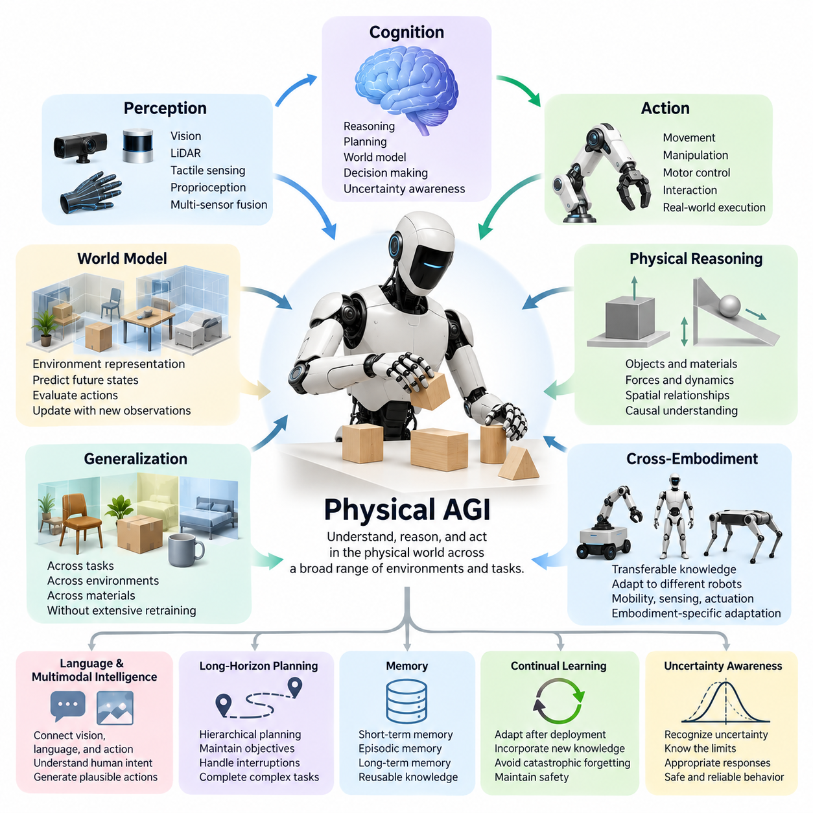{width="7.268055555555556in" height="7.268055555555556in"}

Physical Artificial General Intelligence, or Physical AGI, refers to a hypothetical form of general intelligence capable of understanding, reasoning about, and acting within the physical world across a broad range of environments and tasks. Unlike conventional automation, which operates within predefined conditions, Physical AGI would adapt its behavior to unfamiliar situations, learn from experience, and pursue complex objectives while respecting physical constraints.

The concept extends Artificial General Intelligence beyond digital reasoning into embodied interaction. A digital intelligence may demonstrate broad capabilities in language, mathematics, programming, and abstract problem solving, yet physical environments introduce additional requirements. Physical AGI would need to connect symbolic knowledge and conceptual reasoning with perception, movement, manipulation, and the consequences of real-world actions.

A defining characteristic of Physical AGI would be its ability to integrate perception, cognition, and action into a unified intelligence system. Cameras, LiDAR, tactile sensors, proprioception, and other sensing modalities would provide information about surrounding conditions. The system would transform these observations into meaningful representations, reason about possible outcomes, and generate actions that continuously respond to environmental feedback.

Physical AGI would require a grounded understanding of objects, materials, forces, spatial relationships, and environmental dynamics. Recognizing a chair would involve more than identifying its visual appearance. The system would need to understand its structural properties, possible functions, interaction constraints, and how it might respond to different forces. Such understanding would support flexible behavior beyond previously demonstrated examples.

World models could provide a central foundation for this capability by representing the current environment and predicting how it may evolve. An advanced Physical AGI system would potentially maintain internal representations of objects, agents, physical relationships, and dynamic processes. These models would allow the intelligence to evaluate alternative actions, anticipate consequences, and update its understanding when observations differ from predictions.

Physical reasoning would distinguish general embodied intelligence from systems that primarily associate observations with learned responses. A robot encountering an unstable object would need to estimate its balance, anticipate how contact might affect its motion, and select an appropriate manipulation strategy. Such reasoning would combine learned physical regularities, causal understanding, uncertainty estimation, and predictive simulation.

Generalization would represent another essential requirement. Contemporary robotic systems frequently perform well within specific environments, object categories, or operational procedures but encounter difficulties when conditions change substantially. Physical AGI would need to transfer acquired knowledge across tasks, locations, materials, and operating conditions without requiring extensive retraining for every new situation or configuration.

Cross-embodiment intelligence would further expand this definition. A general physical intelligence should ideally separate transferable knowledge about the world from the mechanical characteristics of a particular robot. Knowledge acquired through a wheeled mobile manipulator might inform the behavior of a humanoid or quadruped system, although differences in mobility, sensing, actuation, and physical reach would still require embodiment-specific adaptation.

Language and multimodal intelligence could provide an interface between abstract human intentions and physical execution. Vision-Language-Action models offer one possible architectural direction by connecting visual observations, language instructions, and motor commands. However, generating plausible actions from multimodal inputs alone would not establish Physical AGI unless the system also demonstrated reliable reasoning, adaptation, and generalization.

Long-horizon planning would be particularly important because meaningful physical tasks often involve sequences of dependent decisions. Preparing a room, repairing equipment, or assembling a complex structure requires maintaining objectives across many actions while responding to interruptions and unexpected conditions. Physical AGI would need hierarchical planning capabilities that coordinate immediate motor control with intermediate goals and extended task objectives.

Memory would allow Physical AGI to accumulate useful knowledge beyond individual interactions. Short-term memory could preserve recent observations and actions, while episodic memory could record experiences involving particular objects, locations, and outcomes. Long-term semantic and procedural memory would support reusable knowledge and skills, enabling the system to improve its decisions through experience rather than repeatedly learning similar tasks from the beginning.

Continual learning would extend this capacity by allowing the system to adapt after deployment. A Physical AGI platform might encounter unfamiliar equipment, changing environments, or new human preferences throughout its operational lifetime. It would need mechanisms for incorporating new information without catastrophically forgetting previously acquired capabilities, while ensuring that learning does not introduce unacceptable operational risks.

Uncertainty awareness would be indispensable because physical observations are incomplete and real-world outcomes cannot always be predicted accurately. A generally intelligent robot would need to distinguish reliable knowledge from uncertain assumptions and recognize situations beyond its competence. Appropriate responses could include gathering additional information, selecting conservative actions, requesting human assistance, or suspending execution when safety cannot be maintained.

Safety and alignment would therefore form fundamental properties of Physical AGI rather than optional additions. Unlike purely digital systems, embodied intelligence can directly affect people, infrastructure, equipment, and natural environments. Its decisions would need to respect human intentions, operational boundaries, and physical safety requirements, supported by independent monitoring, constrained control, emergency intervention, and accountable governance.

Physical AGI would not necessarily require a humanoid body or humanlike consciousness. General physical competence could emerge through diverse robotic configurations, distributed systems, or combinations of specialized embodiments sharing transferable intelligence. The essential criterion would concern the breadth, adaptability, and reliability of physical understanding and action rather than external appearance, anthropomorphic behavior, or assumptions about subjective experience.

Evaluating Physical AGI would require more than measuring performance on isolated robotic benchmarks. Meaningful assessments would examine unfamiliar tasks, environmental adaptation, causal reasoning, long-horizon execution, knowledge transfer, and safe recovery from failures. Evaluation should distinguish memorized task competence from genuine generalization and measure performance across diverse physical settings under realistic resource and safety constraints.

The distinction between highly capable Physical AI and Physical AGI would remain gradual and potentially contested. A robot that performs hundreds of tasks might still depend on narrow training distributions or extensive human intervention. Conversely, a system with fewer demonstrated skills could possess stronger transferable reasoning capabilities. A credible definition would therefore emphasize open-ended competence, adaptability, autonomy, and reliability rather than task counts alone.

The convergence of Physical AI and AGI could eventually produce systems capable of learning general principles through direct interaction with the world. Such systems might combine foundation models, predictive world models, causal reasoning, hierarchical memory, and adaptive control within integrated architectures. Whether this combination is sufficient for general intelligence remains an open research question requiring theoretical progress and rigorous empirical validation.

Ultimately, Physical AGI would signify a transition from machines that execute predefined physical capabilities toward intelligent systems that can understand unfamiliar situations, acquire new skills, and perform diverse physical tasks with sustained autonomy. Its realization remains uncertain, but the concept provides a research direction for integrating perception, world modeling, reasoning, memory, learning, and safe action into broadly capable embodied intelligence.

## 05.02. Digital AGI vs Embodied AGI

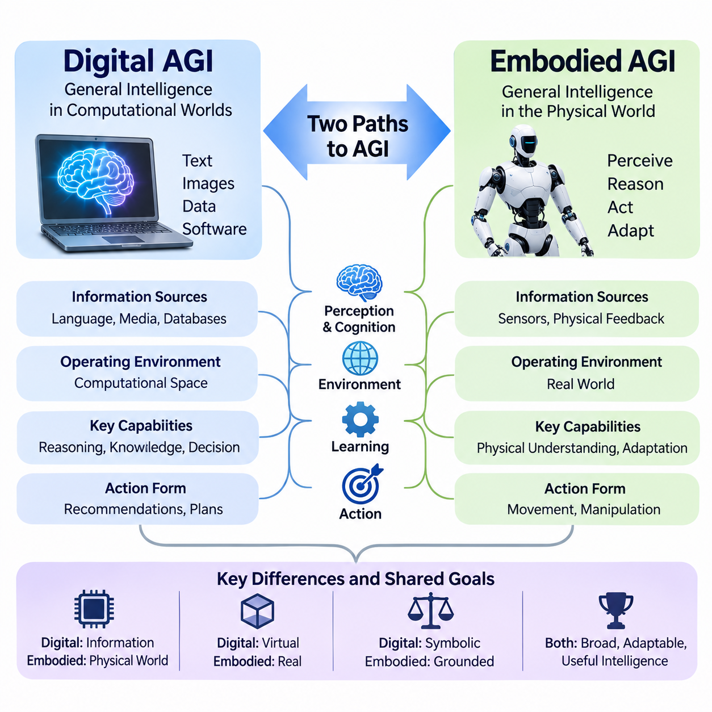{width="7.268055555555556in" height="7.268055555555556in"}

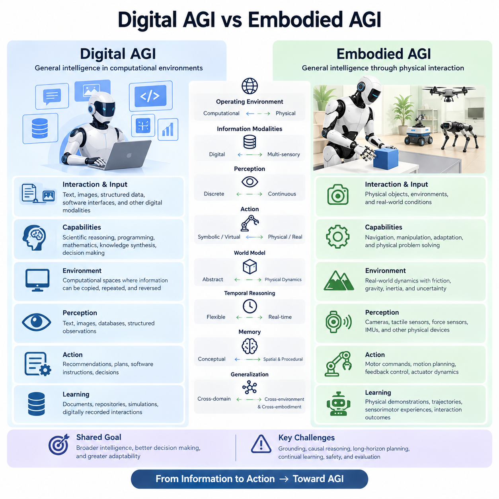{width="7.268055555555556in" height="7.268055555555556in"}

Digital Artificial General Intelligence, or Digital AGI, refers to a hypothetical form of general intelligence capable of performing diverse cognitive tasks within computational environments. Embodied Artificial General Intelligence, or Embodied AGI, extends this concept into physical interaction, where intelligence must perceive, reason, and act through a body. The distinction concerns not only where intelligence operates but also how it acquires knowledge and demonstrates competence.

Digital AGI would primarily interact with information represented through language, images, structured data, software interfaces, and other digital modalities. Its capabilities might include scientific reasoning, programming, mathematical problem solving, knowledge synthesis, and complex decision making. Embodied AGI would additionally need to interact with physical objects, navigate environments, manipulate materials, and adapt its behavior to changing real-world conditions.

The operating environment creates a fundamental difference between these two concepts. Digital systems often function within computational spaces where information can be copied, operations can be repeated, and certain actions can be reversed. Physical environments involve friction, gravity, inertia, material deformation, and irreversible consequences. Embodied intelligence must therefore account for continuous dynamics and uncertainty that cannot be eliminated through symbolic reasoning alone.

Perception represents another important distinction. Digital AGI may receive information through text, images, databases, or structured observations, whereas Embodied AGI must interpret continuous streams from cameras, tactile sensors, force sensors, inertial measurement units, and other physical devices. These observations are frequently noisy, incomplete, and dependent on viewpoint, requiring active perception and continuous estimation of environmental states.

The relationship between intelligence and action is especially important in embodied systems. Digital AGI may generate recommendations, plans, software instructions, or decisions without directly controlling physical mechanisms. Embodied AGI must translate intentions into motor commands that produce real-world effects. This requires coordination between high-level reasoning, motion planning, feedback control, and actuator dynamics while respecting the mechanical limitations of its body.

World models could serve as a common foundation for both forms of general intelligence. Digital AGI might use internal models to reason about abstract systems, social interactions, or scientific processes. Embodied AGI would additionally require predictive representations of physical environments, object interactions, and action-dependent dynamics. Such models would help connect abstract knowledge with the consequences of physical behavior.

Grounding distinguishes knowledge expressed through symbols from knowledge connected to physical experience. A digital intelligence may describe how a glass can break when dropped, while an embodied intelligence must predict the consequences of grasping, lifting, transporting, or releasing that glass. Physical grounding requires linking conceptual representations to sensory evidence, material properties, causal relationships, and the effects of executed actions.

Learning processes would also differ in important ways. Digital AGI could potentially learn from large collections of documents, software repositories, simulations, and digitally recorded interactions. Embodied AGI would additionally depend on physical demonstrations, robot trajectories, sensorimotor experiences, and interaction outcomes. Because real-world data collection is expensive and potentially hazardous, efficient learning from limited physical experience would be particularly valuable.

Simulation could partially bridge this difference by allowing embodied systems to explore physical interactions within computational environments. Digital twins, physics engines, and synthetic data generation could support training and evaluation before real-world deployment. However, discrepancies between simulated and actual environments would remain significant challenges, requiring domain adaptation, uncertainty estimation, and systematic Sim2Real transfer.

Temporal reasoning introduces another distinction. Digital AGI may solve complex problems through extended computation while operating independently of immediate physical deadlines. Embodied AGI frequently faces strict real-time constraints because moving objects, unstable contacts, and human interactions require timely responses. Its architecture must coordinate fast control loops with slower deliberative reasoning and long-horizon planning across multiple temporal scales.

Memory would play an important role in both systems, although embodied intelligence introduces additional spatial and procedural requirements. Digital AGI might maintain knowledge about concepts, documents, interactions, and previous reasoning processes. Embodied AGI would also benefit from remembering locations, object configurations, manipulation outcomes, environmental changes, and previously acquired motor skills, allowing experience to influence future physical behavior.

Generalization would provide a critical measure of progress toward either form of AGI. Digital AGI would need to transfer reasoning capabilities across intellectual domains and unfamiliar problem structures. Embodied AGI would additionally need to generalize across physical environments, object categories, robot morphologies, and dynamic conditions. Success in one laboratory or robot configuration would not necessarily establish general physical competence.

Embodiment itself introduces constraints that influence the expression of intelligence. A humanoid robot, mobile manipulator, quadruped, and aerial vehicle possess different sensing capabilities, movement patterns, and interaction possibilities. Embodied AGI would ideally preserve transferable knowledge across these platforms while adapting actions to their mechanical characteristics. General intelligence would therefore need to distinguish world knowledge from body-specific control.

Safety requirements also differ because the consequences of actions occur through different channels. Digital AGI may create risks through misinformation, cybersecurity failures, unauthorized decisions, or harmful digital operations. Embodied AGI introduces additional hazards involving collisions, excessive forces, equipment damage, and human injury. Its operation would require physical safety mechanisms, runtime monitoring, constrained planning, and reliable human intervention.

The distinction does not imply that Digital AGI would necessarily be less intelligent than Embodied AGI. General intelligence might be achieved through digital learning and reasoning without requiring a physical body, although this remains scientifically unresolved. Conversely, physical interaction may provide important learning signals for developing causal understanding, intuitive physics, and grounded reasoning that are difficult to acquire through passive digital information alone.

A future architecture could combine digital and embodied intelligence rather than treating them as competing approaches. Large-scale digital models might provide abstract reasoning, language understanding, scientific knowledge, and strategic planning. Embodied systems could contribute sensory grounding, physical experimentation, and practical experience. Shared representations and predictive world models could enable knowledge to flow between these complementary capabilities.

Such convergence could support a hierarchical intelligence architecture in which high-level cognitive processes formulate objectives while embodied controllers execute and evaluate physical actions. Feedback from real-world interaction would update internal models, memories, and future plans. The resulting system would operate through a continuous cycle of perception, prediction, reasoning, action, and learning rather than relying exclusively on digital inference or reactive motor control.

Ultimately, Digital AGI and Embodied AGI represent different dimensions of the broader pursuit of general intelligence. Digital AGI emphasizes flexible cognition across informational environments, while Embodied AGI emphasizes the integration of cognition with physical perception and action. Their convergence may provide a pathway toward Physical AGI, although whether embodiment is necessary for AGI and how general intelligence should be evaluated remain open questions.

## 05.03. Perception Action and Grounded Intelligence

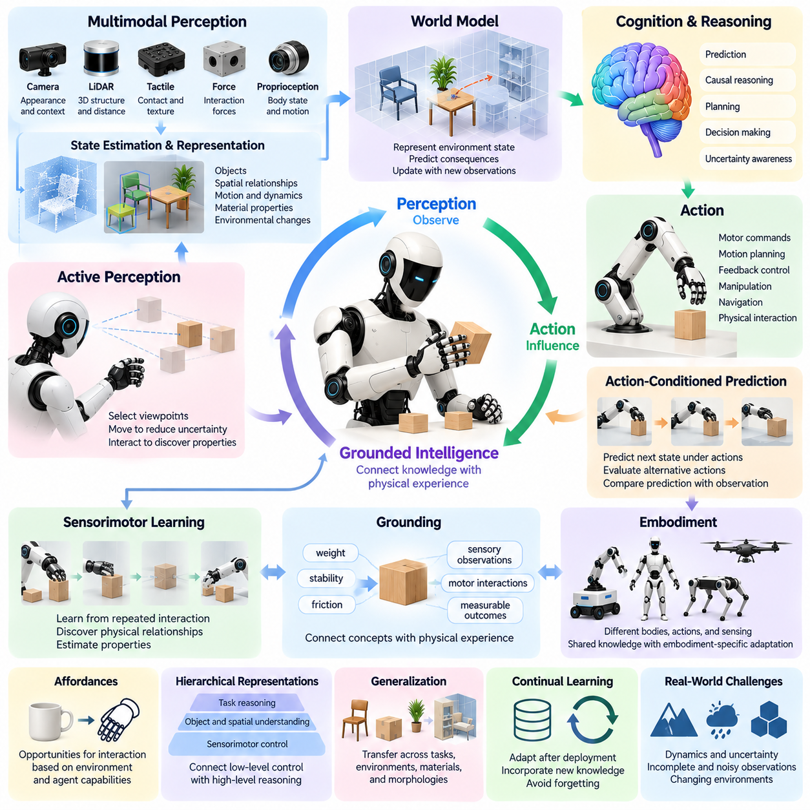{width="7.268055555555556in" height="7.268055555555556in"}

Perception, action, and grounded intelligence form a foundational relationship in the development of Physical Artificial General Intelligence. Perception enables an intelligent system to observe its environment, while action allows it to influence physical conditions and acquire new information. Grounded intelligence emerges when internal knowledge is connected to these interactions, allowing concepts and decisions to reflect the actual properties and behavior of the physical world.

Perception in Physical AI extends beyond recognizing objects in images or interpreting isolated sensor measurements. An embodied system must continuously estimate spatial relationships, object states, motion, material properties, and environmental changes. Cameras, LiDAR, tactile sensors, force sensors, and proprioceptive measurements provide complementary information that must be integrated into a coherent representation of the surrounding world.

The relationship between perception and action is inherently bidirectional. Perception influences which actions are selected, while actions change the information available for subsequent perception. A robot may reposition its camera to inspect an occluded object, touch a surface to estimate friction, or manipulate an unfamiliar item to discover its properties. These interactions transform perception from passive observation into active information acquisition.

Grounded intelligence refers to the ability to connect abstract representations with physical experiences and observable consequences. A system may possess linguistic knowledge about weight, stability, or resistance without understanding how these properties affect actual manipulation. Physical grounding requires associating such concepts with sensory observations, motor interactions, and measurable outcomes, enabling knowledge to guide behavior in unfamiliar circumstances.

Sensorimotor learning provides an important mechanism for developing grounded representations. Through repeated interaction, an intelligent system can discover relationships between motor commands, environmental responses, and sensory feedback. For example, pushing objects with different masses and surface characteristics produces distinct motion patterns. Learning these relationships helps the system estimate physical properties and predict the consequences of future actions.

World models can integrate perception and action within a predictive framework. A world model represents relevant environmental states and estimates how those states may change under alternative actions. By comparing predicted outcomes with observed results, an embodied system can refine its internal understanding of physical dynamics. This predictive capability supports planning, adaptation, and reasoning beyond immediate stimulus-response behavior.

Action-conditioned prediction is particularly important because physical environments evolve differently depending on the actions performed. A robot approaching an obstacle, grasping an object, or applying force to a mechanism changes the subsequent state of the world. Predictive models must therefore incorporate both environmental dynamics and the effects of control decisions, allowing the system to evaluate possible futures before committing to physical execution.

Causal reasoning strengthens grounded intelligence by distinguishing correlations from mechanisms that produce physical outcomes. Observing that an object moves after contact is insufficient to understand the underlying interaction. The system must reason about applied force, contact geometry, friction, and constraints. Such causal representations support transfer to unfamiliar objects and enable predictions about interventions that have not previously been experienced.

Active perception introduces decision making into the sensing process itself. Rather than treating sensor observations as fixed inputs, an intelligent agent can select movements and interactions that reduce uncertainty. It may approach an object from another viewpoint, adjust illumination, or perform a controlled exploratory action. The value of perception is therefore measured not only by recognition accuracy but also by its contribution to effective decisions.

Multimodal integration is essential because individual sensing modalities reveal different aspects of physical reality. Vision provides appearance and spatial context, tactile sensing reveals local contact conditions, and proprioception describes the robot\'s own configuration and motion. Combining these signals enables more reliable state estimation, particularly when observations are incomplete, noisy, or temporarily unavailable.

Embodiment also influences how physical knowledge is acquired and represented. A mobile robot experiences environments through navigation and obstacle avoidance, while a manipulator learns through grasping, contact, and object transformation. Different robot morphologies create different opportunities for exploration. Grounded intelligence must therefore account for the relationship between the physical body, available actions, and accessible sensory information.

The concept of affordances connects perception directly to potential actions. An affordance represents an opportunity for interaction that depends on both environmental properties and an agent\'s capabilities. A handle may afford pulling for a robotic gripper, while a narrow passage may afford traversal for a compact mobile platform. Learning affordances enables an intelligent system to interpret environments in terms of achievable objectives rather than visual categories alone.

Hierarchical representations can connect low-level sensorimotor experience with higher-level reasoning. Fast control processes manage contact forces, balance, and motion, while intermediate representations describe objects, spatial relationships, and executable skills. Higher-level cognitive processes organize these capabilities into goals and plans. This hierarchy allows grounded intelligence to operate across multiple spatial and temporal scales.

Memory extends grounded intelligence beyond immediate interactions by preserving information about previous experiences. Episodic memory can record specific actions and outcomes, while semantic memory stores generalized knowledge about objects and physical relationships. Procedural memory supports reusable motor skills. Integrating these memory systems allows an agent to recognize recurring situations and adapt its behavior without rediscovering every physical relationship.

Long-horizon physical tasks require grounded intelligence to maintain consistency between perception, prediction, and action over extended periods. During assembly, maintenance, or navigation, the environment changes as actions are completed. The system must update its world representation, track progress toward objectives, and detect unexpected deviations. Reliable execution depends on maintaining this feedback process throughout the task rather than relying on a fixed initial plan.

Uncertainty remains unavoidable because sensors provide incomplete measurements and learned models cannot perfectly predict every physical interaction. A grounded system must estimate confidence in its observations, predictions, and planned actions. When uncertainty becomes significant, it may gather additional evidence, modify its strategy, or request assistance. This ability to recognize limitations is essential for safe and reliable physical autonomy.

The integration of perception, action, and grounding also provides a potential pathway toward generalization. Knowledge acquired through direct interaction may transfer across objects, tasks, and environments when the system learns reusable physical principles rather than memorizing specific trajectories. However, generalization across substantially different conditions remains difficult, and successful performance in familiar environments does not establish general physical intelligence.

Ultimately, grounded intelligence represents the continuous integration of sensing, prediction, reasoning, and physical interaction. Perception provides evidence about the world, action generates consequences and new observations, and learning transforms these experiences into reusable knowledge. Their convergence may provide a foundation for Physical AGI, enabling intelligent systems to develop increasingly flexible, adaptive, and reliable competence in real-world environments.

## 05.04. World Models as a Bridge to General Intelligence

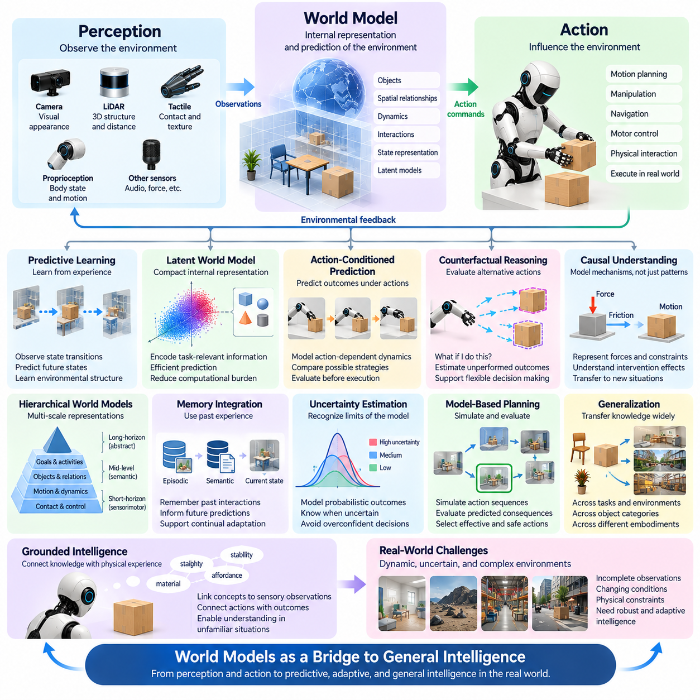{width="7.268055555555556in" height="7.268055555555556in"}

World models represent a potential bridge between specialized artificial intelligence and general intelligence by enabling systems to construct internal representations of their environments and predict how those environments may evolve. Rather than responding only to immediate observations, an intelligent agent can use a world model to anticipate consequences, evaluate alternatives, and adapt its behavior. This capability is particularly important for Physical AI operating in complex environments.

A world model can be understood as a learned representation of environmental states, physical relationships, and transition dynamics. It captures information about objects, spatial configurations, motion, interactions, and the effects of actions. By maintaining such representations, an intelligent system can reason about situations beyond its current sensory inputs and estimate how different decisions might influence future conditions.

Traditional perception systems often focus on identifying objects, estimating positions, or classifying environmental features. World models extend these capabilities by representing how the environment changes over time. A robot may recognize a moving object, but a predictive world model can estimate its future trajectory, anticipate possible interactions, and determine whether a planned action could create a collision or other undesirable outcome.

The connection between world modeling and general intelligence emerges from the ability to reuse learned knowledge across different situations. Instead of memorizing individual responses for every possible scenario, an intelligent system can learn reusable principles governing environmental behavior. These principles may support adaptation to unfamiliar objects, new task configurations, and changing operating conditions without requiring complete retraining.

Predictive learning provides an important foundation for developing such representations. By observing sequences of environmental states and actions, a model can learn relationships between current conditions and future outcomes. Training objectives may involve predicting future observations, latent representations, or physical state transitions. Accurate prediction encourages the model to capture environmental structure that may be useful for planning and reasoning.

Latent world models represent complex observations within compact internal spaces rather than reproducing every sensory detail. These latent representations can encode task-relevant information about object relationships, motion, and environmental dynamics. By predicting changes within the latent space, an intelligent system may perform efficient internal simulations while reducing the computational burden associated with detailed physical reconstruction.

Action-conditioned world models extend prediction by incorporating the consequences of an agent\'s decisions. The future state of an environment depends not only on external dynamics but also on actions performed by the agent. A robot pushing a container, opening a door, or navigating around an obstacle changes subsequent conditions. Modeling these action-dependent transitions allows the system to compare possible strategies before physical execution.

Counterfactual reasoning becomes possible when a world model can estimate outcomes under actions that were not actually performed. An intelligent system may ask what would happen if an object were moved, a different route were selected, or a manipulation strategy were modified. Such reasoning supports flexible decision making by allowing hypothetical alternatives to be evaluated without requiring every possibility to be tested in the real world.

Causal understanding could further strengthen the relationship between world models and general intelligence. Statistical prediction may identify recurring patterns, but general reasoning often requires understanding why events occur. Models that capture forces, constraints, object interactions, and intervention effects may transfer more effectively across unfamiliar situations. However, predictive accuracy alone does not establish that a model has learned genuine causal mechanisms.

Hierarchical world models could organize knowledge across multiple spatial and temporal scales. Low-level representations may describe contact dynamics, motion, and immediate sensorimotor changes, while higher-level representations capture objects, activities, goals, and environmental structure. This hierarchy would allow intelligent systems to coordinate rapid physical responses with long-horizon planning and abstract reasoning.

Memory provides continuity between world modeling and long-term intelligence. A world model may maintain a current estimate of environmental conditions while drawing on previous experiences stored in episodic and semantic memory. Past interactions can inform predictions about unfamiliar situations, while prediction errors can reveal missing knowledge. Integrating memory with predictive modeling could support continual adaptation and cumulative learning.

Uncertainty estimation is essential because world models cannot perfectly represent complex physical environments. Sensor noise, incomplete observations, unfamiliar objects, and changing dynamics can reduce prediction reliability. An intelligent system must recognize when its internal model is uncertain and avoid treating hypothetical outcomes as guaranteed. Probabilistic representations and confidence-aware planning can help manage these limitations.

World models also provide a foundation for model-based planning. Instead of selecting actions solely through learned stimulus-response associations, an agent can simulate alternative action sequences and evaluate their predicted consequences. Model Predictive Control and learned planning architectures illustrate this principle. More advanced systems could combine predictive simulation with symbolic goals, language instructions, and hierarchical decision making.

The relationship between world models and foundation models introduces another important direction. Large multimodal models can learn broad representations from images, video, language, and interaction data, while predictive world models emphasize environmental dynamics and action consequences. Integrating these capabilities could connect semantic understanding with physically grounded prediction, enabling knowledge acquired from diverse information sources to support embodied decision making.

Cross-embodiment generalization could benefit from world representations that distinguish environmental knowledge from robot-specific control. A model describing object dynamics, spatial relationships, and physical constraints may provide useful information to different robotic platforms. However, translating shared predictions into executable actions requires adaptation to each robot\'s morphology, sensing capabilities, actuation limits, and control architecture.

Simulation and real-world experience could jointly improve world models through iterative learning. Simulated environments provide scalable opportunities to explore alternative actions and rare situations, while physical interactions reveal discrepancies between modeled and actual dynamics. Combining these sources may support more robust representations, although simulation bias and distribution shifts remain significant obstacles to reliable transfer.

World models could also support autonomous scientific exploration by allowing intelligent agents to formulate hypotheses and test them through controlled interactions. When predictions disagree with observations, the system can identify uncertain assumptions and select experiments that provide useful information. This process connects perception, reasoning, action, and learning within a continuous cycle of model refinement and knowledge acquisition.

Despite their potential, world models alone do not guarantee general intelligence. A system may predict environmental changes accurately while lacking reliable goal understanding, causal reasoning, transfer learning, or safe decision making. General intelligence would require world models to operate alongside memory, planning, language, adaptive control, and mechanisms for learning from experience across diverse domains.

Ultimately, world models may serve as a bridge toward Physical AGI by connecting perception with prediction, prediction with reasoning, and reasoning with purposeful action. Their greatest contribution would be enabling intelligent systems to develop reusable internal knowledge about how the world behaves. Whether this approach can scale to general intelligence remains unresolved, but predictive world modeling provides a promising foundation for increasingly adaptive and autonomous physical systems.

## 05.05. Robot Foundation Models and Generalist Policies

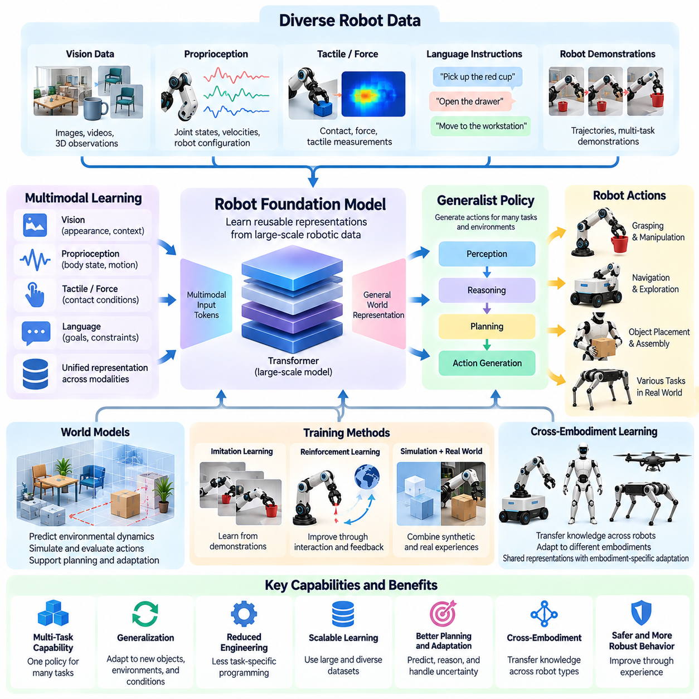{width="7.268055555555556in" height="7.268055555555556in"}

Robot foundation models represent an important step toward general-purpose physical intelligence by learning reusable representations and behaviors from diverse robotic experiences. Unlike traditional controllers designed for individual tasks, these models aim to support multiple objectives, environments, and interaction patterns within a shared architecture. Their development could reduce dependence on task-specific engineering and provide a foundation for increasingly adaptable autonomous systems.

A robot foundation model is typically trained on large collections of sensor observations, robot actions, demonstrations, and task descriptions. These datasets may combine visual information, proprioceptive measurements, language instructions, and recorded trajectories. Through large-scale learning, the model attempts to discover transferable relationships between environmental states, intended objectives, and appropriate actions rather than memorizing isolated control sequences.

Generalist policies extend this approach by generating actions for many different tasks through a common decision-making mechanism. A single policy might support object grasping, placement, navigation, and manipulation when provided with suitable observations and instructions. The central objective is not merely to increase the number of supported tasks but to develop reusable capabilities that remain effective when objects, environments, and task requirements change.

The relationship between foundation models and generalist policies is complementary rather than identical. A foundation model provides broadly learned representations or predictive capabilities, while a generalist policy converts relevant information into executable behavior. Some architectures integrate these functions into one model, whereas others separate perception, reasoning, planning, and control into specialized components connected through shared representations.

Multimodal learning plays a central role because physical tasks involve information from several sensing and communication channels. Vision provides object appearance and spatial context, language expresses goals and constraints, and proprioception describes the robot\'s configuration. Tactile and force measurements contribute information about contact conditions. Integrating these modalities helps a policy relate human instructions to physical states and feasible actions.

Vision-Language-Action models illustrate one architectural direction for generalist robotic intelligence. These models connect visual observations and natural-language instructions with representations of robot actions. By learning from diverse demonstrations, they may acquire reusable associations between semantic goals and motor behavior. However, generating actions from multimodal inputs does not automatically establish reliable physical reasoning or general intelligence.

Action representation is a critical design consideration because robotic systems operate through continuous physical control. Policies may predict joint positions, end-effector poses, velocities, or sequences of future actions. Discrete action tokens and continuous action distributions offer different tradeoffs in precision, computational efficiency, and adaptability. The selected representation must remain compatible with robot dynamics and real-time control requirements.

Training data diversity strongly influences the generalization capabilities of robot foundation models. Demonstrations collected across different objects, environments, operators, and robotic platforms can expose models to broader interaction patterns. However, increasing dataset size alone does not guarantee transferable intelligence. Data quality, task coverage, physical consistency, and the representation of rare failure conditions remain essential considerations.

Imitation learning provides a practical mechanism for acquiring generalist behavior from demonstrations. A policy learns to reproduce actions associated with observed states and intended tasks, potentially reducing the need for manually programmed control rules. Nevertheless, imitation-based systems may struggle when encountering situations outside their training distribution, especially when errors accumulate during long sequences of physical actions.

Reinforcement learning can complement imitation learning by improving behavior through interaction and feedback. Simulated environments allow policies to explore alternative strategies, evaluate rewards, and practice recovery from failures. Real-world reinforcement learning may provide additional adaptation but introduces safety and resource constraints. Combining demonstrations, simulation, and carefully controlled physical experience could support more robust generalist policies.

World models may strengthen robot foundation models by providing predictive knowledge about environmental dynamics and action consequences. Instead of selecting actions solely from learned observation-action associations, a system could evaluate possible outcomes before execution. Integrating predictive representations with generalist policies may improve planning, uncertainty awareness, and adaptation when familiar action patterns become unreliable.

Cross-embodiment learning represents a major opportunity for scaling generalist robotic intelligence. Data collected from manipulators, mobile robots, humanoids, and other platforms may contain shared knowledge about objects, spatial relationships, and physical interactions. However, differences in joint structures, actuator limits, sensing configurations, and control interfaces complicate direct policy transfer. Shared representations must therefore be combined with embodiment-specific adaptation.

Hierarchical architectures offer a practical approach to coordinating broad intelligence with precise physical execution. High-level models can interpret instructions, decompose tasks, and select reusable skills, while lower-level controllers manage motion, contact forces, and stability. This separation allows computationally intensive reasoning to operate at slower rates while time-critical control processes maintain reliable physical behavior.

Memory and continual learning could further expand the capabilities of generalist policies. An intelligent robot may need to remember previous interactions, environmental changes, and task-specific preferences while acquiring new skills after deployment. Integrating episodic memory, reusable skill representations, and controlled model updates could support cumulative learning. Preventing catastrophic forgetting and unsafe behavioral changes remains a significant challenge.

Evaluation must distinguish broad task coverage from genuine generalization. A policy performing many familiar demonstrations successfully may still fail when object properties, lighting, geometry, or task sequences change. Meaningful benchmarks should measure performance on unseen tasks, unfamiliar environments, long-horizon objectives, and unexpected disturbances. Reliability, recovery behavior, and physical safety are as important as nominal task success.

Deployment introduces additional constraints involving computation, latency, power consumption, and hardware compatibility. Large foundation models may require substantial processing resources, while robotic systems often operate under strict real-time and energy limitations. Model compression, efficient inference, edge computing, and hierarchical control can help reconcile broad reasoning capabilities with practical requirements for continuous autonomous operation.

Safety and alignment become increasingly important as generalist policies acquire broader behavioral capabilities. A robot capable of performing diverse actions must recognize operational boundaries, interpret human intentions, and avoid harmful consequences. Runtime monitoring, constrained action generation, independent safety controllers, and human intervention mechanisms can provide protection against model errors and unexpected environmental conditions.

Robot foundation models and generalist policies could contribute to Physical AGI by combining reusable knowledge with adaptable physical behavior. Their long-term significance lies in moving robotics from collections of narrowly programmed skills toward systems capable of learning and executing diverse tasks through shared intelligence. Whether these architectures can achieve open-ended physical competence remains uncertain, but they establish an important direction for scalable embodied intelligence.

## 05.06. VLA and Multimodal Action Intelligence

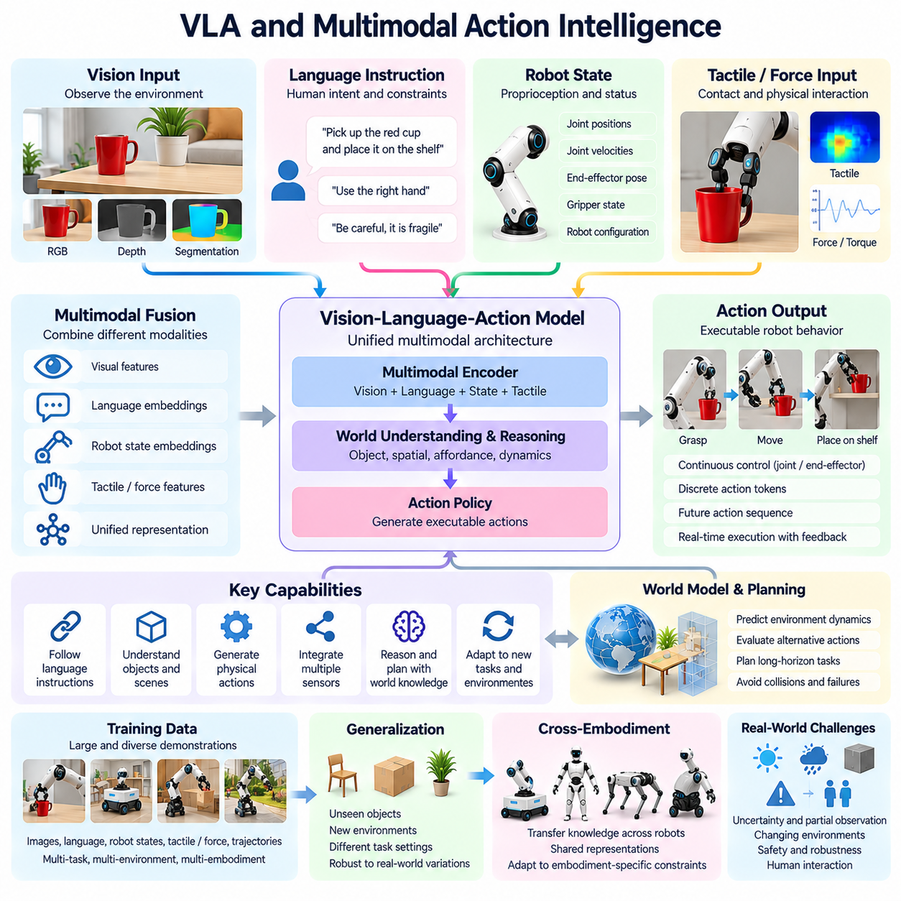{width="7.268055555555556in" height="7.268055555555556in"}

Vision-Language-Action models, commonly known as VLA models, represent an emerging approach to connecting visual perception, natural-language understanding, and physical action within a unified intelligence architecture. These models aim to translate human instructions and environmental observations into executable robotic behavior. Their development could help bridge the gap between abstract multimodal reasoning and the practical requirements of embodied intelligence.

Multimodal action intelligence extends beyond recognizing objects or interpreting language instructions. It requires an intelligent system to combine visual information, spatial relationships, robot states, and task objectives when selecting physical actions. A robot must understand not only what an instruction means but also whether the requested action is physically feasible, how it should be executed, and what consequences may follow.

VLA architectures typically integrate visual encoders, language representations, and action-generation mechanisms. Visual inputs describe objects and environmental conditions, while language provides semantic goals and operational constraints. Action components transform these representations into motor commands or intermediate action sequences. Different architectures may combine these functions within a single network or distribute them across interconnected modules.

The relationship between vision and language provides an important foundation for general-purpose robotic behavior. Language allows humans to express objectives without specifying every movement, while vision enables robots to identify relevant objects and environmental conditions. By connecting these modalities, a robot may interpret instructions such as placing an object on a shelf while adapting its movements to the observed arrangement of surrounding items.

Action representations determine how high-level intentions become executable physical behavior. VLA models may generate discrete action tokens, continuous control values, end-effector poses, or sequences of future movements. Each representation introduces tradeoffs involving precision, computational efficiency, temporal consistency, and hardware compatibility. Effective action generation must remain consistent with robot kinematics, dynamics, and operational constraints.

Training VLA models generally involves combining robotic demonstrations with multimodal information. Datasets may contain camera observations, language instructions, proprioceptive measurements, and corresponding robot trajectories. Learning from diverse tasks and environments can help models associate semantic objectives with physical behaviors. However, the usefulness of these associations depends on data quality, task diversity, and coverage of challenging situations.

Large vision-language models can provide semantic knowledge that complements robot-specific experience. Knowledge about objects, activities, spatial relationships, and human intentions may help robots interpret unfamiliar instructions. Nevertheless, linguistic or visual understanding does not automatically translate into reliable motor competence. Physical execution requires additional knowledge about contact forces, object dynamics, manipulation constraints, and feedback control.

Multimodal fusion is particularly important when visual information alone cannot determine the correct action. A robot may recognize an object but remain uncertain about its weight, friction, or mechanical resistance. Tactile sensors, force measurements, and proprioceptive feedback can provide complementary evidence during manipulation. Integrating these signals may improve grasp stability, contact awareness, and adaptation to unexpected physical interactions.

Temporal action modeling allows VLA systems to represent behavior across sequences rather than isolated commands. Predicting short action segments can improve continuity and reduce the computational overhead of generating every control update independently. However, longer action sequences may become unreliable when environmental conditions change. Closed-loop execution and frequent observation updates remain necessary for correcting deviations during physical tasks.

World models could strengthen VLA systems by providing predictive representations of environmental dynamics. Instead of mapping observations and instructions directly into actions, an integrated architecture could evaluate how alternative movements might change the environment. Such prediction would support planning, collision avoidance, and recovery from unexpected outcomes. This connection may help transform multimodal action generation into more deliberate physical reasoning.

Hierarchical planning provides another pathway for scaling VLA capabilities to complex tasks. A high-level model may interpret an instruction, identify intermediate objectives, and select appropriate skills. Lower-level policies can then execute grasping, navigation, or manipulation while responding to sensor feedback. This division allows semantic reasoning to guide extended behavior without requiring a single model to directly manage every motor-control detail.

Generalization remains a central challenge because robotic environments contain substantial variation in object geometry, lighting, materials, and spatial arrangements. A VLA model trained on diverse demonstrations may adapt to unfamiliar combinations of known elements, but performance can deteriorate under significant distribution shifts. Robust generalization requires evaluating whether learned representations capture transferable physical relationships rather than memorized visual-action patterns.

Cross-embodiment learning could allow multimodal action intelligence to operate across different robotic platforms. Shared language and visual representations may encode task objectives independently of a particular robot body. However, action execution depends on morphology, actuator capabilities, sensor configurations, and control interfaces. Transfer between manipulators, humanoids, and mobile robots therefore requires mechanisms that translate common intentions into embodiment-specific actions.

Memory and contextual understanding could improve VLA performance during long-horizon activities. A robot may need to remember previous instructions, completed actions, object locations, and changing environmental conditions. Episodic memory can preserve interaction history, while task-level representations maintain progress toward objectives. These capabilities help prevent repeated mistakes and support coherent behavior across multiple stages of physical execution.

Inference efficiency presents a practical challenge because large multimodal models can require substantial computational resources. Physical robots must often operate under limitations involving processing power, energy consumption, communication latency, and thermal capacity. Edge deployment, model compression, action chunking, and hierarchical control may reduce these constraints. Safety-critical control loops must remain responsive even when higher-level model inference is delayed.

Safety and reliability are fundamental requirements for deploying VLA systems in real environments. Language instructions may be ambiguous, visual observations may be incomplete, and generated actions may violate physical constraints. Runtime monitoring, uncertainty estimation, constrained planning, and independent safety controllers can reduce operational risks. Human supervision and intervention remain important when systems encounter unfamiliar or potentially hazardous situations.

Evaluation of multimodal action intelligence must examine more than instruction-following accuracy. Meaningful benchmarks should measure physical task completion, manipulation precision, recovery from disturbances, long-horizon consistency, and performance under unfamiliar conditions. Testing should also examine whether systems recognize infeasible instructions and uncertain situations. Such evaluation helps distinguish plausible action generation from dependable embodied competence.

VLA models and multimodal action intelligence may become important components of Physical AGI by connecting semantic understanding with adaptive physical behavior. Their long-term potential lies in enabling robots to interpret diverse human objectives and translate them into reliable actions across changing environments. However, achieving general physical intelligence will require deeper integration with world models, causal reasoning, memory, continual learning, and robust control.

## 05.07. Physical Reasoning

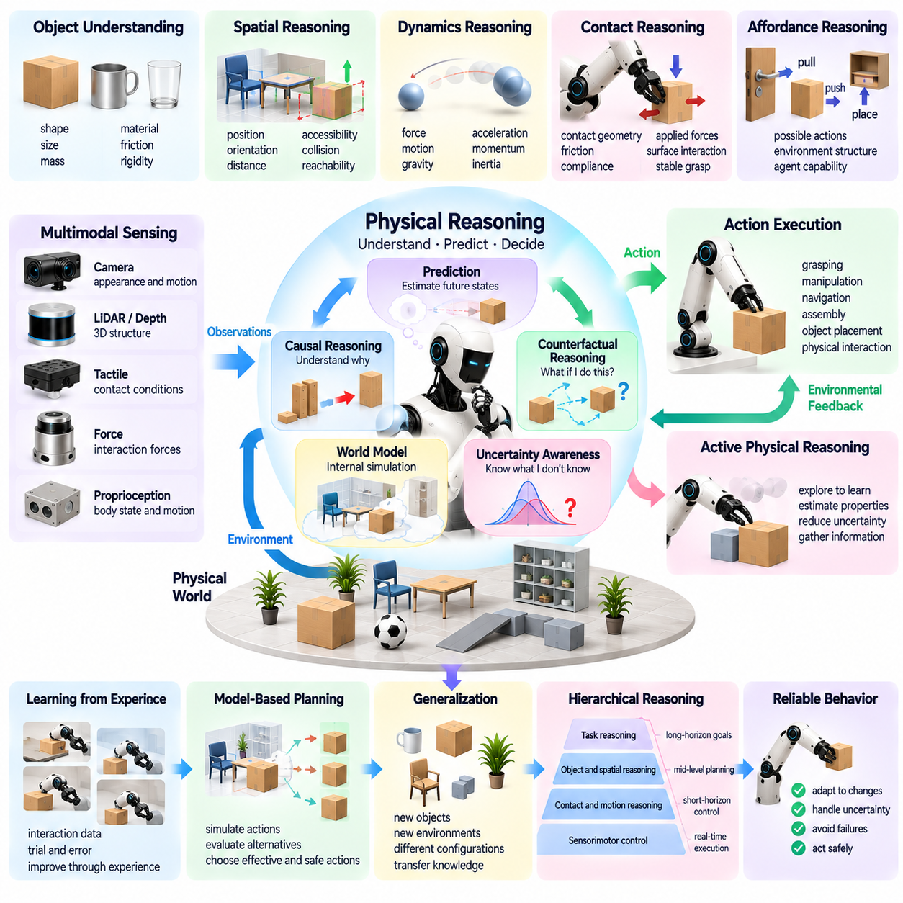{width="7.268055555555556in" height="7.268055555555556in"}

Physical reasoning is the ability of an intelligent system to understand, predict, and make decisions about interactions in the physical world. It involves reasoning about objects, forces, motion, spatial relationships, and environmental constraints. Unlike purely symbolic reasoning, physical reasoning must account for continuous dynamics and uncertainty. This capability is essential for Physical AI systems that must act reliably in unfamiliar and changing environments.

Human physical reasoning develops through observation, interaction, and accumulated experience. People intuitively understand that unsupported objects fall, heavy objects require greater effort to move, and unstable structures may collapse. Physical AI seeks to acquire comparable capabilities through sensory learning, predictive modeling, and interaction. However, reproducing human-like physical intuition remains challenging because real environments contain complex and partially observable dynamics.

A fundamental component of physical reasoning is understanding object properties and relationships. Intelligent robots must estimate size, shape, mass, material, friction, rigidity, and spatial configuration. Some properties can be inferred visually, while others require physical interaction. A robot manipulating an unfamiliar container may need to estimate its weight and center of mass before determining a safe grasping and lifting strategy.

Spatial reasoning enables intelligent systems to understand geometric relationships between objects, surfaces, and surrounding structures. It includes estimating positions, orientations, distances, accessibility, and collision constraints. A robot navigating a cluttered environment must determine whether its body can pass through available spaces. Manipulation similarly requires reasoning about reachability, object placement, and feasible movement trajectories.

Physical reasoning also requires understanding dynamics, including how forces produce motion and how objects respond to contact. Robots must anticipate acceleration, momentum, gravity, friction, and mechanical resistance when interacting with their environments. A manipulation strategy that succeeds for a lightweight object may fail for a heavier one. Effective reasoning therefore connects perceived object properties with predictions about physical behavior.

Contact reasoning is particularly important because many robotic tasks involve complex interactions between surfaces. Grasping, pushing, sliding, insertion, and assembly depend on contact geometry, friction, compliance, and applied forces. Small differences in contact conditions can produce substantially different outcomes. Intelligent systems must therefore estimate contact states and adapt their actions when interactions deviate from expectations.

Affordance reasoning connects physical properties with possible actions. An affordance describes what an object or environment permits an agent to do, given the agent\'s capabilities. A handle may support pulling, a flat surface may support placement, and an opening may permit insertion. These possibilities depend on both environmental structure and robot morphology, making affordance understanding essential for transferable physical intelligence.

Prediction provides a central mechanism for physical reasoning. A system can use learned dynamics or world models to estimate how environmental states will change after an action. By simulating alternative movements, a robot may compare outcomes before committing to physical execution. Such predictive reasoning can reduce unnecessary experimentation, although prediction errors must be recognized when models encounter unfamiliar materials or interactions.

Causal reasoning extends physical prediction by identifying relationships between actions and outcomes. A robot may observe that pushing an object causes movement, but deeper reasoning involves understanding how force direction, friction, and constraints influence the result. Causal representations may support adaptation when conditions change. Nevertheless, statistical associations learned from demonstrations do not automatically provide reliable causal understanding.

Counterfactual reasoning allows intelligent systems to consider physical outcomes that did not actually occur. A robot might evaluate whether a different grasp point would improve stability or whether reducing speed would prevent an object from slipping. These hypothetical evaluations support planning and error recovery. Their reliability depends on the accuracy of the underlying physical model and its ability to represent relevant constraints.

Multimodal sensing strengthens physical reasoning by combining complementary information sources. Cameras provide visual geometry and motion cues, while depth sensors estimate three-dimensional structure. Force and tactile sensors reveal contact conditions, and proprioceptive measurements describe the robot\'s internal state. Integrating these observations helps resolve ambiguities that cannot be addressed through vision alone.

Uncertainty is unavoidable because physical properties and environmental states are often only partially observable. A robot may not know whether an object is fragile, whether a surface is slippery, or whether a structure can support additional weight. Physical reasoning must therefore incorporate confidence estimates and risk-aware decisions. When uncertainty is significant, the system may need to gather additional information before executing an action.

Active physical reasoning combines observation with purposeful experimentation. A robot may gently push an object to estimate friction, lift it slightly to assess weight, or adjust its grip to determine stability. Such actions serve both practical and informational purposes. This approach connects active perception, system identification, and learning, allowing the robot to improve its understanding through controlled physical interaction.

Hierarchical reasoning connects low-level physical dynamics with higher-level task objectives. A robot assembling a component must consider contact forces and alignment while also understanding the required assembly sequence. High-level planning determines what should happen, while lower-level reasoning determines how actions can be executed safely. Coordinating these levels is essential for completing complex tasks involving multiple physical dependencies.

Generalization requires physical reasoning to extend beyond previously encountered objects and environments. A robot should ideally apply knowledge about gravity, friction, support, and collision constraints to unfamiliar situations. Learning reusable physical principles may reduce dependence on extensive task-specific demonstrations. However, differences in materials, geometry, and interaction conditions can expose limitations in learned representations.

Simulation offers an important environment for developing physical reasoning capabilities. Robots can explore interactions, test hypotheses, and learn from failures without exposing physical hardware to unnecessary risks. Physics engines and learned simulators can provide complementary training experiences. However, discrepancies between simulated and real-world dynamics may limit transfer, particularly when contact behavior and material properties are difficult to model.

Evaluation of physical reasoning should examine more than successful task execution. Meaningful tests must assess predictions about object behavior, responses to unfamiliar constraints, adaptation after unexpected outcomes, and the ability to explain action consequences. Long-horizon tasks provide additional evidence of whether physical knowledge supports coherent planning. Safety and reliability remain critical evaluation dimensions.

Physical reasoning represents a foundational capability for Physical AGI because general intelligence in the real world requires understanding how actions interact with physical constraints. Its development depends on integrating perception, world models, causal learning, memory, planning, and adaptive control. Although current systems remain limited in open-ended physical understanding, progress in these areas could enable increasingly autonomous robots to reason and act across diverse environments.

## 05.08. Causal and Counterfactual Reasoning

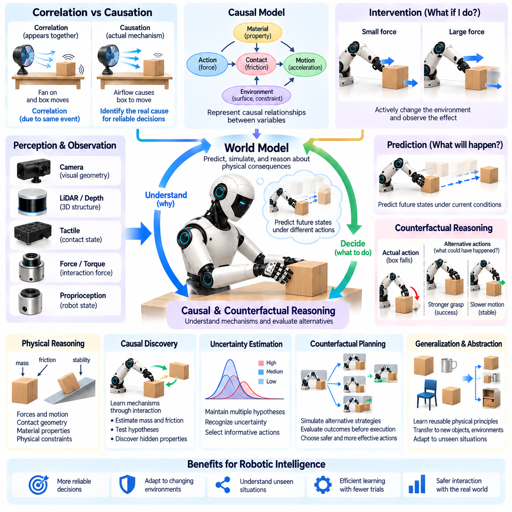{width="7.268055555555556in" height="7.268055555555556in"}

Causal and counterfactual reasoning are essential capabilities for Physical AI systems that must understand why events occur and how alternative actions might change outcomes. While conventional predictive models identify relationships between observations and future states, causal reasoning seeks to explain the mechanisms connecting actions, environmental conditions, and consequences. Counterfactual reasoning extends this understanding by evaluating hypothetical situations that differ from actual experience.

Causal reasoning distinguishes correlation from causation, a fundamental requirement for reliable physical intelligence. Two events may occur together without one directly producing the other. For example, a robot may observe that objects move when a machine operates, but determining whether vibration, airflow, or mechanical contact causes the movement requires deeper analysis. Identifying the actual mechanism enables more reliable decisions when operating conditions change.

Physical environments contain interconnected causal relationships involving forces, motion, contact, materials, and structural constraints. A robot manipulating an object must understand how applied force influences acceleration, how friction resists movement, and how contact geometry affects stability. These relationships form causal structures that can support prediction and planning. Learning such structures may help robots transfer knowledge beyond previously observed situations.

Structural causal models provide one framework for representing relationships between variables and their underlying mechanisms. In robotics, variables may describe applied forces, object positions, contact states, environmental conditions, and observed outcomes. A causal model specifies how changes in one variable influence others under particular assumptions. Such representations can support intervention analysis, although identifying valid causal structures from observational data remains difficult.

Interventional reasoning examines what happens when an agent deliberately changes part of an environment. Unlike passive observation, intervention allows a robot to test whether a particular action produces a predicted result. A robot might apply different pushing forces to estimate friction or alter a grasp position to evaluate stability. Carefully controlled interventions can reveal causal relationships that are difficult to infer from observation alone.

Counterfactual reasoning considers alternative outcomes for events that have already occurred. After dropping an object, a robot might ask whether a different grasp force or movement trajectory would have prevented the failure. This reasoning requires estimating how the situation would have evolved under an alternative action while preserving relevant background conditions. Counterfactual evaluation can support failure analysis, strategy improvement, and adaptive learning.

The distinction between prediction, intervention, and counterfactual reasoning is important. Prediction estimates what may happen under observed conditions, intervention evaluates the consequences of deliberately changing conditions, and counterfactual reasoning examines what might have happened differently. Together, these capabilities provide a richer understanding of physical environments than pattern recognition alone, supporting more flexible and deliberate robotic behavior.

World models may provide computational foundations for causal and counterfactual reasoning by representing environmental states and action-dependent transitions. An intelligent robot could simulate alternative actions and compare predicted consequences before execution. However, a model that accurately predicts future observations does not necessarily represent genuine causal mechanisms. Reliable causal reasoning requires identifying relationships that remain meaningful under interventions and changing conditions.

Physical interaction offers valuable opportunities for causal discovery because robots can actively manipulate their environments. By pushing, lifting, rotating, or contacting objects, a robot can observe how specific changes influence physical outcomes. These experiments can reveal hidden properties such as mass distribution, friction, and mechanical constraints. Active causal discovery must nevertheless balance information gathering with safety, efficiency, and hardware limitations.

Uncertainty presents a major challenge because physical environments are only partially observable. A robot may observe that an object slips without knowing whether the cause is insufficient grip force, surface contamination, or unexpected acceleration. Multiple causal explanations may remain consistent with available evidence. Intelligent systems must therefore maintain uncertainty over possible mechanisms and select additional observations or interventions when necessary.

Causal abstraction could improve generalization by separating reusable physical principles from environment-specific details. Knowledge that insufficient support causes instability may apply across objects with different appearances and materials. Similarly, understanding how friction influences motion may support adaptation to unfamiliar surfaces. Such abstractions could reduce dependence on memorized demonstrations, although their reliability depends on correctly identifying the conditions under which each principle applies.

Counterfactual planning allows robots to compare strategies without physically executing every alternative. A manipulation system might evaluate whether changing the approach angle, reducing acceleration, or selecting another grasp point would improve success probability. This capability becomes especially valuable when experimentation is expensive or dangerous. Nevertheless, counterfactual predictions must account for model uncertainty and should not be treated as guaranteed outcomes.

Causal reasoning can also strengthen error recovery and continual learning. When an action fails, an intelligent system should identify the likely cause rather than simply repeat the same behavior. It may distinguish perception errors, incorrect physical assumptions, control inaccuracies, and unexpected environmental changes. Updating the relevant causal representation can improve future decisions and help prevent similar failures across related tasks.

Multimodal observations support causal understanding by providing complementary evidence about physical interactions. Vision reveals motion and spatial relationships, while tactile sensors detect contact changes and force sensors measure mechanical loading. Proprioceptive feedback provides information about actuator behavior and robot configuration. Combining these signals can help distinguish competing explanations and improve the identification of physical mechanisms.

Hierarchical causal reasoning connects local physical events with higher-level task outcomes. A failed assembly operation may result from incorrect alignment, excessive contact force, unsuitable sequencing, or an earlier positioning error. Understanding these dependencies allows robots to identify which part of a complex process requires correction. Such reasoning supports long-horizon planning by linking immediate interactions to broader operational objectives.

Simulation environments provide scalable opportunities to study interventions and counterfactual outcomes. Robots can test alternative forces, trajectories, and environmental conditions without exposing physical hardware to unnecessary risks. Simulated experiments may generate useful causal hypotheses and training data. However, inaccurate contact models, material properties, or environmental assumptions can produce misleading conclusions that must be validated through real-world interaction.

Evaluating causal and counterfactual reasoning requires tests that distinguish genuine understanding from statistical pattern matching. Robots should be assessed on their ability to predict intervention effects, identify causes of failures, adapt to altered physical relationships, and evaluate plausible alternatives. Tests involving unfamiliar objects and changing environmental mechanisms are particularly valuable. Reliable performance across such conditions would provide stronger evidence of transferable causal competence.

Causal and counterfactual reasoning could become foundational components of Physical AGI by enabling intelligent systems to move beyond predicting events toward understanding and influencing them. Their integration with world models, active perception, memory, planning, and adaptive control may support more autonomous learning and decision making. Although robust causal understanding remains an open research challenge, these capabilities offer a promising path toward flexible physical intelligence.

## 05.09. Memory and Continual Learning

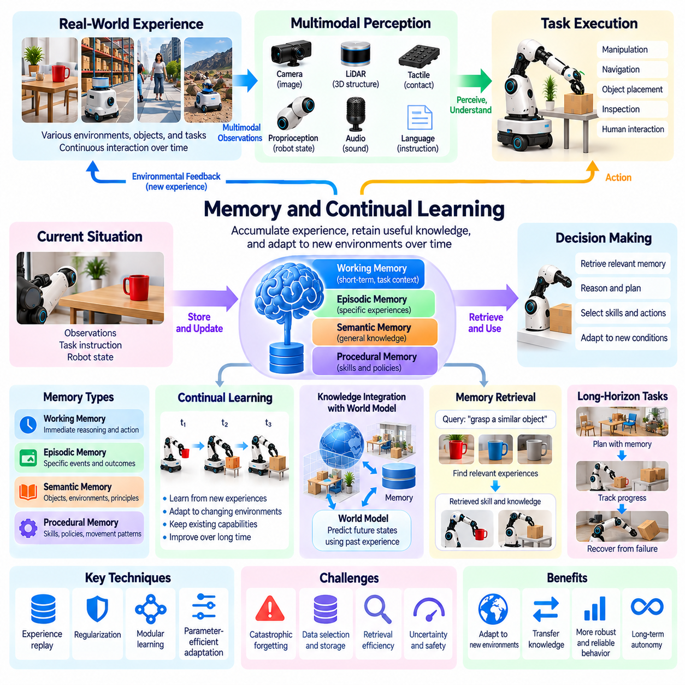{width="7.268055555555556in" height="7.268055555555556in"}

Memory and continual learning are essential capabilities for Physical AI systems that must accumulate experience and adapt to changing environments over extended periods. Unlike conventional models trained once and deployed with fixed knowledge, adaptive robots need mechanisms for retaining useful information while acquiring new skills. These capabilities connect past experience with present decisions and future learning, providing an important foundation for increasingly general physical intelligence.

Memory in intelligent robots extends beyond storing sensor recordings or task histories. It involves organizing information about environmental states, object properties, previous actions, and their consequences. Effective memory systems allow robots to retrieve relevant experiences when encountering similar situations. By connecting stored knowledge with current observations, robots can make more informed decisions without repeatedly learning the same physical relationships.

Working memory maintains information required for immediate reasoning and action execution. A robot performing a manipulation task may need to remember an object\'s location, the current grasp configuration, and the sequence of completed movements. This information must remain accessible even when objects become temporarily occluded. Working memory therefore supports continuity between perception, planning, and control during ongoing physical interactions.

Episodic memory preserves records of specific experiences, including environmental context, actions, outcomes, and unexpected events. A robot may remember that a particular object slipped during an earlier grasp or that an alternative navigation route avoided an obstruction. Such experiences can inform future decisions when similar conditions arise. Episodic memory also supports failure analysis by connecting observed outcomes with the circumstances in which they occurred.

Semantic memory represents generalized knowledge about objects, environments, tasks, and physical relationships. Unlike episodic memory, which records individual events, semantic memory captures reusable concepts and principles. A robot may learn that fragile objects require careful handling or that certain surfaces provide limited traction. These generalized representations can support transfer across situations that differ in appearance but share relevant physical properties.

Procedural memory stores knowledge about how to perform actions and coordinated behaviors. In robotics, this may include grasping strategies, movement patterns, manipulation skills, and learned control policies. Procedural knowledge enables repeated execution without reconstructing every action from first principles. Integrating procedural memory with semantic and episodic knowledge allows robots to select appropriate skills while adapting their execution to current conditions.

Continual learning enables Physical AI systems to update their capabilities as new experiences become available. Robots operating in homes, factories, hospitals, or outdoor environments encounter changing layouts, unfamiliar objects, and evolving task requirements. A continual learning system must incorporate useful information without requiring complete retraining after every new observation. This ability is essential for maintaining long-term adaptability in dynamic physical environments.

Catastrophic forgetting represents a major obstacle to continual learning. When neural networks are updated using new tasks or environments, previously acquired capabilities may deteriorate. A robot learning a new manipulation strategy might lose proficiency in earlier tasks if training changes important internal representations. Addressing this problem requires methods that preserve useful knowledge while allowing sufficient flexibility for learning new behaviors.

Experience replay provides one approach to reducing catastrophic forgetting by revisiting selected examples from previous interactions. A robot may retain representative trajectories, failure cases, and successful demonstrations for future training. Replaying these experiences can help maintain performance across older tasks while learning new ones. However, memory capacity, data selection, privacy requirements, and computational costs limit how much experience can be stored and reused.

Regularization and modular learning offer complementary mechanisms for protecting existing capabilities. Regularization methods discourage updates that substantially disrupt important learned parameters, while modular architectures separate reusable skills or knowledge components. Parameter-efficient adaptation may also allow new capabilities to be acquired through limited updates. These approaches involve tradeoffs between stability, flexibility, memory requirements, and model complexity.

Memory retrieval becomes increasingly important as accumulated experience grows. A robot cannot examine every previous interaction before making each decision, so it must identify information relevant to the current situation. Retrieval mechanisms may use semantic similarity, environmental context, task objectives, or predicted utility. Effective retrieval transforms large experience repositories into practical resources for planning, adaptation, and problem solving.

World models can integrate memory with predictive reasoning by using past experiences to estimate future environmental changes. When a robot encounters unfamiliar dynamics, remembered interactions may provide useful initial assumptions. Prediction errors can then reveal where existing knowledge is incomplete or inaccurate. Updating predictive representations through new observations creates a feedback process connecting memory, environmental understanding, and continual adaptation.

Long-horizon tasks require memory systems that preserve goals, intermediate results, and environmental changes across extended action sequences. A robot organizing a workspace may need to remember which objects have been moved, which locations remain available, and which tasks are unfinished. Without persistent task memory, the system may repeat actions or lose progress. Coordinating short-term context with long-term knowledge is therefore essential for reliable autonomous operation.

Active learning can improve continual adaptation by allowing robots to select experiences that provide valuable information. Rather than collecting data indiscriminately, an intelligent system may identify uncertain object properties, unfamiliar contact conditions, or poorly understood behaviors. Carefully chosen interactions can reduce uncertainty and improve future decisions. Such exploration must remain constrained by safety, operational costs, and the risks of physical experimentation.

Fleet learning extends individual robot memory into shared experience across multiple deployed systems. Robots operating in different environments may encounter complementary situations and failure modes. Aggregating selected experiences can improve shared models and distribute useful skills throughout a fleet. However, differences in hardware, environments, data quality, and operating conditions require careful validation before knowledge learned by one robot is transferred to others.

Continual learning also introduces safety and governance challenges because autonomous model updates may alter robot behavior after deployment. A newly learned policy could improve task performance while introducing unexpected risks in previously reliable situations. Controlled update procedures, regression testing, rollback mechanisms, and human oversight are therefore important. Systems must distinguish between acquiring useful knowledge and authorizing changes to safety-critical behavior.

Evaluation of memory and continual learning should measure both knowledge acquisition and long-term retention. Benchmarks may examine adaptation to new objects, recovery of previously learned skills, performance after sequential task training, and resistance to distribution shifts. Evaluation should also consider memory efficiency, learning speed, and the reliability of deployed updates. Strong performance requires improvement over time without unacceptable degradation of established capabilities.

Memory and continual learning could become foundational components of Physical AGI by enabling robots to develop cumulative knowledge through sustained interaction with the world. Their significance lies in transforming isolated task execution into an ongoing process of experience acquisition, knowledge organization, and behavioral improvement. Although open-ended lifelong learning remains unresolved, integrating memory, predictive models, adaptive control, and safe learning mechanisms offers a promising direction toward general embodied intelligence.

## 05.10. Test Time Compute and Deliberative Action

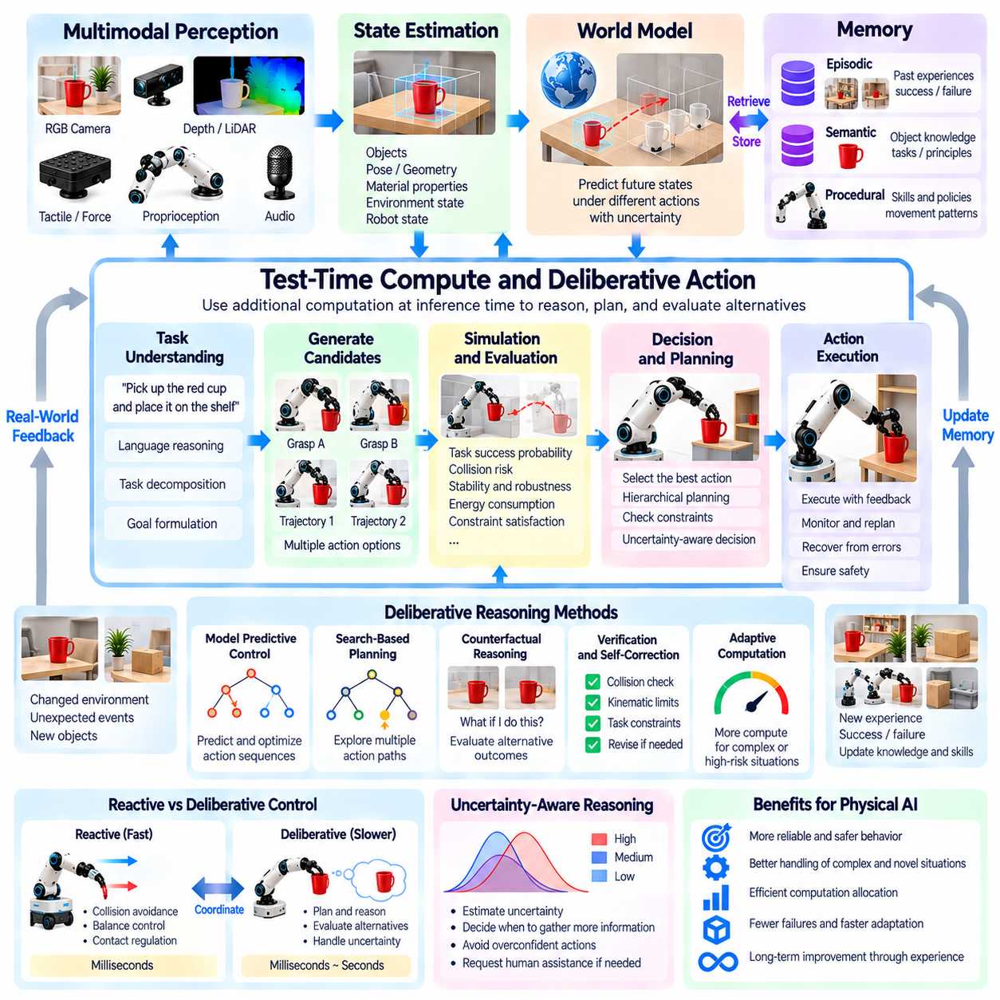{width="7.268055555555556in" height="7.268055555555556in"}

Test-time compute represents the computational effort an intelligent system allocates to reasoning, planning, and evaluating alternatives during inference rather than training. In Physical AI, this capability allows robots to deliberate before acting, particularly when tasks involve uncertainty, complex constraints, or significant consequences. Increasing computation at decision time may improve performance, but physical systems must balance reasoning depth against latency, energy consumption, and operational safety.

Traditional robotic controllers often prioritize rapid responses through predefined control laws or learned policies. Deliberative action introduces an additional decision-making process in which a robot evaluates possible actions before execution. Rather than immediately selecting the most probable response, the system may examine alternative strategies, predict their outcomes, and identify potential failures. This approach is especially valuable when actions are difficult to reverse.

The distinction between reactive and deliberative intelligence is fundamental to autonomous physical systems. Reactive control responds quickly to sensor feedback and is essential for maintaining balance, avoiding collisions, and regulating contact forces. Deliberative reasoning operates over longer time horizons and supports task planning, strategy selection, and uncertainty reduction. Effective Physical AI architectures must coordinate both mechanisms rather than treating them as competing approaches.

Test-time compute can be allocated to several forms of reasoning, including trajectory optimization, world-model simulation, task decomposition, and verification of physical constraints. A robot manipulating an unfamiliar object might evaluate multiple grasp configurations before selecting one. An autonomous mobile robot may compare routes according to accessibility, collision risk, and expected energy consumption. Additional computation provides opportunities to identify better actions without requiring immediate model retraining.

World models provide an important foundation for deliberative physical intelligence by enabling internal simulation of possible futures. Given an estimated environmental state and candidate actions, a predictive model can generate hypothetical outcomes. The robot can then compare alternatives using criteria such as task success, stability, efficiency, and safety. However, inaccurate world models may produce misleading predictions, making uncertainty estimation essential for reliable deliberation.

Model Predictive Control illustrates how repeated prediction and optimization can support physical decision making. The controller evaluates candidate action sequences over a limited planning horizon, executes an initial portion, and replans using updated observations. This process combines anticipation with feedback correction. More advanced architectures may extend the principle by incorporating learned world models, semantic objectives, and high-level reasoning into predictive control.

Search-based planning provides another mechanism for using additional inference computation. A robot may explore a tree of possible actions, evaluate intermediate states, and compare alternative paths toward a goal. Search depth and breadth determine the computational burden and the range of strategies considered. While deeper search may reveal better solutions, its usefulness depends on accurate state estimates, efficient evaluation, and the availability of sufficient decision time.

Deliberative reasoning can also operate at the level of task structure rather than individual motor commands. A robot asked to assemble a device may first identify required components, determine assembly dependencies, and establish an execution sequence. It can then select manipulation skills for each stage. This hierarchical approach separates strategic reasoning from time-critical control and reduces the need to evaluate every low-level movement within a single planning process.

Adaptive computation allocation is important because not every physical decision requires extensive reasoning. Familiar, low-risk actions may be executed through efficient reactive policies, while unfamiliar or safety-critical situations justify additional analysis. An intelligent system could allocate computation according to task complexity, prediction uncertainty, expected consequences, and available time. Such adaptive deliberation may improve efficiency without sacrificing reliability.

Uncertainty-aware deliberation helps robots recognize when additional reasoning is useful and when further observation is necessary. A system may compare several candidate actions but find that all predictions remain unreliable because important object properties are unknown. In such cases, additional computation alone cannot resolve missing information. The robot may need to inspect the environment, perform a safe exploratory action, or request human assistance before proceeding.

Counterfactual reasoning can strengthen test-time decision making by evaluating what might happen under actions that are not executed. A robot carrying a fragile object may compare alternative speeds, grasp forces, and movement trajectories. By estimating potential failures, it can select a strategy with lower expected risk. However, counterfactual evaluations depend on the quality of the underlying models and must account for uncertainty in physical interactions.

Verification and self-correction provide additional applications of deliberative computation. Before executing a proposed action, a robot may check whether the plan violates collision constraints, actuator limits, or task requirements. If inconsistencies are detected, the system can revise its strategy and evaluate the revised plan. Such procedures can reduce preventable errors, although computational verification cannot replace independent safety mechanisms or guarantee correct physical execution.

The relationship between language-based reasoning and physical deliberation introduces both opportunities and limitations. Multimodal foundation models may help interpret instructions, generate task plans, and identify relevant constraints. Nevertheless, plausible verbal explanations do not establish that a proposed action is physically feasible. Reliable systems must connect semantic reasoning with geometric planning, dynamics, sensor feedback, and executable control policies.

Real-time constraints fundamentally distinguish physical test-time compute from reasoning in purely digital environments. A robot cannot always pause its surroundings while evaluating alternatives. Moving obstacles, unstable objects, and ongoing contact interactions may require immediate responses. Deliberative architectures must therefore enforce computation deadlines and preserve fast control loops. When planning exceeds available time, the system needs safe fallback behavior rather than uncontrolled delay.

Edge computing and distributed architectures influence how deliberative intelligence can be deployed. Local processors provide low-latency access to sensors and actuators, while remote computing resources may support more demanding planning operations. However, network delays and connectivity failures can make remote reasoning unsuitable for time-critical decisions. Practical systems may divide computation between onboard control, local planning, and optional cloud-assisted analysis according to operational requirements.

Learning can improve the efficiency of deliberation by identifying which situations require additional computation and which strategies are likely to succeed. Experience may help a robot prioritize promising action candidates, estimate planning difficulty, and reuse previously successful solutions. Memory and learned heuristics can reduce redundant search. Over time, the system may develop more effective relationships between computational effort, decision quality, and task complexity.

Evaluating test-time compute requires measuring more than task success alone. Relevant metrics include planning latency, computational cost, energy consumption, safety violations, recovery performance, and improvement relative to simpler policies. Experiments should examine whether additional reasoning produces meaningful benefits under unfamiliar conditions. The evaluation must also identify cases where excessive deliberation delays necessary action or where model errors undermine planning quality.

Test-time compute and deliberative action could become important components of Physical AGI by enabling robots to allocate reasoning effort according to the demands of each situation. Their long-term significance lies in combining rapid physical responsiveness with flexible planning, predictive simulation, and reflective decision making. Achieving this balance will require reliable world models, adaptive computation, real-time control, and safety mechanisms that remain effective under uncertainty.

## 05.11. Cross Embodiment Generalization

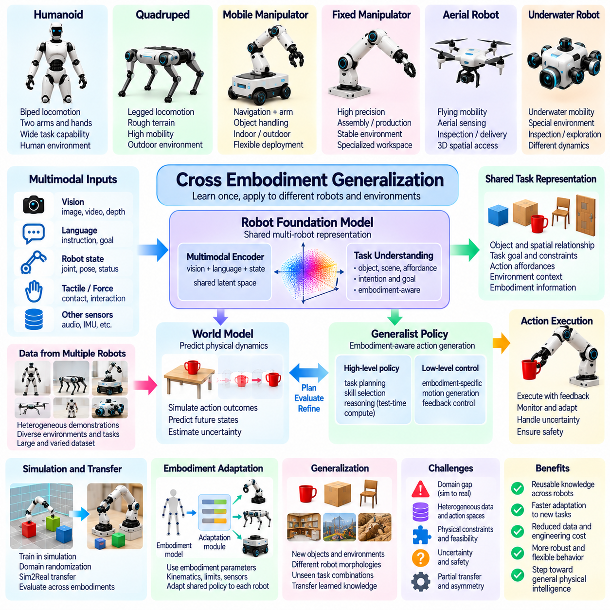{width="7.268055555555556in" height="7.268055555555556in"}

Cross-embodiment generalization refers to the ability of Physical AI systems to apply learned knowledge across robots with different bodies, sensors, actuators, and movement capabilities. A skill acquired by one robot may contain principles useful to another, even when their physical structures differ substantially. This capability is important for Physical AGI because general intelligence should not depend entirely on a particular mechanical configuration or hardware platform.

Embodiment determines how an intelligent system perceives and interacts with the physical world. A humanoid robot uses articulated limbs, a quadruped relies on coordinated leg movements, and a mobile manipulator combines locomotion with object handling. These differences influence reachable workspaces, contact dynamics, and available actions. Cross-embodiment generalization seeks to identify knowledge that remains useful despite such variations.

A central challenge is separating task-level understanding from embodiment-specific execution. The objective of moving an object to a designated location may be shared by several robots, but the required movements depend on their physical capabilities. A humanoid might lift the object with two hands, while a mobile manipulator uses a mounted arm. Generalization requires representing the common objective independently from the particular motor commands used to achieve it.

Shared representations provide a possible foundation for transferring knowledge between different embodiments. Instead of encoding every task exclusively through joint angles or actuator commands, a model may represent object relationships, spatial goals, contact conditions, and desired outcomes. These representations can describe what should be accomplished without prescribing a particular movement. Each robot can then translate the shared objective into actions compatible with its morphology.

Action representation is especially challenging because robots differ in their degrees of freedom, actuator arrangements, and control interfaces. A humanoid hand, parallel gripper, and suction tool cannot directly exchange identical low-level commands. Generalist systems may therefore use abstract action descriptions, end-effector targets, or intermediate task representations. Embodiment-specific controllers remain necessary to convert these descriptions into feasible physical movements.

Cross-embodiment learning can benefit from datasets collected across heterogeneous robotic platforms. Demonstrations from manipulators, mobile robots, humanoids, and quadrupeds expose learning systems to different ways of achieving related objectives. Large and diverse datasets may help models identify reusable patterns rather than memorize individual hardware configurations. However, inconsistent sensor formats, action definitions, and data quality complicate unified training.

Robot foundation models offer a potential mechanism for learning shared knowledge from heterogeneous experiences. Multimodal architectures can combine visual observations, language instructions, robot states, and action trajectories into common representations. Conditioning the model on embodiment information may help it adapt predictions to different physical capabilities. Nevertheless, training across multiple robots does not automatically guarantee successful generalization to previously unseen embodiments.

Morphology-aware learning explicitly incorporates information about a robot\'s physical structure into its reasoning or control process. Relevant descriptions may include kinematic chains, joint limits, link dimensions, actuator characteristics, and available sensors. A model conditioned on these properties can potentially adapt its behavior to different bodies. Such approaches seek to combine general task knowledge with the mechanical constraints that determine feasible execution.

World models may support cross-embodiment generalization by representing environmental dynamics separately from robot-specific action mechanisms. The effects of gravity, friction, and object contact remain relevant across many platforms, although each robot interacts with these forces differently. A shared predictive representation could support planning for multiple embodiments. Accurate transfer still requires modeling how each body produces forces and changes its environment.

Simulation provides opportunities to train and evaluate policies across many robot morphologies without collecting equivalent quantities of physical data. Virtual environments can vary limb configurations, actuator strengths, sensor placements, and body dimensions. Such variation may encourage models to learn robust behavioral principles. However, simulated diversity alone cannot eliminate differences in real-world contact dynamics, hardware limitations, or sensing characteristics.

Generalization between embodiments is not necessarily symmetric. Knowledge acquired by a robot with sophisticated manipulation capabilities may contain useful task concepts for a simpler platform, but the simpler robot may lack the hardware required to reproduce the original behavior. Conversely, navigation knowledge from a wheeled robot may help a legged robot plan routes without transferring its locomotion policy. Transfer must therefore respect differences in physical feasibility.

Task affordances provide another perspective on shared physical intelligence. An affordance describes an action opportunity arising from the relationship between an agent and its environment. A handle may be graspable by a dexterous hand but inaccessible to a large parallel gripper. A narrow passage may be traversable by a quadruped but unsuitable for a wide mobile platform. Understanding affordances requires considering both environmental properties and embodiment capabilities.

Hierarchical control architectures can separate reusable task planning from specialized movement execution. A high-level planner may determine that a container must be opened, an object retrieved, and the workspace restored. Different robots can implement these objectives through their available skills and controllers. This separation allows shared reasoning to coexist with specialized locomotion, manipulation, and stabilization mechanisms.

Cross-embodiment generalization also depends on calibration and adaptation after deployment. Even robots with similar morphologies may differ in actuator response, sensor alignment, payload capacity, or mechanical wear. A shared model may provide useful initial behavior, but local adaptation is often necessary to achieve reliable performance. Online system identification, feedback correction, and limited fine-tuning can help reconcile generalized knowledge with actual hardware characteristics.

Safety becomes particularly important when transferring policies between robots with different physical capabilities. An action that is safe for a lightweight manipulator may generate excessive forces when executed by a heavier industrial robot. Differences in stability, stopping distance, and reachable workspace can introduce unexpected hazards. Transfer mechanisms must therefore validate physical constraints and preserve independent safety controls rather than assume that successful behavior transfers safely.

Evaluating cross-embodiment generalization requires testing on robots that differ meaningfully from those represented during training. Relevant measures include task success, adaptation efficiency, safety, sample requirements, and performance degradation as morphology changes. Experiments should distinguish genuine transfer of task knowledge from successful reuse of nearly identical control structures. Unseen hardware configurations provide particularly valuable tests of generalization.

A further challenge involves determining which aspects of intelligence should remain universal and which must be specialized. Spatial reasoning, object relationships, causal understanding, and task decomposition may be broadly reusable, while contact control and locomotion depend strongly on embodiment. Effective architectures may combine shared foundation models with morphology-specific adapters and controllers. The appropriate boundary between these components remains an important research question.

Cross-embodiment generalization represents a significant step toward Physical AGI because it challenges the assumption that intelligence must be learned separately for every robot body. Its long-term potential lies in developing reusable physical knowledge that can be expressed through diverse mechanical systems. Although universal transfer remains unresolved, progress in shared representations, world models, morphology-aware learning, and adaptive control could enable increasingly general embodied intelligence.

## 05.12. Transfer of Knowledge across Robot Bodies

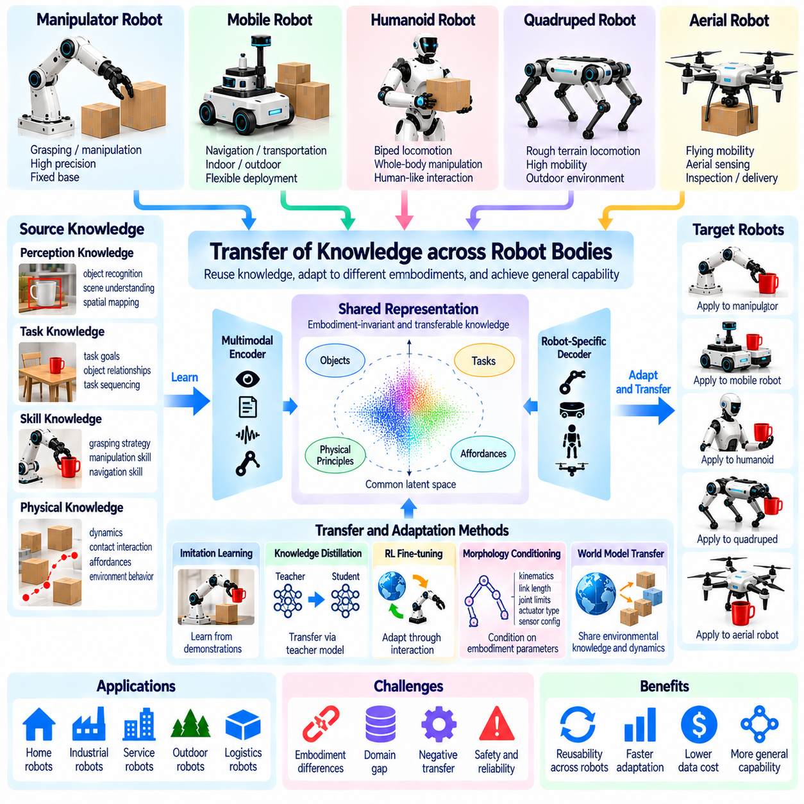{width="7.268055555555556in" height="7.268055555555556in"}

Knowledge transfer across robot bodies refers to the process of reusing information, skills, and learned representations from one robotic platform to improve the capabilities of another. Although robots may differ in morphology, sensors, and actuation, they often operate under shared physical principles and pursue similar objectives. Effective transfer can reduce the need for independent training on every platform and support the development of increasingly general Physical AI systems.

A fundamental distinction exists between transferring knowledge and transferring executable behavior. Knowledge about object properties, spatial relationships, or task dependencies may remain useful across many robots. However, the motor commands required to apply that knowledge depend on each robot\'s physical structure. Successful transfer therefore requires translating reusable understanding into embodiment-compatible actions rather than copying control sequences directly.

Task-level knowledge provides a natural starting point for transfer between heterogeneous robots. A robot that learns how to organize objects may acquire concepts involving object categories, placement constraints, and task sequencing. Another robot can potentially reuse these concepts even if it employs different manipulators or locomotion mechanisms. The shared knowledge describes the intended outcome, while embodiment-specific systems determine how that outcome can be achieved.

Transferring perception knowledge can be particularly valuable because different robot bodies may encounter similar visual environments. Object recognition, semantic segmentation, spatial mapping, and scene understanding can provide reusable information across platforms. Nevertheless, differences in camera placement, viewing angle, sensor resolution, and motion patterns create distribution shifts. Adaptation may be necessary to preserve reliable perception under new sensing configurations.

Skill transfer introduces additional challenges because physical actions depend on kinematics, dynamics, and contact conditions. A grasping strategy learned by a robotic arm may contain useful information about approach direction and object stability. However, a humanoid hand or alternative gripper must generate different joint movements and forces. Transferring the underlying skill requires separating its functional objective from the original robot\'s actuator-level implementation.

Shared latent representations offer one approach to bridging differences between robot bodies. A learning system may encode observations, goals, and actions into a common representation that captures task-relevant relationships. Robot-specific encoders and decoders can then connect this representation to different sensor and actuator spaces. The effectiveness of this approach depends on whether the shared representation preserves information necessary for successful physical execution.

Knowledge distillation provides another mechanism for transferring capabilities between robotic platforms. A teacher model trained on extensive experience may generate demonstrations, action preferences, or intermediate representations for a student model. The student can learn to reproduce relevant task outcomes using its own embodiment. Distillation is especially useful when the receiving robot has limited computational resources, although physical feasibility must be verified independently.

Imitation learning can transfer behavioral knowledge through demonstrations that emphasize intended outcomes rather than identical movements. Human demonstrations, robot trajectories, and video observations may reveal task structure and successful interaction patterns. A receiving robot must infer which aspects of the demonstration are relevant to its capabilities. This process becomes difficult when important contact forces, hidden states, or physical constraints cannot be recovered from observations.

Reinforcement learning can support transfer by adapting previously learned policies to new robot bodies through additional interaction. A transferred policy may provide an initial strategy, reducing exploration compared with learning entirely from scratch. Fine-tuning can then adjust behavior to differences in actuator response, stability, and movement constraints. However, inappropriate initialization may produce negative transfer, where reused knowledge reduces performance or increases risk.

Morphology-conditioned models explicitly represent differences between robotic platforms during transfer. Inputs may include joint topology, link lengths, actuator limits, mass properties, and sensor configurations. Conditioning shared policies on these descriptions may help models generate actions suitable for different bodies. Such methods require accurate physical specifications and must still address nonlinear dynamics, hardware uncertainty, and differences between simulated and real systems.

World models can support knowledge transfer by distinguishing environmental behavior from robot-dependent interaction mechanisms. Understanding that an object may topple when pushed near its upper edge can be useful to several robots. Each platform must nevertheless determine whether it can reach the object and apply the necessary force safely. Combining shared physical predictions with embodiment-specific dynamics can improve planning while respecting mechanical constraints.

Transfer between wheeled, legged, and aerial robots illustrates the distinction between common reasoning and specialized control. These platforms may share semantic maps, destination goals, obstacle information, and mission priorities. However, their traversability constraints, energy consumption, and motion dynamics differ substantially. Shared navigation knowledge can guide planning, while each robot requires its own locomotion controller and feasibility assessment.

Cross-robot transfer also benefits from standardized descriptions of tasks, capabilities, and outcomes. Common representations for object states, coordinate frames, action goals, and success conditions can simplify communication between platforms. Capability descriptions help determine whether a receiving robot can perform a transferred task. Without consistent semantics and reliable calibration, apparently compatible knowledge may produce incorrect actions or misleading predictions.

Simulation and digital twins provide controlled environments for adapting transferred knowledge before deployment. A skill learned on one robot can be evaluated using a simulated model of another robot with different geometry and dynamics. This process can reveal unreachable targets, unstable motions, or excessive actuator demands. Nevertheless, simulation-based validation cannot fully replace physical testing because real contact behavior and hardware limitations may differ.

Knowledge transfer must account for uncertainty and negative transfer. A strategy that performs well on one platform may fail when applied to a robot with different payload capacity, sensing limitations, or control bandwidth. Transfer systems should estimate confidence, identify incompatible assumptions, and restrict execution when feasibility is uncertain. Safe adaptation may require gradual testing, human supervision, and independent verification of critical constraints.

Fleet-scale knowledge transfer could enable robots with different bodies to contribute to a shared learning ecosystem. A mobile robot may discover environmental changes, a manipulator may learn improved object-handling strategies, and a quadruped may collect experience on difficult terrain. Relevant information can be distributed to other platforms according to their capabilities. Such sharing requires careful management of data quality, compatibility, privacy, and model updates.

Evaluating knowledge transfer requires measuring how much useful capability moves from a source robot to a target robot. Important criteria include task success, adaptation time, additional data requirements, safety, and performance relative to training from scratch. Experiments should include meaningful differences in morphology and sensing rather than only minor hardware variations. Robust evaluation must also identify situations where transfer is ineffective or harmful.

Knowledge transfer across robot bodies represents an important pathway toward Physical AGI because it enables physical experience to become a reusable resource rather than knowledge confined to individual machines. Its long-term promise lies in combining shared task understanding, transferable physical principles, and embodiment-specific execution. Although universal transfer remains an open challenge, advances in foundation models, world models, skill adaptation, and safe learning could accelerate the emergence of general embodied intelligence.

## 05.13. Self Improving Physical AI

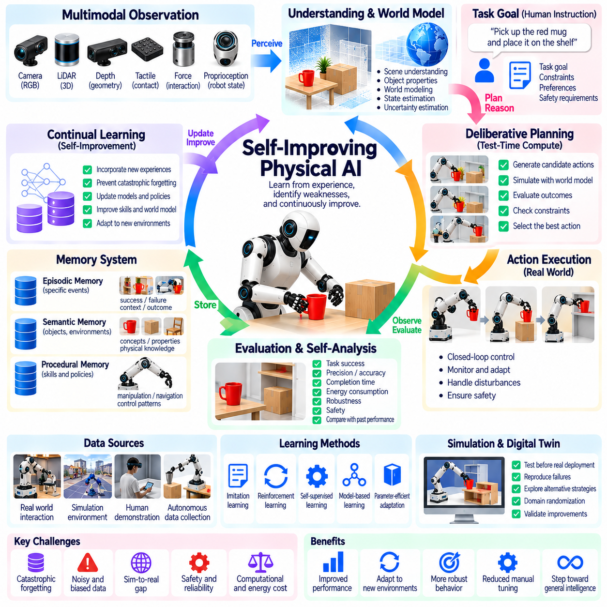{width="7.268055555555556in" height="7.268055555555556in"}

Self-improving Physical AI refers to intelligent systems capable of enhancing their perception, reasoning, planning, and control through accumulated experience. Unlike conventional robots that depend primarily on fixed software and periodic human updates, self-improving systems seek to identify weaknesses and refine their capabilities over time. This concept is important for Physical AGI because general physical intelligence requires sustained adaptation rather than competence limited to initial training conditions.

The foundation of self-improvement is a continuous interaction between action, observation, evaluation, and learning. A robot executes a task, observes the resulting physical state, compares the outcome with its objectives, and identifies opportunities for improvement. Useful experiences can then inform updates to internal models or policies. This feedback process transforms routine operation into a potential source of knowledge, although improvement is not guaranteed by collecting experience alone.

Experience-driven improvement requires mechanisms for distinguishing informative events from repetitive observations. Successful actions may reveal reliable strategies, while failures expose limitations in perception, planning, or control. Unexpected outcomes can be particularly valuable because they challenge existing assumptions. A self-improving robot must therefore evaluate the relevance, quality, and novelty of collected experiences before incorporating them into future learning.

World models can support self-improvement by predicting the consequences of actions and identifying discrepancies between expected and observed outcomes. When a robot encounters unfamiliar friction, object dynamics, or contact conditions, prediction errors may reveal incomplete knowledge. Updating the model can improve subsequent planning. However, incorrect interpretations of prediction errors may reinforce faulty assumptions, making validation and uncertainty estimation essential.

Continual learning provides mechanisms for incorporating new experiences without repeatedly rebuilding an entire model. Robots may update selected parameters, adapt specialized modules, or expand their repertoire of learned skills. These updates must preserve previously acquired capabilities while enabling useful behavioral changes. Catastrophic forgetting remains a central obstacle because improvement on recent tasks can unintentionally degrade performance in established operating conditions.

Autonomous data collection can accelerate improvement by directing attention toward situations where additional experience is most valuable. A robot may identify uncertain object properties, unfamiliar environments, or recurring failure patterns and select appropriate observations. Active learning can reduce unnecessary data collection while improving model coverage. Physical exploration must nevertheless respect safety limits, resource constraints, and the operational consequences of experimentation.

Simulation environments offer opportunities for testing improvements before applying them to physical hardware. Robots can replay recorded failures, explore alternative strategies, and evaluate updated policies under controlled conditions. Digital twins may provide additional context by reproducing relevant system characteristics. However, simulation fidelity is limited, and improvements demonstrated virtually must be checked against real-world dynamics, sensing errors, and hardware constraints.

Self-improvement can involve multiple learning mechanisms rather than a single optimization procedure. Imitation learning may incorporate successful demonstrations, reinforcement learning may refine action policies, and self-supervised learning may extract information from unlabeled sensor data. Model-based planning can evaluate candidate behaviors before execution. Combining these methods may improve adaptability, but each introduces distinct requirements for data quality and verification.

Failure analysis is especially important because repeated errors can reveal systematic weaknesses. A robot that frequently drops objects may need improved grasp estimation, force control, or object property modeling. A mobile robot that repeatedly becomes trapped may require better traversability prediction or route planning. Effective self-improvement identifies the underlying failure mechanism rather than merely adjusting behavior to compensate for isolated symptoms.

Memory systems provide continuity across learning cycles by preserving relevant experiences, model versions, and previously validated strategies. Episodic memory can retain unusual events and failures, while semantic memory organizes reusable physical knowledge. Procedural memory preserves successful skills and control patterns. Integrating these forms of memory allows robots to compare current performance with historical experience and avoid repeatedly rediscovering the same solutions.

Self-evaluation enables robots to estimate whether a proposed modification is genuinely beneficial. Performance measures may include task success, completion time, energy consumption, precision, robustness, and safety. Improvements should be assessed across diverse conditions rather than a narrow set of recent examples. A change that increases speed but reduces reliability may not represent meaningful progress, particularly in applications involving human interaction or expensive equipment.

Adaptive computation can contribute to self-improvement by allocating additional reasoning effort to difficult situations. A robot may use test-time planning, internal simulation, or counterfactual analysis to examine alternative actions before execution. Successful deliberative strategies can later be incorporated into faster policies through learning or distillation. This creates a potential relationship between computationally intensive reasoning and increasingly efficient habitual behavior.

Fleet-scale learning expands self-improvement beyond individual robots by combining experiences from multiple deployed systems. Robots operating in different environments may encounter complementary objects, tasks, and failure modes. Aggregated experience can support improved shared models and distribute validated capabilities across the fleet. Nevertheless, differences in hardware, sensor configurations, and operating conditions require careful compatibility checks before updates are deployed.

Automated learning pipelines may organize self-improvement into repeatable processes involving data selection, training, evaluation, and controlled deployment. Operational data can be filtered to identify informative cases, while candidate models undergo offline testing and simulation-based assessment. Approved updates can then be introduced gradually. Such pipelines provide a practical foundation for systematic improvement without requiring unrestricted autonomous modification of deployed systems.

Safety constraints fundamentally distinguish self-improving Physical AI from unconstrained optimization. A robot that modifies its behavior may unintentionally violate force limits, collision boundaries, or established operating procedures. Safety-critical functions should therefore remain protected by independent mechanisms. Human oversight, runtime monitoring, regression testing, and rollback capabilities help ensure that learning does not compromise previously validated safety requirements.

A major research challenge is determining how autonomous improvement can remain stable over long periods. Changing environments, noisy feedback, biased data, and shifting task objectives can cause learning systems to drift away from desirable behavior. Improvement mechanisms must detect degradation, maintain reliable reference evaluations, and distinguish temporary variation from genuine progress. Long-term stability requires balancing adaptability with preservation of trusted capabilities.

Evaluating self-improving Physical AI requires longitudinal experiments that measure performance across repeated learning and deployment cycles. Relevant criteria include adaptation speed, knowledge retention, recovery from failures, data efficiency, and improvement under unfamiliar conditions. Evaluation should also examine whether benefits persist after environmental changes and whether updates introduce regressions. Demonstrating reliable cumulative progress is more demanding than achieving isolated benchmark gains.

Self-improving Physical AI represents a potential pathway toward Physical AGI by transforming robots from systems with largely fixed capabilities into agents that accumulate and refine physical competence. Its long-term significance lies in integrating experience, memory, world models, continual learning, and safe adaptation into a sustained improvement process. Although open-ended autonomous improvement remains unresolved, carefully governed learning systems may progressively expand the range of physical tasks robots can perform reliably.

## 05.14. Collective and Fleet Intelligence

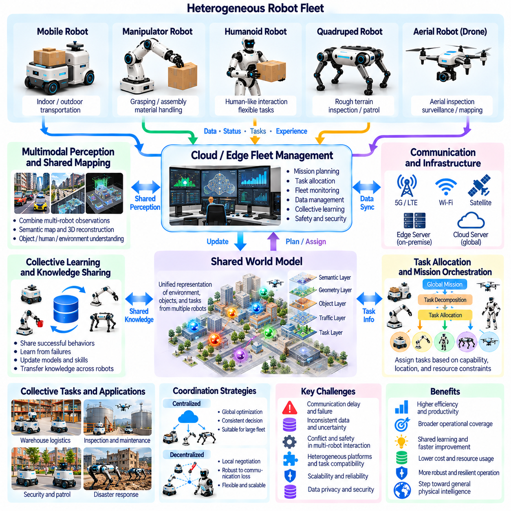{width="7.268055555555556in" height="7.268055555555556in"}

Collective and fleet intelligence refers to the ability of multiple Physical AI systems to coordinate actions, share knowledge, and achieve objectives beyond the capabilities of individual robots. Instead of operating as isolated machines, robots become participants in a distributed intelligent system. This approach is important for Physical AGI because complex physical environments often require cooperation, specialization, and the integration of experiences across multiple embodied agents.

Collective intelligence emerges when interactions among agents produce capabilities that exceed independent individual performance. Robots may exchange observations, divide tasks, coordinate movements, or combine specialized skills. A mobile robot can transport materials while a manipulator performs assembly and an inspection robot verifies results. The effectiveness of the collective depends not only on individual intelligence but also on communication, coordination, and shared understanding.

Fleet intelligence extends these principles to groups of robots operating across facilities, geographic regions, or organizational environments. A fleet may contain identical robots performing repeated tasks or heterogeneous platforms with different sensing and actuation capabilities. Shared management systems can coordinate missions, allocate resources, and monitor operational performance. As fleets expand, intelligence must address interactions among robots rather than merely optimize individual trajectories.

A central requirement is a shared representation of tasks, environments, and operational states. Robots need consistent descriptions of locations, objects, mission objectives, and completion conditions to cooperate effectively. Semantic maps, spatial reference frames, and standardized task interfaces can support this common understanding. Without reliable synchronization and compatible representations, individually correct decisions may produce conflicts or inconsistent collective behavior.

Distributed perception enables multiple robots to combine observations from different viewpoints and locations. One robot may detect an obstacle while another observes changes in a nearby workspace. Shared information can improve environmental coverage, reduce uncertainty, and support coordinated decisions. However, observations may differ in accuracy, timing, and relevance, requiring data association, confidence estimation, and mechanisms for resolving contradictory information.

Collective world models can represent environments through information accumulated by multiple agents. Instead of relying on a single robot\'s limited observations, a shared model may integrate spatial structure, object states, traffic patterns, and operational changes. Such models can support prediction and planning across the fleet. Maintaining consistency becomes challenging when environments change rapidly or communication delays prevent immediate synchronization.

Mission-level orchestration provides a mechanism for translating broad objectives into coordinated robotic activities. A mission may be decomposed into navigation, manipulation, inspection, transportation, and verification tasks. An orchestration system can assign responsibilities according to robot capabilities, availability, and operational constraints. Effective coordination also requires monitoring task dependencies, handling failures, and adapting assignments when conditions change.

Task allocation is a fundamental optimization problem in collective Physical AI. Robots differ in payload capacity, mobility, energy reserves, sensor quality, and proximity to work locations. Assignments should consider these capabilities alongside task urgency, travel cost, and resource availability. Centralized optimization can provide global coordination, while distributed negotiation may offer flexibility when communication or centralized infrastructure becomes unavailable.

Communication architecture strongly influences the performance of collective intelligence. Robots may exchange information through local networks, edge computing nodes, on-premise infrastructure, or cloud services. High-frequency control generally remains close to the physical device, while broader mission planning and shared learning can operate at higher architectural levels. Communication delays, bandwidth limits, and network failures must be considered when distributing decisions.

Decentralized coordination allows robots to maintain useful behavior without depending entirely on a central controller. Local agents can negotiate access to shared spaces, adjust trajectories, or respond to nearby hazards. Consensus mechanisms and distributed planning may support coordinated decisions when appropriate. Nevertheless, decentralization introduces challenges involving inconsistent information, conflicting objectives, and the difficulty of guaranteeing global safety.

Collective learning enables fleets to transform distributed operational experience into shared improvements. A robot encountering an unfamiliar obstacle or manipulation failure can contribute useful information to a common learning process. Experiences from many robots may improve perception models, navigation policies, and task strategies. Such learning requires careful filtering because incorrect observations, incompatible hardware, or unusual operating conditions can reduce model reliability.

Heterogeneous fleets offer opportunities for specialization and complementary capabilities. Wheeled robots may provide efficient transportation, quadrupeds may traverse difficult terrain, drones may inspect elevated structures, and manipulators may perform precise physical interactions. Coordinating these platforms can extend operational coverage beyond any single embodiment. Shared task semantics must be combined with platform-specific feasibility checks and control mechanisms.

Fleet memory provides continuity by preserving operational events, environmental changes, failures, and validated solutions. Episodic records can support incident analysis, while structured knowledge repositories retain reusable procedures and learned constraints. Robots may retrieve relevant experiences before performing unfamiliar tasks. Effective memory management must address outdated information, conflicting observations, data provenance, and the relevance of experiences to different robot embodiments.

Scalability becomes a major challenge as the number of robots increases from small teams to large fleets. Communication traffic, computational demand, scheduling complexity, and coordination overhead may grow rapidly. Hierarchical architectures can organize robots into local groups managed by intermediate coordination nodes. Such structures can reduce centralized bottlenecks, although they introduce additional requirements for synchronization, resource allocation, and fault recovery.

Reliability and fault tolerance are essential because failures can propagate through coordinated operations. A delayed transport robot may prevent a manipulator from completing its task, while incorrect shared localization may affect several nearby agents. Collective systems should detect failures, isolate unreliable components, and reassign tasks when necessary. Graceful degradation allows essential operations to continue even when individual robots or communication links become unavailable.

Safety governance must extend beyond individual robot controllers to interactions among multiple autonomous systems. Shared workspaces introduce collision risks, resource conflicts, and unexpected dependencies between tasks. Fleet-level coordination should enforce operational boundaries while independent local safety systems protect against immediate hazards. Human supervision, access controls, audit records, and controlled software updates help maintain accountability across distributed deployments.

Evaluating collective intelligence requires metrics that capture both individual and system-level performance. Relevant measures include mission completion, throughput, resource utilization, coordination latency, energy efficiency, resilience, and safety. Experiments should examine performance under increasing fleet size, communication disruptions, and heterogeneous task demands. Improvements in aggregate productivity must be distinguished from genuine gains produced by cooperation and shared intelligence.

Collective and fleet intelligence could contribute to Physical AGI by enabling embodied agents to accumulate knowledge, distribute reasoning, and coordinate specialized capabilities at scale. A collective system may accomplish missions that exceed the abilities of any participating robot without making each robot individually general. Its long-term potential lies in combining shared world models, adaptive orchestration, fleet memory, and continual learning into reliable networks of cooperating physical agents.

## 05.15. Physical AI as a Path Toward AGI

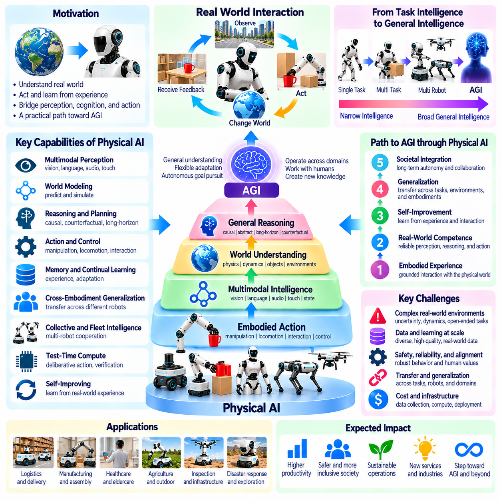{width="7.268055555555556in" height="7.268055555555556in"}

Physical AI represents a potential pathway toward Artificial General Intelligence by connecting computational reasoning with perception, action, and continuous interaction in the physical world. While digital intelligence can acquire broad knowledge through text, images, and simulated environments, embodied systems must translate understanding into effective physical behavior. This requirement introduces constraints that may encourage more integrated and general forms of intelligence.

The relationship between Physical AI and AGI begins with the concept of grounding. An intelligent system must connect abstract concepts to observable states, physical objects, and the consequences of actions. A robot learning the meaning of stability, containment, or support can test these concepts through interaction. Such experiences may complement knowledge acquired from language and visual data by connecting symbolic understanding with physical consequences.

Physical environments expose intelligent systems to uncertainty, partial observability, and continuously changing conditions. Robots must reason about objects that move unexpectedly, surfaces with unknown friction, and interactions that cannot be predicted perfectly. These challenges require adaptive perception, causal reasoning, and feedback-based control. Competence across diverse environments may therefore provide meaningful evidence of generalization beyond static benchmark performance.

World models form an important connection between embodied learning and general intelligence. By representing environmental states, physical relationships, and possible future outcomes, they enable robots to anticipate the consequences of actions. A sufficiently capable world model could support planning across many tasks without requiring a separate strategy for every situation. However, accurate prediction alone does not guarantee intelligent decision-making or reliable physical execution.

Causal reasoning strengthens the relationship between physical experience and general understanding. Robots can investigate how actions produce changes, distinguish correlation from intervention, and evaluate alternative explanations for observed events. Counterfactual reasoning allows them to consider what might have happened under different decisions. These capabilities may support flexible problem-solving because unfamiliar tasks often require understanding mechanisms rather than reproducing memorized behaviors.

Embodied interaction also creates opportunities for learning through experimentation. A robot may manipulate objects, observe outcomes, revise assumptions, and select additional actions to resolve uncertainty. This process resembles scientific inquiry at a practical scale, combining hypotheses, interventions, and evidence. Nevertheless, physical experimentation carries costs and risks, requiring intelligent systems to balance information gain with safety, efficiency, and operational constraints.

Generalist robot policies and foundation models may provide reusable capabilities across tasks and environments. Multimodal systems can integrate language instructions, visual observations, proprioceptive information, and action representations. Such integration allows knowledge from one modality to inform decisions in another. Yet broad task coverage should not be confused with AGI, because performance may remain dependent on training distributions, hardware configurations, and predefined action spaces.

Cross-embodiment generalization offers another possible indicator of progress toward general intelligence. Knowledge that transfers between manipulators, mobile robots, humanoids, and legged platforms is less dependent on a particular mechanical structure. Shared task representations can preserve objectives while embodiment-specific controllers determine feasible movements. The ability to adapt knowledge to unfamiliar robot bodies would provide stronger evidence of abstraction than success on a single platform.

Long-horizon planning is essential because many physical tasks involve dependencies, delayed outcomes, and limited resources. A robot maintaining an industrial facility may need to inspect equipment, identify faults, obtain tools, and coordinate repairs. Completing such missions requires memory, task decomposition, scheduling, and recovery from unexpected events. These capabilities connect immediate sensorimotor behavior with broader reasoning about goals, constraints, and future consequences.

Test-time computation may support more deliberate forms of embodied intelligence. Rather than responding through a single immediate policy prediction, a robot can evaluate candidate plans, simulate consequences, and revise decisions before acting. Additional reasoning can be allocated to unfamiliar or high-risk situations. However, physical systems must also satisfy real-time constraints, making efficient coordination between deliberative planning and reactive control essential.

Continual learning provides a mechanism for expanding competence through accumulated physical experience. Robots operating over long periods can encounter new objects, environmental changes, and previously unseen failure conditions. Incorporating these experiences may improve future performance without requiring complete retraining. Progress toward AGI would require such learning to preserve existing capabilities, avoid catastrophic forgetting, and remain reliable as knowledge and task demands expand.

Self-improving Physical AI extends continual learning by evaluating weaknesses and organizing improvement cycles. Operational data can reveal systematic errors, while simulation and controlled testing can assess proposed model updates. Successful changes may be incorporated into future deployments after verification. Although these mechanisms could accelerate capability development, autonomous improvement must remain subject to safety constraints, measurable objectives, and appropriate human oversight.

Collective intelligence introduces a distributed pathway toward increasingly capable physical systems. Multiple robots can share observations, divide complex missions, and combine specialized skills. Fleet memory and shared world models may accumulate experience beyond the lifetime or sensing range of individual machines. Such systems can achieve broad operational competence without requiring every robot to possess identical capabilities, although collective performance does not establish individual AGI.

Physical AGI may ultimately require an architecture that integrates perception, world modeling, memory, reasoning, planning, and control into a coherent learning system. Specialized modules can provide reliable low-level execution while shared representations support flexible task understanding. The central challenge is maintaining consistency between abstract goals and physical constraints. Architectural integration is necessary for broad competence but does not by itself establish general intelligence.

The physical world also provides demanding criteria for evaluating claims of general intelligence. Robots must demonstrate reliable performance across unfamiliar objects, tasks, environments, and disturbances. Evaluation should measure adaptation efficiency, causal understanding, long-term autonomy, and recovery from failure rather than isolated task success. Safety, energy consumption, and hardware limitations further distinguish embodied competence from performance in purely digital environments.

Nevertheless, Physical AI is not necessarily the only route toward AGI, nor does embodiment automatically produce general intelligence. Digital systems may develop broad reasoning capabilities without robotic interaction, while highly capable robots may remain narrow specialists. Physical experience can enrich learning but also introduces substantial engineering complexity and limited data availability. The relationship between embodiment and general intelligence therefore remains an open scientific question.

A plausible development pathway involves combining large-scale multimodal pretraining with simulation, robotic interaction, and continual adaptation. Digital models may provide broad conceptual knowledge, while embodied experience tests and refines predictions about physical reality. Shared representations could connect language, perception, action, and causal models across platforms. Whether this combination can produce robust general intelligence remains uncertain and requires rigorous empirical investigation.

Physical AI offers a distinctive contribution to the pursuit of AGI by demanding that intelligence remain effective when abstract reasoning encounters physical consequences. Its potential lies in integrating grounded knowledge, adaptive behavior, transferable skills, and cumulative experience into systems capable of operating across diverse real-world conditions. Although no established pathway guarantees Physical AGI, advances in embodied learning may clarify which capabilities are essential for general intelligence.

## 05.16. Limits and Open Questions of Physical AGI

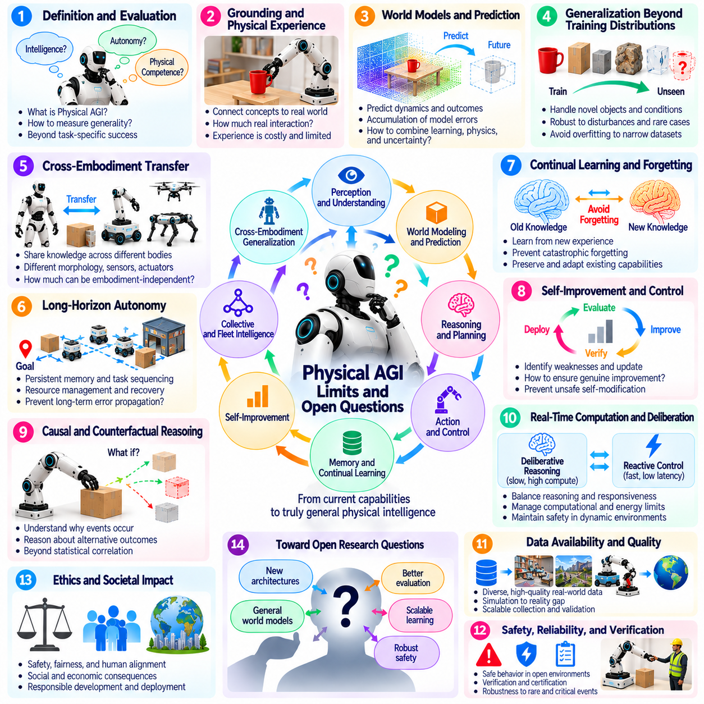{width="7.268055555555556in" height="7.268055555555556in"}

Physical AGI remains an open scientific objective rather than an established technological capability. Although advances in robot foundation models, world models, and embodied learning have expanded the range of robotic tasks, broad competence does not necessarily imply general intelligence. A central unresolved question is what evidence would demonstrate that a physical system can understand, learn, and act across genuinely unfamiliar situations without extensive task-specific engineering.

Defining Physical AGI presents difficulties because intelligence, autonomy, adaptability, and physical competence are not interchangeable concepts. A robot may execute complex missions reliably while depending on predefined procedures or specialized controllers. Another system may reason flexibly but lack the physical precision required for deployment. A useful definition must distinguish broad reasoning ability from successful execution under particular hardware and environmental conditions.

Grounding remains a fundamental challenge because physical concepts cannot always be learned adequately from symbolic descriptions or passive observations. Robots must connect representations to measurable states, interactions, and consequences. Yet physical experience is expensive, incomplete, and sometimes dangerous to collect. It remains uncertain how much direct interaction is necessary for general intelligence and which aspects of physical understanding can be acquired through digital learning.

World models introduce important possibilities but also unresolved limitations. Predictive systems may represent object dynamics, spatial relationships, and future outcomes without capturing every causal mechanism governing physical interactions. Small modeling errors can accumulate during long-horizon planning, especially under unfamiliar conditions. Determining how to combine learned predictions, physical constraints, and uncertainty estimates remains a central research problem.

Generalization beyond training distributions is another major obstacle. Robots may perform well on familiar objects, layouts, and tasks yet fail when encountering unusual materials, unexpected disturbances, or unfamiliar combinations of conditions. Benchmark improvements can conceal dependence on narrow datasets or carefully controlled environments. Physical AGI would require stronger evidence of robust adaptation to situations not anticipated during training or system design.

Cross-embodiment transfer remains incomplete because knowledge useful to one robot may not translate directly into another robot\'s capabilities. Differences in morphology, actuator dynamics, sensing, and reachable workspaces create substantial constraints. Shared representations can preserve task meaning, but they cannot eliminate physical incompatibility. An open question is how much general knowledge can remain independent of embodiment while still supporting reliable action.

Long-horizon autonomy exposes weaknesses that short demonstrations may not reveal. Complex missions require persistent memory, task sequencing, resource management, and recovery from unexpected events. Errors in perception or planning can propagate through many dependent actions, producing failures far from their original causes. Developing systems that maintain coherent objectives and dependable behavior over extended periods remains difficult.

Continual learning introduces the challenge of improving competence without damaging established capabilities. New experiences may contain noisy observations, misleading feedback, or patterns specific to temporary conditions. Updating models can produce catastrophic forgetting, behavioral drift, or unexpected regressions. Reliable Physical AGI would need mechanisms for preserving validated knowledge while adapting efficiently to changing environments and emerging requirements.

Self-improvement raises further questions about evaluation and control. A robot may identify performance weaknesses and propose changes to its policies, but determining whether those changes are genuinely beneficial requires independent evidence. Optimization against incomplete metrics can reward undesirable shortcuts. Autonomous improvement must therefore be distinguished from unrestricted self-modification, particularly when learning affects safety-critical physical behavior.

Causal reasoning and counterfactual understanding remain difficult to verify in embodied systems. A robot may predict successful actions without understanding why they work or how outcomes would change under intervention. Genuine causal competence requires reasoning about mechanisms, hidden variables, and alternative possibilities. Establishing benchmarks that distinguish causal understanding from statistical pattern recognition is an important unresolved research direction.

Real-time computation creates a tension between sophisticated reasoning and immediate physical responsiveness. Complex planning, world-model simulation, and uncertainty analysis may improve decisions but require computational resources and time. Robots operating near humans or moving machinery cannot postpone every action for extended deliberation. An open architectural question is how to coordinate slow reasoning with fast control while preserving predictable safety behavior.

Physical data availability remains a substantial limitation. Collecting diverse robotic experiences requires hardware, maintenance, supervision, energy, and physical operating space. Datasets often differ in sensor formats, action definitions, quality, and embodiment coverage. Synthetic data can expand training diversity, but simulation-to-reality discrepancies remain significant. Scalable learning therefore requires better methods for selecting, validating, and combining heterogeneous experiences.

Safety and verification become increasingly difficult as robotic capabilities expand. A general-purpose robot may encounter situations that were not represented during certification or testing. Learned policies can behave unpredictably under distribution shifts, sensor failures, or unusual physical contacts. Formal constraints, runtime monitoring, and independent protective mechanisms may reduce risks, but comprehensive guarantees for open-ended autonomous behavior remain unresolved.

Collective intelligence introduces questions that differ from those of individual Physical AGI. A fleet may accomplish complex missions through specialization, shared memory, and distributed coordination without any single robot possessing general intelligence. Communication failures, conflicting information, and shared-model errors can create system-wide vulnerabilities. Researchers must distinguish collective operational competence from individual generality while evaluating both forms of intelligence.

Evaluation methodology is itself an unresolved problem. Fixed benchmarks may reward memorization, hardware specialization, or repeated optimization against known tests. Meaningful assessment should examine unfamiliar tasks, environmental diversity, adaptation efficiency, knowledge retention, and safe recovery from failure. However, creating reproducible physical evaluations across different robots is expensive, and no universally accepted benchmark establishes the presence of Physical AGI.

The relationship between embodiment and consciousness also requires conceptual separation. Physical AGI concerns broad intelligence expressed through perception and action, whereas consciousness involves questions about subjective experience that are not resolved by robotic competence. A system may exhibit sophisticated autonomy without providing evidence of subjective awareness. Research should avoid treating embodiment, agency, intelligence, and consciousness as equivalent properties.

Economic and infrastructural constraints may shape the development of Physical AGI as strongly as algorithmic progress. Advanced robots require reliable actuators, sensors, computing resources, energy systems, and maintenance infrastructure. Capabilities demonstrated on expensive experimental platforms may not transfer economically to widespread deployment. Practical generality therefore involves affordability, reliability, interoperability, and operational sustainability alongside learning performance.

The central open question is whether integrated perception, world models, causal reasoning, memory, planning, and continual learning can produce robust general intelligence in physical environments. Progress in individual components does not guarantee that their combination will achieve Physical AGI. Future research must establish stronger definitions, evaluation methods, and safety principles while testing systems under realistic conditions. Physical AGI remains a promising but unproven possibility whose limits must be investigated empirically.
