**Volume 13. Future of Physical AI and Civilization**

# Chapter 06. Long Term Societal Impact

## 06.01. Physical AI and Human Society

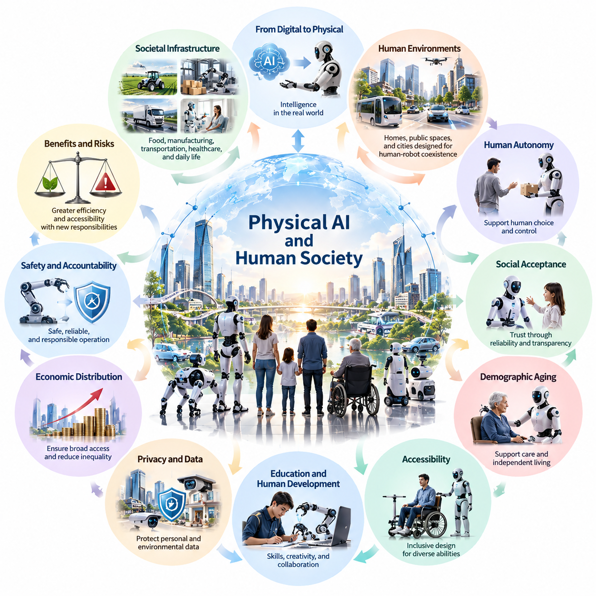{width="7.268055555555556in" height="7.268055555555556in"}

Physical AI represents a fundamental transformation in the relationship between human society and intelligent machines. Unlike conventional digital artificial intelligence, which primarily processes information, Physical AI interacts directly with the material world through perception, reasoning, movement, and manipulation. Its long-term significance extends beyond automation into the organization of social institutions, human activities, and civilization itself.

Human societies have historically developed around the availability of physical labor, technological infrastructure, and the ability to coordinate collective activities. Agriculture, manufacturing, transportation, and urban development have all depended on human effort supported by increasingly sophisticated machines. Physical AI introduces a new possibility: autonomous systems capable of performing diverse physical tasks while adapting to changing environments.

The transition from mechanized production to intelligent physical autonomy could reshape how societies organize essential services. Robots may eventually participate in food production, infrastructure maintenance, healthcare support, transportation, and household assistance. Rather than replacing individual machines with more advanced devices, this transformation could establish interconnected networks of intelligent physical systems operating throughout everyday environments.

One defining characteristic of Physical AI is its ability to connect digital intelligence with physical consequences. Decisions generated by artificial intelligence can influence the movement of vehicles, the manipulation of objects, and interactions with human environments. This capability creates opportunities for improved efficiency and accessibility, but also introduces responsibilities involving safety, accountability, reliability, and the protection of human interests.

The societal impact of Physical AI will depend on how its capabilities are distributed across populations and institutions. Advanced robotic systems may initially be concentrated in technologically developed regions and capital-intensive industries. Without deliberate efforts to expand accessibility, these differences could reinforce existing economic inequalities and create new divisions between communities that benefit from autonomous physical services and those that remain excluded.

Physical AI may also transform the relationship between individuals and the physical environments surrounding them. Intelligent transportation systems, robotic assistants, and automated infrastructure could reduce the effort required to perform routine activities. Buildings, public spaces, and transportation networks may increasingly be designed to accommodate autonomous machines, gradually creating environments in which human and robotic activities are closely coordinated.

The development of autonomous physical systems raises important questions about human independence. As robots become more capable of performing everyday tasks, individuals may increasingly depend on technological assistance for mobility, maintenance, communication, and personal care. Such dependence can improve quality of life, particularly for vulnerable populations, but excessive reliance may reduce practical skills and create new forms of technological vulnerability.

Human autonomy must therefore remain a central consideration in the development of Physical AI. Systems should support meaningful human choice rather than systematically replacing individual decision-making. Users need understandable mechanisms for setting objectives, modifying instructions, rejecting unwanted actions, and recovering control when automated behavior becomes inappropriate. Technological convenience should not require surrendering personal agency.

Social acceptance will be another decisive factor in the integration of Physical AI. People may evaluate robots differently depending on their appearance, behavior, reliability, and intended functions. A machine operating in an industrial warehouse may encounter fewer social concerns than a robot assisting elderly individuals or interacting with children. Trust will emerge through consistent performance, transparent operation, and demonstrated respect for human expectations.

Physical AI could become especially important in societies experiencing demographic aging. Declining working-age populations and increasing demand for care services may create substantial pressure on existing institutions. Assistive robots could support mobility, household activities, rehabilitation, and routine monitoring. However, the social value of these technologies will depend on whether they strengthen human caregiving relationships rather than replacing essential emotional and interpersonal connections.

Accessibility represents another potential source of long-term social benefit. Robotic mobility assistance, adaptive manipulation, and intelligent environmental interfaces could help individuals with disabilities participate more independently in education, employment, and community life. Achieving these benefits requires inclusive design, affordability, and systems capable of accommodating diverse physical abilities, preferences, and living conditions.

Education and human development will also evolve as intelligent machines assume additional physical responsibilities. Future generations may need greater familiarity with robotic systems, machine supervision, physical AI safety, and collaborative problem-solving. At the same time, education should preserve practical reasoning, creativity, ethical judgment, and interpersonal capabilities. The objective should be to expand human potential rather than narrow learning around machine operation.

The widespread deployment of Physical AI introduces significant privacy challenges because autonomous machines often require continuous environmental perception. Cameras, microphones, spatial maps, and behavioral observations may reveal sensitive information about individuals and communities. Responsible deployment will require clear limitations on data collection, secure processing architectures, appropriate retention policies, and meaningful oversight of how physical-world information is used.

Responsibility becomes more complicated when autonomous systems make decisions with direct physical consequences. A robotic vehicle, construction machine, or healthcare assistant may act through combinations of learned policies, software instructions, and real-time environmental observations. Determining accountability for harmful outcomes requires consideration of manufacturers, developers, operators, deploying organizations, and the degree of meaningful human control maintained throughout operation.

Governance frameworks must evolve alongside the growing capabilities of Physical AI. Traditional product safety regulations may not fully address systems that learn, adapt, and operate across changing environments. Future governance may require continuous evaluation, operational monitoring, transparent incident reporting, and mechanisms for restricting unsafe behavior. Effective oversight must balance innovation with public protection and democratic accountability.

Environmental sustainability is another essential dimension of long-term societal impact. Large-scale robotic deployment requires energy, computing infrastructure, batteries, electronic components, and industrial materials. Although autonomous systems could improve resource efficiency, reduce waste, and optimize infrastructure operations, their overall environmental benefits cannot be assumed. Lifecycle assessment must consider manufacturing, operation, maintenance, replacement, and disposal.

At the global level, Physical AI may influence geopolitical relationships and technological competitiveness. Countries capable of developing advanced robotic platforms, semiconductor infrastructure, and large-scale learning systems may gain substantial industrial advantages. Meanwhile, regions lacking access to capital, technical expertise, or reliable infrastructure could face growing dependence on external technology providers. International cooperation may become important for preventing excessive technological concentration.

The integration of Physical AI into everyday life may gradually reshape human identity and perceptions of meaningful activity. Work has historically provided not only economic income but also social recognition, purpose, and opportunities for personal development. If autonomous machines assume increasing portions of physical labor, societies may need to reconsider how individuals participate in economic production, contribute to communities, and establish a sense of personal achievement.

Human--AI symbiosis offers an alternative to viewing intelligent machines exclusively as substitutes for human capabilities. In a collaborative model, robots provide physical strength, precision, endurance, and continuous operational capacity, while humans contribute contextual understanding, ethical judgment, creativity, and social intelligence. The resulting relationship could expand the range of activities individuals and organizations can accomplish without requiring complete machine independence.

The long-term transformation of society will not occur uniformly or according to a predetermined technological schedule. Adoption will depend on technical reliability, economic feasibility, regulatory conditions, infrastructure readiness, and cultural expectations. Some industries may achieve extensive autonomy while other domains continue to require close human supervision. Different societies may consequently develop distinct models of human--robot coexistence.

Several alternative futures are possible. Physical AI could support greater prosperity, safer working environments, accessible services, and improved infrastructure resilience. Alternatively, poorly governed deployment could intensify inequality, weaken privacy, concentrate economic power, and create dependence on systems that individuals cannot effectively control. These outcomes are not determined by technical capability alone but by institutional choices and social priorities.

Ultimately, the significance of Physical AI lies in its potential to alter the foundations of human civilization through the integration of intelligence and physical action. Its success should not be measured solely by robot performance, economic productivity, or the number of automated tasks. A more comprehensive assessment must consider human dignity, freedom, inclusion, environmental sustainability, and the resilience of social institutions in an increasingly autonomous physical world.

## 06.02. Access to Physical AI and Technological Inequality

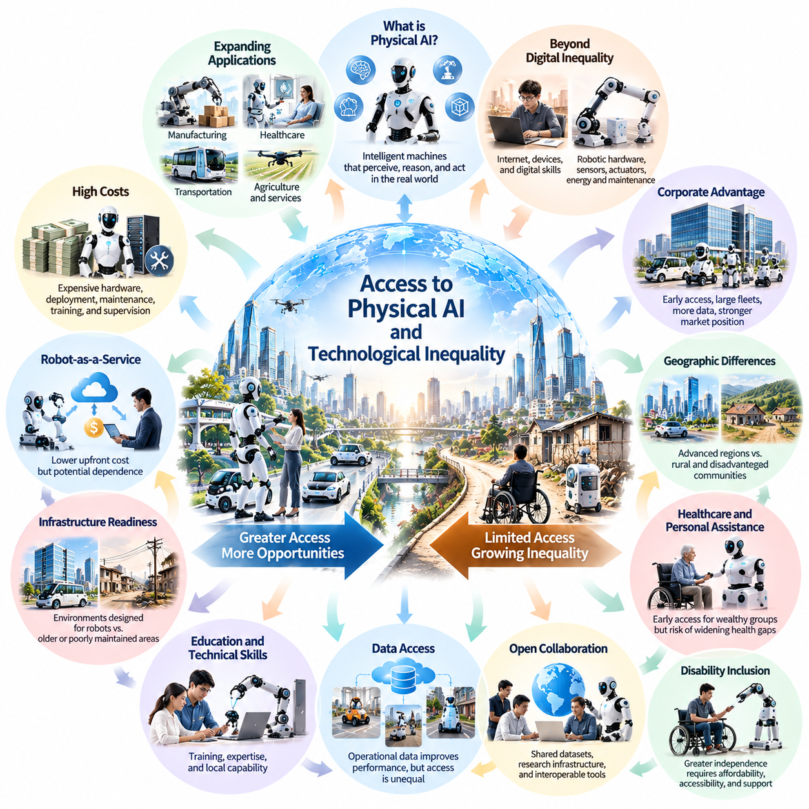{width="7.268055555555556in" height="7.268055555555556in"}

Access to Physical AI will become an increasingly important determinant of economic opportunity, social inclusion, and technological development. As autonomous robots and intelligent physical systems expand into manufacturing, healthcare, transportation, and everyday services, unequal access may create new divisions within society. Technological inequality will therefore involve not only access to information and computing resources but also access to intelligent physical capabilities.

Traditional digital inequality has largely concerned differences in internet connectivity, computing devices, digital literacy, and information services. Physical AI introduces additional requirements involving robotic hardware, sensors, actuators, energy infrastructure, maintenance, and physical operating environments. These requirements make accessibility more complex because intelligent physical services depend on both computational intelligence and reliable interaction with the material world.

The economic cost of Physical AI represents a major barrier to widespread adoption. Advanced robots require substantial investment in mechanical components, embedded computing, perception systems, safety mechanisms, and software development. Even when hardware prices decline, deployment expenses may remain significant because organizations must provide integration, maintenance, training, insurance, and operational supervision. These costs may initially favor large institutions.

Large corporations may gain early advantages through their ability to finance robotic fleets and collect extensive operational data. High deployment volumes can improve purchasing efficiency, infrastructure utilization, and learning performance. Smaller enterprises may struggle to achieve comparable economies of scale. Consequently, Physical AI could reinforce industrial concentration unless affordable platforms, shared infrastructure, and accessible service models become widely available.

Robot-as-a-Service models may reduce some financial barriers by converting large capital expenditures into recurring operational payments. Organizations could access robotic capabilities without purchasing and maintaining entire fleets. However, subscription pricing, service availability, contractual restrictions, and dependence on technology providers may create different forms of inequality. Lower initial costs do not necessarily guarantee affordable or independent long-term access.

Geographic differences will strongly influence the distribution of Physical AI benefits. Regions with advanced telecommunications, reliable electricity, technical expertise, and modern infrastructure may deploy autonomous systems more rapidly. Rural communities and economically disadvantaged regions may encounter greater difficulties because robotic operations require dependable connectivity, maintenance services, suitable facilities, and access to replacement components.

Infrastructure readiness may become a hidden source of technological inequality. Autonomous delivery vehicles, mobile robots, and intelligent maintenance systems often perform better in environments designed to accommodate their operational requirements. Buildings with accessible pathways, reliable localization references, and compatible communication infrastructure may benefit earlier. Older or poorly maintained environments could require costly modifications before comparable services become practical.

Access to Physical AI will also depend on education and technical capability. Organizations need personnel who can configure robots, interpret operational data, manage safety procedures, and resolve unexpected failures. Communities lacking technical training opportunities may become dependent on external specialists. Investment in robotics education, vocational programs, and accessible technical documentation will therefore influence how broadly Physical AI capabilities can be adopted.

Data availability creates another important dimension of inequality. Physical AI systems improve through experience collected from real-world operation, simulation, and human demonstrations. Organizations operating large robotic fleets may accumulate valuable datasets that improve perception, planning, and control. Smaller developers may lack comparable learning resources, potentially producing a reinforcing cycle in which established platforms become increasingly capable.

Shared datasets, open research infrastructure, and interoperable development tools could help reduce these disadvantages. Public research institutions and collaborative industry initiatives may support access to simulation environments, evaluation benchmarks, and reusable robotic software. Nevertheless, openness must be balanced against privacy, intellectual property, cybersecurity, and safety requirements. Equitable access requires carefully designed institutions rather than unrestricted information sharing alone.

Technological inequality may become particularly visible in healthcare and personal assistance. Wealthier households and well-funded institutions could gain earlier access to robotic rehabilitation, mobility support, and automated care services. Lower-income populations may continue relying on limited human resources or outdated equipment. Without inclusive financing and public service policies, Physical AI could deepen differences in health-related independence and quality of life.

Disability inclusion provides an important example of both the opportunities and risks associated with unequal access. Intelligent assistive robots may expand independence for individuals with mobility or manipulation limitations. However, high equipment costs, limited customization, inadequate maintenance support, and inaccessible interfaces could prevent many potential users from benefiting. Accessibility must therefore be considered throughout design, distribution, financing, and long-term operation.

The labor market may experience additional inequalities as Physical AI adoption accelerates. Workers in highly automated organizations may gain access to advanced tools, improved safety, and new technical responsibilities. Others may face displacement without comparable opportunities for retraining. The distribution of benefits will depend on education systems, labor institutions, organizational practices, and policies that support transitions toward emerging occupations.

Ownership of robotic capital will significantly influence how economic benefits are distributed. When autonomous machines generate productivity gains, the resulting income may primarily benefit their owners unless mechanisms exist for broader participation. Employee ownership, cooperative deployment, public investment, and shared-service infrastructure represent possible approaches. Their effectiveness will depend on economic conditions, governance quality, and institutional implementation.

International differences may become more pronounced as countries compete to develop Physical AI ecosystems. Nations with semiconductor production, advanced manufacturing, research institutions, and reliable energy supplies may establish strong technological positions. Countries dependent on imported robotic systems could face higher acquisition costs and limited technological independence. Such differences may influence industrial competitiveness and long-term economic sovereignty.

Supply chain concentration could further restrict access to advanced physical intelligence. Specialized processors, precision actuators, sensors, batteries, and critical materials may be produced by relatively few suppliers. Export restrictions, geopolitical disputes, manufacturing disruptions, and resource shortages could disproportionately affect smaller economies. Diversified supply chains and international technical cooperation may therefore contribute to more resilient access.

Public policy can influence whether Physical AI becomes a broadly shared technological resource or a capability concentrated among privileged groups. Governments may support research infrastructure, technical education, accessible procurement, and deployment in underserved communities. Public investment should be evaluated through measurable social outcomes rather than deployment volume alone, ensuring that technological expansion addresses genuine public needs.

Interoperability and open standards may also reduce barriers to participation. Proprietary robotic ecosystems can create switching costs and dependence on specific vendors, particularly when software, hardware, and operational data are tightly integrated. Standardized interfaces and portable data formats could enable organizations to combine technologies from multiple providers. However, interoperability must preserve safety certification, cybersecurity, and operational reliability.

The long-term affordability of Physical AI will depend on more than declining hardware prices. Total cost of ownership includes energy consumption, software licensing, maintenance, replacement components, insurance, and system upgrades. Technologies that appear inexpensive during acquisition may become costly over their operational lifetime. Sustainable accessibility requires transparent pricing, predictable maintenance, and service models suited to different economic environments.

Equitable deployment also requires attention to cultural and social differences. Robotic systems developed for one population may not perform effectively in environments with different languages, customs, housing structures, or accessibility needs. Standardized platforms must therefore support local adaptation without imposing excessive costs. Community participation in system design can help ensure that technological solutions reflect actual social priorities.

A future characterized by widespread Physical AI could either narrow or expand existing inequalities. Affordable robotic assistance might improve access to transportation, essential services, education, and productive tools. Conversely, concentrated ownership, restricted data access, and unequal infrastructure could create persistent technological hierarchies. Both outcomes remain plausible because technological progress does not automatically determine how its benefits are distributed.

Reducing technological inequality requires coordinated attention to affordability, infrastructure, education, governance, and institutional participation. Access should be evaluated not merely by whether a robot can be purchased, but by whether individuals and organizations can use it safely, effectively, and independently over time. Meaningful access includes the ability to maintain systems, understand their limitations, and influence how they operate.

Ultimately, equitable access to Physical AI will be a defining challenge for societies integrating autonomous intelligence into the physical world. The objective should not be identical robotic deployment everywhere, but fair opportunities to benefit from intelligent physical capabilities according to local needs. Long-term social progress will depend on ensuring that Physical AI expands human opportunity rather than converting technological differences into permanent social divisions.

## 06.03. Human Autonomy and Dependence on Robots

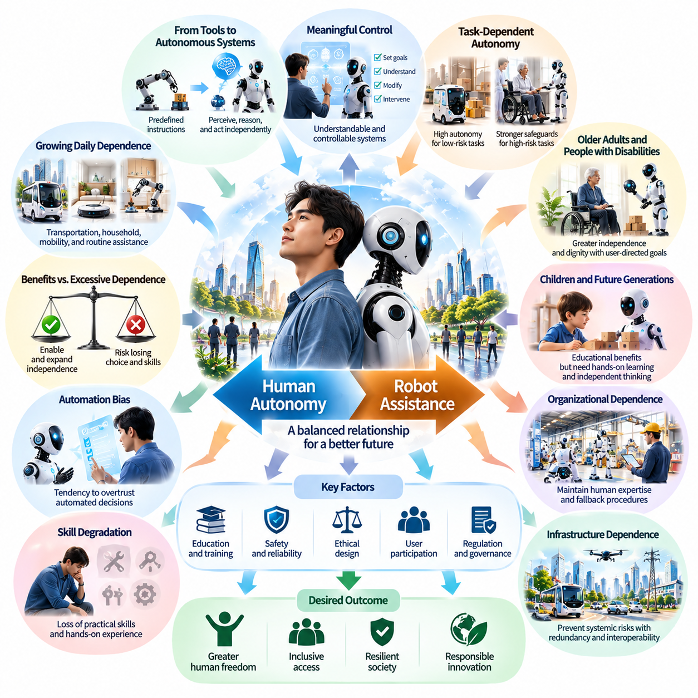{width="7.268055555555556in" height="7.268055555555556in"}

Human autonomy is the ability of individuals to make meaningful choices, direct their activities, and maintain control over their lives. As Physical AI becomes integrated into everyday environments, autonomous robots may increasingly influence how people move, work, receive assistance, and interact with physical infrastructure. The central societal challenge is ensuring that robotic capabilities expand human freedom rather than gradually replacing independent human decision-making.

Robots have traditionally operated under predefined instructions or direct human supervision. Physical AI introduces systems capable of interpreting environments, predicting outcomes, and selecting actions with greater independence. These capabilities can reduce physical effort and improve convenience, but they also change the relationship between users and machines. Humans may shift from directly performing tasks toward supervising autonomous processes whose internal decisions are difficult to understand.

Dependence on robots can emerge gradually through repeated reliance on automated services. Individuals may begin using robotic systems for transportation, household maintenance, personal mobility, and routine assistance. As these technologies become embedded in daily activities, manual alternatives may become less familiar or less accessible. The resulting dependence may remain unnoticed until a system fails, becomes unavailable, or behaves differently from user expectations.

A distinction must be made between beneficial assistance and excessive technological dependence. Assistive robots can strengthen autonomy when they enable individuals to perform activities that would otherwise be difficult or impossible. However, autonomy may decline when users lose the ability to choose alternative methods, question automated decisions, or function without continuous machine support. The same technology can therefore increase independence in one context while reducing it in another.

Human control should be understood as more than the presence of an emergency stop button or a manual operating mode. Meaningful control requires the ability to establish goals, understand relevant system behavior, modify operational constraints, and intervene before harmful consequences occur. Physical AI systems should communicate their intentions and limitations in ways that users can interpret, allowing supervision to remain practical rather than merely symbolic.

The degree of appropriate robot autonomy depends on the task, operating environment, and consequences of failure. Routine cleaning or material transport may permit extensive automation, while medical assistance and personal mobility require stronger safeguards. Systems operating near vulnerable individuals must consider consent, physical safety, and user preferences. Autonomy should therefore be allocated dynamically according to risk, uncertainty, and the importance of human judgment.

Automation bias represents an important psychological risk in human--robot interaction. Users may become inclined to accept robotic recommendations or actions because automated systems appear consistent, precise, or technologically advanced. Such trust can become problematic when robots encounter unfamiliar environments or produce incorrect predictions. Maintaining human autonomy requires interfaces that encourage appropriate verification without imposing excessive cognitive demands.

Skill degradation may occur when individuals stop practicing activities that robots routinely perform. Navigation, physical manipulation, equipment maintenance, and practical problem-solving could become less familiar as automated assistance expands. Although technological progress has always changed human skills, dependence becomes concerning when essential capabilities disappear without reliable alternatives. Education and system design should preserve the competencies necessary for independent action.

The relationship between autonomy and dependence is especially important for older adults and people with disabilities. Robotic assistance may enable independent living, improve mobility, and reduce reliance on continuous human support. Yet systems that restrict user preferences or impose rigid routines could undermine dignity. Assistive Physical AI should prioritize user-directed goals, adaptable behavior, and the ability to accept or reject assistance whenever circumstances permit.

Children growing up in environments populated by autonomous robots may develop different expectations about physical effort, responsibility, and problem-solving. Robotic tutors, household assistants, and interactive machines could provide educational and practical benefits. However, excessive delegation of everyday activities may reduce opportunities for experiential learning. Developmentally appropriate interaction should encourage exploration, physical engagement, and independent reasoning.

Dependence can also develop at the organizational level. Hospitals, factories, logistics networks, and public infrastructure may restructure operations around autonomous robotic systems. Once workflows depend on continuous machine availability, failures can interrupt essential services. Organizations must therefore maintain operational resilience through fallback procedures, human expertise, redundant capabilities, and carefully tested recovery mechanisms.

Infrastructure dependence introduces broader societal risks. Autonomous transportation, robotic maintenance, and automated distribution networks may become interconnected components of essential services. A software defect, cybersecurity incident, or energy disruption could affect multiple systems simultaneously. Preventing systemic vulnerability requires decentralized safeguards, interoperability, emergency operating procedures, and the preservation of essential services during technological failures.

Economic dependence may arise when users and organizations rely on proprietary robotic platforms. Software subscriptions, cloud services, specialized replacement components, and restricted maintenance access can limit the ability to change providers. Such arrangements may reduce practical autonomy even when robotic systems perform effectively. Open interfaces, transparent contracts, repairability, and data portability can help preserve meaningful technological choice.

Physical AI systems increasingly depend on world models, predictive planning, and learned control policies to determine their actions. These components may operate through representations that are not directly interpretable by ordinary users. Consequently, system transparency should focus on understandable explanations of intended actions, operational boundaries, uncertainty, and intervention options rather than requiring users to understand every internal computation.

Human autonomy also involves the right to refuse robotic participation in certain activities. Individuals may prefer human interaction during caregiving, education, or sensitive personal services, even when automated alternatives are available. Respecting these preferences requires institutions to consider consent and reasonable alternatives. Efficiency alone should not determine whether autonomous systems become mandatory components of human experience.

The balance between machine initiative and human authority may evolve through adjustable autonomy. Under this approach, robots can perform routine actions independently while requesting assistance when uncertainty, risk, or conflicting objectives exceed acceptable limits. Human operators can increase or reduce automation according to circumstances. Effective implementation requires reliable uncertainty estimation, timely communication, and clear responsibility for final decisions.

Long-term dependence may also influence human perceptions of competence and responsibility. When machines routinely solve physical problems, individuals may become less confident in their own abilities or less willing to accept responsibility for outcomes. Conversely, well-designed robotic assistance can expand participation and strengthen confidence. The psychological consequences of Physical AI will therefore depend partly on whether systems encourage active human engagement or passive reliance.

Preserving autonomy does not require rejecting automation or maintaining manual control over every physical activity. Human civilization has always relied on tools and infrastructure that extend individual capabilities. The relevant distinction is whether technological dependence remains manageable, transparent, and reversible. A society can benefit from extensive robotic assistance while retaining human authority over important decisions and preserving alternatives when systems become unavailable.

Governance frameworks should recognize human autonomy as a measurable design and deployment objective. Evaluation may consider user override capabilities, informed consent, operational transparency, recovery procedures, and the availability of nonautomated alternatives. Public institutions should also assess whether robotic systems create coercive dependence through restricted access, excessive surveillance, or the removal of meaningful choices.

The future relationship between humans and robots will likely involve varying degrees of shared responsibility. Some activities may become almost entirely autonomous, while others will continue to require human participation and ethical judgment. Successful integration depends on defining appropriate boundaries between machine execution and human authority, recognizing that technical capability does not automatically justify transferring decision-making power.

Ultimately, the objective of Physical AI should be to strengthen human agency through intelligent physical assistance. Robots can reduce physical limitations, improve safety, and expand access to essential services, but these benefits should not require surrendering control over personal or collective life. A sustainable human--robot society will preserve the ability to choose, intervene, adapt, and remain resilient even as autonomous machines become increasingly capable and widespread.

## 06.04. Human Robot Trust and Social Acceptance

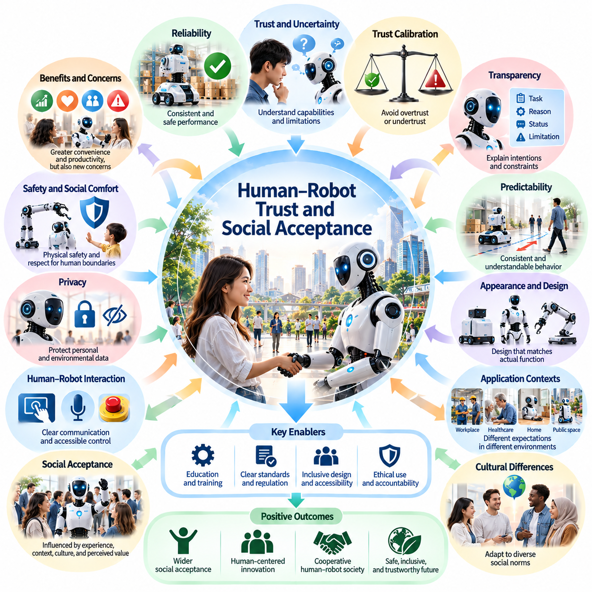{width="7.268055555555556in" height="7.268055555555556in"}

Human--robot trust is a fundamental requirement for the successful integration of Physical AI into society. As autonomous robots move beyond controlled industrial environments into homes, hospitals, workplaces, and public spaces, people must develop confidence in their behavior and reliability. Social acceptance depends not only on technological performance but also on whether robotic systems operate predictably, respect human expectations, and demonstrate appropriate responses to uncertainty.

Trust in robotic systems differs from trust in conventional machines because Physical AI can interpret situations and select actions without continuous human direction. Users may encounter behaviors that emerge from learned policies rather than explicitly programmed instructions. This flexibility creates practical benefits but introduces uncertainty about how robots will respond. Trust therefore requires an understanding of both machine capabilities and their operational limitations.

Reliability is one of the strongest foundations of human--robot trust. A robot that consistently completes tasks, avoids hazards, and responds appropriately to unexpected events is more likely to gain acceptance. However, occasional successful demonstrations are insufficient. Confidence must develop through repeated performance across diverse conditions, including environmental changes, sensor disturbances, equipment degradation, and interactions with unfamiliar people.

Trust calibration is more important than maximizing trust without qualification. Excessive confidence can encourage users to delegate responsibilities beyond a robot\'s actual capabilities, while insufficient confidence can prevent beneficial adoption. Properly calibrated trust emerges when human expectations correspond to demonstrated system competence. Physical AI should communicate uncertainty, limitations, and operating conditions so that users can make informed decisions about reliance.

Transparency plays an important role in establishing appropriate expectations. Robots should communicate what they are attempting to accomplish, why certain actions are necessary, and when human assistance is required. Explanations do not need to reveal every internal computation, but they should provide meaningful information about intentions and constraints. Understandable feedback can reduce confusion when autonomous behavior differs from user expectations.

Predictability is another essential component of social acceptance. Humans rely on behavioral patterns to coordinate activities with other people and machines. Robots that move unexpectedly, change direction abruptly, or initiate actions without clear signals may create discomfort even when technically safe. Consistent movement conventions, understandable signals, and context-sensitive behavior help people anticipate robotic actions and maintain confidence during shared activities.

Physical appearance and movement influence how people perceive robots. Industrial mobile platforms, humanoid robots, robotic arms, and assistive devices can generate different expectations about intelligence, safety, and social interaction. Humanlike appearance may encourage intuitive communication but can also create unrealistic assumptions about understanding or emotional capability. Robot design should align visible characteristics with actual functional abilities.

Social acceptance varies considerably across application environments. In manufacturing and logistics, users may prioritize productivity, safety, and operational reliability. In healthcare and caregiving, emotional comfort, dignity, privacy, and interpersonal sensitivity become more important. Public service robots must additionally accommodate unfamiliar users with diverse expectations. Successful deployment requires trust mechanisms suited to each social context.

Cultural differences can influence attitudes toward robotic autonomy and human--machine interaction. Communities may differ in their expectations regarding personal space, authority, privacy, communication style, and acceptable levels of automation. A robotic behavior considered efficient in one environment may appear intrusive or disrespectful in another. Physical AI systems should therefore support culturally appropriate adaptation without compromising fundamental safety principles.

Direct experience often shapes trust more strongly than abstract technological descriptions. Individuals who repeatedly interact with reliable robots may develop greater familiarity and confidence. Conversely, highly visible failures can influence perceptions far beyond the immediate incident. Carefully managed pilot deployments, user training, and transparent communication can help communities evaluate robotic capabilities through realistic experience rather than exaggerated expectations.

Human--robot interaction interfaces should support clear communication and accessible control. Visual indicators, audible signals, natural language instructions, and intuitive emergency procedures can help users understand robotic behavior. Interfaces must also accommodate individuals with different physical abilities, technical backgrounds, and communication preferences. Accessibility is essential because trust cannot develop when users cannot effectively interpret or influence machine actions.

Safety is a necessary but insufficient condition for trust. A robot may satisfy technical safety requirements while still behaving in ways that make people uncomfortable or uncertain. Excessive proximity, unexplained observation, unexpected physical contact, or persistent interaction can undermine acceptance. Socially appropriate behavior requires attention to personal boundaries, consent, and the broader context of human activities.

Privacy concerns may significantly influence willingness to accept Physical AI. Robots equipped with cameras, microphones, and environmental mapping systems can collect information about personal routines and surrounding spaces. Users may hesitate to adopt such systems if data practices are unclear. Trustworthy deployment requires understandable privacy policies, secure information handling, data minimization, and meaningful choices regarding observation and recording.

Responsibility and accountability also affect public confidence. When a robot causes damage, interrupts services, or makes an inappropriate decision, users need clear procedures for reporting incidents and obtaining remedies. Uncertainty about responsibility can weaken trust even when failures are uncommon. Manufacturers, operators, and deploying institutions should establish transparent accountability structures and effective mechanisms for investigation and correction.

Trust must be maintained throughout the operational lifetime of a robotic system. Software updates, changing environments, component aging, and newly learned behaviors can alter performance after initial deployment. Continuous monitoring and periodic evaluation are therefore necessary to ensure that previously established confidence remains justified. Significant changes in robotic capabilities should be communicated clearly to affected users.

Human supervision can strengthen trust when it provides meaningful oversight without undermining the benefits of autonomy. Robots should recognize situations that exceed their competence and request assistance when appropriate. Reliable fallback procedures demonstrate that uncertainty and failure have been anticipated. Users are more likely to accept autonomous systems when they know that intervention, recovery, and safe shutdown remain available.

Social acceptance also depends on perceived fairness and the distribution of benefits. Communities may resist robotic deployment if they associate it primarily with job displacement, exclusion, surveillance, or reduced human services. Acceptance may improve when systems visibly enhance accessibility, reduce dangerous work, and support public welfare. Participatory design and community consultation can help align technological deployment with social expectations.

Media representation and public communication influence how societies interpret Physical AI. Exaggerated claims about robotic intelligence can generate unrealistic expectations, while sensational accounts of failures may create disproportionate fear. Responsible communication should distinguish demonstrated capabilities from experimental research and speculative future possibilities. Accurate information supports informed public judgment and more stable expectations.

Long-term trust may depend on developing shared behavioral conventions between humans and robots. Just as transportation systems rely on standardized signals and predictable rules, robotic environments may require common interaction protocols. These conventions could address movement priority, personal space, emergency communication, and requests for assistance. Standardization can reduce uncertainty when people encounter unfamiliar robotic platforms.

The objective of human--robot trust should not be unconditional acceptance of autonomous machines. A healthy relationship requires justified confidence, informed skepticism, and the ability to withdraw reliance when circumstances change. Physical AI systems should earn trust through demonstrated competence, transparency, safety, and respect for human agency. Social acceptance becomes sustainable when people remain capable of evaluating and controlling their interactions with robots.

Ultimately, human--robot trust will shape whether Physical AI becomes a beneficial component of everyday civilization. Technical intelligence alone cannot guarantee social integration, because autonomous physical systems operate within human relationships, institutions, and cultural expectations. Successful coexistence requires robots that are not only capable and efficient but also understandable, accountable, adaptable, and consistently respectful of human dignity.

## 06.05. Care Assistance and Human Dignity

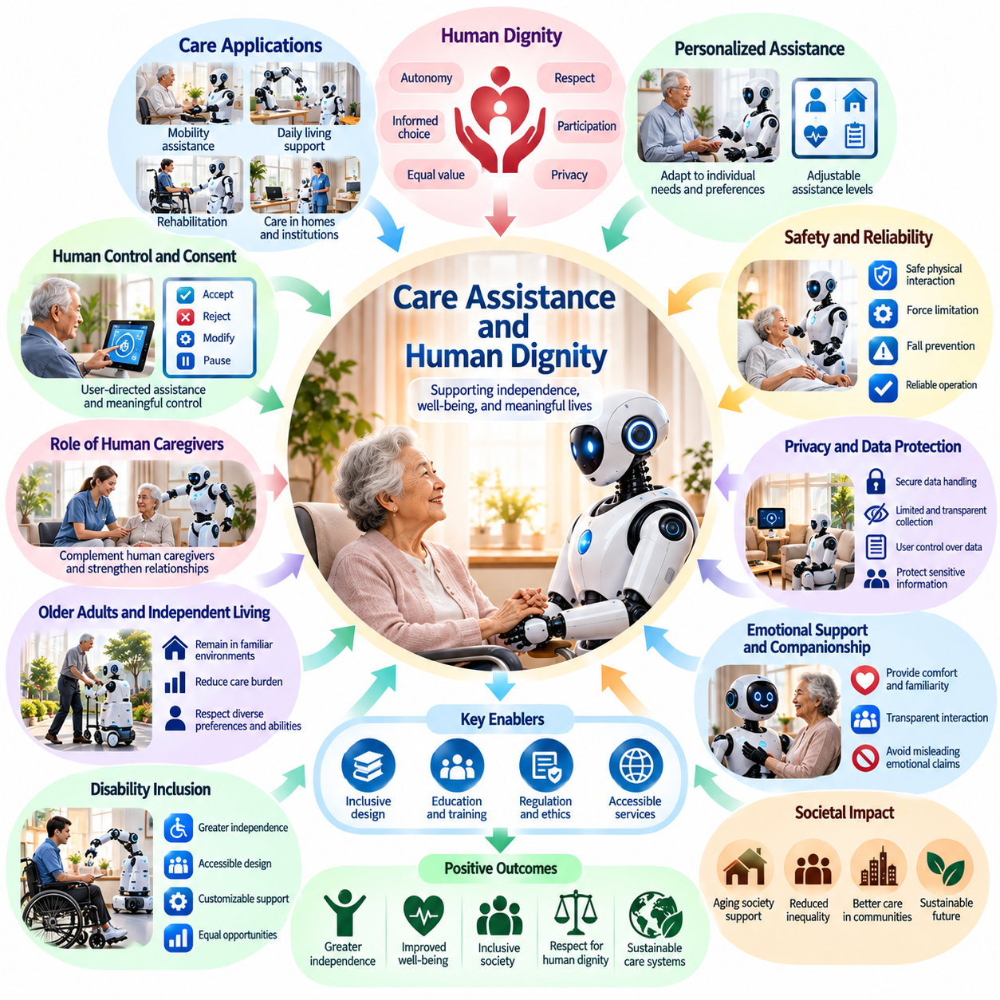{width="7.268055555555556in" height="7.268055555555556in"}

Care assistance represents one of the most socially significant applications of Physical AI because it directly affects human well-being, independence, and dignity. Autonomous robots may support personal mobility, daily activities, rehabilitation, and caregiving services in homes and institutions. However, successful deployment requires more than technical efficiency. Robotic assistance must respect individual preferences, emotional needs, privacy, and the fundamental value of human relationships.

Human dignity refers to the inherent worth of individuals regardless of age, disability, health condition, or dependence on assistance. In caregiving environments, dignity involves personal autonomy, respectful treatment, informed consent, and meaningful participation in decisions. Physical AI should reinforce these principles rather than treating care recipients as passive objects of automated service delivery or reducing their needs to measurable operational tasks.

Traditional caregiving combines physical assistance with emotional understanding, communication, and interpersonal trust. Caregivers often interpret subtle expressions, personal histories, and changing preferences when providing support. Robots may perform selected physical tasks reliably, but this does not establish equivalent emotional understanding. Responsible integration requires recognizing the distinction between functional assistance and the human relationships that give caregiving its broader social meaning.

Assistive robots can improve independence by helping individuals perform activities that would otherwise require continuous human support. Mobile manipulators, robotic mobility devices, and intelligent household systems may assist with retrieving objects, navigating indoor spaces, or completing routine tasks. When users control the timing and manner of assistance, these capabilities can strengthen self-determination and reduce unnecessary dependence on institutional care.

Personal autonomy should remain central to robotic caregiving. Individuals must have opportunities to accept, reject, modify, or suspend assistance according to their preferences and capabilities. A robot that completes tasks efficiently but ignores user choices may undermine dignity. Human-centered control interfaces should therefore support understandable instructions, adjustable assistance levels, and accessible mechanisms for intervention whenever operational conditions permit.

Consent becomes particularly important when robots perform activities involving physical contact, personal hygiene, mobility support, or private environments. Users should understand what a robot intends to do and have appropriate opportunities to authorize its actions. Consent may need to be renewed when circumstances change. For individuals with limited communication abilities, systems must support accessible expression and established decision-making arrangements without assuming that silence indicates agreement.

Physical safety is essential because caregiving robots frequently operate near vulnerable individuals. Unexpected movement, excessive contact forces, unstable transfers, or navigation errors may cause serious harm. Reliable systems require appropriate sensing, compliant actuation, force limitation, and protective control mechanisms. Safety evaluation should consider individual physical conditions, environmental uncertainty, and the consequences of failures during close human interaction.

Privacy is another foundational requirement for dignified care assistance. Robots may collect images, audio, movement patterns, and information about daily routines to provide personalized support. Such observations can reveal sensitive aspects of personal life. Data collection should remain proportionate to the intended service, with clear access restrictions, secure processing, and understandable choices about recording, retention, and sharing.

Personalization can improve care quality when robotic systems adapt to individual needs and preferences. Assistance may vary according to mobility, communication style, daily routines, and changing functional capabilities. However, personalization should not become behavioral control. Robots should support individual preferences while avoiding unnecessary restrictions, excessive monitoring, or automated judgments that override the person\'s expressed priorities.

The relationship between robotic assistance and human caregiving requires careful balance. Robots may reduce repetitive physical workloads, transport supplies, and support routine monitoring, allowing professional caregivers to devote more attention to complex needs. Nevertheless, replacing human contact solely to reduce costs may increase isolation. The objective should be complementary care in which automation strengthens, rather than displaces, meaningful interpersonal relationships.

Emotional attachment to care robots introduces additional ethical considerations. Individuals may develop familiarity or affection toward machines that communicate regularly and provide assistance. Such relationships can offer comfort, but robotic behavior should not misrepresent machine capabilities or create misleading impressions of human emotional understanding. Transparent interaction design can support companionship without exploiting loneliness or emotional vulnerability.

Older adults may benefit from Physical AI through assistance with mobility, household activities, and independent living. These capabilities could help individuals remain in familiar environments and reduce certain caregiving burdens. However, age alone should not determine the level of robotic intervention. Care systems must recognize substantial differences in personal preferences, abilities, and living arrangements rather than applying uniform assumptions about older populations.

People with disabilities may experience significant improvements in independence through adaptive robotic assistance. Systems capable of manipulating objects, supporting movement, and interacting with accessible environments can expand participation in daily life. Effective design requires direct involvement from intended users, compatibility with assistive technologies, and attention to affordability. Accessibility should be treated as a fundamental design requirement rather than an optional feature.

Caregiving environments also require sensitivity to cultural expectations and personal boundaries. Attitudes toward physical contact, privacy, family involvement, and acceptable forms of assistance differ across individuals and communities. A robotic system designed around standardized procedures may fail to accommodate these differences. Flexible interaction policies and user-directed customization can help align robotic behavior with diverse social and cultural preferences.

Institutional deployment raises questions about responsibility and oversight. Hospitals, residential care facilities, and home-care providers must establish clear roles for supervising robotic assistance and responding to incidents. Automated systems should not obscure accountability when errors occur. Care recipients and their representatives need understandable reporting procedures, accessible complaint mechanisms, and assurance that human intervention remains available when required.

Care quality should not be evaluated solely through productivity or task completion. Metrics such as service speed, robot utilization, and operating cost provide useful operational information but cannot fully represent dignity or well-being. Evaluation should also consider user satisfaction, perceived autonomy, physical comfort, privacy, social participation, and the preservation of meaningful human relationships throughout the caregiving process.

Economic accessibility will influence whether robotic care becomes a broadly shared benefit or a privilege available mainly to wealthy households and institutions. Advanced assistive systems may involve substantial acquisition, maintenance, and support costs. Public funding, insurance arrangements, shared-service models, and accessible procurement could expand availability. However, affordability initiatives must preserve safety, service quality, and individual choice.

Human caregivers will continue to play essential roles even as Physical AI capabilities improve. Professional judgment, emotional sensitivity, ethical reasoning, and complex interpersonal communication remain central to many care situations. Robotic systems should provide reliable physical assistance and relevant information while enabling caregivers to exercise informed judgment. Training must prepare care professionals to supervise automation without losing essential practical skills.

Long-term governance should establish clear expectations for consent, safety, privacy, accessibility, and human oversight in robotic care. Regulatory frameworks may need to distinguish ordinary household assistance from higher-risk physical interventions. Continuous evaluation is important because system updates, changing user conditions, and environmental differences can alter operational risks. Governance should prioritize the rights and welfare of care recipients.

The broader societal value of care-oriented Physical AI depends on how technology changes relationships among individuals, families, caregivers, and institutions. Well-designed systems may reduce physical burdens, support independent living, and expand access to essential assistance. Poorly designed deployment could instead increase surveillance, weaken personal choice, or reduce human interaction. These outcomes depend on institutional priorities as much as technological capabilities.

Ultimately, Physical AI should be developed as a means of supporting human dignity rather than redefining care as a purely automated process. Intelligent machines can extend physical capabilities and improve the delivery of assistance, but human worth cannot be measured through efficiency or independence alone. A sustainable model of robotic caregiving will combine technological competence with respect, compassion, informed choice, and the continuing importance of human relationships.

## 06.06. Physical AI and Aging Societies

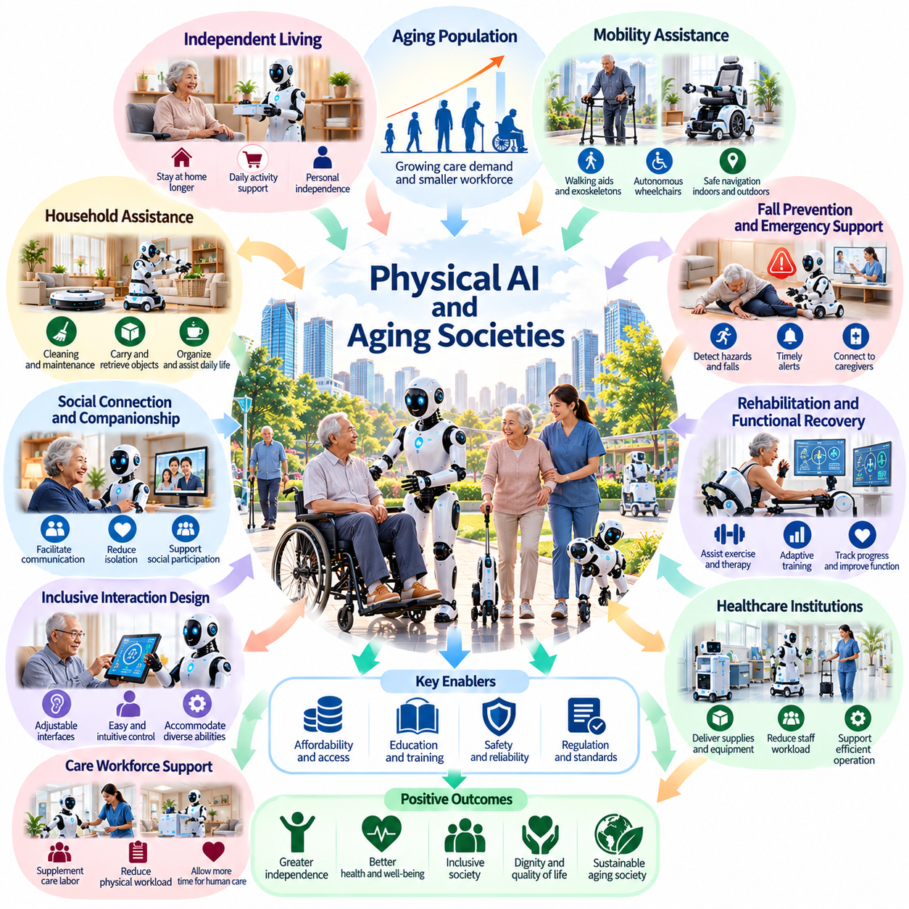{width="7.268055555555556in" height="7.268055555555556in"}

Population aging is transforming the economic and social structures of many countries, creating new challenges for healthcare, labor markets, and long-term care. Physical AI may help aging societies maintain essential services by providing intelligent physical assistance. Autonomous robots could support older adults, caregivers, and public institutions, but their effectiveness will depend on accessibility, reliability, affordability, and respect for individual autonomy.

Aging societies typically experience increasing demand for care alongside changes in the working-age population. Smaller labor forces may face growing responsibilities for healthcare, transportation, household assistance, and infrastructure maintenance. Physical AI offers a potential means of supplementing human labor through autonomous mobility, manipulation, and environmental interaction. However, robots should be understood as complementary resources rather than universal replacements for human caregivers.

Independent living is a central objective of robotic assistance for older adults. Many individuals prefer remaining in familiar homes and communities rather than moving into institutional care. Mobile robots, intelligent household devices, and adaptive assistive systems may support daily activities such as retrieving objects, carrying supplies, and navigating indoor environments. These capabilities can reduce physical barriers while preserving personal routines and independence.

Mobility assistance represents an important application of Physical AI in aging societies. Autonomous wheelchairs, robotic walking aids, and intelligent navigation systems may help individuals move through homes, healthcare facilities, and public spaces. Effective systems must adapt to changing mobility capabilities and environmental conditions. Safe navigation, stable physical support, intuitive controls, and accessible infrastructure are essential for practical adoption.

Fall prevention and emergency assistance are particularly relevant to older populations. Robotic systems equipped with environmental sensors and movement analysis may identify hazards, detect unusual events, and support timely responses. However, automated monitoring introduces risks of false alarms, missed incidents, and unnecessary surveillance. Effective deployment requires careful validation, appropriate escalation procedures, and privacy protections that preserve personal dignity.

Physical AI may also support rehabilitation and functional recovery. Robotic rehabilitation devices can assist repetitive movements, provide controlled physical support, and collect information about exercise performance. Adaptive systems may adjust assistance according to individual capabilities and progress. Nevertheless, rehabilitation objectives should remain under appropriate professional supervision, with robotic technologies supporting rather than replacing clinical judgment and personalized care planning.

Household assistance can reduce the physical demands of everyday living. Robots may help with cleaning, carrying objects, organizing supplies, and performing selected maintenance tasks. Such capabilities are particularly valuable when reduced strength, limited mobility, or fatigue makes routine activities difficult. Successful systems must operate safely in cluttered and changing home environments while accommodating different household layouts and personal preferences.

Aging societies may benefit from robotic assistance in healthcare institutions and residential care facilities. Autonomous mobile robots can transport supplies, deliver equipment, and support routine logistics, potentially reducing repetitive workloads for care professionals. These applications may improve operational efficiency and allow staff to focus on direct human care. However, institutional deployment requires reliable integration with existing workflows and clear responsibility for failures.

Care workforce shortages are an important motivation for developing Physical AI. In regions experiencing rapid population aging, demand for professional caregivers may grow faster than available labor. Robots could supplement physically demanding tasks such as material handling, mobility support, and routine transportation. Their value should be assessed through actual reductions in workload and improvements in care quality rather than assumptions that automation automatically resolves staffing shortages.

Social isolation and loneliness are additional concerns in aging societies. Interactive robots may facilitate communication, provide reminders, and support connections with family members or community services. These functions can be beneficial when they increase opportunities for meaningful interaction. However, artificial companionship should not become a justification for reducing human contact. Robotic assistance should strengthen social participation rather than substitute for relationships.

Human--robot interaction must account for differences in sensory, cognitive, and physical capabilities among older adults. Interfaces may require adjustable speech speed, readable visual information, simplified commands, and alternative interaction methods. Systems should avoid assuming that chronological age determines technical ability. Inclusive design must accommodate individual variation while providing opportunities for training, feedback, and gradual familiarization.

Trust and perceived safety strongly influence the adoption of robotic assistance. Older adults may hesitate to use systems that move unpredictably, require complicated procedures, or provide unclear feedback. Confidence develops through consistent performance, understandable behavior, and accessible human support. Demonstrations and supervised introductory experiences can help users evaluate whether particular robotic services meet their needs without imposing unwanted technological dependence.

Economic accessibility will determine whether Physical AI benefits aging populations broadly. Advanced robotic systems may involve significant purchase, maintenance, software, and technical support costs. Insurance arrangements, public subsidies, rental programs, and community-based service models could improve access. Policymakers must also consider unequal infrastructure availability and ensure that technological assistance does not become concentrated among higher-income households.

Rural and geographically isolated communities may face distinctive challenges related to aging populations. Limited healthcare access, transportation difficulties, and shortages of local service providers can increase the importance of assistive technologies. Physical AI could support selected delivery, inspection, and household assistance tasks. However, deployment must account for connectivity limitations, maintenance availability, difficult terrain, and the need for dependable local support.

Data governance is especially important when robotic systems operate in private homes and care environments. Cameras, microphones, movement sensors, and behavioral models may collect detailed information about daily routines and personal activities. Such data can improve assistance but also create privacy and security risks. Appropriate governance requires data minimization, clear consent procedures, secure processing, and transparent rules for information access and retention.

Physical AI could also influence the economic participation of older adults. Assistive robots and adaptive workstations may reduce physical demands and enable individuals who wish to remain employed to perform selected tasks more comfortably. Such technologies may support flexible retirement and continued participation in skilled activities. Nevertheless, automation should expand voluntary opportunities rather than create pressure for individuals to work beyond their preferences or capabilities.

Urban planning and infrastructure design will affect the usefulness of robotic assistance in aging societies. Accessible buildings, barrier-free transportation, reliable communication networks, and robot-compatible public spaces can improve mobility and service delivery. Poorly designed infrastructure may prevent otherwise capable robots from operating effectively. Coordinated planning between robotics developers, municipalities, and care institutions can improve deployment outcomes.

Public policy should evaluate Physical AI as part of a broader strategy for demographic adaptation. Robotics alone cannot address the financial, social, and institutional challenges associated with population aging. Effective strategies may combine assistive technology with healthcare reform, caregiver support, accessible housing, and community services. Investment decisions should consider long-term operational costs, demonstrated benefits, safety, and equitable distribution.

The long-term impact of Physical AI will depend on whether aging individuals retain meaningful control over their lives. Systems that impose rigid routines, excessive monitoring, or automated decisions without consent may undermine autonomy despite providing physical assistance. Human-centered design should allow users to establish preferences, modify support, and request human intervention. Dignity and self-determination must remain central measures of technological success.

Future aging societies may develop integrated ecosystems of home robots, healthcare platforms, autonomous transportation, and community infrastructure. These systems could coordinate assistance across different environments while responding to changing individual needs. Achieving such integration will require interoperability, reliable service continuity, and safeguards against systemic dependence. Human oversight must remain available when automated coordination encounters uncertainty or failure.

Ultimately, Physical AI offers opportunities to support aging societies by extending human capabilities, reducing physical burdens, and improving access to essential services. Its greatest contribution may come from enabling older adults to remain active, connected, and independent for longer periods. Realizing these benefits requires combining technological innovation with inclusive design, responsible governance, sustainable economics, and continued respect for human relationships and dignity.

## 06.07. Disability Inclusion and Accessibility

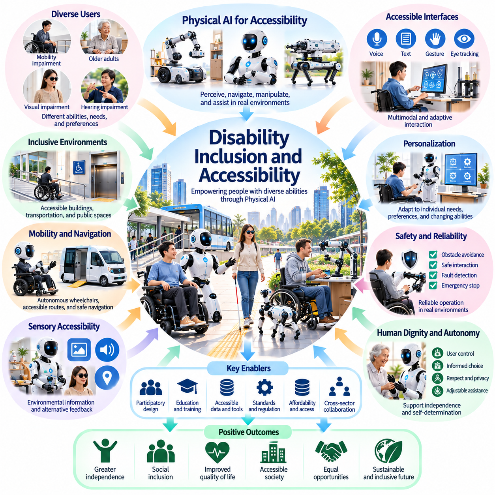{width="7.268055555555556in" height="7.268055555555556in"}

Disability inclusion is a fundamental dimension of the social impact of Physical AI because intelligent robotic systems can reshape how people interact with their physical environments. Robots capable of perception, mobility, and manipulation may reduce barriers that limit participation in everyday activities. However, technological capability alone does not guarantee inclusion. Accessibility, affordability, individual autonomy, and equitable participation must guide system development and deployment.

Disability should not be understood solely as an individual physical or cognitive limitation. Many restrictions arise from environments, services, and technologies that fail to accommodate diverse human capabilities. Physical AI can help address these barriers by adapting assistance to individual needs and changing circumstances. Its broader value lies in enabling participation without requiring everyone to conform to standardized assumptions about human movement, communication, or interaction.

Assistive robotics can expand independence by supporting activities that would otherwise require continuous assistance. Mobile manipulators may retrieve objects, operate household equipment, and assist with selected daily tasks. Robotic mobility platforms can support movement through accessible environments. These capabilities become most meaningful when individuals can determine what assistance is provided, how it operates, and when it should stop.

Accessibility must be integrated into the earliest stages of robotic system design. Interfaces developed around a single interaction method may exclude people with visual, hearing, motor, or cognitive disabilities. Multimodal interaction can combine speech, text, tactile feedback, gesture recognition, and alternative control devices. Flexible configurations allow users to select communication methods that match their capabilities rather than adapting themselves to rigid machine requirements.

Physical AI may improve mobility for individuals who encounter barriers in conventional transportation and built environments. Autonomous wheelchairs, robotic navigation assistants, and intelligent mobility devices can support route planning and obstacle avoidance. However, reliable operation requires more than advanced perception. Accessible pathways, elevators, standardized infrastructure, and appropriate safety mechanisms remain essential for practical and equitable mobility.

Robotic manipulation offers opportunities for individuals with limited upper-limb function or reduced physical strength. Assistive robotic arms may help users reach objects, handle tools, and interact with household environments. Successful assistance requires precise control, appropriate force regulation, and adaptation to personal preferences. Systems should prioritize user-directed manipulation rather than automatically deciding which activities are necessary or desirable.

Sensory accessibility presents additional opportunities for intelligent physical systems. Robots may provide environmental descriptions, identify obstacles, communicate spatial information, or translate visual signals into alternative feedback. For individuals with hearing impairments, robotic interfaces may incorporate visual notifications and accessible communication methods. Such capabilities should supplement established assistive technologies while remaining reliable under diverse environmental conditions.

Cognitive accessibility is equally important in the design of Physical AI. Some users may benefit from simplified instructions, predictable interaction sequences, contextual reminders, or additional time to make decisions. Adaptive interfaces can reduce unnecessary complexity while preserving meaningful choices. Designers must avoid equating cognitive differences with an absence of decision-making capacity, since autonomy requires individualized support rather than generalized restrictions.

Human dignity and self-determination should remain central principles of disability-oriented robotics. Assistance becomes empowering when individuals retain control over goals, preferences, and personal boundaries. Conversely, systems that impose rigid routines or override user decisions may reproduce existing forms of exclusion. Physical AI should provide adjustable autonomy, understandable feedback, and accessible mechanisms for refusing, modifying, or interrupting assistance.

Participatory design is essential because engineers cannot reliably infer accessibility requirements from technical assumptions alone. People with disabilities should participate directly in identifying needs, evaluating prototypes, and defining acceptable system behavior. Their involvement can reveal practical barriers that conventional laboratory testing overlooks. Meaningful participation also requires recognizing differences within disability communities rather than treating users as a homogeneous population.

Personalization can improve accessibility when robotic systems adapt to individual physical capabilities, communication preferences, and environmental conditions. Learning-based control may help adjust assistance as user needs change over time. However, adaptation should remain transparent and reversible. Users must understand significant behavioral changes and retain opportunities to correct inappropriate assumptions made by automated models.

Safety requirements must account for the consequences of robotic failures for users who depend on assistance. Unexpected shutdowns, navigation errors, excessive contact forces, or inaccessible emergency controls may create serious risks. Reliable assistive systems require fault detection, safe recovery procedures, and appropriate human support. Evaluation should include realistic conditions in which users cannot easily compensate for equipment failures through independent physical action.

Economic accessibility is a major challenge for disability-inclusive Physical AI. Advanced robotic devices may require expensive hardware, specialized maintenance, software subscriptions, and ongoing technical support. These costs can prevent adoption even when systems provide substantial benefits. Public funding, insurance coverage, repairable designs, and shared support infrastructure may improve access, but policies must also consider long-term affordability and service continuity.

Digital infrastructure can create additional forms of exclusion. Robotic systems that require continuous cloud connectivity, expensive computing services, or proprietary interfaces may be unavailable in underserved communities. Dependence on remote platforms can also introduce reliability and privacy concerns. Edge computing, offline functionality, interoperable interfaces, and accessible maintenance services can help reduce these barriers while improving operational resilience.

Physical AI may expand educational and employment opportunities for people with disabilities. Adaptive workstations, robotic assistants, and accessible automation can support participation in activities involving physical manipulation or mobility. These technologies may reduce environmental barriers without requiring individuals to abandon their professional goals. Nevertheless, employers and institutions must avoid using automation as a substitute for reasonable accommodation or inclusive organizational practices.

Public environments must evolve alongside assistive robotics. Buildings, transportation networks, healthcare facilities, and community spaces should accommodate diverse robotic mobility and interaction requirements. Universal design principles can benefit both human users and assistive machines by reducing unnecessary physical barriers. Coordination among urban planners, accessibility specialists, robotics developers, and disability organizations is necessary to avoid fragmented solutions.

Privacy and data governance require particular attention when assistive robots collect information about personal activities and functional capabilities. Sensor observations may reveal sensitive patterns involving mobility, communication, or daily routines. Users should retain meaningful control over data collection, sharing, and retention. Accessibility must not become a justification for excessive surveillance or compulsory disclosure of personal information.

Social attitudes also influence whether Physical AI produces genuine inclusion. Assistive robots may reduce practical barriers, but they cannot independently eliminate discrimination, stigma, or institutional exclusion. Public communication should avoid portraying disabled individuals as passive beneficiaries of technological intervention. Instead, robotic systems should be understood as tools that support agency, participation, and diverse forms of independent living.

Evaluation frameworks should measure more than task completion or technical performance. Relevant outcomes include user autonomy, participation in education and employment, accessibility across environments, perceived dignity, and the reliability of ongoing support. Longitudinal assessment can reveal whether initial benefits persist as user needs and system capabilities evolve. Success should be defined through meaningful improvements in lived experience rather than demonstrations of robotic sophistication.

Governance should establish accessibility as a continuing obligation throughout the robotic system lifecycle. Procurement requirements, interoperability standards, inclusive testing, maintenance provisions, and accessible complaint procedures can strengthen accountability. Regulatory approaches should recognize that exclusion may result from interface design, pricing, infrastructure, or service restrictions even when a robot performs its intended technical functions correctly.

Ultimately, disability-inclusive Physical AI should expand the range of choices available to individuals rather than prescribe a single model of independence. Intelligent robotic assistance can reduce physical barriers, support self-determination, and create new opportunities for social participation. Its long-term societal value will depend on whether technological progress is combined with universal accessibility, equitable distribution, human dignity, and the direct participation of people whose lives these systems affect.

## 06.08. Education and Human Skill Transformation

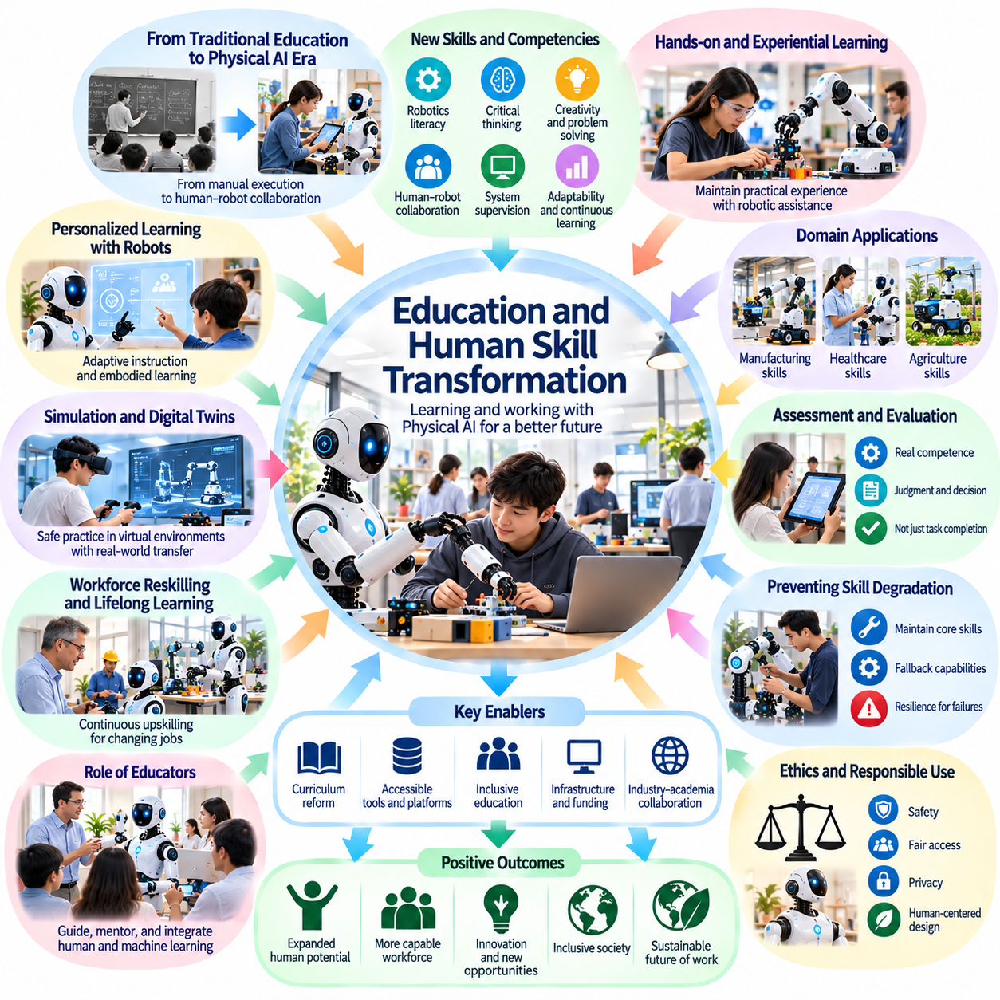{width="7.268055555555556in" height="7.268055555555556in"}

Education and human skill development will undergo significant transformation as Physical AI becomes integrated into workplaces, schools, and everyday environments. Autonomous robots capable of perception, reasoning, and physical action may change which abilities people need to acquire and maintain. The central educational challenge is preparing individuals to collaborate with intelligent machines while preserving independent judgment, practical competence, creativity, and adaptability.

Traditional education has emphasized knowledge acquisition, procedural skills, and repeated practice of physical and cognitive tasks. Physical AI may automate portions of these activities, changing the relationship between learning and execution. Students may increasingly supervise robotic processes rather than perform every operation manually. Education must therefore distinguish between skills that can be delegated and foundational understanding that remains essential for responsible decision-making.

Human skill transformation does not necessarily mean the disappearance of practical abilities. Instead, many occupations may experience a redistribution of responsibilities between people and machines. Workers could shift from repetitive physical execution toward planning, supervision, exception handling, and system improvement. These changes will require educational programs that combine domain expertise with robotics literacy, analytical reasoning, and operational awareness.

Robotics literacy will become an important component of general education. Individuals should understand how autonomous machines perceive environments, interpret instructions, select actions, and encounter limitations. Such knowledge does not require everyone to become a robotics engineer. However, basic familiarity with sensors, control systems, machine learning, and safety boundaries can help users evaluate robotic behavior and recognize situations requiring human intervention.

Experiential learning remains essential even when robots can perform complex physical tasks. Direct interaction with materials, tools, and environments develops intuition about forces, motion, uncertainty, and practical constraints. Students who rely exclusively on automated execution may struggle to recognize unrealistic plans or unsafe actions. Educational systems should preserve meaningful hands-on experiences while using robotic assistance to extend exploration and experimentation.

Physical AI may create new opportunities for personalized education through embodied learning environments. Robotic tutors and interactive machines could demonstrate physical principles, support laboratory exercises, and adapt activities to different learning needs. Unlike purely digital systems, embodied robots can connect abstract concepts with observable physical consequences. Their educational value depends on instructional quality, reliable behavior, and appropriate human supervision.

Human--robot collaboration will require new forms of communication and coordination. Learners must understand how to specify goals, communicate constraints, interpret system feedback, and resolve unexpected outcomes. These abilities resemble teamwork but involve additional challenges related to machine uncertainty and automated decision-making. Educational programs should develop practical competence in shared control, task allocation, and safe intervention.

Critical thinking becomes increasingly important when robotic systems provide recommendations or execute decisions autonomously. Students and workers must learn to question outputs, identify unsupported assumptions, and evaluate consequences before accepting automated actions. Excessive trust can create automation bias, while excessive skepticism may prevent useful collaboration. Effective education should promote calibrated trust based on demonstrated system capabilities.

Skill degradation is a potential consequence of prolonged reliance on robotic assistance. Navigation, equipment operation, manual manipulation, and troubleshooting abilities may weaken when machines consistently perform these tasks. Not every traditional skill must be preserved at its previous level, but critical fallback capabilities remain important. Training should identify which competencies are necessary for safety, resilience, and independent operation during system failures.

Workforce education will need to accommodate continuous technological change. As robotic platforms evolve, workers may require repeated opportunities to update their knowledge and practical skills. Lifelong learning systems could combine online instruction, simulation, supervised robot operation, and workplace experience. Effective reskilling should address actual occupational transitions rather than assuming that short technical courses can resolve complex employment challenges.

Simulation and digital twins may expand access to robotics education by allowing learners to practice without exposing people or equipment to unnecessary risk. Virtual environments can reproduce navigation challenges, manipulation tasks, and operational failures. However, simulated performance does not guarantee competence in real-world conditions. Training should combine simulation with physical experimentation and explicit attention to the differences between modeled and actual environments.

Physical AI may also change how expertise is recognized and evaluated. Traditional assessments often emphasize task completion, speed, and procedural accuracy. In robot-assisted environments, meaningful competence may involve selecting appropriate automation levels, diagnosing failures, and exercising sound judgment. Educational assessment should distinguish genuine understanding from successful delegation to automated systems, particularly in safety-critical occupations.

Teachers and instructors will remain central to educational transformation. Robots may support demonstrations, repetitive practice, and individualized assistance, but educational relationships involve motivation, ethical guidance, and social development. Human educators provide context and judgment that cannot be reduced to automated task execution. Physical AI should strengthen instructional capacity while preserving teachers\' responsibility for learning objectives and student well-being.

Educational inequality may increase if advanced robotic learning environments are available primarily to wealthy institutions. Access to hardware, technical support, laboratory space, and reliable computing infrastructure can shape opportunities for practical experience. Public investment, shared robotics laboratories, affordable platforms, and accessible educational resources may reduce these disparities. Inclusion must extend to learners with different abilities and socioeconomic circumstances.

Physical AI education should incorporate ethics, safety, and social responsibility alongside technical knowledge. Learners need to understand privacy risks, physical hazards, accountability, and the consequences of deploying autonomous systems in shared environments. Technical proficiency without awareness of social impact can produce unsafe or exclusionary practices. Interdisciplinary education can connect engineering decisions with human rights, institutional responsibilities, and public welfare.

Children growing up alongside intelligent robots may develop new expectations about effort, learning, and responsibility. Automated assistance can make experimentation easier, but excessive delegation may reduce opportunities to develop persistence and independent problem-solving. Age-appropriate educational design should encourage active participation rather than passive observation. Robots should function as learning partners and tools without replacing the developmental value of personal effort.

Professional training in manufacturing, healthcare, logistics, and infrastructure management will require application-specific approaches. Each field involves distinct safety requirements, physical environments, and human responsibilities. Workers must learn not only how to operate robots but also when automation is inappropriate. Training programs should integrate technical procedures with domain knowledge, emergency response, and the ethical consequences of operational decisions.

Human creativity may become more valuable as robots assume predictable physical tasks. Individuals could devote greater attention to designing processes, solving unfamiliar problems, and developing new applications. However, creativity depends partly on practical experience and understanding of material constraints. Educational systems should therefore combine computational tools with physical experimentation, encouraging learners to test ideas rather than accepting machine-generated solutions without examination.

Institutional adaptation will be necessary to support these changes. Schools, universities, employers, and governments must coordinate curricula, certification standards, infrastructure investment, and workforce development. Educational programs should be updated according to demonstrated technological capabilities rather than speculative predictions. Continuous evaluation can identify which teaching methods improve competence, inclusion, and long-term employability.

The future of education should not be defined solely by preparing people to operate increasingly autonomous machines. Physical AI creates an opportunity to reconsider which human capabilities deserve protection and development. Judgment, empathy, collaboration, adaptability, and practical understanding remain important even when automated systems outperform humans in selected tasks. Education should strengthen these capacities while enabling productive technological cooperation.

Ultimately, Physical AI will transform human skills through a continuing interaction between automation, learning, and social adaptation. Some abilities may become less frequently practiced, while new forms of expertise emerge around supervision, collaboration, and system governance. A successful educational response will preserve essential human competencies, expand access to technological opportunity, and prepare individuals to remain capable decision-makers in an increasingly robotic civilization.

## 06.09. Privacy Surveillance and Robot Data

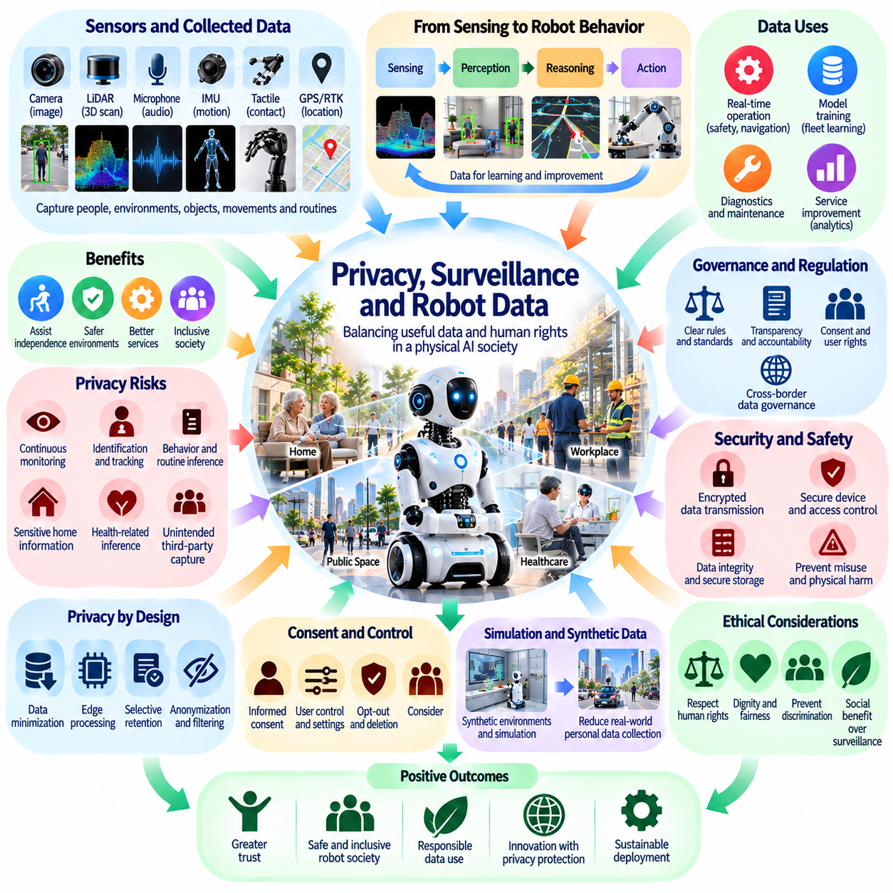{width="7.268055555555556in" height="7.268055555555556in"}

Privacy and surveillance are central societal challenges as Physical AI systems become embedded in homes, workplaces, hospitals, and public spaces. Unlike conventional digital services, autonomous robots continuously observe physical environments to navigate and interact safely. Their sensors may capture faces, conversations, movements, and personal routines. The resulting data can improve robotic performance while creating unprecedented opportunities for intrusive monitoring.

Robot data differs from traditional digital information because it connects observations directly to physical behavior and spatial context. Cameras, LiDAR, microphones, tactile sensors, and localization systems generate detailed representations of surrounding environments. When combined over time, these observations may reveal identities, relationships, habits, and sensitive activities. Even information collected for navigation can become personally identifiable through aggregation and inference.

The distinction between operational sensing and surveillance is particularly important. Robots require environmental awareness to avoid obstacles, recognize objects, and execute physical tasks. However, continuous sensing does not automatically justify permanent recording or unrestricted analysis. Privacy-conscious systems should distinguish information necessary for immediate operation from data retained for training, monitoring, or commercial purposes.

Privacy by design requires protective measures to be integrated throughout the robotic system lifecycle. Data minimization can limit collection to information genuinely necessary for defined functions. Local processing may reduce unnecessary transmission of sensitive observations, while selective retention can prevent indefinite accumulation. These principles must influence sensor configuration, software architecture, storage policies, and operational procedures.

Edge computing offers opportunities to protect privacy by processing sensor information directly on robotic devices. Navigation, object recognition, and certain safety functions may operate without transmitting raw video or audio to external servers. Nevertheless, local processing does not eliminate every risk. Compromised devices, unauthorized access, and insecure maintenance interfaces can still expose sensitive information or undermine system integrity.

Cloud connectivity introduces additional governance challenges because robot data may pass through multiple providers, jurisdictions, and technical platforms. Centralized processing can support fleet learning, diagnostics, and model improvement, but it also expands potential access to personal information. Organizations must establish clear responsibilities for data ownership, processing authority, retention, and deletion across interconnected services.

Consent becomes complicated when autonomous robots operate in shared environments. A household robot may observe family members, visitors, and service workers who never directly agreed to its operation. Similarly, robots in hospitals or workplaces may collect information about individuals who cannot reasonably avoid their sensors. Meaningful consent therefore requires appropriate notice, practical alternatives, and safeguards beyond simple acceptance by the device owner.

Workplace robotics raises concerns about employee monitoring and behavioral surveillance. Autonomous machines may record worker locations, task durations, movement patterns, and interactions with equipment. Such information can improve safety and workflow coordination, but it may also enable excessive performance tracking or discriminatory management practices. Responsible deployment requires proportional monitoring, transparent policies, and appropriate restrictions on secondary uses.

Public-space robots create additional tensions between collective benefits and individual privacy. Delivery robots, inspection platforms, and autonomous service machines may observe pedestrians and surrounding properties during normal operations. Their deployment should not transform ordinary public movement into persistent behavioral tracking. Privacy protections must address recording practices, identification capabilities, data sharing, and the potential aggregation of observations across multiple systems.

Robotic perception models can infer sensitive information even when explicit identifiers are removed. Movement patterns, household layouts, repeated schedules, and interaction histories may reveal health-related circumstances or personal relationships. Consequently, anonymization alone may not guarantee privacy. Effective protection requires evaluating reidentification risks, inference capabilities, and the cumulative effects of combining datasets from different sources.

Data security is inseparable from physical safety in autonomous robotic systems. Unauthorized access to sensor streams can expose private environments, while compromised control interfaces may enable dangerous physical actions. Cybersecurity measures should therefore protect both information and robotic behavior. Secure authentication, encrypted communications, software integrity checks, and controlled update mechanisms are essential components of responsible deployment.

Robot learning introduces difficult questions about how operational experience should be reused. Recorded demonstrations and fleet observations can improve perception, planning, and manipulation models. However, training datasets may contain incidental personal information unrelated to the intended learning objective. Data governance should specify permissible reuse, establish appropriate filtering procedures, and restrict access to sensitive examples.

Synthetic data and simulation may reduce dependence on recordings of real people and private environments. Artificially generated scenes can support model training without directly reproducing identifiable observations. Nevertheless, synthetic datasets are not automatically privacy-preserving, especially when generated from sensitive source material. Their benefits depend on how original data is obtained, transformed, validated, and protected.

Federated learning and privacy-preserving computation offer potential alternatives to centralized data collection. Robots may improve shared models by exchanging selected updates rather than transmitting complete operational records. Differential privacy and secure aggregation can provide additional protections under appropriate assumptions. Yet these methods involve tradeoffs involving accuracy, computational cost, communication efficiency, and residual information leakage.

Transparency is essential for maintaining public trust in robotic sensing. Users should understand which sensors are active, what information is recorded, how long it is retained, and who can access it. Visible indicators, accessible privacy controls, and understandable documentation can improve awareness. However, transparency must be accompanied by enforceable limits because disclosure alone cannot justify disproportionate surveillance.

Privacy governance should recognize differences among homes, workplaces, healthcare facilities, and public infrastructure. Each environment involves distinct expectations, vulnerabilities, and legal responsibilities. A robot operating in a private residence may require different retention and access policies from an industrial inspection platform. Context-sensitive governance can establish appropriate safeguards without assuming that one uniform policy fits every deployment.

Data ownership and control remain contested questions in robotic ecosystems. Users, operators, manufacturers, and software providers may each claim legitimate interests in information generated during operation. Contractual terms alone may not resolve conflicts involving bystanders or sensitive environments. Governance frameworks should clarify decision-making authority, access rights, portability, deletion procedures, and accountability when information is misused.

Long-term data retention creates risks that may exceed the original purpose of collection. Detailed environmental records can become more revealing as analytical techniques improve or datasets are combined. Information considered harmless today may enable sensitive inferences in the future. Retention limits, periodic deletion, access audits, and documented exceptions can reduce unnecessary exposure while preserving information genuinely required for safety or legal obligations.

Independent oversight can strengthen accountability in large-scale robotic deployments. Privacy impact assessments, security audits, incident reporting, and external review can identify risks overlooked during product development. Organizations should evaluate not only whether data practices comply with formal requirements but also whether surveillance burdens fall disproportionately on particular populations. Effective oversight must connect technical evidence with meaningful corrective action.

The expansion of Physical AI may gradually normalize continuous observation unless clear social boundaries are established. Convenience, efficiency, and safety benefits should not automatically override privacy, freedom of movement, or personal autonomy. Democratic governance and public participation can help determine acceptable sensing practices. These discussions must consider both immediate operational benefits and the cumulative consequences of widespread robotic monitoring.

Ultimately, responsible robot data governance must balance the information needs of intelligent physical systems with fundamental human rights. Physical AI can learn from environments without treating every observed activity as an unrestricted data resource. Privacy-preserving architectures, strong cybersecurity, transparent accountability, and enforceable limits on surveillance will be essential for building a robotic society that protects human dignity and freedom.

## 06.10. Responsibility Liability and Machine Agency

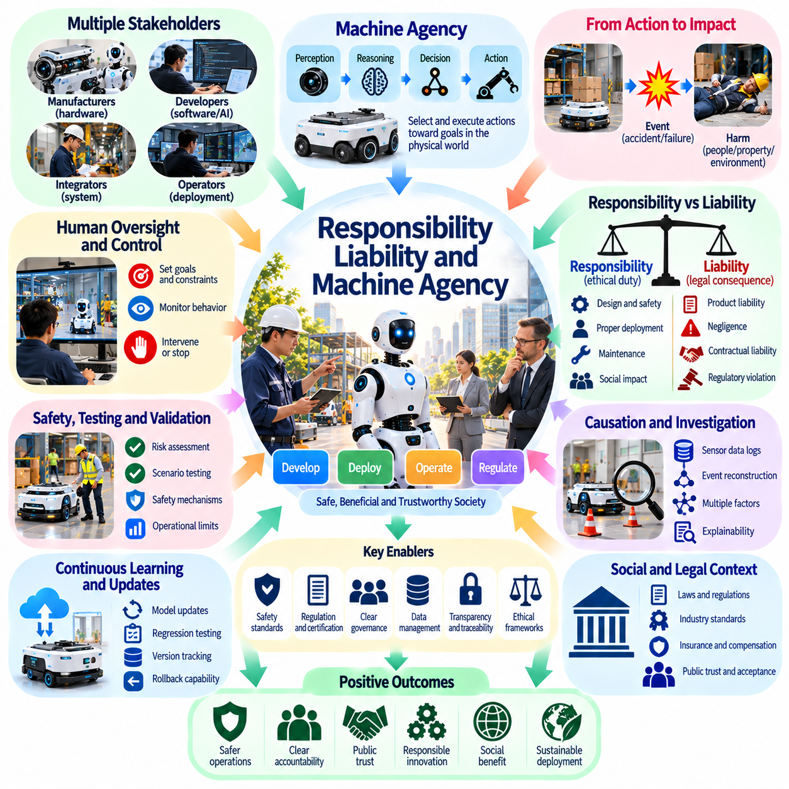{width="7.268055555555556in" height="7.268055555555556in"}

Responsibility and liability become increasingly complex as Physical AI systems gain the ability to perceive environments, make decisions, and execute physical actions. Unlike conventional software, autonomous robots can directly affect people, property, and infrastructure. Their behavior may emerge from interactions among learned models, control systems, operators, and environmental conditions. Establishing accountability therefore requires understanding both technical causation and human responsibility.

Machine agency refers to the capacity of an artificial system to select and execute actions toward specified objectives. In Physical AI, this agency becomes observable through movement, manipulation, navigation, and interaction with the physical world. However, operational autonomy should not automatically be equated with moral agency or legal personhood. A robot may act independently within technical boundaries while remaining subject to human-defined purposes and institutional oversight.

Responsibility concerns the obligations of individuals and organizations involved in developing, deploying, and operating robotic systems. Liability concerns the legal consequences that may arise when harmful outcomes occur. Although closely related, these concepts are not identical. An organization may have ethical responsibilities beyond its legal obligations, while legal liability may depend on jurisdiction, contractual relationships, negligence, and applicable product safety rules.

Traditional responsibility models often assume that a human operator directly controls a machine\'s actions. Physical AI challenges this assumption because robots may execute complex decisions without continuous human intervention. A supervisor might define objectives while an autonomous system determines routes, movements, and intermediate actions. Responsibility frameworks must therefore distinguish high-level authorization from operational control and foreseeable system behavior.

The development lifecycle introduces multiple potential sources of responsibility. Hardware manufacturers influence mechanical reliability, actuator performance, and physical safeguards. Software developers shape perception, planning, and decision-making capabilities. System integrators determine how components interact, while operators configure missions and maintain equipment. Accountability requires clearly defined duties across these participants rather than assuming that one actor controls every risk.

Product liability becomes particularly important when autonomous robots cause physical injury or property damage. Defective sensors, inadequate safety mechanisms, software faults, and insufficient warnings may contribute to harmful incidents. Learning-based systems complicate defect analysis because failures may arise from unexpected combinations of inputs rather than obvious programming errors. Legal evaluation must consider relevant safety expectations, foreseeable uses, and evidence of system behavior.

Negligence-based responsibility may arise when organizations fail to exercise reasonable care in designing or operating Physical AI. Examples include deploying robots without adequate testing, ignoring known hazards, or failing to maintain essential safety functions. However, reasonable care cannot be defined solely through hindsight after an accident. Evaluation should consider available knowledge, established practices, operational context, and precautions that were practical before the event.

Human oversight remains essential, but its effectiveness depends on actual intervention capabilities. Assigning a nominal supervisor does not establish meaningful control if a robot acts faster than a person can understand or interrupt it. Oversight mechanisms should account for response time, situational awareness, interface clarity, and authority to stop operations. Responsibility should correspond to realistic opportunities to influence outcomes.

The concept of meaningful human control helps distinguish genuine supervision from symbolic approval. Humans should retain appropriate authority over objectives, deployment conditions, safety boundaries, and exceptional decisions. Yet control arrangements must reflect task characteristics and operational risks. A warehouse transport robot may require different supervision from a surgical assistant or autonomous construction machine operating near workers.

Causation becomes difficult to establish when harmful outcomes result from interacting technical and environmental factors. A collision might involve sensor degradation, inaccurate mapping, unexpected pedestrian behavior, and inadequate braking control. Investigations should reconstruct the sequence of events rather than attributing failure to a single component prematurely. Reliable logs, synchronized sensor records, and documented software versions can support technical and legal analysis.

Explainability contributes to accountability by helping investigators understand why a robot selected particular actions. However, explanations generated after an incident may not accurately represent the internal causes of a learned model\'s behavior. Accountability therefore requires more than persuasive narratives. Traceable decisions, reproducible testing, system documentation, and independent technical examination can provide stronger evidence of operational mechanisms.

Continuous learning introduces additional responsibility challenges. A robot that changes its behavior after deployment may operate differently from the system originally evaluated or certified. Model updates, fleet learning, and adaptive control can improve performance while introducing unfamiliar failure modes. Organizations should establish update approval procedures, version tracking, regression testing, and rollback mechanisms to maintain accountability throughout operation.

Shared autonomy creates situations in which humans and robots jointly influence outcomes. A teleoperator may provide guidance while automated controllers manage balance, collision avoidance, or manipulation forces. When an incident occurs, the distinction between human commands and machine-generated actions becomes important. Responsibility allocation should reflect actual control authority, system constraints, and whether participants received sufficient information to act safely.

Multi-robot systems further complicate attribution because collective behavior may emerge from distributed decisions. Fleet managers, individual robots, communication networks, and shared world models can jointly influence physical outcomes. Failures may propagate through coordination mechanisms rather than originate within one robot. Governance should define responsibility for fleet-level policies, communication integrity, shared data quality, and system-wide emergency responses.

Insurance and compensation mechanisms can help manage risks that cannot be eliminated completely. Operators, manufacturers, and service providers may require different forms of coverage depending on deployment arrangements. Compensation systems should enable affected individuals to obtain appropriate remedies without requiring unrealistic knowledge of complex robotic architectures. Insurance design should also encourage prevention through verified safety practices and transparent incident reporting.

Contractual allocation of liability can clarify responsibilities among organizations, but private agreements should not undermine protections for injured individuals. Robot-as-a-Service arrangements may distribute maintenance, software management, and operational authority across several companies. Contracts should specify safety duties, incident cooperation, data access, and update responsibilities. Applicable law ultimately determines which contractual provisions are enforceable against particular parties.

Machine agency raises philosophical questions about whether increasingly capable systems could possess moral responsibility. Present-day robotic autonomy does not establish consciousness, moral understanding, or independent ethical standing. Even highly sophisticated decision-making should not automatically transfer responsibility from humans to machines. Debates about future artificial moral agency remain open, but practical governance must operate without assuming that robots can meaningfully bear legal or moral blame.

Responsibility gaps may emerge when no participant appears to have complete knowledge or control over an autonomous system. Developers may not anticipate every deployment condition, while operators may lack access to internal model behavior. These gaps should motivate stronger institutional accountability rather than acceptance of responsibility-free automation. Clear operational boundaries, documented assumptions, and mandatory escalation procedures can reduce uncertainty.

Regulation and technical standards can establish common expectations for responsible robotic deployment. Requirements may address risk assessment, functional safety, cybersecurity, incident reporting, and post-deployment monitoring. Nevertheless, compliance with a standard does not guarantee the absence of harm or automatically resolve every liability question. Regulatory systems must adapt to changing capabilities while preserving enforceable duties and independent review.

Public trust depends partly on whether people can identify who is answerable when robots cause harm. Transparent complaint procedures, accessible investigation mechanisms, and effective remedies are essential for social acceptance. Organizations should communicate operational limitations without transferring unreasonable burdens to users or bystanders. Accountability becomes credible when technical evidence, institutional responsibility, and corrective action are connected.

Ultimately, Physical AI requires responsibility frameworks that recognize increasing machine autonomy without abandoning human accountability. Robots may acquire greater operational agency, but their development, authorization, deployment, and governance remain embedded in human institutions. A responsible robotic society must combine technical traceability, meaningful oversight, fair liability allocation, and effective remedies so that autonomous physical action remains compatible with justice and public safety.

## 06.11. Governance of Autonomous Physical Systems

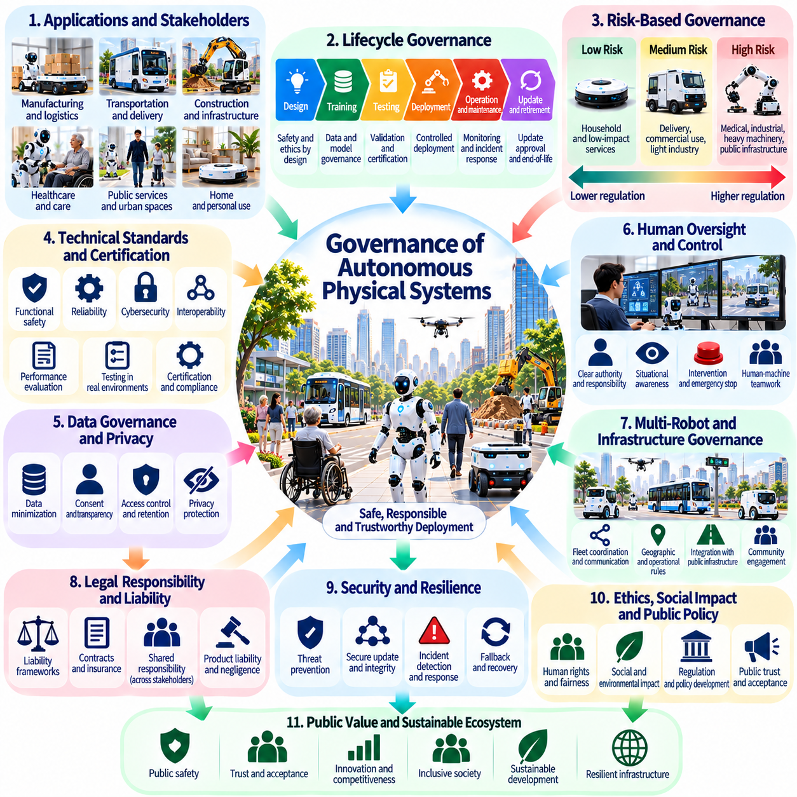{width="7.268055555555556in" height="7.268055555555556in"}

Governance of autonomous physical systems concerns the institutions, rules, and decision-making processes that determine how intelligent machines are developed, deployed, and controlled. Physical AI introduces governance challenges because autonomous robots can affect people and infrastructure through direct physical actions. Effective governance must coordinate technological innovation, public safety, individual rights, and institutional accountability.

Unlike conventional digital AI, autonomous physical systems operate in environments where mistakes may produce immediate material consequences. A planning error can cause a collision, equipment damage, or interruption of essential services. Governance must therefore address not only algorithmic decisions but also mechanical reliability, environmental uncertainty, operational supervision, and emergency response capabilities throughout the system lifecycle.

A central governance principle is that operational autonomy should not eliminate human accountability. Robots may independently select routes, manipulate objects, and coordinate missions, but organizations remain responsible for defining permissible objectives and operating conditions. Governance frameworks should identify who authorizes deployment, who supervises operations, who maintains safety controls, and who responds when systems behave unexpectedly.

Risk-based governance offers a practical approach because autonomous physical systems differ significantly in their potential consequences. A household cleaning robot presents different hazards from an autonomous surgical platform or heavy industrial vehicle. Regulatory requirements should reflect the severity of potential harm, exposure to vulnerable populations, operating environments, and the ability to intervene before unsafe actions occur.

Governance must extend across the entire lifecycle of Physical AI systems rather than focus exclusively on initial product approval. Design, training, testing, deployment, maintenance, software updates, and retirement can each introduce new risks. Lifecycle governance requires documented responsibilities, periodic reassessment, configuration management, and procedures for withdrawing or restricting systems when their safety assumptions are no longer valid.

Technical standards provide a foundation for consistent governance by establishing expectations for functional safety, reliability, cybersecurity, and interoperability. However, conventional standards may not fully address learning-based behavior or rapidly evolving autonomous capabilities. Governance institutions should combine established engineering requirements with evidence-based evaluation of perception, planning, adaptation, and performance under uncertain conditions.

Certification of autonomous physical systems presents difficulties when behavior depends on complex learned models. Traditional testing often evaluates predefined operating conditions, while Physical AI may encounter unfamiliar objects, changing environments, and unexpected human behavior. Certification approaches should consider operational design domains, uncertainty boundaries, failure recovery, and evidence that systems remain safe beyond narrowly scripted demonstrations.

Continuous learning creates additional governance challenges because deployed systems may change after initial validation. Model updates and shared fleet experience can improve performance while introducing new behavioral patterns. Organizations need procedures for approving updates, detecting regressions, maintaining version histories, and restoring validated configurations. Significant changes should trigger reassessment proportional to their potential safety impact.

Operational governance must establish clear authority between human supervisors and autonomous decision-making systems. Human oversight is meaningful only when supervisors receive adequate information and possess realistic intervention capabilities. Interfaces should communicate system status, uncertainty, mission objectives, and emerging hazards. Emergency stopping, controlled fallback, and escalation procedures must remain effective under foreseeable failures.

Multi-robot fleets introduce governance problems that extend beyond individual machine certification. Distributed coordination, shared maps, collective learning, and fleet-level task allocation can create risks through interactions among otherwise reliable robots. Governance should address communication failures, conflicting missions, shared resource allocation, and cascading disturbances. Responsibility for collective behavior must be assigned at the system level.

Public infrastructure requires especially careful governance because autonomous systems may operate near individuals who have not chosen to interact with them. Delivery robots, inspection platforms, and urban service machines can affect accessibility, pedestrian movement, and emergency operations. Public authorities should establish deployment permissions, geographic restrictions, operational limits, and transparent procedures for addressing community concerns.

Data governance is another essential component because autonomous physical systems continuously generate sensor observations and operational records. These datasets may contain personal information, sensitive spatial details, or information about critical infrastructure. Governance should define collection purposes, access rights, retention periods, and acceptable secondary uses. Security controls must protect both information confidentiality and the integrity of robotic actions.

Cybersecurity governance must recognize that digital compromises can produce physical consequences. Unauthorized commands, manipulated sensor inputs, or compromised fleet software may cause unsafe movement or coordinated disruption. Organizations should implement secure authentication, protected communications, vulnerability management, and incident recovery procedures. Security assessments must consider the interaction between cyber threats and physical safety mechanisms.

Transparency and auditability strengthen governance by allowing relevant parties to examine how autonomous systems operate. Documentation should describe intended functions, operational limitations, safety assumptions, and responsibilities. Event logs and version records can support investigations following incidents. However, transparency does not require unrestricted disclosure of sensitive technical information; appropriate access controls and independent review can balance competing interests.

Democratic participation becomes important when autonomous systems influence shared public environments. Residents, workers, disability advocates, and other affected communities may identify risks overlooked by developers or operators. Consultation should occur before consequential deployments rather than only after incidents. Participatory governance can improve legitimacy by connecting technical decisions with local expectations, accessibility requirements, and public interests.

International coordination is increasingly necessary because robotic hardware, software, cloud services, and operational data often cross national borders. Differences in safety regulation, liability rules, and data protection can create uncertainty for manufacturers and operators. International standards and mutual recognition mechanisms may reduce unnecessary fragmentation. Nevertheless, harmonization should preserve the ability of jurisdictions to address local risks and social priorities.

Economic governance must consider whether regulatory obligations disproportionately favor large organizations with extensive compliance resources. Excessively burdensome requirements may discourage smaller innovators, while weak oversight can expose communities to unacceptable risks. Proportionate testing pathways, shared evaluation infrastructure, and transparent certification criteria can support responsible competition without compromising essential protections.

Independent oversight is necessary when commercial incentives conflict with safety or public welfare. External audits, incident investigations, regulatory inspections, and whistleblower protections can reveal weaknesses that internal reviews overlook. Oversight institutions require sufficient technical expertise and access to relevant evidence. Their authority should include demanding corrective actions and restricting deployments when serious risks remain unresolved.

Governance should also anticipate the increasing integration of autonomous systems into essential services. Logistics, healthcare, energy, transportation, and infrastructure maintenance may become dependent on coordinated robotic operations. Such dependence creates systemic risks when common software, communication networks, or compute platforms fail. Resilience planning should include redundancy, manual fallback capabilities, continuity procedures, and recovery priorities.

Long-term governance must remain adaptable because future Physical AI capabilities cannot be predicted with certainty. Rules designed for narrow autonomous functions may become inadequate as systems gain broader planning, learning, and coordination abilities. Adaptive governance combines stable principles with periodic technical reassessment, controlled experimentation, and evidence-driven revision. Regulatory flexibility should not weaken fundamental protections or obscure institutional responsibility.

Ultimately, governance of autonomous physical systems is the process of ensuring that increasing machine autonomy remains compatible with human rights, public safety, and democratic accountability. Technical safeguards alone cannot resolve every institutional or societal concern. Effective governance requires coordinated responsibilities, enforceable standards, meaningful oversight, public participation, and continuous adaptation as Physical AI becomes part of civilization\'s physical infrastructure.

## 06.12. Safety Alignment and Human Control

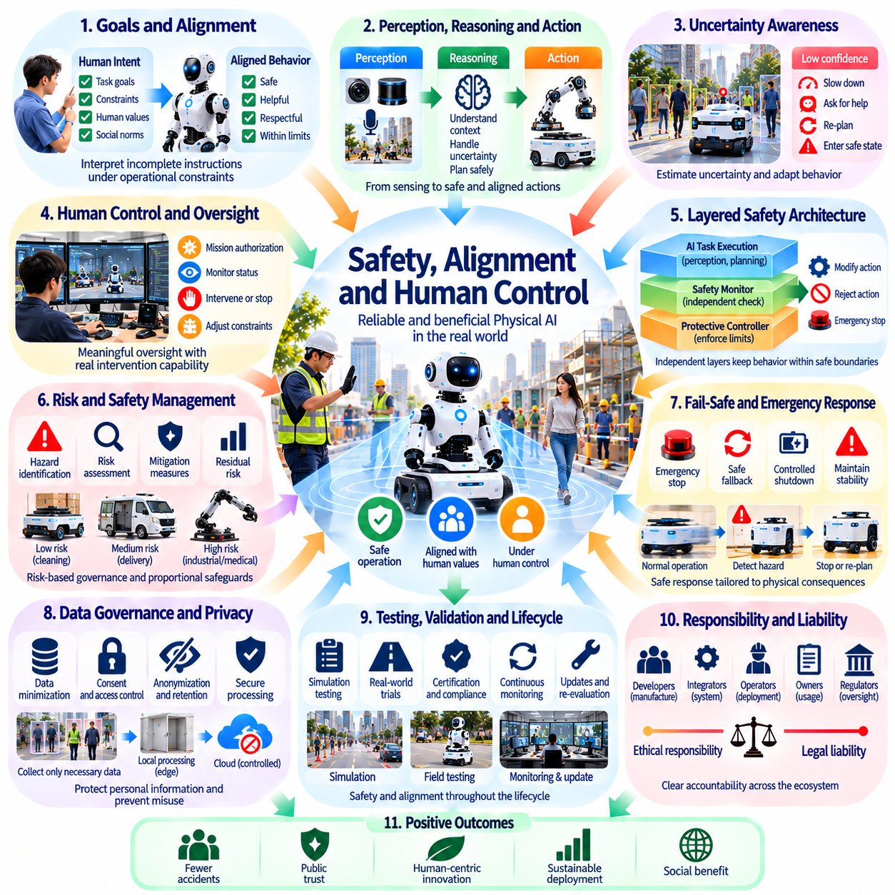{width="7.268055555555556in" height="7.268055555555556in"}

Safety, alignment, and human control are fundamental requirements for Physical AI systems that act autonomously in the physical world. Unlike digital AI, robotic decisions can produce immediate consequences for human bodies, equipment, and infrastructure. Reliable autonomy therefore requires more than successful task execution. It demands mechanisms that keep robotic behavior within acceptable safety boundaries and preserve meaningful human authority.

Safety refers to preventing unacceptable harm, while alignment concerns whether system behavior remains consistent with intended objectives, human values, and legitimate instructions. These concepts overlap but are not identical. A robot may perform a requested task accurately while creating unnecessary danger, or operate safely while pursuing an unintended objective. Responsible Physical AI must address both dimensions simultaneously.

Physical AI alignment is particularly difficult because human instructions are often incomplete or dependent on context. A command to move equipment quickly may conflict with pedestrian safety, workspace restrictions, or fragile surroundings. Robots must interpret objectives within operational constraints rather than optimize isolated commands. This requires explicit priorities, contextual reasoning, and mechanisms for recognizing conflicting requirements.

Human control should be understood as a structured relationship between human authority and machine autonomy. Operators may define missions, approve operating conditions, and establish safety limits while robots select intermediate actions. The appropriate distribution of control depends on task complexity, environmental uncertainty, and potential consequences. Greater autonomy should be accompanied by stronger verification and oversight.

Meaningful human oversight requires more than placing an operator near an autonomous machine. Supervisors must understand system status, recognize emerging hazards, and possess realistic opportunities to intervene. If a robot acts faster than a person can assess its behavior, nominal supervision provides limited protection. Interface design, alert prioritization, response latency, and intervention authority are therefore essential safety considerations.

A layered safety architecture separates intelligent task execution from protective functions that enforce operational boundaries. Perception and planning models may generate actions, while independent monitors evaluate speed, proximity, workspace limits, and hazardous conditions. When proposed actions violate defined constraints, protective controllers can modify, reject, or interrupt execution. Independence reduces reliance on a single learned model.

Runtime assurance provides a practical framework for supervising autonomous behavior during operation. A high-performance controller may manage normal tasks while a verified safety controller remains available to assume control when necessary. Monitoring mechanisms evaluate operating conditions and detect departures from validated assumptions. Successful implementation depends on reliable switching, sufficient reaction time, and clearly defined safe states.

Uncertainty awareness is essential because Physical AI systems cannot perceive or predict every environmental condition accurately. Sensor degradation, occlusion, unfamiliar objects, and distribution shifts can undermine confidence in planned actions. Robots should estimate relevant uncertainty and adapt their behavior accordingly. Slowing down, requesting assistance, or entering a safe state may be preferable to continuing under unsupported assumptions.

Fail-safe behavior must be designed around the physical consequences of stopping or changing control modes. Emergency braking may be appropriate for a mobile robot but hazardous for a manipulator carrying a heavy object. Safe responses depend on payload, terrain, surrounding people, and system dynamics. Designers must distinguish immediate emergency stops from controlled fallback procedures that maintain stability and containment.

Human override mechanisms should remain accessible, predictable, and effective under foreseeable failures. Emergency stops, remote intervention, supervisory commands, and local safety controls may provide complementary protections. However, intervention channels can themselves fail through communication loss, power disruption, or software malfunction. Critical safety functions should therefore avoid unnecessary dependence on unreliable external connectivity.

Alignment also requires protecting against unintended consequences of apparently reasonable objectives. A robot instructed to maximize throughput might obstruct human access or neglect equipment wear if these concerns are absent from its objective structure. Reward functions and task specifications cannot capture every social or physical requirement. Constraint-based planning, human feedback, and operational policies can reduce such specification failures.

Human preferences may conflict across users, operators, bystanders, and institutions. A service robot might receive a request that violates privacy expectations or workplace safety rules. Alignment cannot mean unconditional obedience to the nearest person. Systems need authority hierarchies, permission boundaries, and procedures for resolving conflicting instructions. Legitimate human control must include safeguards against misuse and unauthorized commands.

Learning-based robotic systems introduce challenges because their behavior may change across environments and software versions. Training success does not guarantee safe performance under rare combinations of physical conditions. Validation should examine robustness, recovery behavior, uncertainty handling, and interactions with humans. Simulation, controlled field trials, and real-world monitoring provide complementary evidence but cannot eliminate every residual risk.

Continuous adaptation requires particular caution when deployed robots update their policies using operational experience. A model improvement in one environment may introduce unexpected behavior elsewhere. Safety governance should distinguish monitored learning from authorization to execute newly learned actions. Version control, regression testing, staged deployment, and rollback mechanisms help prevent uncontrolled changes from bypassing validated protections.

Multi-robot coordination creates safety problems that may not appear when robots are evaluated individually. Shared routes, distributed task allocation, and collective motion can generate congestion, conflicting actions, or cascading failures. Fleet-level safety constraints should complement local collision avoidance and emergency functions. Coordination systems must account for communication delays, inconsistent world models, and degraded network conditions.

Security and alignment are interconnected because unauthorized interference can redirect otherwise well-designed autonomous behavior. Manipulated sensor inputs, malicious commands, and compromised updates may undermine safety controls. Authentication, secure communication, software integrity, and access management help preserve legitimate authority. Safety assessments should examine cyber-physical attack paths rather than treating cybersecurity as an unrelated concern.

Evaluation of human control should measure whether intervention actually prevents harm, not merely whether an override button exists. Relevant evidence includes hazard detection time, operator comprehension, command latency, stopping distance, and recovery success. Human factors testing can reveal confusion, excessive workload, or automation bias. Realistic exercises should include degraded sensors, unexpected obstacles, and conflicting instructions.

Transparency supports alignment by helping operators understand intended behavior, operational limitations, and reasons for intervention requests. Explanations should communicate uncertainty and relevant constraints without implying greater reliability than the system possesses. Technical logs can support incident investigation, while clear interfaces support immediate decisions. Explanations alone, however, cannot replace tested safety mechanisms.

Responsibility for safety and alignment extends across developers, manufacturers, integrators, operators, and governing institutions. Each participant influences different parts of the system lifecycle. Clear allocation of duties is necessary for testing, maintenance, updates, incident response, and operational authorization. Safety claims should be supported by documented evidence and reassessed when deployment conditions or capabilities change.

Long-term alignment becomes more challenging as Physical AI systems gain broader planning capabilities and operate with less direct supervision. Robots may coordinate extended missions, manage resources, and adapt to changing objectives. Governance must ensure that increasing autonomy does not create irreversible actions beyond legitimate human authority. Permission limits, staged authorization, and reliable interruption mechanisms remain essential.

Ultimately, safe Physical AI requires an enduring balance between machine initiative and human control. Autonomous systems should act efficiently within validated boundaries while recognizing uncertainty, respecting legitimate instructions, and yielding control when necessary. Technical safeguards, institutional accountability, and continuous evaluation must evolve together. The objective is not unrestricted machine independence, but trustworthy physical autonomy that protects human welfare and agency.

## 06.13. Energy Resources and Environmental Impact

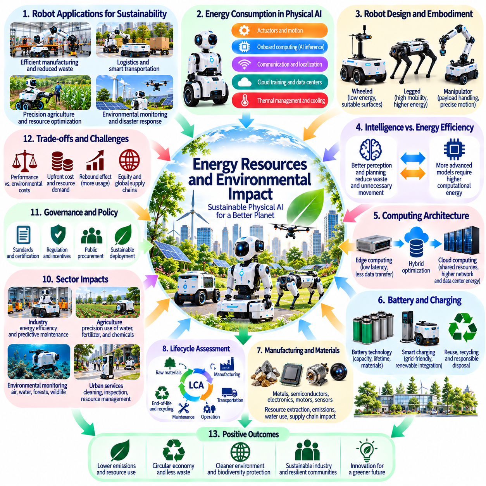{width="7.268055555555556in" height="7.268055555555556in"}

The environmental impact of Physical AI depends on how autonomous machines consume energy, use materials, and transform physical production. Robots can improve resource efficiency by reducing waste, optimizing operations, and supporting environmental monitoring. However, widespread deployment also requires electricity, computing infrastructure, batteries, and manufactured components. Evaluating sustainability therefore requires examining both the benefits of automation and its environmental costs.

Energy consumption in Physical AI extends beyond the electricity required to move robotic actuators. Perception, planning, communication, localization, and onboard inference all consume computational power. Additional energy is required for cloud processing, model training, data storage, and fleet coordination. A complete assessment must consider the entire computational and mechanical system rather than focusing only on robot operating time.

Robot morphology strongly influences energy efficiency because different physical structures require different amounts of power for equivalent tasks. Wheeled robots generally offer efficient movement on suitable surfaces, while legged platforms provide mobility across difficult terrain at potentially higher energy costs. Manipulators introduce additional demands through payload handling and precise motion. Selecting appropriate embodiments is therefore an environmental as well as an engineering decision.

The relationship between intelligence and energy efficiency is complex. Better perception and planning can reduce unnecessary movement, collisions, and repeated operations. Predictive world models may help robots select shorter routes or more efficient manipulation strategies. Yet increasingly sophisticated models can require substantial computation. Energy-aware system design must evaluate whether the operational savings produced by intelligence exceed its additional computational demands.

Edge computing and cloud computing create different environmental tradeoffs. Local inference can reduce communication requirements and dependence on remote infrastructure, but powerful onboard processors increase device power consumption and thermal demands. Cloud services can share computational resources across fleets while introducing network and data-center energy costs. Hybrid architectures should allocate workloads according to latency, reliability, and total energy consumption.

Battery technology is a major determinant of robotic sustainability. Battery capacity affects operating duration, payload, charging frequency, and platform weight. Larger batteries may increase autonomy but require additional materials and energy during manufacturing. Battery degradation also creates replacement and disposal challenges. Sustainable design should consider chemistry selection, thermal management, charging practices, repairability, and responsible end-of-life processing.

Charging infrastructure becomes increasingly important as autonomous fleets expand. Large numbers of robots charging simultaneously can create concentrated electricity demand and operational bottlenecks. Intelligent scheduling may shift charging toward periods of lower grid stress or greater renewable generation. However, such strategies depend on operational flexibility and reliable energy information. Fleet management should incorporate energy availability alongside mission priorities.

Manufacturing Physical AI systems requires metals, semiconductors, electronic components, motors, sensors, and structural materials. Their extraction and processing can generate greenhouse gas emissions, water consumption, and ecological disturbance. Advanced sensing and computing hardware may involve resource-intensive supply chains. Environmental assessments should therefore account for embodied emissions and material demand before robots begin operating.

Lifecycle assessment provides a systematic method for evaluating these impacts. It examines resource extraction, component production, transportation, operation, maintenance, and eventual disposal or recycling. A robot that consumes little electricity during operation may still have substantial manufacturing impacts. Comparing robotic alternatives requires consistent functional boundaries, realistic utilization assumptions, and an understanding of which human or mechanical activities are displaced.

Robotic durability and repairability can significantly influence long-term resource consumption. Systems designed around replaceable sensors, modular actuators, accessible batteries, and maintainable computing components may remain useful longer. Software support and spare-part availability are equally important. Premature replacement caused by unsupported hardware or incompatible updates can increase electronic waste even when individual robots are operationally efficient.

Physical AI may improve industrial energy efficiency through adaptive process control and continuous monitoring. Robots can inspect equipment, detect abnormal conditions, and adjust production activities to reduce material losses. Autonomous maintenance may identify failures before they cause major resource waste. Nevertheless, environmental improvements should be measured against actual operating baselines rather than inferred from automation alone.

Agriculture presents opportunities for reducing certain environmental burdens through precision operations. Autonomous platforms may apply water, fertilizer, or crop treatments more selectively based on local conditions. Robotic monitoring can support earlier detection of plant stress and resource inefficiency. However, benefits depend on sensor accuracy, agronomic practices, energy sources, and the possibility that increased automation encourages more intensive resource use.

Environmental monitoring robots can extend observation into locations that are difficult or dangerous for humans to access. Aerial, ground, and underwater systems may collect information about pollution, habitat conditions, infrastructure leakage, and ecosystem changes. These capabilities can support better decisions, but sensing alone does not guarantee environmental improvement. Data quality, scientific interpretation, and effective institutional responses remain essential.

The rebound effect is a major concern when automation reduces the cost of physical activity. More efficient robotic production or transportation may encourage greater overall consumption, potentially offsetting resource savings. Lower operational costs can increase the frequency and scale of activities that still carry environmental burdens. Sustainability analysis must therefore consider total system demand rather than efficiency improvements per individual task.

Large-scale robotic fleets may introduce new environmental pressures through continuous operation and accelerated equipment replacement. Frequent sensor upgrades, expanding compute requirements, and short product cycles can increase material throughput. Shared fleet infrastructure and standardized components may improve utilization, but only when supported by effective maintenance and reuse policies. Scaling Physical AI responsibly requires controlling both operational and embodied impacts.

Energy-aware autonomy can make sustainability an explicit consideration in robotic decision-making. Planning algorithms may balance task completion time, electricity consumption, battery health, and equipment wear. Fleet orchestration can allocate missions to robots with suitable capabilities and energy reserves. Such optimization requires transparent objectives because minimizing energy alone may conflict with safety, service quality, or human accessibility.

Renewable electricity can reduce operational emissions associated with robotic systems, although environmental outcomes depend on regional electricity generation and charging patterns. Robots operating on carbon-intensive grids may have different impacts from identical platforms supplied by low-carbon energy. Time-sensitive carbon accounting can inform charging and compute scheduling. Nevertheless, renewable electricity does not eliminate manufacturing emissions or material constraints.

Environmental governance should establish measurable sustainability indicators for Physical AI deployments. Relevant metrics include energy per completed task, lifecycle greenhouse gas emissions, battery replacement frequency, material recovery, and equipment utilization. Comparisons must account for task difficulty and operating conditions. Standardized reporting can help distinguish genuine environmental progress from claims based on selective performance measurements.

The distribution of environmental costs also raises questions of justice. Communities involved in mineral extraction, component manufacturing, electricity generation, and electronic waste processing may bear burdens disproportionate to the benefits they receive. Responsible procurement should consider labor conditions, local ecological impacts, and supply-chain transparency. Sustainability cannot be evaluated solely at the location where a robot performs its tasks.

Long-term environmental scenarios depend on how Physical AI interacts with economic growth, infrastructure development, and resource governance. Autonomous production could support more efficient material use and circular manufacturing, but it could also accelerate extraction and consumption. Technological capability does not determine which outcome will prevail. Public policy, industrial incentives, and social priorities will shape whether automation reduces or expands ecological pressures.

Ultimately, environmentally responsible Physical AI requires optimizing intelligence, embodiment, computation, and resource use together. Energy-efficient algorithms cannot compensate for unnecessarily wasteful hardware, while durable machines cannot ensure sustainability if they enable unchecked consumption. Lifecycle evidence, renewable energy integration, repairable design, and accountable governance must guide deployment. The objective is physical intelligence that improves human welfare while operating within ecological limits.

## 06.14. Global Inequality and Technology Access

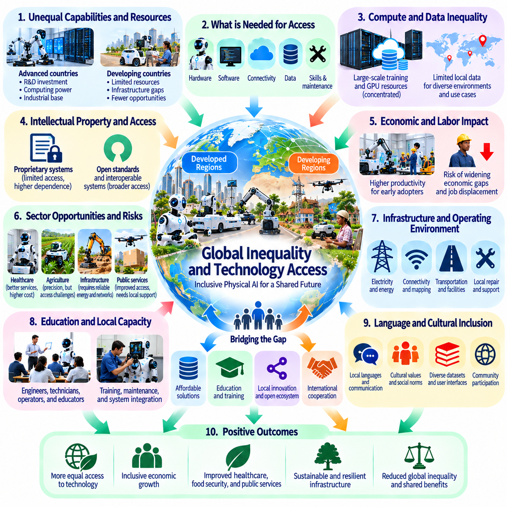{width="7.268055555555556in" height="7.268055555555556in"}

Global inequality is a central concern in the development and deployment of Physical AI because access to autonomous technologies is unevenly distributed across countries and communities. Advanced robotics may improve productivity, healthcare, infrastructure, and public services, but these benefits are not automatically shared. Without inclusive policies, Physical AI could reinforce existing differences in wealth, technological capability, and institutional power.

The global distribution of Physical AI capabilities reflects longstanding disparities in research investment, industrial infrastructure, education, and computing resources. Countries with advanced semiconductor industries, robotics laboratories, and reliable energy systems possess significant advantages. Regions lacking these foundations may struggle to develop or maintain autonomous systems, even when robotics could address urgent social and economic needs.

Access to Physical AI involves more than purchasing robotic hardware. Effective deployment requires software, connectivity, technical expertise, maintenance facilities, training data, and reliable operational support. A robot delivered without these complementary resources may remain underutilized or become unusable after a minor failure. Technology access should therefore be evaluated through sustainable operational capability rather than equipment ownership alone.

Computational inequality is particularly important because modern Physical AI increasingly depends on large-scale model training and sophisticated inference infrastructure. Organizations with extensive GPU resources can develop foundation models, generate simulation data, and conduct repeated experiments. Smaller institutions may depend on externally developed models and services, limiting their ability to adapt systems to local environments and priorities.

Data inequality creates another barrier to participation. Large robotics organizations can collect extensive demonstrations, sensor recordings, and operational histories from deployed fleets. Regions with fewer robots may lack representative datasets for local terrain, languages, infrastructure, and working practices. Models trained predominantly in wealthy industrial environments may perform poorly when transferred to different physical and social conditions.

The concentration of robotics intellectual property can influence which societies benefit from technological progress. Proprietary models, specialized components, restrictive licenses, and closed development platforms may increase dependence on a small number of suppliers. Such concentration can accelerate innovation through coordinated investment, but it can also restrict independent adaptation. Open standards and interoperable systems may reduce barriers without eliminating legitimate commercial incentives.

Physical AI may transform international labor markets by changing the economic value of different production activities. Countries that historically relied on labor-intensive manufacturing could face competitive pressure if autonomous production becomes economically attractive elsewhere. At the same time, robotics may create opportunities for localized manufacturing and infrastructure development. Outcomes will depend on investment, workforce capabilities, and access to complementary technologies.

Unequal automation can widen productivity differences between firms and regions. Organizations that adopt capable robotic systems may achieve lower operating costs, higher consistency, and greater production capacity. Competitors without sufficient capital or technical expertise may fall further behind. Policies supporting technology diffusion, shared infrastructure, and workforce development can help prevent early adoption advantages from becoming permanent economic divisions.

Healthcare illustrates both the promise and the risks of unequal access. Autonomous assistance, rehabilitation robotics, and medical logistics could improve services in underserved communities. However, high equipment costs, maintenance requirements, and limited clinical infrastructure may concentrate benefits in wealthier institutions. Equitable deployment requires affordable designs, local technical support, appropriate regulation, and integration with existing healthcare systems.

Agriculture presents similar challenges because smallholder farmers and large industrial producers operate under very different economic conditions. Precision robotics may reduce labor burdens and improve resource management, yet expensive platforms can be inaccessible to smaller farms. Cooperative ownership, shared robotic services, and modular equipment may broaden participation. Technologies must also accommodate diverse crops, terrain, farm sizes, and local practices.

Infrastructure inequality affects whether autonomous systems can operate reliably. Stable electricity, broadband connectivity, accurate mapping, repair networks, and accessible transportation facilities are not universally available. Physical AI designed around highly connected urban environments may be unsuitable for remote or resource-constrained regions. Robust offline operation, energy-efficient hardware, and adaptable sensing can improve accessibility under challenging conditions.

Education and technical capacity are essential for reducing technological dependence. Communities need engineers, technicians, operators, and educators who understand robotic systems and their limitations. Training should extend beyond programming to include mechanical maintenance, safety procedures, data governance, and system integration. Long-term participation in Physical AI requires the ability to modify and evaluate technology rather than merely operate imported products.

Language and cultural diversity also influence technology accessibility. Human-robot interfaces developed primarily for dominant languages may exclude users who communicate differently. Social expectations regarding privacy, authority, assistance, and acceptable robotic behavior vary across communities. Inclusive design requires multilingual interfaces, locally appropriate interaction models, and participation from intended users during development and evaluation.

Global supply chains create dependencies that can intensify inequality during disruptions. Advanced processors, precision sensors, batteries, and specialized actuators may be manufactured in geographically concentrated facilities. Export restrictions, trade disputes, and supply shortages can limit access to critical components. Diversified procurement, repairable architectures, and regional manufacturing capabilities may improve resilience, although complete technological independence is rarely practical.

International research partnerships can help distribute knowledge and technical capabilities more broadly. Joint laboratories, shared benchmarks, open educational resources, and collaborative field trials may support institutions with limited research infrastructure. However, partnerships should avoid treating less-resourced communities merely as data sources or experimental environments. Fair collaboration requires meaningful participation, transparent agreements, and shared recognition of contributions.

Technology transfer is most effective when it includes the knowledge required for independent operation and adaptation. Delivering robotic equipment without documentation, training, spare parts, or software support may create lasting supplier dependence. Sustainable transfer should develop local maintenance capacity, engineering expertise, and institutional ownership. Licensing arrangements and procurement policies can encourage long-term capability building rather than short-term equipment distribution.

Financial accessibility remains a major obstacle because robotic systems often require substantial initial investment before producing measurable benefits. Smaller organizations may struggle to obtain financing when operating outcomes are uncertain. Leasing, robotics-as-a-service models, cooperative purchasing, and public investment may lower entry barriers. Nevertheless, financing mechanisms must be evaluated carefully to avoid creating excessive debt or dependence on restrictive service contracts.

Governance differences can also produce unequal outcomes. Countries with mature regulatory institutions may establish certification pathways and operational standards more rapidly, while others face limited enforcement capacity. Excessively fragmented requirements can raise costs for smaller markets. International cooperation should support proportionate safety frameworks, regulatory training, and mutual learning without imposing rules that ignore local conditions.

Environmental justice intersects with technology inequality because the costs and benefits of robotics are distributed across different regions. Mineral extraction, component manufacturing, energy production, and electronic waste processing may impose environmental burdens on communities receiving limited automation benefits. Responsible Physical AI development should consider supply-chain transparency, resource stewardship, and fair distribution of environmental risks alongside economic opportunities.

The digital and physical dimensions of inequality increasingly reinforce one another. Limited access to computing restricts model development, while insufficient robotic deployment reduces opportunities to collect useful operational data. Weak data resources then constrain future model improvement and investment. Breaking this cycle may require shared compute facilities, accessible datasets, simulation platforms, and locally relevant pilot deployments.

Ultimately, equitable access to Physical AI requires more than making advanced robots commercially available worldwide. It demands sustained investment in infrastructure, education, local innovation, interoperability, and institutional capacity. Global cooperation should enable communities to shape autonomous technologies according to their own needs and priorities. The long-term objective is a distribution of physical intelligence that expands human opportunity rather than concentrating technological power.

## 06.15. Human Identity in a Robotic Society

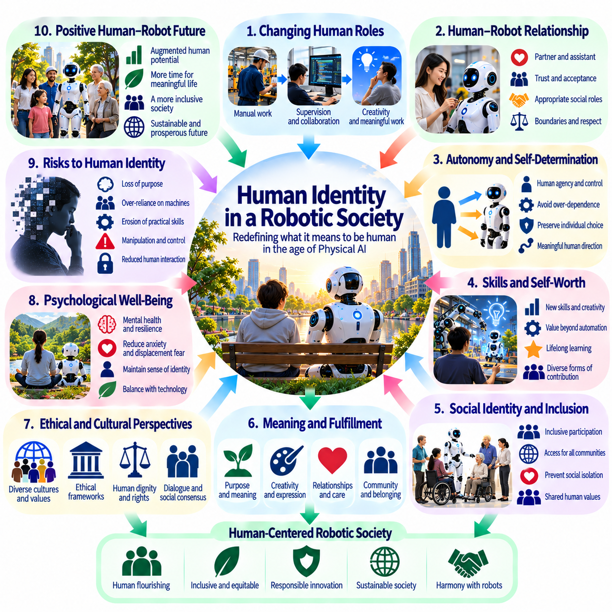{width="7.268055555555556in" height="7.268055555555556in"}

Human identity in a robotic society will be shaped by the growing presence of intelligent machines in work, care, education, and everyday life. Physical AI challenges familiar assumptions about what makes human action distinctive when robots can perceive, learn, and perform complex tasks. The central question is not whether machines can imitate human abilities, but how people understand their own purpose, dignity, and agency alongside autonomous systems.

Throughout history, human identity has been closely connected to physical capabilities and productive activity. Craftsmanship, mobility, problem-solving, and skilled labor have contributed to individual pride and social recognition. As robots acquire similar abilities, societies may need to reconsider the relationship between competence and personal worth. Human dignity should not depend exclusively on performing tasks that machines cannot accomplish.

Work provides more than economic income because it often creates identity, belonging, and a sense of contribution. When Physical AI transforms occupations, individuals may experience changes in status and professional meaning even if material productivity improves. Successful transitions require opportunities to develop new skills and forms of participation. Social institutions must recognize the psychological importance of meaningful activity beyond employment statistics.

Human agency concerns the ability to make choices, pursue goals, and influence one\'s surroundings. Autonomous machines can strengthen agency by extending physical capabilities and reducing barriers to participation. However, excessive dependence on robotic assistance may weaken practical control when users cannot understand or override automated decisions. Preserving agency requires accessible interfaces, genuine choice, and opportunities for independent action.

Embodiment is fundamental to human identity because perception, movement, and physical interaction shape personal experience. Robots may reproduce selected motor skills, but human embodiment also involves vulnerability, sensation, memory, and biological development. Physical AI therefore raises questions about the distinction between functional performance and lived experience. Similar outward behavior does not necessarily imply equivalent subjective experience.

Social relationships may change as robots become persistent participants in homes, workplaces, and public spaces. People can develop familiarity, trust, and emotional attachment toward machines that respond consistently to their needs. These relationships may provide practical comfort, especially during isolation or disability. Nevertheless, designers should avoid exploiting attachment through deceptive claims about machine emotions, intentions, or personal understanding.

Caregiving illustrates the tension between functional assistance and interpersonal meaning. A robot may help with mobility, medication routines, or household tasks while reducing physical burdens on caregivers. Yet care also involves recognition, empathy, and relationships that cannot be measured solely through task completion. Responsible integration should expand opportunities for human connection rather than treat efficient assistance as a complete substitute for personal attention.

Children growing up with Physical AI may develop different expectations about intelligence, cooperation, and authority. Educational robots can encourage experimentation and support personalized learning, but they also influence how children interpret social behavior. Developmentally appropriate design should distinguish machine-generated responses from human relationships. Education should strengthen critical judgment rather than encourage unquestioning reliance on automated guidance.

Aging societies may experience significant changes in identity as robotic assistance supports independent living. Older adults may gain mobility, confidence, and greater control over daily routines through accessible physical technologies. However, assistance can become disempowering when systems impose decisions or reduce opportunities for social participation. Respectful design must accommodate personal preferences, changing abilities, and the right to decline automated intervention.

Disability inclusion offers another perspective on human identity and technological capability. Assistive robots can expand access to environments and activities that were previously difficult or inaccessible. Their value should be understood through self-determination rather than assumptions that technological enhancement defines human worth. Inclusive systems must support diverse bodies and preferences without imposing a single model of normal physical performance.

Cultural understandings of human identity will influence the acceptance of robotic systems. Societies differ in their expectations regarding independence, family obligations, collective responsibility, and relationships with technology. A robot considered helpful in one context may be perceived as intrusive or disrespectful elsewhere. Physical AI development should therefore incorporate cultural participation and avoid presenting one technological lifestyle as universally desirable.

The distinction between human and machine creativity may also evolve as robots acquire sophisticated manipulation and planning capabilities. Autonomous systems could manufacture artworks, perform musical gestures, or assist with complex craftsmanship. Such capabilities challenge definitions of creative production based only on technical execution. Human creativity may increasingly emphasize intention, interpretation, personal history, and the social meaning attached to expression.

Human identity is also influenced by responsibility and moral judgment. Robots may recommend actions or execute decisions, but their operational competence does not automatically establish moral authority. People and institutions must retain responsibility for defining acceptable purposes and resolving ethical conflicts. Delegating physical tasks should not become a justification for abandoning human accountability or democratic control over consequential decisions.

As robotic systems become more humanlike in appearance and interaction, anthropomorphism may shape public expectations. Humanlike gestures and conversational behavior can make interfaces intuitive while also encouraging exaggerated beliefs about machine understanding. Transparent design should help users distinguish simulated social signals from verified capabilities. Trust should arise from demonstrated reliability rather than emotional resemblance alone.

The long-term challenge is to preserve a pluralistic understanding of human flourishing in environments increasingly populated by autonomous machines. Individuals should remain free to value craftsmanship, physical effort, social service, intellectual achievement, or quiet personal experience. Physical AI can expand these possibilities when designed around human choice. A robotic society should be evaluated by the lives people can meaningfully pursue, not merely by the tasks machines perform.

## 06.16. Human AI Symbiosis

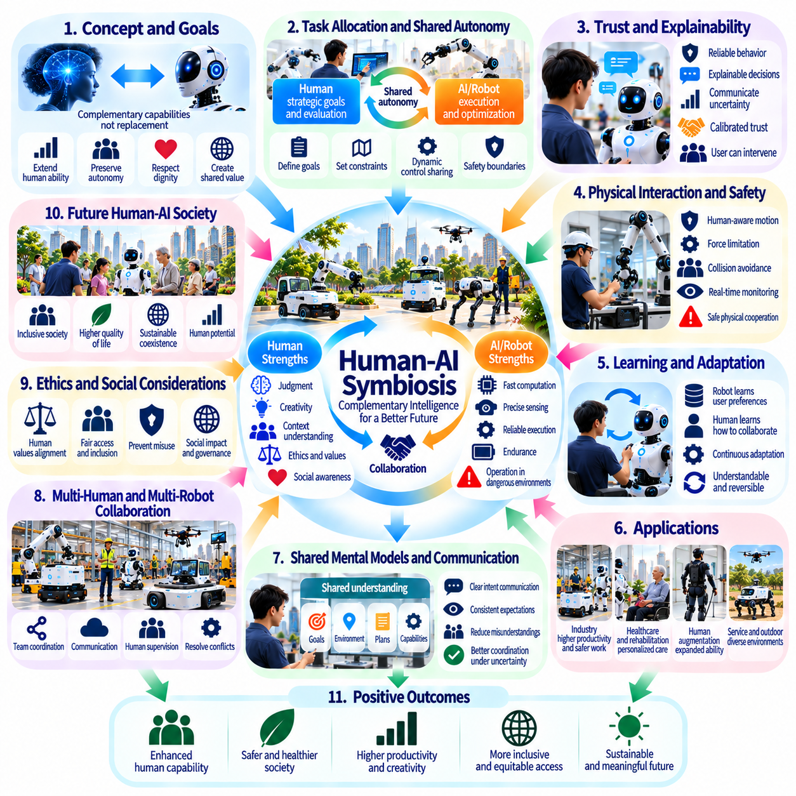{width="7.268055555555556in" height="7.268055555555556in"}

Human-AI symbiosis describes a relationship in which human capabilities and artificial intelligence complement one another through continuous cooperation. In Physical AI, this relationship extends beyond information exchange into shared perception, decision-making, and physical action. The objective is not to replace human participation but to create systems that expand human abilities while preserving autonomy, dignity, and meaningful control.

Human beings and autonomous machines possess different strengths that can become mutually beneficial. Humans contribute contextual understanding, ethical judgment, social awareness, and flexible interpretation of goals. Physical AI contributes computational speed, precise sensing, repeatable execution, and sustained operation. Effective symbiosis emerges when these capabilities are coordinated rather than treated as competing forms of intelligence.

The foundations of human-AI symbiosis depend on appropriate task allocation and shared authority. Robots may handle repetitive, hazardous, or physically demanding activities while humans establish objectives and evaluate broader consequences. However, responsibilities should not be divided solely according to technical efficiency. Human preferences, safety requirements, professional expertise, and the importance of personal participation must influence how tasks are assigned.

Shared autonomy provides a practical model for cooperation between humans and intelligent machines. A human may specify a destination, manipulation goal, or mission priority while an autonomous system determines feasible movements and intermediate actions. Control can shift dynamically as environmental conditions change. Such systems require clear authority boundaries and predictable transitions between manual, assisted, and autonomous operation.

Human intention must be interpreted carefully because instructions are often incomplete, ambiguous, or dependent on circumstances. A collaborative robot may need to infer whether an operator wants assistance, observation, or independent execution. Incorrect assumptions can create frustration or physical danger. Symbiotic systems should combine contextual inference with clarification mechanisms and explicit confirmation before consequential actions.

Trust is essential for productive human-AI cooperation, but trust must remain calibrated to demonstrated system capabilities. Excessive confidence may encourage unsafe dependence, while insufficient confidence can prevent beneficial use. Robots should communicate uncertainty, operating limitations, and reasons for requesting intervention. Reliable behavior, transparent feedback, and consistent recovery procedures support trust without encouraging unrealistic expectations.

Physical interaction introduces requirements that are absent from purely conversational AI systems. Collaborative robots must coordinate motion, force, timing, and spatial awareness with human partners. Safe cooperation depends on sensing human proximity, predicting likely movements, and adapting to unexpected actions. Mechanical compliance, force limitations, protective monitoring, and responsive control contribute to physically trustworthy interaction.

Human-AI symbiosis can enhance industrial work by combining human expertise with robotic precision and endurance. Workers may guide complex assembly, inspect uncertain conditions, or resolve exceptions while robots perform repetitive manipulation and transportation. Such collaboration can improve consistency and reduce physical strain. Its success should also be measured through worker safety, skill development, and participation in operational decisions.

Healthcare and rehabilitation offer opportunities for symbiotic assistance that responds to individual needs. Assistive robots may support movement, therapy, and daily activities while clinicians and users retain authority over goals and acceptable interventions. Adaptive systems can personalize support as physical capabilities change. However, effective care requires informed consent, respect for preferences, and preservation of meaningful human relationships.

Human augmentation represents a deeper form of symbiosis in which technology extends physical capabilities directly. Powered exoskeletons, intelligent prosthetics, and assistive mobility devices can combine human intention with automated control. Their effectiveness depends on accurate intention recognition, comfortable interaction, and reliable adaptation. Augmentation should expand user choice rather than impose standardized expectations of bodily performance.

Learning in symbiotic systems should occur in both directions. Robots can adapt to human preferences, working styles, and demonstrated skills, while humans learn how to communicate effectively with autonomous partners. Repeated interaction may improve coordination and reduce unnecessary supervision. Nevertheless, adaptation must remain understandable and reversible so that users do not lose control over changing machine behavior.

Shared mental models help humans and robots coordinate actions under uncertainty. A robot should maintain estimates of the task, surrounding environment, and relevant human intentions, while users need an understandable representation of robotic capabilities and plans. Communication mechanisms can reduce misunderstandings before they become physical hazards. Successful coordination depends on maintaining sufficiently consistent expectations.

Multi-human and multi-robot environments extend symbiosis beyond individual partnerships. Teams may coordinate with mobile robots, manipulators, drones, and distributed intelligence services to accomplish complex missions. Effective orchestration requires task priorities, communication protocols, and procedures for resolving conflicting objectives. Human supervisors should retain visibility into collective behavior and the authority to modify mission-level decisions.

Long-term cooperation introduces questions about dependency and skill preservation. When machines perform increasingly complex tasks, people may lose opportunities to practice abilities that remain important during failures or emergencies. Symbiotic design should preserve appropriate human competence through training, periodic manual operation, and accessible fallback procedures. Assistance becomes empowering when it strengthens capability without creating unnecessary dependence.

Ethical symbiosis requires recognizing that human interests cannot be reduced to productivity or task completion. Workers may value craftsmanship, patients may value personal independence, and communities may prioritize social relationships over operational efficiency. Physical AI should accommodate these differences through configurable assistance and participatory design. Human values must shape the purposes of cooperation rather than merely constrain its technical implementation.

## 06.17. Long Term Civilization Scenarios

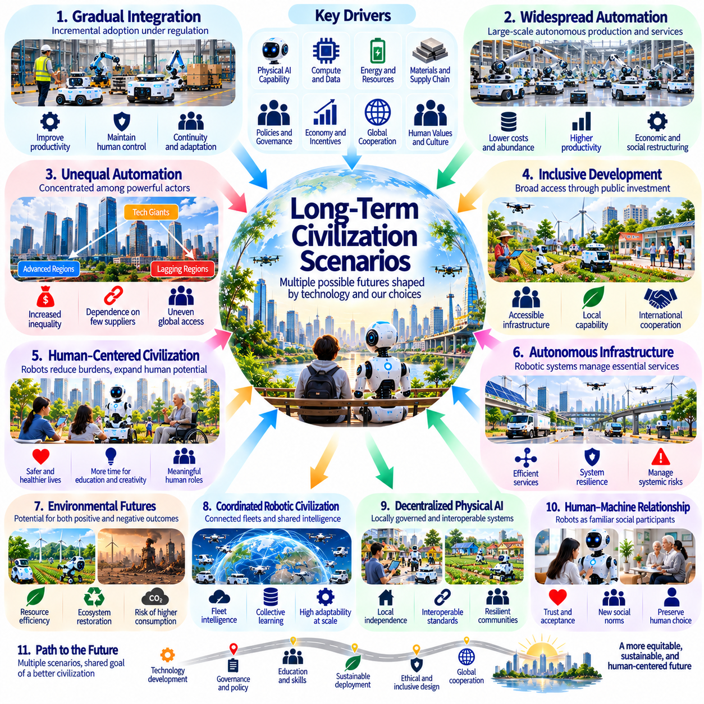{width="7.268055555555556in" height="7.268055555555556in"}

Long-term civilization scenarios for Physical AI explore how autonomous machines may reshape economic systems, social institutions, infrastructure, and human relationships over several decades. These scenarios are not predictions of an inevitable future but structured possibilities shaped by technological capabilities and collective choices. Their purpose is to identify opportunities, systemic risks, and decisions that could influence the direction of human civilization.

One possible trajectory is gradual integration, in which Physical AI expands through carefully regulated industrial and public applications. Robots increasingly support manufacturing, logistics, healthcare, agriculture, and infrastructure maintenance without fundamentally replacing human institutions. Productivity improves through incremental innovation, while human supervision remains central. This scenario emphasizes continuity, adaptation, and controlled technological diffusion.

A more transformative scenario involves widespread autonomous production and service delivery. Intelligent machines could manage substantial portions of material handling, transportation, construction, and routine maintenance. The cost of producing certain goods and services might decline, creating opportunities for greater material abundance. However, whether these gains improve general welfare depends on ownership structures, income distribution, and access to essential resources.

An unequal automation scenario emerges when advanced Physical AI remains concentrated among powerful corporations and technologically developed countries. Organizations controlling robotic fleets, computing infrastructure, and proprietary models could gain substantial economic influence. Less-resourced communities might become dependent on imported systems and external services. Such concentration could deepen existing inequalities despite overall productivity growth.

An inclusive development scenario would distribute the benefits of Physical AI through accessible infrastructure, public investment, education, and international cooperation. Shared robotic services could support small enterprises, rural communities, and underserved regions. Open interfaces and local engineering capabilities would reduce dependence on dominant suppliers. Achieving this outcome requires deliberate institutional design rather than assuming that technological progress automatically produces equity.

A human-centered civilization could use autonomous machines to reduce dangerous labor while expanding opportunities for education, creativity, caregiving, and community participation. Robots might perform physically demanding tasks while people retain meaningful authority over social priorities. Yet reduced labor requirements do not automatically produce fulfilling lives. Education, social recognition, and economic institutions would need to support identities beyond conventional employment.

Another trajectory involves increasing dependence on autonomous infrastructure. Transportation networks, energy facilities, food distribution, and emergency services could rely on interconnected robotic systems. Such integration may improve responsiveness and operational efficiency, but common failures could propagate across essential services. Civilizational resilience would require redundancy, cybersecurity, human fallback capabilities, and mechanisms for recovering from large-scale disruptions.

Environmental outcomes represent a major source of uncertainty across future scenarios. Physical AI could support precision agriculture, circular manufacturing, ecosystem restoration, and efficient resource management. Alternatively, inexpensive autonomous production might accelerate extraction, consumption, and electronic waste. The environmental balance will depend on energy sources, equipment lifecycles, material recovery, and governance of total resource demand.

A highly coordinated robotic civilization may develop extensive fleet intelligence that connects individual machines through shared world models and distributed planning. Autonomous systems could exchange operational experience, coordinate infrastructure maintenance, and respond collectively to changing conditions. Such capabilities could improve adaptability at scale. However, centralized coordination may create surveillance risks, concentrated control, and systemic vulnerabilities.

Decentralized Physical AI offers a different institutional possibility. Communities, enterprises, and public organizations could operate locally governed robotic systems supported by interoperable technologies. Edge computing and distributed intelligence might preserve operational independence while enabling selective cooperation. This approach could improve resilience and local accountability, although fragmented systems may face coordination difficulties and uneven technical standards.

Human-machine relationships may evolve as robots become familiar participants in domestic and public environments. Long-term interaction could normalize shared autonomy, robotic assistance, and machine-mediated physical activity. People may redefine independence as the ability to direct intelligent assistance rather than perform every task personally. Nevertheless, preserving meaningful choice will remain essential to prevent convenience from becoming involuntary technological dependence.

Education and cultural development will influence how future generations understand human capabilities. Children raised alongside autonomous machines may regard robotic cooperation as an ordinary part of social life. Traditional distinctions between manual skill, intellectual work, and machine execution could become less rigid. Educational institutions may increasingly emphasize judgment, creativity, ethical reasoning, and the ability to collaborate with intelligent physical systems.

Governance could evolve toward continuous oversight of autonomous physical infrastructure. Certification, operational monitoring, incident investigation, and adaptive regulation may become routine institutional functions. International coordination could establish shared expectations for safety and accountability while preserving local decision-making authority. The effectiveness of these arrangements will depend on technical competence, transparency, public participation, and enforceable responsibility.

Civilizational scenarios must also consider rare but consequential failures. Large-scale software defects, coordinated cyberattacks, cascading infrastructure disruptions, or poorly controlled autonomous behavior could produce damage beyond individual robotic accidents. These possibilities do not make widespread automation inherently undesirable, but they require precautionary engineering and institutional preparation. Safety must be treated as an evolving property of interconnected systems.

The most consequential distinction between future scenarios may concern who controls autonomous physical capabilities and for what purposes. Similar robotic technologies could support broad public welfare or reinforce concentrated economic and political power. Technical performance alone cannot determine social legitimacy. Ownership, access rights, democratic oversight, and the distribution of benefits will shape whether Physical AI strengthens or weakens human autonomy.

Long-term outcomes are unlikely to follow a single global trajectory. Different regions may adopt Physical AI at different rates according to infrastructure, demographics, economic structures, and cultural preferences. Some societies may prioritize productivity and industrial competitiveness, while others emphasize accessibility, environmental restoration, or public services. Global civilization may therefore develop through multiple interacting models of human-machine coexistence.

Ultimately, the future of civilization with Physical AI should be evaluated through human flourishing rather than the quantity of autonomous machines deployed. A desirable trajectory would combine technological capability with social inclusion, ecological responsibility, resilient infrastructure, and meaningful human control. Achieving this balance requires continuous public deliberation and institutional adaptation. Physical AI will expand the possibilities of civilization, but human choices will determine which possibilities become reality.
