**Volume 13. Future of Physical AI and Civilization**

# Chapter 07. Open Research Questions

## 07.01. What Remains Unsolved in Physical AI

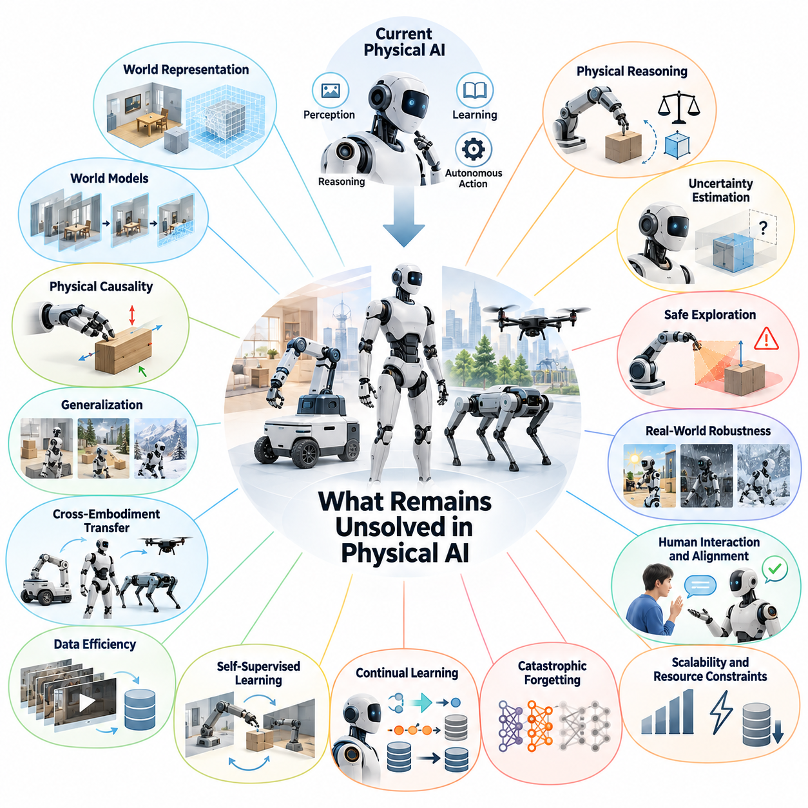{width="7.268055555555556in" height="7.268055555555556in"}

Physical AI has advanced from narrowly programmed machines toward systems capable of perception, reasoning, learning, and autonomous action. However, the transition from specialized robotic competence to general physical intelligence remains incomplete. Robots can perform impressive tasks in controlled environments, yet reliable operation across unfamiliar objects, environments, and situations continues to present fundamental scientific challenges.

One of the most important unresolved problems is how machines should represent the physical world. Current systems combine images, depth measurements, geometric maps, semantic descriptions, and learned latent representations, but no single approach fully captures geometry, dynamics, causality, uncertainty, and task relevance. A general physical intelligence system must construct representations that remain useful across changing environments and multiple timescales.

World models offer a promising foundation for predictive physical intelligence, but accurate long-horizon prediction remains difficult. Small errors in estimated motion, contact forces, object states, or environmental conditions can accumulate during extended predictions. Research must determine how world models can maintain physical consistency, update their assumptions through observation, and distinguish predictable dynamics from fundamentally uncertain events.

Physical causality presents another major limitation. Recognizing an object does not necessarily mean understanding how it behaves when pushed, lifted, compressed, or dropped. Robots must learn relationships among forces, materials, geometry, friction, and motion while identifying the consequences of their own actions. Developing causal representations that support counterfactual reasoning remains essential for robust manipulation and autonomous planning.

Generalization beyond training environments remains one of the defining challenges of Physical AI. A robot trained in a laboratory may encounter unfamiliar lighting, surface conditions, object configurations, or human behaviors during deployment. Statistical similarity between training and operational data cannot guarantee reliable performance. Future systems must recognize distribution shifts and adapt without requiring extensive retraining for every new situation.

Cross-embodiment transfer introduces an additional difficulty because physical intelligence is expressed through different bodies. Wheeled robots, manipulators, humanoids, quadrupeds, and aerial vehicles possess distinct actuation capabilities and physical constraints. Researchers must identify which aspects of knowledge can be shared across embodiments and which require morphology-specific adaptation, control strategies, and physical experience.

Data efficiency remains a fundamental obstacle to scalable robot learning. Unlike digital intelligence, Physical AI often requires costly physical interactions involving equipment, energy, supervision, and safety precautions. Large quantities of robot experience cannot always be collected economically. An important research direction is learning reusable physical knowledge from limited demonstrations, sparse rewards, human videos, simulations, and autonomous interaction.

Self-supervised learning may reduce dependence on manually labeled robotic datasets, but the most effective learning objectives remain uncertain. Predicting future observations, reconstructing missing sensory information, estimating latent dynamics, and learning action-conditioned transitions provide different forms of supervision. A central question is which objectives produce representations that support reliable control rather than merely accurate sensory reconstruction.

Continual learning introduces challenges that become increasingly important as robots operate for months or years. Physical environments change, mechanical components wear, new tasks emerge, and previously learned behaviors may become obsolete. Robots must incorporate new experiences while preserving valuable existing knowledge. Achieving stable lifelong learning requires mechanisms for memory consolidation, selective adaptation, experience retrieval, and systematic knowledge revision.

Catastrophic forgetting illustrates the difficulty of accumulating physical intelligence over time. Updating a neural policy for new conditions can unintentionally degrade previously reliable capabilities. Simple retraining may become computationally expensive as experience grows. Research must establish architectures that separate stable knowledge from rapidly changing information while allowing both to influence perception, prediction, planning, and control.

Physical reasoning remains substantially more demanding than symbolic or textual reasoning alone. A robot must evaluate whether an intended action is geometrically feasible, dynamically stable, energetically practical, and safe under uncertainty. Reasoning must also respect real-time constraints because delayed decisions can create physical hazards. Combining deliberative intelligence with reactive control is therefore a critical architectural challenge.

Uncertainty estimation is essential for dependable autonomy, yet existing approaches frequently struggle to distinguish incomplete knowledge from unpredictable environmental behavior. Robots must estimate confidence in perception, world models, planned actions, and expected outcomes. Reliable systems should recognize when their predictions are insufficient, gather additional information, request assistance, or transition into conservative operating modes before unsafe conditions emerge.

Safe exploration remains an unresolved tension between learning and operational reliability. Autonomous robots improve through interaction, but experimentation can damage equipment, disrupt environments, or endanger people. Simulation provides a safer learning environment, although simulated dynamics cannot perfectly reproduce reality. Future research must develop exploration strategies that balance information gain, physical constraints, uncertainty, and formally defined safety boundaries.

The relationship between robot morphology and intelligence also requires deeper investigation. Mechanical structure determines what information sensors can observe, what actions actuators can perform, and how environmental forces influence behavior. Intelligence cannot be optimized independently of the physical body. Jointly designing morphology, sensing, computation, actuation, and learning algorithms may produce capabilities that software optimization alone cannot achieve.

Energy efficiency represents another critical limitation. Advanced neural models require computational resources, while locomotion and manipulation consume substantial electrical and mechanical power. A physically intelligent system must allocate energy across sensing, inference, communication, and actuation. Research into event-driven computation, adaptive model execution, efficient hardware, and energy-aware planning is necessary for sustained autonomous operation.

Multi-robot intelligence raises questions that cannot be resolved by improving individual robots alone. Large fleets must coordinate tasks, share experiences, maintain consistent environmental knowledge, and resolve conflicting observations. Communication bandwidth, latency, privacy, and heterogeneous capabilities complicate collective learning. Scalable systems must determine what knowledge should remain local, what should be shared, and how collective decisions can remain reliable.

Evaluation methodology remains insufficient for measuring general physical intelligence. Success on a limited set of manipulation or navigation benchmarks may not indicate adaptability, long-term reliability, or competence in unfamiliar environments. More comprehensive evaluation must examine transfer learning, physical reasoning, recovery from failure, safety, resource efficiency, and sustained performance across diverse tasks and embodiments.

Long-horizon autonomy requires integrating many capabilities that are often evaluated separately. A robot may possess strong perception, accurate short-term control, and competent task planning while still failing during extended operations. Unexpected events, accumulated localization errors, changing objectives, and mechanical degradation create interconnected challenges. Research must address system-level reliability rather than treating individual model performance as sufficient evidence of autonomy.

The convergence of foundation models, vision-language-action systems, world models, and hierarchical control introduces important architectural questions. It remains uncertain whether general physical intelligence will emerge primarily from unified end-to-end models or modular systems with specialized components. Hybrid architectures may combine learned representations with explicit dynamics, memory, planning, and safety mechanisms, but their optimal organization remains unresolved.

Another fundamental question concerns the relationship between physical experience and abstract intelligence. Language-based knowledge can describe physical interactions without directly experiencing their consequences. Conversely, embodied learning produces grounded knowledge but may transfer poorly across tasks. Understanding how symbolic reasoning, latent world representations, and sensorimotor experience should interact could provide an important foundation for future Physical AGI.

Self-improving Physical AI systems introduce additional research challenges involving verification, governance, and operational stability. Robots that autonomously collect experience and update their policies may improve over time, but improvements in one environment do not guarantee safety elsewhere. Continuous deployment therefore requires mechanisms for evaluating updates, detecting regressions, preserving validated capabilities, and controlling the introduction of new behaviors.

The central unresolved challenge is not simply building robots that perform more tasks. It is developing physical intelligence that learns efficiently, understands causal relationships, predicts consequences, transfers knowledge, adapts continuously, and acts safely under real-world constraints. Progress toward Physical AGI will depend on integrating these capabilities into systems whose reliability, generalization, and autonomy can be demonstrated through reproducible physical evidence.

## 07.02. Grounded World Representation

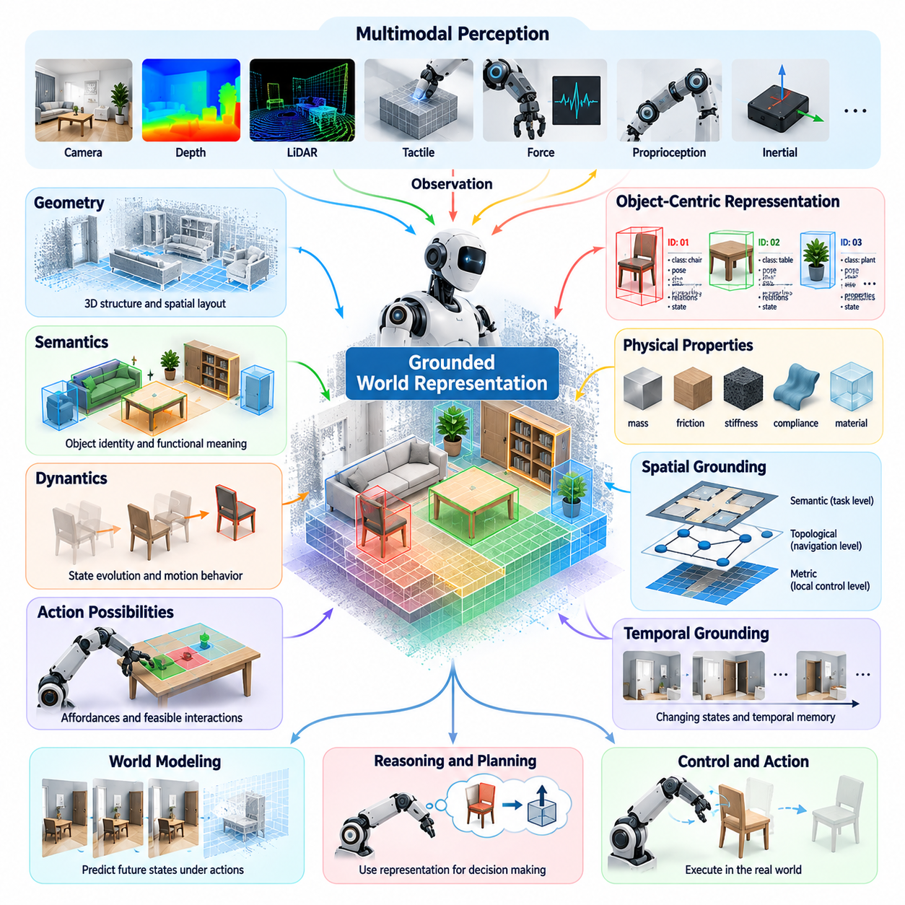{width="7.268055555555556in" height="7.268055555555556in"}

Grounded world representation is a fundamental requirement for Physical AI because intelligent physical action depends on understanding the environment beyond visual appearance. A robot must connect sensory observations to physical entities, spatial relationships, material properties, and possible interactions. Unlike purely symbolic representations, grounded representations must remain consistent with measurable physical conditions and the consequences of real actions.

Traditional robotic systems rely on geometric maps, occupancy grids, object models, and predefined semantic categories. These representations support localization, navigation, and manipulation, but often describe only selected aspects of the environment. A geometric map may capture spatial structure without explaining object function, while a semantic map may identify objects without representing their dynamic behavior or physical constraints.

A grounded world representation must integrate geometry, semantics, dynamics, and action possibilities within a coherent internal model. Geometry describes where objects and surfaces exist, semantics identifies their meaning and functional roles, and dynamics explains how their states evolve. Action-related information connects these properties to the robot\'s capabilities, enabling predictions about what can be reached, moved, traversed, or manipulated.

Multimodal perception provides the observational foundation for grounded representations. Cameras capture appearance and visual structure, depth sensors estimate spatial relationships, and LiDAR measures environmental geometry. Tactile sensors, force measurements, proprioception, and inertial sensing reveal information unavailable through vision alone. Combining these modalities allows robots to construct representations that are more physically informative than isolated sensory measurements.

However, integrating multiple sensing modalities introduces challenges involving calibration, synchronization, uncertainty, and inconsistent observations. Different sensors operate at different frequencies, resolutions, and noise levels. A grounded representation must preserve useful information while reconciling conflicting measurements. It should also identify which properties are directly observed, which are inferred, and which remain unknown.

Object-centric representation is a promising approach because physical environments contain entities with persistent identities and changing states. Rather than treating every observation as an independent image, a robot can maintain internal descriptions of objects, their locations, attributes, and relationships. Such representations support object permanence, interaction tracking, and reasoning about entities that temporarily disappear behind obstacles.

Grounding also requires understanding that objects possess physical properties extending beyond their visible appearance. Mass, friction, stiffness, compliance, and surface conditions influence the outcome of interactions. These properties may not be directly observable and often require active exploration. A robot must infer them through movement, contact, force feedback, and the observed consequences of controlled actions.

Affordance representation connects environmental understanding to possible actions. A surface may be traversable for a wheeled robot but unsuitable for a legged robot carrying a heavy payload. An object may be graspable using one end effector but inaccessible to another. Therefore, affordances should be represented as relationships among environmental properties, robot morphology, current state, and intended task rather than fixed object labels.

Spatial grounding must operate across multiple levels of abstraction. Local representations support collision avoidance, grasping, and precise motion control, while larger-scale representations support navigation, route selection, and task planning. A comprehensive system must connect metric geometry with topological relationships and semantic descriptions, allowing information to remain consistent across different spatial resolutions.

Temporal grounding is equally important because physical environments continuously change. Objects move, doors open and close, surfaces become obstructed, and human activities modify the environment. A useful representation must distinguish persistent properties from temporary states and maintain information about how conditions evolve. This requires temporal memory, state estimation, and mechanisms for updating outdated knowledge.

The relationship between world representation and world modeling deserves particular attention. A representation describes the current or remembered physical state, while a predictive world model estimates how that state may evolve under actions and external influences. These functions are closely related but not identical. Grounded representations provide the state variables and relationships upon which action-conditioned prediction and planning can operate.

Latent representations learned through neural networks offer opportunities to compress complex sensory information into compact internal states. However, compactness alone does not guarantee physical grounding. A latent representation may predict images accurately while failing to preserve information needed for contact reasoning or control. Research must identify learning objectives that retain physically meaningful variables and support reliable downstream decisions.

Physics-informed representation learning may improve consistency by incorporating structural constraints derived from mechanics and environmental interactions. Conservation principles, contact relationships, kinematic constraints, and motion continuity can guide representation learning. Nevertheless, real environments contain uncertain parameters, deformable materials, and complex interactions, making rigid physical assumptions insufficient for every situation.

Causal grounding extends representation beyond statistical correlation. A robot should understand not only that objects move together but also whether one movement causes another. Interventions provide evidence about physical relationships by allowing the system to observe how outcomes change under controlled actions. Such knowledge supports counterfactual reasoning, enabling robots to evaluate alternative actions before physically executing them.

Uncertainty must be represented explicitly because physical observations are incomplete and often ambiguous. A robot may know that an object exists without knowing its precise position, material, or stability. Representations that conceal uncertainty can produce overconfident decisions. Probabilistic state estimates, confidence measures, and multiple competing hypotheses help systems distinguish established knowledge from uncertain assumptions.

Partial observability creates additional difficulties when important environmental states cannot be measured directly. Occluded objects, hidden obstacles, internal mechanical conditions, and unknown human intentions require inference from incomplete evidence. Grounded representations must preserve uncertainty over hidden states and support information-gathering actions that improve knowledge before consequential decisions are made.

Memory plays a central role in maintaining grounded world understanding over extended operations. Short-term memory preserves recent observations and rapidly changing states, while longer-term memory stores persistent geometry, object characteristics, learned dynamics, and previous interactions. Hierarchical memory architectures may connect immediate sensorimotor experience with accumulated knowledge across tasks, environments, and operating periods.

Continual representation learning is necessary because physical knowledge becomes outdated as environments and robots change. A robot may encounter new objects, altered layouts, different terrain conditions, or gradual actuator degradation. Its internal representation must adapt without losing previously validated knowledge. This creates a research challenge involving stable learning, selective memory updates, and the prevention of catastrophic forgetting.

Cross-embodiment grounding raises questions about whether different robots can share a common understanding of the same physical environment. Geometry and object identity may be broadly transferable, while reachability, manipulability, and traversability depend on embodiment. A shared world representation may therefore require embodiment-independent environmental knowledge combined with embodiment-conditioned action and capability models.

Language grounding introduces another layer by connecting human descriptions to measurable physical states and executable actions. Instructions such as placing a fragile object on a stable surface require understanding object identity, fragility, support relationships, and task constraints. A language model alone cannot establish these conditions without reliable connections to perception, physical reasoning, and feedback from the environment.

Evaluation of grounded representations remains an open research problem. Reconstruction accuracy and object recognition scores provide useful measurements but do not establish whether a representation supports successful physical interaction. More meaningful evaluation should examine prediction accuracy, causal consistency, task transfer, uncertainty calibration, robustness to environmental changes, and performance during long-horizon autonomous operation.

A central architectural question is whether grounded world representations should be explicitly structured, entirely learned, or constructed through hybrid approaches. Explicit structures provide interpretability and support constraint-based reasoning, while learned representations capture complex patterns from high-dimensional observations. Hybrid systems may combine object-centric state descriptions, latent dynamics, physical constraints, and hierarchical memory within a unified architecture.

Ultimately, grounded world representation should serve as the connection between perception, physical understanding, prediction, reasoning, and action. The objective is not merely to construct an accurate digital description of the environment, but to maintain an actionable model that explains what exists, how it behaves, what remains uncertain, and what the robot can safely accomplish. Achieving this capability is a foundational research challenge on the path toward general Physical AI.

## 07.03. Long Horizon World Model Prediction

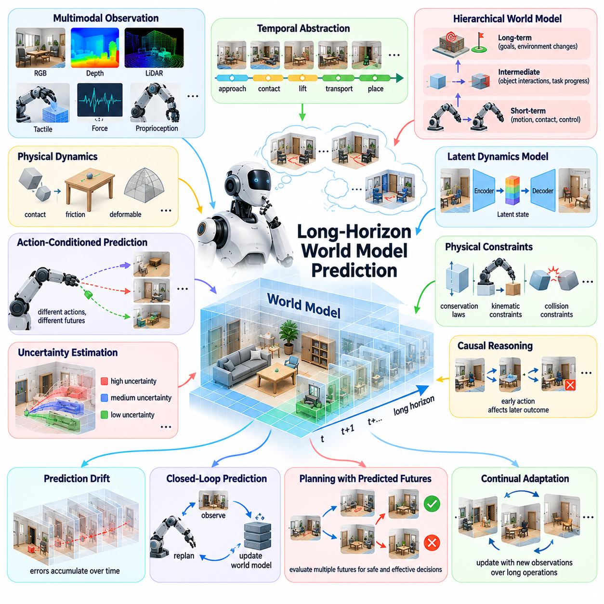{width="7.268055555555556in" height="7.268055555555556in"}

Long-horizon world model prediction is a fundamental challenge in Physical AI because autonomous systems must anticipate how physical environments evolve over extended periods. Short-term predictions can estimate immediate motion and contact outcomes, but complex tasks require reasoning across many future actions and environmental changes. Reliable long-horizon prediction must preserve physical consistency while accounting for uncertainty, interactions, and changing objectives.

A world model represents the dynamics of an environment by estimating how its state changes under actions and external influences. In short-horizon prediction, small errors may remain manageable because observations frequently correct the estimated state. Over longer horizons, however, prediction errors accumulate and can produce increasingly unrealistic trajectories. This makes temporal stability and uncertainty management essential research problems.

The difficulty of long-horizon prediction arises partly from the nonlinear nature of physical dynamics. Contact events, friction changes, collisions, deformable materials, and actuator limitations can produce discontinuous transitions between states. Small differences in initial conditions may lead to substantially different outcomes. A predictive system must therefore represent multiple plausible futures rather than assuming a single deterministic trajectory.

Temporal abstraction offers a promising approach to managing long prediction horizons. Instead of predicting every low-level state transition with equal detail, a model can represent higher-level events, actions, and milestones. For example, a manipulation task may involve approaching an object, establishing contact, lifting it, transporting it, and placing it. These phases provide meaningful temporal structure for efficient prediction and planning.

Hierarchical world models can organize prediction across multiple timescales. Fast dynamics models estimate immediate motion, contact forces, and control responses, while intermediate models represent object interactions and task progression. Long-term models capture goals, environmental changes, and persistent consequences. Coordinating these levels may allow robots to reason over extended periods without requiring uniformly detailed simulation.

Latent dynamics models provide another approach by predicting future states within compressed representation spaces. Rather than generating complete images or geometric reconstructions at every step, a model can estimate transitions between compact latent states. This reduces computational requirements, but the learned representation must preserve information relevant to physical feasibility, contact dynamics, safety, and task completion.

Action-conditioned prediction is essential because the future physical state depends on what the robot chooses to do. A world model should estimate how different control commands, manipulation strategies, or navigation decisions influence subsequent outcomes. This capability supports model-based planning and counterfactual evaluation. However, prediction accuracy must remain reliable when evaluating action sequences that differ from previously observed behavior.

Uncertainty grows as prediction extends further into the future. Sensor noise, unknown physical parameters, environmental disturbances, and unpredictable human actions introduce multiple sources of uncertainty. A long-horizon model should distinguish uncertainty caused by incomplete knowledge from variability inherent in the environment. Without this distinction, predicted trajectories may appear precise even when their underlying assumptions are unreliable.

Probabilistic world models can represent alternative future outcomes through distributions, ensembles, or sampled trajectories. These approaches allow planners to evaluate risks across multiple possible scenarios. Nevertheless, maintaining diverse predictions becomes computationally expensive as the horizon increases. Research must develop efficient methods for preserving meaningful uncertainty without generating an impractically large number of future possibilities.

Prediction drift is a major obstacle to sustained autonomy. When a world model repeatedly uses its own predicted states as inputs, small errors can compound and gradually move the simulated future away from physically plausible behavior. This problem becomes especially severe during contact-rich manipulation and complex navigation. Training methods must improve multi-step consistency rather than optimizing only one-step prediction accuracy.

Closed-loop prediction can reduce accumulated error by incorporating new observations during execution. Instead of relying on a fixed long-term forecast, the robot periodically updates its estimated state and replans. This approach connects world modeling with model predictive control and receding-horizon planning. However, frequent replanning introduces computational costs and may create unstable behavior if successive predictions disagree substantially.

Physical constraints can improve long-horizon consistency by restricting predictions to plausible state transitions. Conservation laws, kinematic relationships, collision constraints, and contact mechanics provide useful structural guidance. Physics-informed learning may combine these constraints with data-driven dynamics estimation. Yet uncertain materials, complex friction, and unmodeled interactions require flexible representations rather than purely rigid physical assumptions.

Causal reasoning becomes increasingly important when predicting consequences across extended action sequences. A robot must understand how an early decision can influence later opportunities, risks, and environmental conditions. Moving an obstacle may enable navigation, while placing an object incorrectly may prevent subsequent manipulation. Causal world models could support predictions that preserve meaningful dependencies between actions and delayed outcomes.

Memory is essential for long-horizon prediction because relevant information may originate far earlier than the current observation. A robot may need to remember previous object locations, completed subtasks, environmental changes, or earlier interaction failures. Short-term memory supports immediate state estimation, while long-term memory preserves persistent knowledge. Hierarchical memory systems may connect these representations across multiple prediction horizons.

Persistent world state estimation must distinguish temporary observations from durable environmental properties. A door that was previously open may later be closed, while a structural wall generally remains stationary. Predictive models must update dynamic states without unnecessarily discarding stable knowledge. This requires representations that track object identity, temporal validity, environmental persistence, and uncertainty about unobserved changes.

Long-horizon prediction also depends on understanding human behavior and multi-agent interaction. Humans and other robots may change goals, respond to the autonomous system, or introduce unexpected disturbances. Their behavior cannot always be modeled through deterministic physical dynamics alone. Predictive systems must combine physical constraints with uncertain behavioral models while avoiding unjustified assumptions about future intentions.

Planning with long-horizon world models requires balancing predictive detail against computational efficiency. Evaluating every possible action sequence through high-resolution simulation quickly becomes impractical. Hierarchical planning, trajectory sampling, learned value functions, and selective simulation may reduce this burden. A key research question is how to allocate computational resources to the future events that most strongly influence decisions.

Adaptive prediction horizons offer a potential solution by varying how far and how precisely the model predicts. Immediate high-risk interactions may require detailed short-term simulation, while distant objectives can be represented through abstract state transitions. Prediction depth can also depend on uncertainty and task complexity. This approach may improve efficiency while preserving the information necessary for safe decision-making.

Learning long-horizon dynamics requires training data that captures extended sequences of meaningful physical interaction. Short demonstrations may describe isolated actions but fail to reveal delayed consequences, recovery strategies, or persistent environmental changes. Collecting long trajectories is expensive and introduces challenges involving synchronization, data quality, and rare events. Simulation and fleet-scale experience may help expand coverage.

Self-supervised learning provides opportunities to learn temporal structure without extensive manual annotation. Models can predict future latent states, identify event boundaries, reconstruct missing observations, or estimate action consequences. However, optimizing predictive similarity does not necessarily produce useful planning representations. Learning objectives should reward preservation of controllability, physical constraints, causal dependencies, and task-relevant information.

Evaluation of long-horizon world models must extend beyond visual prediction quality. A model may generate realistic future observations while incorrectly predicting object stability, collision outcomes, or task feasibility. Meaningful evaluation should measure multi-step physical consistency, uncertainty calibration, action-conditioned accuracy, planning effectiveness, and recovery from prediction failures across increasingly long operational horizons.

An important architectural question concerns the integration of world models with foundation models, reasoning systems, and low-level controllers. A general-purpose model may provide semantic understanding and task-level predictions, while specialized dynamics models handle precise physical interactions. Hierarchical architectures could coordinate these capabilities through shared state representations, memory, and feedback, although their optimal organization remains unresolved.

Ultimately, long-horizon world model prediction is not simply the extension of short-term forecasting to more time steps. It requires temporal abstraction, causal understanding, persistent memory, uncertainty-aware reasoning, physically consistent dynamics, and continuous correction through interaction. Solving these challenges would enable Physical AI systems to anticipate delayed consequences, plan complex tasks, and sustain reliable autonomous behavior over extended periods.

## 07.04. Physical Causality and Commonsense

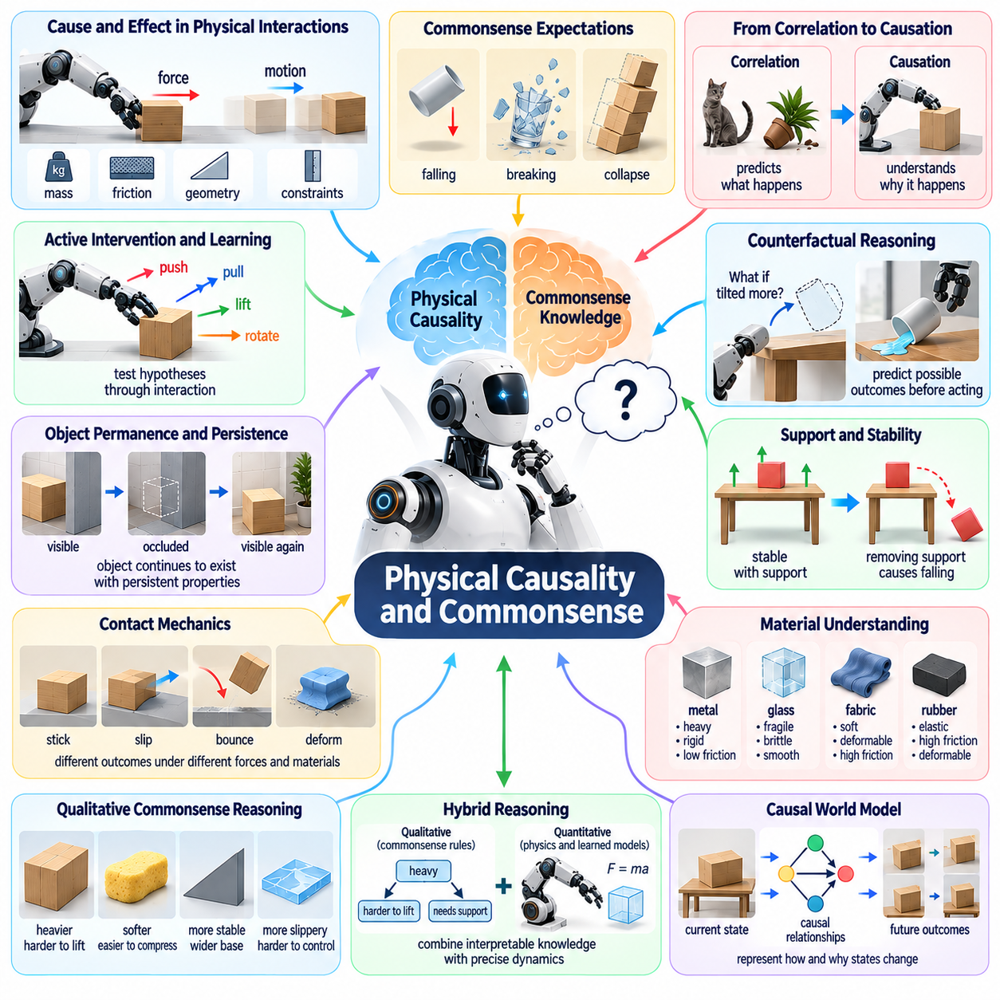{width="7.268055555555556in" height="7.268055555555556in"}

Physical causality and commonsense are fundamental requirements for Physical AI because intelligent robots must understand not only what exists in an environment but also why physical events occur. Recognizing objects and predicting their motion is insufficient without understanding the mechanisms connecting actions to consequences. Physical intelligence requires causal knowledge that supports reliable interaction, adaptation, and reasoning beyond previously observed situations.

Physical causality concerns the relationships through which forces, movements, contacts, and environmental conditions produce changes in physical states. When a robot pushes an object, the resulting motion depends on mass, friction, applied force, surface geometry, and external constraints. A causally informed system must distinguish these mechanisms from superficial correlations and identify which variables determine the outcome of an interaction.

Physical commonsense refers to practical knowledge about how everyday objects and environments behave. Humans intuitively expect unsupported objects to fall, fragile materials to break under excessive force, and unstable structures to collapse. Robots must acquire comparable expectations to operate effectively. However, commonsense knowledge must remain sensitive to context because physical behavior depends on materials, geometry, and environmental conditions.

A central challenge is distinguishing statistical prediction from causal understanding. A model trained on extensive videos may predict that a falling object will reach the ground without understanding the underlying gravitational interaction. Such predictions may fail when unusual forces or constraints are introduced. Causal representations should explain how changing a relevant physical variable alters the resulting behavior.

Intervention provides a powerful mechanism for learning physical causality. Rather than observing events passively, a robot can push, pull, lift, rotate, or release objects to investigate their properties. Controlled interactions reveal relationships among actions, forces, and outcomes. This active learning process allows the system to test hypotheses and distinguish competing explanations that passive observation cannot reliably resolve.

Counterfactual reasoning extends causal understanding by considering outcomes of actions that were not actually performed. A robot may evaluate whether a container would spill if tilted, whether an object would fall if its support were removed, or whether an alternative grasp would prevent slipping. Such reasoning supports planning by allowing the system to compare possible consequences before committing to physical actions.

Object permanence and persistence are important components of physical commonsense. A robot should understand that an object continues to exist when temporarily hidden and that its physical properties generally persist between observations. However, object states may change through unobserved interactions. Reliable reasoning must therefore combine persistent object identity with uncertainty about location, orientation, damage, and environmental changes.

Support relationships represent another essential category of causal knowledge. Objects remain stable when supporting surfaces and contact forces balance gravitational effects. Removing a support may cause falling, sliding, or rotation. A robot performing manipulation or stacking tasks must reason about load distribution, center of mass, contact geometry, and structural stability rather than relying exclusively on visual appearance.

Contact mechanics introduces significant complexity because physical interactions often involve discontinuous transitions. Objects may stick, slip, bounce, deform, or fracture depending on forces and material properties. Small variations in contact conditions can change the resulting motion substantially. Physical AI must learn representations that capture these transitions while remaining computationally efficient enough for real-time decision-making.

Material understanding is closely related to causal reasoning. Metal, glass, fabric, rubber, and liquids respond differently to forces and environmental conditions. Visual appearance provides partial clues, but material properties often require tactile sensing and interaction. Robots must estimate stiffness, friction, elasticity, fragility, and deformation behavior to select appropriate manipulation strategies and avoid damaging objects.

Human physical commonsense frequently involves qualitative reasoning rather than exact numerical simulation. People can recognize that a heavy object is difficult to lift or that a narrow stack may become unstable without calculating detailed force equations. Robots may benefit from similar qualitative representations that capture relationships such as heavier, softer, more stable, or more slippery while retaining access to precise dynamics when necessary.

Combining qualitative commonsense with quantitative physics remains an open research challenge. Symbolic descriptions provide interpretable relationships and support abstract planning, while numerical models estimate forces, trajectories, and contact dynamics. Neither approach alone is sufficient for every situation. Hybrid architectures may connect qualitative causal rules with learned dynamics models and physics-based simulation to support flexible physical reasoning.

Causal world models aim to represent not only how physical states evolve but also why particular transitions occur. Such models should distinguish the effects of robot actions from environmental disturbances and hidden variables. By representing causal dependencies explicitly or implicitly, they may improve prediction under changing conditions and support reasoning about unfamiliar interactions that differ from training examples.

Learning physical commonsense from human videos offers opportunities for large-scale knowledge acquisition. Videos contain examples of object motion, tool use, material interaction, and human manipulation strategies. However, visual observations rarely reveal exact forces, hidden constraints, or alternative outcomes. Models trained on passive video must therefore address causal ambiguity and may require physical interaction to validate learned assumptions.

Simulation can provide controlled environments for studying causal relationships because physical parameters and interventions can be systematically varied. Robots can investigate changes in mass, friction, gravity, contact conditions, and object geometry without risking physical equipment. Nevertheless, simulated interactions depend on imperfect physics models, and knowledge acquired in simulation must be validated against real-world behavior.

Uncertainty is inseparable from physical causal reasoning. A robot may know that an object is likely to slide when pushed without knowing its exact friction coefficient. Multiple causal explanations may remain consistent with available observations. Reliable systems should maintain alternative hypotheses, estimate confidence, and select information-gathering actions when uncertainty could significantly affect safety or task success.

Long-horizon tasks require causal reasoning across sequences of dependent actions. Moving one object may expose another, opening a door may change navigational possibilities, and placing a component incorrectly may prevent later assembly. Physical commonsense helps robots anticipate these delayed consequences. Causal planning must therefore connect immediate interactions with future task constraints and evolving environmental states.

Embodiment influences how causal knowledge is acquired and applied. A wheeled robot, humanoid, manipulator, and aerial robot interact with physical environments through different sensors and actuators. Although fundamental physical laws remain shared, available interventions and observable consequences differ. Research must determine how causal knowledge can transfer across embodiments while accounting for their distinct physical capabilities.

Language and foundation models may contribute broad descriptions of everyday physical relationships, but linguistic familiarity does not guarantee grounded causal competence. A model may correctly describe how to lift a fragile object while failing to estimate the forces required for safe manipulation. Physical commonsense must therefore be connected to sensory evidence, action-conditioned prediction, and feedback from real interactions.

Evaluation of physical causality should extend beyond object recognition and conventional prediction accuracy. A system should be tested on interventions, counterfactual questions, unfamiliar material properties, changing physical parameters, and multi-step manipulation tasks. Strong evaluation must determine whether learned knowledge remains valid when superficial visual correlations are altered while underlying causal mechanisms remain unchanged.

Safety provides a practical motivation for causal understanding. Robots operating near humans, equipment, and fragile infrastructure must anticipate how their actions could produce harmful consequences. Causal reasoning can help identify unstable objects, excessive forces, dangerous contact conditions, and indirect effects of movement. However, causal models themselves remain uncertain and must be combined with monitoring, constraints, and protective control mechanisms.

An important unresolved question is whether physical commonsense should emerge primarily from large-scale predictive learning or require explicit causal structures and active experimentation. Predictive models capture broad regularities, while structured causal models support interventions and explanation. Future architectures may integrate both approaches with embodied experience, allowing robots to refine abstract knowledge through controlled physical interaction.

Ultimately, physical causality and commonsense provide the foundation for moving from pattern recognition toward genuine physical understanding. Robots must learn why objects behave as they do, how actions change outcomes, and which consequences remain possible under uncertainty. Progress in causal representation, active experimentation, counterfactual reasoning, and grounded physics will be essential for developing adaptable, reliable, and increasingly general Physical AI systems.

## 07.05. Real World Generalization

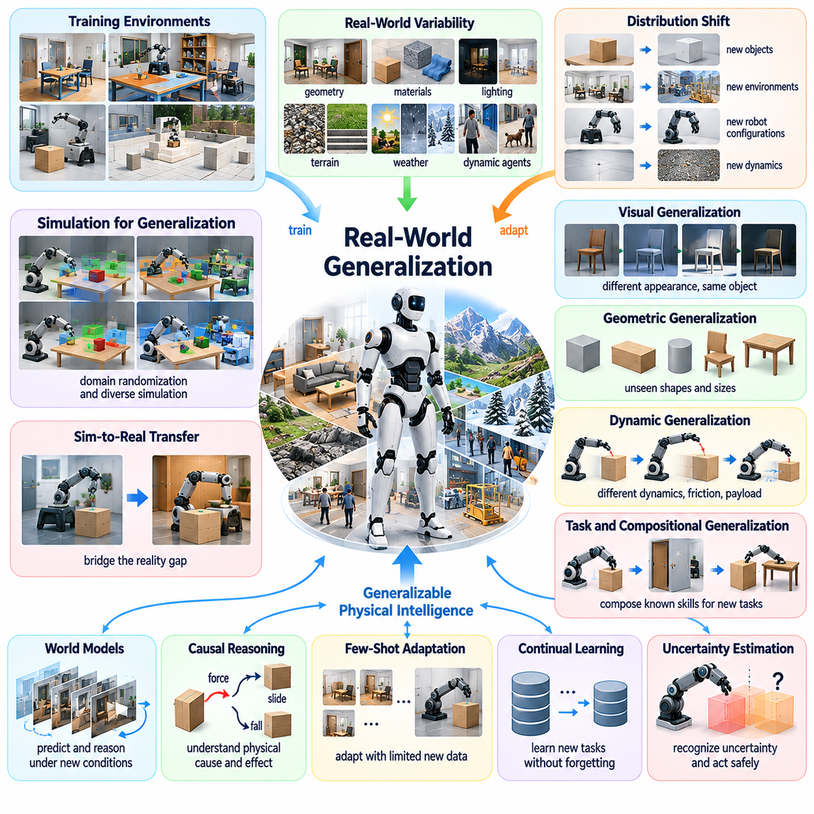{width="7.268055555555556in" height="7.268055555555556in"}

Real-world generalization is one of the most important unresolved challenges in Physical AI because robots must operate reliably beyond the environments and tasks encountered during training. A system that performs successfully in a laboratory may fail when exposed to unfamiliar objects, lighting, terrain, or human behavior. Generalization requires transferring learned capabilities to new conditions without extensive retraining or manual reconfiguration.

Physical environments exhibit enormous variability across geometry, materials, weather, illumination, and dynamic interactions. Even apparently similar locations can differ in friction, surface compliance, object placement, and sensor visibility. These variations influence perception, planning, and control simultaneously. A generalizable Physical AI system must identify which environmental properties matter for successful action and which differences can safely be ignored.

Distribution shift occurs when operational conditions differ from the data used during model training. Changes may involve sensor characteristics, object categories, robot configurations, or interaction dynamics. Conventional machine learning systems often assume that training and deployment distributions are sufficiently similar. Physical AI must instead detect unfamiliar conditions and adapt its behavior when those assumptions no longer hold.

Generalization across visual appearance is necessary but insufficient for physical competence. A robot may recognize an object under different lighting conditions while failing to manipulate it because its mass, friction, or stiffness differs from familiar examples. Physical generalization requires understanding relationships between observable characteristics and hidden mechanical properties. Such understanding often depends on tactile feedback and active interaction.

Geometric generalization concerns the ability to operate across unfamiliar shapes, dimensions, spatial arrangements, and obstacles. Manipulation policies must adapt to objects with different sizes and grasping surfaces, while navigation systems must handle changing corridors, slopes, and clearances. Representations based on geometric relationships and functional constraints may transfer more effectively than policies relying on memorized configurations.

Dynamic generalization becomes critical when physical interactions differ from training experience. Contact forces, actuator responses, payload variations, and environmental disturbances can alter system behavior. A controller trained on one surface may become unstable on another with different friction characteristics. Robust systems must estimate changing dynamics and adjust control strategies while respecting stability and safety constraints.

Task generalization requires robots to apply existing skills to unfamiliar objectives and combinations of actions. A robot capable of grasping, transporting, and placing objects should ideally combine these abilities into new workflows without collecting demonstrations for every sequence. Hierarchical policies and reusable skills may support such composition, although coordinating dependencies and recovering from unexpected failures remain difficult.

Compositional generalization extends this idea by combining previously learned concepts in novel configurations. A robot may understand doors, containers, tools, and obstacles individually but encounter them together in an unfamiliar task. Successful behavior requires reasoning about their relationships and the consequences of interactions. This capability depends on structured representations that preserve functional meaning beyond specific training examples.

Simulation offers a scalable method for exposing robots to diverse conditions before physical deployment. Domain randomization can vary lighting, textures, geometry, friction, mass, and actuator parameters to broaden training coverage. However, excessive randomization may produce unrealistic experiences, while insufficient variation leaves important gaps. Effective simulation must balance diversity, physical plausibility, and relevance to deployment conditions.

Sim-to-real transfer remains difficult because simulated environments cannot reproduce every detail of physical interaction. Sensor noise, contact mechanics, material deformation, and hardware imperfections introduce discrepancies between simulated and real behavior. Generalization therefore depends on identifying which simulation errors affect task success and developing policies that tolerate or compensate for those differences during deployment.

World models may improve generalization by representing physical relationships rather than memorizing specific observations. A predictive model that captures object dynamics, contact conditions, and causal dependencies can potentially support planning in unfamiliar environments. Nevertheless, learned world models may also fail under distribution shift. Their predictions must be accompanied by uncertainty estimates and mechanisms for correcting inaccurate assumptions.

Causal reasoning offers another promising foundation for transferable physical intelligence. Statistical correlations may change across environments, while some underlying physical mechanisms remain relatively stable. A robot that understands how friction influences sliding can adapt more effectively than one that associates motion with surface appearance alone. Identifying invariant causal relationships is therefore an important research direction.

Few-shot adaptation addresses situations where a robot encounters new conditions but has access to only a small amount of additional experience. Rather than retraining an entire model, the system may update selected parameters, retrieve relevant memories, or estimate unfamiliar physical properties through limited interaction. The challenge is adapting quickly without destabilizing previously reliable behavior or violating operational safety requirements.

Meta-learning seeks to improve the ability to learn new tasks by training across diverse experiences. A robot exposed to many manipulation or navigation conditions may acquire adaptation strategies that transfer to unfamiliar situations. However, meta-learning performance depends strongly on the diversity and structure of training tasks. Research must determine whether learned adaptation mechanisms remain effective under genuinely novel physical conditions.

Continual learning provides a longer-term approach to generalization by allowing robots to accumulate knowledge throughout deployment. New environments, objects, and operating conditions become opportunities for improvement rather than isolated exceptions. Yet continual updates introduce risks of catastrophic forgetting and performance regression. Reliable systems require memory management, controlled adaptation, and validation before updated policies are widely deployed.

Cross-embodiment generalization introduces additional complexity because robots differ in morphology, sensing, actuation, and physical constraints. Knowledge about object identity and environmental geometry may transfer between platforms, while locomotion and manipulation strategies often require adaptation. Shared representations should separate embodiment-independent physical knowledge from capabilities determined by each robot\'s mechanical configuration.

Language-conditioned policies may support generalization by connecting human instructions with reusable physical skills. Natural language can describe new objectives without requiring task-specific programming, but linguistic understanding does not guarantee executable behavior. A robot must ground instructions in current observations, available actions, physical constraints, and task feasibility. Reliable execution requires continuous feedback from the environment.

Uncertainty awareness is essential because generalization failures often occur when systems encounter unfamiliar situations without recognizing their limitations. A robot should estimate whether current observations and dynamics fall within its reliable operating range. When confidence decreases, it may slow down, gather additional information, request assistance, or activate conservative control strategies instead of continuing with unsupported predictions.

Safety constraints must remain effective even when learned policies generalize poorly. Collision avoidance, force limits, stability monitoring, and emergency stopping should not depend entirely on the accuracy of a general-purpose neural model. Hybrid architectures can combine adaptive learning with verified protective mechanisms. This separation may enable exploration of unfamiliar conditions while maintaining clearly defined operational boundaries.

Evaluation of real-world generalization requires testing across environments that differ meaningfully from training conditions. Randomly dividing similar demonstrations into training and test datasets can overestimate transfer capability. More informative benchmarks should vary object categories, physical properties, layouts, tasks, hardware configurations, and environmental dynamics while preventing hidden overlap between evaluation and training experiences.

Generalization should also be evaluated over extended operating periods rather than isolated successful trials. A policy may perform well initially but degrade when sensors drift, surfaces wear, payloads change, or environmental conditions evolve. Long-term evaluation must examine reliability, recovery behavior, adaptation efficiency, safety incidents, and the computational or data costs required to maintain performance.

An important research question concerns the balance between universal models and specialized adaptation. Large foundation models may provide broad transferable representations, while smaller task-specific controllers can offer precise and efficient physical execution. A hierarchical architecture could combine general reasoning with local dynamics estimation and specialized control. Determining how these components should interact remains an open challenge.

Ultimately, real-world generalization is not simply the ability to recognize unfamiliar scenes or execute previously learned actions in new locations. It requires transferable physical knowledge, causal understanding, adaptive control, uncertainty estimation, continual learning, and reliable safety mechanisms. Progress will be measured by how effectively Physical AI systems maintain competence across genuinely unfamiliar conditions with minimal additional supervision and experience.

## 07.06. Cross Embodiment Transfer

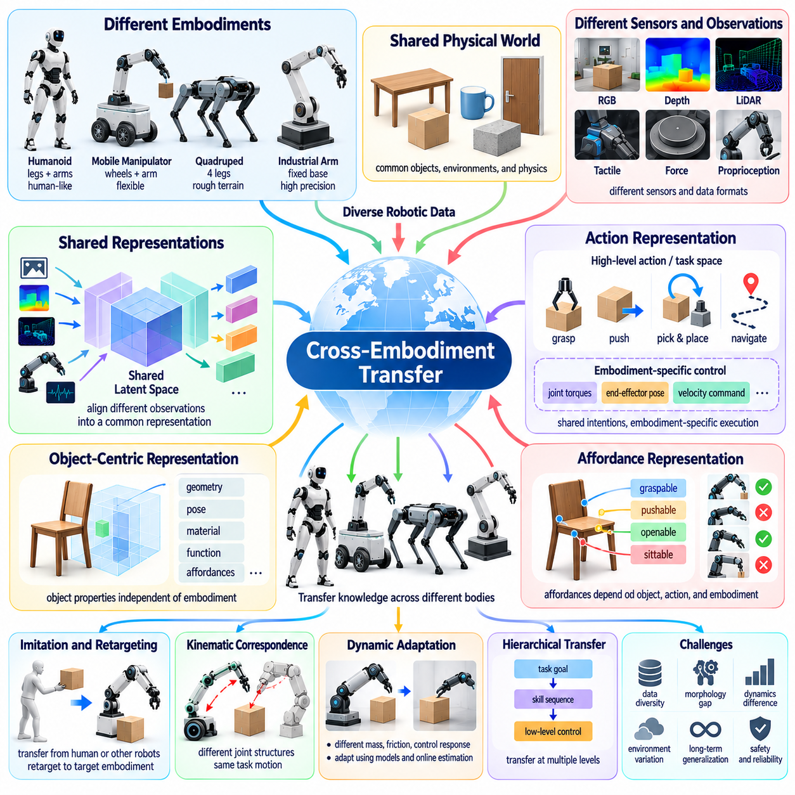{width="7.268055555555556in" height="7.268055555555556in"}

Cross-embodiment transfer is a fundamental challenge in Physical AI because robots with different bodies must learn to share knowledge despite variations in mechanical structure, sensing, and actuation. A manipulation strategy learned by one robot may not directly apply to another with different joints or grippers. Achieving transfer requires separating general physical knowledge from embodiment-specific capabilities and constraints.

Embodiment determines how an intelligent system perceives and interacts with its environment. Humanoids, mobile manipulators, quadrupeds, and industrial arms possess different kinematic structures, workspaces, and control interfaces. Although they operate under common physical laws, their available actions differ substantially. Cross-embodiment learning must identify which aspects of experience remain transferable across these differences.

A central difficulty is the mismatch between action spaces. One robot may control joint torques, another may command end-effector positions, and a third may use velocity-based interfaces. Directly transferring low-level policies between these systems can produce invalid or unsafe actions. Shared action representations must express functional intentions while allowing each embodiment to translate those intentions into feasible motor commands.

Task-space representations offer one approach to transferring manipulation skills. Instead of describing behavior through individual joint movements, a policy can specify desired object motion, end-effector trajectories, or contact relationships. Embodiment-specific controllers then generate appropriate joint commands. This separation can improve portability, although differences in reachability, dexterity, and force capacity still limit transfer.

Object-centered representations provide another foundation for shared physical intelligence. A robot can describe an object through its geometry, pose, material properties, and functional affordances without depending on its own morphology. Such representations support common reasoning about grasping, pushing, lifting, and placement. However, whether an action is feasible depends on the interaction between object properties and robot capabilities.

Affordance learning connects environmental opportunities with embodiment-specific abilities. A handle may offer a pulling affordance to a robot with a suitable gripper but remain inaccessible to a platform without manipulation hardware. Therefore, affordances cannot always be treated as intrinsic object properties. Transferable models should represent the relationship among objects, intended actions, environmental conditions, and available robotic capabilities.

Morphological diversity creates significant challenges for locomotion transfer. Wheeled robots, quadrupeds, humanoids, and tracked platforms negotiate terrain through different contact mechanisms. A navigation objective may be shared, but the movement strategy must reflect stability, traction, clearance, and actuator limits. Cross-embodiment transfer should preserve high-level navigation knowledge while adapting locomotion control to each platform.

Shared latent spaces may enable policies to operate across different robotic configurations. Encoders can transform heterogeneous sensor observations and proprioceptive states into common representations, while decoders translate shared commands into embodiment-specific actions. The challenge is ensuring that these latent representations retain task-relevant physical information rather than obscuring important differences in robot dynamics.

Vision-language-action models offer a potential framework for learning across multiple robot types. Language can represent common goals, visual observations can describe environmental context, and action modules can account for platform-specific execution. Training on diverse robotic datasets may improve transferable representations. However, inconsistent action conventions, sensor calibration, and data quality can limit effective knowledge sharing.

Robot datasets are often fragmented across hardware platforms, laboratories, and application domains. Different robots record joint states, force measurements, camera streams, and action commands using incompatible formats. Building transferable models requires standardized metadata describing morphology, coordinate frames, actuator limits, and sensor characteristics. Without these descriptions, combining datasets may introduce ambiguity rather than useful diversity.

Kinematic correspondence is important when transferring movement patterns between robots with different joint structures. Two manipulators may achieve the same end-effector pose through different configurations, while some target poses may be unreachable for one platform. Transfer methods must account for joint limits, singularities, collision constraints, and workspace differences. Functional equivalence does not imply identical motor behavior.

Dynamic correspondence is more difficult because similar movements can require different forces and control responses. Robots vary in mass distribution, actuator bandwidth, joint friction, structural compliance, and payload capacity. A transferred policy must respect these differences to avoid instability or equipment damage. Dynamics-aware adaptation can combine learned behavior with robot-specific models and online parameter estimation.

Imitation learning across embodiments introduces additional complexity when demonstrations originate from humans or robots with different morphologies. Human hand movements cannot be copied directly by a two-finger gripper, and humanoid locomotion demonstrations cannot be applied unchanged to quadrupeds. Retargeting methods must preserve task objectives and relevant contact relationships while generating actions compatible with the target embodiment.

Hierarchical skill representations may improve transfer by separating task objectives from execution details. High-level skills such as opening a door, transporting an object, or inspecting equipment can be shared across platforms. Lower-level controllers implement these skills according to available sensors and actuators. This architecture supports reuse, but reliable skill selection requires accurate estimates of each robot\'s capabilities.

World models can support cross-embodiment transfer by representing how physical environments respond to actions independently of a particular robot. Shared knowledge about gravity, object stability, friction, and contact consequences may benefit many platforms. Nevertheless, predictions must incorporate embodiment-dependent forces and reachable interactions. A useful architecture combines general environmental dynamics with robot-specific action models.

Causal representations may provide stronger transfer than purely statistical associations. Physical relationships such as support, collision, and object displacement remain meaningful across different robotic bodies. A robot that understands the causal effects of pushing may apply this knowledge through different actuators. However, transferring causal knowledge requires recognizing when changes in embodiment alter the mechanisms connecting actions to outcomes.

Few-shot adaptation can reduce the amount of target-robot data required for transferring learned capabilities. A pretrained policy may use a limited number of demonstrations or interactions to calibrate action mappings and estimate unfamiliar dynamics. Parameter-efficient adaptation and modular policy architectures are promising approaches. Their reliability must be assessed under physical constraints, especially when target hardware differs substantially.

Simulation offers controlled environments for training and evaluating cross-embodiment transfer. Multiple robot morphologies can perform related tasks under comparable environmental conditions, allowing researchers to isolate the effects of mechanical differences. Simulation also supports systematic variation in joint structures, actuator characteristics, and payloads. However, successful simulated transfer does not guarantee reliable behavior on real hardware.

Safety is especially important because transferred policies may encounter physical constraints absent from the source robot. Commands that are feasible for a powerful industrial manipulator may exceed the force limits of a lightweight collaborative robot. Similarly, locomotion strategies may violate stability constraints on another platform. Transfer systems must validate actions against embodiment-specific safety envelopes before execution.

Evaluation should distinguish transfer of perception, planning, manipulation, locomotion, and complete task execution. Success on shared visual recognition tasks does not establish transferable motor intelligence. Benchmarks should include robots with meaningfully different morphologies and measure target-task success, adaptation data requirements, safety, and performance degradation. Testing must also prevent hidden overlap between source and target experiences.

An important open question is how much physical intelligence can be genuinely embodiment-independent. Geometric reasoning, object permanence, and some causal principles may transfer broadly, while precise control and contact behavior remain strongly body-dependent. The boundary between shared knowledge and specialized competence is unlikely to be fixed. It may vary with task complexity, sensor availability, and required physical precision.

Large-scale multi-robot learning could create shared representations that improve as additional embodiments contribute experience. A fleet containing different robotic platforms may collectively learn environmental structure, task strategies, and failure patterns. However, useful aggregation requires careful treatment of heterogeneous data and hardware limitations. Shared learning must preserve distinctions between universally applicable knowledge and platform-specific behavior.

Ultimately, cross-embodiment transfer is not simply the reuse of neural network parameters across different robots. It requires common physical representations, functional action abstractions, morphology-aware adaptation, causal understanding, and reliable embodiment-specific control. Solving these challenges would allow Physical AI systems to accumulate knowledge across diverse robotic platforms and move toward increasingly general physical intelligence.

## 07.07. Learning from Limited Real World Data

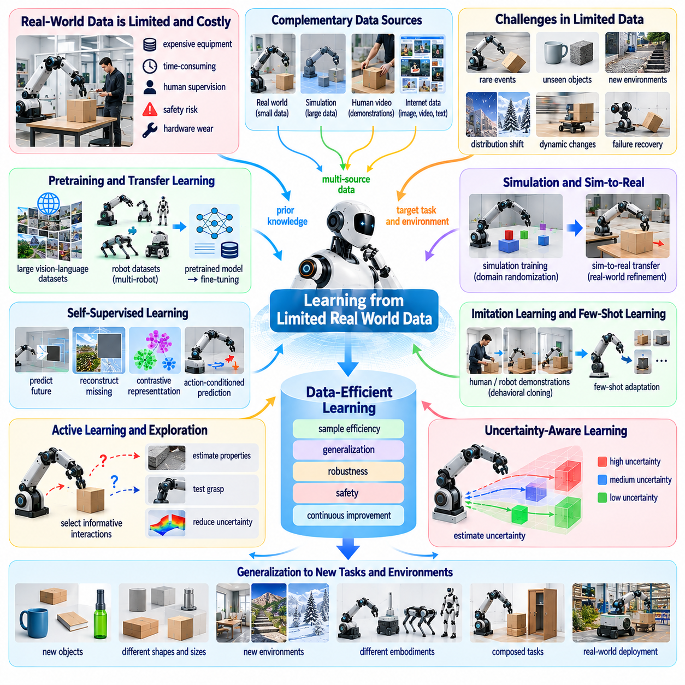{width="7.268055555555556in" height="7.268055555555556in"}

Learning from limited real-world data is a central challenge in Physical AI because collecting physical interaction experience is expensive, time-consuming, and potentially hazardous. Unlike digital learning systems, robots must interact with actual objects, environments, and hardware to acquire grounded knowledge. Data-efficient learning aims to develop reliable perception, planning, and control capabilities from relatively small amounts of physical experience.

Real-world robotic data is constrained by equipment costs, operational time, human supervision, and safety requirements. Each demonstration may require environment preparation, sensor calibration, task execution, and recovery from failure. Hardware wear and maintenance further limit collection capacity. These constraints make it difficult to apply conventional large-scale data collection strategies directly to embodied intelligence.

Data scarcity becomes particularly severe for rare events and complex physical interactions. Robot failures, unexpected collisions, unusual material behavior, and hazardous environmental conditions may occur infrequently but remain critical for reliable autonomy. A dataset containing mostly successful routine operations may not represent these situations adequately. Learning systems must therefore extract meaningful knowledge from sparse and unevenly distributed experiences.

Sample efficiency measures how effectively a learning algorithm improves performance using limited interaction data. A sample-efficient robot should acquire useful skills without requiring thousands of repeated physical trials. Achieving this capability involves exploiting prior knowledge, structured representations, and predictive models. However, efficiency must be evaluated alongside safety, robustness, and the ability to generalize beyond the collected examples.

Transfer learning offers a practical approach to reducing real-world data requirements. A model pretrained on related tasks, simulated environments, or diverse robotic datasets can provide reusable representations and initial control strategies. Fine-tuning then adapts these capabilities to the target robot and environment. The effectiveness of transfer depends on the similarity of physical dynamics, sensing conditions, and task requirements.

Foundation models may contribute broad perceptual and semantic knowledge acquired from large-scale image, video, and language datasets. Such knowledge can improve object recognition, task interpretation, and high-level planning with limited robot-specific training. Nevertheless, visual and linguistic pretraining cannot fully replace physical experience. Contact dynamics, force control, and actuator behavior still require grounded adaptation and validation.

Simulation provides an important source of supplementary experience when real-world interaction is limited. Robots can practice manipulation, navigation, and recovery behaviors through repeated simulated trials. Synthetic environments also enable systematic variation of physical parameters and task conditions. However, simulation errors may introduce misleading experiences, making careful calibration and real-world validation essential.

Sim-to-real learning seeks to combine abundant simulated experience with limited physical data. A robot may learn a preliminary policy in simulation and refine it through a small number of real-world interactions. Domain randomization, system identification, and residual dynamics learning can reduce discrepancies between environments. The challenge is determining which real-world measurements provide the greatest improvement in transfer reliability.

Self-supervised learning can exploit sensory data without requiring extensive manual labels. Robots may learn representations by predicting future observations, reconstructing missing measurements, or identifying relationships between actions and outcomes. Continuous streams from cameras, tactile sensors, and proprioceptive systems provide useful training signals. However, learned representations must preserve information relevant to physical decision-making.

Imitation learning is especially valuable when expert demonstrations are available but autonomous exploration is costly. A robot can learn manipulation or navigation behavior from examples provided by humans or other robotic systems. Behavioral cloning offers a direct learning method, but limited demonstrations may not cover recovery states or unexpected disturbances. Additional interaction and corrective feedback are often necessary.

Few-shot learning addresses the ability to acquire new skills from a small number of examples. A robot may need to manipulate an unfamiliar object or adapt to a new workspace after only several demonstrations. Meta-learning and pretrained skill representations can accelerate this adaptation. Yet few-shot performance must remain reliable when object properties, contact conditions, or task requirements differ significantly from previous experience.

Active learning improves data efficiency by selecting informative observations and interactions. Rather than collecting every possible trajectory, a robot identifies situations where additional experience could reduce important uncertainty. For example, it may perform a controlled push to estimate friction or test a grasp to assess stability. Such actions should maximize learning value while respecting physical safety constraints.

Uncertainty-aware exploration is essential when data is scarce because the robot may encounter conditions outside its learned experience. Bayesian models, ensembles, and confidence estimation can help identify poorly understood dynamics. Exploration strategies can then prioritize informative but manageable interactions. However, uncertainty estimates themselves may become unreliable under severe distribution shift, requiring conservative safeguards.

Model-based reinforcement learning can reduce interaction requirements by using learned dynamics to predict the consequences of candidate actions. Instead of evaluating every strategy through physical trials, the robot can simulate alternatives within an internal world model. Real-world observations periodically update the model. This approach improves efficiency when predictions are accurate but can amplify errors when the learned dynamics are incomplete.

Offline reinforcement learning offers another approach by learning policies from previously collected datasets without continuous physical exploration. Historical demonstrations, operational logs, and recorded failures can provide valuable experience. However, offline policies may propose actions that differ substantially from the data distribution. Conservative learning objectives and uncertainty estimation are needed to reduce unsupported extrapolation.

Data quality can be more important than data volume when physical experience is limited. Accurate timestamps, calibrated sensors, synchronized action records, and reliable task annotations improve the usefulness of each trajectory. Corrupted measurements or inconsistent coordinate frames can undermine learning even when datasets are large. Careful curation helps ensure that scarce physical data contributes meaningful training information.

Experience replay and memory systems allow robots to reuse valuable interactions during learning. Rare failures, successful recoveries, and informative contact events may deserve greater attention than repetitive routine trajectories. Prioritized sampling can improve training efficiency by emphasizing experiences with high learning value. Nevertheless, excessive reuse of narrow examples may cause overfitting and reduce generalization.

Multi-task learning can increase data efficiency by sharing knowledge across related objectives. Experience acquired during grasping may inform placement, assembly, and tool manipulation, while navigation data may support obstacle avoidance and localization. Shared representations reduce the need to learn every capability independently. The challenge is preventing interference when tasks require conflicting behaviors or different physical assumptions.

Cross-robot data sharing offers opportunities to expand experience beyond a single platform. Multiple robots can contribute observations, demonstrations, and failure records to a shared learning system. Fleet-scale learning may expose models to greater environmental diversity while distributing collection costs. However, differences in hardware, sensors, and control interfaces require careful normalization and embodiment-aware adaptation.

Human feedback can provide efficient supervision when autonomous learning encounters difficult situations. Operators may correct trajectories, demonstrate recovery strategies, or identify unsafe actions. Interactive learning systems can request assistance selectively rather than requiring constant supervision. Designing effective feedback interfaces is important because human guidance introduces operational costs and may vary in consistency and precision.

Evaluation of data-efficient learning should measure more than final task success. Researchers must consider the number of physical interactions, demonstration time, human intervention, equipment wear, computational resources, and safety incidents required to achieve performance. Comparisons should use consistent data budgets and clearly separate simulated from real-world experience. Generalization to unfamiliar conditions remains an essential criterion.

An important research direction is the integration of pretrained models, simulation, active learning, and continual adaptation into unified data-efficient architectures. Each method addresses a different limitation of physical data collection. Their combination could allow robots to begin with broad prior knowledge, identify critical uncertainties, gather targeted experience, and improve without excessive physical experimentation.

Ultimately, learning from limited real-world data requires transforming scarce physical experience into reusable and transferable knowledge. Progress depends on sample-efficient algorithms, reliable world models, informative exploration, high-quality datasets, and safe adaptation mechanisms. Solving this challenge would reduce the cost of developing Physical AI and enable autonomous systems to acquire new capabilities in environments where extensive training is impractical.

## 07.08. Self Supervised and Weakly Supervised Robot Learning

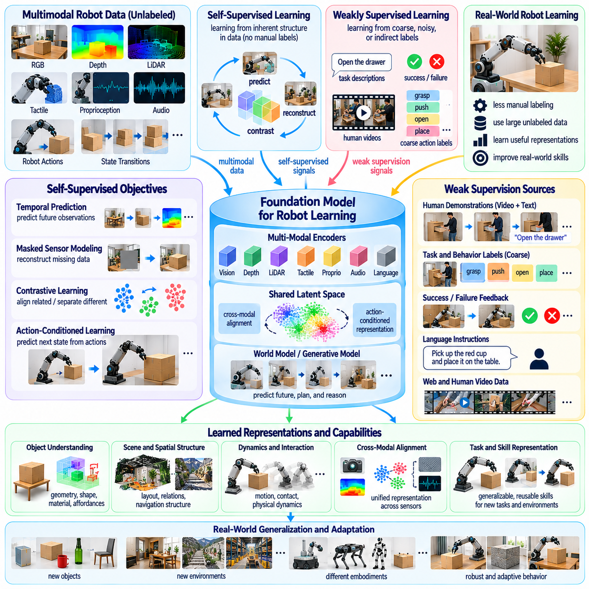{width="7.268055555555556in" height="7.268055555555556in"}

Self-supervised and weakly supervised robot learning are essential research directions in Physical AI because robots must acquire useful knowledge without depending entirely on expensive human annotations. Physical environments generate continuous streams of visual, tactile, proprioceptive, and action data. Learning from these signals can reduce supervision requirements while enabling robots to develop representations of objects, dynamics, and interactions.

Self-supervised learning constructs training objectives directly from available data rather than relying on manually assigned labels. A robot may predict future observations, reconstruct missing sensor measurements, or estimate relationships between consecutive states. These tasks provide learning signals from ordinary operation. However, successful reconstruction or prediction does not automatically guarantee that the resulting representations support reliable physical actions.

Weakly supervised learning uses incomplete, noisy, coarse, or indirectly associated labels to guide model training. Robot datasets may contain task descriptions, approximate object locations, success indicators, or human instructions without precise action-level annotations. Such information can provide valuable semantic structure. The central challenge is extracting reliable learning signals while preventing annotation errors from becoming systematic behavioral mistakes.

Robot learning differs from conventional image representation learning because physical competence requires understanding how actions change the environment. Visual similarity alone cannot establish whether an object is graspable, stable, movable, or fragile. Self-supervised objectives should therefore connect observations with motor commands and resulting state transitions. This action-conditioned structure is essential for learning physically meaningful representations.

Temporal prediction provides a natural source of self-supervision for embodied systems. By estimating future observations from previous states and actions, a robot can learn patterns of motion, interaction, and environmental change. Short-term prediction captures immediate dynamics, while longer prediction horizons reveal task progression and delayed consequences. Maintaining accuracy across multiple timescales remains a significant challenge.

Masked sensor modeling allows robots to learn by reconstructing deliberately hidden portions of observations. Missing image regions, depth measurements, tactile readings, or proprioceptive signals can be predicted from surrounding information. This encourages the model to discover relationships among sensing modalities. Nevertheless, reconstruction quality must be evaluated against downstream control performance rather than treated as sufficient evidence of physical understanding.

Multimodal self-supervision is especially important because robotic perception combines complementary information sources. Cameras provide appearance and geometry, tactile sensors reveal contact properties, and proprioceptive measurements describe internal motion. Aligning these signals can help robots infer hidden physical states. The difficulty lies in synchronizing heterogeneous data and distinguishing meaningful relationships from accidental correlations.

Contrastive learning can organize robot experiences by encouraging related observations and actions to occupy nearby regions of a representation space. Different views of the same object or consecutive states from a shared interaction may provide positive associations. Unrelated experiences can provide contrasting examples. However, poorly selected training pairs may encourage visual invariance while suppressing important physical differences.

Action-conditioned representation learning aims to preserve information that determines how the environment responds to robot behavior. Two objects may appear similar but require different gripping forces because of material or mass differences. A useful representation must distinguish these cases when they affect control decisions. This motivates learning objectives based on action outcomes, controllability, and physical consequences rather than appearance alone.

Predictive world models offer a unified framework for self-supervised robot learning. Models can estimate future latent states, object trajectories, contact events, and task-relevant environmental changes. Once learned, these models may support planning without requiring direct supervision for every action sequence. However, accumulated prediction errors and uncertain physical interactions can undermine their reliability during long-horizon execution.

Learning object permanence and persistent environmental structure is another important objective. Robots frequently encounter occlusion, partial visibility, and temporary sensor loss. Self-supervised tracking across time can encourage representations that preserve object identity and spatial relationships. Yet objects may also move or change through unobserved interactions, requiring models to represent uncertainty rather than assuming complete environmental stability.

Weak supervision can connect large-scale human video data with robotic skill acquisition. Videos may contain language descriptions, action categories, or approximate temporal boundaries that indicate meaningful behavior. These signals can support learning about manipulation sequences and task structure. Nevertheless, human actions differ from robot actions, and visual demonstrations rarely provide exact forces, contact conditions, or executable control commands.

Language provides a flexible form of weak supervision by associating observations and action sequences with semantic descriptions. A robot may learn that opening a drawer involves approaching a handle, establishing contact, and pulling along a constrained direction. Such descriptions can support task decomposition and skill retrieval. However, linguistic knowledge must be grounded in physical feasibility and validated through sensory feedback.

Learning from task success and failure offers another source of weak supervision. A binary success indicator can distinguish completed tasks from unsuccessful attempts without specifying the correct action at every moment. Models may use these outcomes to improve policy selection or identify effective behavior patterns. However, sparse feedback creates credit assignment difficulties when long action sequences contain both useful and harmful decisions.

Unsupervised skill discovery seeks to identify reusable behaviors without predefined task labels. Robots may learn movement patterns, object interactions, or exploration strategies by maximizing behavioral diversity or controllable state changes. These skills can provide building blocks for future tasks. The challenge is ensuring that discovered behaviors are meaningful, safe, and transferable rather than merely diverse within the training environment.

Intrinsic motivation can encourage robots to explore situations that improve their internal understanding. Prediction error, information gain, and learning progress may serve as signals for selecting informative actions. A robot could investigate unfamiliar materials or test uncertain object interactions through controlled experiments. However, curiosity-driven exploration must be constrained to avoid dangerous actions and repetitive pursuit of unpredictable noise.

Offline robotic datasets provide substantial opportunities for self-supervised learning because recorded sensor streams can be reused without additional physical experiments. Operational logs, teleoperation demonstrations, and fleet experiences may contain rich temporal information. Yet these datasets often exhibit inconsistent sensor configurations and biased task coverage. Careful data curation is necessary to prevent misleading representations.

Simulation can complement real-world self-supervision by generating diverse interactions and automatically available physical state information. Synthetic trajectories can expose models to variations in geometry, material properties, contact conditions, and environmental disturbances. However, models may learn artifacts specific to simulation. Combining simulated and physical observations requires methods that preserve transferable dynamics while correcting domain differences.

Continual self-supervised learning could allow deployed robots to improve from ordinary operation. New observations may refine representations of familiar objects, changing environments, and previously unseen interactions. Such learning reduces dependence on repeated human labeling. Nevertheless, uncontrolled model updates can cause catastrophic forgetting or degrade established skills, making validation and protected adaptation mechanisms necessary.

Uncertainty estimation is particularly important when supervision is incomplete. Weak labels may contain errors, and self-supervised objectives may admit multiple plausible interpretations. Models should distinguish confident knowledge from uncertain assumptions and avoid treating every generated prediction as equally reliable. Calibration, ensemble methods, and selective human review can help reduce the operational consequences of incorrect learning signals.

Evaluation must determine whether self-supervised representations improve actual robotic capabilities. Strong performance on reconstruction, contrastive, or prediction objectives does not necessarily imply successful manipulation or navigation. Benchmarks should measure downstream task performance, sample efficiency, transfer to unfamiliar conditions, robustness, and safety. Comparisons should also account for annotation costs and the amount of unlabeled data consumed.

An important open question concerns which self-supervised objectives produce representations that are genuinely useful for physical reasoning. Predicting pixels, latent states, contact outcomes, and future rewards emphasizes different aspects of experience. No single objective is guaranteed to preserve all relevant physical information. Research must explore combinations that capture geometry, dynamics, causality, controllability, and long-term task structure.

Ultimately, self-supervised and weakly supervised robot learning aim to transform abundant but imperfect sensory experience into reliable physical intelligence. Progress requires meaningful training objectives, multimodal grounding, robust handling of noisy supervision, and continual validation through interaction. These advances could reduce dependence on costly annotations and enable Physical AI systems to learn increasingly general capabilities from everyday experience.

## 07.09. Continual and Lifelong Learning

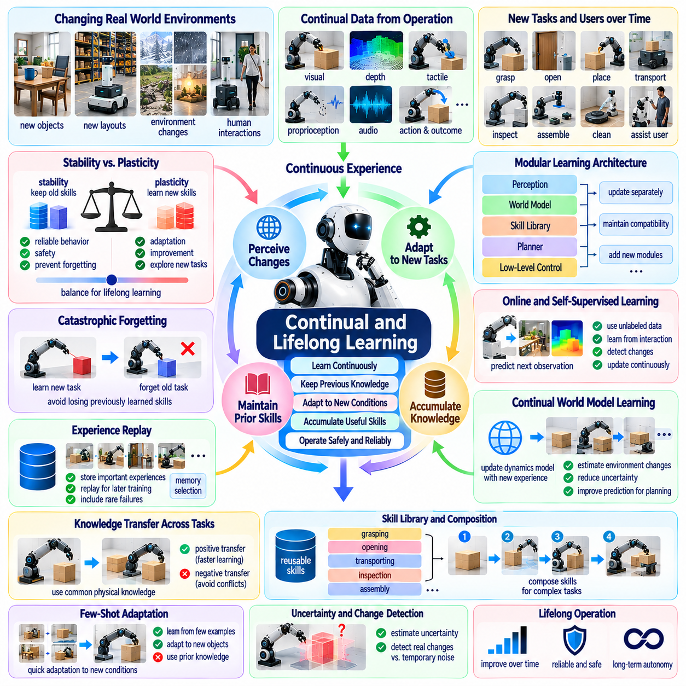{width="7.268055555555556in" height="7.268055555555556in"}

Continual and lifelong learning represent essential capabilities for Physical AI systems operating in environments that change over time. Unlike conventional machine learning models trained once and deployed with fixed parameters, autonomous robots must adapt to new objects, tasks, users, and physical conditions. Lifelong learning aims to accumulate useful experience throughout operation while preserving previously acquired knowledge and maintaining reliable behavior.

Real-world environments are inherently nonstationary because objects move, equipment ages, layouts change, and human activities evolve. A warehouse robot may encounter new inventory configurations, while a service robot may face unfamiliar household arrangements. Fixed policies can gradually become less effective under these conditions. Continual learning enables robotic systems to update their internal representations and control strategies as operational circumstances change.

A central challenge is balancing stability and plasticity during learning. Stability preserves established knowledge and reliable skills, while plasticity enables adaptation to unfamiliar experiences. Excessive stability prevents improvement, whereas excessive plasticity can disrupt previously successful behavior. Effective lifelong learning requires mechanisms that selectively incorporate new information without unnecessarily modifying knowledge that remains valid.

Catastrophic forgetting occurs when learning new tasks causes a model to lose performance on previously mastered tasks. This problem is especially serious in robotics because forgotten skills may create unsafe physical behavior. A robot adapting to a new grasping strategy must not lose the ability to handle familiar objects reliably. Preventing forgetting requires preserving important representations, behaviors, and safety constraints throughout successive learning stages.

Experience replay provides one approach to maintaining earlier knowledge. A robot stores selected observations, actions, and outcomes from previous tasks and reuses them during later training. Replay buffers can include representative successes, rare failures, and important recovery behaviors. However, storage capacity and computational resources are limited, making memory selection and efficient sampling important research problems.

Regularization-based methods reduce forgetting by constraining changes to parameters considered important for earlier tasks. Such approaches allow models to adapt while discouraging modifications that could damage established capabilities. Their effectiveness depends on accurately identifying which parameters support valuable knowledge. Complex robotic tasks often share representations, making the distinction between reusable and task-specific knowledge difficult.

Modular learning architectures offer another strategy for continual adaptation. Perception modules, world models, skill libraries, and low-level controllers can be updated independently when appropriate. A robot may learn a new manipulation skill without replacing its entire navigation system. However, interactions among modules can create unexpected dependencies, requiring careful integration testing and compatibility management.

Lifelong robot learning must distinguish genuine environmental changes from temporary disturbances and sensor noise. A slippery floor may indicate a persistent change in surface conditions or a short-lived contamination event. Updating a policy too aggressively could reduce performance after normal conditions return. Change detection, uncertainty estimation, and temporal reasoning help determine when adaptation is necessary and how long new knowledge should remain relevant.

Online learning enables robots to update models using data collected during ordinary operation. Continuous observations may reveal changes in friction, payload distribution, actuator response, or object behavior. These updates can improve performance without requiring complete retraining. Nevertheless, online adaptation must operate within computational and safety constraints, especially when learning occurs alongside real-time control.

Self-supervised learning provides valuable signals for lifelong adaptation because robots generate sensory experience continuously. Predicting future observations, estimating contact outcomes, and detecting unexpected state transitions can support representation updates without extensive manual annotation. However, self-supervised objectives may reinforce irrelevant patterns. Learning systems must verify that updated representations improve meaningful physical capabilities.

Continual world model learning allows robots to refine predictions about environmental dynamics as new evidence becomes available. A manipulator may gradually estimate the properties of unfamiliar materials, while a mobile robot may improve its understanding of changing terrain. These models support planning and adaptation. Their reliability depends on managing uncertainty and preventing incorrect updates from contaminating established physical knowledge.

Skill accumulation is a defining objective of lifelong physical intelligence. Instead of learning every task independently, robots should preserve reusable skills and combine them to solve increasingly complex problems. Grasping, positioning, opening, transporting, and inspection behaviors may become components of larger task sequences. Effective skill libraries require mechanisms for discovery, selection, refinement, and reliable composition.

Knowledge transfer across tasks can accelerate continual learning by exploiting common physical structures. Experience with one type of container may help a robot manipulate another, while knowledge of contact forces may generalize across assembly operations. Positive transfer reduces data requirements, but negative transfer can occur when inappropriate assumptions are reused. Robots must evaluate whether previously learned knowledge applies to new circumstances.

Long-term memory systems may organize robotic experience at multiple levels of abstraction. Episodic memory can preserve specific interactions and outcomes, while semantic memory stores generalized knowledge about objects and environments. Procedural memory represents reusable skills and control strategies. Coordinating these forms of memory may improve learning efficiency, but deciding what to retain, summarize, or discard remains difficult.

Active learning can make lifelong adaptation more efficient by identifying situations where additional experience would be valuable. A robot may request human assistance, inspect an unfamiliar object, or perform a controlled experiment to reduce uncertainty. Such strategies avoid indiscriminate exploration. However, information-seeking actions must remain compatible with operational objectives and physical safety requirements.

Human feedback is important when autonomous learning encounters ambiguous or high-risk situations. Operators may provide demonstrations, correct unsuccessful behavior, or confirm whether an environmental change is meaningful. Selective supervision can improve adaptation without requiring continuous human involvement. The challenge is integrating feedback consistently while avoiding excessive dependence on intervention.

Multi-robot lifelong learning introduces opportunities for collective knowledge accumulation. Robots operating in different locations may encounter distinct objects, environmental conditions, and failure patterns. Shared experience can accelerate learning across a fleet. However, differences in embodiment, sensing, and operational context require careful adaptation before knowledge learned by one platform is applied to another.

Federated and distributed learning approaches may support knowledge sharing without centralizing every raw observation. Robots can exchange selected model updates or summarized experiences while retaining sensitive operational data locally. Such systems must address communication limitations, heterogeneous data distributions, and conflicting updates. Shared improvements also require validation to prevent errors from spreading across deployed fleets.

Safety assurance becomes increasingly difficult when robot behavior changes after deployment. A policy validated during initial testing may no longer behave identically after extensive adaptation. Continual learning systems therefore require monitoring, controlled update procedures, rollback mechanisms, and independent safety constraints. High-risk changes should be evaluated before activation rather than accepted solely because recent training performance improved.

Evaluation of lifelong learning must extend beyond performance on the newest task. Benchmarks should measure retention of previous skills, adaptation speed, cumulative task success, transfer efficiency, and recovery from environmental changes. Long-duration testing is necessary to reveal gradual degradation and hidden interference. Evaluation should also account for the physical interaction cost and safety implications of learning.

A major open research question concerns how autonomous robots should decide when to learn, when to preserve existing behavior, and when to request assistance. Continuous updating is not always beneficial, particularly when observations are unreliable or operational conditions are temporary. Intelligent learning management requires calibrated uncertainty, task awareness, resource allocation, and explicit consideration of safety and long-term performance.

Another challenge is maintaining knowledge consistency across changing representations and models. New perception systems may classify objects differently, while updated world models may alter predicted action outcomes. Previously learned skills must remain compatible with these changes. Versioned representations, modular interfaces, and systematic regression testing may help prevent inconsistencies from undermining accumulated competence.

Ultimately, continual and lifelong learning aim to transform Physical AI from a collection of fixed trained capabilities into systems that improve through sustained interaction with the physical world. Achieving this vision requires stable knowledge retention, adaptive representations, structured memory, safe online learning, and reliable evaluation. Progress would enable robots to accumulate experience over years while becoming more capable without sacrificing established competence.

## 07.10. Catastrophic Forgetting and Knowledge Accumulation

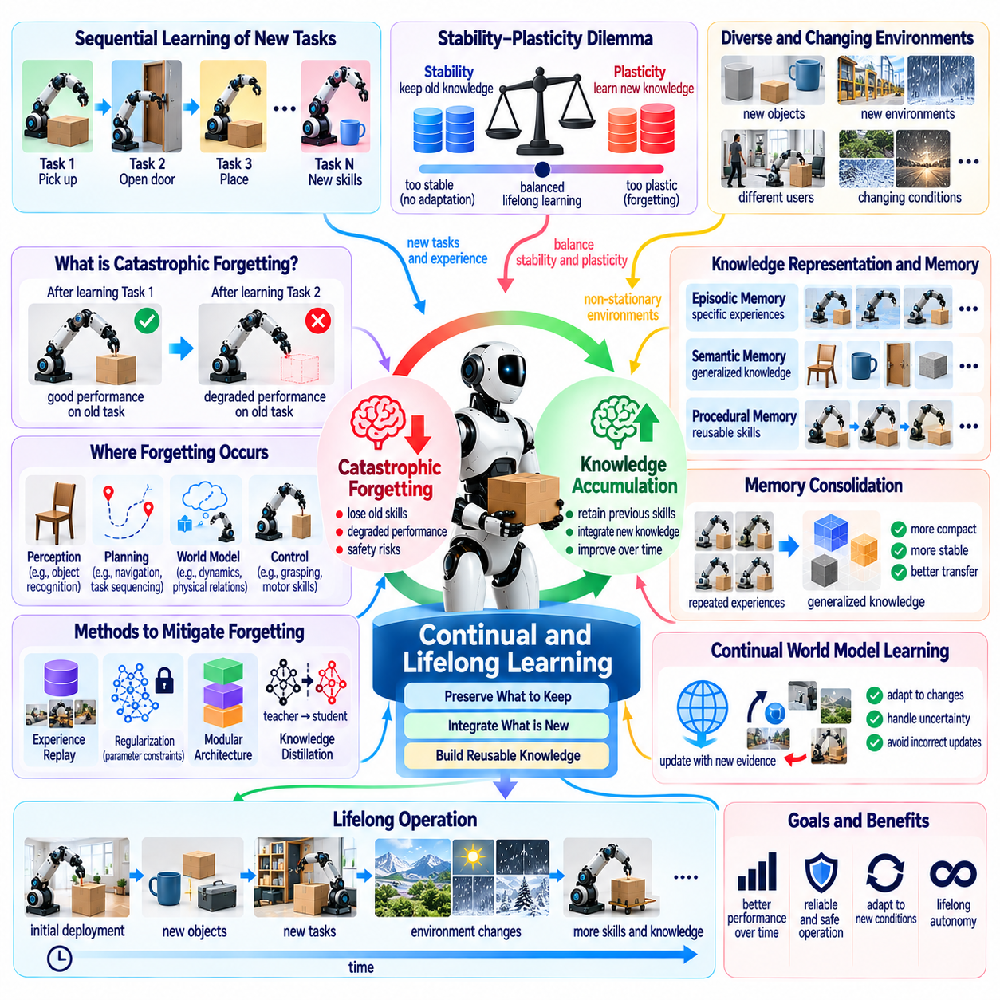{width="7.268055555555556in" height="7.268055555555556in"}

Catastrophic forgetting and knowledge accumulation represent interconnected challenges in Physical AI because autonomous robots must acquire new capabilities without losing previously learned skills. Unlike static learning systems, deployed robots encounter changing tasks, environments, and physical conditions throughout their operational lives. Reliable intelligence requires mechanisms that preserve established competence while integrating new experience into an expanding body of reusable knowledge.

Catastrophic forgetting occurs when training on new experiences significantly reduces performance on earlier tasks. Neural networks are particularly vulnerable because shared parameters may be modified to accommodate new information. A robot learning to manipulate unfamiliar objects might consequently lose precision when handling familiar ones. Such degradation is especially concerning when forgotten behaviors involve safety-critical control or recovery procedures.

The stability-plasticity dilemma describes the tension between preserving existing knowledge and adapting to new information. Excessive stability prevents robots from learning unfamiliar tasks, while excessive plasticity allows recent experiences to overwrite valuable representations. Effective learning systems must determine which knowledge should remain stable and which components should adapt. This decision becomes increasingly difficult as task diversity and operational experience grow.

Forgetting can affect perception, planning, world modeling, and motor control differently. A perception model may lose the ability to recognize previously encountered objects, while a controller may forget successful grasping strategies. World models may also replace accurate physical relationships with assumptions derived from recent environments. Understanding these distinct failure mechanisms is necessary for designing targeted knowledge-preservation methods.

Experience replay is a widely studied approach to reducing catastrophic forgetting. Robots retain selected trajectories, observations, actions, and outcomes from previous tasks and incorporate them into subsequent training. Replaying representative experiences helps maintain earlier capabilities while new skills are acquired. However, physical interaction records can be large, making memory capacity, data selection, and replay frequency important design considerations.

Memory selection should prioritize more than frequently observed behavior. Rare failures, successful recovery sequences, unusual contact conditions, and safety-critical interactions may contain disproportionately valuable information. Representative sampling can preserve broad task coverage, while importance-based sampling emphasizes consequential experiences. Combining these strategies may improve retention without requiring complete storage of every operational trajectory.

Regularization methods attempt to protect earlier knowledge by limiting changes to important model parameters. Techniques based on parameter importance can discourage updates that would damage previously acquired capabilities. Although such methods can reduce interference, parameter importance is difficult to estimate accurately across complex physical tasks. Shared neural representations may also contain knowledge that cannot be cleanly separated by task.

Architectural approaches address forgetting by separating or expanding model components. New tasks may receive specialized modules, adapters, or parameter subsets while established capabilities remain protected. Modular policies can preserve reliable navigation or manipulation skills during adaptation. However, continual architectural growth increases memory requirements, computational cost, and integration complexity, creating a tradeoff between retention and scalability.

Knowledge distillation offers another mechanism for preserving learned behavior. A previously validated model can provide reference predictions or action distributions while a newer model learns additional tasks. This encourages behavioral continuity without requiring every original training example. Nevertheless, distillation may preserve earlier model errors and may fail to retain capabilities that are poorly represented in the available transfer data.

Knowledge accumulation requires more than preventing performance degradation. A lifelong robot should organize experience into reusable concepts, physical principles, task strategies, and executable skills. Individual observations become valuable when they contribute to general knowledge about object properties, contact dynamics, spatial relationships, and action consequences. The objective is cumulative competence rather than repeated relearning of isolated behaviors.

Structured memory architectures can support knowledge accumulation at multiple levels. Episodic memory preserves specific interactions and their outcomes, semantic memory represents generalized facts about environments, and procedural memory stores reusable skills. These forms of memory can complement learned neural representations. Effective systems must determine when experiences should be retained individually, consolidated into abstractions, or discarded as redundant.

Memory consolidation transforms repeated experiences into more stable knowledge. For example, multiple encounters with slippery surfaces may support a generalized understanding of traction rather than separate memorization of every event. Consolidation can improve storage efficiency and transfer across environments. However, premature generalization may erase important exceptions, while overly specific memories may prevent efficient reasoning and adaptation.

Continual world model learning introduces additional challenges because new physical evidence may contradict earlier predictions. A robot may discover that a familiar-looking object has different mass, friction, or compliance than expected. Updating the model should improve prediction without corrupting valid knowledge about other objects. Context-dependent representations and uncertainty-aware updates can help distinguish genuine exceptions from broader changes in physical laws.

Task interference occurs when learning objectives compete for shared model capacity. Skills requiring precise contact control may conflict with policies optimized for rapid movement, while different environments may reward incompatible behaviors. Multi-task optimization and gradient conflict mitigation can reduce harmful interference. However, maintaining performance across an expanding task collection remains difficult when computational resources and model capacity are limited.

Positive transfer is the complementary opportunity within lifelong learning. Previously acquired knowledge can accelerate new skill development when tasks share physical structure or causal relationships. Experience with grasping containers may support handling unfamiliar packages, while navigation knowledge may transfer across related facilities. Reliable accumulation requires recognizing when shared knowledge applies and when inappropriate transfer could introduce errors.

Forgetting may also result from changes in sensing hardware, calibration, or action interfaces rather than neural training alone. Replacing a camera, modifying a gripper, or updating actuator control can invalidate assumptions embedded in existing policies. Knowledge-preservation systems must therefore distinguish model forgetting from hardware-induced performance changes. Maintaining explicit representations of embodiment and calibration history can support diagnosis and recovery.

Continual learning systems must account for limited storage, energy, and computational resources. Retaining every experience and repeatedly retraining large models is impractical for many deployed robots. Memory compression, selective replay, parameter-efficient adaptation, and hierarchical skill storage offer potential solutions. Their effectiveness should be evaluated against the physical costs of computation, communication, and additional robot interaction.

Fleet-scale knowledge accumulation could allow multiple robots to contribute to a shared repository of experience. Distributed systems may combine rare failure cases, environmental discoveries, and improved task strategies from different locations. However, heterogeneous hardware and operating conditions complicate knowledge integration. Shared updates must be validated to prevent localized errors from degrading the performance of other robots.

Safety introduces a strict requirement for preserving certain capabilities even when other knowledge changes. Collision avoidance, emergency stopping, stability recovery, and force limitation should not depend entirely on continually updated policies. Independent safety mechanisms and protected control functions can reduce the consequences of forgetting. New model versions should undergo regression testing before replacing previously validated operational behavior.

Evaluation should measure both knowledge retention and cumulative learning efficiency. Useful metrics include performance on previous tasks, adaptation speed, backward transfer, forward transfer, memory consumption, and safety violations. Long-duration benchmarks should expose robots to sequential tasks and changing environments without unrestricted access to earlier training data. Testing must distinguish genuine accumulated competence from memorization of benchmark sequences.

A major open question concerns how robots should determine which experiences deserve permanent retention. Information that appears unimportant during routine operation may become critical when rare conditions recur. Conversely, excessive preservation can prevent adaptation and overwhelm available memory. Intelligent memory management requires estimates of relevance, uncertainty, future utility, and the consequences of losing particular knowledge.

Ultimately, overcoming catastrophic forgetting is necessary but insufficient for lifelong Physical AI. Robots must preserve reliable skills, consolidate experience into transferable abstractions, resolve conflicting knowledge, and expand their capabilities through sustained interaction. Progress toward general physical intelligence depends on transforming sequential learning from a process of repeated replacement into one of stable, cumulative, and safely reusable knowledge.

## 07.11. Physical Reasoning and Deliberation

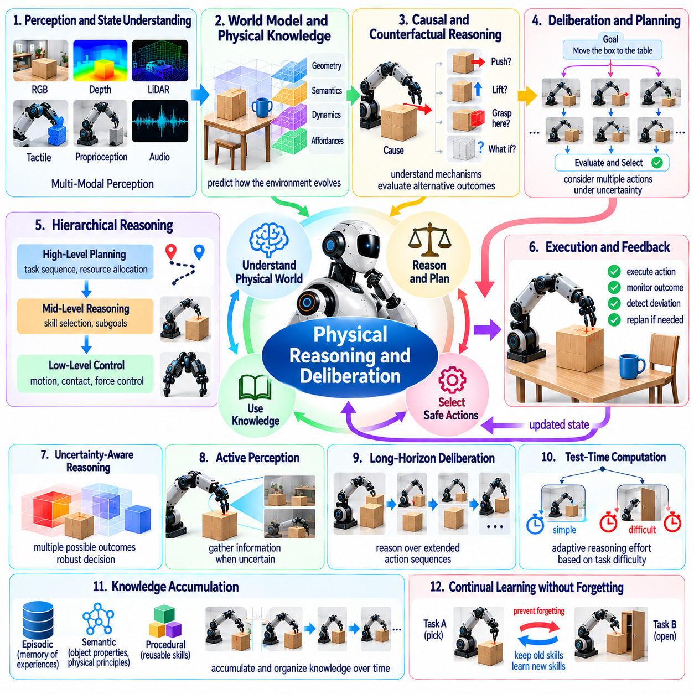{width="7.268055555555556in" height="7.268055555555556in"}

Physical reasoning and deliberation are fundamental research challenges in Physical AI because autonomous systems must understand physical situations before selecting actions. Unlike purely digital reasoning, robotic decisions involve geometry, motion, contact, force, uncertainty, and irreversible consequences. A capable robot must connect abstract goals with physical constraints while anticipating how its actions will transform the surrounding environment.

Physical reasoning involves interpreting objects, materials, spatial relationships, and dynamic interactions to determine what actions are possible. A robot moving a heavy container must consider mass, friction, available clearance, and potential instability. These properties cannot always be inferred from visual appearance alone. Reliable reasoning therefore requires combining sensory observations, learned physical knowledge, and predictions of action outcomes.

Deliberation extends immediate decision-making by evaluating alternative actions before execution. Rather than selecting a response directly from current observations, a robot may simulate candidate behaviors, compare expected outcomes, and choose a suitable strategy. This process becomes especially important when actions are costly or difficult to reverse. However, extensive deliberation introduces computational latency that must be balanced against operational deadlines.

A central challenge is constructing representations that support both symbolic reasoning and continuous physical prediction. Symbolic descriptions capture objects, goals, constraints, and task relationships, while continuous models represent positions, velocities, forces, and contact dynamics. Neither representation is sufficient for every situation. Integrating them may enable robots to reason about high-level intentions while respecting low-level physical feasibility.

World models provide a computational foundation for physical deliberation by predicting how environments evolve under candidate actions. A robot may estimate whether pushing an object will create sufficient clearance or whether grasping from another direction will improve stability. These predictions support planning without requiring every alternative to be tested physically. Their usefulness depends on prediction accuracy and awareness of model uncertainty.

Causal reasoning is essential because robots must distinguish correlations from mechanisms that determine physical outcomes. Observing that an object moves after contact does not establish which force or constraint caused the motion. Understanding causal structure helps robots select effective interventions and adapt to unfamiliar situations. Learning such relationships remains difficult when observations are incomplete and controlled experiments are expensive.

Counterfactual reasoning allows a robot to consider what might happen if it chooses an alternative action. Before lifting a fragile object, the system may compare different grasp locations, contact forces, and motion trajectories. Counterfactual predictions can reveal potential failures without exposing equipment to unnecessary risk. However, their reliability depends on models that accurately represent physical constraints and uncertain interactions.

Long-horizon deliberation requires reasoning across sequences of actions whose consequences may emerge much later. An assembly robot may need to reposition components before completing a fastening operation, while a mobile manipulator may rearrange obstacles to reach a destination. Local actions must therefore be evaluated in relation to future goals. Errors in predicted intermediate states can accumulate and undermine otherwise reasonable plans.

Hierarchical reasoning can reduce complexity by separating strategic objectives from detailed motor execution. High-level planning determines task order and resource allocation, while lower levels select motion trajectories and contact strategies. This decomposition allows robots to reason over extended tasks without evaluating every motor command simultaneously. Nevertheless, coordination between levels remains challenging when unexpected physical events invalidate higher-level assumptions.

Test-time computation offers a mechanism for allocating additional reasoning effort to difficult decisions. Simple actions may require minimal deliberation, whereas uncertain manipulation or hazardous navigation may justify evaluating multiple candidate plans. Adaptive computation could improve efficiency by concentrating resources where they provide the greatest benefit. The unresolved question is how to estimate the value of further reasoning before committing computational resources.

Physical deliberation must operate under strict timing constraints because the environment continues changing while a robot reasons. A navigation system cannot indefinitely analyze an approaching obstacle, and a manipulator cannot delay necessary stabilization during unstable contact. Effective architectures may combine fast reactive control with slower predictive planning. The challenge is maintaining consistency between these processes while guaranteeing timely safety responses.

Uncertainty-aware reasoning is necessary because physical predictions are rarely exact. Sensor noise, unknown material properties, imperfect calibration, and unpredictable human behavior can produce multiple plausible outcomes. Robots should evaluate plans across uncertainty ranges rather than relying exclusively on a single predicted future. Robust decisions may sacrifice nominal efficiency to reduce the probability of dangerous or unrecoverable outcomes.

Active perception connects reasoning with information gathering. When uncertainty prevents a reliable decision, a robot may change its viewpoint, inspect an object, or perform a small exploratory interaction. These actions can reveal hidden geometry, contact conditions, or material characteristics. Deliberation must determine whether the expected information gain justifies the time, energy, and physical risk associated with additional sensing.

Commonsense physical knowledge provides useful expectations about support, containment, stability, and object interaction. Robots should recognize that unsupported objects may fall, blocked doors cannot open freely, and stacked materials may collapse when their support changes. Such knowledge can guide planning before detailed simulation. However, translating broad physical expectations into precise, context-dependent control decisions remains an open challenge.

Language-guided reasoning can connect human intentions with executable physical plans. Instructions such as clearing a workspace or securing a loose component require interpretation of goals, objects, constraints, and acceptable outcomes. Vision-language-action models may help translate semantic descriptions into candidate behaviors. Nevertheless, linguistic plausibility does not guarantee physical feasibility, making grounded verification essential.

Tool use introduces additional reasoning requirements because tools alter the relationship between robot actions and environmental effects. A robot using a lever, gripper, or cleaning implement must account for contact geometry, mechanical advantage, and task-specific constraints. Generalizing tool use requires understanding functional properties rather than memorizing appearances. This remains difficult when tools or working conditions differ from training examples.

Multi-robot deliberation extends physical reasoning to interactions among autonomous agents. Robots sharing a workspace must anticipate each other\'s trajectories, task dependencies, and resource requirements. Coordinated planning can improve efficiency and prevent interference, but it also increases uncertainty and communication demands. Distributed reasoning must remain reliable when agents possess incomplete information or temporarily lose connectivity.

Learning to deliberate from experience may reduce dependence on expensive exhaustive search. Robots can acquire heuristics that identify promising actions, recognize likely failures, and prioritize informative simulations. Successful strategies may become reusable planning skills. However, learned reasoning shortcuts can reproduce training biases, so unfamiliar or high-risk situations may still require explicit physical verification.

Safety constraints must shape deliberation rather than appear only as final checks. Candidate plans should account for collision limits, force thresholds, human proximity, equipment stability, and emergency recovery options. A theoretically efficient action may be unacceptable if its failure consequences are severe. Integrating safety into reasoning requires models that represent both expected performance and credible hazardous outcomes.

Evaluation of physical reasoning should measure more than whether a robot eventually completes a task. Benchmarks should examine causal understanding, counterfactual accuracy, planning efficiency, robustness, and adaptation to unfamiliar physical conditions. Controlled experiments can test whether systems understand why actions succeed or fail. Real-world evaluation remains essential because simulated reasoning performance may not transfer reliably to physical interaction.

A major research question concerns how much explicit reasoning is necessary for different classes of robotic behavior. Some tasks may be solved efficiently through learned reactive policies, while others require structured search, simulation, or symbolic planning. A general Physical AI system should determine which reasoning mechanism is appropriate for each situation. Such flexibility may be more valuable than applying computationally expensive deliberation to every action.

Another unresolved challenge is integrating reasoning with continual learning and persistent memory. Physical experiences should refine causal models, improve planning heuristics, and reveal previously unknown constraints. At the same time, incorrect conclusions must not become permanent assumptions that influence future actions. Reliable knowledge revision requires evidence tracking, uncertainty estimation, and validation across diverse physical contexts.

Ultimately, physical reasoning and deliberation aim to transform robotic behavior from immediate stimulus-response mapping into informed, goal-directed interaction with the physical world. Progress depends on grounded representations, predictive world models, causal understanding, adaptive computation, and safety-aware planning. These capabilities are essential for Physical AI systems that must solve unfamiliar problems while acting reliably under real-world constraints.

## 07.12. Uncertainty and Reliable Decision Making

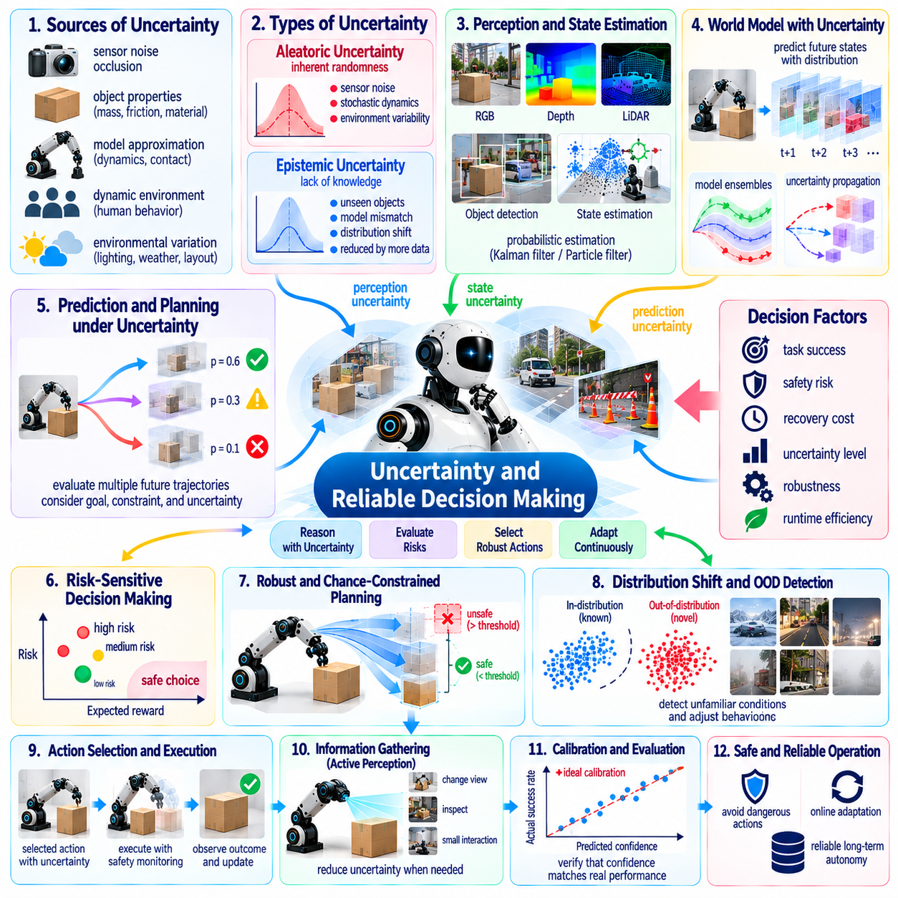{width="7.268055555555556in" height="7.268055555555556in"}

Uncertainty and reliable decision-making are central challenges in Physical AI because autonomous robots must act despite incomplete observations, imperfect models, and unpredictable environments. Unlike digital systems, physical actions can produce irreversible consequences involving equipment, infrastructure, and human safety. Reliable autonomy therefore requires robots to recognize uncertainty, estimate its consequences, and select actions that remain acceptable under changing conditions.

Uncertainty arises from multiple sources throughout robotic perception and control. Sensors introduce measurement noise, occlusion, and calibration errors, while world models approximate complex physical interactions. Unknown object properties and unexpected human behavior introduce additional variability. A robot must distinguish uncertainty caused by limited knowledge from variability inherent in the environment to determine appropriate responses.

Aleatoric uncertainty describes randomness or variability that cannot be eliminated simply by collecting more information. Examples include sensor noise, unpredictable surface interactions, and stochastic environmental disturbances. Epistemic uncertainty reflects insufficient knowledge about models, objects, or operating conditions. This distinction matters because additional observations may reduce epistemic uncertainty, whereas aleatoric uncertainty often requires robust decision policies.

Uncertainty estimation must extend beyond assigning confidence scores to perception outputs. A robot may recognize an object correctly while remaining uncertain about its mass, friction, stability, or response to contact. Reliable decision-making requires uncertainty representations covering geometry, dynamics, task outcomes, and safety constraints. These estimates should remain meaningful when information passes between perception, planning, and control modules.

Probabilistic state estimation provides a foundation for reasoning under incomplete observations. Bayesian filtering methods combine sensor measurements with motion models to estimate possible robot and environment states. Kalman filters and particle filters illustrate different approaches to maintaining such beliefs. However, complex contact dynamics and changing environments can violate modeling assumptions, causing estimated confidence to become misleading.

Belief-state planning considers multiple possible environmental states rather than assuming a single known configuration. Partially observable Markov decision processes provide a formal framework for selecting actions under uncertain observations and transitions. Such methods can balance task progress with information gathering. Their computational complexity remains a major obstacle when robots operate in high-dimensional spaces with continuous actions.

Predictive world models introduce uncertainty about future physical states. Small errors in estimated friction, contact geometry, or actuator response may produce substantially different outcomes after several actions. Reliable planning must therefore consider distributions of possible trajectories rather than one deterministic prediction. Maintaining useful uncertainty estimates across long horizons remains difficult because prediction errors can accumulate and interact.

Model ensembles can estimate uncertainty by comparing predictions from independently trained models. Agreement may indicate relatively stable predictions, while disagreement can reveal unfamiliar situations or insufficient training coverage. Nevertheless, ensembles may share systematic errors and produce misleading agreement. Reliable uncertainty assessment requires validation against real outcomes rather than treating model consensus as proof of correctness.

Calibration determines whether predicted confidence corresponds to observed reliability. A robot reporting high confidence should succeed at an appropriately high frequency under comparable conditions. Poor calibration can cause dangerous overconfidence or unnecessarily conservative behavior. Calibration must be evaluated across different environments, tasks, and risk levels because confidence estimates that work during training may fail after deployment.

Distribution shift occurs when operational conditions differ from those represented in training data. New lighting, unfamiliar materials, changed layouts, or degraded sensors can invalidate learned assumptions. Out-of-distribution detection may identify unusual observations, but recognizing novelty does not automatically establish how dangerous it is. Robots need mechanisms that connect distribution shift with task relevance and appropriate operational responses.

Risk-sensitive decision-making evaluates not only expected task performance but also the consequences of unfavorable outcomes. Two actions with similar average rewards may differ substantially in their probability of causing damage. A reliable robot should consider failure severity, recovery cost, and uncertainty when comparing alternatives. This may justify selecting slower or less efficient actions when their safety margins are significantly greater.

Robust optimization seeks decisions that remain effective across plausible variations in model parameters and environmental conditions. A manipulation planner may account for uncertain object mass, while a mobile robot may plan for variations in traction. Conservative assumptions can improve safety but may also reduce productivity. The challenge is defining uncertainty sets that capture credible conditions without making useful actions unnecessarily impossible.

Chance-constrained planning allows selected risks to be bounded probabilistically. For example, a trajectory planner may require collision probability to remain below a specified threshold. Such constraints connect uncertainty estimates with explicit operational requirements. However, their guarantees depend on the validity of probability models, and rare hazardous events may be poorly represented by available training or evaluation data.

Conditional value at risk provides another perspective by emphasizing severe outcomes in the unfavorable tail of a loss distribution. Instead of optimizing only average performance, a robot may prioritize reducing the consequences of particularly damaging failures. This approach can support decisions involving fragile equipment or hazardous environments. Its practical effectiveness depends on obtaining credible estimates of rare-event consequences.

Active perception enables robots to reduce uncertainty before committing to difficult actions. A manipulator may inspect an object from another viewpoint, while a mobile robot may slow down to obtain more reliable terrain measurements. Such information-gathering actions consume time and energy but can prevent costly mistakes. Reliable decision-making must estimate when additional sensing is more valuable than immediate task execution.

The value of information provides a formal perspective on whether further observation or experimentation is worthwhile. A robot should seek information when it is likely to change the preferred action enough to justify its acquisition cost. However, information gathering can itself involve physical risk. Safe exploration must therefore distinguish useful uncertainty reduction from unnecessary exposure to hazardous conditions.

Human involvement remains important when uncertainty exceeds autonomous operating limits. A robot may request confirmation, transfer control, or suspend a task when available evidence cannot support a reliable decision. Effective escalation requires meaningful uncertainty indicators and clear explanations of operational consequences. Excessive requests can overwhelm operators, while delayed intervention can allow manageable problems to become dangerous.

Runtime assurance can provide an independent layer of protection against uncertain learned decisions. Monitoring systems may evaluate predicted trajectories, enforce safety boundaries, or activate fallback controllers when confidence deteriorates. Such mechanisms should remain effective even when the primary learning model is incorrect. However, designing dependable monitors requires explicit assumptions about sensing accuracy, system dynamics, and intervention timing.

Reliable decision-making also requires recognizing when uncertainty cannot be reduced sufficiently. Some environments contain hidden hazards, unpredictable agents, or physical interactions that exceed available modeling capabilities. In these situations, stopping, retreating, or selecting a restricted operating mode may be the most appropriate response. Autonomous competence includes knowing when continued action is unjustified.

Multi-robot systems introduce additional uncertainty through communication delays, incomplete shared observations, and unpredictable coordination outcomes. One robot may plan using outdated information about another robot\'s location or intended trajectory. Distributed decision-making must account for these inconsistencies while maintaining safe separation and task coordination. Shared confidence estimates can help, but they must reflect differences in local information quality.

Evaluation of uncertainty-aware Physical AI should measure calibration, robustness, risk exposure, and recovery behavior alongside ordinary task success. Benchmarks must include unfamiliar conditions, sensor degradation, ambiguous observations, and rare hazardous events. Testing should determine whether robots become appropriately cautious when confidence decreases. Reliable uncertainty handling must be demonstrated through physical outcomes rather than confidence predictions alone.

A major unresolved question is how uncertainty should propagate through integrated robotic architectures. Perception errors influence world models, planning decisions, and control actions, often through nonlinear relationships. Independent confidence estimates may fail to capture correlated errors between modules. Research must develop scalable methods that preserve relevant uncertainty information without overwhelming real-time computational resources.

Ultimately, reliable decision-making requires Physical AI systems to reason about what they know, what remains uncertain, and what consequences may follow from acting. Progress depends on calibrated uncertainty estimates, probabilistic world models, risk-sensitive planning, active information gathering, and dependable safety mechanisms. These capabilities are essential for autonomous robots that must operate responsibly in complex and unpredictable physical environments.

## 07.13. Safe Exploration and Self Improvement

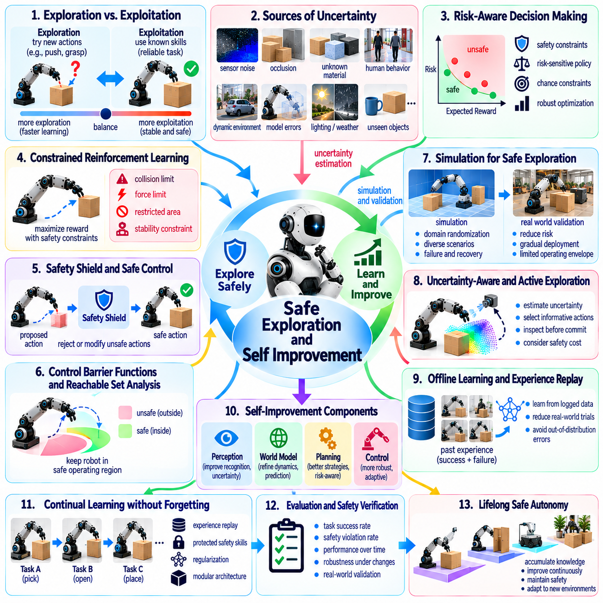{width="7.268055555555556in" height="7.268055555555556in"}

Safe exploration and self-improvement are essential research challenges in Physical AI because autonomous robots must learn from experience without exposing people, equipment, or environments to unacceptable risks. Unlike digital learning systems, physical experimentation can cause irreversible damage. A reliable robot must therefore balance the benefits of discovering new behaviors with the responsibility to preserve safety throughout learning and deployment.

Exploration enables robots to discover unfamiliar objects, physical properties, environmental structures, and action strategies. However, actions that provide valuable information may also introduce collision, instability, or equipment damage. Safe exploration requires distinguishing informative experiments from unnecessarily hazardous ones. The objective is not to eliminate uncertainty entirely but to acquire useful knowledge while maintaining acceptable operational risk.

The exploration-exploitation dilemma becomes particularly important when learning occurs in the physical world. Exploitation uses established policies to achieve known objectives, while exploration investigates potentially better alternatives. Excessive exploitation limits improvement, whereas uncontrolled exploration creates safety hazards. Adaptive strategies must determine when experimentation is justified by expected learning benefits and available safety margins.

Constrained reinforcement learning provides a framework for optimizing behavior while respecting explicit safety requirements. Instead of maximizing task rewards alone, the learning process incorporates limits on collisions, excessive forces, unstable motion, or restricted-area violations. These constraints may be expressed through expected costs or risk measures. However, satisfying average constraints does not necessarily prevent individual catastrophic failures.

Safety shields can prevent exploratory policies from executing actions that violate predefined operational boundaries. A shield may reject unsafe commands, modify trajectories, or activate a verified fallback controller. This separation allows learning components to propose new behaviors while independent mechanisms enforce critical constraints. Nevertheless, shielding effectiveness depends on accurate state estimation and sufficiently reliable safety models.

Control barrier functions and reachable-set analysis offer mathematical approaches to maintaining safe operating regions. These techniques evaluate whether candidate control actions preserve specified state constraints over time. They can support collision avoidance, actuator limits, and stability protection. However, their guarantees depend on modeling assumptions, disturbance bounds, and the availability of computationally tractable safety representations.

Simulation provides a comparatively low-risk environment for testing exploratory behaviors before physical deployment. Robots can evaluate candidate policies, encounter synthetic failures, and practice recovery strategies without repeatedly endangering real equipment. Domain randomization and digital twins can broaden experimental coverage. Yet simulation cannot reproduce every physical interaction, making real-world validation necessary before unrestricted operation.

The simulation-to-reality gap creates a major obstacle for safe self-improvement. Policies that appear reliable in simulation may fail when confronted with unmodeled friction, sensor degradation, contact dynamics, or unexpected human behavior. Safety evaluation should therefore include uncertainty about simulation fidelity. Gradual deployment, restricted operating envelopes, and controlled physical trials can reduce exposure during adaptation.

Uncertainty-aware exploration prioritizes actions according to both expected information gain and potential consequences. A robot may inspect an unfamiliar surface before driving across it or perform a low-force contact test before grasping an unknown object. Such experiments can improve physical understanding without immediately committing to high-risk actions. Reliable exploration requires estimating whether additional information justifies the associated physical cost.

Active learning can reduce the amount of real-world experimentation needed for improvement. Rather than collecting arbitrary experiences, robots identify observations or interactions that are especially informative for their models. Targeted data collection may focus on uncertain object properties, rare failure conditions, or poorly understood dynamics. However, information value must be evaluated alongside safety constraints and the availability of safer alternatives.

Self-improvement extends beyond learning individual actions to refining perception, world models, planning, and control. Operational experience can reveal systematic prediction errors, inefficient trajectories, or recurring task failures. These observations may guide model updates and policy refinement. A central challenge is determining whether an apparent improvement generalizes beyond the specific conditions in which it was discovered.

Continual self-improvement introduces the risk that new learning will degrade previously validated capabilities. Updates may improve performance on recent tasks while weakening collision avoidance, grasp stability, or recovery behavior. Preventing such regressions requires experience replay, protected safety functions, and evaluation across historical tasks. Improvement must be measured against accumulated competence rather than isolated short-term gains.

Offline reinforcement learning offers a way to improve policies using previously collected experience without requiring continuous physical experimentation. Historical trajectories can support learning from both successful and unsuccessful actions. However, policies may incorrectly evaluate actions poorly represented in the dataset. Conservative learning methods and uncertainty estimates are therefore important when deciding whether offline improvements are safe to deploy.

Human demonstrations and corrective feedback can guide exploration toward useful and acceptable behaviors. Operators may demonstrate safe manipulation, identify dangerous conditions, or intervene when autonomous behavior becomes uncertain. Such guidance can reduce exploration costs and improve task relevance. Nevertheless, human feedback may be inconsistent, and demonstrations may not cover every failure condition encountered during deployment.

A staged validation process can connect experimental learning with operational deployment. Candidate models may first undergo offline evaluation, simulation testing, controlled physical trials, and progressively broader field testing. Each stage should establish measurable acceptance criteria for task performance and safety. Deployment should proceed only when evidence supports the intended operating conditions, with rollback mechanisms available if regressions emerge.

Runtime monitoring is necessary because even extensively validated policies may encounter unfamiliar conditions. Monitoring systems can detect unusual observations, prediction failures, excessive forces, or deviations from expected trajectories. When safety margins deteriorate, the robot may reduce speed, request assistance, or transition to a protected controller. Such mechanisms allow adaptation while limiting the consequences of unexpected behavior.

Recovery competence is an important component of safe exploration. Robots should learn how to recognize failed actions, stabilize their physical state, and return to known safe configurations. Recovery may involve releasing an object, retreating from an obstacle, or abandoning an infeasible task. However, recovery strategies themselves require validation because an inappropriate corrective action can increase the severity of an existing failure.

Fleet-scale self-improvement can accelerate learning by aggregating experiences from multiple robots. Rare failures, successful adaptations, and unfamiliar environmental conditions can contribute to shared training datasets. Centralized or federated learning may distribute improved models across the fleet. However, updates should be evaluated against differences in hardware, calibration, operating environments, and safety requirements before widespread deployment.

Self-improving robots also require mechanisms for determining when learning should stop. Continued adaptation is not always beneficial, particularly when data quality deteriorates or operational conditions become hazardous. Learning-rate limits, uncertainty thresholds, and performance monitoring can help prevent unstable updates. The ability to suspend learning while preserving reliable operation is itself an important aspect of autonomous intelligence.

Evaluation of safe exploration should consider learning efficiency, safety violations, recovery success, and performance retention. A system that learns rapidly but causes frequent hazardous events cannot be considered successful. Benchmarks should include rare disturbances, unfamiliar objects, sensor failures, and changing operational constraints. Long-duration testing is needed to determine whether improvements remain reliable after repeated updates.

An unresolved research challenge is establishing trustworthy evidence that autonomous improvement does not compromise safety. Statistical testing alone may provide limited assurance for extremely rare failures. Combining formal verification, runtime assurance, empirical evaluation, and conservative deployment could strengthen confidence. However, guarantees remain difficult when learned models interact with complex and partially observable physical environments.

Another challenge concerns autonomous modification of the learning process itself. Advanced robots may eventually adjust their exploration strategies, memory structures, or planning architectures based on accumulated experience. Such changes could improve adaptability but also alter assumptions underlying previous safety assessments. Reliable self-modification therefore requires explicit boundaries, traceable updates, and independent validation mechanisms.

Ultimately, safe exploration and self-improvement aim to create Physical AI systems that become more capable through experience without sacrificing operational reliability. Progress requires integrating uncertainty estimation, constrained learning, predictive world models, safety supervision, and continuous validation. The long-term objective is not unrestricted autonomous experimentation but disciplined learning that produces cumulative improvements within demonstrable safety boundaries.

## 07.14. Morphology Intelligence Co Design

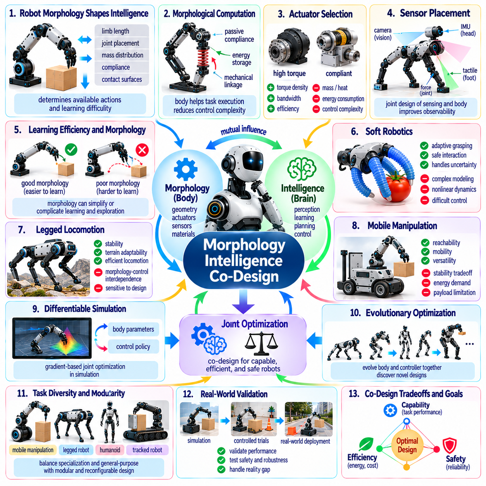{width="7.268055555555556in" height="7.268055555555556in"}

Morphology-intelligence co-design is an emerging research direction in Physical AI that treats robot embodiment and computational intelligence as interconnected elements of a single system. Traditional robotics often designs mechanical structures before developing perception, planning, and control algorithms. Co-design instead considers how body geometry, actuators, sensors, materials, and learning architectures jointly determine achievable behavior.

Robot morphology influences intelligence by shaping the physical interactions available to an autonomous system. Limb length, joint placement, mass distribution, compliance, and contact surfaces determine how a robot moves and manipulates objects. These characteristics constrain possible actions while creating opportunities for efficient behavior. Consequently, intelligence cannot be evaluated independently of the body through which it acts.

Morphological computation describes how physical structures can perform functions that would otherwise require explicit computational control. Passive compliance may absorb impacts, elastic components may store energy, and mechanical linkages may coordinate movement. Such properties reduce the burden on control algorithms. However, passive mechanisms may become disadvantages when operating conditions differ substantially from those anticipated during design.

Co-design requires optimization across mechanical performance, sensing capability, control complexity, and computational cost. A robot with additional joints may gain dexterity but require more sophisticated coordination and greater energy consumption. A simpler mechanism may improve reliability while limiting task versatility. The central challenge is identifying embodiments that support broad capabilities without introducing unnecessary mechanical complexity.

The relationship between morphology and learning efficiency is particularly important for general-purpose robots. Some body configurations make useful behaviors easier to discover through reinforcement learning or imitation learning. Others produce difficult exploration landscapes because effective actions require precise coordination. Designing morphology to simplify learning may reduce training data requirements and improve the transfer of learned policies.

Actuator selection strongly affects the interaction between physical design and intelligent control. High-torque actuators provide substantial force but may increase mass, heat generation, and power consumption. Compliant actuators improve interaction safety and impact tolerance but introduce additional dynamic complexity. Co-design must consider actuator bandwidth, torque density, efficiency, and controllability alongside intended tasks.

Sensor placement is another critical dimension of morphology-intelligence integration. Cameras, tactile sensors, force sensors, and inertial measurement units provide information whose usefulness depends on their physical locations. Poor sensor geometry can create persistent blind spots or ambiguous observations. Joint optimization of sensing and embodiment can improve observability while reducing unnecessary sensor redundancy.

Soft robotics illustrates how morphology can contribute directly to adaptive physical behavior. Flexible structures deform around objects, distribute contact forces, and accommodate uncertain geometry. These properties can simplify grasping and interaction with delicate materials. Nevertheless, modeling and controlling deformable bodies remain challenging because their dynamics are nonlinear, distributed, and difficult to observe completely.

Legged locomotion provides a prominent example of morphology-control interdependence. Leg proportions, joint configurations, foot geometry, and body mass distribution influence stability, speed, and terrain adaptability. A controller optimized for one morphology may perform poorly on another. Joint optimization of leg design and locomotion policies could produce robots that traverse difficult environments more efficiently and robustly.

Mobile manipulation introduces additional tradeoffs between locomotion and manipulation capability. A large manipulator may extend workspace reach but increase platform instability and energy demand. A compact mobile base may improve maneuverability while restricting payload and operational range. Co-design must balance reachability, stability, mobility, and task requirements rather than optimizing individual subsystems independently.

Differentiable simulation offers a potential method for jointly optimizing physical parameters and control policies. Gradients can sometimes be propagated through simulated dynamics to adjust body dimensions, material properties, and controller parameters. This approach may accelerate design exploration compared with exhaustive physical prototyping. However, contact discontinuities, modeling errors, and manufacturing constraints limit practical applicability.

Evolutionary optimization provides another framework for discovering effective combinations of morphology and intelligence. Candidate robot designs can be evaluated through simulation, with successful structures and controllers guiding subsequent generations. Such methods can explore unconventional configurations that human designers might overlook. Their main limitations include computational expense, simulation bias, and difficulty transferring evolved designs into manufacturable hardware.

Task diversity complicates morphology optimization because a body optimized for one activity may perform poorly on another. A lightweight robot designed for rapid locomotion may lack the strength required for industrial manipulation. General-purpose embodiment therefore requires balancing specialization and adaptability. Modular hardware, interchangeable end effectors, and reconfigurable structures may provide practical compromises.

Morphological adaptation extends co-design beyond fixed mechanical structures. Robots with adjustable stiffness, variable geometry, or reconfigurable limbs may modify their physical properties to match changing tasks. Such capabilities expand the action space but also increase planning and control complexity. Intelligent systems must decide when physical reconfiguration provides sufficient benefit to justify its time and energy costs.

Energy efficiency is a fundamental objective in morphology-intelligence co-design. Mechanical structure influences energy losses, actuator loading, balance, and the need for continuous corrective control. Passive dynamics and appropriate mass distribution can reduce computational and mechanical effort. However, optimizing energy consumption must not compromise safety, robustness, or the ability to handle unfamiliar operating conditions.

Hardware-aware learning seeks policies that respect physical limitations during training rather than discovering infeasible behaviors afterward. Torque limits, joint ranges, thermal constraints, actuator delays, and sensor characteristics should influence the learning process. Incorporating these factors can improve real-world deployment reliability. The challenge is preserving learning flexibility while accurately representing complex hardware restrictions.

Cross-embodiment transfer raises questions about which aspects of intelligence can remain independent of morphology. High-level task concepts may transfer between wheeled robots, quadrupeds, and humanoids, while low-level motor policies often require substantial adaptation. Shared representations of goals, objects, and physical affordances may support transfer. Effective co-design should distinguish reusable intelligence from embodiment-specific control.

Manufacturing feasibility introduces practical constraints that purely computational optimization may overlook. Complex structures may achieve excellent simulated performance while being expensive, fragile, or difficult to maintain. Material availability, assembly tolerances, repairability, and component standardization influence real deployment. Successful co-design must integrate engineering economics and lifecycle considerations into optimization objectives.

Safety requirements also shape the relationship between morphology and intelligence. Rounded surfaces, compliant joints, stable support geometries, and mechanically limited forces can reduce hazards before software intervention becomes necessary. Such inherent safety features complement learned policies and runtime monitoring. Designing safety into the body may provide protection against control failures that purely algorithmic methods cannot guarantee.

Evaluation of morphology-intelligence co-design should compare complete systems rather than isolated mechanical or algorithmic components. Relevant metrics include task success, energy efficiency, robustness, learning speed, adaptability, maintenance cost, and safety. Experiments should distinguish improvements caused by morphology from those caused by larger models or additional training. Standardized evaluation remains difficult because embodiments possess different capabilities and constraints.

A major open research question concerns the search space of possible robot bodies. Continuous dimensions, discrete mechanisms, material choices, sensor configurations, and control architectures create an enormous optimization problem. Efficient search requires useful design priors, hierarchical representations, and reliable simulation. Developing methods that explore this space without excessive computation or physical prototyping remains a significant challenge.

Another unresolved issue is whether morphology and intelligence can improve together throughout a robot\'s operational lifetime. Software can adapt rapidly, but mechanical changes usually require physical replacement or reconfiguration. Future systems may combine modular hardware evolution with continual learning to support progressive capability development. Such approaches must manage compatibility, validation, and the preservation of previously acquired skills.

Ultimately, morphology-intelligence co-design suggests that advanced Physical AI will emerge from coordinated development of bodies, sensors, actuators, learning systems, and control architectures. Intelligence should not merely compensate for mechanical limitations, nor should hardware design assume fixed computational capabilities. Progress toward general physical intelligence may depend on discovering embodiments that make complex behaviors easier to learn, safer to execute, and more efficient to sustain.

## 07.15. Energy Efficient Physical Intelligence

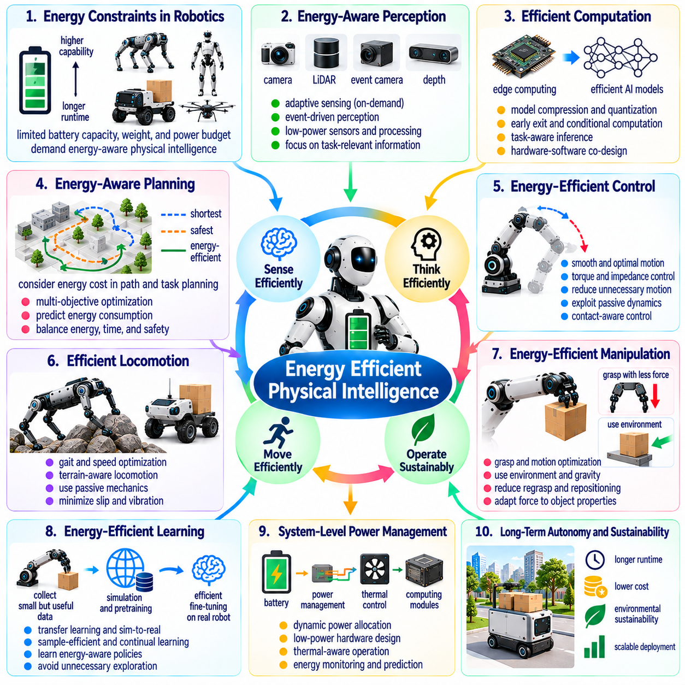{width="7.268055555555556in" height="7.268055555555556in"}

Energy-efficient physical intelligence is a fundamental challenge in Physical AI because autonomous robots must transform limited energy resources into useful perception, reasoning, and physical action. Unlike purely digital systems, robots consume energy through computation, sensing, actuation, communication, and environmental interaction. Achieving sustained autonomy requires optimizing these processes together rather than treating computational efficiency and mechanical efficiency as separate objectives.

Energy consumption directly influences operational endurance, mobility, payload capacity, and system reliability. A robot may possess advanced perception and planning capabilities yet remain impractical if its energy requirements exceed available battery capacity. Increasing battery size introduces additional mass, which can raise locomotion costs and reduce maneuverability. Energy-efficient intelligence must therefore consider the interactions between power availability, physical design, and task performance.

Physical AI energy efficiency cannot be measured solely through computational operations per second or neural network inference latency. Meaningful evaluation must consider energy consumed per successful task, distance traveled, object manipulated, or mission completed. A computationally expensive planning algorithm may reduce total energy use by avoiding inefficient movement. Conversely, a lightweight model may waste energy if it repeatedly produces poor physical decisions.

Actuation frequently represents a major energy demand in mobile and manipulation robots. Motors must overcome inertia, friction, gravity, and external loads while maintaining stability and precision. Inefficient motion trajectories can consume substantial energy even when computational workloads are small. Joint optimization of mechanical design, trajectory generation, and feedback control can reduce unnecessary acceleration, braking, and corrective movement.

Morphology strongly influences the energy required to perform physical tasks. Body mass distribution, joint configuration, transmission efficiency, wheel geometry, and compliant structures affect locomotion and manipulation costs. Passive mechanical dynamics can sometimes replace continuous active control. However, designs optimized for energy efficiency under ideal conditions may become inefficient or unstable when terrain, payload, or environmental disturbances change.

Energy-aware planning extends conventional task optimization by considering the power consequences of alternative actions. A mobile robot may choose a longer but smoother route to avoid steep gradients or repeated acceleration. A manipulator may select a grasp that reduces sustained holding torque. Such decisions require predictive models connecting actions, physical conditions, execution time, and energy consumption.

Battery state estimation is essential for reliable energy-aware autonomy. Remaining capacity alone does not fully describe usable energy because temperature, aging, discharge rate, and load variations affect battery performance. State-of-charge and state-of-health estimation can support operational planning. Nevertheless, inaccurate battery models may cause robots to overestimate endurance, creating mission failures or unsafe shutdown conditions.

Energy-efficient perception requires adjusting sensing effort to operational needs. High-resolution cameras, dense LiDAR measurements, and continuous multimodal processing can provide detailed environmental information but consume significant power. Adaptive sensing can reduce sampling rates or deactivate unnecessary sensors during predictable conditions. Critical safety observations must remain available, however, even when energy-saving policies restrict ordinary perception workloads.

Neural network architecture also affects the energy demands of physical intelligence. Large vision-language-action models may provide flexible reasoning but require substantial memory bandwidth and accelerator power. Quantization, pruning, knowledge distillation, and efficient attention mechanisms can reduce inference costs. Their practical value must be assessed against accuracy degradation, response latency, and the consequences of incorrect physical actions.

Adaptive computation allows robots to allocate processing resources according to task difficulty and uncertainty. Routine navigation may require lightweight inference, while unfamiliar manipulation can justify more intensive reasoning. Early-exit networks, hierarchical controllers, and selective model activation offer possible approaches. The unresolved challenge is predicting when additional computation improves decisions enough to justify its energy expenditure.

Edge computing introduces tradeoffs between local processing and remote intelligence services. Onboard computation reduces communication dependence and can support low-latency control, but powerful accelerators increase electrical and thermal demands. Offloading selected workloads may save local computation while consuming communication energy and introducing network delays. Optimal allocation depends on task urgency, connectivity, privacy requirements, and available power.

Thermal management creates another connection between energy efficiency and computational reliability. High-power processors and actuators generate heat that may require active cooling or reduced operating frequency. Thermal throttling can alter inference latency and control responsiveness. Intelligent workload scheduling should therefore account for temperature, cooling capacity, and sustained performance rather than optimizing instantaneous computational throughput alone.

Learning energy-efficient behavior requires reward functions that represent physical costs accurately. Reinforcement learning can penalize excessive torque, unnecessary movement, or prolonged task execution. However, poorly designed energy penalties may encourage slow, unstable, or incomplete behavior. Multi-objective optimization must balance energy consumption with task success, safety, precision, and operational deadlines.

Predictive control can reduce energy consumption by anticipating future physical requirements. Model predictive control may coordinate acceleration, braking, and actuator effort across a planning horizon. Learned dynamics models can improve predictions of terrain resistance or manipulation loads. Yet inaccurate models may produce inefficient or unsafe actions, making uncertainty estimation and feedback correction essential components of energy-aware control.

Energy harvesting and regenerative mechanisms may extend operational endurance in selected applications. Regenerative braking can recover part of the kinetic energy during deceleration, while suitable mechanical systems may reuse stored elastic energy. The benefits depend on actuator architecture, operating conditions, and conversion losses. Such mechanisms complement energy-efficient intelligence but cannot eliminate fundamental limits imposed by physical work.

Multi-robot systems create opportunities for energy-aware task allocation. Robots with different battery levels, payload capabilities, and locomotion efficiencies may distribute tasks to reduce total fleet energy consumption. Charging schedules and mission assignments can account for travel distance, expected workload, and infrastructure availability. However, minimizing fleet energy must be balanced against deadlines, communication reliability, and operational resilience.

Long-horizon autonomy requires robots to reason about energy as a limited strategic resource. A system must determine whether sufficient capacity remains to complete a mission, recover from disturbances, and reach a charging location. Energy reserves should reflect uncertainty in travel time and physical workload. Reliable mission planning therefore requires integrating energy predictions with safety margins and contingency strategies.

Continual learning can improve energy efficiency through accumulated operational experience. Robots may discover recurring sources of wasted movement, inefficient grasp strategies, or unnecessary computation. Fleet data can support updated energy models across different environments and payload conditions. However, improvements must be validated against changing hardware characteristics and the possibility that reduced energy use compromises other performance objectives.

Evaluation of energy-efficient Physical AI should include task-level energy consumption, operational endurance, computational power, actuator efficiency, and thermal stability. Comparisons should control for task difficulty, payload, environment, and hardware configuration. Energy measurements must also distinguish instantaneous power from total energy expenditure. Without standardized evaluation, apparent improvements may reflect favorable testing conditions rather than genuine intelligence gains.

A major open research question concerns the relationship between intelligence complexity and physical energy savings. More capable models may consume additional computational energy while producing shorter trajectories, fewer failures, and better task coordination. Smaller models may be efficient during inference but require more corrective actions. Determining the optimal balance demands system-level measurements connecting reasoning quality with physical execution costs.

Another challenge is developing architectures that adapt energy consumption across multiple timescales. Millisecond-level control requires predictable responsiveness, while mission planning can adjust workloads over minutes or hours. Battery management operates across longer horizons involving charging cycles and degradation. Coordinating these timescales requires hierarchical intelligence that preserves safety and performance while managing shared energy constraints.

Ultimately, energy-efficient physical intelligence requires treating computation, embodiment, sensing, actuation, and mission planning as parts of a unified energy system. Progress depends on adaptive inference, efficient morphology, predictive control, reliable energy estimation, and system-level optimization. The long-term objective is autonomous intelligence that delivers increasingly capable physical behavior while minimizing the energy required for safe and sustained operation.

## 07.16. Multi Robot Collective Intelligence

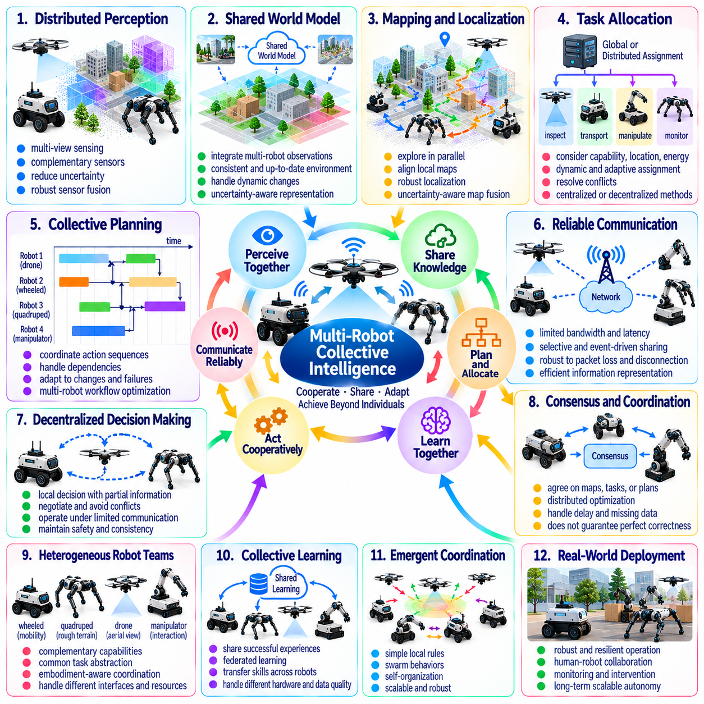{width="7.268055555555556in" height="7.268055555555556in"}

Multi-robot collective intelligence is a major research frontier in Physical AI because coordinated groups of robots can perform tasks beyond the capabilities of individual machines. Rather than operating as isolated autonomous agents, robots must share information, distribute responsibilities, and adapt their behavior to collective objectives. The central challenge is transforming multiple independent systems into a reliable, coordinated, and adaptive physical intelligence.

Collective intelligence differs from conventional multi-robot coordination by emphasizing capabilities that emerge through interaction and shared learning. A fleet may collectively explore environments, construct maps, manipulate large objects, or respond to changing operational demands. Effective cooperation requires more than synchronized movement. Robots must integrate individual observations and decisions into coherent behavior that improves overall mission performance.

Distributed perception enables robots to construct environmental understanding from multiple viewpoints and sensor configurations. One robot may observe an obstacle hidden from another, while aerial and ground platforms may provide complementary spatial information. Combining these observations can improve situational awareness and reduce uncertainty. However, inconsistent calibration, observation delays, and conflicting measurements complicate reliable sensor fusion.

Shared world models provide a foundation for collective reasoning across robot teams. Each robot may maintain a local representation of objects, terrain, dynamic agents, and operational constraints. Collective intelligence requires reconciling these representations into sufficiently consistent shared knowledge. Maintaining useful world models becomes difficult when communication is intermittent, environments change rapidly, or individual robots possess different sensing capabilities.

Distributed mapping and localization illustrate the challenges of collective environmental understanding. Multiple robots can accelerate exploration and map construction by covering separate regions simultaneously. Their local maps must eventually be aligned through common observations, relative measurements, or shared landmarks. Errors in coordinate transformations and loop closures can propagate across the team, making uncertainty-aware map fusion essential.

Multi-robot task allocation determines how collective objectives are divided among available agents. Assignments may depend on robot capabilities, location, energy reserves, payload limits, and task priorities. Centralized optimization can produce coordinated plans when reliable communication is available. Distributed approaches may offer greater resilience but must resolve conflicting assignments and changing resource availability without continuous central supervision.

Collective planning extends task allocation by coordinating the timing and dependencies of physical actions. One robot may transport materials while another prepares a workspace, and a third verifies completion. Such workflows require explicit representations of precedence, shared resources, and operational constraints. Planning must remain adaptable because delays, failures, and unexpected environmental changes can invalidate previously agreed schedules.

Communication is a fundamental constraint on collective intelligence. Wireless networks introduce limited bandwidth, variable latency, packet loss, and occasional disconnection. Continuous transmission of raw sensor data may be impractical for large fleets. Efficient cooperation requires selective information exchange, event-driven communication, and compact shared representations that preserve decision-relevant information without overwhelming network resources.

Decentralized decision-making allows robots to maintain useful autonomy when communication with a central coordinator becomes unavailable. Local agents may negotiate responsibilities, avoid conflicts, and continue authorized tasks using partial information. However, independent decisions can produce inconsistent plans or unsafe interactions. Designing distributed policies that remain coordinated under incomplete communication is a central unresolved challenge.

Consensus mechanisms can help robot teams agree on shared estimates, task priorities, or coordinated actions. Distributed optimization and agreement protocols provide mathematical tools for combining local information. Their effectiveness depends on network connectivity, message timing, and assumptions about participating agents. Consensus alone does not guarantee that the agreed information is accurate or that the resulting collective behavior is safe.

Heterogeneous robot teams introduce opportunities for complementary intelligence. Wheeled robots may provide efficient transportation, quadrupeds may traverse difficult terrain, and drones may perform rapid aerial observation. Their combined capabilities can exceed those of homogeneous fleets. Yet differences in mobility, sensing, control interfaces, and computational resources require common task abstractions and embodiment-aware coordination mechanisms.

Collective learning enables robots to benefit from experiences acquired by other members of a fleet. Successful navigation strategies, manipulation outcomes, and failure cases can contribute to shared training processes. Federated learning may support knowledge exchange without transferring all local data. However, differences in hardware, environmental conditions, and data quality can cause shared updates to degrade performance on particular robots.

Emergent coordination offers another perspective on collective intelligence. Simple local interaction rules can sometimes produce organized group behavior without explicit global planning. Swarm robotics explores mechanisms inspired by biological collectives, including local signaling and distributed adaptation. Although emergence can improve scalability, it remains difficult to predict, verify, and control complex behaviors when safety-critical requirements must be satisfied.

Collective intelligence also requires managing uncertainty about other robots. An agent may not know whether a teammate has completed an assignment, encountered an obstacle, or changed its intended route. Shared belief representations and probabilistic coordination can help manage incomplete information. Nevertheless, uncertainty may propagate through task dependencies, making reliable cooperation difficult during long-duration missions.

Safety in multi-robot systems extends beyond individual collision avoidance. Robots may interfere with shared workspaces, block emergency routes, or create hazardous interactions through simultaneous actions. Collective safety requires coordination of spatial separation, resource access, and emergency responses. Independent safety controllers should complement team-level planning so that failures in collective reasoning do not eliminate local protection.

Fault tolerance is essential because large fleets inevitably experience hardware failures, communication disruptions, and software errors. Collective systems should detect unavailable agents, redistribute unfinished tasks, and preserve essential mission functions. Redundancy can improve resilience but also increases resource costs. The challenge is achieving graceful degradation rather than allowing isolated failures to propagate into system-wide disruption.

Scalability introduces difficulties as robot populations grow from small teams to hundreds of autonomous agents. Centralized computation and communication may become bottlenecks, while fully decentralized coordination can produce excessive negotiation overhead. Hierarchical architectures may combine local autonomy with regional and mission-level orchestration. Their effectiveness depends on allocating authority without sacrificing responsiveness or operational consistency.

Human supervision remains important for collective robotic operations. Operators require understandable representations of fleet status, mission progress, uncertainty, and emerging conflicts. Supervising individual actions becomes impractical as fleet size increases. Human-machine interfaces must therefore support mission-level intervention, exception handling, and clear responsibility boundaries while preserving the autonomy needed for scalable operation.

Energy-aware collective intelligence considers the resources of the entire robot team rather than optimizing individual battery consumption alone. Task allocation may account for charging availability, travel distance, and differences in locomotion efficiency. Robots can coordinate charging schedules to maintain mission coverage. However, local energy-saving decisions may reduce collective productivity, requiring optimization across fleet-wide objectives.

Evaluation of collective intelligence must measure more than the number of robots or completed tasks. Relevant metrics include mission success, coordination overhead, communication efficiency, fault recovery, safety, and scalability. Experiments should compare collective performance against appropriate independent-agent baselines. A genuinely intelligent collective should demonstrate benefits that justify the additional complexity of cooperation.

A major open research question concerns how shared intelligence should be represented across different robot embodiments and operating environments. High-level goals and semantic knowledge may transfer readily, while physical skills often remain platform-specific. Developing reusable representations of tasks, capabilities, and environmental constraints could support broader cooperation. Such representations must remain grounded in each robot\'s actual physical abilities.

Another unresolved challenge is establishing dependable collective behavior under dynamic membership and uncertain communication. Robots may join, leave, fail, or become temporarily unreachable during ongoing missions. Coordination protocols must accommodate these changes without repeatedly reconstructing the entire operational plan. Reliable collective intelligence requires adaptable organization, consistent safety constraints, and mechanisms for validating shared decisions.

Ultimately, multi-robot collective intelligence seeks to transform autonomous robot fleets into coordinated physical systems capable of shared perception, distributed reasoning, cooperative action, and cumulative learning. Progress depends on scalable communication, shared world models, heterogeneous coordination, fault tolerance, and collective safety. The long-term objective is reliable intelligence that emerges from cooperation while preserving the autonomy and accountability of individual robots.

## 07.17. Evaluation of General Physical Intelligence

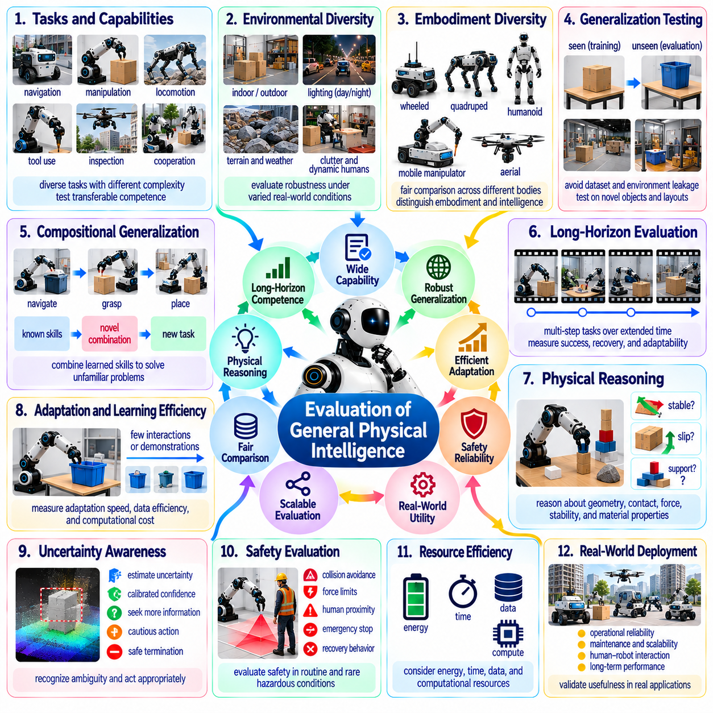{width="7.268055555555556in" height="7.268055555555556in"}

Evaluating general physical intelligence is a fundamental challenge in Physical AI because robotic competence cannot be represented adequately by success on a small collection of predefined tasks. A robot may perform exceptionally well in a controlled environment yet fail when objects, objectives, or physical conditions change. Meaningful evaluation must determine whether intelligence transfers across tasks, environments, and embodiments while preserving safety and reliability.

General physical intelligence involves the capacity to perceive, reason, learn, plan, and act across diverse physical situations. Evaluation must therefore distinguish narrow task specialization from transferable competence. High performance on familiar manipulation or navigation benchmarks does not necessarily indicate broad intelligence. A comprehensive framework should examine how effectively robots handle unfamiliar objectives without extensive task-specific retraining.

Task diversity is a central requirement for evaluating generality. Benchmark suites should include navigation, manipulation, locomotion, tool use, inspection, and cooperative operations. Tasks should vary in complexity, duration, physical constraints, and required reasoning. Performance across these domains can reveal whether a system possesses reusable capabilities or relies primarily on specialized solutions developed for individual benchmark environments.

Environmental diversity is equally important because physical intelligence must remain functional under changing real-world conditions. Lighting, terrain, object materials, clutter, weather, and human activity can alter task difficulty substantially. Evaluation should expose robots to controlled variations and previously unseen combinations of conditions. Robust generalization requires more than tolerating minor perturbations around familiar training environments.

Embodiment diversity creates additional challenges for fair evaluation. Wheeled robots, quadrupeds, humanoids, and mobile manipulators possess different physical capabilities and limitations. Identical tasks may favor particular mechanical configurations rather than superior intelligence. Evaluation frameworks should distinguish embodiment-specific performance from transferable reasoning and adaptation while respecting each platform\'s achievable action space.

Generalization testing requires strict separation between training experiences and evaluation scenarios. Reusing familiar objects, layouts, trajectories, or simulation assets can produce misleading estimates of capability. Hidden test environments and independently generated tasks may reduce benchmark overfitting. However, preventing leakage becomes difficult when large foundation models have encountered extensive public datasets and simulation environments.

Compositional generalization measures whether robots can combine previously learned skills to solve unfamiliar problems. A robot may understand grasping, navigation, and object placement independently yet struggle to coordinate them within a new workflow. Evaluation should include tasks requiring novel combinations of known capabilities. Successful composition provides stronger evidence of general intelligence than repeated execution of isolated familiar actions.

Long-horizon evaluation examines whether robots can sustain coherent behavior across extended sequences of dependent actions. Complex missions require memory, planning, error recovery, and adaptation to intermediate outcomes. Small execution errors may accumulate and invalidate later steps. Metrics should therefore consider complete mission success, recovery effectiveness, and the ability to revise plans rather than measuring isolated action accuracy alone.

Physical reasoning should be evaluated through interactions involving geometry, contact, force, stability, and material properties. Robots may need to predict whether an object will slip, whether a structure can support a load, or how an unfamiliar tool should be used. Such tests should distinguish genuine physical understanding from memorized visual patterns. Counterfactual questions and controlled physical interventions can provide additional evidence.

Adaptation speed is an important indicator of general physical intelligence. A capable robot should improve its behavior when encountering unfamiliar objects, changing dynamics, or new task instructions. Evaluation can measure the number of demonstrations, interactions, or training updates required to reach acceptable performance. Sample efficiency should be assessed alongside the physical risks and computational resources consumed during adaptation.

Uncertainty awareness and decision reliability must be included in general intelligence assessment. A robot should recognize ambiguous observations, unreliable predictions, and conditions beyond its competence. Appropriate responses may include additional sensing, cautious action, assistance requests, or safe termination. Evaluation should measure confidence calibration and risk-sensitive behavior rather than rewarding task completion regardless of uncertainty.

Safety evaluation must address both routine operation and rare hazardous conditions. Collision avoidance, force limits, human proximity, emergency response, and recovery behavior are relevant across many robotic applications. A system that achieves high task success through unsafe experimentation cannot demonstrate dependable general intelligence. Safety metrics should therefore be reported separately from productivity to prevent dangerous tradeoffs from being concealed.

Learning efficiency should be considered together with computational and physical resource consumption. Two robots may achieve similar task success while requiring vastly different training data, inference energy, or physical experimentation. Evaluation should account for learning cost, deployment power, execution time, and hardware requirements. Resource-normalized measurements can reveal whether apparent intelligence gains depend mainly on increased computational expenditure.

Human interaction provides another dimension of evaluation. General-purpose robots must interpret instructions, resolve ambiguity, communicate limitations, and cooperate with people during physical tasks. Language understanding alone is insufficient if instructions cannot be grounded in feasible actions. Evaluation should examine clarification behavior, shared task understanding, and the ability to maintain safety when human intentions change.

Multi-robot evaluation should determine whether collective capabilities exceed those of independently operating agents. Shared perception, cooperative planning, task allocation, and coordinated recovery can improve mission performance. However, communication overhead and coordination failures may offset these benefits. Appropriate baselines should compare collective outcomes against individual capabilities under comparable resource and environmental constraints.

Benchmark design must balance standardization with ecological validity. Highly controlled tests support reproducibility and scientific comparison, but may fail to capture the complexity of real deployment. Open-ended field evaluations provide realistic challenges but introduce uncontrolled variables. Combining standardized laboratory benchmarks with carefully documented real-world trials can improve both comparability and practical relevance.

Evaluation metrics should capture performance distributions rather than reporting average success alone. Worst-case outcomes, failure severity, recovery time, and variability across environments may be more informative than a single aggregate score. Confidence intervals and repeated trials are necessary because physical experiments contain substantial stochastic variation. Transparent reporting should distinguish measured results from extrapolated capability claims.

An unresolved challenge is defining a unified measure of general physical intelligence without hiding important differences between systems. Composite scores can simplify comparisons but may obscure weaknesses in safety, adaptability, or physical reasoning. Multidimensional capability profiles offer greater transparency while complicating rankings. Evaluation frameworks must determine which dimensions are essential and how their relative importance should be justified.

Progress measurement also requires benchmarks that evolve as robotic capabilities improve. Static tasks eventually become saturated or vulnerable to specialized optimization. Continually refreshed evaluations can introduce new objects, environments, objectives, and interaction patterns. However, changing benchmarks complicates longitudinal comparison. Maintaining stable reference tasks alongside evolving challenge sets may provide a practical compromise.

Reproducibility remains difficult because physical outcomes depend on hardware condition, calibration, environmental variation, and operator procedures. Two laboratories may obtain different results from nominally identical robots and policies. Evaluation protocols should document hardware configurations, software versions, training data, and experimental conditions. Independent replication is essential for distinguishing reliable capability advances from isolated demonstrations.

Another open question concerns the relationship between simulated evaluation and real-world intelligence. Simulation enables large-scale testing across rare events and diverse environments, but may reward strategies that exploit modeling inaccuracies. Physical trials provide stronger grounding yet are expensive and potentially hazardous. Reliable assessment requires understanding which simulated metrics predict real deployment performance and where such correlations break down.

Ultimately, evaluating general physical intelligence requires a multidimensional framework encompassing generalization, reasoning, adaptation, long-horizon competence, safety, efficiency, and cooperation. No single benchmark can establish universal robotic intelligence. Progress depends on rigorous testing across unfamiliar physical conditions, transparent reporting, and independent validation. The objective is to measure transferable, dependable competence rather than isolated demonstrations of impressive behavior.

## 07.18. Measuring Progress Toward Physical AGI

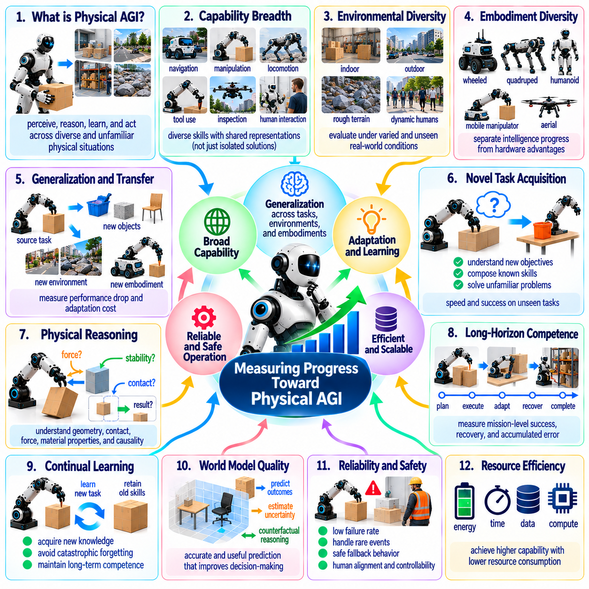{width="7.268055555555556in" height="7.268055555555556in"}

Measuring progress toward Physical Artificial General Intelligence, or Physical AGI, requires determining whether autonomous systems are developing broadly transferable capabilities rather than accumulating isolated task-specific achievements. Physical AGI implies intelligence that can perceive, reason, learn, and act across unfamiliar physical situations. Progress must therefore be assessed through generalization, adaptability, reliability, and sustained real-world competence.

Unlike conventional AI benchmarks, Physical AGI evaluation must account for the interaction between intelligence and embodiment. A robot\'s performance depends on its sensors, actuators, mechanical structure, computational resources, and operating environment. Superior hardware can improve task success without demonstrating better reasoning. Meaningful progress measurements must separate advances in physical platforms from advances in transferable intelligence.

A central difficulty is defining what constitutes generality in the physical world. No finite collection of tasks can represent every possible environment, object, or interaction. Evaluation should instead examine how performance changes as task diversity and novelty increase. Systems approaching greater generality should demonstrate stable competence across unfamiliar combinations of goals, physical constraints, and environmental conditions.

Capability breadth provides one dimension of progress measurement. Physical AGI candidates should demonstrate navigation, manipulation, locomotion, tool use, physical reasoning, and human interaction across varied settings. However, breadth alone is insufficient if each capability depends on separately engineered solutions. Stronger evidence comes from shared representations and policies that support multiple tasks without extensive architectural modification.

Transfer efficiency offers another important indicator. A system may learn a skill in simulation, on one robot platform, or within a particular environment and then apply it elsewhere. Progress can be measured through the additional data, training time, and physical interactions required for successful transfer. Greater generality should reduce adaptation costs while maintaining reliable performance under unfamiliar conditions.

Novel-task acquisition is particularly relevant because genuine general intelligence cannot depend entirely on predefined demonstrations. Robots should interpret unfamiliar objectives, identify required capabilities, and construct appropriate action sequences. Evaluation can introduce previously unseen task combinations and measure how quickly systems achieve competent execution. Such testing should distinguish flexible problem solving from retrieval of memorized solutions.

Physical reasoning provides evidence of intelligence beyond pattern recognition. Robots must understand relationships involving force, contact, geometry, stability, material properties, and causal consequences. Progress can be measured through predictions and interventions in unfamiliar physical situations. Systems should demonstrate the ability to revise incorrect assumptions when observations contradict their internal models rather than repeating previously successful actions.

Long-horizon competence is essential because practical autonomy requires maintaining objectives across extended sequences of actions. Robots must remember intermediate outcomes, coordinate dependent subtasks, and recover from unexpected events. Measuring only individual action accuracy can conceal substantial weaknesses in planning and execution. Mission-level success, recovery effectiveness, and accumulated error provide more informative indicators of progress.

Continual learning is another defining requirement for progress toward Physical AGI. Autonomous systems should acquire new knowledge without repeatedly forgetting previously mastered capabilities. Evaluation must examine performance before and after learning unfamiliar tasks, including retention and interference effects. A system demonstrating rapid adaptation but severe catastrophic forgetting cannot be considered broadly competent over extended operational lifetimes.

World model quality may provide a deeper measure of physical understanding. Useful models should predict how environments change under alternative actions and support planning beyond immediate observations. Evaluation can examine predictive accuracy, uncertainty calibration, and counterfactual reasoning across unfamiliar situations. However, accurate prediction alone does not establish intelligence unless the model improves physical decision-making and task execution.

Reliability must remain a primary dimension of progress measurement. A robot that completes most tasks successfully but occasionally causes severe failures may be unsuitable for autonomous deployment. Evaluation should consider performance distributions, rare-event behavior, recovery time, and failure severity. Progress toward Physical AGI should involve reducing dangerous uncertainty and improving dependable behavior rather than maximizing average benchmark scores alone.

Safety and human alignment become increasingly important as physical autonomy expands. Robots must recognize operational boundaries, interpret human instructions, and respond appropriately when objectives conflict with safety constraints. Measuring progress requires assessing intervention requests, safe fallback behavior, and compliance with authorized actions. Higher autonomy should not be interpreted as progress when it reduces human oversight or controllability.

Resource efficiency provides an additional perspective on intelligence development. Systems may improve performance by using larger models, more powerful processors, or extensive physical experimentation. Such improvements are valuable but should not automatically be interpreted as greater generality. Evaluation should examine task success relative to training data, computational energy, execution time, and physical resources to identify genuinely more efficient intelligence.

Cross-embodiment performance is especially informative for assessing transferable physical intelligence. A shared model that supports different manipulators, mobile robots, or legged platforms may demonstrate reusable knowledge about tasks and environments. Nevertheless, identical performance is neither expected nor physically possible across all embodiments. Progress should be measured through adaptation efficiency and appropriate exploitation of each platform\'s capabilities.

Collective intelligence may extend the scope of Physical AGI evaluation beyond individual robots. Multiple agents can share observations, coordinate complex tasks, and accumulate operational experience. Progress can be assessed through improvements in cooperative reasoning, distributed planning, and fault recovery. However, collective success must be distinguished from gains produced solely by adding more robots, communication infrastructure, or computational resources.

Benchmark saturation presents a serious challenge to long-term progress measurement. Systems may achieve high scores through specialized optimization without acquiring broadly transferable abilities. Continuously refreshed tasks, hidden environments, and independent evaluation can reduce this risk. Stable reference benchmarks remain useful for historical comparisons, but evolving challenge sets are necessary to expose limitations as capabilities improve.

A multidimensional capability profile is more informative than a single Physical AGI score. Such a profile may represent generalization, adaptation speed, physical reasoning, long-horizon planning, safety, efficiency, and knowledge retention. Composite indices can support broad comparisons, but their weighting assumptions must remain explicit. Progress should be reported as improvements across identifiable dimensions rather than an unsupported claim of universal intelligence.

Longitudinal evaluation can reveal whether improvements persist across successive model generations. Researchers should compare systems using consistent protocols while introducing controlled increases in task novelty and difficulty. Measuring learning curves, performance degradation, and recovery behavior can expose meaningful trends. Independent replication is essential because isolated demonstrations may exaggerate capabilities that do not generalize reliably.

Simulation can accelerate Physical AGI evaluation by generating diverse environments and rare failure scenarios. However, simulated success may not translate directly into real-world competence because contact dynamics, sensor noise, and environmental complexity are imperfectly modeled. Progress measurement should combine simulation-based stress testing with physical validation. The relationship between simulated scores and deployment outcomes must be established empirically.

A fundamental unresolved question is whether progress toward Physical AGI follows predictable scaling relationships. Increasing model capacity, training data, simulation experience, and physical interaction may improve capabilities, but gains can vary substantially across tasks. Apparent scaling trends may conceal bottlenecks in embodiment, causal understanding, or safety. Reliable forecasting requires measuring these constraints rather than extrapolating from computational scale alone.

Another challenge concerns establishing meaningful milestones without assuming a universal threshold for Physical AGI. Milestones may describe increasing autonomy, transferable skill acquisition, environmental robustness, or operational responsibility. Each should specify measurable conditions and recognized limitations. Such milestones can guide research while avoiding the misleading implication that general physical intelligence emerges at a single numerical score.

Ultimately, measuring progress toward Physical AGI requires evidence that autonomous systems are becoming more general, adaptable, reliable, and efficient across unfamiliar physical situations. No isolated benchmark, model size, or demonstration can establish this transition. The strongest evidence will come from sustained performance across diverse tasks, independent validation, safe real-world operation, and the accumulation of reusable physical knowledge.
