**Volume 13. Future of Physical AI and Civilization**

# Chapter 08. 2030--2040 Roadmap

## 08.01. How to Build a Physical AI Roadmap

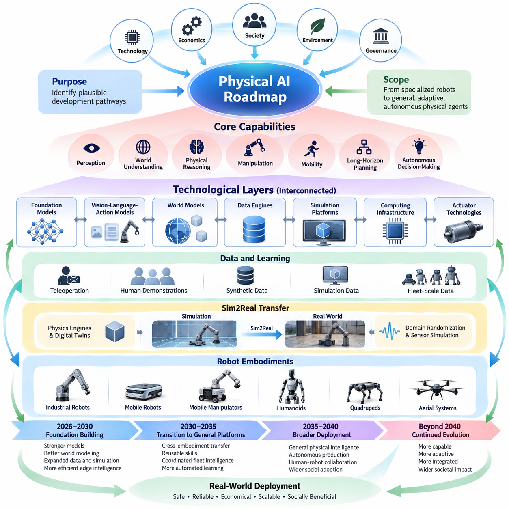{width="7.268055555555556in" height="7.268055555555556in"}

A Physical AI roadmap is a structured framework for understanding how embodied intelligence may evolve from specialized robotic systems into increasingly general, adaptive, and autonomous physical agents. Unlike conventional technology forecasts, it must account for the interaction of artificial intelligence, mechanical systems, computation, energy, infrastructure, economics, and society. Its purpose is to identify plausible development pathways rather than predict exact outcomes.

Building a credible roadmap begins by defining the scope of Physical AI and the capabilities that constitute meaningful progress. These include perception, world understanding, physical reasoning, manipulation, mobility, long-horizon planning, and autonomous decision-making. Each capability must be evaluated in relation to real-world operating conditions, because improvements in laboratory benchmarks do not automatically translate into reliable physical performance.

The roadmap should distinguish technological capabilities from deployment maturity. A robot may demonstrate impressive manipulation skills in controlled environments while remaining unsuitable for continuous industrial operation. Practical maturity requires repeatability, safety, durability, maintainability, and acceptable operating costs. Consequently, capability milestones should be connected to measurable operational requirements rather than demonstrations alone.

A useful roadmap organizes development into interconnected technological layers. Foundation models, vision-language-action models, predictive world models, robot data engines, simulation platforms, edge computing, and actuator technologies form essential components. Progress in one layer can accelerate another, but system-level advancement depends on their integration. This makes dependency analysis more informative than forecasting individual technologies independently.

World models deserve particular attention because they provide mechanisms for representing environmental states, predicting physical consequences, and evaluating possible actions. Future Physical AI systems may increasingly combine learned representations with action-conditioned dynamics and uncertainty estimation. Roadmap milestones should therefore measure predictive accuracy, planning usefulness, temporal consistency, and robustness under unfamiliar conditions.

Robot foundation models and vision-language-action architectures represent another important development trajectory. Their progress should be evaluated through task diversity, instruction understanding, action reliability, and transfer across environments. Increasing model size alone is insufficient evidence of general intelligence. More meaningful indicators include reduced task-specific training, improved adaptation efficiency, and successful execution of previously unseen physical tasks.

Data availability and learning efficiency are central constraints in Physical AI development. Unlike digital intelligence, physical learning requires interactions with environments governed by geometry, contact dynamics, uncertainty, and safety limitations. A roadmap must therefore examine teleoperation, human demonstrations, synthetic data, simulation-generated experiences, and fleet-scale data collection as complementary mechanisms for expanding training coverage.

Simulation and Sim2Real transfer should be evaluated as enabling technologies rather than isolated research areas. Improvements in physics engines, domain randomization, sensor simulation, and digital twins can reduce dependence on expensive physical experiments. However, simulation quality must be measured against real-world behavior. The roadmap should identify when simulated experience produces reliable improvements in deployed robots and when physical validation remains indispensable.

Computing infrastructure establishes another critical boundary. Physical AI systems must execute perception, reasoning, planning, and control within constraints imposed by latency, power consumption, thermal management, and communication reliability. Future development may involve increasingly heterogeneous edge processors and selective cloud assistance. Roadmap assessments should measure useful intelligence per unit of energy and computation rather than processing capacity alone.

Robot embodiment must also be incorporated into the forecasting framework. Autonomous mobile robots, mobile manipulators, humanoids, quadrupeds, and aerial systems possess different mechanical capabilities and operational limitations. Their development trajectories should not be assumed to converge at identical rates. Morphology, actuator performance, sensing configuration, and environmental accessibility strongly influence the economic and technical feasibility of deployment.

The period from 2026 to 2030 can be treated as a near-term foundation-building horizon. Relevant milestones include stronger robot foundation models, improved world-model prediction, expanded simulation and data infrastructure, and more efficient edge intelligence. Industrial mobile robots and selected manipulation systems may achieve broader operational capabilities, while humanoid and legged platforms continue progressing through application-specific validation.

The 2030 to 2035 horizon can be examined as a possible transition toward more general robot platforms. Important indicators include cross-embodiment knowledge transfer, reusable manipulation skills, coordinated fleet intelligence, and increasingly automated learning pipelines. Self-improving systems may emerge through structured operational feedback, although unrestricted autonomous adaptation would introduce substantial safety, verification, and governance challenges.

The 2035 to 2040 horizon introduces more uncertain possibilities involving general physical intelligence, autonomous production systems, and infrastructure designed around robotic operation. These outcomes should be treated as conditional scenarios rather than inevitable developments. Their realization would depend on breakthroughs in generalization, long-horizon reasoning, reliable autonomy, affordable hardware, and institutional acceptance.

Technology roadmaps become more useful when milestones are expressed through observable indicators. Examples include task completion rates, intervention frequency, recovery performance, operating hours between failures, energy consumption, adaptation time, and total lifecycle cost. Generalization can be assessed across objects, environments, tasks, and robot morphologies. Such measurements provide stronger evidence than isolated demonstrations or claims of human-level capability.

Critical dependencies should be explicitly identified because technological progress rarely occurs uniformly. More capable foundation models may remain constrained by insufficient robot data, weak actuators, or unreliable sensing. Similarly, inexpensive hardware may fail to produce economic value without dependable autonomy. A roadmap should distinguish fundamental research bottlenecks from engineering limitations, supply-chain constraints, regulatory barriers, and deployment economics.

Economic forecasting must connect technical progress to actual productivity. Robot acquisition prices, maintenance expenses, utilization rates, energy costs, human supervision, and infrastructure modifications determine commercial feasibility. Declining hardware prices do not necessarily imply rapid adoption. The roadmap should examine how total cost of ownership, service models, production scale, and organizational readiness influence the transition from prototypes to sustained operations.

Societal considerations must be integrated throughout the roadmap rather than added after technological milestones. Physical AI could reshape employment, education, healthcare, transportation, construction, and public services. Its effects will depend on how responsibilities are distributed between humans and autonomous systems. Safety, privacy, accessibility, accountability, and equitable access should therefore be treated as conditions influencing deployment and public acceptance.

Scenario planning provides a practical method for managing uncertainty. A slow-progress scenario may involve persistent limitations in data efficiency, physical reasoning, and system reliability. A base scenario may assume gradual improvements through coordinated advances in models, hardware, and deployment experience. A fast-progress scenario may involve breakthroughs in generalization and autonomous learning, but it should not be mistaken for a guaranteed trajectory.

Each scenario should specify its assumptions, dependencies, and observable signals. For example, rapid improvements in cross-embodiment transfer would support expectations of reusable robot intelligence, while continued dependence on extensive task-specific demonstrations would suggest slower generalization. Scenario probabilities, where estimated, should remain provisional. The roadmap should be revised when empirical evidence contradicts its underlying assumptions.

A rigorous roadmap also distinguishes leading indicators from lagging indicators. Research breakthroughs, benchmark improvements, and declining inference costs may provide early signals of future capabilities. Commercial deployment volumes, verified productivity gains, and regulatory acceptance usually emerge later. Tracking both categories helps prevent the mistaken assumption that scientific demonstrations immediately produce widespread economic or societal transformation.

Ultimately, a Physical AI roadmap should function as a continuously updated decision framework connecting scientific progress with engineering readiness, commercial adoption, and civilizational consequences. Its value lies not in predicting precisely when general physical intelligence will emerge, but in revealing which capabilities, dependencies, and measurable transitions matter most. This approach provides a disciplined foundation for examining Physical AI development through 2040 and beyond.

## 08.02. 2026--2030 Foundation Model and VLA Evolution

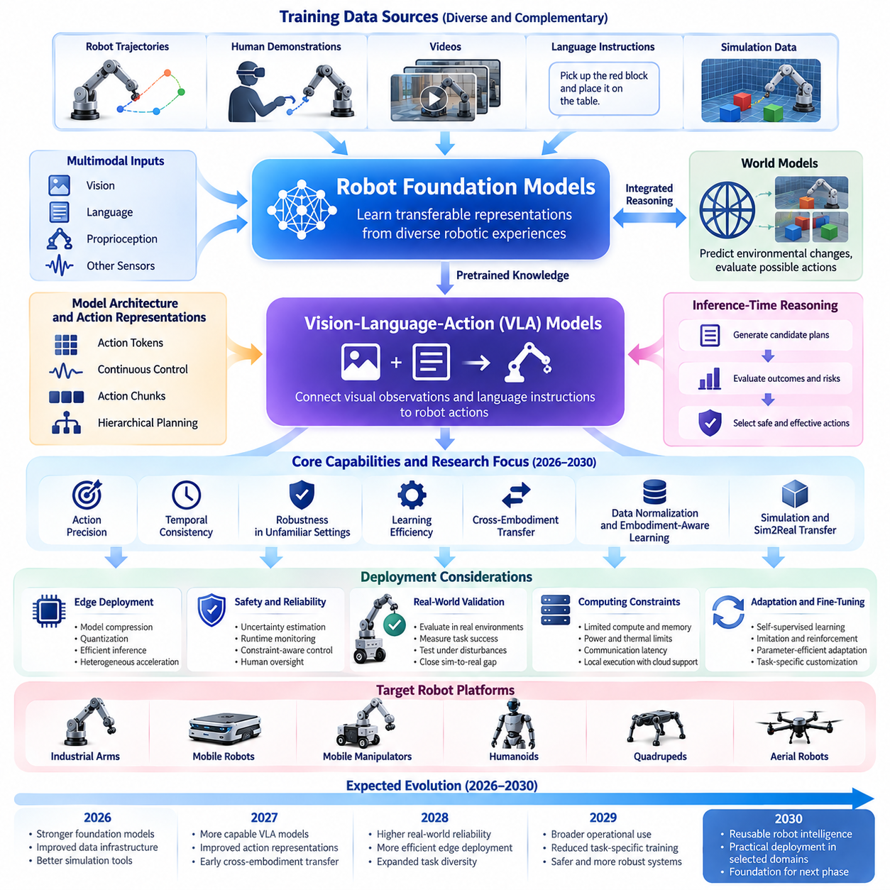{width="7.268055555555556in" height="7.268055555555556in"}

Between 2026 and 2030, robot foundation models and Vision-Language-Action models are expected to become increasingly important components of Physical AI architectures. Their evolution may shift robotics from narrowly programmed behaviors toward reusable intelligence capable of interpreting instructions, understanding environments, and generating physical actions. However, progress will depend on reliable integration with perception, planning, control, and real-world feedback.

Robot foundation models aim to learn transferable representations from diverse robotic experiences rather than requiring independent models for every task. Training may combine robot trajectories, human demonstrations, videos, language instructions, and simulation-generated interactions. The central objective is to acquire knowledge that can support multiple tasks and environments while reducing the amount of additional training required for each deployment.

Vision-Language-Action models extend multimodal learning by connecting visual observations and language instructions directly to robot actions. These architectures can interpret goals, identify relevant objects, and generate action sequences conditioned on environmental context. Between 2026 and 2030, research may increasingly focus on improving action precision, temporal consistency, and robustness when operating beyond familiar training conditions.

An important development direction involves the evolution of action representations. Early approaches frequently rely on discretized action tokens, continuous control outputs, or learned action chunks. Future systems may combine these representations with hierarchical planning and predictive control. High-level models could determine task intentions while specialized low-level controllers execute movements under strict timing and safety constraints.

The relationship between foundation models and world models is likely to become increasingly significant. Foundation models can provide semantic understanding and task-level reasoning, while world models predict how environments change in response to actions. Integrating these capabilities may allow robots to evaluate possible outcomes before executing movements, improving planning reliability and reducing unnecessary physical experimentation.

Temporal reasoning represents a major challenge for the next generation of VLA systems. Many robotic tasks require coordinated actions extending over seconds, minutes, or longer periods. Models must preserve task context, recognize intermediate progress, and recover from unexpected disturbances. Hierarchical memory and multi-horizon planning may help connect immediate motor control with extended task execution and long-term operational objectives.

Training data diversity will strongly influence the development of generalist robot intelligence. Large datasets containing different robot embodiments, environments, objects, and interaction patterns may improve transferable representations. However, combining heterogeneous datasets introduces challenges involving inconsistent action spaces, sensor configurations, coordinate systems, and task definitions. Data normalization and embodiment-aware learning will therefore remain important research priorities.

Cross-embodiment transfer may become a defining measure of foundation model progress. A useful generalist model should transfer relevant knowledge between mobile manipulators, humanoids, industrial arms, and other robotic platforms without assuming identical physical capabilities. This requires separating shared task concepts from embodiment-specific dynamics and control constraints while preserving accurate representations of physical interaction.

Simulation-generated data may become an increasingly important complement to real-world demonstrations. Physics simulation, procedural environment generation, and domain randomization can expose models to diverse situations at relatively low marginal cost. Nevertheless, synthetic experience cannot fully reproduce contact dynamics, sensor imperfections, and unexpected environmental behavior. Real-world validation will remain essential for evaluating learned policies.

Learning efficiency is another critical dimension of the 2026--2030 evolution. Rather than relying exclusively on larger datasets and more computationally expensive training, researchers may prioritize self-supervised learning, imitation learning, reinforcement learning, and targeted adaptation. Efficient fine-tuning and parameter-efficient adaptation could enable organizations to customize generalist models for specific robots and operational environments.

Inference-time reasoning may improve how robots handle unfamiliar tasks and uncertain situations. Instead of generating actions through a single immediate prediction, future systems could evaluate alternative plans, estimate risks, and select actions based on predicted consequences. Such deliberation must remain compatible with real-time operation, making adaptive computation and selective reasoning important architectural considerations.

Edge deployment will strongly influence the practical adoption of foundation models and VLA architectures. Robots frequently operate under constraints involving computational capacity, memory bandwidth, power consumption, and communication latency. Model compression, quantization, distillation, and heterogeneous acceleration may allow increasingly capable models to execute locally while retaining cloud-based resources for training and noncritical computation.

Safety and reliability will become essential evaluation dimensions as foundation models gain greater control over physical systems. Language-conditioned policies may misunderstand instructions, misidentify objects, or produce actions inconsistent with environmental constraints. Runtime monitoring, uncertainty estimation, safety filters, and verified control boundaries can help prevent unsafe actions. General-purpose intelligence must therefore remain subject to explicit operational safeguards.

Evaluation methodologies must evolve beyond isolated manipulation demonstrations and short task sequences. Meaningful benchmarks should examine long-horizon task completion, recovery from failure, adaptation to unfamiliar objects, and performance across different embodiments. Intervention frequency, action accuracy, task success rates, and operational reliability will provide more useful indicators of practical progress than model size or training volume alone.

Commercial adoption between 2026 and 2030 may initially concentrate on structured environments where tasks are repetitive but require flexibility. Manufacturing, warehouse logistics, laboratory automation, and selected service applications provide opportunities for foundation models to improve task adaptability. Deployment success will depend on measurable productivity, acceptable maintenance requirements, predictable behavior, and integration with existing operational systems.

Humanoid robots may benefit from advances in VLA architectures because language-conditioned manipulation and transferable task representations could reduce the need for extensive task-specific programming. However, humanoid deployment also depends on locomotion, balance, dexterity, energy efficiency, and hardware durability. Improvements in foundation models alone cannot eliminate the mechanical and control challenges associated with general-purpose humanoid operation.

The development of fleet-scale learning may create increasingly effective feedback loops between deployed robots and foundation model training. Operational experiences can reveal failure patterns, unfamiliar environments, and previously unrepresented interactions. Carefully curated fleet data may support periodic model improvements, while controlled validation and deployment procedures help prevent regressions and unsafe behavioral changes.

By 2030, a plausible outcome is the emergence of foundation-model-based robotic platforms capable of performing broader task families with reduced engineering effort. Such systems may combine language understanding, visual perception, learned manipulation, predictive world models, and hierarchical control. Their generality will nevertheless remain constrained by embodiment, environmental complexity, data coverage, and the reliability requirements of physical deployment.

The pace of development will depend on several interacting factors, including training data availability, compute efficiency, model architecture, hardware capabilities, and standardized evaluation. Breakthroughs in one area may accelerate progress elsewhere, but bottlenecks in contact-rich manipulation, long-horizon reliability, and real-world generalization could slow adoption. Roadmap projections should therefore remain conditional rather than assume continuous exponential improvement.

Ultimately, the 2026--2030 evolution of robot foundation models and Vision-Language-Action systems should be understood as a transition toward more reusable and adaptable physical intelligence. The most important milestone will not be the creation of a single universally capable robot model, but the establishment of architectures that reliably connect perception, language, prediction, memory, and action across increasingly diverse physical tasks.

## 08.03. 2026--2030 World Model Evolution

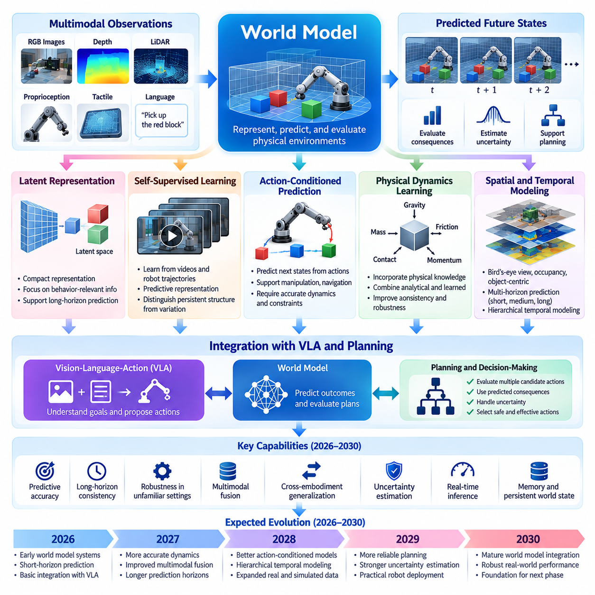{width="7.268055555555556in" height="7.268055555555556in"}

Between 2026 and 2030, world models are expected to evolve from experimental predictive representations into increasingly important components of Physical AI systems. Their primary purpose is to enable machines to represent physical environments, anticipate changes, and evaluate the consequences of possible actions. This evolution may shift robotic intelligence from reactive perception toward predictive understanding and model-based decision-making.

A world model represents the relationships between environmental states, physical objects, robot actions, and temporal changes. Unlike conventional perception systems that primarily identify current conditions, predictive world models estimate how those conditions may evolve. Their development requires integrating geometry, motion, interaction dynamics, uncertainty, and contextual information into representations that remain useful for planning and control.

The period from 2026 to 2030 may witness increasing adoption of latent world models that predict future states within compact learned representations. Rather than reconstructing every visual detail, these models can focus on information relevant to physical behavior and decision-making. Latent dynamics architectures may improve computational efficiency while supporting longer prediction horizons, although preserving physically meaningful information remains a significant challenge.

Self-supervised predictive learning is likely to become a central mechanism for developing scalable world models. By learning from video sequences, robot trajectories, sensor observations, and interaction histories, models can acquire knowledge without requiring extensive manual annotations. Predictive representation learning, including joint-embedding approaches, may help distinguish persistent environmental structure from unpredictable sensory variation.

Action-conditioned world models represent a particularly important direction for Physical AI. These models predict how environmental states change when a robot performs specific actions. Such predictions can support manipulation, navigation, collision avoidance, and task planning. However, reliable action conditioning requires accurate representations of robot dynamics, contact interactions, and environmental constraints rather than visual correlations alone.

Physical dynamics learning will increasingly connect data-driven prediction with principles of mechanics. Models may incorporate information about mass, friction, gravity, momentum, contact forces, and object constraints. Physics-informed architectures can improve consistency when sufficient physical knowledge is available, while learned dynamics can capture effects that are difficult to model analytically. Combining both approaches may improve predictive robustness.

Multimodal world models may integrate RGB images, depth measurements, LiDAR, proprioception, tactile sensing, and language-based context. Different sensing modalities provide complementary information about environmental structure and physical interaction. Effective fusion requires temporal synchronization, coordinate alignment, uncertainty management, and mechanisms for handling missing or unreliable observations during real-world operation.

Spatial representations are also expected to become more sophisticated. Bird\'s-eye-view representations, occupancy networks, object-centric models, and structured scene representations can support different planning requirements. A mobile robot may prioritize traversability and obstacle prediction, while a manipulator requires detailed contact geometry and object relationships. Future world models may combine multiple spatial abstractions within unified predictive systems.

Temporal prediction remains one of the most difficult research challenges. Short-horizon predictions can support immediate collision avoidance and motor control, while longer horizons are necessary for navigation, manipulation sequences, and complex task execution. Prediction errors accumulate over time, particularly in environments containing unpredictable human behavior or uncertain contacts. Hierarchical temporal modeling may help manage these limitations.

Multi-horizon world models may organize predictions across different temporal scales. Fast dynamics models can estimate immediate physical responses, intermediate models can predict object interactions and task progress, and slower models can represent environmental changes and operational goals. This hierarchical organization may allow robots to connect low-level control with long-term planning without requiring uniformly detailed predictions at every future step.

Memory will become increasingly important as world models move beyond short observation windows. Persistent representations can preserve information about previously observed objects, environmental layouts, task histories, and recurring physical patterns. Episodic memory and structured world-state memory may support reasoning under partial observability. Nevertheless, stored information must be updated when environments change to prevent outdated assumptions from influencing actions.

Uncertainty estimation is essential for trustworthy world-model prediction. Physical environments contain incomplete observations, stochastic interactions, and previously unseen conditions. Future models may estimate confidence in predicted states and distinguish uncertainty caused by limited knowledge from inherent environmental variability. Planning systems can then use these estimates to select conservative actions, request additional observations, or seek human assistance.

The integration of world models with Vision-Language-Action systems may become a major architectural development. Language-conditioned models can interpret goals and propose actions, while predictive world models evaluate their likely physical consequences. This combination could support more deliberate behavior by allowing robots to compare candidate actions before execution. Effective integration will require managing computational cost and maintaining real-time responsiveness.

Model-based planning may increasingly use learned world models to simulate possible action sequences before physical execution. Techniques such as model predictive control, trajectory optimization, and imagined rollouts can evaluate candidate behaviors under predicted environmental dynamics. However, planning performance depends on model accuracy, especially when actions involve contact, deformable objects, or irreversible physical consequences.

Simulation and digital twins may provide complementary infrastructure for world-model development. Physics engines can generate controlled experiences, while digital twins can represent operational environments and support scenario testing. Learned world models may improve simulation realism or provide faster approximate predictions. The relationship should remain bidirectional, with physical observations continuously informing model calibration and simulation validation.

Data quality will strongly influence world-model performance. Large quantities of video may support visual prediction, but physical reasoning also requires action labels, synchronized sensor measurements, contact information, and diverse interaction outcomes. Data engines should prioritize informative transitions, rare failures, and environmental variations. Carefully curated datasets may produce greater improvements than simply increasing raw observation volume.

Real-world generalization will remain a decisive challenge throughout the period. Models trained in controlled environments may fail when encountering unfamiliar materials, lighting conditions, object geometries, or interaction dynamics. Robustness will depend on diverse training experiences, adaptation mechanisms, uncertainty-aware planning, and repeated physical validation. Generalization should be evaluated through actual task outcomes rather than prediction quality alone.

Evaluation frameworks must measure both predictive accuracy and downstream utility. Relevant indicators include future-state prediction error, temporal consistency, physical constraint violations, uncertainty calibration, planning success, and recovery performance. A visually realistic prediction may still be unsuitable for control if it misrepresents contact or motion. Therefore, world-model benchmarks should connect representation quality with measurable physical task performance.

By 2030, a plausible outcome is the emergence of integrated world-model architectures supporting perception, prediction, planning, and memory within increasingly capable robotic platforms. These systems may improve manipulation, autonomous mobility, and adaptation to changing environments. Nevertheless, long-horizon reliability, causal understanding, and accurate contact dynamics are likely to remain important limitations requiring continued research.

Ultimately, the 2026--2030 evolution of world models should be understood as a transition from passive environmental representation toward action-aware predictive intelligence. The most important milestone will not be generating realistic future images, but enabling robots to predict physically meaningful consequences and use those predictions for reliable decisions. This capability could become a foundational bridge between robot foundation models and general physical intelligence.

## 08.04. 2026--2030 Robot Data and Simulation Scaling

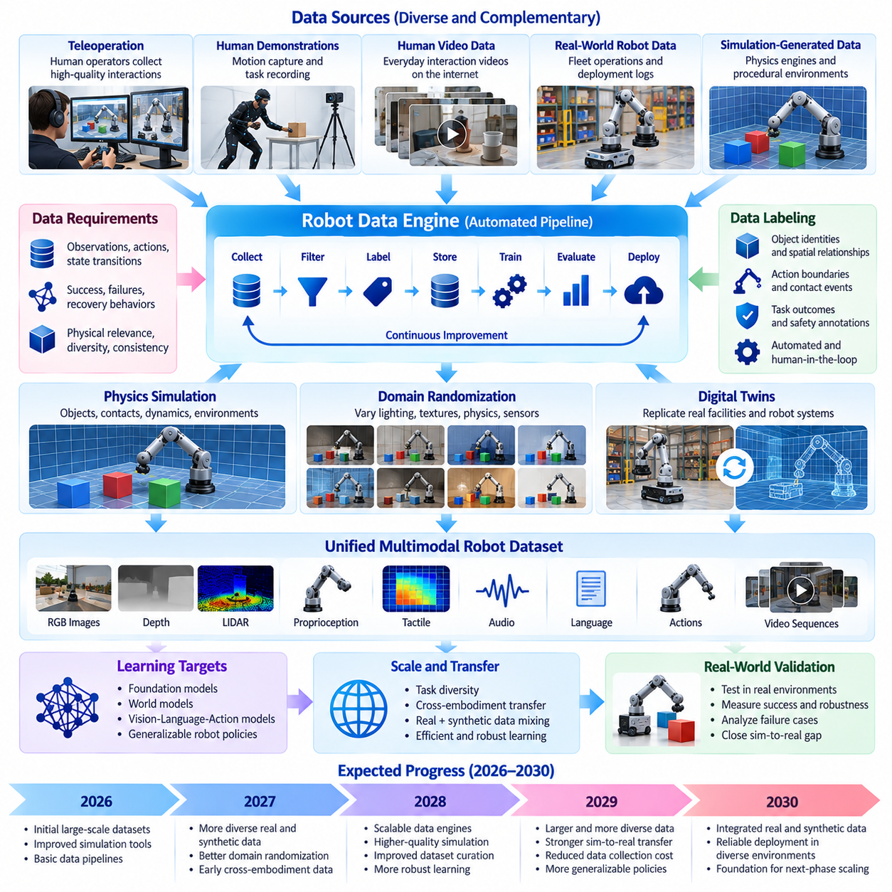{width="7.268055555555556in" height="7.268055555555556in"}

Between 2026 and 2030, the scaling of robot data and simulation is expected to become a central driver of Physical AI development. Unlike digital AI, robotic intelligence requires experience involving physical motion, contact, environmental uncertainty, and real-world consequences. Expanding the quantity, diversity, and quality of such experiences may accelerate the development of foundation models, world models, and increasingly adaptable robotic policies.

Robot data scaling involves more than collecting larger datasets. Physical intelligence depends on observations, actions, state transitions, and outcomes that accurately represent interactions with the environment. Effective datasets must capture successful operations, failures, recovery behaviors, and changing conditions. Consequently, the value of robotic data will increasingly depend on its physical relevance, diversity, temporal consistency, and usefulness for downstream learning.

Teleoperation and human demonstrations are likely to remain important sources of high-quality robot interaction data. Human operators can demonstrate complex manipulation, navigation, and recovery strategies that are difficult to discover through autonomous exploration. Advances in remote operation interfaces, motion capture, and demonstration recording may improve collection efficiency, although operator costs and embodiment differences will continue to constrain scalability.

Human video data may complement robot-generated trajectories by providing broad coverage of everyday physical interactions. Videos contain information about object affordances, manipulation sequences, spatial relationships, and task intentions. However, translating human observations into executable robot actions remains challenging because human bodies and robotic mechanisms differ. Learning systems must distinguish transferable physical knowledge from embodiment-specific movement patterns.

Simulation-generated data may become a major mechanism for expanding robotic experience without proportional increases in physical hardware deployment. Physics engines can generate controlled interactions involving objects, surfaces, obstacles, and dynamic environments. Procedural generation and automated scenario creation may expose learning systems to combinations of conditions that would be expensive, dangerous, or impractical to reproduce repeatedly in the real world.

Massively parallel simulation can accelerate learning by executing many independent environments simultaneously. Thousands of simulated agents may explore different policies, object configurations, and environmental parameters within distributed computing infrastructure. This approach can support reinforcement learning, policy evaluation, and failure discovery. Nevertheless, simulation throughput alone does not guarantee improvements in real-world performance.

Domain randomization will remain important for reducing dependence on narrowly defined simulation conditions. By varying lighting, textures, friction, mass, sensor noise, actuator response, and environmental geometry, training systems can expose policies to broader operating distributions. The objective is not merely to maximize randomness but to generate variations that reflect plausible physical conditions and improve transfer to unfamiliar environments.

Photorealistic rendering and physically accurate simulation address different aspects of the Sim2Real challenge. Realistic visual appearance can improve perception models, while accurate contact dynamics and actuator behavior are essential for physical control. A visually convincing simulation may still produce misleading manipulation outcomes. Future simulation platforms may therefore prioritize task-relevant physical fidelity rather than visual realism alone.

Digital twins may strengthen the connection between simulated learning and operational environments. A digital twin can represent robot configurations, facility layouts, sensor characteristics, and selected physical processes. By incorporating observations from deployed systems, simulation environments can be updated to reflect changing conditions. This approach may support scenario testing, deployment planning, and targeted generation of training experiences.

Synthetic data generation will increasingly require systematic control over scenario diversity and difficulty. Automated pipelines may create object variations, task combinations, environmental disturbances, and rare failure conditions. Curriculum learning can organize these experiences from simple interactions toward more demanding behaviors. However, generated scenarios must remain physically plausible and sufficiently representative of deployment environments.

The combination of real and synthetic data will be a major design consideration. Real-world observations provide grounding in actual physical behavior, while synthetic data can expand coverage of underrepresented situations. Effective mixing strategies may depend on task complexity, simulation fidelity, and model maturity. Excessive reliance on synthetic experience can introduce systematic biases, making continuous real-world validation necessary.

Robot data engines may evolve into automated systems that connect collection, labeling, filtering, training, evaluation, and deployment. Operational failures can trigger targeted data acquisition, while uncertainty estimates can identify situations requiring additional examples. Such feedback loops may improve learning efficiency by concentrating resources on weaknesses rather than indiscriminately increasing dataset size.

Data labeling will remain important despite advances in self-supervised learning. Robotic datasets may require object identities, action boundaries, contact events, task outcomes, spatial relationships, and safety annotations. Automated labeling through simulation metadata, foundation models, and sensor fusion can reduce manual effort. Nevertheless, label consistency, uncertainty, and validation will remain essential for maintaining reliable training signals.

Data curation may become as important as data acquisition. Duplicate trajectories, corrupted sensor streams, inconsistent timestamps, and low-information experiences can reduce effective learning efficiency. Quality scoring, diversity sampling, failure mining, and dataset balancing can improve the usefulness of collected information. Training datasets should also maintain appropriate separation between training, validation, and testing to prevent misleading performance estimates.

Fleet-scale data collection may provide a powerful source of real-world learning experience. Robots operating across warehouses, factories, hospitals, and other facilities encounter diverse environmental conditions and operational exceptions. Aggregating selected experiences can reveal recurring failures and transferable behaviors. However, differences in hardware, software versions, sensor configurations, and operating procedures complicate data integration.

Shared fleet learning may support continuous improvement through structured feedback mechanisms. Deployed robots can identify unfamiliar situations, record intervention events, and contribute validated experiences to centralized training pipelines. Updated models can then undergo simulation testing and controlled physical evaluation before deployment. This process may create increasingly effective data flywheels while limiting the risks of uncontrolled policy changes.

Scaling laws for robotic intelligence may differ substantially from those observed in language modeling. Performance improvements depend not only on dataset size and model parameters but also on interaction diversity, physical fidelity, action coverage, and embodiment compatibility. Increasing data volume may produce diminishing returns when additional examples repeat familiar situations. Research must therefore investigate quality-adjusted scaling relationships.

Compute infrastructure will influence the economics of simulation and data scaling. High-fidelity physics simulation, photorealistic rendering, large-scale model training, and distributed storage can require substantial computational resources. Efficient simulation scheduling, adaptive fidelity, data compression, and selective scenario generation may reduce costs. The relevant objective is useful learning progress per unit of computation rather than maximum simulation throughput.

Evaluation frameworks must distinguish simulated performance from real-world competence. Policies that achieve high success rates in virtual environments may fail when encountering unexpected contact forces, sensor degradation, or mechanical wear. Benchmarks should measure transfer success, intervention frequency, recovery capability, and robustness across environmental variations. Physical validation remains the decisive test of whether additional data improves operational intelligence.

By 2030, a plausible outcome is the emergence of integrated robot data and simulation platforms that support increasingly automated learning cycles. Such systems may combine real-world fleet observations, teleoperation demonstrations, synthetic scenarios, digital twins, and continuous evaluation. Their effectiveness will depend on the ability to transform diverse experiences into reliable improvements in deployed robot behavior.

Ultimately, the 2026--2030 scaling of robot data and simulation should be understood as a transition from fragmented dataset collection toward systematic experience generation and learning infrastructure. The most important achievement will not be the production of the largest possible dataset, but the creation of efficient feedback loops that connect physical experience, simulation, model improvement, and validated deployment across increasingly diverse robotic systems.

## 08.05. 2026--2030 Edge AI and Compute Evolution

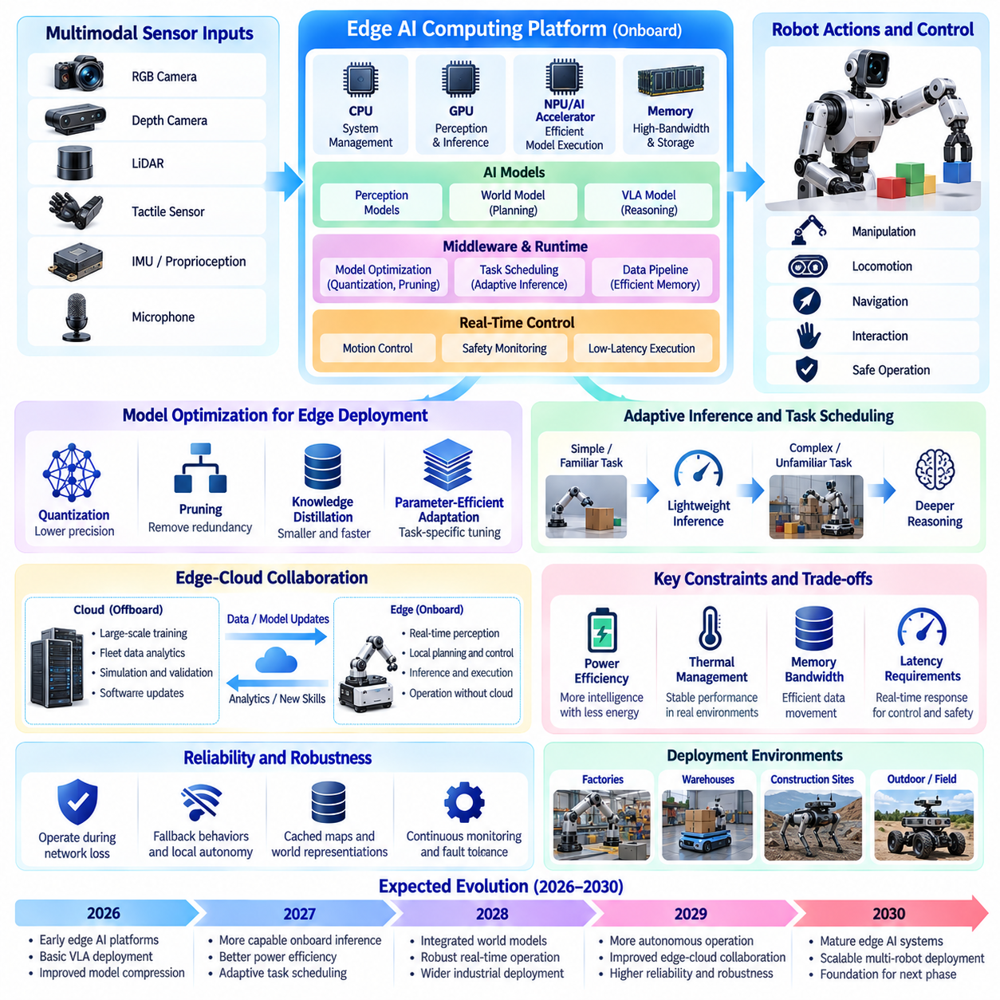{width="7.268055555555556in" height="7.268055555555556in"}

Between 2026 and 2030, edge artificial intelligence and computing infrastructure are expected to become critical enablers of Physical AI deployment. Robots must process sensory information, interpret instructions, plan actions, and execute control commands under strict timing and energy constraints. The evolution of edge computing may allow increasingly sophisticated intelligence to operate directly on robotic platforms without continuous dependence on remote cloud services.

Unlike conventional cloud-based AI, Physical AI requires computational systems that interact with the physical environment in real time. Delays in perception or control can create safety risks and reduce operational performance. Edge computing addresses these challenges by placing essential processing capabilities near sensors and actuators. However, achieving reliable autonomy requires careful coordination between computing hardware, software architectures, and physical control systems.

The evolution of robotic computing platforms will likely involve increasingly heterogeneous processing architectures. Central processing units, graphics processing units, neural processing units, and specialized accelerators may perform complementary functions. CPUs can manage system coordination, GPUs can accelerate perception and neural inference, and dedicated processors can support efficient model execution. Effective workload distribution will become essential for balancing performance and energy consumption.

Robot foundation models and Vision-Language-Action architectures will create growing demands for onboard computational resources. These models must process multimodal observations and generate actions while maintaining responsiveness. Larger model capacity can improve representation and reasoning, but it also increases memory requirements and computational latency. Edge deployment will therefore require architectures designed around practical operating constraints rather than model size alone.

Model compression will become an important mechanism for bringing advanced intelligence onto resource-constrained robots. Quantization, pruning, knowledge distillation, and parameter-efficient adaptation can reduce memory consumption and inference costs. However, compression may affect prediction accuracy, action precision, and robustness. Evaluation must therefore examine the relationship between computational savings and physical task performance rather than relying exclusively on digital benchmarks.

Memory bandwidth and data movement may become as important as raw computational throughput. Robotic systems continuously exchange information between cameras, depth sensors, LiDAR, processors, and control modules. Moving large volumes of data can increase latency and power consumption. Future platforms may employ optimized memory hierarchies, sensor preprocessing, and efficient data pipelines to reduce unnecessary transfers while preserving information required for reliable decisions.

Real-time computing requirements will continue to distinguish Physical AI from many digital AI applications. Motor control, collision avoidance, and safety monitoring often require predictable response times. High-level reasoning models may operate at slower frequencies than low-level controllers. Hierarchical computing architectures can separate time-critical control from computationally intensive planning, allowing sophisticated intelligence to coexist with deterministic operational safeguards.

The integration of edge AI with predictive world models may improve local decision-making capabilities. World models can estimate environmental changes, anticipate interactions, and evaluate candidate actions. Executing these predictions onboard may reduce dependence on network connectivity and improve responsiveness. Nevertheless, prediction horizons and model complexity must be adapted to available computational resources, especially when robots operate under strict energy and thermal constraints.

Adaptive inference may become a major architectural direction between 2026 and 2030. Rather than applying maximum computational effort to every observation, robots may allocate processing resources according to task complexity and uncertainty. Routine operations could use lightweight policies, while unfamiliar situations trigger more detailed reasoning. Such approaches may improve energy efficiency, provided that computational scheduling does not compromise safety-critical response times.

Edge-cloud collaboration will remain important even as onboard intelligence becomes more capable. Edge systems can execute immediate perception, planning, and control, while cloud infrastructure supports large-scale training, fleet analytics, simulation, and software distribution. Some noncritical reasoning tasks may also use remote resources when connectivity permits. The division of responsibilities should account for latency, bandwidth, privacy, availability, and operational safety.

Communication reliability will strongly influence the design of distributed Physical AI systems. Robots operating in factories, warehouses, construction sites, and outdoor environments may experience intermittent connectivity. Essential autonomy must therefore remain functional during network disruptions. Local fallback behaviors, cached environmental representations, and controlled synchronization mechanisms can help maintain safe operation while enabling broader fleet coordination when communication is restored.

Power efficiency will become a central measure of computing platform progress. Mobile robots depend on limited onboard energy, and computational workloads compete with locomotion, manipulation, sensing, and communication for available power. Higher inference performance does not necessarily improve productivity if it significantly reduces operating time. Future platforms should therefore optimize useful task performance per watt while considering the complete robot energy budget.

Thermal management presents another important challenge for compact robotic systems. High-performance processors generate heat that must be dissipated within limited mechanical space. Excessive temperatures can reduce computational performance, accelerate component degradation, and affect system reliability. Hardware-software co-design may incorporate dynamic power management, workload scheduling, thermal-aware inference, and mechanical cooling strategies to maintain sustained performance.

Specialized AI accelerators may increasingly support robotic perception, neural inference, and selected planning operations. Their value will depend on software compatibility, numerical precision, memory architecture, and the ability to execute evolving model structures. Hardware optimized for one neural architecture may become less efficient as algorithms change. Flexible acceleration and mature software ecosystems may therefore be as important as peak theoretical performance.

Safety-critical computing will require separation between learned intelligence and verified control mechanisms. Neural models may generate goals, trajectories, or action proposals, but independent safety monitors should enforce operational constraints. Real-time operating systems, watchdog mechanisms, redundant sensing, and deterministic emergency responses can provide additional protection. Such architectural separation may become increasingly important as robots perform more autonomous tasks.

Cybersecurity and data governance will also shape edge computing development. Robots may process sensitive visual observations, facility information, operational records, and human interaction data. Local processing can reduce unnecessary transmission, but it does not eliminate security risks. Secure boot, authenticated updates, encrypted communication, access control, and model integrity verification will be important for maintaining trustworthy Physical AI deployments.

The economics of robotic computing will depend on more than processor acquisition costs. System designers must consider energy consumption, cooling requirements, software integration, maintenance, hardware replacement, and operational reliability. A more expensive computing platform may be economically justified if it reduces interventions or improves task completion rates. Conversely, excessive computational capacity can increase costs without producing proportional operational benefits.

Evaluation frameworks should measure edge intelligence under realistic operating conditions. Relevant indicators include inference latency, response-time variability, memory utilization, sustained throughput, power consumption, thermal stability, and task success rates. Testing should include simultaneous sensor processing, planning, communication, and control workloads. Performance measured through isolated neural benchmarks may not accurately represent integrated robotic operation.

By 2030, a plausible outcome is the emergence of more capable edge computing platforms that support multimodal foundation models, predictive world models, and hierarchical robotic control within practical power envelopes. These systems may enable greater autonomy in mobile manipulation, industrial inspection, logistics, and selected service applications. However, computational advances alone will not resolve limitations involving mechanical reliability, physical reasoning, and environmental generalization.

Ultimately, the 2026--2030 evolution of edge AI and computing should be understood as a transition toward efficient, distributed, and physically grounded intelligence. The most important milestone will not be achieving maximum onboard computational performance, but enabling robots to execute increasingly complex tasks safely and reliably within real-world constraints. Successful progress will require continuous co-design of AI models, computing hardware, control architectures, energy systems, and operational infrastructure.

## 08.06. 2026--2030 AMR and Mobile Manipulation

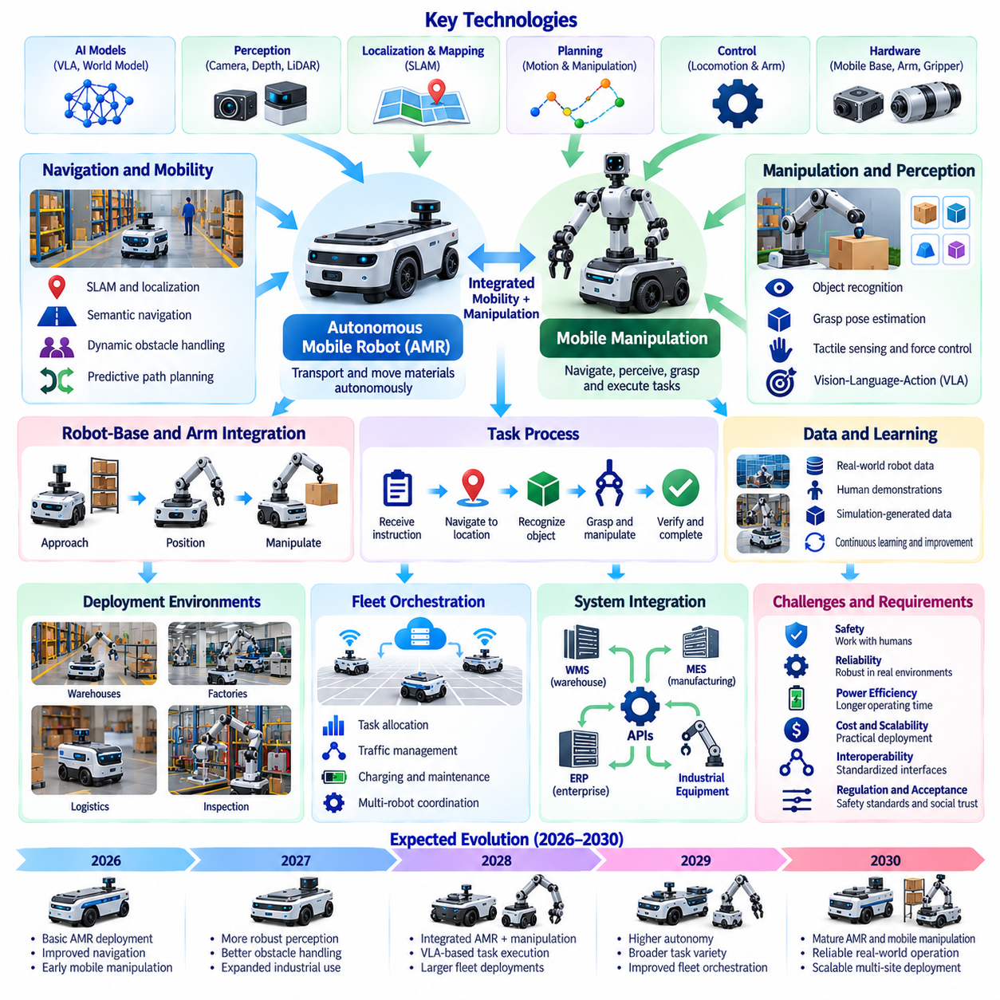{width="7.268055555555556in" height="7.268055555555556in"}

Between 2026 and 2030, Autonomous Mobile Robots (AMRs) and mobile manipulation systems are expected to become increasingly important platforms for deploying Physical AI in practical environments. Their evolution will involve a transition from navigation-centered automation toward integrated mobility, perception, manipulation, and task reasoning. This progression may enable robots to perform more complex workflows across warehouses, factories, logistics facilities, and selected service environments.

Conventional AMRs primarily transport materials between predefined locations while adapting their routes to changing obstacles. Although modern systems already demonstrate sophisticated navigation capabilities, their operational roles often remain limited to transportation. Mobile manipulation extends these capabilities by integrating robotic arms, grippers, and intelligent perception systems, allowing a single platform to navigate, identify objects, interact with equipment, and execute physical tasks.

The development of mobile manipulation requires close coordination between locomotion and manipulation. A robot must position its mobile base while maintaining suitable arm reach, collision clearance, and mechanical stability. Unlike stationary manipulators, mobile platforms introduce additional uncertainty through localization errors, wheel-ground interactions, and platform movement. Effective whole-body planning must therefore consider mobility and manipulation as interconnected processes.

Navigation capabilities are likely to advance through improvements in simultaneous localization and mapping, semantic perception, and predictive planning. Future AMRs may interpret environmental structure beyond geometric obstacles, recognizing workstations, pedestrian zones, material storage areas, and operational constraints. Semantic navigation can help robots select routes according to task requirements rather than distance alone, improving flexibility in dynamic facilities.

Dynamic obstacle handling will remain a major challenge in environments shared with human workers and industrial equipment. Robots must anticipate pedestrian movement, forklift trajectories, temporary obstructions, and changing workspace configurations. Predictive world models may support short-horizon motion forecasting and risk-aware path planning. However, safe navigation requires conservative behavior when observations are incomplete or predictions become unreliable.

Mobile manipulation systems will increasingly combine multimodal perception with task-oriented reasoning. Cameras, depth sensors, force sensors, and proprioceptive measurements can provide information about object geometry, grasp conditions, and robot configuration. Vision-Language-Action models may translate high-level instructions into coordinated movement and manipulation behaviors. Reliable execution will nevertheless require continuous feedback and explicit verification of physical outcomes.

Grasping and object handling are expected to remain important technical bottlenecks. Industrial environments contain objects with different shapes, weights, surface properties, and packaging conditions. A mobile manipulator must estimate grasp feasibility, select suitable contact locations, and adapt to unexpected movement. Tactile sensing, force control, and learned grasp policies may improve robustness, particularly when visual observations cannot fully describe contact conditions.

The integration of manipulation with mobile base positioning can expand the reachable workspace of robotic systems. Instead of requiring objects to arrive at fixed automation stations, mobile manipulators can approach shelves, machines, containers, and inspection points. This flexibility may reduce some infrastructure requirements and support variable production layouts. However, mobility introduces additional calibration, positioning, and safety challenges that must be addressed.

Industrial applications may initially focus on repetitive, structured tasks with measurable operational value. Examples include machine tending, material transfer, component delivery, inventory interaction, and selected inspection procedures. These applications offer relatively controlled environments while allowing progressive increases in autonomy. Deployment strategies will likely prioritize reliable task completion and integration with existing workflows over unrestricted general-purpose capabilities.

Warehouse and logistics operations may provide particularly favorable environments for AMR scaling. Mobile platforms can support goods transportation, replenishment, order preparation, and coordination between storage and processing areas. Mobile manipulation may extend automation to picking and handling tasks that currently require human intervention. Nevertheless, variable packaging, cluttered storage, and high throughput requirements will continue to challenge fully autonomous operation.

Fleet orchestration will become increasingly important as facilities deploy larger numbers of mobile robots. Coordinated systems must allocate tasks, manage traffic, schedule charging, and respond to equipment failures. Fleet management platforms may integrate operational priorities with predictive models of congestion and resource availability. Efficient coordination can improve system-level productivity, although communication failures and heterogeneous robot capabilities complicate optimization.

Interoperability will influence the economic viability of mobile robotic deployments. Robots must exchange information with warehouse management systems, manufacturing execution systems, enterprise software, and industrial equipment. Standardized interfaces and modular software architectures may reduce integration costs. However, differences in facility procedures, safety requirements, and equipment protocols will continue to require application-specific engineering.

Edge computing will support increasingly sophisticated autonomy without continuous cloud dependence. Onboard processors can execute perception, navigation, manipulation planning, and safety monitoring with low latency. Cloud infrastructure may remain responsible for fleet analytics, large-scale learning, and software updates. A carefully designed edge-cloud architecture can improve responsiveness while preserving the benefits of centralized coordination and accumulated operational experience.

Simulation and digital twins may accelerate AMR and mobile manipulation development. Virtual environments can reproduce facility layouts, robot dynamics, traffic conditions, and representative manipulation tasks. Developers can evaluate navigation policies, grasp strategies, and fleet coordination before physical deployment. However, accurate contact dynamics, wheel-ground interactions, and operational variability remain difficult to reproduce, requiring systematic real-world validation.

Learning from operational data may gradually improve mobile robot adaptability. Deployed systems can collect navigation failures, manipulation errors, intervention events, and recovery trajectories. Data engines can identify recurring problems and generate targeted training scenarios. Fleet learning may then distribute validated improvements across compatible robots, creating feedback loops that increase performance without requiring every robot to learn independently.

Safety engineering will remain central to commercial adoption. Mobile manipulators combine the hazards of moving vehicles with those of articulated robotic arms. Risk assessment must consider collisions, pinch points, payload instability, unexpected arm motion, and human proximity. Safety-rated sensing, monitored operating modes, emergency stopping, and appropriate physical separation can help manage these risks, although learned policies alone cannot establish safety assurance.

Reliability and maintainability will strongly influence deployment decisions. Industrial customers require predictable uptime, manageable service costs, and consistent task performance. Wheel wear, actuator degradation, sensor contamination, calibration drift, and battery aging can affect operational availability. Predictive maintenance and modular hardware may reduce downtime, but successful commercialization will depend on demonstrating sustained performance across realistic operating cycles.

Economic evaluation should consider total cost of ownership rather than robot acquisition price alone. Relevant factors include integration expenses, facility modifications, maintenance, energy consumption, operator supervision, and achievable utilization. Mobile manipulation can create value by reducing repetitive handling and improving workflow flexibility. Nevertheless, additional mechanical complexity may outweigh these benefits when simpler AMRs or fixed automation can perform the same tasks more efficiently.

By 2030, a plausible outcome is the broader deployment of AMRs capable of reliable navigation and selected mobile manipulation tasks in semi-structured environments. Increasingly capable perception models, task planners, and fleet intelligence may reduce manual configuration and expand operational flexibility. However, highly unstructured manipulation, long-horizon autonomy, and robust generalization across facilities will likely remain challenging.

Ultimately, the 2026--2030 evolution of AMRs and mobile manipulation should be understood as a transition from autonomous transportation toward integrated physical task execution. The decisive milestone will not be the creation of robots that can move and manipulate independently, but systems that coordinate mobility, perception, reasoning, and physical interaction reliably. This integration may establish an important foundation for more general-purpose robotic platforms beyond 2030.

## 08.07. 2026--2030 Humanoid and Legged Robotics

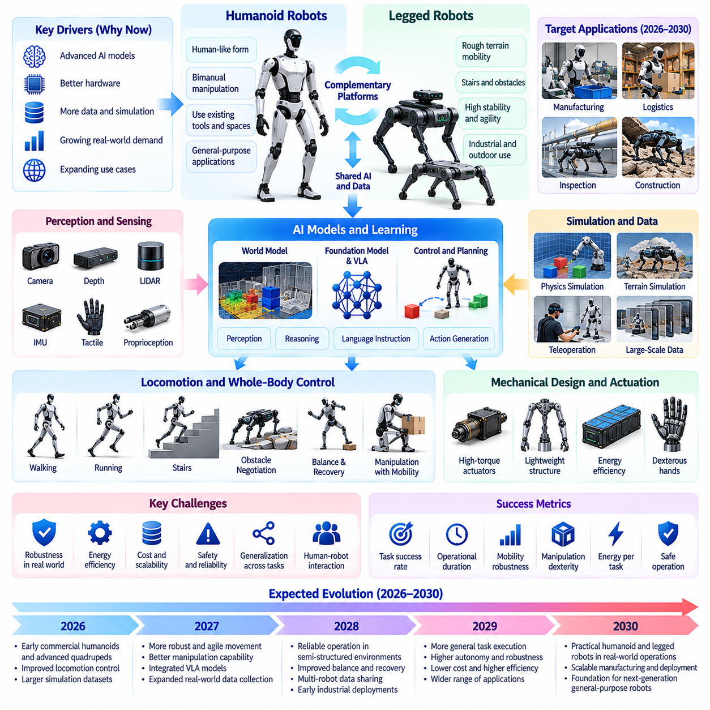{width="7.268055555555556in" height="7.268055555555556in"}

Between 2026 and 2030, humanoid and legged robotics are expected to advance from specialized demonstrations toward increasingly practical Physical AI applications. Their development will combine improvements in locomotion, manipulation, perception, learning, and mechanical design. However, progress will differ across platforms, with quadrupedal robots potentially achieving broader operational maturity earlier than general-purpose humanoids in several demanding environments.

Legged robots offer mobility advantages in environments containing stairs, uneven terrain, obstacles, and discontinuous surfaces. Unlike wheeled platforms, they can adjust individual foot placements to negotiate complex ground conditions. These capabilities are valuable for industrial inspection, construction monitoring, infrastructure maintenance, and hazardous environments. Nevertheless, legged mobility introduces higher mechanical complexity, energy demands, and control requirements.

Humanoid robots pursue a different architectural objective by approximating aspects of human body geometry and manipulation capability. Their potential advantage lies in operating within environments originally designed for human workers, including existing tools, workstations, stairs, and access pathways. However, humanlike morphology does not automatically guarantee superior productivity. Practical value depends on task suitability, stability, dexterity, operating cost, and reliability.

Locomotion control will remain a central research priority throughout the period. Advances in reinforcement learning, model predictive control, and whole-body dynamics may improve walking, running, turning, and obstacle negotiation. Learned controllers can adapt to changing terrain and disturbances, while analytical models provide useful physical constraints. Combining these approaches may improve robustness without eliminating the need for extensive physical validation.

Dynamic balance and disturbance recovery are particularly important for humanoid systems. Bipedal locomotion requires continuous coordination of body posture, foot placement, momentum, and ground reaction forces. Unexpected pushes, slippery surfaces, or changing payloads can destabilize the robot. Future control architectures may integrate predictive dynamics, reactive stabilization, and learned recovery behaviors to reduce falls and improve operational safety.

Mechanical design will strongly influence the achievable performance of legged robots. Actuator torque density, transmission efficiency, joint compliance, structural mass, and thermal characteristics determine mobility capabilities. High-performance actuators can support dynamic movement but may increase cost and energy consumption. Design optimization must balance strength, durability, controllability, maintainability, and the requirements of intended applications.

Energy efficiency will remain a major constraint on commercial deployment. Legged locomotion can consume substantial power, especially when robots carry payloads, climb stairs, or maintain dynamic balance. Battery capacity, actuator efficiency, gait selection, and computational workloads jointly determine operating endurance. Improvements in energy management may extend mission duration, but practical deployments must still account for charging, battery replacement, and downtime.

Perception systems will become increasingly important for terrain-aware locomotion and manipulation. Cameras, depth sensors, LiDAR, inertial measurements, and proprioceptive sensing can provide information about obstacles, surface geometry, and body motion. Predictive world models may help robots anticipate terrain transitions and select stable footholds. However, uncertain ground friction, deformable surfaces, and partially observed obstacles will continue to challenge reliable movement.

Whole-body control will connect locomotion, balance, and manipulation into coordinated physical behavior. A humanoid carrying an object must adjust posture and foot placement while accounting for payload forces. A quadruped equipped with a manipulator must maintain stability during reaching or contact tasks. Such coordination requires models of coupled dynamics and contact constraints, together with real-time feedback that responds to unexpected disturbances.

Manipulation capability may become a major differentiator among humanoid platforms. General-purpose work requires reaching, grasping, tool use, object transfer, and coordinated bimanual actions. Dexterous hands offer flexibility but introduce complex sensing, actuation, and control challenges. Early commercial systems may therefore employ simplified grippers or application-specific end effectors rather than attempting unrestricted human-level hand dexterity.

Robot foundation models and Vision-Language-Action systems may support more adaptable humanoid behavior. Language-conditioned policies can interpret instructions and coordinate perception with task execution. Cross-task learning may reduce the need to program each behavior independently. Nevertheless, translating high-level goals into physically safe actions remains difficult because humanoid robots must continuously satisfy balance, contact, joint, and environmental constraints.

Simulation will play a major role in scaling locomotion and manipulation learning. Massively parallel physics environments can generate diverse terrain conditions, disturbances, object interactions, and recovery scenarios. Domain randomization may improve transfer from simulation to physical hardware. However, contact dynamics, actuator behavior, structural compliance, and sensor imperfections must be represented sufficiently accurately to avoid unreliable real-world performance.

Robot data collection will increasingly combine teleoperation, motion capture, autonomous exploration, and operational fleet experience. Human demonstrations can provide examples of coordinated manipulation and task execution, while reinforcement learning can optimize dynamic locomotion. Retargeting human motion to robotic bodies requires accounting for differences in joint structure, balance, and physical capability. Data quality and embodiment compatibility will remain critical.

Quadrupedal robots may expand their roles in inspection, monitoring, and remote operations during this period. Their ability to traverse stairs, debris, and uneven industrial terrain can provide advantages where wheeled systems face access limitations. Applications may include equipment inspection, environmental sensing, and hazardous-area reconnaissance. However, payload limitations, endurance, sensor requirements, and integration costs will determine whether deployment is economically justified.

Humanoid commercialization may initially concentrate on structured industrial tasks rather than unrestricted household or public environments. Material handling, workstation assistance, repetitive component movement, and selected logistics operations may provide controlled opportunities for deployment. Such tasks can be evaluated through measurable productivity and intervention rates. Nevertheless, simpler automation solutions may remain preferable when they deliver equivalent results at lower cost.

Safety assurance will become increasingly important as legged robots operate near people and equipment. Falling robots, unexpected limb motion, unstable payloads, and high-force contacts create distinct hazards. Safety engineering must incorporate risk assessment, motion constraints, emergency stopping, and appropriate operating boundaries. Learned control policies can improve adaptability, but independent protective mechanisms and validated operating procedures remain essential.

Reliability engineering will determine whether impressive demonstrations become sustainable commercial operations. Repeated walking and manipulation expose joints, transmissions, bearings, and structural components to cyclic loading and wear. Maintenance intervals, component replacement costs, calibration stability, and recovery from failures will influence availability. Commercial success requires consistent performance over extended duty cycles rather than isolated demonstrations.

The economics of humanoid and legged robotics will depend on application-specific productivity. Relevant factors include acquisition cost, energy consumption, supervision, maintenance, integration, and achievable operating hours. Humanoid morphology may reduce certain facility modifications, but its mechanical complexity can offset those savings. Quadrupedal systems may justify higher mobility costs when difficult terrain creates substantial operational value.

By 2030, a plausible outcome is wider adoption of quadrupedal platforms for selected inspection and mobility-intensive applications, alongside controlled deployments of humanoid robots in structured industrial environments. Improvements in actuators, learning algorithms, simulation, and onboard computing may increase autonomy. However, generalized dexterity, long-duration reliability, energy efficiency, and safe operation in unpredictable environments will remain substantial challenges.

Ultimately, the 2026--2030 evolution of humanoid and legged robotics should be understood as a transition from mobility demonstrations toward reliable physical task execution. The decisive milestone will not be achieving humanlike appearance or spectacular movement, but demonstrating sustained operational value under realistic constraints. Progress during this period may establish the mechanical, computational, and learning foundations for more generalist embodied robots beyond 2030.

## 08.08. 2030--2035 Generalist Robot Platforms

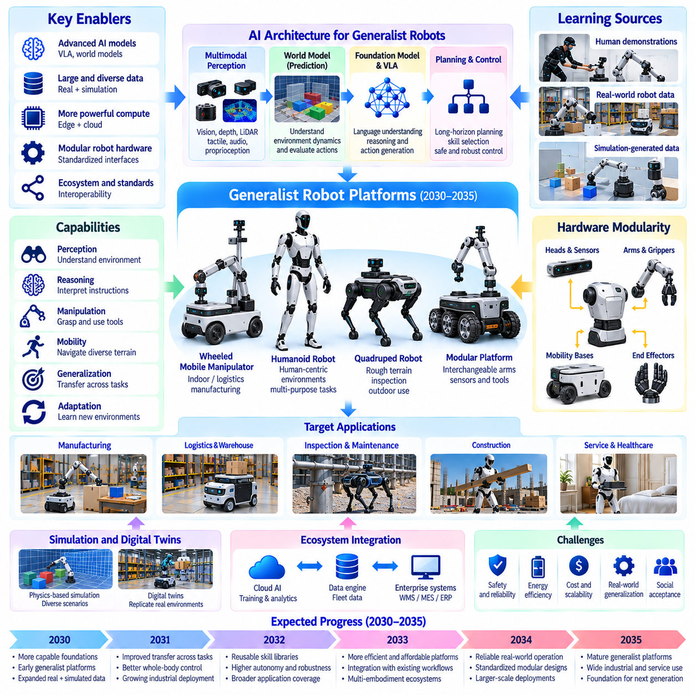{width="7.268055555555556in" height="7.268055555555556in"}

Between 2030 and 2035, generalist robot platforms may emerge as an important stage in the evolution of Physical AI. Unlike specialized robots designed for narrowly defined tasks, generalist platforms aim to perform multiple physical activities using shared intelligence and adaptable hardware. Their development may represent a transition from application-specific automation toward reusable robotic systems capable of operating across different tasks, environments, and workflows.

The defining characteristic of a generalist robot is not its physical appearance but its ability to transfer capabilities across tasks. A generalist platform should combine perception, reasoning, planning, manipulation, and mobility within a coherent architecture. Rather than requiring complete reprogramming for every new operation, such systems may adapt through instructions, demonstrations, experience, and limited task-specific learning.

Generalist robotics will likely depend on the convergence of robot foundation models, predictive world models, and advanced control architectures. Foundation models can provide transferable representations of objects, actions, and tasks, while world models estimate physical consequences. Control systems translate these predictions into executable movements. Integrating these components may enable robots to perform unfamiliar tasks with less application-specific engineering.

Hardware modularity may become a central principle of generalist robot platform design. Interchangeable manipulators, grippers, sensor modules, and mobility bases can support different operational requirements. Modular architectures may allow manufacturers to reuse computing systems and software across multiple robot configurations. However, mechanical compatibility, calibration, safety validation, and maintenance complexity will influence the practical benefits of modularity.

Generalist platforms may include humanoid robots, mobile manipulators, wheeled systems, and specialized legged configurations. Different embodiments provide different advantages in mobility, payload capacity, precision, and environmental accessibility. A humanoid may interact with human-oriented infrastructure, while a wheeled manipulator may offer greater stability and efficiency on industrial floors. Generality should therefore be evaluated through task coverage rather than morphology.

Cross-task learning will become increasingly important as robots encounter diverse operational requirements. A platform trained on object handling, navigation, and tool interaction may reuse previously acquired knowledge when performing related activities. Shared representations can reduce the amount of new training data required for unfamiliar tasks. Nevertheless, successful transfer depends on physical similarity, action compatibility, and the reliability of learned abstractions.

Vision-Language-Action models may provide a common interface between human instructions and robotic behavior. Natural language can specify goals, constraints, and task sequences without requiring detailed low-level programming. The robot must then ground these instructions in observed objects, available tools, and physical capabilities. Reliable execution requires verification mechanisms that detect misunderstandings and prevent unsafe interpretations.

Predictive world models may support generalist behavior by enabling robots to evaluate alternative action sequences. A robot could estimate whether an object can be moved, whether a route remains accessible, or whether a manipulation strategy may cause instability. Such predictions can improve planning efficiency and recovery decisions. However, physically accurate reasoning across unfamiliar objects and environments will remain a significant challenge.

Long-horizon task execution will distinguish generalist robots from systems that perform isolated skills. Complex workflows require robots to maintain goals, track progress, manage dependencies, and respond to unexpected events. Hierarchical planning architectures may connect high-level objectives with reusable movement and manipulation skills. Persistent memory and state monitoring will be essential for maintaining consistency throughout extended operations.

Skill libraries may become an important architectural component of generalist robotic systems. Reusable capabilities such as grasping, opening doors, transporting objects, and operating equipment can be organized into parameterized behaviors. Higher-level planners may select and combine these skills according to task requirements. Learning new skills should expand the platform\'s capabilities without degrading previously validated behaviors.

Adaptation to unfamiliar environments will require more than broad training data. Generalist robots must recognize when existing knowledge is insufficient and adjust their behavior accordingly. Online perception updates, limited policy adaptation, and uncertainty-aware planning may improve flexibility. However, unrestricted online learning during physical operation could introduce safety risks, making controlled adaptation and validation necessary.

Robot data infrastructure may increasingly support generalist learning through diverse experiences collected across applications. Demonstrations, autonomous trajectories, intervention events, and simulated interactions can provide complementary learning signals. Data engines may identify transferable skills and underrepresented conditions. The challenge will be combining heterogeneous experiences without introducing inconsistent labels, incompatible action spaces, or systematic biases.

Simulation will remain essential for expanding the task coverage of generalist platforms. Virtual environments can generate variations in objects, layouts, materials, and operating conditions. Large-scale simulated experience may support policy training and evaluation before deployment. Nevertheless, the simulation-to-reality gap will remain especially important for contact-rich manipulation, deformable materials, and interactions involving unpredictable human behavior.

Edge computing architectures will need to support increasingly sophisticated intelligence under practical power and latency constraints. Generalist robots may execute perception, task planning, world-model prediction, and motor control concurrently. Hierarchical processing can distribute workloads across specialized accelerators and real-time controllers. Cloud infrastructure may support training and fleet learning, but essential autonomy must remain available locally.

Safety assurance will become more complex as robotic task coverage expands. A robot capable of performing many activities may encounter hazards that cannot be fully anticipated during initial deployment. Risk assessment must consider task context, environmental conditions, human proximity, and mechanical limitations. Independent safety mechanisms, constrained action spaces, and systematic validation will remain necessary even as learned policies become more capable.

Human-robot collaboration may become a defining feature of early generalist deployments. Human workers can provide instructions, demonstrate unfamiliar procedures, supervise exceptions, and approve sensitive actions. Robots may progressively assume repetitive or physically demanding activities while humans retain responsibility for judgment-intensive decisions. Effective collaboration will require understandable interfaces, predictable behavior, and calibrated trust.

Commercial adoption will likely begin in environments where diverse tasks share common physical requirements. Warehouses, manufacturing facilities, laboratories, and selected service operations may offer opportunities for platforms that can switch between related workflows. Generalist capability can improve utilization by reducing dependence on single-purpose assignments. However, specialization may remain economically superior for high-volume tasks requiring exceptional speed or precision.

The economics of generalist robots will depend on flexibility as well as productivity. A platform capable of performing several tasks may distribute acquisition and integration costs across multiple applications. Relevant measures include task coverage, utilization, intervention frequency, training effort, maintenance, and total cost of ownership. Broad capabilities create value only when they translate into reliable performance under realistic operational conditions.

By 2035, a plausible outcome is the emergence of commercially useful generalist platforms capable of executing families of related tasks with limited reconfiguration. Improvements in foundation models, world models, simulation, and modular hardware may expand adaptability across facilities. Nevertheless, unrestricted physical generality, human-level dexterity, and dependable performance in highly unpredictable environments may remain beyond practical deployment.

Ultimately, the 2030--2035 development of generalist robot platforms should be understood as a transition from isolated robotic capabilities toward reusable embodied intelligence. The decisive milestone will not be a robot that performs every conceivable human activity, but a platform that can acquire, combine, and reliably execute many useful physical skills. This progression may establish the foundation for broader cross-embodiment intelligence and self-improving robotic systems.

## 08.09. 2030--2035 Cross Embodiment Foundation Models

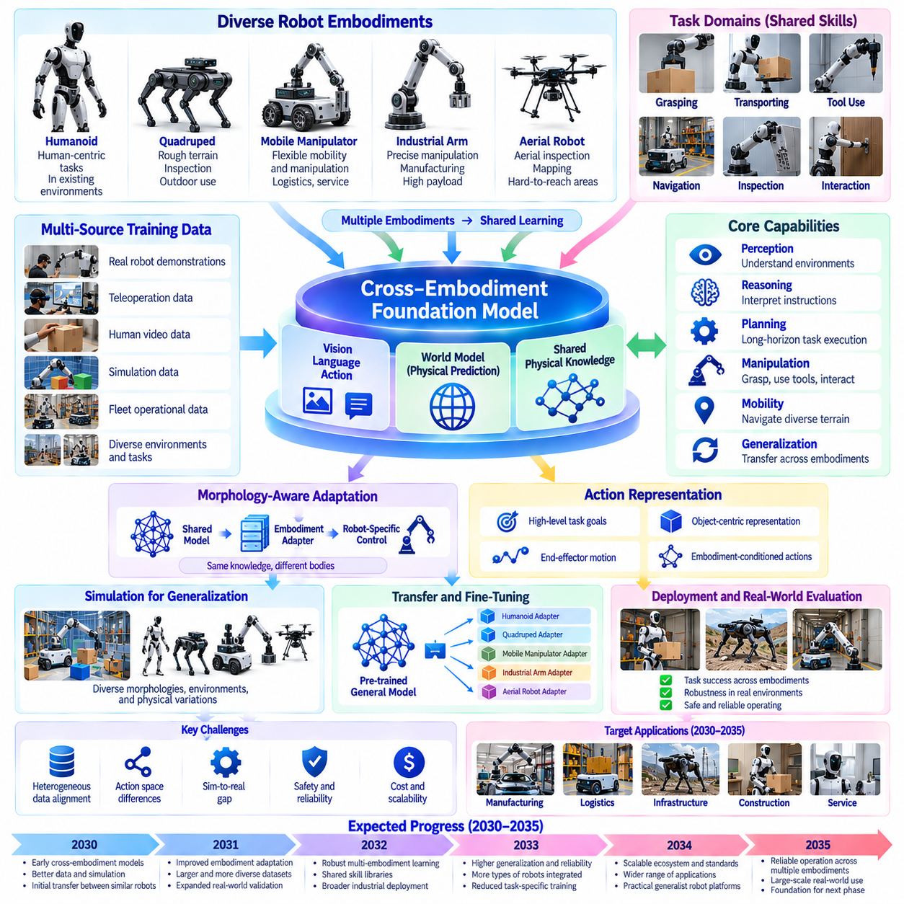{width="7.268055555555556in" height="7.268055555555556in"}

Between 2030 and 2035, cross-embodiment foundation models may become a major step toward general Physical AI. These models aim to transfer knowledge across robots with different bodies, sensors, actuators, and control systems. Rather than training every robot independently, developers may build shared representations of physical tasks and adapt them to specific platforms. Their success will depend on separating transferable intelligence from embodiment-specific constraints.

Robot embodiment determines how intelligence interacts with the physical world. Humanoid robots, quadrupeds, wheeled manipulators, and industrial arms differ in geometry, mobility, sensing, and available actions. A task such as moving an object may require different motions on each platform. Cross-embodiment learning seeks to preserve common task knowledge while translating it into actions compatible with each robot\'s mechanical structure.

Shared representations may provide the foundation for transferring capabilities across robotic platforms. Objects, spatial relationships, task goals, and physical interactions can be represented independently of particular joint configurations. A common latent space may encode concepts such as reaching, grasping, transporting, and placing. However, successful transfer requires these abstract representations to remain connected to the actual capabilities and limitations of each embodiment.

Cross-embodiment architectures may combine a shared foundation model with robot-specific perception and action interfaces. The shared model can interpret goals, predict outcomes, and select strategies, while embodiment adapters translate decisions into executable commands. These adapters must account for joint limits, kinematics, dynamics, and actuator characteristics. This separation could improve model reuse without assuming that different robots possess identical physical capabilities.

Training data diversity will be essential for developing transferable robotic intelligence. Datasets may combine demonstrations from humanoids, mobile manipulators, industrial arms, quadrupeds, and simulated robots. Each platform contributes different observations and interaction experiences. However, inconsistent sensor configurations, action frequencies, coordinate systems, and task definitions can complicate learning. Standardized metadata and carefully aligned representations will therefore become increasingly important.

Action representation is one of the central technical challenges in cross-embodiment learning. Directly transferring joint commands between robots is generally impractical because their mechanical structures differ. Higher-level representations may instead describe desired end-effector motion, object transformations, contact goals, or task constraints. Robot-specific controllers can then convert these intentions into feasible movements while respecting physical and safety limitations.

Vision-Language-Action models may provide a shared interface for interpreting instructions across robot embodiments. Language can express task objectives without specifying the exact motor commands needed by each platform. Visual perception can identify relevant objects and environmental conditions. The action component must then generate embodiment-compatible behavior. This architecture may support broad task transfer, although physical grounding remains necessary for reliable execution.

World models may strengthen cross-embodiment learning by representing physical consequences independently of specific robot configurations. A shared model could predict how objects move, collide, deform, or respond to contact. Different robots could use these predictions to select suitable manipulation strategies. However, interaction outcomes also depend on robot geometry, force capacity, and contact mechanics, requiring world models to incorporate embodiment-specific information when necessary.

Transfer learning across embodiments may reduce the amount of data required to introduce new robotic platforms. A model trained on several manipulation systems could provide useful initialization for a robot with different dimensions or actuators. Fine-tuning may then focus on hardware-specific behaviors rather than relearning general task structure. Nevertheless, transfer performance will depend on the similarity of available actions and the quality of the shared representations.

Simulation may enable large-scale experimentation with different robot morphologies. Virtual environments can vary limb lengths, joint arrangements, payload capacities, sensor placements, and actuator properties. Training across these variations may encourage models to learn robust physical principles instead of memorizing a single robot configuration. Yet simulated diversity cannot fully replace real-world data, particularly for contact-rich tasks and complex material interactions.

Morphology-conditioned learning may become an important approach for adapting foundation models to different bodies. A robot\'s kinematic structure, joint limits, sensor configuration, and dynamic parameters can be encoded as model inputs. The model may then adjust its predictions and actions according to the available hardware. Such conditioning could improve generalization to unfamiliar configurations, although substantial differences in embodiment may still require additional training.

Skill transfer will likely progress first among robots that share similar manipulation capabilities. Industrial arms and mobile manipulators may exchange knowledge about grasping, placement, and tool interaction more easily than platforms with fundamentally different action spaces. Transfer between humanoids and quadrupeds may be more effective for perception or navigation reasoning than for direct motor behavior. Generality will therefore emerge unevenly across different capability categories.

Hierarchical planning may help bridge the gap between shared intelligence and embodiment-specific execution. High-level planners can represent tasks through goals and dependencies, while lower-level controllers implement suitable movements for each platform. A shared instruction such as retrieving an object may produce different navigation and manipulation sequences depending on robot capabilities. This hierarchy allows common reasoning without requiring identical physical behavior.

Multi-robot collaboration may benefit from cross-embodiment foundation models. Heterogeneous fleets could share task descriptions, environmental knowledge, and learned strategies while assigning actions according to platform strengths. A quadruped might inspect an inaccessible location, while a wheeled manipulator transports equipment and an industrial arm performs precision handling. Shared intelligence could improve coordination, although communication and scheduling remain separate challenges.

Evaluation frameworks will need to distinguish genuine transfer from performance achieved through extensive platform-specific retraining. Benchmarks may measure task success, adaptation data requirements, safety, robustness, and performance degradation across embodiments. Testing should include unfamiliar objects, environments, and robot configurations. Without rigorous evaluation, apparent generalization may reflect similarities in training datasets rather than transferable physical understanding.

Safety assurance will remain a critical limitation of cross-embodiment deployment. A strategy that is safe for one robot may be hazardous for another because of differences in mass, reach, stability, or actuator force. Shared models must therefore operate within platform-specific safety constraints. Independent controllers, verified operating envelopes, and uncertainty-aware execution can help prevent inappropriate transfer of learned behaviors.

Commercial applications may initially emphasize shared software across related robot families. Manufacturers could deploy common perception, task planning, and learning components while retaining specialized motion controllers. This approach may reduce software development costs and accelerate deployment of new hardware variants. However, integration expenses, certification requirements, and differences in operational environments will limit the immediate economic benefits of universal models.

Data governance and interoperability will influence the scalability of cross-embodiment learning. Shared datasets may involve multiple manufacturers, customers, and operational environments with different privacy and ownership requirements. Common schemas, secure data exchange, and controlled model updates can support collaboration. Nevertheless, proprietary hardware interfaces and commercially sensitive operational data may restrict the creation of fully unified training ecosystems.

By 2035, a plausible outcome is the emergence of foundation models that transfer selected perception, planning, and manipulation capabilities across several compatible robot embodiments. Such systems may reduce task-specific programming and improve adaptation to new hardware. However, universal motor control, reliable zero-shot transfer, and consistent performance across radically different bodies will likely remain unresolved challenges requiring further research.

Ultimately, cross-embodiment foundation models represent a transition from robot-specific intelligence toward shared physical knowledge. Their significance lies in allowing different machines to reuse experience while respecting their distinct mechanical capabilities. The decisive milestone will be measurable transfer across tasks and platforms with limited additional training. This progress may establish a foundation for heterogeneous fleet intelligence and increasingly general embodied AI beyond 2035.

## 08.10. 2030--2035 Large Scale Fleet Intelligence

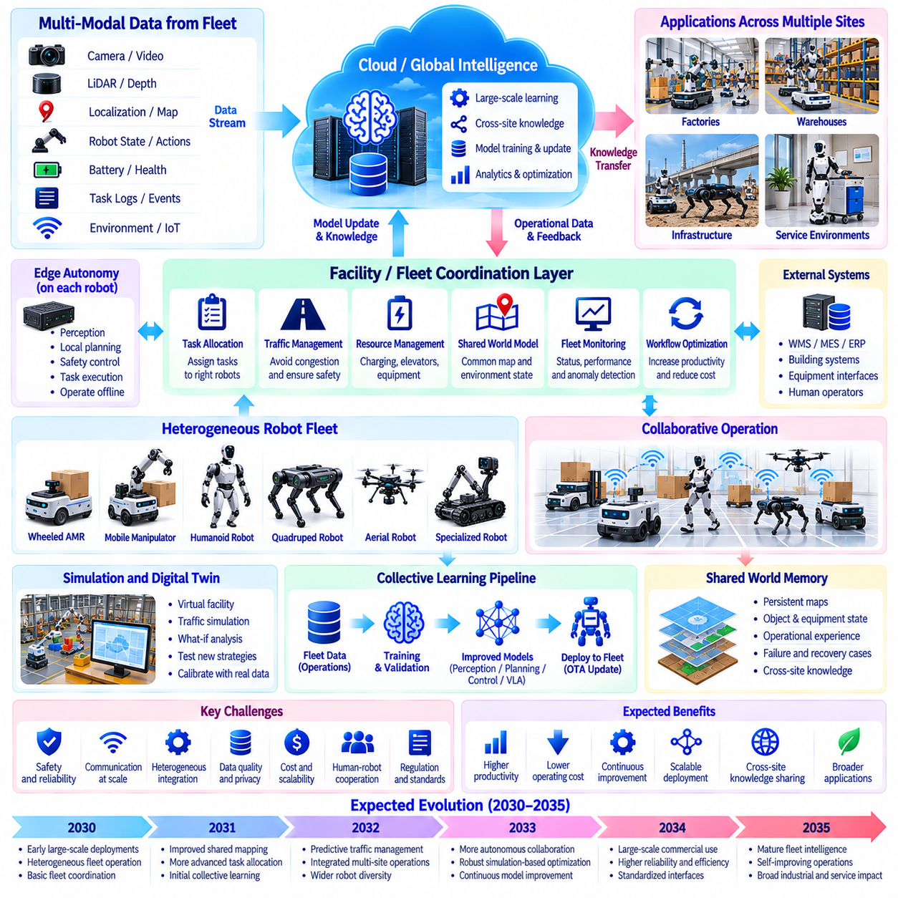{width="7.268055555555556in" height="7.268055555555556in"}

Between 2030 and 2035, large-scale fleet intelligence may transform robotic operations from collections of independent machines into coordinated Physical AI systems. As deployments expand across factories, warehouses, infrastructure, and service environments, overall performance will increasingly depend on collective decision-making. Fleet intelligence will combine shared knowledge, distributed autonomy, and centralized coordination to improve productivity, adaptability, and operational resilience.

Traditional fleet management focuses primarily on dispatching robots, assigning routes, and monitoring equipment status. Large-scale fleet intelligence extends these functions toward shared perception, predictive planning, and coordinated learning. Robots may exchange environmental observations, operational experiences, and task information. The resulting system can make decisions based on collective knowledge rather than relying exclusively on each robot\'s local observations.

Fleet architectures will likely combine local autonomy with hierarchical coordination. Individual robots must maintain safe navigation, obstacle avoidance, and task execution even when communication becomes unreliable. Facility-level controllers can optimize traffic, resource allocation, and workflow priorities. Higher-level services may coordinate operations across multiple facilities, allowing local responsiveness while supporting broader operational optimization.

Shared world representations may become a foundation of collective robotic intelligence. Robots operating within the same facility can contribute observations to common maps, semantic models, and dynamic occupancy representations. These shared resources may describe obstacles, equipment states, accessible routes, and temporary restrictions. Continuous updates can improve situational awareness, although inconsistent observations and localization errors require careful reconciliation.

Fleet world memory may extend shared mapping into persistent operational knowledge. Robots could record recurring congestion, difficult manipulation conditions, equipment accessibility, and previous recovery actions. This information may help future missions anticipate operational difficulties. However, shared memory must distinguish stable environmental properties from temporary events to prevent outdated information from influencing decisions.

Task allocation will become increasingly sophisticated as fleets grow in size and diversity. Scheduling systems may consider robot capabilities, payload requirements, travel distances, battery levels, task deadlines, and equipment availability. Dynamic allocation can respond to urgent requests or unexpected failures. Optimization methods may improve throughput, but centralized scheduling must remain computationally manageable and robust against incomplete information.

Traffic coordination will become a major challenge in dense robotic environments. Large fleets may compete for corridors, elevators, charging stations, loading areas, and shared workspaces. Predictive traffic management can anticipate congestion and adjust routes before conflicts emerge. Reservation-based access and distributed negotiation may improve coordination, although unpredictable human activity will continue to require conservative safety margins.

Heterogeneous fleets may combine wheeled mobile robots, mobile manipulators, quadrupeds, humanoids, and specialized industrial systems. Each platform contributes different mobility, manipulation, sensing, and payload capabilities. Fleet intelligence can assign tasks according to these strengths and coordinate complementary operations. Effective collaboration will require common task representations and interfaces without assuming identical robot behavior.

Collective learning may become a central mechanism for improving fleet performance. Operational data from many robots can reveal recurring failures, rare environmental conditions, and inefficient task strategies. Centralized training systems may transform these experiences into improved perception, planning, and control models. Validated updates can then be distributed to compatible platforms, enabling collective improvement without requiring every robot to encounter the same problem.

Fleet-scale data engines will need to process large volumes of multimodal operational information. Camera streams, LiDAR observations, robot states, task logs, intervention records, and equipment telemetry may provide complementary evidence. Automated event mining can identify unusual behaviors and performance degradation. Data selection and quality control will be essential because collecting more information does not necessarily produce more useful learning.

Simulation and digital twins may support fleet-level optimization before operational changes are introduced. Virtual facilities can reproduce robot traffic, resource constraints, equipment interactions, and workflow dependencies. Operators may evaluate alternative scheduling strategies or deployment configurations without disrupting production. However, simulations must be continuously calibrated against real operations to prevent unrealistic assumptions from influencing decisions.

Edge-cloud architectures will distribute intelligence across robots, local servers, and remote computing infrastructure. Safety-critical control and immediate obstacle avoidance should remain local, while facility servers may coordinate shared resources and fleet scheduling. Cloud services can support large-scale analytics, model training, and cross-site knowledge transfer. This architecture must account for latency, bandwidth limitations, and communication failures.

Communication infrastructure will influence the scalability of collective robotic systems. Reliable exchange of task states, map updates, and coordination messages is essential for efficient operation. Network congestion, wireless interference, and temporary disconnections can reduce system performance. Communication-aware planning may prioritize essential information while allowing robots to continue operating safely when connectivity is degraded.

Operational resilience will become increasingly important as organizations depend on large robotic fleets. A single robot failure should not necessarily interrupt an entire workflow. Fleet controllers may redistribute tasks, isolate malfunctioning equipment, and reorganize traffic around unavailable resources. Redundant capabilities and graceful degradation can improve continuity, but recovery strategies must account for physical constraints and operational priorities.

Safety assurance will expand from individual robots to interactions among many autonomous machines. Collective behavior can create hazards that are not apparent when robots are evaluated independently. Congestion, conflicting task assignments, shared-space interference, and cascading failures require system-level analysis. Independent safety functions, coordinated emergency procedures, and continuous monitoring will remain essential for responsible deployment.

Cybersecurity and data governance will become critical as fleet intelligence relies on shared infrastructure. Unauthorized commands, corrupted maps, compromised updates, or manipulated task priorities could create physical consequences. Secure communication, authentication, access control, and verified software deployment can reduce these risks. Organizations must also establish rules for operational data ownership, retention, privacy, and cross-site sharing.

Human supervision will evolve from direct control of individual robots toward management of collective operations. Operators may monitor fleet productivity, investigate exceptions, approve significant changes, and intervene when autonomous recovery fails. Decision-support systems can summarize operational risks and recommend corrective actions. Effective interfaces must make collective behavior understandable while preserving clear human authority over safety-sensitive decisions.

Fleet economics will depend on system-wide productivity rather than individual robot performance alone. Relevant measures include throughput, utilization, congestion losses, energy consumption, intervention frequency, and maintenance costs. Coordinated charging and predictive maintenance may reduce downtime. However, additional software complexity and infrastructure expenses must be justified through measurable improvements in operational efficiency.

By 2035, a plausible outcome is the deployment of increasingly intelligent fleets capable of coordinating hundreds or thousands of robots across selected facilities and networks. Shared world memory, predictive scheduling, collective learning, and heterogeneous coordination may improve adaptability. Nevertheless, unrestricted decentralized cooperation, reliable cross-site generalization, and fully autonomous exception handling will remain substantial challenges.

Ultimately, large-scale fleet intelligence represents a transition from optimizing individual robots toward optimizing collective physical operations. Its decisive achievement will be the reliable coordination of many machines under changing environmental and operational conditions. Progress between 2030 and 2035 may establish the infrastructure for self-improving robotic ecosystems and increasingly autonomous industrial networks beyond 2035.

## 08.11. 2030--2035 Self Improving Robot Systems

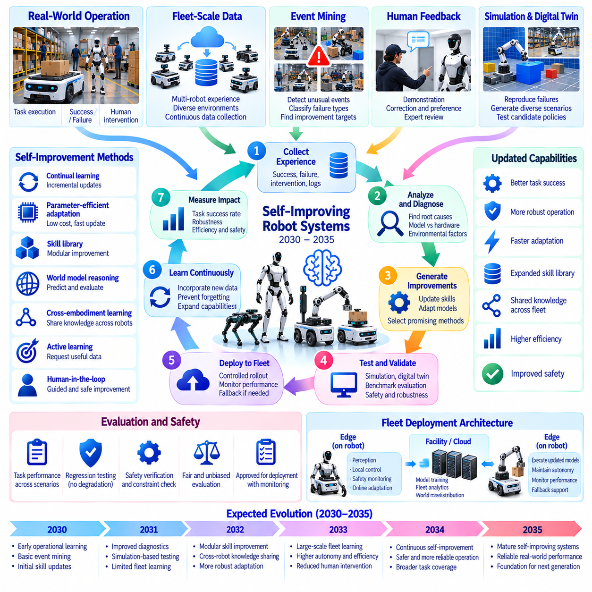{width="7.268055555555556in" height="7.268055555555556in"}

Between 2030 and 2035, self-improving robot systems may become a defining stage in the evolution of Physical AI. Rather than depending entirely on periodic manual programming, robots may use operational experience to identify weaknesses and improve selected capabilities. This transition will require continuous learning, reliable evaluation, and controlled deployment mechanisms that convert real-world experience into measurable performance gains.

Self-improvement should be understood as a structured engineering process rather than unrestricted autonomous modification. Robots can collect observations, detect failures, propose behavioral improvements, and evaluate updated models. However, changes affecting physical actions must pass safety and reliability requirements. The central objective is to create a repeatable improvement cycle without sacrificing operational predictability.

Real-world experience will provide the foundation for self-improving robotic intelligence. Every navigation failure, unsuccessful grasp, unexpected obstacle, and human intervention may contain useful learning information. Fleet-scale data engines can identify recurring problems and select representative events for analysis. The quality and diversity of these experiences will matter more than the unrestricted accumulation of raw sensor data.

Automated event mining may become an essential component of continuous robot learning. Monitoring systems can detect unusual trajectories, repeated recovery attempts, task delays, and deviations from expected performance. These events can be classified according to failure type, environmental context, and operational impact. Structured event records may then guide data selection, simulation generation, and targeted model improvement.

Self-improving systems will require reliable methods for distinguishing model limitations from hardware or environmental problems. A failed manipulation may result from perception errors, inaccurate world models, actuator degradation, or unexpected object properties. Diagnostic reasoning can identify plausible causes before retraining begins. Without such separation, learning systems may repeatedly modify policies while leaving underlying mechanical problems unresolved.

World models may support self-improvement by predicting the consequences of alternative actions. When a robot encounters an unsuccessful strategy, simulated rollouts can explore different approaches before additional physical attempts occur. Counterfactual evaluation may reveal safer or more efficient behaviors. Nevertheless, model uncertainty must be considered because inaccurate predictions can produce misleading improvements.

Simulation environments and digital twins may become testing grounds for candidate robot policies. Recorded failures can be reconstructed and expanded into related scenarios with varied objects, lighting, friction, and obstacles. Candidate models can be compared against existing policies across thousands of controlled trials. However, simulated success alone cannot establish real-world reliability, especially for contact-rich manipulation and unexpected interactions.

Continual learning will allow robots to incorporate new experiences without repeatedly rebuilding entire models. Parameter-efficient adaptation, replay buffers, and modular skill updates may reduce computational costs. However, catastrophic forgetting remains a major concern when new training changes previously reliable behaviors. Effective systems must preserve established capabilities while extending performance into unfamiliar conditions.

Skill libraries may provide a practical structure for controlled self-improvement. Instead of replacing an entire foundation model after every failure, developers may update specific navigation, grasping, docking, or recovery skills. Each modification can be evaluated against relevant operational benchmarks. This modular approach may simplify validation, although interactions between skills must still be tested during long-horizon tasks.

Fleet learning may accelerate improvement by aggregating experiences from many robots. A rare failure encountered by one machine can become a training example for compatible systems throughout the fleet. Centralized learning services may generate candidate updates, while local controllers preserve essential autonomy. Such collective improvement depends on data compatibility, secure communication, and careful management of differences between robot embodiments.

Active learning may reduce the amount of physical experience required for useful adaptation. Learning systems can identify uncertain situations and request targeted demonstrations, human annotations, or additional simulation experiments. Data acquisition can then focus on cases expected to provide high information value. However, uncertainty estimates must be calibrated, and robots should not deliberately explore hazardous situations merely to obtain training data.

Human feedback will remain important even as improvement pipelines become increasingly automated. Operators may explain failed tasks, demonstrate preferred behaviors, and identify unacceptable outcomes that automated metrics overlook. Expert review can help distinguish genuine performance improvements from shortcuts that violate operational expectations. Human oversight will be particularly important when updates affect safety-sensitive interactions.

Evaluation must become a continuous process rather than a final development stage. Candidate models should be tested for task success, robustness, latency, energy efficiency, and safety across representative conditions. Regression testing must identify whether improvements in one scenario reduce performance elsewhere. Independent evaluation datasets and clearly defined acceptance criteria can reduce the risk of deploying misleadingly successful models.

Deployment pipelines may adopt staged updates similar to reliable software engineering practices. New policies can first operate in simulation, then in restricted physical trials, and finally within limited production deployments. Shadow evaluation may compare candidate decisions against active policies without allowing unsafe control. Version tracking, rollback mechanisms, and operational monitoring will remain essential for maintaining accountability.

Self-improvement will also require protection against data drift and changing environments. New equipment, altered layouts, seasonal conditions, and evolving workflows can gradually reduce model effectiveness. Drift monitoring may detect changes in observation distributions and task outcomes. Adaptation systems must determine whether retraining is necessary or whether operational configuration changes can resolve the problem more efficiently.

Computational infrastructure will influence the practical speed of improvement cycles. Edge devices can collect experience and perform limited adaptation, while on-premise servers may support validation and specialized training. Larger cloud systems can process fleet-scale datasets and train foundation models. The distribution of workloads must balance computational cost, data governance, network reliability, and operational continuity.

Safety constraints must remain independent of the learning mechanisms responsible for improving performance. An updated policy should not gain unrestricted authority simply because it performs better on training benchmarks. Verified operating envelopes, runtime monitoring, emergency stopping, and human approval procedures can restrict unsafe changes. This separation is necessary because optimization objectives may not capture every physical hazard.

The economics of self-improving robots will depend on whether learning produces measurable operational benefits. Reduced intervention frequency, higher task completion rates, lower downtime, and faster deployment to new environments may justify investment in data infrastructure. However, continuous training and validation introduce additional costs. Improvement systems must therefore prioritize changes with demonstrated operational value.

By 2035, a plausible outcome is the emergence of robotic platforms capable of improving selected skills through structured experience-driven learning cycles. These systems may automatically discover failures, generate candidate improvements, and recommend validated updates. Nevertheless, fully autonomous redesign of arbitrary behaviors and guaranteed safe lifelong learning will remain unresolved research challenges rather than established industrial capabilities.

Ultimately, self-improving robot systems represent a transition from static automation toward continuously evolving embodied intelligence. Their significance lies in transforming operational experience into reusable knowledge while preserving safety and reliability. Progress between 2030 and 2035 may establish the foundation for more adaptive robotic ecosystems, collective intelligence, and increasingly general Physical AI beyond 2035.

## 08.12. 2035--2040 General Physical Intelligence

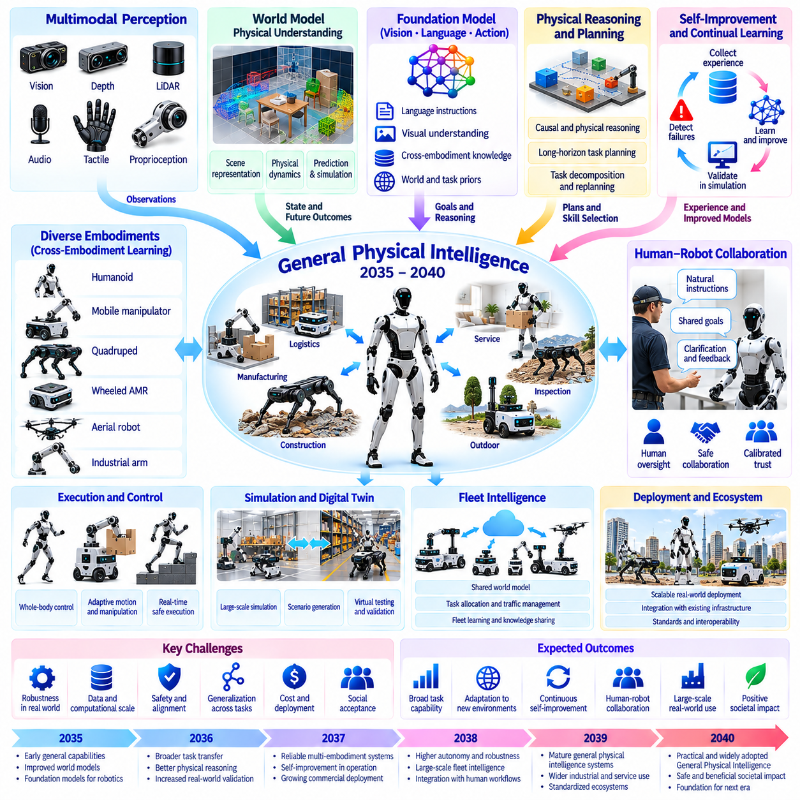{width="7.268055555555556in" height="7.268055555555556in"}

Between 2035 and 2040, General Physical Intelligence may emerge as a long-term objective of Physical AI research. It describes the capacity of embodied systems to perceive, reason, learn, and act across diverse physical environments without extensive task-specific engineering. Unlike specialized automation, this capability would require transferable knowledge, adaptive behavior, and reliable interaction with unfamiliar objects, tools, and situations.

General Physical Intelligence should not be defined solely by humanoid appearance or humanlike movement. Its central characteristic is the ability to accomplish different physical goals across changing environments and embodiments. A system may demonstrate broad competence through manipulation, navigation, inspection, construction, or collaborative work. However, generality must be evaluated through measurable task transfer rather than isolated demonstrations.

Progress toward this capability may depend on the convergence of robot foundation models, predictive world models, and hierarchical control. Foundation models can provide reusable representations of objects, tasks, and interactions. World models may estimate physical consequences and support planning. Control architectures must translate abstract decisions into feasible actions while respecting the mechanical limitations and safety requirements of each platform.

Physical reasoning will become increasingly important as robots encounter unfamiliar situations. A generally capable system must understand how objects interact, how forces affect motion, and how environmental constraints influence possible actions. Causal reasoning may help distinguish meaningful relationships from superficial correlations. Nevertheless, robust physical understanding will require continuous grounding through observation, experimentation, and feedback.

Long-horizon planning may distinguish General Physical Intelligence from systems that perform collections of isolated skills. Complex objectives require task decomposition, dependency management, persistent memory, and adaptation when assumptions become invalid. Robots may need to revise plans after unexpected obstacles, equipment failures, or changing human instructions. Reliable execution will depend on connecting strategic reasoning with continuous physical monitoring.

Cross-embodiment learning may enable shared intelligence to operate through different robotic bodies. Humanoids, mobile manipulators, quadrupeds, and industrial systems could reuse task knowledge while generating embodiment-specific actions. Common representations may support transfer of perception, planning, and selected manipulation skills. However, differences in geometry, dynamics, and actuator capabilities will continue to limit universal action policies.

Continual learning may allow robotic systems to accumulate useful experience throughout their operational lifetimes. New tasks, objects, and environmental conditions can provide opportunities for adaptation without rebuilding entire models. Memory systems may preserve successful strategies and previously encountered failures. Preventing catastrophic forgetting and unsafe behavioral changes will remain essential requirements for reliable lifelong learning.

Test-time computation may expand the reasoning capabilities available during physical task execution. Instead of selecting actions through a single immediate prediction, robots could evaluate alternatives, simulate possible outcomes, and estimate uncertainty. More difficult decisions may receive additional computational resources. However, deliberation must remain compatible with real-time control, energy constraints, and safety-critical response deadlines.

Multimodal intelligence may integrate vision, language, tactile sensing, proprioception, audio, and spatial representations. These information sources provide complementary evidence about physical environments and ongoing interactions. A robot handling unfamiliar materials may combine visual geometry with tactile feedback to adjust its grasp. Effective integration will require synchronized observations and representations that remain reliable under sensor degradation.

World models may evolve from short-horizon prediction toward more structured representations of physical environments. Such models could support reasoning about object permanence, contact relationships, material behavior, and alternative future states. They may also help robots anticipate consequences before executing risky actions. Yet accurate long-term prediction in complex environments will remain limited by uncertainty, incomplete observations, and computational cost.

Self-improving systems may contribute to General Physical Intelligence through repeated experience-driven development cycles. Robots could detect failures, generate candidate strategies, evaluate them in simulation, and deploy validated improvements. Fleet-scale learning may accelerate this process by sharing experiences among compatible platforms. Nevertheless, autonomous improvement must remain constrained by independent safety mechanisms, rigorous testing, and human oversight.

Human-robot collaboration will remain central even if robotic capabilities become substantially more general. Humans may specify goals, communicate preferences, resolve ambiguous situations, and retain authority over consequential decisions. Robots could increasingly perform complex physical work while requesting clarification when uncertainty exceeds acceptable limits. Successful collaboration will require understandable behavior, calibrated trust, and clearly defined responsibility.

Safety and alignment will become more challenging as robotic systems acquire broader operational capabilities. A general-purpose machine may encounter situations that were not anticipated during development. Safety assurance must therefore address uncertainty, unexpected interactions, and failures across multiple task categories. Verified control boundaries, runtime monitoring, emergency intervention, and structured evaluation will remain necessary regardless of model sophistication.

Evaluation of General Physical Intelligence will require benchmarks extending beyond individual task success rates. Relevant measures may include cross-task transfer, adaptation efficiency, physical reasoning, long-horizon reliability, and performance under unfamiliar conditions. Tests should distinguish memorized behavior from genuine generalization. Safety, energy efficiency, intervention frequency, and recovery capability must also be included in practical assessments.

The economic significance of General Physical Intelligence may arise from reducing the cost of adapting robots to new work. A broadly capable platform could perform multiple tasks with less programming, specialized equipment, and integration effort. This flexibility may improve utilization across manufacturing, logistics, infrastructure, and service applications. However, commercial value will still depend on reliability, operating costs, maintenance, and measurable productivity.

The period from 2035 to 2040 should be understood through alternative development scenarios rather than a guaranteed technological destination. Rapid progress in models, data, simulation, and computing could enable increasingly general robotic capabilities. Conversely, physical data limitations, hardware constraints, safety requirements, and deployment costs may slow advancement. Broad competence may therefore emerge unevenly across tasks, environments, and robot embodiments.

A plausible outcome by 2040 is the availability of robotic systems that perform diverse families of physical tasks with limited adaptation and substantial operational autonomy. These platforms may combine reusable skills, predictive reasoning, shared experience, and flexible planning. However, unrestricted competence in arbitrary environments, human-level dexterity across all activities, and guaranteed autonomous reliability should not be assumed.

Ultimately, General Physical Intelligence represents a potential transition from specialized robotic capabilities toward adaptable, reusable embodied intelligence. Its achievement should be measured by reliable performance across unfamiliar tasks rather than claims of universal machine competence. Progress during 2035--2040 may establish important foundations for more autonomous infrastructure, production systems, and human-robot societies while leaving fundamental research challenges unresolved.

## 08.13. 2035--2040 Physical AI Native Infrastructure

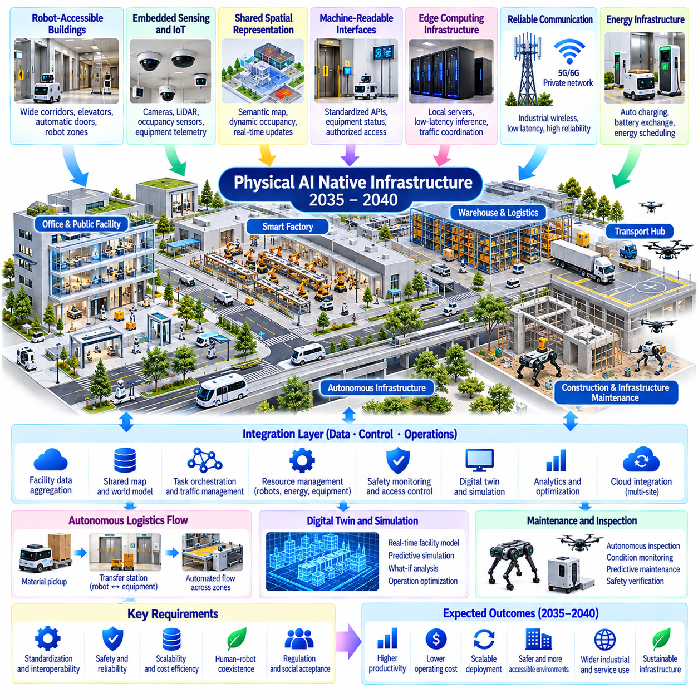{width="7.268055555555556in" height="7.268055555555556in"}

Between 2035 and 2040, Physical AI-native infrastructure may emerge as buildings, factories, transport networks, and public facilities are designed to accommodate autonomous machines from the outset. Unlike conventional infrastructure retrofitted for robots, these environments would integrate sensing, connectivity, navigation, and machine access into their architecture. The objective is to make physical environments more predictable, interoperable, and accessible to intelligent robotic systems.

Physical AI-native infrastructure represents a transition from robot adaptation to coordinated environment and robot design. Traditional robots must often navigate spaces optimized exclusively for humans or fixed machinery. Future facilities may instead incorporate robot-compatible pathways, automated access points, standardized docking interfaces, and shared operational information. Such changes could reduce deployment complexity while improving safety and productivity.

Robot-accessible buildings may incorporate elevators, doors, corridors, loading zones, and storage systems designed for autonomous navigation. Digital access permissions could allow authorized machines to move between operational areas without repeated human intervention. However, physical accessibility must accommodate different robot sizes, mobility systems, and payload capacities. Universal infrastructure design will require practical compromises between human convenience and robotic efficiency.

Embedded sensing may transform infrastructure into an active source of environmental intelligence. Fixed cameras, LiDAR systems, occupancy sensors, and equipment telemetry could complement onboard robot perception. Shared observations may improve awareness of congestion, hazards, and equipment conditions. Nevertheless, infrastructure sensing should supplement rather than replace essential onboard autonomy, particularly when external sensors fail or communication becomes unavailable.

Shared spatial representations may become fundamental components of intelligent facilities. Semantic maps, dynamic occupancy models, and infrastructure digital twins could describe navigable regions, equipment locations, and operational restrictions. Robots may access updated environmental information through standardized interfaces. Maintaining accurate shared representations will require reliable localization, timestamp synchronization, and procedures for resolving conflicting observations.

Physical AI-native infrastructure may incorporate machine-readable descriptions of its capabilities and constraints. Doors, elevators, charging stations, and production equipment could expose operational states and permitted actions through secure interfaces. Robots could discover available resources and request access without custom integration for every installation. However, interoperability will depend on common standards, authorization mechanisms, and consistent descriptions of physical behavior.

Edge computing infrastructure may provide low-latency intelligence close to physical operations. Facility servers could support shared perception, task orchestration, traffic coordination, and local model inference. Robots would retain independent safety-critical control while accessing additional computational resources when needed. This distributed architecture could improve efficiency, although network reliability and workload prioritization will remain important design considerations.

Reliable communication will become an essential infrastructure requirement rather than an optional operational convenience. Industrial wireless networks, private cellular systems, and wired equipment connections may support coordinated robotic operations. Communication-aware architectures should prioritize safety-related messages and critical operational data. Yet robots must retain safe fallback behaviors because no communication infrastructure can guarantee uninterrupted connectivity.

Energy infrastructure will need to accommodate increasingly diverse autonomous machines. Facilities may integrate automated charging, battery exchange, power monitoring, and coordinated energy scheduling. Charging availability could influence mission planning and fleet allocation. Efficient energy management may reduce operational costs, but electrical capacity, thermal constraints, battery degradation, and emergency power requirements must be considered during infrastructure design.

Autonomous logistics infrastructure may connect production areas, warehouses, loading docks, and transportation interfaces. Standardized transfer stations could allow mobile robots, manipulators, and fixed automation equipment to exchange materials. Shared scheduling systems may coordinate movement across multiple operational zones. The resulting infrastructure could support continuous material flow, although physical handoff reliability and exception handling will remain critical.

Infrastructure digital twins may evolve into continuously updated operational models rather than static engineering representations. They could combine geometry, equipment status, robot trajectories, energy consumption, and environmental conditions. Predictive simulations may evaluate congestion, maintenance requirements, and alternative operational strategies. Their usefulness will depend on accurate calibration and clear treatment of uncertainty between simulated and actual conditions.

Maintenance and inspection may become increasingly integrated with autonomous infrastructure operations. Robots could monitor structural conditions, inspect equipment, identify anomalies, and perform selected maintenance activities. Infrastructure systems may provide historical records and diagnostic information to support these tasks. However, high-risk repairs and safety-critical inspections will still require appropriate verification, specialized procedures, and human accountability.

Physical AI-native cities may gradually emerge through connected districts, industrial parks, hospitals, campuses, and transportation facilities. Shared robotic access systems could support delivery, cleaning, inspection, and emergency response. Municipal infrastructure may provide machine-readable routes and operational restrictions. Nevertheless, city-scale deployment will require coordination among public authorities, property owners, service providers, and infrastructure operators.

Safety architecture must be embedded into infrastructure rather than delegated entirely to individual robots. Shared workspaces may require access control, traffic separation, emergency stopping, and coordinated responses to hazardous conditions. Infrastructure-level monitoring can identify risks involving multiple machines. However, collective safety functions must remain compatible with independent robot protections and clearly defined responsibility for failures.

Cybersecurity will become inseparable from physical infrastructure safety. Compromised access controls, manipulated maps, or unauthorized equipment commands could disrupt physical operations. Secure identities, authenticated communication, segmented networks, and verified software updates may reduce these risks. Infrastructure operators will also need procedures for incident detection, recovery, and continued safe operation when digital services become unavailable.

Data governance will influence how Physical AI-native infrastructure collects and shares information. Environmental sensors and robotic systems may generate records involving workers, visitors, customers, and commercially sensitive activities. Data minimization, access restrictions, retention policies, and privacy-preserving processing can support responsible deployment. Cross-organization information sharing will require clear agreements about ownership, permitted uses, and accountability.

Economic adoption will depend on whether infrastructure modernization produces measurable operational benefits. Robot-ready facilities may reduce integration costs, increase equipment utilization, and improve workflow flexibility. However, retrofitting existing buildings can be expensive, and benefits may vary with fleet size and operational complexity. New construction may offer stronger opportunities for integrated design, while legacy facilities may require incremental upgrades.

Standardization will determine whether Physical AI-native infrastructure becomes broadly interoperable or remains fragmented among proprietary ecosystems. Common interfaces for navigation, equipment access, charging, task exchange, and safety reporting could reduce vendor dependence. Open specifications may encourage competition and innovation. Nevertheless, standards must accommodate diverse hardware capabilities and evolving requirements without compromising security or reliability.

By 2040, a plausible outcome is the emergence of selected facilities and urban districts designed around continuous human-robot collaboration. These environments may combine shared world models, edge intelligence, automated resource access, and coordinated fleet operations. However, universal robot accessibility and fully autonomous infrastructure management should not be assumed. Progress will likely remain uneven across regions, industries, and investment capacities.

Ultimately, Physical AI-native infrastructure represents a shift from deploying intelligent machines into passive environments toward creating environments that actively support embodied intelligence. Its significance lies in coordinating physical design, digital systems, and robotic capabilities as one operational ecosystem. Advances during 2035--2040 may establish foundations for autonomous production, logistics, and public services while preserving human oversight and infrastructure resilience.

## 08.14. 2035--2040 Autonomous Production and Logistics

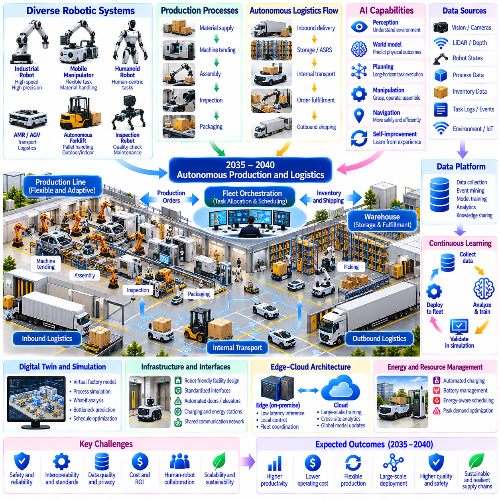{width="7.268055555555556in" height="7.268055555555556in"}

Between 2035 and 2040, autonomous production and logistics may evolve from isolated robotic operations into coordinated Physical AI ecosystems. Manufacturing facilities, warehouses, and transportation networks could increasingly share operational intelligence across machines and locations. The objective would be to enable flexible production and material movement with reduced manual coordination while preserving reliability, safety, and human oversight.

Traditional automation relies heavily on fixed sequences, predefined equipment configurations, and predictable operating conditions. Future production systems may combine adaptive robots, intelligent machinery, and dynamic scheduling to accommodate changing requirements. Rather than eliminating structured automation, Physical AI may extend its flexibility. Deterministic controllers will remain important wherever precision, repeatability, and safety are essential.

Autonomous production may begin with integrated perception, planning, manipulation, and process control. Robots could interpret work orders, identify available resources, select appropriate skills, and execute tasks across multiple stations. When equipment becomes unavailable, orchestration systems may reorganize workflows and redistribute assignments. Such adaptability will depend on accurate process models, reliable interfaces, and validated operating constraints.

Generalist robotic platforms may support production environments where product varieties and task requirements change frequently. Mobile manipulators and selected humanoid systems could perform material handling, machine tending, inspection, and basic assembly. Reusable foundation-model capabilities may reduce task-specific programming. However, specialized industrial robots will likely remain preferable for operations requiring exceptional speed, precision, or payload capacity.

Autonomous logistics may connect material supply, internal transportation, storage, order fulfillment, and outbound distribution. Mobile robots could coordinate with conveyors, automated storage systems, and robotic loading equipment through shared scheduling services. Inventory information may continuously influence transport priorities. Effective coordination will require accurate identification, dependable handoffs, and recovery procedures for damaged or misplaced goods.

Production and logistics may increasingly operate through unified mission-level orchestration. A manufacturing order could generate coordinated tasks for material delivery, equipment preparation, assembly, inspection, and packaging. Dependencies would be monitored as operations progress, allowing schedules to change when delays occur. Local controllers would execute individual actions while higher-level systems manage objectives, resources, and workflow continuity.

Fleet-scale intelligence may enable heterogeneous robots to cooperate across large industrial facilities. Autonomous mobile robots, forklifts, manipulators, inspection robots, and specialized machines could share traffic information and resource reservations. Dynamic task allocation may consider capabilities, location, battery condition, and deadlines. Nevertheless, interoperability and safe coordination between independently supplied systems will remain major engineering challenges.

Digital twins may support production planning by representing equipment, material flows, robot movements, and operational constraints. Simulation could compare alternative schedules, identify bottlenecks, and estimate the consequences of equipment failures. Predictive models may recommend changes before disruptions affect production. However, simulation results must be calibrated against real measurements because inaccurate assumptions can create operational risks.

World models may allow robotic systems to reason about changing physical conditions beyond predefined process descriptions. A robot could detect unexpected material placement, estimate available manipulation options, and propose an alternative sequence. Predictive reasoning may reduce unnecessary retries and improve recovery. Yet contact uncertainty, deformable materials, and incomplete observations will continue to constrain autonomous physical decision-making.

Quality assurance may become an integrated part of autonomous production rather than a separate final inspection stage. Vision systems, force sensing, dimensional measurements, and process telemetry could detect deviations during manufacturing. Inspection results may trigger rework, process adjustment, or additional verification. Such closed-loop quality control will require traceable evidence, calibrated sensors, and clearly defined acceptance criteria.

Self-improving production systems may learn from repeated failures, human interventions, and changing operating conditions. Fleet data engines could identify recurring delays, manipulation difficulties, and inefficient material routes. Candidate improvements may be evaluated through simulation and controlled trials before deployment. Continuous adaptation must preserve previously validated capabilities and prevent unsafe changes to production processes.

Edge and on-premise computing may become central to industrial autonomy. Local processors can maintain low-latency perception and control, while facility servers support shared planning, fleet coordination, and specialized model inference. Cloud platforms may provide large-scale training and cross-site analytics. Critical operations must remain safe during communication failures, and sensitive production data may require local processing.

Energy-aware scheduling may become increasingly important as autonomous facilities operate large robotic fleets. Task assignment could consider battery capacity, charging availability, equipment utilization, and electricity demand. Coordinated charging may reduce peak power requirements and prevent operational interruptions. However, optimization must account for battery degradation, electrical infrastructure limitations, and the availability of backup power.

Resilience will be a defining requirement for autonomous production and logistics. Equipment failures, supply shortages, network interruptions, and unexpected environmental conditions may disrupt coordinated operations. Intelligent systems could redistribute tasks, select alternative routes, or reduce production rates safely. Nevertheless, graceful degradation requires predefined operating boundaries and recovery procedures that remain effective when intelligent services fail.

Human workers may increasingly supervise processes, resolve exceptions, maintain equipment, and improve production strategies. Rather than replacing every operational role, autonomous systems could change the distribution of responsibilities between people and machines. Human expertise will remain valuable for unfamiliar failures, process redesign, and consequential decisions. Effective interfaces must communicate system status, uncertainty, and the reasons for operational changes.

Safety assurance must extend beyond individual machines to the entire production and logistics ecosystem. Shared workspaces introduce risks involving robot interactions, material transfers, and cascading equipment failures. Independent protective systems, access controls, verified operating limits, and emergency procedures will remain necessary. Learning-based optimization should never override validated safety constraints or established industrial protection mechanisms.

Cybersecurity and data governance will influence the reliability of connected autonomous facilities. Production schedules, equipment commands, digital twins, and operational records may become targets for manipulation or unauthorized access. Secure identities, network segmentation, authenticated interfaces, and auditable updates can reduce exposure. Organizations must also establish clear policies for data ownership, retention, and sharing across suppliers and operating sites.

Economic adoption will depend on measurable improvements in throughput, utilization, quality, and operational flexibility. Autonomous systems may reduce downtime, accelerate product changeovers, and improve material availability. However, integration costs, maintenance requirements, energy consumption, and validation expenses may offset some benefits. Deployment decisions should therefore consider total lifecycle costs rather than isolated robot performance.

By 2040, selected industrial facilities may achieve highly coordinated production and logistics with limited routine human intervention. Such systems could integrate adaptive robots, autonomous material flow, continuous quality monitoring, and predictive operational planning. Nevertheless, fully autonomous factories capable of handling arbitrary products and disruptions should not be assumed. Adoption will likely differ across industries according to process complexity and investment capacity.

Ultimately, autonomous production and logistics represent a transition toward physical operations that can coordinate, adapt, and improve across entire industrial workflows. Their significance lies in combining embodied intelligence with reliable manufacturing processes and interconnected infrastructure. Progress during 2035--2040 may establish important foundations for more flexible industrial ecosystems while preserving human accountability, operational resilience, and safety.

## 08.15. 2035--2040 Human Robot Society

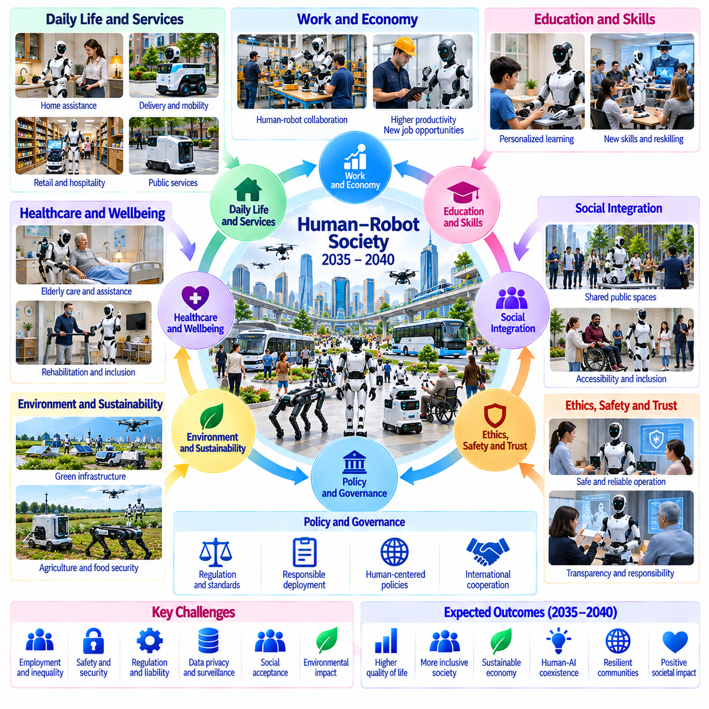{width="7.268055555555556in" height="7.268055555555556in"}

Between 2035 and 2040, human-robot society may emerge as Physical AI becomes increasingly integrated into everyday environments. Robots could participate in manufacturing, healthcare support, transportation, public services, and household activities. This transition would involve more than technological adoption because it could reshape human responsibilities, social expectations, and institutional arrangements. Its success will depend on trust, accessibility, safety, and meaningful human control.

Human-robot society should not be understood as a future in which autonomous machines simply replace human participation. Instead, it may involve new forms of cooperation between people and embodied intelligent systems. Robots could undertake repetitive, physically demanding, or hazardous activities while humans retain responsibility for goals, values, and consequential decisions. The distribution of tasks will vary according to capability, economic conditions, and social preferences.

Human-robot collaboration may evolve from direct command execution toward shared task understanding. People could communicate objectives through natural language, demonstrations, gestures, and contextual instructions. Robots may interpret these signals, propose action plans, and request clarification when uncertainty arises. Effective collaboration will require systems that recognize human intentions without assuming that every instruction is complete, safe, or unambiguous.

Trust will become a central requirement for widespread robotic participation in society. People must understand what robots can accomplish, where their limitations exist, and how they respond to unexpected situations. Transparent status reporting, predictable behavior, and clear explanations may support appropriate confidence. Excessive trust can be dangerous, while insufficient trust may prevent useful adoption. Reliable performance must therefore remain the foundation of social acceptance.

Safety in shared environments will require continuous awareness of human presence, movement, and vulnerability. Robots operating in hospitals, schools, workplaces, and public spaces may encounter children, older adults, and people with different mobility needs. Perception and planning systems must account for uncertainty and unexpected behavior. Independent protective mechanisms and conservative operating policies will remain essential when physical contact could cause harm.

Healthcare and assisted living may become important applications of human-robot cooperation. Robots could transport supplies, support mobility, monitor environmental conditions, and assist with selected daily activities. Such systems may reduce physical workloads and improve service availability. However, clinical decisions, personal dignity, consent, and emotional care require appropriate human responsibility. Robotic assistance should strengthen rather than diminish person-centered services.

Education and workforce development may change as Physical AI becomes more accessible. Students could learn through interactive robotic laboratories, while workers may acquire skills in robot supervision, maintenance, and process optimization. Educational programs will need to combine AI literacy with physical safety and systems engineering. Access to training will be important because unequal opportunities could widen existing differences in technological participation.

Employment patterns may evolve as robots assume selected physical tasks across multiple industries. Some occupations could experience reduced demand for routine activities, while others may expand around integration, supervision, maintenance, and specialized services. The overall effects will depend on productivity growth, institutional choices, and the speed of adaptation. Workforce transitions will require credible training pathways and policies that address displaced workers.

Human-robot society may also transform the organization of public services. Autonomous machines could assist with sanitation, infrastructure inspection, emergency logistics, and maintenance of shared spaces. Municipal authorities may coordinate robotic operations through standardized access systems and digital infrastructure. However, public deployment must consider accessibility, service equity, noise, congestion, and the rights of people who do not wish to interact with robots.

Privacy and data governance will become increasingly important as robots observe and interact with everyday environments. Cameras, microphones, location systems, and operational logs may capture sensitive information about individuals and communities. Responsible systems should minimize unnecessary collection and restrict data access according to legitimate purposes. Public confidence will depend on understandable policies, effective safeguards, and mechanisms for accountability.

Social norms may evolve around how people communicate with robots and interpret their behavior. Machines may display conversational fluency, expressive movement, and apparent responsiveness without possessing human emotions or social understanding. Designers should avoid encouraging misleading assumptions about robotic capabilities or moral status. Clear communication about system limitations can support useful interaction while preserving distinctions between human relationships and machine services.

Responsibility and liability will require careful institutional definition as robots perform increasingly autonomous physical actions. When an incident occurs, relevant factors may include system design, deployment configuration, operator decisions, maintenance, and software updates. Responsibility cannot be resolved simply by describing a robot as autonomous. Traceable records, independent investigation, and enforceable obligations will be necessary to support accountability across complex robotic ecosystems.

Human agency must remain a foundational principle of robotic integration. Individuals should retain meaningful choices about whether and how autonomous systems participate in sensitive activities. Workers may need clear procedures for intervention, while service users may require accessible alternatives. Human oversight should provide practical authority rather than symbolic approval. This principle becomes particularly important when robots influence health, mobility, employment, or access to essential services.

Accessibility and inclusion may determine whether the benefits of Physical AI are broadly distributed. Robots could assist people with disabilities, support independent living, and extend services to underserved communities. Yet systems designed around narrow assumptions about language, movement, or behavior may exclude some users. Inclusive development requires diverse evaluation populations, adaptable interfaces, and attention to affordability across different social environments.

Economic inequality may influence the development of human-robot society. Wealthier organizations and regions may adopt advanced robotic infrastructure earlier, potentially gaining productivity and service advantages. Smaller businesses and less-resourced communities could face barriers involving equipment costs, integration, and technical expertise. Public investment, shared infrastructure, and accessible standards may help reduce disparities, although outcomes will depend on governance choices.

Cultural differences will shape expectations regarding robotic roles, acceptable autonomy, and human interaction. Some communities may welcome robots in public services or domestic environments, while others may prefer limited deployment. Social acceptance cannot be assumed from technical performance alone. Participatory design, public consultation, and culturally sensitive interfaces may help align robotic services with local values without compromising fundamental safety requirements.

Environmental sustainability will become another important consideration as robotic systems expand. Autonomous machines may improve resource utilization, reduce waste, and support infrastructure maintenance. However, manufacturing robots, producing batteries, and operating large computing systems also consume materials and energy. Lifecycle assessment should compare environmental benefits against equipment production, electricity demand, repairability, and electronic waste.

Governance frameworks may need to address interactions among robotics, artificial intelligence, labor policy, public infrastructure, and consumer protection. Technical standards can define safety and interoperability requirements, while legal institutions establish responsibilities and remedies. International cooperation may support common principles without requiring identical national regulations. Effective governance should adapt to technological change while preserving democratic accountability.

By 2040, a plausible scenario is a society in which robots routinely perform selected physical services under structured human supervision. Industrial facilities, hospitals, logistics centers, and some public environments may support continuous human-robot cooperation. However, universal adoption, unrestricted robotic autonomy, and uniform social acceptance should not be assumed. Progress will likely remain uneven across occupations, communities, and economic regions.

Ultimately, human-robot society represents a transformation in how intelligent machines participate in collective physical activity. Its long-term value should be assessed through human well-being, safety, opportunity, and institutional resilience rather than robot deployment numbers alone. Progress during 2035--2040 may establish foundations for broader coexistence, provided that technological capability develops alongside responsible governance and meaningful human agency.

## 08.16. Technology Bottlenecks and Critical Dependencies

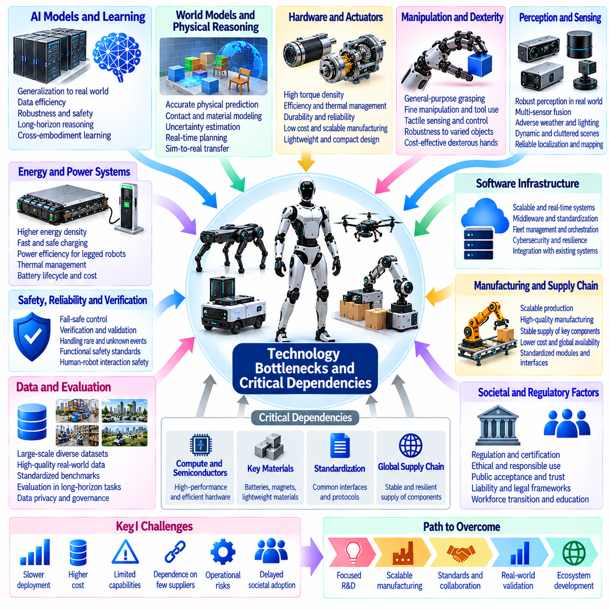{width="7.268055555555556in" height="7.268055555555556in"}

The development of Physical AI between 2026 and 2040 will depend not only on advances in artificial intelligence but also on overcoming interconnected technological bottlenecks. Progress in foundation models, robotic hardware, simulation, data infrastructure, and safety engineering must occur together. A breakthrough in one area may produce limited practical benefits if other components remain immature, making critical dependencies central to long-term technology roadmaps.

Physical interaction remains a fundamental bottleneck because robots must operate under uncertainty, contact forces, and changing environmental conditions. Unlike purely digital systems, physical agents cannot easily reverse harmful actions or ignore mechanical constraints. Reliable manipulation and mobility require accurate perception, predictive reasoning, and responsive control. Failures in any component can compromise an otherwise capable intelligent system.

Robotic data availability may constrain the development of general-purpose Physical AI models. Internet-scale text and image datasets do not directly provide the action consequences, force measurements, and embodied experiences required for physical learning. Real-world demonstrations are expensive and often difficult to standardize. Scaling robotic intelligence will therefore depend on high-quality multimodal datasets, automated collection, and reusable experience representations.

Data quality may become more important than raw dataset volume as robotic learning systems mature. Sensor misalignment, inconsistent action definitions, missing calibration records, and unreliable task labels can distort learned behavior. Cross-robot datasets introduce additional differences in embodiment, control frequency, and coordinate systems. Effective scaling requires validated data schemas, synchronized measurements, provenance tracking, and systematic quality assessment.

Simulation fidelity represents another critical dependency for efficient robotic development. Digital environments can generate large quantities of experience, but inaccurate contact dynamics, friction, material properties, and sensor behavior may produce misleading policies. Domain randomization and system identification can reduce selected discrepancies. However, simulation cannot eliminate the need for physical validation, particularly when rare failures involve complex interactions.

World model reliability may limit the effectiveness of autonomous planning. Predictive models must represent changing geometry, object interactions, uncertainty, and the consequences of alternative actions. Errors can accumulate during long-horizon prediction, especially in unfamiliar environments. More computation may improve deliberation, but inaccurate assumptions remain dangerous. Reliable systems must recognize prediction limits and revise plans using new observations.

Generalization across tasks and embodiments remains an unresolved challenge. Knowledge learned by one robot may not transfer directly to machines with different joints, sensors, payload capacities, or contact mechanisms. Shared foundation models can support reusable representations, but embodiment-specific adaptation is often necessary. Progress will depend on architectures that separate transferable task knowledge from platform-dependent dynamics and control.

Robotic hardware may become a limiting factor even when AI models improve rapidly. Actuators, transmissions, batteries, sensors, and mechanical structures determine the physical actions available to intelligent systems. Dexterous manipulation requires reliable force control, durable mechanisms, and precise feedback. High-performance hardware may also increase cost, weight, and maintenance complexity, restricting deployment beyond controlled demonstrations.

Energy efficiency and onboard computation form another tightly coupled constraint. Larger models may improve perception and reasoning but demand greater memory capacity, electrical power, and thermal management. Mobile robots must allocate limited energy between movement, sensing, communication, and inference. Edge-cloud architectures can distribute computation, yet communication delays and network failures restrict which functions may safely depend on remote processing.

Real-time control imposes requirements that differ from those of conventional AI inference. Strategic planning may tolerate extended deliberation, while collision avoidance, balance stabilization, and actuator control require bounded response times. Integrating foundation models with deterministic controllers remains an important architectural challenge. Safety-critical control must continue functioning when higher-level reasoning becomes delayed, uncertain, or unavailable.

Long-horizon autonomy depends on reliable integration across perception, planning, execution, and recovery. A robot may perform individual skills successfully yet fail when tasks require many dependent actions. Small errors can accumulate through localization drift, object displacement, or incorrect state assumptions. Persistent memory, task verification, and structured recovery mechanisms are necessary to prevent isolated failures from escalating into mission-level breakdowns.

Safety assurance may become one of the most demanding barriers to widespread deployment. Learning-based systems can behave unpredictably outside their training distributions, while physical mistakes may injure people or damage infrastructure. Testing every possible situation is infeasible. Practical assurance will require independent protection layers, operational boundaries, runtime monitoring, systematic validation, and evidence supporting acceptable residual risk.

Continual learning introduces a dependency between adaptability and stability. Robots must improve from operational experience without losing previously validated capabilities or introducing unsafe behavior. Catastrophic forgetting, biased experience selection, and uncontrolled model updates can undermine reliability. Versioned learning pipelines, regression testing, staged deployment, and rollback mechanisms will be essential before self-improvement becomes routine industrial practice.

Interoperability may determine whether Physical AI scales beyond isolated installations. Robots, industrial equipment, fleet managers, and infrastructure systems often use incompatible interfaces and operational assumptions. Common descriptions of capabilities, tasks, maps, and safety states could simplify integration. However, standards must support heterogeneous hardware while preserving cybersecurity, deterministic behavior, and clear responsibility boundaries.

Economic dependencies may delay adoption even when technical feasibility has been demonstrated. Integration expenses, maintenance requirements, energy consumption, validation costs, and workforce training contribute to total ownership costs. A capable robot may remain commercially unattractive if deployment requires extensive customization. Sustainable adoption will depend on measurable productivity gains, reliable utilization, and reduced lifecycle complexity.

The bottlenecks are interconnected rather than independent. Better simulation requires accurate physical measurements, while improved world models depend on representative datasets and computational resources. More capable robots generate richer experiences but also introduce additional safety and infrastructure requirements. Roadmaps must therefore identify dependency chains and avoid assuming that isolated improvements automatically translate into operational readiness.

Critical dependencies may differ across application domains and development periods. Near-term industrial systems may prioritize reliability, integration, and economic viability, while later generalist platforms may require stronger physical reasoning and cross-embodiment transfer. Humanoid systems may face additional manipulation and energy constraints. Infrastructure-scale autonomy may depend more heavily on interoperability, cybersecurity, and coordinated safety mechanisms.

Progress assessment should distinguish research demonstrations from validated operational capabilities. Benchmark performance alone cannot establish deployment readiness without evidence of robustness, maintainability, and safe recovery. Technology readiness evaluations should include environmental diversity, intervention frequency, failure severity, and lifecycle cost. Explicit dependency tracking can reveal which missing capabilities are most likely to delay broader adoption.

Between 2035 and 2040, some bottlenecks may weaken through advances in hardware, data engines, simulation, and foundation models. Others, particularly open-world safety, general physical reasoning, and dependable lifelong learning, may remain unresolved. Development speed will depend on coordinated progress rather than a single decisive breakthrough. Alternative roadmap scenarios should account for both accelerating innovation and persistent physical constraints.

Ultimately, technology bottlenecks and critical dependencies define the practical boundaries of Physical AI development. Long-term progress requires coordinated investment in intelligence, embodiment, infrastructure, evaluation, and governance. Recognizing these dependencies can improve research priorities and prevent unrealistic deployment expectations. A credible roadmap must measure not only what robotic systems can demonstrate, but what they can reliably sustain in the physical world.

## 08.17. Alternative Slow Base and Fast Progress Scenarios

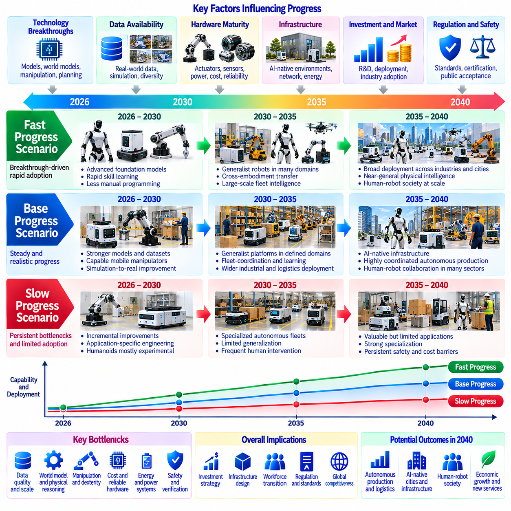{width="7.268055555555556in" height="7.268055555555556in"}

The development of Physical AI between 2026 and 2040 cannot be represented by a single deterministic forecast. Progress will depend on scientific breakthroughs, hardware maturity, data availability, economic investment, and regulatory conditions. Alternative scenarios provide a structured way to examine uncertainty without assuming that technological improvement follows a fixed schedule. Slow, base, and fast trajectories describe different combinations of progress rather than guaranteed outcomes.

Scenario analysis should distinguish technological capability from practical deployment. A robot may demonstrate advanced manipulation in a laboratory while remaining unsuitable for continuous industrial operation. Deployment requires reliability, safety assurance, maintainability, and economic viability. Therefore, each scenario must evaluate both research achievements and operational readiness, including the ability to sustain performance across unfamiliar environments and extended missions.

The slow-progress scenario assumes that major bottlenecks persist longer than anticipated. Robotic datasets may remain fragmented, simulation may struggle with complex contact dynamics, and world models may fail to generalize reliably. Hardware costs and energy limitations could restrict adoption. Under these conditions, Physical AI would continue improving, but deployments would concentrate on structured environments with clearly bounded tasks and substantial human supervision.

Between 2026 and 2030, a slow trajectory could produce incremental advances in vision-language-action models and mobile manipulation without achieving robust general-purpose autonomy. Industrial robots might gain more flexible task interfaces while retaining extensive application-specific engineering. Humanoid systems could remain primarily experimental. Companies would prioritize measurable improvements in existing automation rather than large investments in unproven generalist platforms.

From 2030 to 2035, slow progress might lead to specialized autonomous fleets operating in warehouses, factories, and selected infrastructure environments. Robots could share maps and schedules but struggle with unfamiliar tasks or changing physical conditions. Cross-embodiment learning would remain limited, and human intervention would be frequent during exceptions. Large-scale deployment would depend on careful site preparation and conservative operational boundaries.

By 2035--2040, the slow scenario could still support economically valuable Physical AI applications without producing general physical intelligence. Autonomous production would expand selectively, while healthcare, household, and public-service robots would face persistent safety and affordability barriers. Human-robot society would develop unevenly. The defining characteristic would be reliable specialization rather than broad autonomous competence across diverse physical environments.

The base-progress scenario assumes sustained but uneven improvement across models, data engines, hardware, and infrastructure. Foundation models would acquire more reusable physical skills, while simulation and real-world feedback would support systematic adaptation. However, performance would remain sensitive to embodiment and operating conditions. Deployment would expand through hybrid architectures combining learned intelligence with deterministic control and structured safety mechanisms.

During 2026--2030, the base trajectory could establish stronger robotic foundation models, improved multimodal datasets, and more capable edge computing platforms. Mobile manipulators and autonomous mobile robots would handle increasingly varied industrial tasks. Simulation-to-real transfer would reduce some engineering costs without eliminating physical validation. Early fleet learning systems would begin sharing selected experiences across compatible robots and facilities.

Between 2030 and 2035, the base scenario could enable generalist robotic platforms within defined operational domains. Cross-embodiment models might transfer task knowledge across several robot configurations, although platform-specific adaptation would remain necessary. Fleet intelligence could coordinate hundreds of machines in suitable facilities. Continuous learning would become more practical through controlled updates, regression testing, and validated deployment procedures.

By 2035--2040, the base trajectory could produce Physical AI-native infrastructure and highly coordinated autonomous production systems. Robots might routinely collaborate with people in logistics, maintenance, manufacturing, and selected public services. General physical intelligence would remain partial and context-dependent rather than universal. Human oversight would continue to govern high-risk actions, unexpected situations, and consequential operational decisions.

The fast-progress scenario assumes that several critical dependencies improve together. Large-scale robotic data collection, high-fidelity simulation, transferable world models, and efficient hardware could reinforce one another. Breakthroughs in manipulation and long-horizon planning might accelerate generalization. Such progress would require not only superior algorithms but also reliable evaluation methods, scalable manufacturing, and strong safety engineering.

Between 2026 and 2030, a fast trajectory could produce foundation models capable of learning diverse physical skills from shared multimodal experiences. Robotic platforms might adapt to new tasks with limited demonstrations and substantially less manual programming. Improved simulation could support rapid policy development. Nevertheless, successful laboratory generalization would still require independent validation before deployment in safety-critical environments.

From 2030 to 2035, fast progress could enable heterogeneous robot fleets to coordinate complex missions across large industrial campuses. Shared world representations and transferable skills might support rapid adaptation between mobile manipulators, legged robots, and specialized platforms. Self-improving data engines could identify failures and generate validated model updates. Fleet-level intelligence would increasingly optimize entire workflows rather than individual robot actions.

By 2035--2040, the fast scenario could support advanced generalist robots operating across multiple physical domains. Autonomous facilities might reorganize production dynamically, while infrastructure systems coordinate inspection, logistics, and maintenance. Human-robot collaboration could become common in selected social environments. Even under this trajectory, unrestricted autonomy would remain difficult to justify without robust safety evidence and clear institutional accountability.

The three scenarios should not be interpreted as uniform acceleration across every technology. Foundation models may improve rapidly while actuators, batteries, or safety certification advance slowly. Conversely, specialized hardware could mature before general-purpose reasoning becomes dependable. Different industries may therefore follow different trajectories simultaneously. Scenario assessment must consider dependencies and local constraints rather than assigning a single maturity level to Physical AI.

Early indicators can help distinguish emerging trajectories. Relevant evidence includes real-world task success, intervention frequency, cross-robot transfer, recovery performance, hardware cost, and deployment scale. Improvements must be measured across diverse conditions rather than isolated demonstrations. Repeated performance gains accompanied by declining integration effort would support faster scenarios, while persistent failures and high operating costs would indicate slower development.

Economic and institutional conditions may shift the probability of each trajectory. Investment availability, supply-chain stability, energy infrastructure, technical standards, and public acceptance can accelerate or delay deployment. Regulatory uncertainty may discourage adoption, while credible safety frameworks can improve confidence. Regional differences will matter because access to manufacturing capacity, skilled workers, and computing resources is unevenly distributed.

Scenario transitions are possible rather than fixed. A prolonged bottleneck in manipulation may initially produce slow progress, followed by acceleration after improvements in tactile sensing or world models. Alternatively, rapid model development may encounter unexpected limits in reliability or cost. Roadmaps should therefore be revised using observed evidence. Organizations need investment strategies that preserve flexibility when technological assumptions change.

Strategic planning should identify actions that remain valuable across all three scenarios. High-quality data infrastructure, modular robot interfaces, simulation capabilities, safety engineering, and workforce development provide benefits even when general autonomy advances slowly. More speculative investments can be staged against measurable milestones. This approach reduces dependence on optimistic forecasts while preserving opportunities to accelerate deployment when capabilities mature.

Ultimately, slow, base, and fast scenarios describe alternative pathways toward increasingly capable Physical AI rather than predictions of inevitable technological outcomes. Their purpose is to expose assumptions, identify critical dependencies, and support resilient decisions. A credible 2026--2040 roadmap should track observable progress, revise expectations, and distinguish demonstrated capability from sustainable deployment. Scenario-based planning makes long-term strategy more adaptable to uncertainty.

## 08.18. Physical AI Roadmap Scenario Model [w/Code]

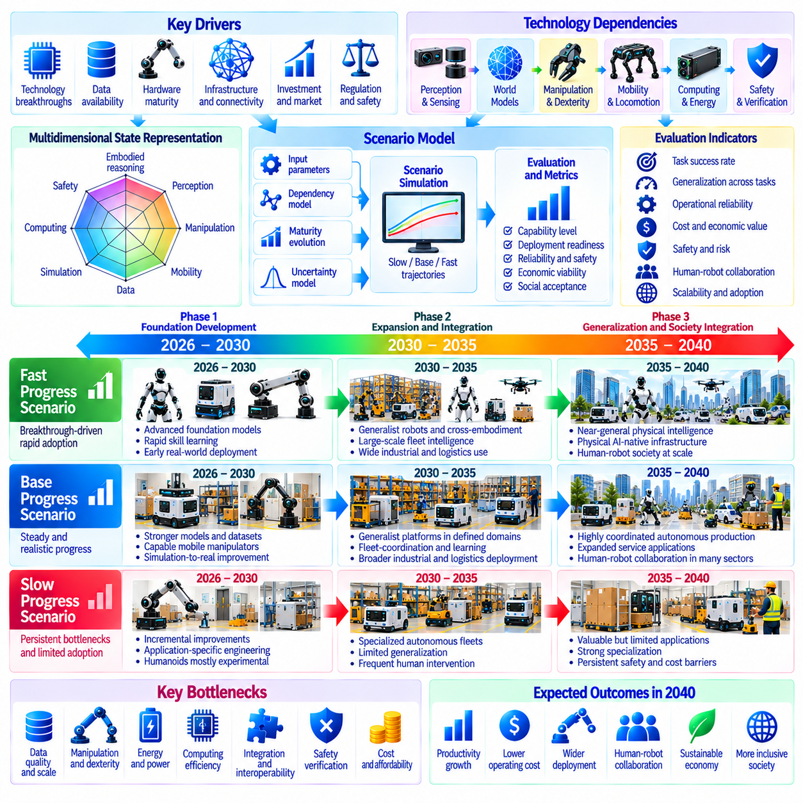{width="7.268055555555556in" height="7.268055555555556in"}

A Physical AI roadmap scenario model provides a structured framework for examining how embodied intelligence may evolve between 2026 and 2040. Rather than predicting a single technological future, the model connects research progress, engineering constraints, economic conditions, and deployment outcomes. Its purpose is to translate uncertain developments into comparable trajectories that support strategic planning, investment decisions, and continuous evaluation.

The model should distinguish technological maturity from operational deployment. Advances in foundation models, world models, manipulation, and robotic perception do not automatically produce commercially reliable systems. Operational readiness also depends on safety, hardware durability, integration, maintenance, and affordability. Each scenario must therefore represent both the capabilities demonstrated by robotic systems and their ability to sustain performance in real environments.

A multidimensional state representation can describe the development of Physical AI more accurately than a single maturity score. Relevant dimensions include embodied reasoning, multimodal perception, physical manipulation, mobility, data availability, simulation fidelity, computing efficiency, safety assurance, and interoperability. Economic viability and institutional readiness should be represented separately because technological achievement does not guarantee adoption.

The scenario model can organize these dimensions into capability, infrastructure, and deployment layers. The capability layer represents intelligence, physical skills, and autonomous decision-making. The infrastructure layer includes compute platforms, data engines, simulation environments, connectivity, and operational coordination. The deployment layer evaluates reliability, cost, safety, utilization, and human oversight. Dependencies between layers determine practical progress.

Each dimension should be evaluated using observable indicators rather than subjective expectations alone. Physical manipulation can be assessed through task completion, contact stability, and recovery performance. Fleet intelligence can be measured through coordinated throughput, intervention frequency, and mission completion. Generalization can be evaluated across tasks, environments, and embodiments. Indicators should retain consistent definitions to support meaningful comparisons over time.

A normalized maturity scale may help compare technologies with different measurement units. However, normalization should preserve the distinction between experimental demonstrations and verified operational capabilities. A high research score should not compensate automatically for unacceptable safety performance. Critical requirements can be represented as minimum thresholds or deployment gates, ensuring that aggregate scores do not conceal fundamental limitations.

The model should represent technological dependencies as directed relationships. Generalist manipulation may depend on tactile sensing, dexterous hardware, representative datasets, and predictive world models. Large-scale fleet autonomy may require interoperable interfaces, shared operational memory, reliable communication, and coordinated safety mechanisms. These dependencies reveal why improvements in isolated components may not immediately accelerate system-level deployment.

Scenario trajectories can be constructed using slow, base, and fast assumptions. The slow trajectory represents persistent bottlenecks, limited transfer, high integration costs, and cautious deployment. The base trajectory assumes sustained but uneven improvements across major technologies. The fast trajectory represents mutually reinforcing advances in learning, hardware, simulation, and infrastructure. These alternatives are conditional pathways rather than assigned probabilities.

The 2026--2030 period can serve as the model\'s foundational development phase. Key indicators may include robotic foundation-model performance, simulation-to-real transfer, edge computing efficiency, and reliable mobile manipulation. Data collection and validation infrastructure should also be assessed. Differences between scenarios may initially appear in engineering effort, task adaptability, and intervention frequency rather than widespread deployment.

During 2030--2035, the model should emphasize cross-embodiment transfer, generalist robotic platforms, and fleet-scale intelligence. Scenario divergence may become more visible as organizations attempt to deploy autonomous systems across multiple facilities. Shared skills, coordinated planning, and validated continual learning could accelerate adoption. Persistent failures in manipulation, interoperability, or recovery would instead constrain deployment to specialized environments.

For 2035--2040, the model can evaluate general physical intelligence, Physical AI-native infrastructure, autonomous production, and human-robot society. The relevant question is not whether robots exhibit isolated advanced behaviors, but whether they can operate reliably across varied tasks and conditions. Social acceptance, legal accountability, accessibility, and workforce adaptation should influence deployment outcomes alongside technological performance.

A formal scenario model may describe the system state as a vector of maturity indicators that changes over time. Each dimension can evolve according to investment, learning efficiency, hardware improvement, and dependency constraints. Deployment outcomes can then be calculated from capability thresholds and operational requirements. Such equations should be treated as modeling assumptions requiring calibration, not as established laws of Physical AI development.

Uncertainty should be represented explicitly through ranges, distributions, and alternative parameter assumptions. Model inputs may include data growth, compute availability, hardware cost reduction, reliability improvement, and regulatory delays. Sensitivity analysis can identify which assumptions most strongly influence projected outcomes. Monte Carlo simulation may help explore possible trajectories, provided that uncertain distributions are not mistaken for objective forecasts.

Critical-path analysis can identify bottlenecks whose resolution would unlock several downstream capabilities. For example, improvements in reliable dexterous manipulation could benefit manufacturing, logistics, healthcare assistance, and household robotics. Conversely, inadequate safety assurance could delay deployment despite strong model performance. Dependency analysis should therefore distinguish research priorities from the conditions required for actual commercialization.

Scenario validation requires continuous comparison between projections and observed developments. Benchmark results, field trials, operating costs, safety incidents, and fleet performance can provide evidence for updating assumptions. Forecast errors should be recorded rather than hidden through retrospective adjustments. Regular recalibration can improve the model\'s usefulness while revealing where predictions remain unreliable or insufficiently supported.

The model should also account for differences between industries and geographic regions. Manufacturing may achieve high autonomy earlier than unstructured domestic environments, while infrastructure inspection may progress faster than dexterous service robotics. Investment capacity, labor availability, regulation, and digital infrastructure influence local adoption. A global scenario should therefore be assembled from differentiated sector-level trajectories.

Strategic decisions can be evaluated against multiple scenarios instead of relying on a single optimistic projection. Investments in data quality, modular architectures, safety engineering, and simulation may remain valuable across all trajectories. More speculative programs can be tied to measurable readiness milestones. This approach supports staged investment, flexible resource allocation, and timely adjustments when technological progress differs from expectations.

A practical implementation should include a baseline dataset, explicit indicators, dependency mappings, scenario parameters, and an update procedure. Results can be presented as time-dependent capability profiles and deployment readiness assessments. Decision-makers should be able to inspect assumptions and understand why projections change. Transparency and reproducibility are essential because a visually precise forecast may still rest on uncertain evidence.

The roadmap scenario model must avoid treating technological progress as inevitable or uniformly accelerating. Breakthroughs may shorten development timelines, while physical constraints, safety requirements, or economic disruptions may slow adoption. Scenario boundaries should be revised when credible evidence emerges. The model is most valuable when it reveals uncertainty and supports adaptive decisions rather than producing an apparently exact prediction of 2040.

Ultimately, the Physical AI roadmap scenario model connects technological research with operational readiness and societal outcomes. Its value lies in identifying dependencies, comparing alternative futures, and translating evidence into strategic choices. A credible model should remain measurable, transparent, and revisable throughout 2026--2040. By distinguishing possible capability from dependable deployment, it can guide the responsible development of increasingly autonomous physical systems.
